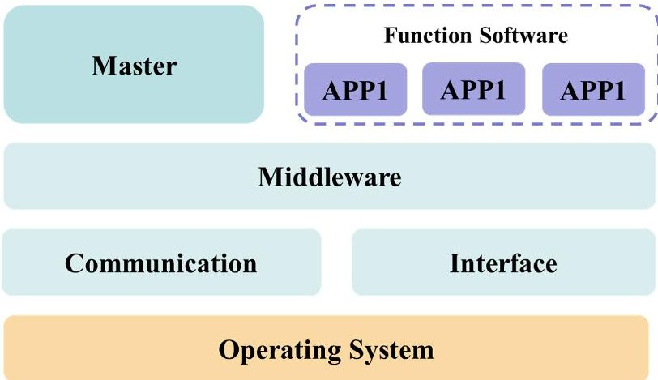
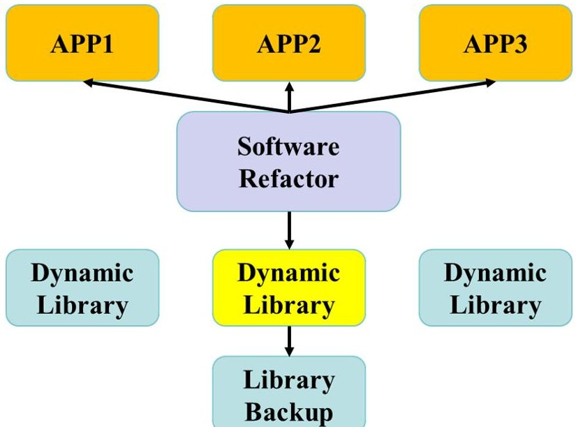
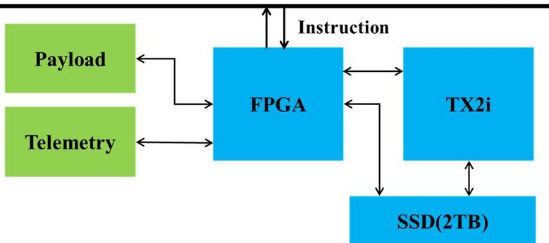
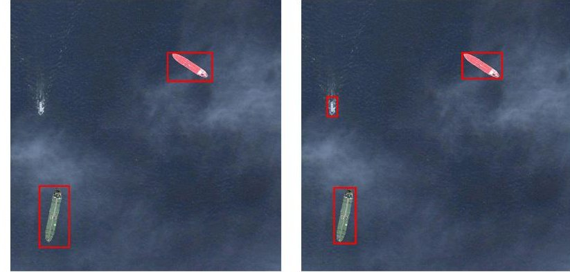

<!-- PDF_PAGE: 1 -->

# APPLICATION-ORIENTED ON-BOARD SOFTWARE MANAGEMENT SYSTEM FOR MICRO-NANO SATELLITE

Yuan Yao $ ^{1} $ , Lantian Chang $ ^{1} $ , Xiaojie Yu $ ^{1} $ , Haopeng Zhang $ ^{2,3,*} $

$ ^{1} $ DFH Satellite Co., Ltd., Beijing 100094, China $ ^{2} $ School of Astronautics, Beihang University, Beijing 102206, China $ ^{3} $ Tianmushan Laboratory, Hangzhou 311115, China

## ABSTRACT

The traditional on-board software architecture lacks adaptability and scalability, with a high degree of customization, significant software-hardware coupling, and slow technological evolution. To enhance utilization efficiency and intelligent application capabilities of satellite, this paper proposes an application-oriented on-board software management system for micro-nano satellite. By analyzing the research status and technical characteristics of traditional software architectures, an open software management system based on Linux is implemented, including key components and functions. In line with the system's operational mode, we propose a method for on-board software dynamic refactoring. Furthermore, we validate the effectiveness of the software management system by a remote sensing image processing algorithm, which has a wide application prospect.

Index Terms Micro-nano satellite, software management, on-board application, intelligent processing

## 1. INTRODUCTION

on-board software. This approach not only shortens the development cycle of software products but also enables on-board updates of software functionalities. It optimizes the utilization of function management software and system application software for the best user experience.

With the advancement of aerospace technology, the production and launch costs of satellites are continuously decreasing, leading to a widespread adoption of satellites in various fields such as communication, resource exploration, meteorological remote sensing, and earth observation. As a result, there is a trend in satellite design to migrate some groundbased software processing functions to on-board processing Traditional satellite software systems face challenges such as a single mode of operation, development difficulties, and software encapsulation. To address these challenges, application-oriented satellite software management systems provide users with system functionalities such as task management, intertask communication, and memory management. The system enable users to focus on the development of application programs, facilitating the standardization and modular design of

In response to the new requirements for the development of high-performance micro-nano satellites, this paper introduces an application-oriented on-board software management system. By utilizing an open architecture and standardized interfaces, we have designed a software solution that offers batch management and adaptability for various applications. This solution aims to establish a plug-and-play software platform that supports on-board intelligence.

The rest of this paper is organized as follows. Section 2 presents the research of the related work. Section 3 introduces the composition, function and software updating of the software management system. Section 4 introduces the application scenarios of the system. Finally, Section 5 concludes this paper.

## 2. RELATED WORK

Currently, common choices for spacecraft computer operating systems include VxWorks [1] and RTEMS [2]. Both are realtime operating systems designed for embedded systems, aiming to achieve autonomous satellite flight, autonomous management, and improve satellite reliability and security. However, due to the limited performance of single-core processors in meeting the growing computational demands and the inability to further increase computing power under limited power conditions, the use of high-performance computing devices in satellite functionality and data processing has become a trend in aerospace system development. With the advancement of spacecraft computer hardware capabilities, on-board software is becoming increasingly larger and more complex, necessitating the ability to handle a wider range of tasks related to payload data processing.

Over the past decade, the adoption of the Linux operating system in spacecraft software systems has witnessed a significant surge. [3]. Linux operating system offers extensive

<!-- PDF_PAGE: 2 -->

hardware support, diverse communication protocols, compatibility with multi-core processors, and support for various on-board intelligent applications. The Core Flight System (CFS) [4] is an independent and reusable software framework for flight systems that addresses the challenges of rapidly increasing software development costs due to continuously changing hardware. Through successful flight experiences, the flight software framework enables the full reuse of developed applications. The framework includes requirements, design documents, testing processes, development standards, and user guides. The European Space Agency proposed the Space Avionics Open Interface Architecture (SAVOIR) [5] based on open standard systems. SAVOIR's primary contribution lies in the standardization of driver components and interfaces, empowering users to invoke them as required, resulting in a significant enhancement in development efficiency.

## 3. SOFTWARE MANAGEMENT SYSTEM

As hardware capabilities continue to advance and artificial intelligence algorithms undergo refinement, an increasing number of on-board intelligent algorithms are being deployed in space, leading to the emergence of various intelligent architectures [6,7,8]. Lockheed Martin space systems company has integrated network technology with aerospace technology to form the software architecture of intelligent satellites. The evolving electronic and electrical architecture of satellites is driving the update of software architectures, and a software management system based on the Linux operating system as the underlying architecture holds significant value and utility.

The on-board software management system is responsible for managing and maintaining the satellite platform and application software. It relies primarily on a high-performance intelligent processing unit, providing a physical platform for managing software and application software. For high-performance, highly integrated electronic architectures, the choice of an open-source Linux operating system offers several advantages. It offers robust support for file systems, boasts open-source code, demonstrates adaptability to diverse processors, exhibits exceptional compatibility, and provides exceptional backing for artificial intelligence applications encompassing deep learning and neural networks. This facilitates the development of various generalized software. During system operation, it not only assumes the responsibility of managing satellite applications but also serves as a functional hub for system scheduling and data communication nodes. Simultaneously, it performs payload data processing functions through data interfaces.

## 3.1. System composition

The kernel of the on-board software management system utilizes the Linux kernel baseline. It establishes a software middleware geared towards application services, primarily consisting of functional software, node managers, middleware component libraries, and communication components, as illustrated in Figure 1. The primary objective is to minimize the learning curve of the technical architecture, enhance development efficiency through standardized program interfaces, a unified technical stack, and consistent program invocation rules. Furthermore, it leverages modular dynamic libraries and static libraries to enhance code reusability and reduce development costs.

Fig. 1. Composition of software management system.

The functional modules of the system software operate independently on a per-node basis, distributed across multiple distinct hosts, and are interconnected during system runtime through an end-to-end topology. A node represents a process that performs computational tasks, and a system typically comprises multiple nodes. Due to permissions and status, different nodes have distinct threads, and multi-threaded management for various tasks can effectively prevent mutual interference between nodes. The introduction of nodes makes the management system based on the application service architecture more rational during runtime and provides a more intuitive form of information interaction. When multiple nodes are running simultaneously, the node manager assumes responsibility for managing the various nodes, preventing issues such as preemption and conflicts between processes, thereby reducing security risks.

## 3.2. System function

The on-board software management system, leveraging the advanced capabilities of the underlying hardware, employs high computing power, ample storage capacity, and swift communication speeds to efficiently execute the following crucial functions:

Through the establishment of a software management system, the organizational structure of the software project is determined. This involves clarifying the function and role of each file, creating a hierarchical tree structure, and individually mounting system files. These measures facilitate efficient

<!-- PDF_PAGE: 3 -->

program development.

Application modules, serving as application-oriented basic components, are fundamental units designed to achieve specific functions. The software management system orchestrates the management and scheduling of these modules as specific objects. The creation and effective management of application modules establish the foundational conditions for the software scheduling system framework.

Following the model of open-source computer operating systems, the software management scheduling system relies on an intermediate layer service framework. This framework determines communication service protocols, establishing the communication mechanism and scheduling communication interface functions. These protocols facilitate seamless communication services between units and programs.

The communication architecture of the software management scheduling system serves as the core and essential component for the normal operation of the entire system. It is primarily responsible for distributing management data, processing load data, executing instructions, transmitting messages, and other crucial functions necessary for system operation.

The software management system exhibits the capability to drive a diverse range of hardware interfaces. This feature enables the achievement of multi-application scheduling and the unification of communication among departmental components, sensors, and data transceivers.

## 3.3. Software refactoring

The software refactoring framework acts as a valuable aid for the management system. Due to uniformly defined interfaces, new functional components can be seamlessly integrated based on tasks and user needs without impacting the underlying functional components. Through the strategic distribution and configuration of modules, application software can be meticulously rearranged, ultimately culminating in a comprehensive software system. Given the ever-evolving nature of payload remote sensing image processing techniques, there is an urgent requirement for speedier and more efficient algorithms for on-orbit processing of satellite payload images. The software refactoring framework facilitates on-orbit updates of programs and parameters, offering flexible accommodation for on-orbit services, target recognition, image compression, geometric correction, and other intelligent processing functions.

In Figure 2, a command is dispatched to the management system, which subsequently awaits the refactoring package information. Once received, the system examines the package, determines its effective data state, verifies the accuracy of the information, and accepts and stores valid data packets. The refactoring package is then positioned according to predefined rules for package interpretation. Prior to performing the replacement, the original dynamic library files are securely backed up. Subsequently, the system replaces the original dynamic library files and restarts after completing the replacement. By following this series of steps, the refactoring process is successfully completed.

Fig. 2. The process of software refactoring.

## 4. APPLICATION SCENARIO

## 4.1. Hardware configuration

By leveraging the limited resources of weight, volume, power consumption, and application-oriented operating mode on the satellite, the on-board intelligent processing unit's test environment was configured according to the specified requirements for the satellite software management system. This environment primarily utilizes high-performance, low-power, and miniaturized industrial-grade commercial components to develop both management software and application software. Testing is conducted under the open-source Linux system to validate the system's capabilities and performance. Figure 3 depicts a schematic diagram of the information flow within the on-board intelligent processing unit. The hardware components of the unit include an FPGA, a NVIDIA Jetson TX2i, and a 2TB solid-state drive. The FPGA and TX2i communicate via network protocols, with the FPGA connected to CAN (Controller Area Network) bus, facilitating satellite operation and information broadcasting. Payload data is linked to the communication module via a high-speed interface. The intelligent processing unit handles tasks such as flight management, on-board time management, autonomous operation mode management, implementation of satellite attitude control algorithms, and storage and processing of payload data.

## 4.2. Typical application software

The remote sensing image ship detection algorithm is used as an example to test the system capability. We established an

<!-- PDF_PAGE: 4 -->

CAN bus

Fig. 3. The information flow of on-board intelligent processing unit.

optical remote sensing ship data set containing 6248 images, with an image size of $ 1 0 2 4 \times1 0 2 4 $ pixels and a resolution of 1 meter. Firstly, 3750 images were used as the original training set, including 5892 ship targets, and the YOLOV3 algorithm was used for model training as original APP. Then, 1249 images (including 1959 ship targets) were selected to simulate the downloaded real satellite data, supplement the training set, and re-use the YOLOV3 algorithm for model training. The training results were used as the optimized APP, and injected into TX2 by software refactoring processing. Finally, the remaining 1249 samples in the data set were used as the test set, including 1975 ship targets, the two APPs were tested separately. The detection rate of the algorithm increased from 94.1% to 94.8%. Figure 4 shows the result of on-board ship detection algorithm. The original APP detects two large ships in the left image, while the optimized APP can detect the small ship in the right image. Through this experiment, it can be seen that increasing training samples can improve algorithm performance, and verifies the effectiveness of the onboard software management system proposed in this article.

## 5. CONCLUSION

This paper introduces an on-board software management system that leverages the application service architecture. This system is primarily based on the Linux open-source operating system and open application service architecture, enabling rapid iteration, scalability, multi-compatibility, and rapid development of the software system. Unlike traditional satellites, this system emphasizes enhancing continuous and effective on-board data processing, data transmission, intelligent management, and other services for satellites. It relies on a high-performance hardware platform to achieve multi-node, parallel computing, and data distribution through node management and dispatch. This system is adaptable to various hardware platforms and application scenarios, providing software system support for the emerging generation of electrical architectures.

Fig. 4. Comparison result of ship detection.

## 6. REFERENCES

[1] A. Barbalace, Adriano Luchetta, Gabriele Manduchi, M. Moro, Anton Soppelsa, and C. Taliercio, "Performance comparison of vxworks, linux, rtai and xenomai in a hard real-time application," Nuclear Science, IEEE Transactions on, vol. 55, pp. 435-439, 03 2008.

[2] Gedare Bloom and Joel Sherrill, "Scheduling and thread management with rtems," in embedded operating system workshop, 2014.

[3] Ahmed Farid, Ahmed Samy, Ahmed Shalaby, Ahmed Tarek, and Samy Amin, "Utilizing low-cost linux microcomputer & android phone solutions on cube-satellites," 2013.

[4] David McComas, "Nasa/gsfc's flight software core flight system," no. GSFC. CPR. 7525.2013, 2012.

[5] Robert Bocchino, Timothy Canham, Garth Watney, Leonard Reder, and Jeffrey Levison, "F prime: an open-source framework for small-scale flight software systems," 2018.

[6] Maria G. Bualat, Trey Smith, Terrence W. Fong, Ernest E. Smith, and D. W. Wheeler, "Astrobee: A new tool for iss operations," in International Conference on Space Operations (SpaceOps 2018), 2018.

[7] Yuan Yao, Zhiguo Jiang, Haopeng Zhang, and Yu Zhou, "On-board ship detection in micro-nano satellite based on deep learning and cots component," Remote Sensing, vol. 11, no. 7, pp. 762, 2019.

[8] GUBin YANGMengfei, JINZhi DUANZhenhua, and DONGYunwei ZHANNaijun, "Intelligent program synthesis framework and key scientific problems for embedded software," Chinese Space Science and Technology, vol. 42, no. 4, pp. 1, 2022.