<!-- PDF_PAGE: 1 -->

# Applying SysML and a Model-Based Systems Engineering Approach to a Small Satellite Design

Sanford Friedenthal $ ^{*} $ SAF Consulting, Reston, Virginia

Christopher Oster $ ^{\dagger} $

Lockheed Martin Corporation, Cherry Hill, New Jersey

## I. INTRODUCTION

This chapter demonstrates how the OMG Systems Modeling Language (OMG SysML $ ^{\mathrm{TM}} $ ) and a model-based systems engineering (MBSE) approach are applied to the design of a small spacecraft. The example used to demonstrate the approach is inspired by the spacecraft design from the FireSat II example in Space Mission Engineering: The New SMAD [Wertz et al. 2011].

This chapter begins with a brief introduction to MBSE and SysML. It explains MBSE and contrasts this approach with a more traditional document-based systems engineering approach to highlight the potential value MBSE can bring to the design of a system. The chapter then introduces SysML to highlight its capability to represent systems. The remainder of the chapter describes the application of MBSE using SysML to the mission and system specification and design of a small spacecraft, with emphasis on the architecture design. This chapter ends with a short summary.

The term spacecraft is used throughout this chapter, which refers to any manmade vehicle that is intended to travel in space beyond the Earth's atmosphere. A satellite is a particular kind of spacecraft or a natural object that orbits the Earth or any other celestial body.

## A. MBSE OVERVIEW

MBSE is an approach to systems engineering where the model of the system is a primary artifact of the systems engineering process. The system model describes the system in terms of its specification, design, verification, and analysis information. This model is managed and controlled throughout system lifecycle to provide a consistent, precise, and traceable definition of the system.

<!-- PDF_PAGE: 2 -->

This MBSE approach is often contrasted with a more traditional documentbased approach where similar information is captured in document-based artifacts, such as text documents, spreadsheets, and drawings. In a document-based approach, the documents are managed and controlled throughout the system lifecycle. However, it is difficult to maintain consistency, precision, and traceability when the information is distributed across these different artifacts. The modelbased approach can provide significant benefit over the document-based approach that includes enhanced system specification and design quality and productivity, thereby enabling a shared understanding of the system. In particular, an MBSE approach can do the following:

1. Increase precision of the system specification and design, resulting in reduced downstream errors.

2. Improve traceability between system requirements, design, analysis, and verification information to enhance system design integrity.

3. Improve maintenance and evolution of the system specification and design baseline to leverage this information throughout the system lifecycle and its reuse across projects.

4. Provide a shared understanding of the system to reduce miscommunication among the development team.

MBSE is not new, but its emphasis has changed over the years. Systems engineering has traditionally included the use of models of all kinds. However, the current emphasis for MBSE is on building an integrated system model that provides multiple views of the system. Evolving modeling standards such as SysML are enabling MBSE to mature and achieve more widespread adoption within the Aerospace and Defense industry and other industries.

Model-based approaches are pervasive in many other disciplines such as mechanical design, electrical design, control systems design, and software design. MBSE is often being placed in the broader context of model-based engineering [MBE NDIA Report, 2011]. In this context, the system model is intended to integrate with other models used by systems engineers and other disciplines. The system model serves as an integrating framework that spans the different disciplines and domains.

## B. KINDS OF MODELS

A model is a physical, mathematical, or otherwise logical representation of a system, entity, phenomenon, or process [DoD, 1998]. A model describes various aspects of a system. For example, a three-dimensional (3D) geometric model created from a computer-aided design (CAD) tool describes the geometrical layout of a system. An analytical model of a system may describe quality characteristics of a system, such as its reliability using closed form equations, or

<!-- PDF_PAGE: 3 -->

the dynamics of a system using simulations that provide discrete-time numerical solutions to differential equations.

A model should be developed for a purpose to enable understanding of the system, entity, phenomenon, or process being modeled. The fidelity of this model may vary depending on its purpose. In some cases, a low-fidelity model may be sufficient to satisfy is intended purpose. For example, a low-fidelity geometric model may be sufficient to support trade study analysis during a conceptual design phase. Another simple example is a spring-mass model where the spring constant and first-order damping coefficient may be sufficient representations to answer certain questions, whereas second-order affects such as velocity coefficients may be necessary to understand the more detailed dynamics.

A system model can be referred to as a logical model. It describes logical relationships among the elements of the system and its environment. A simple example is a block diagram that describes the interconnection between the system components. This is neither a geometric model, nor is it an analytical model that produces numerical results. However, it describes important aspects of the system. A logical model can be used to assess various qualities of the system, such as its interface compatibility with other systems or between its components.

To fully benefit from a shared system model, this model must integrate with many other kinds of models and data sources. In the previous example, the mechanical components represented in a system model can be related to the same components represented in a CAD model. Similarly, key parameters in the system model, such as mass, can be related to the corresponding parameters in other analytical models. Typically, one of the models is designated as the authoritative source, such that when the source changes, any models with information that depend on the source may need to change as well. The correspondence between shared information in different models must be maintained along with the identification of the source. Model integration approaches are the focus of many industry standards and related activities.

## C. SysML OVERVIEW

The Systems Modeling Language [OMG SysML $ ^{\mathrm{TM}} $ ] is a general purpose graphical modeling language for representing systems. It is intended to enable an MBSE approach to support the specification, design, analysis, and verification of systems that may include hardware, software, data, personnel, procedures, and facilities. SysML is an extension of the unified modeling language (UML). It was adopted by the object management group (OMG) and formally released as SysML v1.0 in 2007. The current version as of the time of this writing is SysML v1.4 and continues to evolve through the OMG technology adoption process.

SysML can be used to capture multiple aspects of the system including its requirements, structure, behavior, and parametric relationships. These are often

<!-- PDF_PAGE: 4 -->

called the four pillars of SysML. Specifically, SysML can be used to describe the following:

1. The system breakdown as a hierarchy of subsystems and components.

2. The interconnection between systems, subsystems, and components.

3. The behavior of the system and its components in terms of the actions they perform, and their inputs, outputs, and control flows.

4. The behavior of the system in terms of a sequence of message exchanges between its parts.

5. The behavior of the system and its components in terms of their states and transitions.

6. The properties of the system and its components, and the parametric relationships between them.

7. The text-based requirements which specify the mission, system, and components, and their traceability relationships with design, verification, and analysis.

The following section summarizes some key SysML concepts to help understand the example in the remainder of the chapter.

## SysML Diagrams

The nine kinds of SysML diagrams are shown in Fig.1. These diagrams are used to present the different aspects of a system as described previously. The diagrams include the Requirement Diagram, four kinds of Behavior Diagrams, two kinds of Structure Diagrams, the Parametric Diagram, and the Package Diagram.

Each SysML diagram has a frame, a header, and a content area as shown in Fig. 2. The frame is the enclosure for the diagram content. The diagram

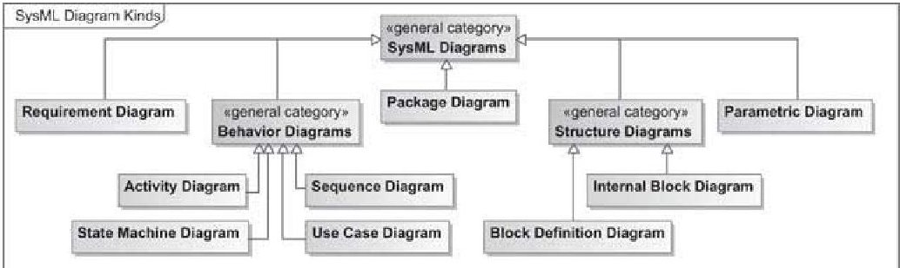

Fig. 1 The nine (9) kinds of SysML diagrams.

<!-- PDF_PAGE: 5 -->

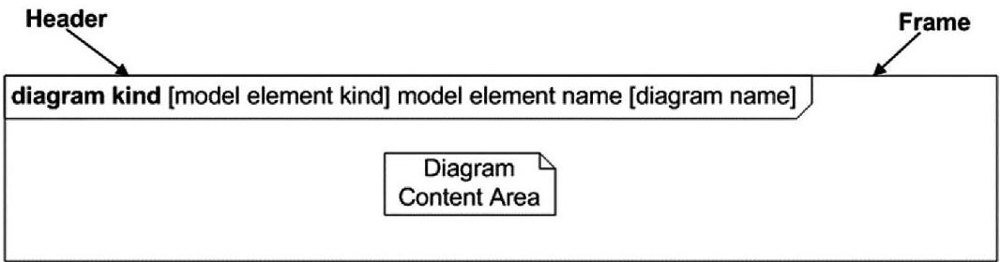

Fig. 2 Each SysML diagram has a diagram frame with a diagram header that can display fields which include the kind of diagram and the diagram name.

header is shown at the top left of the diagram and describes information about the diagram. The header includes the following four fields:

1. Field 1: short descriptor identifying the kind of diagram, such as bdd for block definition diagram.

2. Fields 2 and 3: kind of model element and the name of model element that the frame represents.

3. Field 4: name of the diagram to indicate the purpose of the diagram.

## 1. STRUCTURE DIAGRAMS

## Defining Blocks and their Relationships on Block Definition Diagrams

SysML includes the concept of a block as a general purpose construct to represent a system, external system, or component. The component may be hardware, software, data, facility, or a person. More generally, the block can represent any logical or physical entity, including things that flow, such as water or information.

A block contains features that represent its properties, functions, interfaces, and states. A simple example of a block is shown in the block definition diagram (bdd) in Fig. 3. In the figure, the Spacecraft is a block that has a Mass of 150 kilograms and performs a function called collect observation data. It also has a port called lv electrical i/f that provides the electrical interface to the Launch Vehicle. The Spacecraft can be specified to have many other properties, functions, interfaces, and other kinds of features. Each kind of feature is depicted in a unique block compartment.

The diagram header in this figure designates the kind of diagram as a bdd, which is short for block definition diagram. The name of the diagram is called Example of a block. The 2nd and 3rd fields in the diagram header indicate the diagram frame represents the Structure Package. The significance of packages is explained later in this section.

## Relationships between Blocks

The block can be related to other blocks using whole-part, reference, generalization/specialization, and connection relationships.

<!-- PDF_PAGE: 6 -->

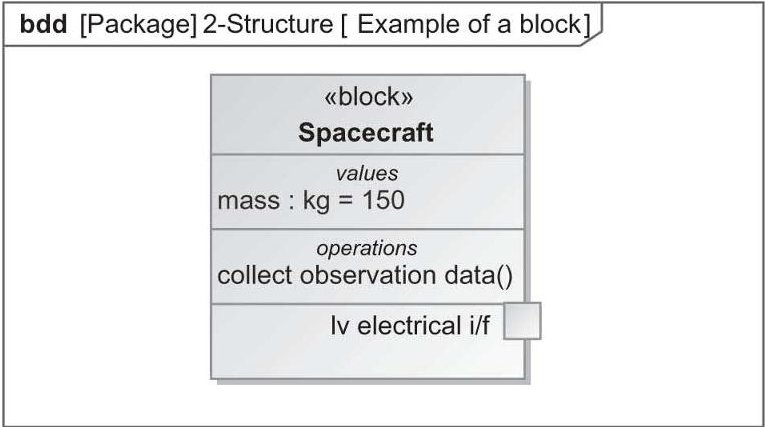

Fig. 3 An example of a block with some of its features.

## Whole-Part Relationship

A whole-part relationship, also known as a composite relationship, defines a hierarchy of blocks. A partial Spacecraft decomposition into subsystems is shown in Fig. 4. The Spacecraft in this diagram is the same Spacecraft that was shown in the previous diagram, but its features are not shown. The black diamond designates the Spacecraft as the whole end, and the arrow designates the subsystems at the part ends of the whole-part relationships. Each subsystem is designated with the key word "subsystem."

The guidance, navigation, and control (GN&C) subsystem is further decomposed into a Reaction Wheel and GN&C SW. The key words designate these elements are hardware and software components.

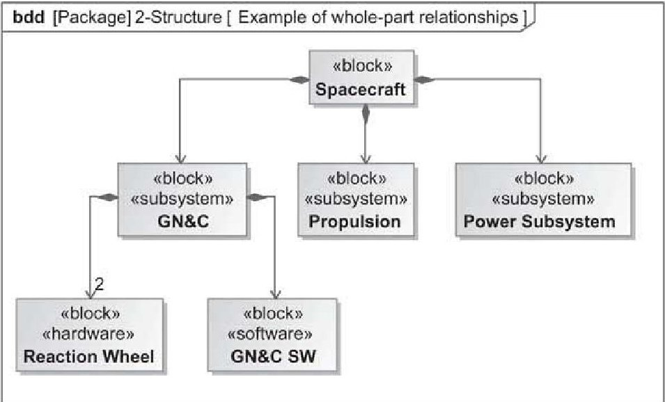

Fig. 4 Partial decomposition of Spacecraft into its subsystems.

<!-- PDF_PAGE: 7 -->

## Multiplicity

On the block diagram in Fig. 4, the GN&C subsystem is composed of 2 Reaction Wheels, as indicated by the number 2 next to the part end of the relationship. This is called the multiplicity. More generally, the multiplicity has a lower bound and upper bound, such as 2..4. An unlimited upper bound is referred to with an asterisk $ ^{*} $ . A lower bound of zero means the component part is optional. If no multiplicity is shown on the part end, the default multiplicity is one.

## Referencing a Block

It is sometimes useful to aggregate a set of components into a logical whole even though the component may already be part of another whole-part relationship. For example, a software component may be considered part of another subsystem, but logically aggregated into a Software subsystem. As shown in Fig. 5, the Software subsystem logically aggregates the GN&C SW and the Power Mgmt SW using a reference association designated by a white diamond on the whole end. This is contrasted with the whole-part relationships designated with the black diamond between the GN&C and Power subsystems and the software. This enables the components to be aggregated in different ways for different purposes.

## Specializing a Block from a More General Block

Another SysML relationship between blocks is the specialization relationship. In particular, a more general block contains features, such as properties,

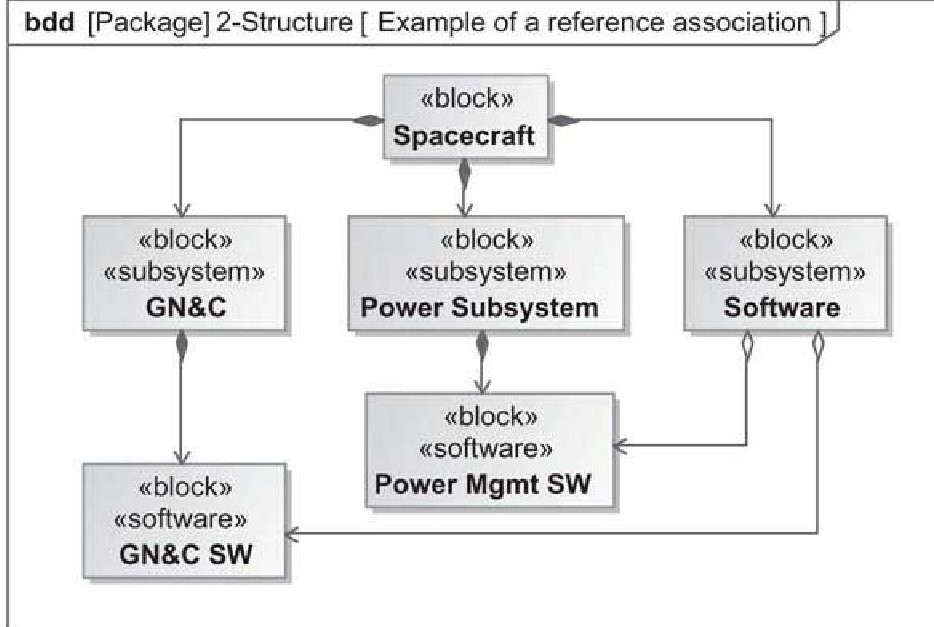

Fig. 5 The Software subsystem logically aggregates the software components using the reference association.

<!-- PDF_PAGE: 8 -->

functions, and interfaces that a more specialized block can inherit. The more specialized block can then add its unique features. This avoids having to define common features for each specialization, and thereby facilitates reuse.

A simple example is shown in Fig. 6 showing the Propulsion subsystem having two specializations to represent a Mono-Propellant Propulsion and Bi-Propellant Propulsion variant. Both specializations inherit the mass and fuel mass properties as designated by the carrot symbol ( $ ^{\wedge} $ ). In addition, the Bi-Propellant Propulsion adds a unique property to specify oxidizer mass. The specialized subsystems can also redefine features of the more general subsystem. As shown in the parts compartment in each block, the more general Propulsion subsystem has one to two tanks, whereas the Mono-Propellant Propulsion has 1 tank and the Bi-Propellant Propulsion has 2 tanks.

## Interconnecting Parts on an Internal Block Diagram

The system, subsystems, and components can be interconnected on an internal block diagram (ibd) as shown in the simplified example in Fig. 7. This shows the connection and the flow of Electrical Power from the Launch

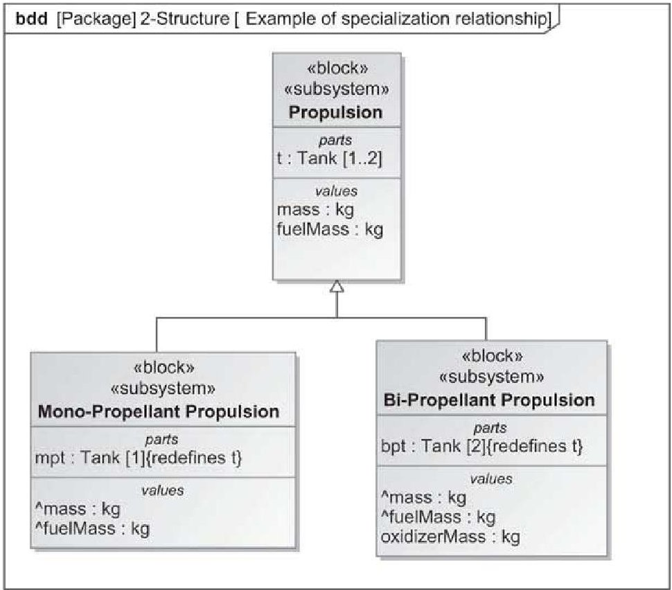

Fig. 6 The mono-propellant propulsion and bi-propellant propulsion subsystems inherit common features from the more general propulsion subsystem.

<!-- PDF_PAGE: 9 -->

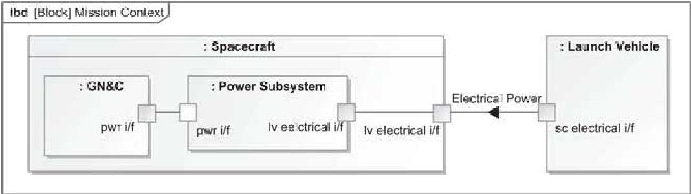

Fig. 7 The internal block diagram shows the connection and flow of Electrical Power between the Launch Vehicle, Spacecraft, and some of its subsystems.

Vehicle to the Spacecraft. This connection is further delegated to the Power Subsystem, which distributes the power to other subsystems such as GN&C.

The general name for an interconnected element is a part. A port is an interaction point on a block or part that enables its interface to be specified. The lines connecting the ports are called connectors. A connector can connect parts directly or to ports on the parts.

The frame of the diagram represents the higher level block that composes the Spacecraft and Launch Vehicle, which in this case is the Mission Context block as indicated in the diagram header. When a part is shown as a dashed rectangle instead of a solid rectangle, then this part is referenced by the higher level block.

## Definition vs Usage

SysML facilitates model reuse by distinguishing the definition of an entity and the usage of an entity in a particular context. In Fig. 8, the Avionics subsystem is composed of a primary and backup computer. Both computers have the same definition but are identified as different usages. A usage in SysML is a part, and a definition is a block. In this example, primary and backup are parts, and the On-Board Computer is the block. The two parts are shown in the ibd in Fig. 9. The colon notation is used to designate the two parts as primary: on-board computer and backup:on-board computer.

## Behavior Modeling

There are three different kinds of behavior representations in SysML including activity diagrams, sequence diagrams, and state machine diagrams. Use case diagrams are often used to support behavior modeling as well. Each of these diagrams is summarized below.

## Using Activity Diagrams to Model Input, Output, and Control Flow

An activity diagram transforms a set of inputs to outputs through a controlled sequence of actions. Figure 10 shows a portion of an activity diagram to Provide Electrical Power. The enclosing frame represents the activity. This activity contains actions. Each action is performed by a component of the Power Subsystem

<!-- PDF_PAGE: 10 -->

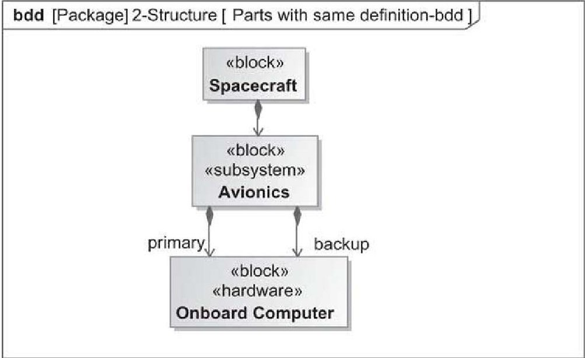

Fig. 8 Different parts with the same definition.

which is designated by swim lanes. Inputs and outputs to and from the activity are designated as rectangles on the frame, and the inputs and outputs to and from each action are shown as small rectangles on the action. The output of one action connects to the input of another through an object flow.

The Perform Mission activity shown in Fig. 11 represents a typical mission scenario. The control flows are indicated by dashed lines with no rectangles on either end.

The activity execution semantics are based on the flow of tokens. An action cannot execute until a token is available on all of its inputs. This enables the modeler to precisely specify a system behavior.

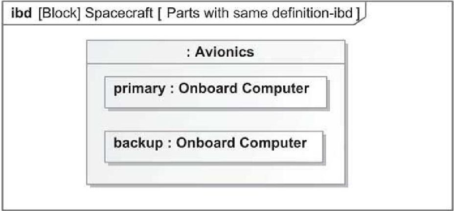

Fig. 9 Referring to parts on an internal block diagram using the colon notation as partName:blockName.

<!-- PDF_PAGE: 11 -->

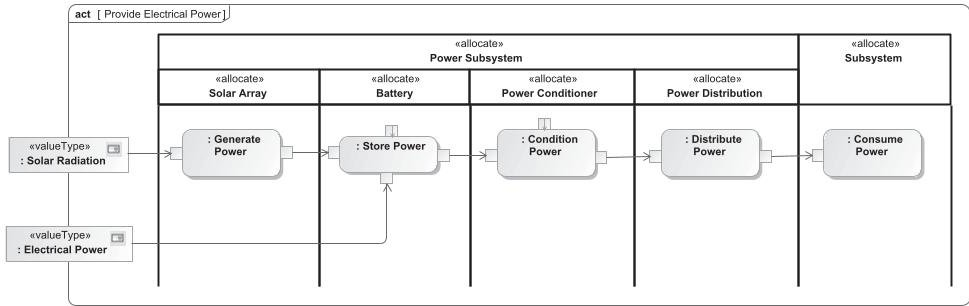

Fig. 10 Activity diagram showing its inputs and Power Subsystem actions to Provide Electrical Power.

There are several kinds of control nodes to control the flow of inputs, outputs, and control. These include the initial node and the activity final node that designate the start and termination of the activity as shown in Fig. 11. When a token is available on the initial node, the activity begins execution, and when a token reaches the activity final, the activity terminates its execution.

There are other control nodes such as a decision node that designate which outgoing flow executes based on the input satisfying a specified guard condition, and a join node that cannot execute until a token on each incoming flow has arrived.

There are many specialized kinds of actions. A signal is sent from an activity using a send signal action, and a signal is received by an activity using an accept event action. The sending and receiving of the signal correspond to events that can control the flow of execution. Actions can also call another activity to further elaborate its behavior. This can also be presented as a hierarchy of activities similar to a traditional functional decomposition. Activity diagrams include many other features to precisely specify a behavior, such as the ability to interrupt selected actions based on the arrival of a signal, and streaming and timecontinuous inputs and outputs.

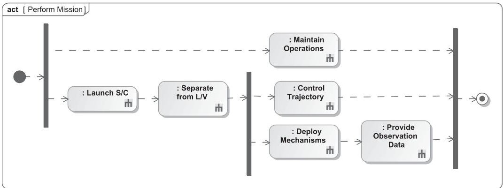

Fig. 11 Activity diagram showing the actions and control flow to Perform Mission.

<!-- PDF_PAGE: 12 -->

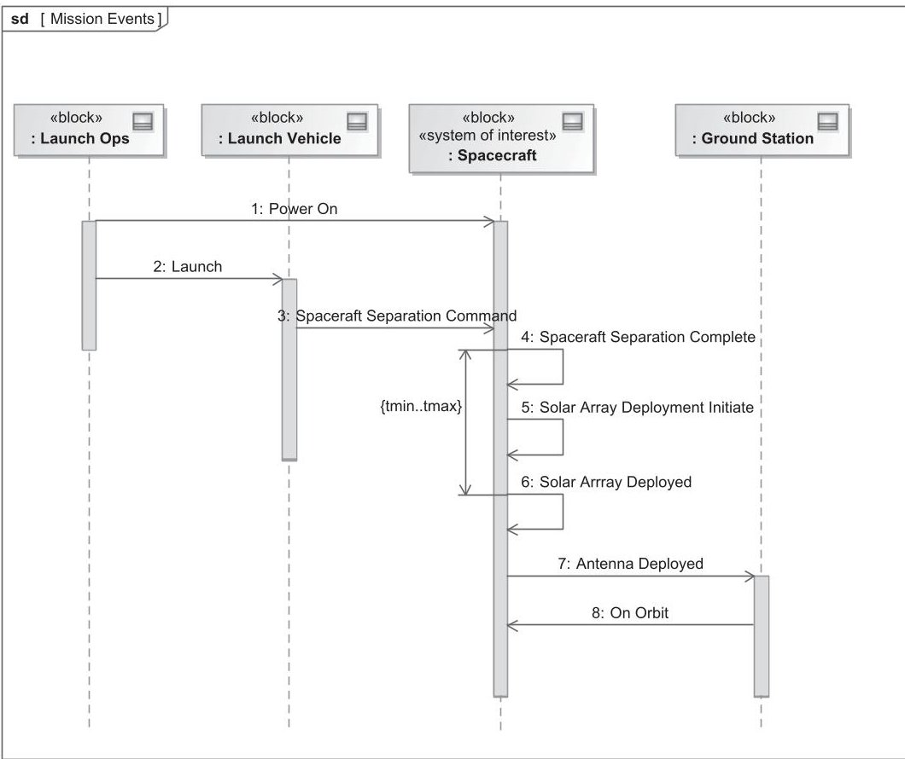

Fig. 12 A sequence diagram used to represent a mission timeline.

## Using Sequence Diagrams to Model Message Exchange between Parts

A sequence diagram is used to describe behavior as a sequence of messages between parts. It can also represent a timeline of events, such as the simplified mission timeline shown in Fig. 12. The parts are represented as lifelines at the top of the figure, and the messages are sent from one part to another as indicated by the lines with arrowheads. Time advances down the vertical axis. In this simplified timeline, Launch Ops sends a Power On signal to the Spacecraft, and then sends a launch signal to the Launch Vehicle. The time between the Spacecraft Separation Complete event and the Solar Array Deployed event is constrained to occur between $ t_{\mathrm{min}} $ and $ t_{\mathrm{max}} $

The semantics of a message can correspond to a signal that is sent from one part to another, or to a sending part requesting a behavior to a receiving part, similar to calling a subroutine in software. Because of these semantics, sequence diagrams are often used to represent the interaction between software components. They can also be used to describe other system level behavior, although activities provide a more robust capability for modeling continuous behavior and behaviors involving more complex flows of data and control.

<!-- PDF_PAGE: 13 -->

## Using State Machine Diagrams to Model the State History of a Block

A state machine diagram describes the discrete states of a block and the transitions from one state to another. A state represents a condition of a block, such as the off state or on state of a system or component. The transition between the off and on states may be triggered by the receipt of a signal, such as when a user turns the power on or off. A simple example of a state machine diagram for the Payload Sensor is shown in Fig. 13.

In addition to defining the states, one can also define entry, exit, and do behaviors that occur when the system or component is within a particular state. These represent the behavior that occurs upon entry to the state, upon exit from the state, or while being in the state, respectively. The Payload Sensor has a do behavior in its on state called Sense Thermal Emissions.

Behaviors can also be defined on transitions between states. For example, a signal can be sent on a transition which triggers a state transition in another block. The entry, exit, do, and transition behaviors can be elaborated by activity diagrams or sequence diagrams, or with behaviors that are specified in a code called opaque behaviors.

With an appropriate MBSE method, SysML can be used to integrate activities, state machines, and sequence diagrams to emphasize different aspects of the system behavior.

## Using Use Case Diagrams to Model the Goals of a System

A use case diagram is generally used to describe the goals of a system, such as those associated with the mission objectives in Fig. 14. They consist of the

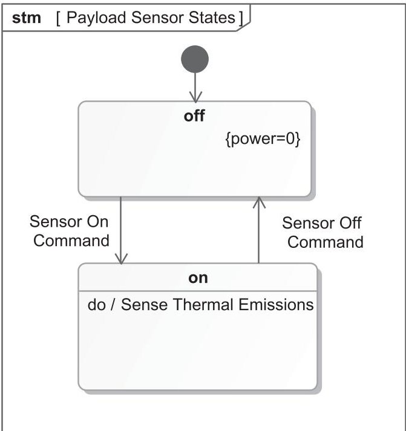

use case (e.g., the goal), the system called the subject and the external systems called actors that participate in achieving the goal. The actors in this figure include the Forest Service, the Operator, and the Fire Department. A goal of the Operator is to Provide Forest Fire Data in Real Time to the Fire Department. This supports the

Fig.13 State machine diagram showing the on and off states of the Payload Sensor, and the behavior that occurs while in the on state.

<!-- PDF_PAGE: 14 -->

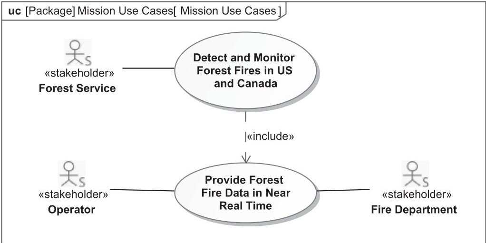

Fig.14 A use case diagram depicts the goals of the external users (i.e., actors) that the system is intended to support.

broader goal of the Forest Service to Detect and Monitor Forest Fires in United States and Canada as indicated by the include relationship. The actors can be depicted as either stick figures or rectangles.

Once a use case is defined, activity diagrams, sequence diagrams, and/or state machine diagrams are used to elaborate the behavior needed to realize the goals.

## Modeling Text-Based Requirements and their Relationship to Design, Analysis, and Verification

A text requirement can be expressed in SysML and then related to other parts of the model to establish traceability to the system design, analysis, and test cases. This extends traditional requirements management approaches which primarily focus on traceability relationships between requirements. The trace relationships can be navigated to provide robust impact assessments.

The requirements relationships include satisfy, verify, refine, derive, and others. An example of traceability between a requirement and the corresponding design, analysis, and test case is shown in Fig. 15. The Sensing requirement for the Payload Sensor specifies the required resolution and sensitivity. This requirement is satisfied by the Resolution and Sensitivity of the Payload Sensor as indicated by the satisfy relationship from the mid range IR scanner. The required resolution and sensitivity are derived from the Spacecraft system requirements for Probability of Detection and orbit altitude. The rationale for the derivation is based on the Sensor Performance Analysis. The test case called Verify Sensor Resolution is used to verify whether the Payload Sensor satisfies its Resolution requirement.

<!-- PDF_PAGE: 15 -->

Requirements and their relationships can also be presented in requirements tables, which provide a compact way to present the requirements and their relationships.

## Modeling Parametric Constraints on System Properties to Support Engineering Analysis

As noted previously in the structural modeling section, a block can contain value properties that represent important quantifiable characteristics about the system or components, such as its mass, power consumption, size, reliability, or cost. In addition to capturing the key properties of a system, SysML enables the capture of constraints, such as Newton's law (e.g., Force = Mass $ \times $ Acceleration).

The parametric diagram in Fig.16 shows a constraint called Orbit Analysis Model with some of its input and output parameters designated as squares flush with the inside boundary. These parameters include key orbit parameters and selected mission effectiveness measures for revisit time and coverage. This Orbit Analysis Model in the figure is a proxy for an analytical model that can perform the computation. The analytical model can be thought of as a set of equations. The parameters of the analysis model are bound to the corresponding properties of the mission context and spacecraft as indicated by the binding connectors with the "equal" key word. The parameter names in the constraint and the property names in the parts do not have to match, all though they do in this example, enabling the analytical model to be reused with other design models. The binding

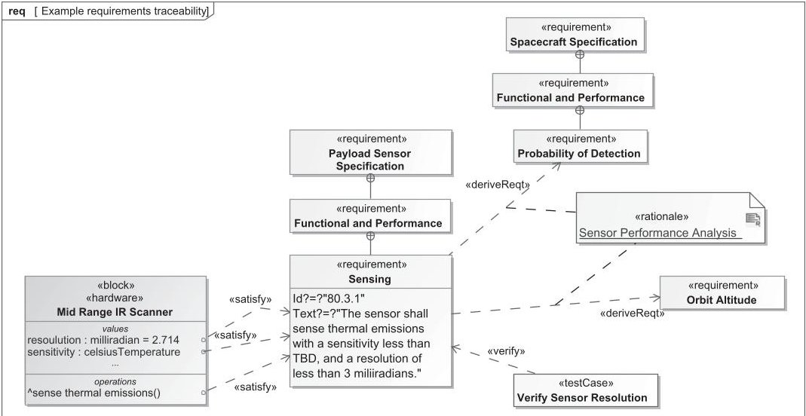

Fig.15 The Sensing requirement is derived from other requirements with supporting rationale. This requirement is also satisfied by the Mid Range IR Scanner and is verified by a test case.

<!-- PDF_PAGE: 16 -->

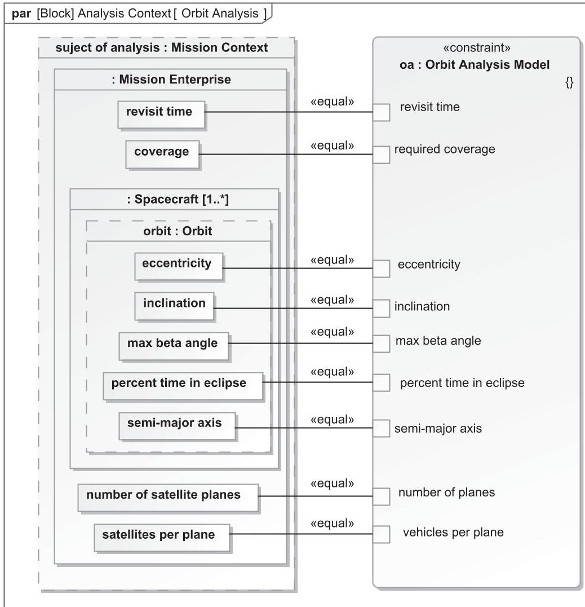

Fig. 16 A parametric diagram binds the parameters of the constraint to the properties of the design.

relationship enables the integration between the system design model and multiple analytical models that perform the analysis. In this way, SysML provides a means to identify critical properties, reconcile the critical design properties with the analysis models, and trace the analysis results to requirements.

## Organizing the Model with Packages

The SysML model contains model elements. Each model element represents something expressible in SysML, such as a system, a component, a component feature such as its property, function, or interface, or a relationship between components, such as a whole-part relationship. A system model can get very large as details are added.

<!-- PDF_PAGE: 17 -->

An important aspect of modeling with SysML is the need to manage the model. This begins with a well-defined model organization using packages that contain the model elements. A package is like a folder and provides a way to organize the model into logical groupings. For example, packages can contain the Requirements, Structure, Behavior, and Parametrics as shown in Fig. 17. In this example, the Structure package contains nested packages for the different levels of design that include Mission, System, and Subsystem. The other packages for Requirements, Behavior, and Parametrics can contain similar nested packages for each level of design. This model organization also includes a Support Elements package that contains other model elements that cross-cut different levels of design, such as a units library and items that flow through the system.

In this way, the model is organized into a tree of packages, where each package may contain other nested packages and model elements. There is no single way to organize the model no more than there is a single way to organize what goes into your cabinets and drawers. However, a model that is organized based on the product structure and the four pillars (requirements, structure, behavior, and parametrics) is a reasonable place to start.

## Diagram vs Model

Building the system model consists of populating the packages with model elements that describe the system and environment of interest. This is accomplished by adding elements to, modifying elements in, and deleting elements from the model using the SysML diagrams as a means for inputting and visualizing the data.

Each diagram is a view that presents a subset of the information contained in the model. For example, an ibd may show the connection between the

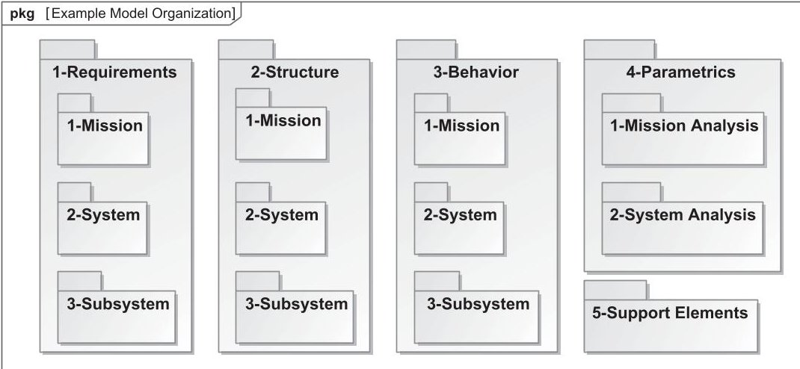

Fig. 17 The package diagram describes the model organization in terms of a set of nested packages.

<!-- PDF_PAGE: 18 -->

components and/or subsystems. This diagram is not typically used to present other information contained in the model such as the functions the components perform. Each diagram highlights different aspects of the system.

The model is a tree of model elements, and each model element has a unique position in the tree. However, any model element may appear on zero, one, or many diagrams. For example, the Spacecraft block appeared on multiple diagrams, but is uniquely defined within the model tree. When a model element is modified, the change to the element is reflected in all diagrams that the element appears.

## Learning SysML and MBSE

There is a lot to learn to apply MBSE effectively including a modeling language, an MBSE method, and a modeling tool. Each of these has its own complexities.

SysML is an expressive language that can be used in many ways. It can achieve its intended purpose or it can be a frustrating effort that accomplishes little. Like any language, it takes time and practice to become proficient in its application. There are several references [Friedenthal et al. 2014; Delligatti, 2013] that describe the language and how it can be used.

It is important to note that the model is only as good as the data that goes into it and should be subject to on-going peer review by domain experts. In addition, it is important to apply a disciplined process using proven MBSE practices and guidelines.

## D. SYSTEM MODELING TOOL

A system modeling tool is used to build the system model. It provides the basic capabilities to create, modify, delete, and view the model. A modeling tool also provides model checking to ensure that the models conform to the language specification or other validation rules. A simple example is that a modeling tool should permit a system element to satisfy a requirement, but not allow a requirement to satisfy a system element. There are many other capabilities that different modeling tools offer, such as the abilities to execute an activity diagram, to autogenerate documentation, to query the model, and to exchange the data via the tool's application program interface (api). The tool should also support standards that enable integration with other modeling tools and data sources. Each tool has its strengths, weaknesses, and price point. Different vendor tools should be carefully evaluated to select a tool and environment that meet your individual, project, and organizational needs.

A typical modeling tool user interface is shown in Fig. 18. The interface includes the following key elements:

1. A browser that depicts the model containment tree.

2. A diagram area to create, modify, and view the diagrams.

<!-- PDF_PAGE: 19 -->

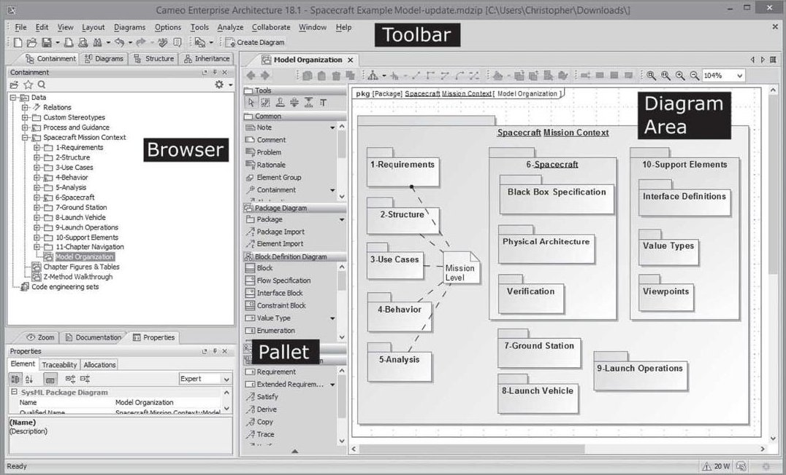

Fig. 18 A typical system modeling tool interface that includes the diagram area, browser, pallet, and tool bar.

3. A pallet with the diagram symbols used to create the diagrams.

4. A toolbar with the menu options that provide the tool functionality.

The tool typically provides a dialogue box to view the detailed information associated with a particular model element. For example, the dialogue box for a block may include its properties, functions, ports, and its relationship with other model elements. In addition, the modeling tool provides mechanisms to navigate the model, such as locating a model element in the browser. There are many other features available to exploit the rich dataset that a system model contains.

## II. SPACECRAFT SYSTEM DESIGN EXAMPLE

This section provides an example of how a model-based approach can be applied to specify, design, analyze, and verify a complex system such as a spacecraft. This example leverages the spacecraft design and assumptions from the FireSat II example in the Space Mission Engineering: The New SMAD [Wertz et al. 2011]. The example demonstrates the application of a model-based approach with SysML by using model artifacts to capture selected aspects of the mission and system specification and design. A reader of this section should refer to the New SMAD for the detailed specification and design, rationale, and assumptions.

<!-- PDF_PAGE: 20 -->

This section first introduces a simplified MBSE method and then highlights the application of this method to the FireSat II example.

## A. MBSE METHOD OVERVIEW

The top level activities for a simplified MBSE method are highlighted in the Mission and System Specification and Design process in Fig. 19. The activities are consistent with a typical systems engineering process, such as those found in the ISO/IEC 15288 standard, on system life cycle processes [ISO/IEC, 2008].

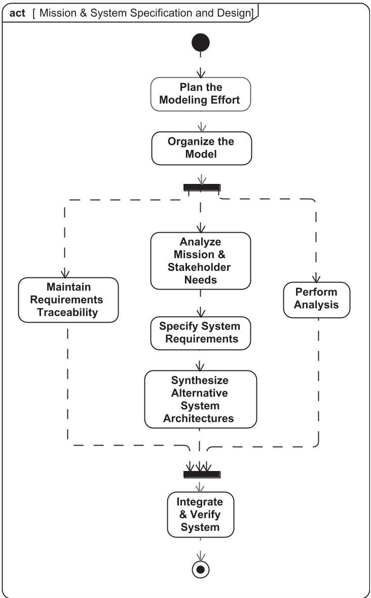

Fig.19 The Mission and System Specification and Design process is applied to the design of a spacecraft using a model-based approach.

<!-- PDF_PAGE: 21 -->

Applying this method results in a system model that is captured in modeling artifacts which represent the mission and system specification and design information. This method is applied iteratively to evolve the system model in its breadth, depth, and fidelity throughout the system development lifecycle. The method is applied during the early phases of design to develop the system conceptual design and then iterated in later phases to evolve the mission and system specification and design through preliminary and detailed design. The following summarizes the basic activities and modeling artifacts.

Plan the modeling effort to maximize value from the model within the project constraints.

1. Establish the purpose and goals of the modeling effort.

2. Define the scope of the model to meet its intended purpose.

3. Define the schedule for developing each modeling artifact.

4. Establish the configuration management approach for managing updates to the model.

5. Define how the modeling effort will be organized to develop and maintain the model.

6. Select the MBSE methodology and applicable modeling practices.

7. Select, acquire, and configure the modeling tools and environment.

8. Determine the training needs for the modeling effort.

Organize the model to facilitate navigation, access control, and reuse.

1. Define the package diagram to organize the data contained in the system model.

2. Establish modeling conventions.

Analyze mission and stakeholder needs to understand the stakeholder needs and develop the mission concept needed to satisfy the needs.

1. Identify the stakeholders and the problems to be addressed.

2. Define the top level use cases to represent the mission objectives.

3. Develop the mission requirements that support the mission objectives.

4. Create the domain model (e.g., bdd) to identify the system and external systems and users.

5. Define the measures of effectiveness (moe) that can be used to quantify the value of a proposed solution for the stakeholders.

6. Create the mission activity diagrams to represent the mission level behavior.

Specify system requirements include the required system functionality, interfaces, physical and performance characteristics, and other quality characteristics to

<!-- PDF_PAGE: 22 -->

support the mission objectives and effectiveness measures and create the system context diagram (ibd) to specify the system external interfaces.

1. Elaborate the mission activity diagrams as needed to specify the system functional requirements.

2. Capture the system black box specification that specifies the system functions, interface, and key technical performance measures.

3. Capture text-based requirements that support the mission objectives and moe in a requirement diagram.

Synthesize alternative system architectures by partitioning the system design into subsystems and components that can satisfy the system requirements.

1. Decompose the system into its components on a bdd.

2. Define the interconnection among the parts using the ibd.

3. Define the interaction among the parts using activity diagrams.

4. Specify the components of each subsystem.

Perform Analysis to evaluate and select a preferred system solution that satisfies the system requirements and maximizes the effectiveness measures (Note: this is done concurrently with the previous activities).

1. Capture the analysis context (bdd) to identify the mission and system analysis to be performed, such as orbit analysis, delta-V, mass properties, power, reliability, cost, and other critical properties.

2. Capture each analysis as a parametric diagram.

3. Perform the engineering analysis to determine the values of the system properties (Note: the analysis is performed using engineering analysis tools).

Maintain requirements traceability to ensure that the proposed solution satisfies the system requirements and stakeholder needs (Note: this is done concurrently with the previous activities).

1. Capture the traceability between the system requirements and the stakeholder needs (e.g., use cases, measures of effectiveness) on a requirements diagram (or table).

2. Capture the traceability between the system design and the system requirements on a requirements diagram (or table).

3. Identify test cases needed to verify the system requirements on a requirements diagram and capture the verification results.

Integrate and verify system defines the test environment and executes the test cases to verify that the system satisfies its requirements and validate that the system satisfies the stakeholder needs.

<!-- PDF_PAGE: 23 -->

1. Develop verification context that maps test cases to test objectives and defines the verification environment.

2. Define how the test cases are performed (e.g., high-level test procedures) using an activity diagram.

3. Define the sequence of test cases to support test planning.

These activities are presented sequentially in the rest of the chapter, but in practice, are applied iteratively and in an order that depends on the objectives for each particular increment of design and development.

More detailed examples of how SysML can be used to support a functional analysis and allocation method and an object-oriented systems engineering method (OOSEM) are included in the modeling examples in chapters 16 and 17 respectively of A Practical Guide to SysML [Friedenthal et al. 2014].

Many other systems engineering techniques can be applied to the design of a spacecraft and integrated with this end-to-end MBSE method such as those described in other chapters of this book. These include techniques used in the ROSETTA approach such as quality function deployment (QFD) for requirements elicitation and analysis (Chapter 5), design of experiments (DoE) for performing design sensitivity analysis and design optimization (Chapter 5), robust and resilient design techniques to ensure that a spacecraft can operate and recover from failure and/or off-nominal conditions (Chapter 3), and the system of systems integration and analysis techniques including interoperability analysis to understand how to integrate the spacecraft into its system of systems context that includes the launch vehicle, ground station including its operators, external users, and other mission elements (Chapter 1).

## B. PLAN THE MODELING EFFORT

The purpose of this activity is to develop a plan that maximizes the value of the model to its stakeholders within the project constraints. It is preferred practice to develop a plan for each project phase in terms of design increments or capability deliveries within the phase. The overall plan for each phase includes the selection of the MBSE methodology, tools, and training and how to organize the modeling effort to achieve the project objectives. The increment plans focus on the increment objectives and delivering specific modeling artifacts within the increment schedule. These plans are integrated with the overall project plans.

The purpose of the modeling effort for each project phase and design increment must be clear. The broad goals may be to ensure a consistent and cohesive architectural description that spans multiple discipline and subsystem views, supports requirements flowdown to ensure the quality of the mission, system, subsystem, and component requirements, and support verification. The specific modeling goals for a design increment support the critical information needs to create or update selected modeling artifacts such as the mass equipment list, system block diagram, interface specifications, and selected analysis and trade studies.

<!-- PDF_PAGE: 24 -->

The scope of the effort defines the breadth, depth, and fidelity of the model to meet its intended purpose. For example, during an early phase of design, the model may support development of the system breakdown and mass estimates and may not require detailed modeling of component interfaces and software specifications.

The modeling schedule supports the project schedule. The longer term schedule identifies which modeling artifacts are needed to support each project milestone, and the increment schedules define intermediate milestones to develop the modeling artifacts including peer reviews and increment baselines.

The configuration management approach is established to manage updates to the model. During the early phase of design, the control on the baseline is less constrained than later phases. Typically, the configuration management process enables different users to check out parts of the model, make changes, and check the model back in.

The organization and roles of the people involved in the development and use of the model evolve as the modeling practice matures on the project. During the early phases of a project, a small core modeling team often defines the modeling practice, and performs the modeling to ensure that the modeling practices are adhered to. The broader team members provide input to the core team and review the modeling artifacts to ensure that their inputs are accurately reflected in the model. As the modeling practice matures on the project, custom interfaces such as web browsers may be developed to enable the broader team to enter data directly into the model and view data from the model in ways that are meaningful to them. The core modeling team continues to ensure the overall integrity of the model and adapts the modeling practices and tools to support the different needs of the project.

The MBSE methodology and applicable modeling practices are selected to achieve the model purpose and scope. The methodology may implement various aspects of the projects organization's systems engineering process such as the one used in this chapter. The specific modeling practices should be piloted and validated to ensure that they yield the desired results. For example, the practice for modeling failure modes should facilitate the failure modes and effects analysis (FMEA).

The modeling tools are often selected based on organizational considerations, since the organization makes substantial investments in maintaining its engineering tools and environments. However, there are often specific customizations and integrations with other tools that are needed to support the project specific model purpose, scope, and practices.

The training needs for the modeling effort include who needs what training, when the training is needed, and how it will be delivered. For example, in the early phases of a project, the small core modeling team requires more intensive training in the modeling language, tool, methodology, and practices, whereas other members of the project team may only require training to enable them to interpret the modeling artifacts.

<!-- PDF_PAGE: 25 -->

## C. ORGANIZE THE MODEL

The purpose of this activity is to define the model structure to organize the mission and system specification and design data to facilitate navigation, access controls, and reuse. In a document-based approach, the documents needed to support the mission and system specification and design activities are identified and often organized in a document tree that is then reflected in the structure of a document repository. In this model-based approach, the system model is organized into a package structure as described in Sec. I.C. The traditional documents can still be generated by querying the system model and presenting the information in a way that is useful to the stakeholders.

Figure 20 shows the model organization for the spacecraft model as a package structure that consists of a top level package with nested packages contained within it. Each package contains model elements, which is analogous to a folder that contains data. The model elements in different packages can be related to one another through model relationships.

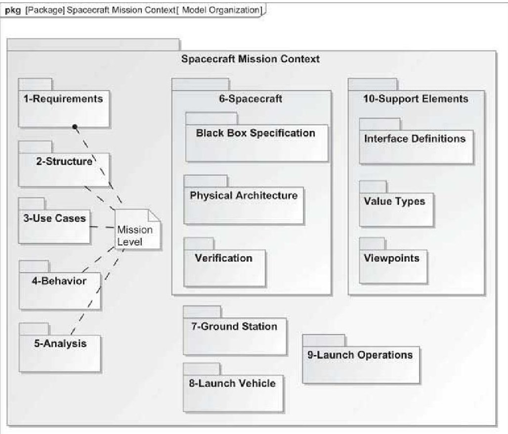

Fig. 20 The model organization includes packages to capture specification and design data for the mission, Spacecraft, other mission elements, and supporting model elements.

<!-- PDF_PAGE: 26 -->

The top level package is called the Spacecraft Mission Context, which contains nested packages that define the mission Requirements, Structure, Use Cases, Behavior, and Analysis. The Spacecraft package contains nested packages to define the Spacecraft specification and design including the Black Box Specification, Physical Architecture, and Verification. The Ground Station, Launch Vehicle, and Launch Operations packages contain the model elements that describe them. The Support Elements package contains supporting information in the Interface Definitions, Value Types, and Viewpoints packages. The Interface Definitions package contains model elements that can be reused throughout the system, such as flows, signals, and port definitions. The Value Types package contains a library of quantities and units. The Viewpoints package contains the viewpoints that identify stakeholders and their concerns.

These packages are initially empty containers, but are populated with data as one applies the MBSE methodology. This iterative process enables continuous refinement of the information about the mission and system specification and design. The sections in the rest of the chapter describes the model elements that are contained in these packages.

## Establish Modeling Conventions

This activity also includes establishing modeling conventions to be applied throughout the modeling effort. Examples include naming conventions for different kinds of elements, diagram naming conventions, and diagram layout conventions. For this example, naming conventions include the following:

1. Blocks, Activities, and other Classifiers begin with upper case

2. Parts, properties, and actions begin with lower case

3. Port names are appended with $ i/f $ (for interface)

4. Activity names are defined as verb-noun

Another example is to establish conventions for annotating the model. For example, each model element can include a text description that can be included in a glossary and used to support the generation of documentation from the model. Annotations also are used to capture design rationale. Other examples of modeling conventions are the selection of when to use a particular kind of port to specify the interfaces.

## D. ANALYZE MISSION AND STAKEHOLDER NEEDS

The purpose for this activity is to analyze the mission and stakeholder needs and establish the mission objectives, measures of effectiveness, mission requirements, and mission concept to address these needs. The activity includes identifying the stakeholders and determining what problem needs to be addressed by the mission, which in this case is to reduce the damage caused by wildfires across the United States. The mission objectives, measures of effectiveness, and

<!-- PDF_PAGE: 27 -->

mission requirements are derived from the needs. The mission concept including the definition of the mission elements and their functions are developed to satisfy the mission requirements and optimize the mission within the specified technical, cost, schedule, regulatory constraints, and risk thresholds.

## Identify Stakeholders and their Concerns

Some of the FireSat II stakeholders are identified in Fig. 21. For this example, the primary stakeholders include the end user, which in this case is the Forest Service and Fire Department, and the mission sponsor, who provides the funding and program oversight to address the stakeholder needs.

The concept of viewpoint and view is used to capture the stakeholders concerns. A viewpoint is used to specify stakeholder concerns in terms of what they care about. A view conforms to a particular viewpoint by presenting the relevant information from the system model that addresses the stakeholder concerns. A view is presented to the stakeholder as a diagram, a table, an entire document, or any other artifact. The format of the artifact can also be specified, such as a document in Word, PDF, or HTML.

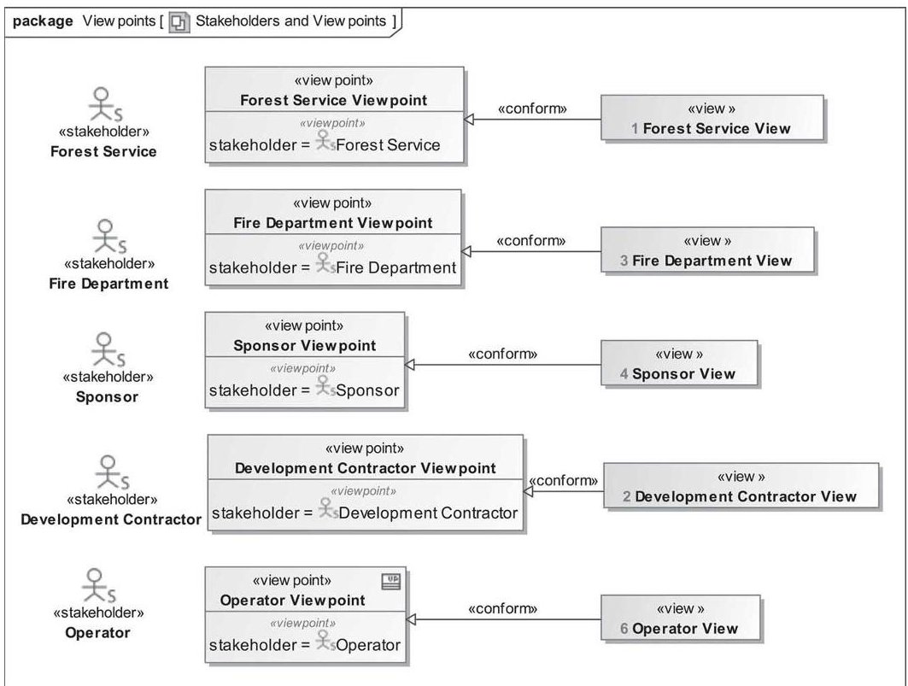

Fig. 21 The viewpoints capture the stakeholders and their concerns, and the conforming views present the specific information from the model to addresses their concerns.

<!-- PDF_PAGE: 28 -->

Viewpoint and view are important architecture concepts that provide a means to explicitly capture and address a broad spectrum of stakeholder concerns in the model. The viewpoint and view concept provide a mechanism to query the model for the information that addresses these concerns and present the resulting information in a way that is useful to each stakeholder.

For FireSat II, the Forest Service is concerned about loss of life and property because of forest fires. The Fire Department is concerned about their ability to put out a fire in a timely manner to prevent the loss of life and property. The sponsor cares about the ability to satisfy the mission requirements within cost and schedule. The development contractor is concerned about establishing a feasible design to satisfy the requirements, and the Operator is concerned about his or her ability to operate the spacecraft to achieve the mission objectives. An Operator's view may focus on the command and telemetry. As the project evolves, other stakeholders are identified and defined in the model in a similar way. Each set of stakeholder concerns can impose additional requirements and constraints on the mission and system.

The stakeholders, viewpoints, and views are captured in the Viewpoints package that is shown in model organization in Fig. 20.

## Define the Mission Objective(s)

The mission objectives should relate directly to stakeholder value. For the New SMAD, a primary objective of the Forest Service is for FireSat II to "detect and monitor forest fires in United States and Canada using as little financial resources as possible," and an operator objective is to "provide forest fire data to the end user in real time, archive data, monitor, and maintain the health and safety of FireSat II." These objectives are reflected in the use case diagram in Fig. 22. As emphasized in The New SMAD, the mission and system specification and design process is intended to provide balanced solutions that meet these objectives within cost, schedule, and risk constraints.

## Specify the Mission Requirements

The mission requirements are specified to support the mission objectives. The New SMAD specifies the mission requirements shown in Table 1 and is the source of the mission requirements for this example. The requirements are captured in the model and can be presented in both tabular and graphical views.

## Fig. 22 The use case diagram reflects the mission objectives.

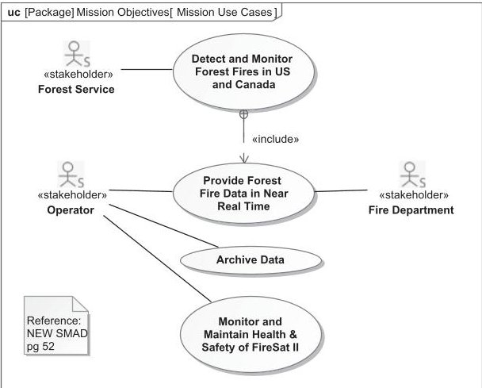

<!-- PDF_PAGE: 29 -->

TABLE 1 THE SOURCE MISSION REQUIREMENTS ARE CAPTURED IN THE MODEL AS DEFINED IN TABLES 3 AND 4 OF THE NEW SMAD

<table border="1"><tr><td>#</td><td>Id</td><td>Name</td><td>Text</td></tr><tr><td>1</td><td>34</td><td>Mission Requirements-SMAD Table 3-4</td><td></td></tr><tr><td>2</td><td>34.1</td><td>Performance</td><td></td></tr><tr><td>3</td><td>34.1.1</td><td>Weather</td><td>Work through light clouds</td></tr><tr><td>4</td><td>34.1.2</td><td>Resolution</td><td>50 meter resolution</td></tr><tr><td>5</td><td>34.1.3</td><td>Geo-location Accuracy</td><td>1km geolocation accuracy</td></tr><tr><td>6</td><td>34.2</td><td>Coverage</td><td>Coverage of specified forest areas within the US at least twice daily.</td></tr><tr><td>7</td><td>34.3</td><td>Interpretation</td><td>Identify an emerging forest fire within 8 hours with less than 10% false positives</td></tr><tr><td>8</td><td>34.4</td><td>Timeliness</td><td>Interpreted data to end user within 5 minutes</td></tr><tr><td>9</td><td>34.5</td><td>Secondary Missions</td><td>Monitor changes in mean forest temperature to +/-2℃</td></tr><tr><td>10</td><td>34.6</td><td>Commanding</td><td>Commandable within 3min of events. download units of stored coverage areas.</td></tr><tr><td>11</td><td>34.7</td><td>Mission Design Life</td><td>8 years</td></tr><tr><td>12</td><td>34.8</td><td>System Availability</td><td>95% excluding weather.24 hour maximum downtime</td></tr><tr><td>13</td><td>34.9</td><td>Survivability</td><td>Natural environment only. not in radiation belts.</td></tr><tr><td>14</td><td>34.10</td><td>Data Distribution</td><td>Up to 500 fire-monitoring offices+2,000 rangers worldwide(max of100 simultaneous users)</td></tr><tr><td>15</td><td>34.11</td><td>Data Content, Form,and Format</td><td>Location and extent in lat/long for local plotting.avg temp for each40m2</td></tr><tr><td>16</td><td>34.12</td><td>User Equipment</td><td>10X20cm display with zoom and touch controls,built-inGPSquality map</td></tr><tr><td>17</td><td>34.13</td><td>Cost</td><td>Non-recurring&lt;$10MRecurring&lt;$3M/year</td></tr><tr><td>18</td><td>34.14</td><td>Schedule</td><td>Operational within3 years</td></tr><tr><td>19</td><td>34.15</td><td>Risk</td><td>Probability of success&gt;90%</td></tr><tr><td>20</td><td>34.16</td><td>Regulations</td><td>Orbital debris,civil program regulations</td></tr><tr><td>21</td><td>34.17</td><td>Political</td><td>Responsive to public demand for action</td></tr><tr><td>22</td><td>34.18</td><td>Environment</td><td>Natural</td></tr><tr><td>23</td><td>34.19</td><td>Interfaces</td><td>Interoperable throughNOAA ground stations</td></tr><tr><td>24</td><td>34.20</td><td>DevelopmentConstraints</td><td>None</td></tr></table>

The mission requirements used for this example are further refined from the New SMAD source requirements and are shown in Fig. 23. In this example, the fundamental requirement is to Detect and Monitor Forest Fires in United States and Canada. This requirement traces directly to the primary mission objective and is further elaborated by several other requirements that specify the coverage,

<!-- PDF_PAGE: 30 -->

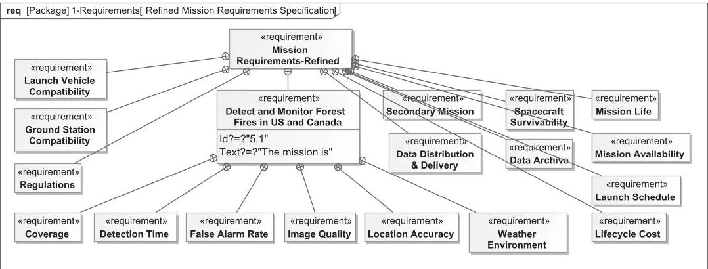

Fig. 23 The Mission Requirements-refined are refined from the source requirements in the New SMAD shown in the previous figure.

response time, probability of fire detection, False Alarm Rate, Location Accuracy and Weather Environment.

Additional mission requirements relate to Launch Vehicle Compatibility, Ground Station Compatibility, and Regulations, such as the constraints on the available radio frequency spectrum. Other mission requirements specify data Distribution and Delivery, Data Archive, Mission Availability, Spacecraft Survivability, Mission Life, Lifecycle Cost, and Launch Schedule.

Clearly, there is considerable analysis needed to derive the mission and system requirements from the set of stakeholder concerns and needs. The supporting mission analysis that provides the rationale for this traceability is part of the Perform Analysis activity shown in Fig. 19, and is discussed later in this section.

The matrix view in Table 2 shows the refinement relationship between the refined mission requirements in Fig. 23 and the New SMAD mission requirements in Table 1. The arrows in the cells of the matrix indicate that the mission requirements in the columns refine the source SMAD requirements shown in the rows.

## Define Mission Elements

Figure 24 is a top level bdd that shows the mission elements that the spacecraft directly or indirectly interacts with throughout its mission, which includes other systems, users, and environments. This figure is important for setting the context for the Spacecraft.

In particular, the top level block is the Mission Context and is composed of the Mission Enterprise. The Mission Enterprise is composed of the Spacecraft, Launch Vehicle, Launch Ops, Ground Station, and relay Spacecraft, and these are the primary mission elements needed to accomplish the mission. Note that the ground station is composed of mission operations and the ground

<!-- PDF_PAGE: 31 -->

TABLE 2 TRACEABILITY BETWEEN THE REFINED MISSION REQUIREMENTS SPECIFIED IN FIG. 23 AND THE MISSION REQUIREMENTS FROM THE NEW SMAD IN TABLE 1

<table border="1"><tr><td rowspan="2"></td><td colspan="16">5 Mission Requirements-Refined</td></tr><tr><td>5.1 Detect and Moni
5.1.2 Image Qu
5.1.3 Detection
5.1.4 False Alar
5.1.5 Coverage
5.1.6 Location A
5.1.7 Weather E
5.2 Launch Vehicle
5.3 Mission Life
5.4 Ground Station
5.6 Secondary Mission
5.7 Data Distributio
5.8 Regulations
5.9 Lifecycle Cost
5.10 Launch Schedule
5.11 Spacecraft Sur
5.12 Mission Availab
5.13 Data Archive</td></tr><tr><td>34 Mission Requirements-SMAD Table 3-4</td><td></td><td></td><td></td><td></td><td></td><td></td><td></td><td></td><td></td><td></td><td></td><td></td><td></td><td></td><td></td><td></td></tr><tr><td>34.1 Performance</td><td></td><td></td><td></td><td></td><td></td><td></td><td></td><td></td><td></td><td></td><td></td><td></td><td></td><td></td><td></td><td></td></tr><tr><td>34.1.1 Weather</td><td></td><td></td><td></td><td></td><td></td><td></td><td></td><td></td><td></td><td></td><td></td><td></td><td></td><td></td><td></td><td></td></tr><tr><td>34.1.2 Resolution</td><td></td><td></td><td></td><td></td><td></td><td></td><td></td><td></td><td></td><td></td><td></td><td></td><td></td><td></td><td></td><td></td></tr><tr><td>34.1.3 Geo-location Accuracy</td><td></td><td></td><td></td><td></td><td></td><td></td><td></td><td></td><td></td><td></td><td></td><td></td><td></td><td></td><td></td><td></td></tr><tr><td>34.2 Coverage</td><td></td><td></td><td></td><td></td><td></td><td></td><td></td><td></td><td></td><td></td><td></td><td></td><td></td><td></td><td></td><td></td></tr><tr><td>34.3 Interpretation</td><td></td><td></td><td></td><td></td><td></td><td></td><td></td><td></td><td></td><td></td><td></td><td></td><td></td><td></td><td></td><td></td></tr><tr><td>34.4 Timeliness</td><td></td><td></td><td></td><td></td><td></td><td></td><td></td><td></td><td></td><td></td><td></td><td></td><td></td><td></td><td></td><td></td></tr><tr><td>34.5 Secondary Missions</td><td></td><td></td><td></td><td></td><td></td><td></td><td></td><td></td><td></td><td></td><td></td><td></td><td></td><td></td><td></td><td></td></tr><tr><td>34.6 Commanding</td><td></td><td></td><td></td><td></td><td></td><td></td><td></td><td></td><td></td><td></td><td></td><td></td><td></td><td></td><td></td><td></td></tr><tr><td>34.7 Mission Design Life</td><td></td><td></td><td></td><td></td><td></td><td></td><td></td><td></td><td></td><td></td><td></td><td></td><td></td><td></td><td></td><td></td></tr><tr><td>34.8 System Availability</td><td></td><td></td><td></td><td></td><td></td><td></td><td></td><td></td><td></td><td></td><td></td><td></td><td></td><td></td><td></td><td></td></tr><tr><td>34.9 Survivability</td><td></td><td></td><td></td><td></td><td></td><td></td><td></td><td></td><td></td><td></td><td></td><td></td><td></td><td></td><td></td><td></td></tr><tr><td>34.10 Data Distribution</td><td></td><td></td><td></td><td></td><td></td><td></td><td></td><td></td><td></td><td></td><td></td><td></td><td></td><td></td><td></td><td></td></tr><tr><td>34.11 Data Content, Form, and Format</td><td></td><td></td><td></td><td></td><td></td><td></td><td></td><td></td><td></td><td></td><td></td><td></td><td></td><td></td><td></td><td></td></tr><tr><td>34.12 User Equipment</td><td></td><td></td><td></td><td></td><td></td><td></td><td></td><td></td><td></td><td></td><td></td><td></td><td></td><td></td><td></td><td></td></tr><tr><td>34.13 Cost</td><td></td><td></td><td></td><td></td><td></td><td></td><td></td><td></td><td></td><td></td><td></td><td></td><td></td><td></td><td></td><td></td></tr><tr><td>34.14 Schedule</td><td></td><td></td><td></td><td></td><td></td><td></td><td></td><td></td><td></td><td></td><td></td><td></td><td></td><td></td><td></td><td></td></tr><tr><td>34.15 Risk</td><td></td><td></td><td></td><td></td><td></td><td></td><td></td><td></td><td></td><td></td><td></td><td></td><td></td><td></td><td></td><td></td></tr><tr><td>34.16 Regulations</td><td></td><td></td><td></td><td></td><td></td><td></td><td></td><td></td><td></td><td></td><td></td><td></td><td></td><td></td><td></td><td></td></tr><tr><td>34.17 Political</td><td></td><td></td><td></td><td></td><td></td><td></td><td></td><td></td><td></td><td></td><td></td><td></td><td></td><td></td><td></td><td></td></tr><tr><td>34.18 Environment</td><td></td><td></td><td></td><td></td><td></td><td></td><td></td><td></td><td></td><td></td><td></td><td></td><td></td><td></td><td></td><td></td></tr><tr><td>34.19 Interfaces</td><td></td><td></td><td></td><td></td><td></td><td></td><td></td><td></td><td></td><td></td><td></td><td></td><td></td><td></td><td></td><td></td></tr><tr><td>34.20 Development Constraints</td><td></td><td></td><td></td><td></td><td></td><td></td><td></td><td></td><td></td><td></td><td></td><td></td><td></td><td></td><td></td><td></td></tr></table>

The line with the arrowhead depicts a refinement relationship indicating that the mission requirements in the columns refine the source mission requirements in the rows.

segment, as indicated by its parts compartment. Also note that there are one to many Spacecraft, one to many Launch Vehicles, and zero to many Relay Satellites as indicated by the multiplicity on the ends of the whole-part relationships.

Although not shown in this figure to simplify the model, the Mission Enterprise is actually composed of one to many launch systems, where each launch system is composed of a single Launch Vehicle and one to many Spacecraft. The number of launch systems and the number of Spacecraft per Launch Vehicle is subject to tradeoff.

The Mission Context also includes the Spacecraft Environment, which is specialized as a Launch Environment and Space Environment. The Space Environment is composed of several planetary objects, such as the Sun and stars, that interact with the Spacecraft through solar radiation affects and light energy that is received by the Spacecraft for navigation. The Space Environment also includes

<!-- PDF_PAGE: 32 -->

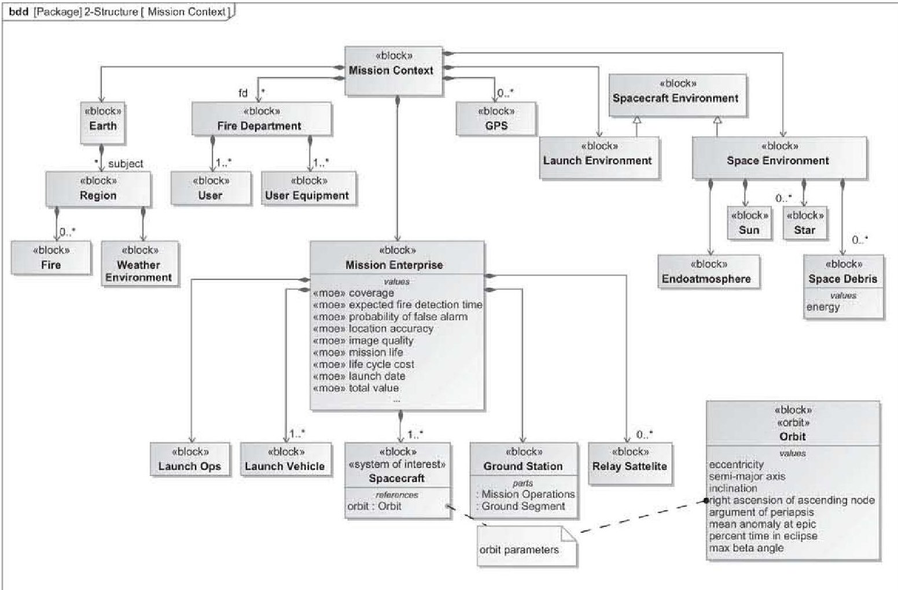

Fig. 24 This block definition diagram identifies the mission elements that the Spacecraft directly or indirectly interacts with throughout its mission.

<!-- PDF_PAGE: 33 -->

the Endo-Atmosphere, which induces drag on the Spacecraft, and Space Debris that can impact the Spacecraft.

The Fire Departments are also shown in this figure, along with the regions on the Earth that are intended to be monitored by the Spacecraft. The Regions that are intended to be monitored can included fires, and are referred to as the subject.

Properties can be specified for any mission element. These properties are used in various analyses. A moe is a particular kind of property of the Mission Enterprise as shown in Fig. 24. The moes are the important properties that can be used to measure the success or failure of the mission. In this case, the moes correlate directly with the mission performance requirements specified in Fig. 23, such as coverage, mission life, and others, and serve as criteria for optimizing the mission.

## Orbit Analysis

The block called Orbit in Fig. 24 is defined with the key properties needed to specify the orbit. The Spacecraft includes a reference to its Orbit in its compartment as shown in Figure 24. The mission and system analysis is performed to trade off different orbits, and optimize the orbit parameters and other system design properties to maximize the total value of the mission moes.

An example of the mission analysis to specify the orbit is shown in Fig. 25. In this particular example, the orbits are analyzed using a commercial off-the-shelf (COTS) simulation tool from AGI called systems tool kit (STK).

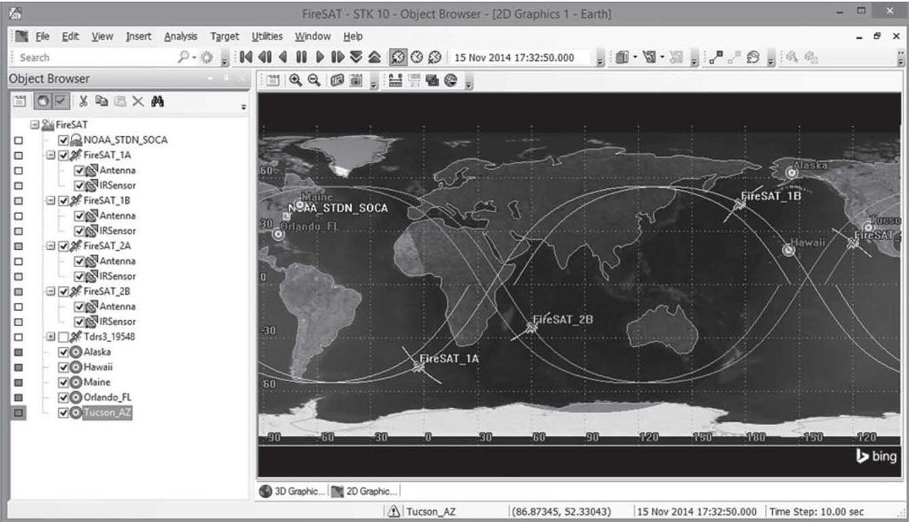

Fig. 25 Orbits for the 4 spacecraft constellation with 2 spacecraft in each of 2 planes provides necessary coverage and revisit times.

<!-- PDF_PAGE: 34 -->

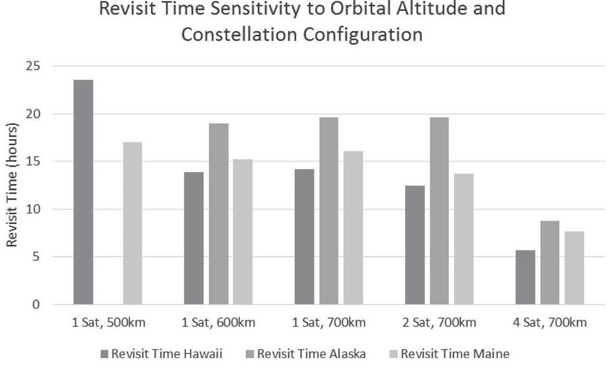

Fig. 26 Orbit analysis results showing the Revisit Time to selected regions within the specified coverage area.

The figure depicts four Spacecraft in two orbital planes. The orbital planes differ in the right ascension of the ascending node (RAAN) and the two Spacecraft in each plane are separated by $ 1 8 0^{\circ} $ . This constellation configuration is the proposed alternative that provides the necessary coverage and revisit times based on the analysis performed.

Analysis models such as the model that generated the results in Fig. 26 are used to evaluate and optimize the mission and system design alternatives that are captured in the system model. The parametrics in Sec. II.G describe the integration between the system model and analytical models, such as the orbit analysis model described here.

Figure 26 illustrates the results from one study using this model. This study investigated the impact of the orbital altitude and number of Spacecraft on revisit times for representative locations in the required coverage regions. The mission requirement is to provide "coverage of specified forest areas within the United States at least twice daily." A single Spacecraft at 500-km altitude does not provide the needed coverage. Placing the Spacecraft in a higher orbit at 700 km increases the total coverage and decreases revisit times as shown in the figure. This study also shows that a single LEO Spacecraft at 700 km is not capable of achieving the desired revisit times. Adding a second Spacecraft in the same orbital plane only marginally improves this performance. However, adding a second plane that phases the orbits with two additional Spacecraft decreases revisit times nearly in half. Adding a third plane further decreases revisit time, but with diminishing returns for the additional cost.

<!-- PDF_PAGE: 35 -->

The 4 spacecraft configuration is the proposed mission design alternative. Since there are two spacecraft in each plane, it is assumed that two Launch Vehicles are required [Pegasus Launch Vehicle Users Guide, 2010]. Each Launch Vehicle carries two Spacecraft to achieve the desired orbit plane. However, this is subject to further tradeoff and analysis to balance with other system design considerations related to size, payload sensor, communications, and propulsion.

The selected orbit is circular with an orbit period of 99 min. The previous analysis is used to derive the requirements for Orbit Altitude, Orbit Plane, and the Number of Spacecraft from the mission requirements for Coverage and Detection Time as indicated in Fig. 27. The Revisit Time is derived from the Detection Time. As noted previously, the orbit requirements must be balanced with other system requirements to ensure that the Coverage, Detection Time, and other mission requirements are satisfied.

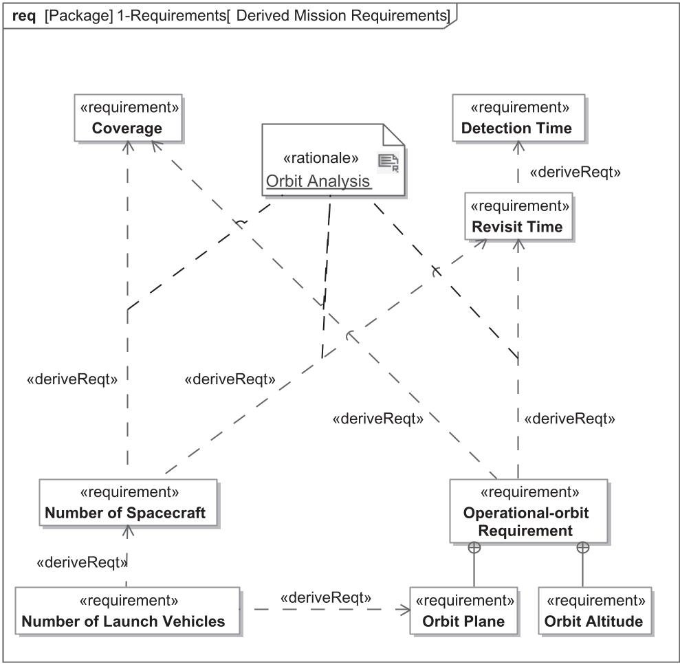

Fig. 27 Traceability showing the requirements for Orbit Plane, Orbit Altitude, Number of Spacecraft, and Number of Launch Vehicles Derived from Mission Requirements.

<!-- PDF_PAGE: 36 -->

## Specify Mission Functions

The top level functions needed to Perform Mission are shown in Fig. 28. These include the functions to Launch Spacecraft, Separate from Launch Vehicle, Control Trajectory, Deploy Mechanisms, Maintain Operations, and Provide Observation Data. Each of these functions may involve interactions throughout the mission between the Spacecraft and other mission elements such as the Launch Vehicle, Ground Station, and the Space Environment.

Mission analysis is used to derive the performance and physical requirements associated with each function. For example, the Control Trajectory function must support the orbit requirements that are derived based on the orbit analysis described in the previous section. This analysis is summarized in Sec. II.G.

The mission functions are further decomposed as part of specify system requirements to specify explicitly what the spacecraft must do to support the mission. An example is shown in the Maintain Operations activity diagram in Fig. 29. To maintain Spacecraft operations, the Spacecraft must Provide Telemetry Data, Receive Ground Command, Provide Electrical Power, Control Thermal Environment, and Manage Faults.

## Specify Mission Timeline

The mission timeline is defined in terms of mission events as shown in the sequence diagram in Fig. 30. The events are associated with the sending of signals between different mission elements. The Power On signal from Launch Ops to the Spacecraft results in a state change of the Spacecraft from the off state to the powering up state and then to the on state. Other states are not shown for brevity. The more detailed on orbit and data distribution events are referenced in Fig. 29 and shown in more detail in Fig. 31.

Time constraints can be specified between any two events, as indicated in Fig. 31 by the time duration between the time a fire starts and the time the data are made available to the end user.

## Identify Mission Failure Modes

It is important to identify the top level failure modes that can cause a mission failure and design the mission and system to mitigate these failures as shown in Fig. 32. This is initiated by identifying the potential failure modes to perform each top level function described in the perform mission activity shown in Fig. 28. There are generally multiple failure modes associated with failing to perform a particular activity, although only a single failure mode for each activity is shown in this figure for simplicity.

A failure mode in the figure violates an activity, and one failure mode can be caused by another (i.e., an effect). A violation implies a performance constraint for a particular activity is not satisfied when one or more property values are outside of their acceptable range for some period of time. The violation of one constraint can be caused by another constraint violation. (Note: this relationship may be very complex and difficult to characterize and quantify). The elaboration

<!-- PDF_PAGE: 37 -->

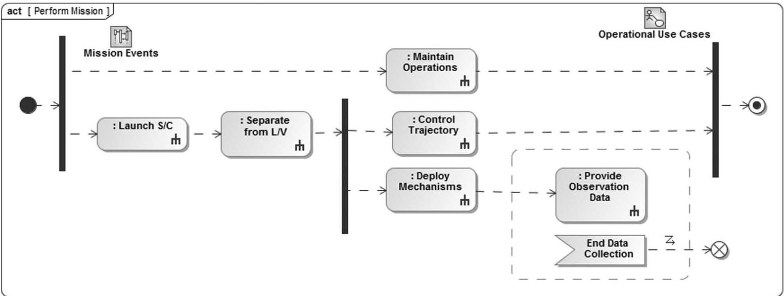

Fig. 28 Top level functions of the Perform Mission activity.

<!-- PDF_PAGE: 38 -->

of these failure modes are illustrated in Sec. II.F and are intended to aid in the failure analysis and failure mitigation strategy.

## E. SPECIFY SPACECRAFT SYSTEM REQUIREMENTS

This purpose of this activity is to specify the black box requirements for the Spacecraft which support the mission requirements. A black box requirement specifies functional, performance, physical, and interface requirements that are observable and verifiable at the Spacecraft level. The mass requirement for the Spacecraft is an example of an observable requirement (i.e., can be measured), whereas the mass of a star tracker is not observable at the Spacecraft level. Similarly, the requirement to return observation data is observable at the Spacecraft level, whereas the requirement to process command data is not externally observable. Some requirements associated with managing the spacecraft internal state, such as Provide Electrical Power, are treated as black box requirements, even though the internal power is not externally observable.

The black box requirements are traceable to the mission requirements. Specifying the black box requirements at the right level of abstraction avoids

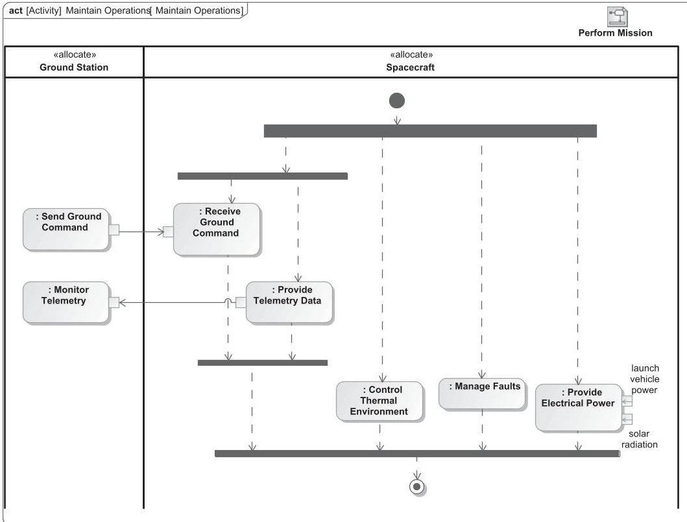

Fig. 29 Some of the functions the Spacecraft must perform are shown in the Maintain Operations activity.

<!-- PDF_PAGE: 39 -->

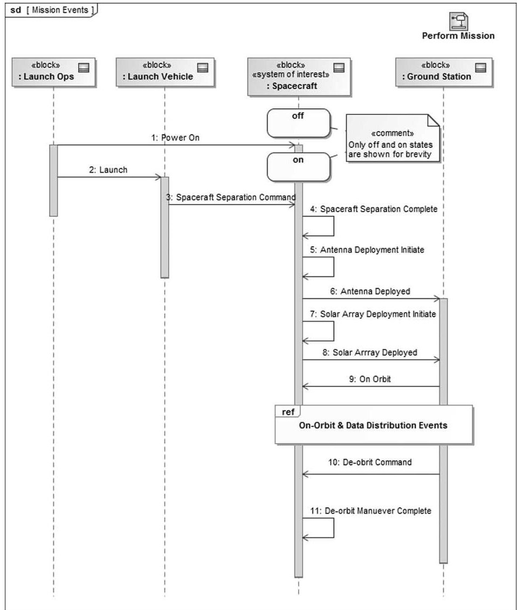

Fig. 30 Sequence diagram showing the mission events including a reference to a more detailed sequence diagram for the on-orbit and data distribution events.

over-constraining the Spacecraft design and enables the Spacecraft design activities to explore the design space by identifying alternative solutions that for the same black box specification. The approach to specifying the black box system requirements is described below.

## Specify the Spacecraft External Interfaces

The ibd for the Mission Context in Fig. 33 shows the Spacecraft external interfaces with other mission elements that are identified in Fig. 24. The Spacecraft, Launch Vehicle, Launch Ops, and Ground Station are all parts of the Mission

<!-- PDF_PAGE: 40 -->

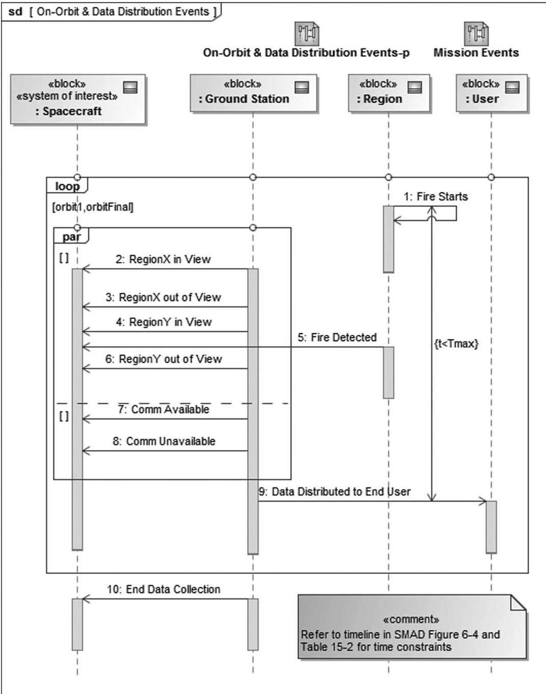

Fig. 31 Sequence diagram showing the on-orbit and data distribution events.

Enterprise. The Spacecraft ports depicted on its boundary identify each of the external interfaces. The item flows depicted as arrows on the connectors represent flows between the mission elements and the Spacecraft.

The ports represent diverse kinds of interfaces including electrical, mechanical, RF, and other physical interfaces. More generally, they can represent

<!-- PDF_PAGE: 41 -->

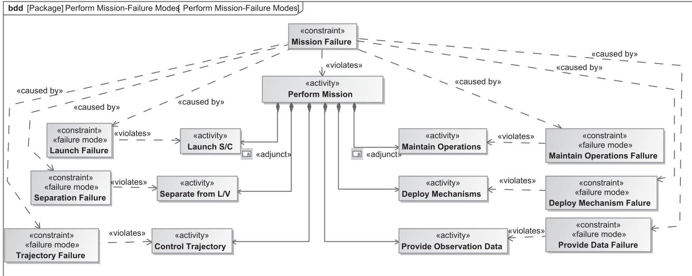

Fig. 32 The potential mission failure modes are identified from the Perform Mission activity. The potential failure modes are defined in terms of violations to satisfy the performance criteria for a particular activity. A failure mode can cause another failure mode (i.e., an effect).

<!-- PDF_PAGE: 42 -->

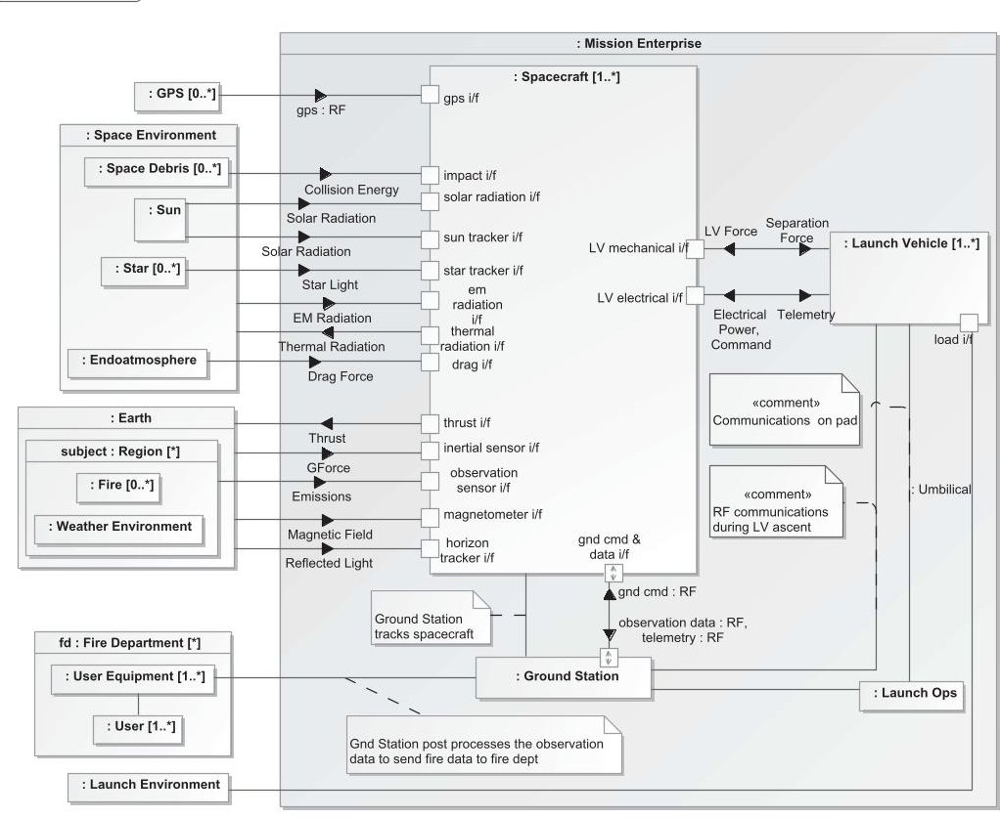

Fig. 33 Spacecraft external interfaces with other mission elements are identified on the Mission Context internal block diagram.

software interfaces, user interfaces, and more abstract logical interfaces. The gnd cmd and data i/f port is the interface that specifies the external interface to the ground station. As indicated in the figure, the item flows include the ground commands, the observation data, and the telemetry, all of which are RF signals. This particular port is later seen to be delegated to the interface for the spacecraft antenna.

The port called sensor observation i/f accepts the emissions from a subject:region on the Earth. This port is later seen as a basis for specifying the interface to the Spacecraft Payload. Other port examples include the external electrical and mechanical interfaces to the Launch Vehicle called LV electrical i/f and LV mechanical i/f. When on the pad, the commands and telemetry are sent to and from the Spacecraft through the LV electrical i/f to the Launch Vehicle and from the Launch Vehicle through an electrical umbilical to Launch Ops. During Launch Vehicle ascent, the spacecraft continues to communicate through the Launch Vehicle via RF communications with the Ground Station, which in turn communicates with Launch Ops. The solar radiation i/f specifies an external interface to the Sun that collects the solar radiation, which is later seen to provide the interface

<!-- PDF_PAGE: 43 -->

to the Solar Array. The port called the impact i/f is a very abstract interface that corresponds to the exposed surface of the Spacecraft that is subject to impact with Space Debris. Different views of the mission context can highlight only the ports and connectors that are used during each mission phase (e.g., prelaunch, ascent, and on-orbit).

Note that only some of the mission elements have ports. It is up to the modeler to determine where ports are needed to specify the interface. For example, it does not necessarily make sense to specify a port on the Sun.

## Specify Spacecraft Functional Requirements

The Spacecraft black box functions define what the spacecraft must do to support the mission. These functions are derived by further elaborating each mission function in the Perform Mission activity diagram in Fig. 28. As described in the introduction to this section, the intent is to specify a system function as a black box function without over constraining how the function is realized by the spacecraft. For example, the functions in Fig. 29 to Provide Telemetry, Provide Electrical Power, Control Thermal Environment, and Manage Faults are black box system functions that can be realized by alternative Spacecraft system design concepts.

Each black box function has performance and interface requirements associated with them. For example, the Spacecraft function to provide telemetry requires an external interface between the Spacecraft and Ground Station. The performance requirement for the Spacecraft function to Provide Electrical Power specifies the power levels that must be provided throughout the mission. The performance and physical requirements are derived based on further engineering analysis as described later in this section.

Another example of Spacecraft black box functions are the control acceleration and Control Attitude functions that are derived from control trajectory in the Perform Mission activity. The performance requirements are associated with the attitude control accuracy and acceleration levels.

## Specify Spacecraft States

The overall Spacecraft behavior is described in the state machine diagram in Fig. 34. This state machine specifies the Spacecraft states and the events that trigger transitions from one state to another, such as the receipt of a Power On and Power Off signals sent from Launch Ops to the Spacecraft. The specific behaviors in each state are also specified, such as Maintain Spacecraft Operations in the on state.

The on state contains two concurrent regions. One region specifies whether the spacecraft is in normal or safe state. The other region specifies whether the spacecraft is in the separating, transferring, orbiting, or de-orbiting state. At any given time, the spacecraft is in exactly one state in each region. Each state may have further nested states as shown by the on, operating, and orbiting states.

<!-- PDF_PAGE: 44 -->

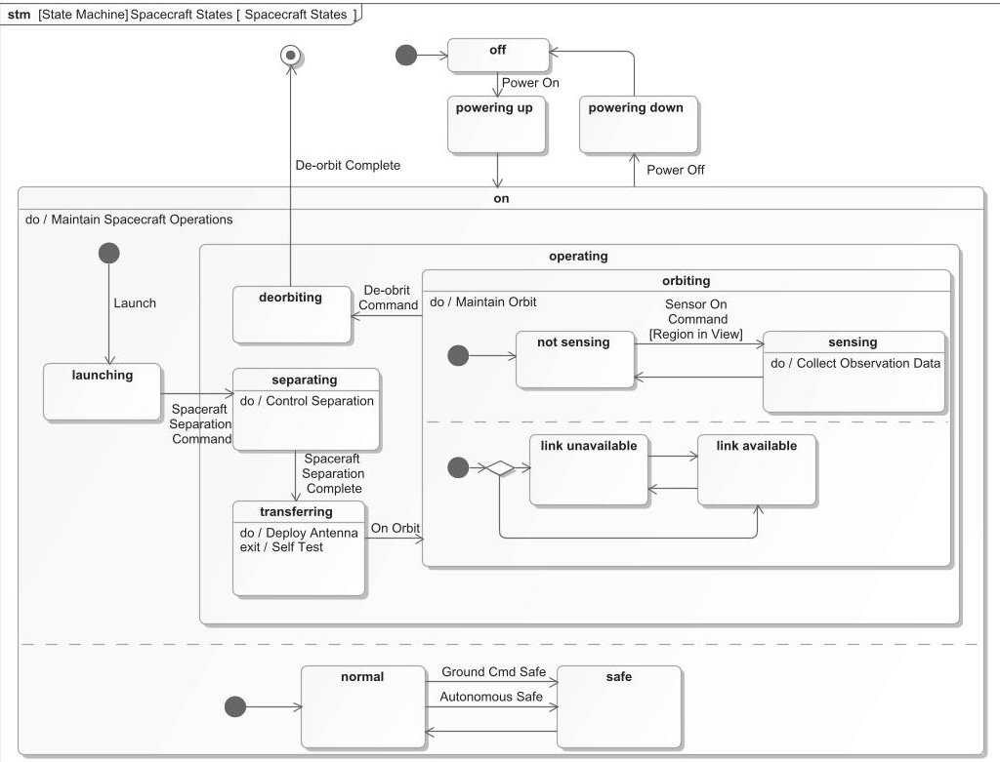

Fig. 34 The spacecraft state machine diagram specifies the overall behavior of the spacecraft in terms of its states, transitions between states, and behaviors within each state.

The transition from one state to another may include a guard condition that must be true for the transition to occur, such as the transition from the not sensing to the sensing state subject to the condition Region in View being true.

## Specify Spacecraft Performance, Physical, and other Quality Characteristics

The spacecraft performance and physical properties and other quality characteristics reflect desired characteristics of the spacecraft. As an example, the Mass property reflects the required mass of the spacecraft, the delta-V property reflects how much delta-V the spacecraft must provide to meet mission requirements, the power property reflects how much electrical power the spacecraft must provide, and the reliability property reflects the specified MTBF of the spacecraft. The required values are subject to trade study and may include an acceptable range of values rather than a single value.

To achieve the required property values, the current best estimate of the property value will be determined based on analysis of the Spacecraft design and compared with the required value. This estimate will vary as the design matures. Early in the design process, a reserve is included to account for design uncertainty.

<!-- PDF_PAGE: 45 -->

The required values are subject to further refinement and reallocation based on the design feedback and further analysis.

The required property values and the estimated design values are determined based on iterative analysis of the mission design and the system design. For example, the mass is constrained by the Launch Vehicle and other factors [Pegasus Launch Vehicle Users Guide, 2010]. The estimated Mass is derived from the initial estimates of the dry mass plus the propellant mass. The initial estimate of the dry mass is often based on general rules of thumb and comparisons with similar designs. The propellant mass is derived from the propulsion analysis to achieve and maintain the optimal mission orbit. This includes the delta-V required to transfer from launch vehicle separation to operational orbit, maintain the operational orbit, perform the de-orbit maneuver, and perform other required Spacecraft maneuvers, such as the yaw slew maneuvers to ensure that the payload sensor remains pointed away from the Sun. The propulsion analysis assumes the dry mass estimate in its calculation.

Table 3 shows the total mass estimate in terms of an initial value, a reserve value, and budgeted value for each subsystem. This table also includes the propellant mass estimate based on the propulsion analysis results in Table 4. The propellant mass to transfer to operational orbit uses the orbit parameters from the

TABLE 3 AN INITIAL SYSTEM MASS BUDGET WITH A LAUNCH MASS TARGET OF 150 KG

<table border="1"><tr><td>Subsystem</td><td>Initial Mass(kg)</td><td>Subsystem Reserve(kg)</td><td>Budget Mass(kg)</td></tr><tr><td>FireSAT Payload</td><td>18.2</td><td>7.8</td><td>26</td></tr><tr><td>Structure</td><td>16.1</td><td>6.9</td><td>23</td></tr><tr><td>Thermal</td><td>1.4</td><td>0.6</td><td>2</td></tr><tr><td>Power(incl harness)</td><td>13.3</td><td>5.7</td><td>19</td></tr><tr><td>TT&amp;C</td><td>1.4</td><td>0.6</td><td>2</td></tr><tr><td>Avionics</td><td>2.8</td><td>1.2</td><td>4</td></tr><tr><td>GN&amp;C</td><td>3.5</td><td>1.5</td><td>5</td></tr><tr><td>Propulsion</td><td>2.1</td><td>0.9</td><td>3</td></tr><tr><td>Other</td><td>2.1</td><td>0.9</td><td>3</td></tr><tr><td>Propellant</td><td>35</td><td>15</td><td>50</td></tr><tr><td>Total Dry Mass</td><td></td><td></td><td>87</td></tr><tr><td>Total Wet Mass</td><td></td><td></td><td>137</td></tr><tr><td>Launch Target Mass</td><td></td><td></td><td>150</td></tr><tr><td>System-level Margin</td><td></td><td></td><td>13</td></tr></table>

<!-- PDF_PAGE: 46 -->

TABLE 4 THE DELTA-V AND REQUIRED FUEL MASS ASSESSMENT

<table border="1"><tr><td colspan="3">Constants &amp; Mission Parameters</td></tr><tr><td>Nominal Dry Mass</td><td>100.0000</td><td>kg</td></tr><tr><td>Insertion Orbit</td><td>200.0000</td><td>km</td></tr><tr><td>Operational Orbit</td><td>700.0000</td><td>km</td></tr><tr><td>Inclination Error</td><td>0.0500</td><td>deg</td></tr><tr><td>Earth Radius</td><td>6378.0000</td><td>km</td></tr><tr><td>Earth mu</td><td>398600.4418</td><td></td></tr><tr><td>Isp</td><td>220.0000</td><td>sec</td></tr><tr><td colspan="3">Orbital Insertion</td></tr><tr><td>Hohman Burn 1</td><td>270.2571</td><td>m/s</td></tr><tr><td>Hohman Burn 2</td><td>138.6632</td><td>m/s</td></tr><tr><td>Inclination Correction</td><td>6.5488</td><td>m/s</td></tr><tr><td>Required Prop</td><td>21.2285</td><td>kg</td></tr><tr><td colspan="3">Yaw Slew</td></tr><tr><td>Prop per maneuver</td><td>0.0490</td><td>kg</td></tr><tr><td>Maneuvers per year</td><td>10.0000</td><td></td></tr><tr><td>Mission Duration</td><td>8.0000</td><td>years</td></tr><tr><td>Required Prop</td><td>3.9200</td><td>kg</td></tr><tr><td colspan="3">Orbit Maintenance</td></tr><tr><td>Drag</td><td>21.0000</td><td>m/s</td></tr><tr><td>De-Orbit</td><td>183.0000</td><td>m/s</td></tr><tr><td>Required Prop</td><td>9.9135</td><td>kg</td></tr><tr><td>Total Required Prop</td><td>35.0620</td><td>kg</td></tr><tr><td>Margin</td><td>11.5705</td><td>kg</td></tr><tr><td>Budgeted Prop</td><td>46.6325</td><td>Kg</td></tr></table>

orbit analysis discussed previously. The integration of the analysis models with the system model is further summarized in Sec. II.G.

## Specify Spacecraft as a Black Box

The Spacecraft black box specification with each of its features is shown in Fig. 35. These features reflect what is required of the Spacecraft, and include the ports that specify the Spacecraft interfaces, the operations that specify the

<!-- PDF_PAGE: 47 -->

«block»

«system of interest»

Spacecraft

references

orbit : Orbit

values

«tpm» mass

«tpm» size : Shape

«tpm» power

«tpm» deltaV

«tpm» max radiation level

«tpm» reliability

«tpm» life

«tpm» cost

«tpm» data capacity

«tpm» probability of detection

«tpm» probability of false alarm

«tpm» pointing accuracy

«store» e : Electrical Energy

operations

collect observation data()

return observation data()

receive ground command()

provide telemetry data()

control attitude()

control acceleration()()

provide electrical power()

control thermal environment()

manage faults()

control separation()

provide structural integrity()

deploy antenna()

deploy solar array()

ports

solar radiation i/f

em radiation i/f

observation sensor i/f

thrust i/f

gnd cmd & data i/f : GndCmd&Data I/F

LV electrical i/f : LV Elecrictal I/F

LV mechanical i/f

thermal radiation i/f

star tracker i/f

inertial sensor i/f

impact i/f

gps i/f

horizon tracker i/f

drag i/f

sun tracker i/f

magnetometer i/f

classifier behavior

«statemachine»Spacecraft States

Fig.35 The Spacecraft black box specification specifies the key functional, interface, and technical performance measures the system design must realize to satisfy the mission requirements.

Spacecraft functions, the value properties that specify the Spacecraft performance, physical, and quality characteristics, and the state machine that specifies the Spacecraft states. This block is referred to as the spacecraft black box specification.

Each feature of the black box specification must be satisfied by the system design. The value properties, such as mass, power, and size, are budgeted across the spacecraft subsystems and components. Similarly, multiple spacecraft subsystems and their components interact to perform each system function. The goal of the integrated spacecraft design is to satisfy the requirements that are associated with each black box feature and optimize the mission measures of effectiveness within the program constraints.

Only critical performance, physical, and quality

characteristics are shown in this figure. The tpm keyword designates these properties as technical performance measures to indicate that they can significantly impact mission performance. In addition, the black box specification includes a reference to its Orbit, which specifies the orbit parameters.

<!-- PDF_PAGE: 48 -->

## Identify Spacecraft Failure Modes

The basis for identifying mission failure modes was discussed in a previous section and shown in Fig. 32. The Spacecraft and other mission elements, such as the Launch Vehicle, can each contribute to a Mission Failure. The spacecraft failure modes are identified in a similar way as the mission failure modes. The failure modes reflect the potential inability of the spacecraft to perform each of its functions within its specified performance bounds. There are generally multiple failure modes for each activity.

The Spacecraft functions to Control Attitude and control acceleration contribute to the mission function to Control Trajectory. The inability to maintain the attitude rate and/or maintain the steady state attitude within the specified performance bounds are two potential failure modes for Control Attitude. The discussion on component failure modes in Sec. II.F provides an example of how lower level failure modes can contribute to a mission failure.

## Capture Spacecraft System Requirements Specification

The spacecraft system requirements are captured in Fig. 36 in a similar way that the mission requirements are depicted. The system requirements are derived from the mission requirements based on analyzing the mission and determining what is required of the spacecraft to support the mission. These requirements are aligned with the features of the spacecraft black box specification, often through a refine relationship. For example, the mass requirement has a refine relationship with the mass property of the black box specification.

Figure 37 show the derivation of the spacecraft Mass and Delta-V requirement from the Launch Vehicle Compatibility and Orbit requirements [Pegasus Launch Vehicle Users Guide, 2010], and the rationale for that derivation based on the Mass and Delta-V Analysis, which includes the orbit analysis, mass analysis, and propulsion analysis as described in Sec. II.G.

The Spacecraft Specification may be developed by the contractor responsible for developing the spacecraft, or provided by the sponsor to the contractor, or a combination of both. The Spacecraft Specification contains requirements that specify the Launch Vehicle interface, Functional and Performance, Physical, and other Quality Characteristics. The spacecraft requirements continue to be refined as part of the spacecraft design tradeoffs to evolve a balanced system design that supports the mission objectives and associated effectiveness measures.

## F. SYNTHESIZE ALTERNATIVE SPACECRAFT SYSTEM ARCHITECTURES

This activity is used to identify and evaluate alternative spacecraft system architectures, select a preferred system architecture, and specify the components of the spacecraft. In particular, this activity includes decomposing the spacecraft into its subsystems and components, defining their interconnection and interactions, and specifying the components needed to perform the Spacecraft black box functions. The component specifications include their functions, interfaces,

<!-- PDF_PAGE: 49 -->

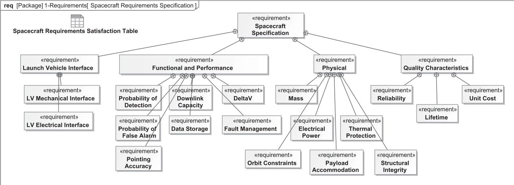

Fig. 36 The Spacecraft Specification contains the text-based requirements that are aligned with the black box specification features to support the mission requirements.

<!-- PDF_PAGE: 50 -->

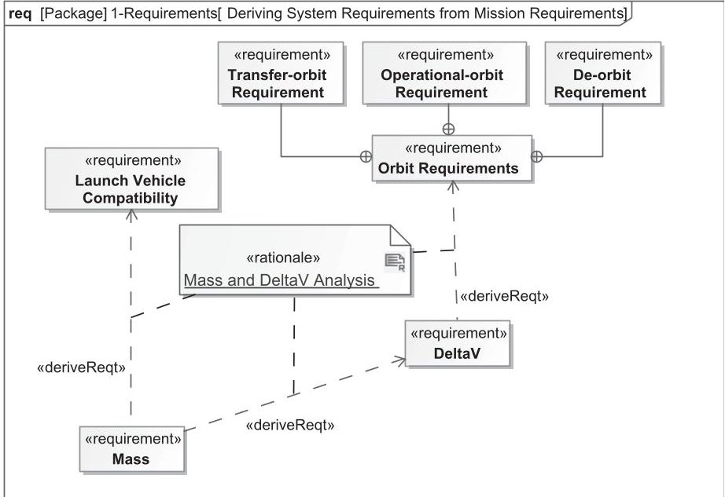

Fig. 37 Example showing traceability of system requirements for Mass and Delta-V with supporting analysis providing rationale.

performance, physical and quality characteristics, and states. These specifications are input to the component design, implementation, and verification.

## Decompose Spacecraft

The Spacecraft is decomposed into its subsystems and components. The Spacecraft black box shown in Fig. 35 is not decomposed directly, but is specialized by a block that inherits the spacecraft black box features. This preserves the black box as a specification, while enabling the specialized block to be decomposed into its parts.

The Spacecraft black box can be specialized into a block that corresponds to the spacecraft-logical and another block that corresponds to the Spacecraft-Physical. The spacecraft-logical block is decomposed into logical components that do not impose technology-specific constraints. This is done when it is desired to open up the trade space to completely new design alternatives. The logical components from a particular logical decomposition are allocated to alternative physical blocks that correspond to alternative physical designs. The logical decomposition is not included in this example. However, a spacecraft-physical can still be sufficiently abstract to accommodate substantial variation in design options as is seen in this example.

In Fig. 38, the Spacecraft-Physical block is a specialization of the Spacecraft black box from Fig. 35, and inherits its black box specification features. The Spacecraft-Physical is decomposed into the Payload, Communications, Avionics, GN&C, Propulsion, Power, Thermal, Structures and Mechanisms, and Harness

<!-- PDF_PAGE: 51 -->

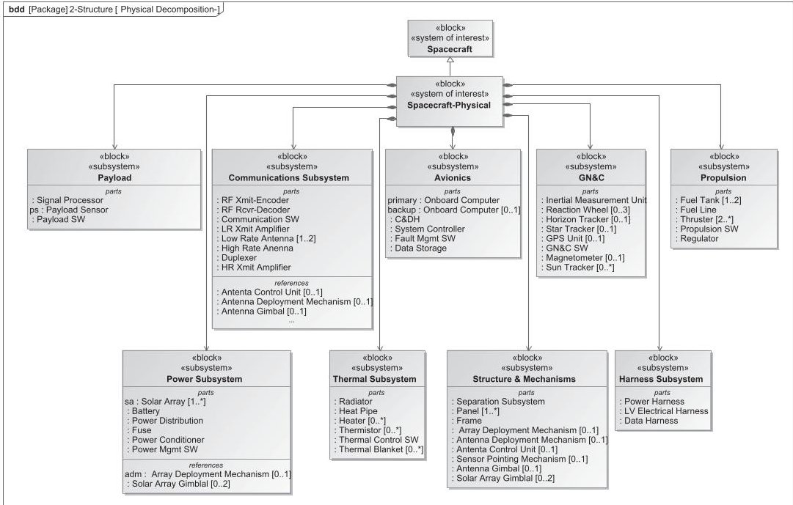

Fig. 38 The Spacecraft-Physical is a specialization of the Spacecraft black box specification, and is decomposed into its subsystems and their components.

subsystems. Each subsystem is further decomposed into its components as indicated in the figure. The subsystem key word designate each subsystem on the bdd.

The use of multiplicity enables the specification of variant Spacecraft designs. For example, each Solar Array is composed of one to many Array Panels, which is subject to further tradeoff and analysis. As will be shown later, multiplicity and specialization provide substantial capability to model alternative physical architectures.

The Software is also treated as a subsystem (not shown on the diagram), and is decomposed into Mission Software and Flight Software. The Mission Software and Flight Software references the software components, which are part of their corresponding subsystem. For example, the Thermal Control SW is part of the Thermal Subsystem.

The figure shows the decomposition of the Spacecraft into subsystems, and the decomposition of the subsystems into components. Although multiple levels of decomposition can be shown, it is common practice to show only a single level of decomposition on a given diagram to reduce complexity of the diagram.

The Spacecraft design may have multiple decompositions, but a single decomposition should be designated as the primary decomposition. Each decomposition may support a particular view and requires a specialization of

<!-- PDF_PAGE: 52 -->

the Spacecraft black box. An example is a decomposition that aggregates the components into higher level assemblies that generally do not correspond to subsystems. For example, each Remote Interface Unit (RIU) in the C&DH subsystem may be a part of a different assembly. A production view of the system typically includes a system decomposition into assemblies rather than subsystems, where each assembly is a composition resulting from an assembly process. Another example may be a dynamics view that decomposes the Spacecraft into lumped masses that include the center body and appendages such as arrays, antennas, and thrusters. The lumped masses include their mass, moment of inertia, and other mass properties, and are subject to dynamics analysis. The correspondence between the lumped masses in the dynamics decomposition and the components in the reference decomposition must be maintained, and the constraints on the property values must be consistent (i.e., the mass of the center body must equal the total mass of all of the components that correspond to the center body).

## Define Spacecraft Subsystem Interconnection

The Spacecraft-Physical subsystem interconnection is shown in Fig. 39. The Spacecraft-Physical is the enclosing block for this ibd, and the parts correspond to the subsystems in the block diagram shown in Fig. 38. The connectors connect to ports on each subsystem, and the connector color (not shown) represent different kinds of interconnection, including command and telemetry, power, thermal, and structural connections. Some item flows are shown such as the Emissions into the payload and Observation Data from the Payload to Avionics.

## Identify and Analyze Design Alternatives

There are many spacecraft design alternatives to be considered throughout the development process. The following section describes each subsystem, identifies some design trade studies, and a preferred solution based on the SMAD FireSat II example. The Power Subsystem subsection includes an example of a solar array trade study using the system model to specify the alternative design concepts, and analysis models to evaluate the alternative designs. This can be used as a representative example for how other subsystem trade studies can be performed.

## 1. PAYLOAD SUBSYSTEM

The payload subsystem interconnection diagram is shown in Fig. 40. This subsystem provides the primary mission functionality for the spacecraft. For the FireSat II mission, this is a sensor capable of detecting fires by detecting temperature variance on the Earth. In addition to this sensor, the Payload includes a Signal Processor which post processes the observation data that are later downlinked to the ground. The Payload SW controls the Payload Sensor and provides Payload telemetry.

<!-- PDF_PAGE: 53 -->

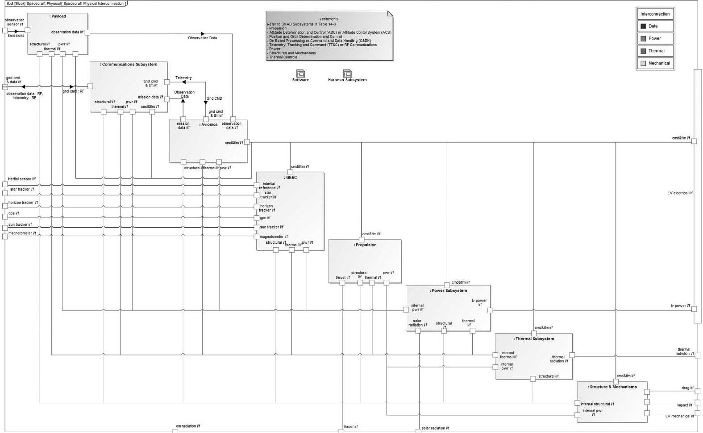

Fig. 39 The internal block diagram for the Spacecraft-Physical shows the interconnection between the subsystems, including command and telemetry, power, thermal, and structural connections.

<!-- PDF_PAGE: 54 -->

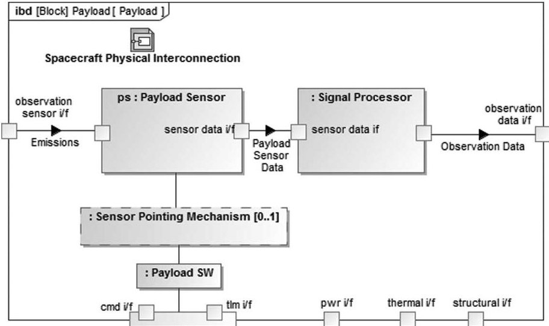

Fig. 40 The payload subsystem senses and processes the thermal emissions, and includes a Payload Sensor, Signal Processor and optional Sensor Pointing Mechanism as well as Payload SW to control the sensor.

If required, this subsystem can include a Sensor Pointing Mechanism. The [0.1] multiplicity indicates that a valid solution can contain either zero or one of these mechanisms. The dashed outline indicates that it is referenced by the payload subsystem, but is owned by the structure and mechanisms subsystem.

There are several trade studies to be performed to select the preferred Payload design. The type of sensor must be determined to satisfy the payload performance requirements and mass and power budgets. It also must be determined whether a pointing mechanism is required to point the sensor or whether this is accomplished by pointing the Spacecraft at the Earth.

The analysis indicates that the preferred selection for the Payload Sensor is a Mid Range IR Scanner which is mounted directly to the body of the Spacecraft. The Spacecraft is nadir pointing and therefore the pointing of the sensor is controlled by pointing the Spacecraft. This sensor generates data at a rate of 8 MBPS. This data rate drives an additional tradeoff between downlink capability and on-board data processing capability. The downlink rate must be sufficient to downlink all data to the Ground Station, or additional data processing can be performed on-board the Spacecraft to reduce the amount of data to be sent—perhaps only sending data frames when a fire is detected.

## 2. COMMUNICATIONS SUBSYSTEM

The Communications Subsystem interconnection diagram is shown in Fig. 41. This subsystem provides capability to communicate with the FireSat II Ground Station and supports uplink of vehicle commands, downlink of telemetry data and downlink of Payload Sensor observation data. The Spacecraft must

<!-- PDF_PAGE: 55 -->

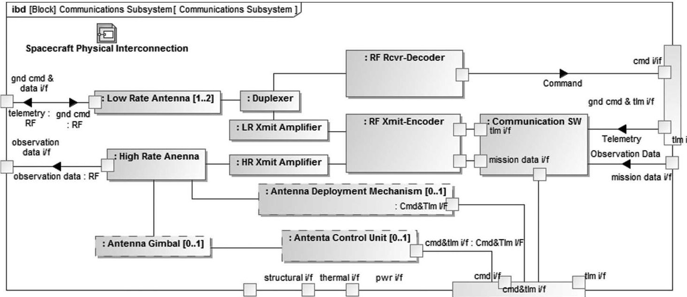

Fig. 41 The Communication Subsystem includes a low-rate channel to support the uplink of commands and downlink of telemetry, and a high-rate channel to support the downlink of the observation data.

<!-- PDF_PAGE: 56 -->

communicate two different kinds of data with the ground each with differing data rate requirements. As such, this requires two data channels within the communications subsystem-one low rate for commands and telemetry and one high rate for observation data.

This subsystem includes one High-Rate Antenna and either one or two Low-Rate Antennas as indicated by the multiplicity in Fig. 41. The low-rate channel supports both uplink and downlink and therefore has both a receiver decoder and a transmit encoder. The receiver decoder processes incoming command data and broadcasts it to the cmd i/f of the subsystem. Status data flowing across the tlm i/f is processed by the communications software before being encoded and amplified for transmission.

The Low-Rate Antenna design is fixed and not deployed. The high-rate channel has an optional Antenna Deployment Mechanism (such as a hinge), an Antenna Control Unit, and Antenna Gimbal to allow for antenna steering if necessary. This can increase communication capacity with the ground station, but adds additional cost and complexity to the design.

The selection of the RF band for the high-rate channel is a key consideration to accommodate the payload sensor data rate. As indicated earlier, the Payload Sensor generates data at 8 MBPS. It is assumed that this design does not include on-board processing to reduce the downlink data, nor does the mission configuration leverage a relay satellite for ground communication. As a result, the Communication Subsystem must be capable of downlinking all data collected in an orbit in 10 min (i.e., $ \sim1/10 $ th of the orbit period) that the Spacecraft is in contact with the Ground Station. This requires the high-rate channel to support downlink at least 800 MBPS, resulting in the selection of an X-band transmitter.

## 3. AVIONICS SUBSYSTEM

The Avionics subsystem interconnection diagram is shown in Fig. 42. This subsystem provides the on-board processing and command and data handling (C&DH) for the Spacecraft. The C&DH can be thought of as a data router where command and telemetry data are routed to the appropriate component or subsystem for processing. The ports on the left side of the Avionics subsystem provide the interface to the Communication Subsystem to receive commands from the ground and send telemetry to the ground. The ports on the right side of Avionics subsystem provide the interface to send commands and receive telemetry to and from the other subsystems.

The System Controller is responsible for controlling the state of the Spacecraft by monitoring the current subsystem state and state changes, and sending events to trigger state changes of one or more other subsystems. The Fault Management Software provides additional monitoring and control of system health and triggers responses to mitigate failures as part of the overall fault detection, isolation, and recovery (FDIR) approach.

<!-- PDF_PAGE: 57 -->

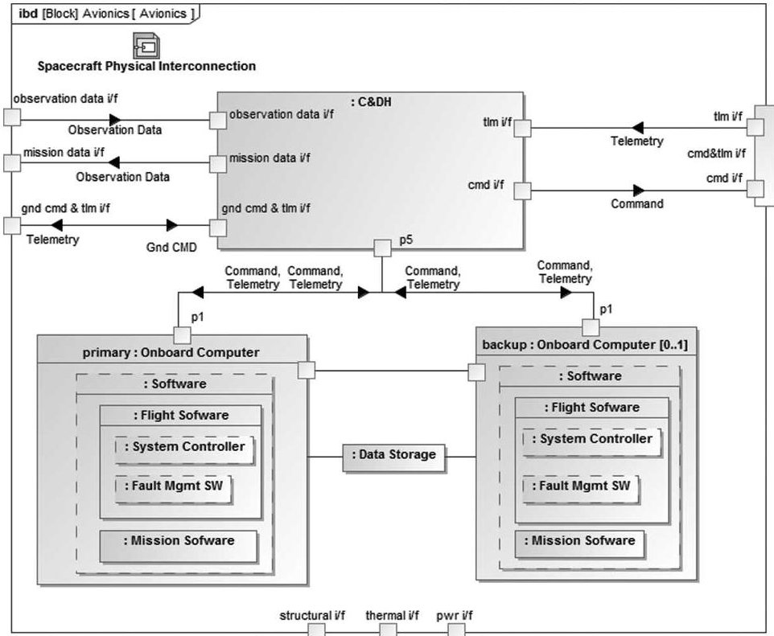

Fig. 42 The Avionics subsystem provides the on-board command and data handling and routes the data to other Subsystems.

The on-board processing for FireSat II includes two on-board computers, one acting as primary, the other as a backup, and aggregates all system Software and on-board Data Storage. Duplicate on-board computers increase system reliability, but at increased cost. If it is determined that the reliability of a single on-board computer is sufficient, the backup computing capability can be removed.

The Avionics subsystem includes a writeable data storage device to store Payload Sensor data for downlink. As noted previously, the payload sensor generates data at 8 MBPS, and the mission orbit requires 99 min for a full revolution. As such, the data storage device must be sized to store at least 50 GB of data and have a write rate of at least 8 MBPS. This storage is implemented in flash memory to meet the mass, power, and reliability requirements as well as the data requirements.

## 4. GUIDANCE, NAVIGATION, AND CONTROL (GN&C) SUBSYSTEM

The guidance, navigation, and control (GN&C) subsystem interconnection diagram is shown in Fig. 43. This subsystem measures the state and controls the attitude of the Spacecraft. GN&C is composed of a combination of sensors to determine where the Spacecraft is and where it is pointing, which may

<!-- PDF_PAGE: 58 -->

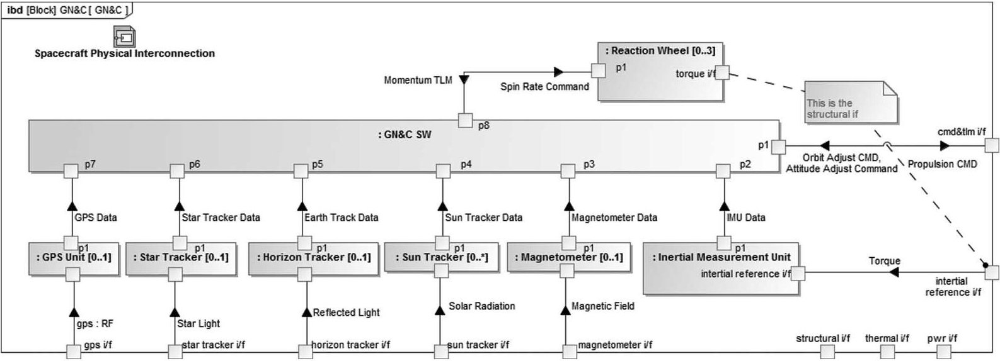

Fig. 43 The GN&C subsystem includes multiple sensors to measure the state of the Spacecraft and control its attitude.

<!-- PDF_PAGE: 59 -->

include an Earth Horizon Tracker, a Sun Tracker, an Inertial Measurement Unit, and a GPS unit. Additionally, the GN&C subsystem includes Reaction Wheels to allow for attitude adjustment of the Spacecraft with minimal use of fuel. These wheels are required for the "yaw flip" maneuver to ensure that the IR sensor is pointed away from the Sun and the solar array is pointed at the Sun.

GN&C is a closed loop control system which makes many measurements to understand the current state of the Spacecraft. It has a significant amount of software to determine how to respond to the current Spacecraft state. For example, when the Spacecraft requires a "yaw flip" maneuver, the GN&C subsystem must either spin up or slow down the Reaction Wheel to torque the vehicle, and collect data from Sun sensors to determine when the maneuver is complete. It must also command the propulsion subsystem to dump excess momentum.

There are various sensor types that may be used to measure the vehicle pointing angle, inertia, momentum, and location based on the spacecraft mission need. For instance, in a low Earth orbit, we may include GPS to determine the current vehicle location to determine if an orbit adjust maneuver is necessary. This data could supplement tracking data from the ground station to provide a higher accuracy assessment of vehicle position.

## 5. PROPULSION SUBSYSTEM

The Propulsion Subsystem interconnection diagram is shown in Fig. 44. This subsystem is responsible for providing thrust to affect the delta-V of the spacecraft. This subsystem is composed of one or more Fuel Tanks, Fuel Lines, Regulators, and multiple Thrusters. The number of Thrusters is subject to tradeoff. For this example, there are two Thrusters per controlled axis, which is assumed to be pitch and yaw. The Propulsion SW determines the duration of fuel flow to the thruster in response to a propulsion command.

A primary Propulsion Subsystem trade is the selection of a mono-propellant or a bi-propellant system. A mono-propellant system includes a single fuel tank to hold the propellant such as hydrazine and can generate thrust without the use of an oxidizer. A bi-propellant system includes fuel and an oxidizer which are combined in a reaction chamber to generate thrust. A higher specific impulse can be achieved from a bi-propellant system, but bi-propellant designs are more complex. They require multiple Fuel Tanks, separate lines for fuel and oxidizer, and more control software. Monopropellant thrusters can produce a specific impulse of 220 s. The black box propulsion analysis indicated this specific impulse is sufficient to support the required maneuvers, and so the preferred option is the simpler mono-propellant design.

## 6. THERMAL SUBSYSTEM

The Thermal Subsystem interconnection diagram is shown in Fig. 45. This subsystem is responsible for maintaining the thermal environment within the spacecraft.

<!-- PDF_PAGE: 60 -->

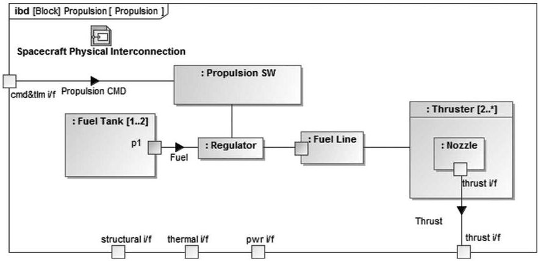

Fig. 44 The Propulsion Subsystem generates thrust to affect the delta-V.

The Thermal Subsystem is composed of temperature sensors (i.e., Thermistors), Heaters, Thermal Blankets, a Radiator, ammonia filled Heat Pipes, and Thermal Control Software.

The number of Heaters and Thermistors are heavily dependent on the design of the Spacecraft. Each component in the system has a nominal temperature

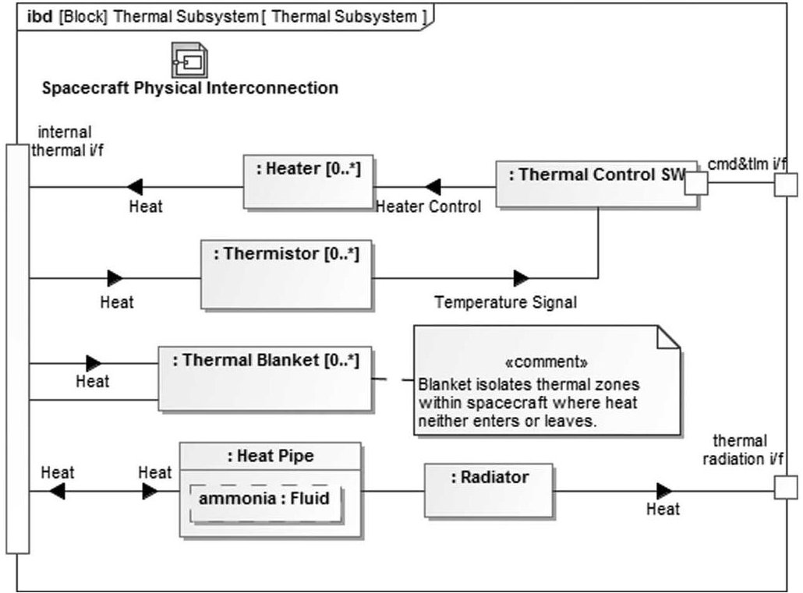

Fig. 45 The Thermal Subsystem controls the temperature across the Spacecraft, and its components are physically distributed.

<!-- PDF_PAGE: 61 -->

operating range. The Thermistors are placed on or near those components so that their temperature can be monitored. The Heaters are mounted to ensure that component temperatures stay within their nominal operating range. Thermal Blankets insulate components and fuel to maintain a stable temperature environment.

Since the Spacecraft is nadir pointing, there is a significant temperature gradient across the spacecraft. The side of the spacecraft pointing at the Sun will be hotter than the opposite side. The IR Payload Sensor and Radiator must be kept cool, and so the Spacecraft cannot be spun to even out the temperature. Therefore, the heat pipes and a radiator are important elements of the thermal control approach. Heat Pipes absorb heat from the hot side of the Spacecraft and circulate ammonia to transfer the heat to the Radiator where it can be expelled from the spacecraft. Balancing the temperature across the Spacecraft requires significant analysis and iteration with the physical layout.

## Power Subsystem

The Power Subsystem interconnection diagram is shown in Fig. 46. This subsystem provides the electrical power for the Spacecraft. It includes the Solar Array to generate the electrical power, the Battery to store the power, the Power Conditioner, and Power Distribution. Before separation, the Launch Vehicle provides the electrical power to the Spacecraft. Following separation, the Spacecraft relies on its batteries for its electrical power. The Solar Array must charge the batteries after separation and before the batteries lose their charge.

The required solar power that the solar arrays must collect from the Sun must be sufficient to charge the batteries and satisfy the power consumption demand of the spacecraft. The orbit analysis is used to establish the power consumption scenarios that define when the Payload Sensors are operating, when the Spacecraft is downlinking data to the Ground Station, and when Heaters are on. The initial power consumption estimate is based on these scenarios and comparisons with similar designs. The preliminary power budget is shown in Table 5 along with some of the assumptions.

A key trade study is the selection of the Solar Array configuration. The Solar Arrays are most efficient when they are pointed directly at the Sun. The different design alternatives include body mounted arrays and gimbaled arrays. The latter provides increased efficiency since it can be pointed more directly at the Sun. The gimbaled arrays must be deployed after separation, whereas the body-mounted arrays are available immediately upon separation. The following provides a brief summary of the trade study analysis.

The alternative Power Subsystem designs include a body-mounted solar array, a single-axis gimbal solar array, and a two-axis gimbal solar array. The bodymounted and two-axis gimbal alternative decompositions are shown in the bdd in Fig. 47.

The alternative designs for the body-mounted solar array and two-axis gimbal solar array are shown as specializations of the generic Power Subsystem. Each

<!-- PDF_PAGE: 62 -->

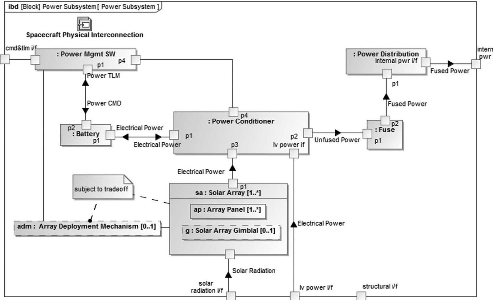

Fig. 46 The Power Subsystem provides the electrical power for the Spacecraft, and includes a Solar Array to generate the power and Battery to store the power.

<!-- PDF_PAGE: 63 -->

TABLE 5 AN INITIAL POWER BUDGET ANALYSIS AND POWER REQUIREMENT ASSESSMENT

<table border="1"><tr><td>Subsystem</td><td>Estimated Power(W)</td><td>Margin(W)</td><td>Budgeted Power</td></tr><tr><td>FireSAT Payload</td><td>45</td><td>20</td><td>65</td></tr><tr><td>Structure</td><td>1</td><td>0</td><td>1</td></tr><tr><td>Thermal</td><td>10</td><td>4</td><td>14</td></tr><tr><td>Power(incl harness)</td><td>9</td><td>4</td><td>13</td></tr><tr><td>TT&amp;C</td><td>12</td><td>5</td><td>17</td></tr><tr><td>Avionics</td><td>12</td><td>5</td><td>17</td></tr><tr><td>GN&amp;C</td><td>10</td><td>4</td><td>14</td></tr><tr><td>Propulsion</td><td>0</td><td>0</td><td>0</td></tr><tr><td colspan="2">Average System Power Consumption</td><td></td><td>141</td></tr><tr><td colspan="2">Battery Efficiency</td><td></td><td>98%</td></tr><tr><td colspan="2">Xe Factor</td><td></td><td>0.97</td></tr><tr><td colspan="2">Te Factor</td><td></td><td>0.36</td></tr><tr><td colspan="2">Xd Factor</td><td></td><td>0.99</td></tr><tr><td colspan="2">Td Factor</td><td></td><td>0.64</td></tr><tr><td colspan="2">Total Solar Array Power Required</td><td></td><td>223.2311261</td></tr></table>

alternative inherits the common parts from the generic Power Subsystem and adds their unique parts via their decomposition. The body-mounted alternative contains four Array Panels, and the two-axis gimbal alternative contains two Array Panels, a two-axis gimbal, and an Array Deployment Mechanism.

The trade study results from the analysis of three design alternatives are shown in Table 6 including consideration for power, mass, reliability, resilience, and cost. The analysis results indicate that the body-mounted configuration is the preferred solution.

This trade investigates the required solar array area for each design alternative and its efficiency in collecting solar energy. An array with a two-axis gimbal can be controlled so that the array is always directly pointed at the Sun, providing an efficient design. A single-axis gimbal cannot always point directly at the Sun, but can effectively cut the angle between the spacecraft and the Sun in half. The orbit analysis shows that the worst case Spacecraft-Sun angle (i.e., beta angle) is $ 7 5^{\circ} $ . Therefore, for this scenario, the single axis gimbal design can reduce the angle between the solar array and the Sun to $ 3 7. 5^{\circ} $ . Efficiency of a solar array is reduced by the cosine of the Sun angle, and so the single-axis gimbal has an efficiency of 79% as compared to the two-axis gimbal design. Finally, the body

<!-- PDF_PAGE: 64 -->

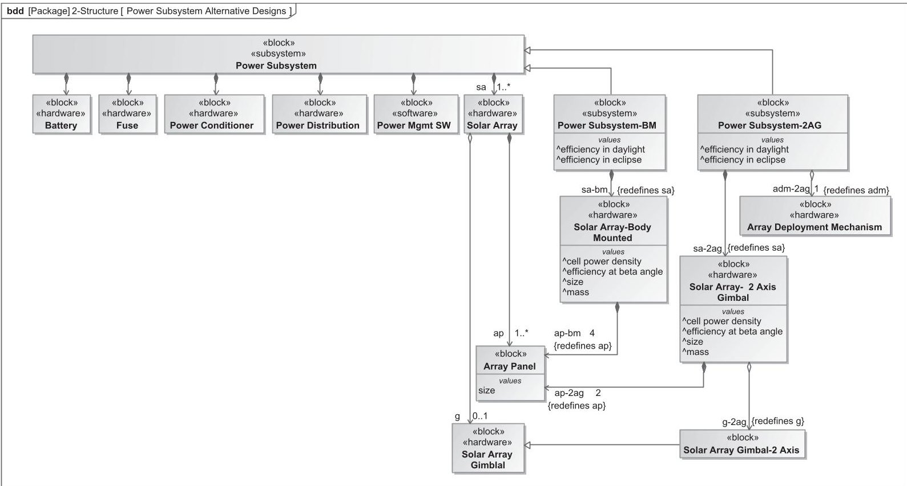

Fig. 47 Alternative Power Subsystem designs include a body mounted Solar Array and 2 axis Gimbal Solar Array.

<!-- PDF_PAGE: 65 -->

TABLE 6 SOLAR ARRAY TRADE STUDY SUMMARY

<table border="1"><tr><td></td><td>S/A Efficiency</td><td>Required Area(m2)</td><td>Actual Area(m2)</td><td>Mass(kg)</td><td>Total Cost($)</td><td>Reliability Factor</td><td>Resiliancy Factor</td><td>Objective</td></tr><tr><td>Power-Body Mount S/A</td><td>0.6</td><td>1.89</td><td>2.02</td><td>5.667</td><td>30240.00</td><td>1.00</td><td>0.8</td><td>0.794625431</td></tr><tr><td>Power-One Axis S/A</td><td>0.79335334</td><td>1.43</td><td>1.43</td><td>3.999</td><td>36783.08</td><td>0.90</td><td>0.9</td><td>0.709336439</td></tr><tr><td>Power-Two Axis S/A</td><td>1</td><td>1.13</td><td>1.13</td><td>3.173</td><td>46331.53</td><td>0.80</td><td>1</td><td>0.420070918</td></tr><tr><td>SA Capacity(W/m2)</td><td>197</td><td></td><td></td><td></td><td></td><td></td><td></td><td></td></tr><tr><td>Required Power(W)</td><td>223</td><td></td><td></td><td></td><td></td><td></td><td></td><td></td></tr></table>

<!-- PDF_PAGE: 66 -->

mounted array does not have as much flexibility to point the arrays at the Sun as the other two designs. Given the shape of the spacecraft, there are different efficiencies on each face of the spacecraft throughout the year. A conservative estimate based on analysis is that the body mounted array can meet 60% efficiency as compared to the two-axis gimbal. The efficiencies are used to calculate the required Solar Array area for each design alternative. In the case of the bodymounted design, the area is assumed to be a multiple of the size of a side of the spacecraft.

Given the Solar Array size, the mass, cost, reliability, and resiliency of each design alternative are evaluated. The body-mounted design requires the largest total area, but is the least expensive design alternative since the cost of the Solar Array material is less than the additional cost of the gimbal mechanisms and control software. Additionally, the reliability factor for this body-mounted array design is higher since there are fewer moving parts. Finally, the larger subsystem mass allocation for the body-mounted design is still within the initial mass budget. As a result of the analysis and assumptions, the body-mounted design alternative is the preferred design solution.

The model provides considerable ability to specify variation and alternative design options using a combination of specialized blocks, such as the Body-Mounted Power Subsystem and the Two-Axis Gimbal Power Subsystem, and the use of multiplicity, such as the number of array panels, and the optional multiplicity on the number of gimbals and the Array Deployment Mechanism.

## 7. STRUCTURES AND MECHANISMS SUBSYSTEM

The Structures and Mechanisms subsystem interconnection diagram is shown in Fig. 48. This subsystem provides the physical support infrastructure for the Spacecraft, structural panels for mounting the Solar Array and internal components, and the mechanisms to control movement of other subsystem components, such as the Antenna Gimbal, Antenna Deployment Mechanism, and the Separation Mechanism to separate from the Launch Vehicle.

These mechanisms are referenced by other subsystems. Mechanisms are mechanized joints between the rigid body of the spacecraft and a movable component such as the deployable antenna. The mechanism requirements are typically driven by the design of other subsystems such as the required antenna pointing accuracy for the Antenna Gimbal to maintain a link budget.

The structure comprises a Spacecraft Frame, a number of Panels, and a mechanical interface to the Launch Vehicle and its faring. The number of Frames is influenced by the internal volume required for components and the size of the Launch Vehicle faring [Pegasus Launch Vehicle Users Guide, 2010]. The Separation Mechanism and Launch Vehicle interface depends on the selection of the Launch Vehicle. The structure and other aspects of the mechanical design of the Spacecraft are captured in a 3D CAD modeling tool.

<!-- PDF_PAGE: 67 -->

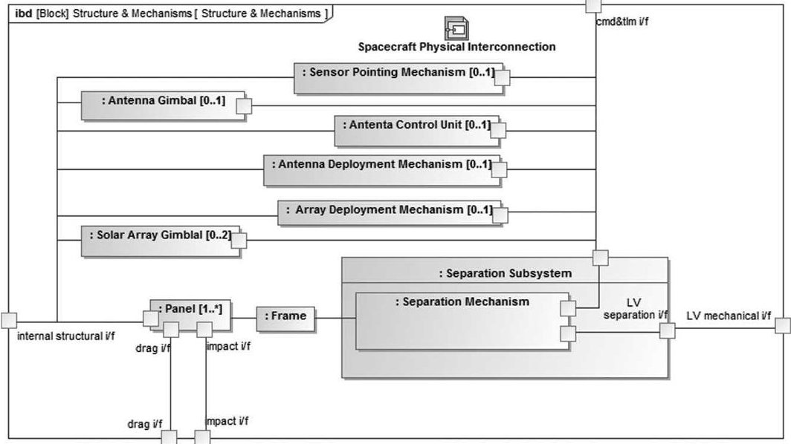

Fig. 48 The Structures and Mechanisms subsystem includes the physical support for the Spacecraft and the moving parts.

## 8. SOFTWARE SUBSYSTEM

The software components interact with the hardware components to provide much of the Spacecraft functionality. The software components are part of the other subsystems described previously. They may execute on a single mission computer or execute on many processors distributed across the spacecraft.

It is sometimes useful to treat the collection of software components as a subsystem. The Software Subsystem is shown in Fig. 49. The software is decomposed into Flight Software and Mission Software. The Flight Software contains the System Controller, Fault Manager, and GN&C software, and the Mission Software contains the software components for the other subsystems. The interaction between software components, such as the processing of commands and telemetry or fault management scenarios, is often represented using sequence diagrams.

## 9. HARNESS SUBSYSTEM

The harness subsystem is the physical medium that connects electrical components to support the exchange of electrical data and the distribution of electrical power. The harness subsystem design must support the signal frequencies and data rates, and power levels, and consider the effects of attenuation, shielding, grounding, and many other characteristics that impact electrical interconnection.

In the subsystem interconnection diagram in Fig. 39, the harness subsystem is abstracted away to simplify this interconnection view. The individual lines correspond to logical connections between ports on the subsystems. The data and power ports can contain nested ports to represent specific electrical pins, enabling

<!-- PDF_PAGE: 68 -->

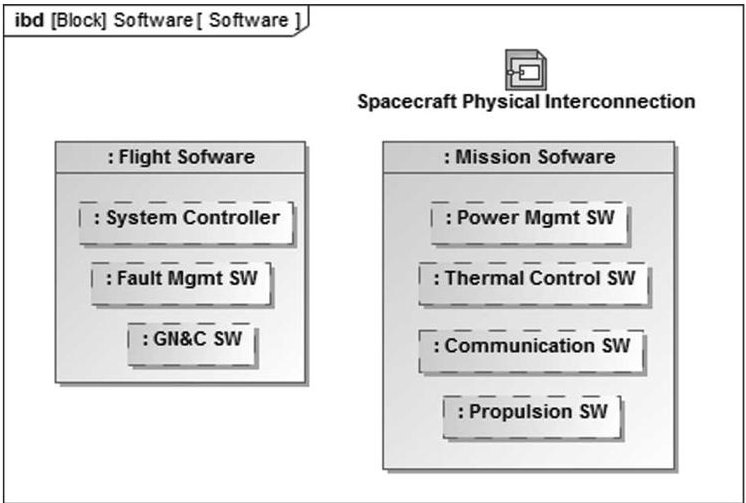

Fig. 49 The Software Subsystem references the software components that are part of other subsystems, such as the Power Mgmt SW which is part of the Power Subsystem.

the specification of the pin-to-pin interconnection. If desired, the individual cables and harnesses can be represented as blocks and treated like any other component. These blocks can have properties such as mass, attenuation, and shielding characteristics, as well as internal structure such as harness segments.

## Define the Spacecraft Geometry

A geometric model of the spacecraft is developed concurrent with the system model. This model is typically captured in a 3D CAD model using commercial tools. A conceptual design of the top assembly view of a proposed Spacecraft design alternative is shown in Figs. 50 and 51. Figure 50 shows the low- and highrate antennas, Mid Range IR Scanner, and the Thruster Assembly. Figure 51 shows the opposing side of the Spacecraft with the four body-mounted solar array panels.

It is important to ensure consistency between the system model and the geometric model. The system model is generally a more abstract model that captures the system breakdown to the component level of design and not down to the piece part level (e.g., nuts and bolts). The components, such as a circuit card or mechanical component, are identified in the system model and mapped to a corresponding component in the system bill of materials (BOM) or mission equipment list (MEL). Third party tools can be used to maintain the mapping between the system model and the BOM, which in turn is related to the components and assemblies in the geometric model. In addition, the Spacecraft block in the system model can include a property that refers to the geometric configuration in the CAD model.

## Specify Spacecraft System Functional Threads

Each system function in the operations compartment of the black box specification in Fig. 35 can be further elaborated by a system functional thread that

<!-- PDF_PAGE: 69 -->

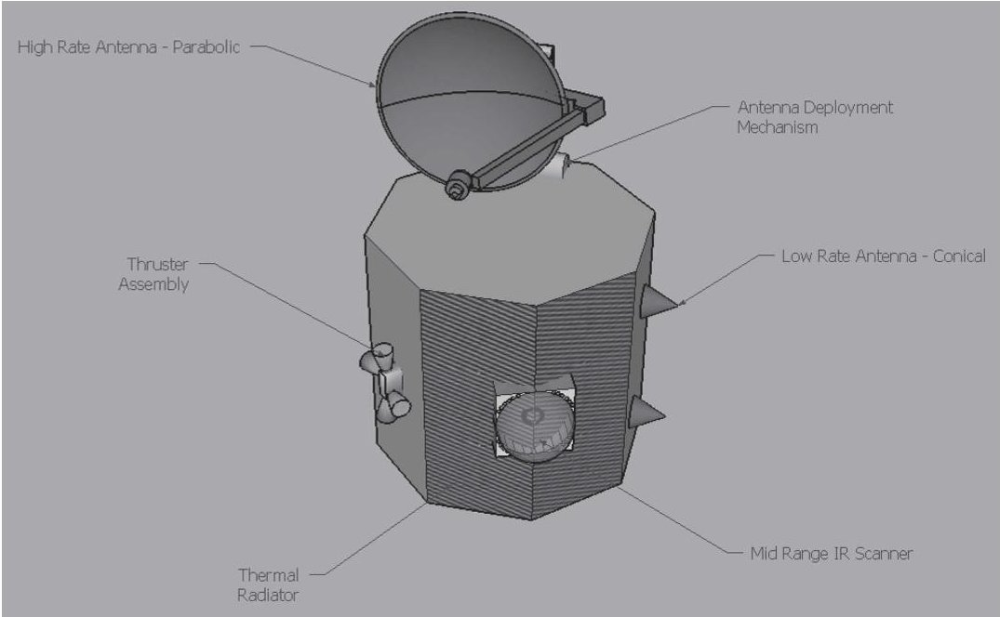

Fig. 50 Conceptual view of the spacecraft geometry.

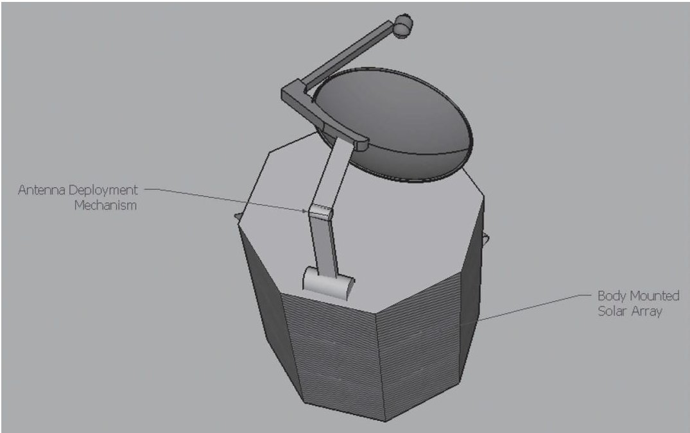

Fig. 51 Conceptual view of the spacecraft geometry - opposing side.

<!-- PDF_PAGE: 70 -->

specifies what each component must do to perform this function. Each functional thread is expressed as an activity diagram, sequence diagram, or combination of the two.

Figures 52-54 show three representative activity diagrams for selected Spacecraft functions to Provide Power, Control Attitude, and Collect and Downlink Observation Data. The Provide Power activity shows the high-level actions that Avionics, the Power Subsystem, and the Power Harness perform to deliver power to the subsystems. The inputs include solar radiation to the Solar Array and the Electrical Power provided by the Launch Vehicle before Spacecraft separation. The Control Attitude activity shows the high-level actions that Avionics, GN&C, and the Propulsion Subsystem perform to control the attitude of the Spacecraft. This is accomplished by sensors that measure the Sun angle, Earth horizon angle, and the Spacecraft angular rate to control the Reaction Wheel spin rate and the thrust. The Collect and Download Observation Data activity shows the highlevel actions that the Payload, Avionics, and Communication Subsystem perform to sense the thermal emissions from the Earth, store the data, and then downlink the data to the ground.

The activities can be further refined and then elaborated by showing the actions performed at the next level of decomposition. For example, the downlink data action performed by the Communication Subsystem in the Collect and Download Observation Data activity can be further decomposed into actions that its components perform, including packaging, encoding, and amplifying the data, and then transmitting the data via the High-rate Antenna. In addition, these activities can be executed through the system modeling tool simulation engine. This enables one to animate the actions to facilitate further analysis of the input-output and control flow.

## Specify Spacecraft Timeline

The mission timeline shown in Fig. 30 identifies key mission events throughout the spacecraft mission, beginning with launch, transfer to orbit, on-orbit operations, and de-orbit. More detailed timelines of the Spacecraft internal events are critical to the Spacecraft design and analysis.

The sequence diagram in Fig. 55 highlights a simplified example of a portion of the Spacecraft timeline, indicating the events and time durations that the Payload Sensor is collecting data, the transmitter is amplifying signals to downlink, and the Solar Array is exposed to the Sun. The events and time durations are used to specify the power analysis and can be expanded to include the other electrical components that consume power.

## Identify Component Failure Modes

Failure modes are identified as a violation of nominal performance of an activity. A failure mode can cause another failure mode. Figure 56 shows two attitude control failure modes that can cause a Trajectory Failure, including both a Steady State Attitude Control Failure and an Attitude Rate Control

<!-- PDF_PAGE: 71 -->

Fig. 52 Provide Electrical Power activity diagram.

<!-- PDF_PAGE: 72 -->

Fig. 53 Control Attitude activity diagram.

<!-- PDF_PAGE: 73 -->

Fig. 54 Collect and downlink observation data activity diagram.

<!-- PDF_PAGE: 74 -->

Fig. 55 The spacecraft timeline captures internal events such as the Payload Sensor turning on or off. These timelines represent scenarios which are integrated with simulation and analysis tools to support various analyses such as power analysis.

Failure. The Attitude Rate Control Failure can fail when the attitude rate is too high or too low.

As further indicated in this figure, an excessive attitude rate can be caused by a Spin Rate Sensing Failure. This failure mode corresponds to the Reaction Wheel's inability to perform its sense spin rate function. In this way, the functional and

<!-- PDF_PAGE: 75 -->

Fig. 56 Failure modes are related to functions, components, and other failure modes.

associated component failure modes can be systematically identified and input to the fault tree analysis and the failure modes, effects, and criticality analysis (FMECA).

The strategy to mitigate these failures includes increasing design reliability through parts selection, redundancy, simplicity, and other means. This is coupled with an effective fault detection, isolation, and recovery (FDIR) approach that includes fault containment, error monitoring, and mitigating responses.

## Specify Component States

The states for each component can be specified by their state machine. The electrical components include an off and on state. Other components have many states, such as the System Controller that is used to control the behavior of the Spacecraft and ensure that it conforms to the Spacecraft state machine specified in Fig. 34.

The Spacecraft operates in the normal state when it is within its nominal performance bounds. The Fault Management Software is responsible for controlling the response to off nominal behavior. The state machine for the Fault Management Software is shown in Fig. 57. The Fault Management Software responds to signals from error monitors. If an error is detected, the Fault Management Software requests a local response. If the error persists, the Fault Management Software requests a system response such as turning a device off and

<!-- PDF_PAGE: 76 -->

Fig. 57 Fault management states include Local Responses and System Responses.

transitioning to a backup device. If a mission critical threshold is exceeded, the Spacecraft transitions to the safe state, where additional autonomous actions or actions commanded from the ground may be performed to try to return to the normal state.

## Specify Component Properties

The critical component properties and their values are captured as value properties on each component block. The values are derived from analysis, such as the power and mass analysis described previously. The governing equations can be captured in parametrics, and integrated with analytical models as described in Sec.II.G. The property values can also vary with its component's state. For example, the power consumption for the Payload Sensor is shown in its on and off states in Fig. 58, and the power received from the Sun is shown in the Solar Array states in Fig. 59.

## Define Component Black Box Specification

The subsystems and components can be specified as a black box in the same way as the system black box shown in Fig. 35. An example is the black box specification for the Payload Sensor shown in Fig. 60. As with the system black box, the Payload Sensor black box includes its interfaces, functions (i.e., operations), critical performance, physical, and quality characteristics, and its state machine. The constraints on some of its critical properties reflect its requirements.

<!-- PDF_PAGE: 77 -->

Fig. 58 The power consumption (i.e., power) of the payload sensor in the on state is captured in its state machine.

## Capture Component Requirements Specification

The component requirements can be specified in terms of traditional textual requirements similar to the system requirements specification shown in Fig. 36. The Payload Sensor requirements specification is shown in Fig. 61 and Table 7 in both graphical and tabular form, respectively.

black box specification is a Mid Range IR Sensor. This sensor inherits the features of the black box specification, but contains specific values as indicated in Fig. 62. Other information, such as its designation as a COTS item versus a development item, can also be specified using customized properties.

The selected sensor for this design that satisfies the

The traceability relationships are established and maintained in the model. The features of the black box, including its value properties, operations, and ports, refine the text requirements. The corresponding features of the IR scanner satisfy the requirements. An example is shown in Fig. 62 where the Mass of the black box specification refines the Mass requirement, and the Mass of the IR Scanner satisfies the Mass requirement. These

Fig. 59 Solar Array states with constraints on power.

<!-- PDF_PAGE: 78 -->

Fig. 60 The Payload Sensor serves as a black box specification which can be realized by alternative design solutions.

relationships can be captured in the requirement table in Table 7 as a more compact representation. Examples of other traceability relationships are highlighted in Sec. II.H.

As the design evolves, updated versions of the model are maintained using the model configuration management environment. Later in the lifecycle, each as-built component can be defined as a subclass of the as-designed Mid Range IR Scanner block with redefined property values that reflect measured values versus the estimated values.

## G. PERFORM ANALYSIS

This activity continues throughout the development process to support trade study analysis, sensitivity analysis, design optimization, and verification. Some examples of the analysis are discussed in earlier sections, such as the orbit analysis in Sec. II.D, the mass and delta-V analysis in Sec. II.E, and the power analysis in Sec. II.F.

Some of the analyses that are performed at the mission level are identified in Fig. 63. Each analysis is intended to analyze a particular moe that contributes to the overall cost effectiveness of the solution. The moes were previously identified in Fig. 24. The analysis context aggregates each analysis, and references

<!-- PDF_PAGE: 79 -->

Fig. 61 The Payload Sensor specification contains requirements that align with the black box specification.

the Mission Context as the subject of the analysis. This pattern enables the analytical models to be reused and applied to different mission contexts.

Each constraint can correspond to an analytical model that is executed in an analytical tool. The parameters of the constraint correspond to the inputs and outputs from each analytical model. The system model provides inputs and receives outputs from multiple analytical models to support system design tradeoffs and optimization.

The results from the Orbit Analysis Model are represented in Sec. II.D. The corresponding parametric diagram shown in Fig. 64 binds the input/output parameters of this model to the properties of the design. The analysis tool that executes the Orbit Analysis Model in this particular case is the AGI system toolkit (STK). The results are presented earlier in Figs. 25 and 26.

The parametric diagram includes the constraint called Orbit Analysis Model. This constraint is used to specify the critical input and output parameters to the analytical model that executes detailed equations to derive the optimal orbit, which in this case is the STK simulation. The Revisit Time is a primary output parameter from the analysis (Note: the input-output direction is not indicated in this figure since more generally, a parameter may be an input in one execution, and an output in another). Critical input parameters include orbit eccentricity, inclination, semi-major axis, number of planes, and number of vehicles per plane. Other orbit parameters include

<!-- PDF_PAGE: 80 -->

TABLE 7 A TABULAR VIEW OF THE PRELIMINARY PAYLOAD SENSOR SPECIFICATION THAT WAS SHOWN GRAPHICALLY IN THE PREVIOUS FIGURE

<table border="1"><tr><td>#</td><td>Id</td><td>Name</td><td>Text</td></tr><tr><td>1</td><td>80</td><td>Payload Sensor Specification</td><td></td></tr><tr><td>2</td><td>80.1</td><td>Quality Characteristics</td><td></td></tr><tr><td>3</td><td>80.1.1</td><td>Reliability</td><td></td></tr><tr><td>4</td><td>80.1.2</td><td>Cost</td><td></td></tr><tr><td>5</td><td>80.2</td><td>Physical</td><td></td></tr><tr><td>6</td><td>80.2.1</td><td>Mass</td><td>The sensor mass shall be less than 22kg.</td></tr><tr><td>7</td><td>80.2.2</td><td>Size</td><td>The sensor size(length, width, height) shall fit in a rectangular volume of less than0.5,0.25,0.20 metres</td></tr><tr><td>8</td><td>80.2.3</td><td>Power</td><td>The sensor power consumption shall be less than60 watts in the on state.</td></tr><tr><td>9</td><td>80.3</td><td>Functional and Performance</td><td></td></tr><tr><td>10</td><td>80.3.1</td><td>Sensing</td><td>The sensor shall sense thermal emissions with a sensitivity less thanTBD,and a resolution of less than3 milliradians.</td></tr><tr><td>11</td><td>80.3.2</td><td>Field of View</td><td>The sensor shall be able to scan a field of view ofat leastTBD milliradians.</td></tr><tr><td>12</td><td>80.3.3</td><td>Data Rate</td><td>The sensor shall be capable of providing a data rate ofa minimum of8 Megabits per second.</td></tr><tr><td>13</td><td>80.3.4</td><td>Spectral Band</td><td>The spectral band shall be mid range infrared</td></tr><tr><td>14</td><td>80.4</td><td>Interface</td><td></td></tr><tr><td>15</td><td>80.4.1</td><td>Electrical Interface</td><td></td></tr><tr><td>16</td><td>80.4.2</td><td>Mechanical Interface</td><td></td></tr></table>

max beta angle to the Sun and percent time in eclipse, which are used as an input to the Solar Array sizing analysis.

The parametric diagram also links the critical input and output parameters of the orbit analysis constraint to properties of the system design model. For example, the eccentricity parameter of the Orbit Analysis Model is linked to the eccentricity property of the Orbit. Similarly, the Revisit Time parameter of the Orbit Analysis Model is linked to the Revisit Time property of the Mission Enterprise. In this particular example, the names of the properties are the same as the parameter names of the analysis model, but they are not required to be the same. In particular, this same Orbit Analysis Model can be reused to analyze different system design alternatives, each of which may have different property names. This linkage enables the key parameters to be identified and explicitly associated with some property of the design.

<!-- PDF_PAGE: 81 -->

Fig. 62 The mass property of the Mid Range IR Scanner satisfies the Mass requirement.

Some of the system level analysis are shown in Fig. 65. This includes the analysis need to support the mass and delta-V analysis, which was discussed in Sec. II.E, and the power system sizing and analysis to support the power subsystem trade study. The parametric diagram in Fig. 66 is the parametric model that integrates the system model with the analytical models needed to perform the mass and delta V analysis. A parametric diagram can include multiple parametric constraints, each representing a separate analysis. In this example, three analyses are required to determine the required fuel mass for the Spacecraft including the orbit analysis discussed previously, a mass analysis to determine the system dry mass, and a propulsion analysis to determine required delta-V and ultimately the required fuel mass.

The parametric diagram for the Solar Array trade study discussed in Sec. II.F is shown in Fig. 67. This trade study includes analysis models for power, mass,

<!-- PDF_PAGE: 82 -->

Fig. 63 The Analysis Context aggregates the constraint blocks that correspond to different analytical models used to analyze the measures of effectiveness.

<!-- PDF_PAGE: 83 -->

Fig. 64 A SysML parametric diagram that specifies the orbit analysis for the Spacecraft.

reliability, and cost. In this particular case, the analysis models are executed using Microsoft Excel $ ^{\circled{*} } $ , but more generally, each analysis model can be executed by a different tool.

## H. MANAGE REQUIREMENTS TRACEABILITY

This activity is applied throughout the development process to ensure that the spacecraft design satisfies the mission requirements. Examples of traceability relationships from mission to system and system to component are included in the previous sections. This section describes traceability relationships that can assist in the impact assessment of changes to the requirements and design throughout the development lifecycle. The following section describes how the

<!-- PDF_PAGE: 84 -->

Fig. 65 The additional systems analysis models are shown to support power analysis, mass analysis, and propulsion analysis.

Fig. 66 Mass and delta V analysis parametric diagram for the spacecraft includes mass analysis, propulsion analysis, and orbit analysis.

<!-- PDF_PAGE: 85 -->

Fig. 67 Power system sizing and analysis for the Solar Array trade study.

<!-- PDF_PAGE: 86 -->

specification tree is captured in the model and how traceability is maintained from mission requirements to component.

## Specification Tree

The mission, system, and component requirements are captured as shown in Figs. 23, 36, and 61. The specification tree establishes a trace relationship between the specifications as shown in Fig. 68. In this example, the original source mission requirements from SMAD are at the top of the tree. The Mission Requirements used for this example trace to the source requirements in SMAD. The Spacecraft Specification in turn traces to the Mission Requirements, and the Payload Sensor Specification is an example of a component specification that traces to the Spacecraft Specification. Additional subsystem and hardware and software component specifications can be captured in a similar way to provide a more complete view of the specification tree.

## Maintaining Mission to Component Traceability

The traceability relationships are established throughout the development process. An example of how some of the critical Payload Sensor requirements trace to mission requirements is shown in Fig. 69.

Fig. 68 An example of trace relationships between specifications used to represent the specification tree.

<!-- PDF_PAGE: 87 -->

Fig. 69 The traceability relationships from mission to component include relationships between requirements, design, analysis, and test elements and can be used to support change impact assessments.

<!-- PDF_PAGE: 88 -->

In this example, the key mission requirement is the detection time corresponding to the time to detect a fire. This is determined by the Spacecraft orbit Revisit Time to a particular region on Earth and the Payload Sensor performance. The Sensing requirement for the Payload Sensor specifies the required resolution and sensitivity, which is satisfied by the Resolution and Sensitivity of the Mid Range IR Scanner as indicated by the satisfy relationships. The required resolution and sensitivity are derived from the spacecraft system requirements for Probability of Detection and the orbit altitude. The rationale for the derivation is based on the Sensor Performance Analysis. The function to Sense Thermal Emissions also satisfies the Sensing requirement. Although not included in this example, the more complete traceability includes relationships with other requirements, such as the Spacecraft pointing stabilization.

The test cases used to verify the Payload Sensor satisfy its resolution and sensitivity requirements are also shown in the figure. Elaboration of the test cases to show how the verification is accomplished is discussed in the next section.

## I. VERIFY SYSTEM

This activity is initiated early to establish the approach to verify that the requirements are satisfied. The following provides a brief introduction to how the model can be used to support verification planning.

## Define Verification Context

A verification context defines the verification environment and test cases needed to achieve the verification objectives. The test cases to verify the sensitivity and resolution are satisfied are shown in Fig. 69, and the context for verifying sensor performance requirements is shown in Fig. 70.

The verification context includes the unit under test, along with the test Operator and the test components (i.e., test equipment), which in this case is an Optical Bench, a Signal Processor, and a Display. The test cases specify the actions that are performed to achieve the verification objectives. These actions can be defined at a high level or at the detailed level of a test procedure, depending on the need. An ibd for the verification context defines the interconnection between the test components and the unit under test.

## Define the Test Cases

Each test case is intended to verify one or more requirements. The test case can be represented by an activity diagram or other behavior to show the actions performed by the Test Operator, test components, and unit under test to verify the requirement. An example is shown in the activity diagram to Verify Sensor Resolution in Fig. 71.

The Test Operator controls the unit under test and the Optical Bench including its thermal source to generate the needed stimulus. The Mid Range IR Scanner produces a sensor output which is then processed by a Signal Processor

<!-- PDF_PAGE: 89 -->

Fig. 70 The verification context defines all the elements needed to achieve the test objectives, including the test cases, the test components, and the unit under test.

and displayed to the Test Operator by the Display. The Test Operator measures the resolution and assesses whether the Payload Sensor satisfies its resolution requirement. Other test cases are elaborated in a similar way to verify the requirements.

Some test components may be replaced by other hardware and software as the integration and test program progress. For this example, the Signal Processor can be replaced by signal processing algorithms used in the Communication Subsystem and the Ground Station to process the fire data that is made available to the end user. These algorithms may initially execute on nonoperational hardware, but this hardware may later be replaced by operational hardware and firmware that is used by the Spacecraft and Ground Station.

Different test configurations for the unit under test and the test environment can be represented in the model. This end to end system or enterprise may include a combination of simulated components, operational hardware, software, and people in the loop, or the complete as-built end-to-end system

<!-- PDF_PAGE: 90 -->

Fig. 71 The test case is elaborated as an activity diagram to show the actions performed to verify the Payload Sensor resolution requirements.

<!-- PDF_PAGE: 91 -->

Fig. 72 The sequence of test cases to verify the Payload Sensor requirements is shown in an activity diagram.

configuration. In the previous example, the test context can define the test objectives, test cases, and end-to-end system to validate that the end user needs can be met. This could include the actual spacecraft in a test lab, with a simulated ground station, and the end user viewing the results on a representative display.

## Define the Test Sequence

The activity diagram in Fig. 72 shows the sequence of test cases that are used to verify the Payload Sensor requirements. This information, along with the test context that describes the test objectives, test components, and test configurations, provide critical inputs for test planning.

## III. SUMMARY

In this chapter, a model-based systems engineering (MBSE) approach was applied to the design of a small spacecraft. The Spacecraft design is inspired by the FireSat II example in the New SMAD. The intent of the example is to demonstrate how this approach can support the mission and system specification, design, analysis, and verification of complex systems, and add value over traditional document-based approaches.

The fundamental tenet is to capture this critical information in a robust model of the system (i.e., the system model) that can be viewed from many different perspectives. The system model is maintained throughout the system lifecycle as a fundamental part of the technical baseline. The key enablers of this approach are a modeling language, a well-defined MBSE method, and a system modeling tool. To fully leverage this approach, the MBSE method, along with the system model and system modeling tool, must integrate with other engineering models and tools.

<!-- PDF_PAGE: 92 -->

MBSE can enable good systems engineering, but still demands competent systems engineers with the essential domain knowledge to apply a rigorous engineering approach. Implementing this approach in an organization requires an investment in the tools, training, and skill development.

MBSE is being recognized as an essential practice to meet the complexity, quality, and productivity challenges facing system development. It is anticipated that the MBSE methods along with the system modeling languages and tools will continue to evolve to meet these challenges for performing effective systems engineering.

## ACKNOWLEDGMENTS

The authors would like to recognize the authors of the New SMAD for the tremendous source of domain specific knowledge and systematic treatise on spacecraft mission analysis and design. In addition, the authors would like to thank Todd Bayer from NASA Jet Propulsion Lab for his review and excellent insights. Finally, the authors would like to acknowledge the following tool vendors for the use of their software: No Magic MagicDraw $ ^{\circledR} $ , AGI Systems ToolKit $ ^{\circledR} $ , and Microsoft Excel $ ^{\circledR} $ .

## REFERENCES

Delligatti, L. (2013), SysML Distilled, A Brief Guide to the Systems Modeling Language, Addison Wesley, Upper Saddle River, NJ.

DoD. (1998), "DoD Modeling and Simulation (M&S) Glossary," DoD Manual 5000.59-M, US Department of Defense, Arlington, VA, USA, http://www.msco.mil/documents/_4_ Final_Glossary.pdf [retrieved January P2.13.22].

Friedenthal, S., Moore, A., and Steiner, R. (2014), A Practical Guide to SysML, The Systems Modeling Language, 3rd ed., Morgan Kaufmann, San Francisco.

ISO/IEC. (2008), "Systems and Software Engineering—System Life Cycle Processes," Int Organ Standardization/Int Electrotechnical Comm, Vol. 2008, pp. 15288.

MBE NDIA Report: Final Report of the Model Based Engineering (MBE) Subcommittee, NDIA Systems Engineering Division, M&S Committee, 10 February 2011.

Object Management Group, OMG Systems Modeling Language (OMG SysML $ ^{\mathrm{TM}} $ ). V1.4, http://www.omg.org/spec/SysML/.

Pegasus Launch Vehicle Users Guide. http://www.orbital.com/LaunchSystems/ Publications/Pegasus_UsersGuide.pdf April 2010, Release 7.0.

Wertz, J. R., Everett, D. F., and Puschell, J. J. (2011), Space Mission Engineering: The New SMAD, Microcosm Press, Hawthorne.