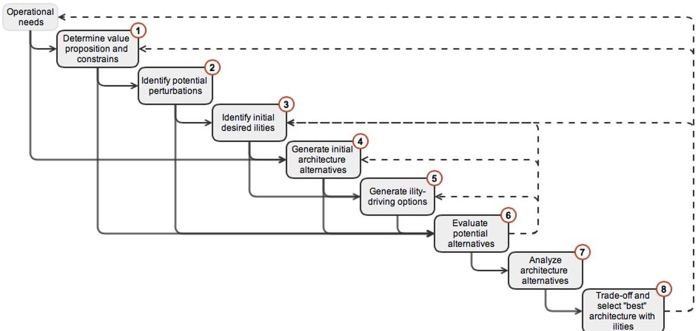

<!-- PDF_PAGE: 1 -->

# Conference on Systems Engineering Research (CSER 2014)

Eds.: Azad M. Madni, University of Southern California; Barry Boehm, University of Southern California; Michael Sievers, Jet Propulsion Laboratory; Marilee Wheaton, The Aerospace Corporation Redondo Beach, CA, March 21-22, 2014

# Architecting Systems of Systems with Ilities: an Overview of the SAI Method

Nicola Ricci $ ^{*} $ , Matthew E. Fitzgerald, Adam M. Ross, Donna H. Rhodes

Systems Engineering Advancement Research Initiative (SEAri), Massachusetts Institute of Technology, Building E38-574, Cambridge, MA 02139

## Abstract

The uncertain and fast-changing nature of operational environments is driving a growing interest in systems that display desirable lifecycle properties (i.e., ilities). A survivable, flexible, or evolvable (among other properties) system is able to sustain value delivery over time by responding to exogenous changes in the operational environment. This paper introduces the SoS Architecting with Ilities (SAI) method, which enables systems architects to design for ilities from the conceptual design phase. An overview of the SAI method is presented, to expose the reader to the most important steps and activities of the method, and how they are specifically targeted at enabling SoS design with ilities.

$ \textcircled{c} $ 2014 The Authors. Published by Elsevier B.V. Selection and peer-review under responsibility of the University of Southern California.

Keywords: Ilties; Perturbation; Value Sustainment; Change Option; Resistance Option; System of Systems.

<!-- PDF_PAGE: 2 -->

## 1. Introduction

This paper introduces the SoS Architecting with Ilities (SAI) method, which is intended to enable the architecting of Systems of Systems with an emphasis on enhancing lifecycle value sustainment from the early phases of design. With SAI, value sustainment is facilitated by guiding systems architects in designing not only for static functional requirements, but also for lifecycle properties such as flexibility or robustness, via the intentional inclusion of design options. Different options drive different lifecycle properties (i.e., ilities), and the SAI method enables the inclusion, quantification and tradeoff of some of these ilities. The method ultimately results in requirements targeted specifically toward such properties.

## 1.1. Motivation

Systems of Systems $ ^{1,2} $ (SoS) can operate in highly uncertain and dynamic environments, and are often characterized by complexity that presents multifaceted challenges for systems architects and decision makers $ ^{3} $ . As a consequence, sustaining stakeholder value delivery in an operational SoS is a continual challenge. Unanticipated shifts in stakeholder needs and perturbations to the system can disrupt value delivery. Neches and Madni (2012) discuss at length such issues faced by modern-day systems in their manifesto on engineering resilient systems (ERS), in which they state: "it is important to realize that, when needs are prematurely translated into requirements or key performance parameters, both the process and the product of engineering suffers the consequence." $ ^{4} $

Modern ilities (e.g. flexibility) are one response to mitigate the impact of dynamic complexities on system value over time. Since a goal of systems engineering is to foster value sustainment throughout a system's lifecycle, a method that can help to create SoS with value sustaining ilities would be invaluable to the modern practicing systems engineer and architect.

## 1.2. Ilities and Options

The SAI method builds upon the Responsive Systems Comparison method $ ^{5} $ by adding more explicit steps and analytical tools for the identification and inclusion of relevant ilities early in the design process. Ilities are "properties of engineering systems that often manifest and determine value after a system is put into initial use. Rather than being primary functional requirements, these properties concern wider impacts with respect to time and stakeholders." $ ^{6} $ Recently, there has been increasing attention devoted to such properties in academia, government and industry, as systems displaying ilities (e.g., survivability, changeability, robustness) have proven more resilient to threats of value loss.

Within SAI, ilities in SoS are driven by the introduction of "options." In general, an option is the ability to execute a design decision or feature at any point in the lifecycle that will change or prevent change to the SoS, in order to respond to variations in the operational context and/or in stakeholder preferences $ ^{7} $ . Options can be of two types: change options and resistance options. The former changes the design of the SoS in order to respond to a perturbation, the latter resists perturbation-imposed changes in the design of the SoS. A change option is possible because of the union of two distinct concepts: path enabler and change mechanism. The change mechanism is the method through which a system goes from state A to state B (e.g., swapping payload on UAV); the path enabler (i.e., physical object, action or decision) is what gives the "option" of executing the change mechanism (e.g., modular payload bay in original design). Similarly, a resistance option consists of a path inhibitor and a resistance mechanism. Options bring about contingent value, which materializes only upon the occurrence of an event (e.g., perturbation), and would not be included in the design if one were only interested in "static" functional requirement satisfaction.

## 2. SoS Architecting with Ilties

The SAI method for SoS architecting is comprised of eight steps, each in turn composed of several sub-steps. It is an end-to-end process that guides systems architects throughout all phases of conceptual design: from value definition and elicitation, to alternative generation, to final selection. This paper is intended to provide the reader

<!-- PDF_PAGE: 3 -->

Fig. 1. Steps in the SAI method. Feedback and feed-forward relationships among the steps are illustrated.

with a general understanding of all the activities associated with the steps in SAI, with particular focus on those linked to the introduction of ilities in SoS. SAI uses a variety of tools and methods developed over the course of a large research project. When possible, a general description of these is provided. Furthermore, when suitable, references to example application of the SAI method to a Maritime Security (MarSec) SoS case study are presented.

The eight steps characterizing the SAI method are shown in Fig.1, along with the feedback and feed forward relationships that exist among them. The general flow of the SAI method is illustrated in the following brief description of the eight SAI steps:

1. Determine value proposition and constraints: the first step involves identifying, understanding, and capturing the overall SoS architecture value proposition(s). In this step, the interactions and needs of key stakeholders are identified, and design constraints are also listed.

2. Identify potential perturbations: using an array of techniques, potential perturbations (in the system, context or needs) that can possibly interfere with SoS value delivery are identified and categorized.

3. Identify initial desired ilities: identify ilities that promote the desired long-term behavior of the SoS using a variety of analytical tools (e.g., ilities hierarchies, semantic basis tool, etc.). Here, information about relevant perturbations can lead to particular interest in certain ilities over others.

4. Generate initial architecture alternatives: the purpose of this step is to propose various value-driven (the value proposed in step 1) SoS architecture alternatives in terms of design and operational variables, with associated concepts of operations.

5. Generate ility-driving options: this step is concerned with the generation and selection of options to include in the initial architecture that will eventually result in enabling desired ilities (identified in step 3). These options are the key linkage to the emergence of lifecycle properties over time, because they are what enables change or resistance to change - in the SoS when exogenous perturbations threaten SoS value delivery, or when opportunities to enhance value delivery arise. Options can also be latent in a given architecture.

6. Evaluate potential alternatives: here a model is built and executed to evaluate different SoS architecture alternatives in terms of various metrics, including performance (i.e. attributes and costs) and ility metrics.

7. Analyze architecture alternatives: the analysis in this step is aimed at developing insight and understanding in the trade-offs between static value and ility behaviors within various SoS architectures in terms of design and operations choices. Various analytical techniques - such as Multi-Epoch Analysis $ ^{5} $ , Era Analysis $ ^{5} $ , and the Valuation Approach for Strategic Changeability (VASC) $ ^{8} $ are employed in this step.

<!-- PDF_PAGE: 4 -->

8. Trade-off and select "best" architecture with ilities: in the final step, selection criteria for nominating the "best" architecture with ilities are justified and documented, and ilities requirements are generated.

The remainder of the paper describes each step more in depth, highlighting the sub-steps and activities associated with them. Inputs and outputs to the steps are listed, as well as the role that they play in the feedback and feed forward relationships that exist amongst the steps. While all steps are described, steps 3 and 5 are the most related to the introduction of ilities in SoS architecture.

## 2.1. Determine Value Proposition and Constraints

The input to the first step (and the process as a whole) is a description of the overall operational needs statement of the SoS. In the case of the MarSec SoS, for example, such a statement is: "the main operational goal of the MarSec SoS is to provide maritime security for a particular littoral area of interest (AOI)." From such a statement, it is then possible to derive salient attributes for quantifying the performance of the SoS, which is then mapped onto the value preferences elicited from stakeholders.

Additionally, this step is for assessing any legacy constituent systems that may be available, or required, to be part of the SoS. It is usually better to avoid starting with a solution, and instead to focus on objectives and functions before identifying forms $ ^{10} $ . However, here it is recognized that most SoS are not developed from scratch, but rather inherit components and requirements to some degree $ ^{11} $ . Another important part of this step is to assess any important organizational constraints for the architecting of the SoS. Overall, this step is very similar to the standard practice of defining the problem scope, also focusing on identifying all external influences and their potential impact to the value delivery of the SoS.

Some selected key activities and associated outputs in step 1 are (in order):

- Assess currently available or required constituent systems.

- List the key organizational and policy constraints ("socio-" type) that limit potential SoS architectures.

- List the key physical and geographic constraints ("technical" type) that limit potential SoS architectures.

- Define SoS enterprise boundary to help identify entities within the SoS over which program managers have complete, partial or no control.

- Identify external and supporting elements (e.g., port authority or satellite services for MarSec SoS).

- Identify and classify stakeholders, discerning among decision makers, SoS stakeholders and exogenous stakeholders. Then, create a stakeholder value network $ ^{12} $ to help understand the impacts of both direct and indirect relationships between stakeholders on the success of the project.

- Elicit stakeholder value- and design-space preferences with regard to SoS concept, operations and objectives. Through interviews, desired SoS attributes are elicited (e.g., surveillance $ \rightarrow $ detect $ \rightarrow $ probability of detection). If using utility theory $ ^{9} $ , including attribute utility curves and weighting is preferred; if using AHP $ ^{13} $ include the value tree with weightings from pairwise comparison.

## 2.2. Identify Potential Perturbations

When considering complex SoS, uncertainty can stem from endogenous and exogenous sources, where the latter are usually related to context and expectation changes $ ^{14} $ . SoS enterprise boundary analysis and other activities performed in Step 1 are helpful toward the determination of possible sources of uncertainty. For the purposes of this method, uncertainty is then parameterized into perturbations, which are "unintended (i.e. imposed) state changes in a system's design, context, or stakeholder needs that could jeopardize value delivery." $ ^{15} $ Moreover, perturbations are subdivided into "shifts in context and/or needs", and disturbances, which are "finite-(short) duration changes of a system's design, context, or needs that could affect value delivery." $ ^{15} $ An "epoch" is defined as a fixed time period in which context and stakeholder's needs don't change. Example epoch shifts could include changes in technology, availability of constituent systems, and policies affecting information sharing. Example disturbances include hostile physical attacks, severe weather events, and short-term communications disruptions. A key difference between an epoch shift and a disturbance is that an epoch shift is unlikely to revert, while a disturbance is likely to revert (i.e. context go back to what it was before the perturbation).

<!-- PDF_PAGE: 5 -->

Step 2 is designed to provide a set of possible epoch changes and disturbances that will be used in later steps to motivate dynamic strategies (and ilities) for the SoS to maintain value delivery. The set of epochs (potential combinations of contexts and stakeholder needs the SoS can encounter) is described by an epoch vector, composed of a variety of different perturbations and the different levels they can have (e.g., boat arrival rate: [low; medium; high], pirate percentage: [0%; 2%], jamming: [present; absent]). In this step, the goal is to identify relevant perturbations that will constitute the epoch vector. Some of the key activities and outcomes are:

- Interview stakeholders and domain experts to get possible endogenous, exogenous and need-related uncertainties.

- Use the enterprise boundary map and stakeholder value network (both generated in step 1) to brainstorm possible categories of uncertainty that can impact with the SoS.

- Identify potential uncertainties surrounding stakeholder(s) attributes and utility ranges/weightings/value trees.

- Parameterize found uncertainty categories into perturbations, and brainstorm preliminary enumeration levels (e.g., uncertainty category "stress on SoS" is parameterized into perturbation "boat arrival rate", which in turn has the following enumerated levels: [low; medium; high]).

- Finalize epoch vector, taking care to record fixed and assumed epoch variables.

- Apply perturbation taxonomy $ ^{16} $ to identified perturbations, according to possible categories and levels shown in Table 1. Perturbation taxonomy can assist in identifying the ways in which the system can fail to deliver value. The categorization of perturbation attributes helps architects design systems that prevent, mitigate and recover from perturbations (i.e. instill survivability, robustness, and other relevant ilities in systems).

Table 1: Perturbation taxonomy: categories and levels.

<table border="1"><tr><td>Perturbation</td><td>Type</td><td>Space</td><td>Origin</td><td>Intentional</td><td>Nature</td><td>Consequence</td><td>Effect</td></tr><tr><td rowspan="3">Name</td><td>Disruption</td><td>Design</td><td>Internal</td><td>Yes</td><td>Natural</td><td>Positive</td><td>Various</td></tr><tr><td>Disturbance</td><td>Context</td><td>External</td><td>No</td><td>Artificial</td><td>Negative</td><td></td></tr><tr><td>Shift</td><td>Needs</td><td>Either</td><td>Either</td><td></td><td>Either</td><td></td></tr></table>

## 2.3. Identify Initial Desired Ilties

This step enables the identification of the ilities desired in the SoS by the stakeholders (in order to promote the desired long-term behavior of the SoS). It is intended to help identify an initial list of ilities for explicit consideration during the architecting of the SoS. Parts of the step rely on the semantic basis for ilities, a tool that has emerged from recent research in the field $ ^{15,17} $ . This tool provides the means for associating a given ility to a specific definition, based on a set of differentiating categories (i.e., collectively defining semantic fields). The semantic basis is used in this step to identify (and differentiate between) stakeholders' desired ilities, as well as in step 8 to generate ilitybased requirements. Some of the key activities performed in this step are:

- Gather directed and implied ility requests from stakeholders (e.g., "a survivable SoS").

- Trace perturbations to ilities: from the list of perturbations identified in step 2 and their taxonomy categorization, it is possible to infer relevant ilities. For example, if the perturbation space is described by many perturbations of the type "shift", then robustness is an ility of interest. If the perturbation space is dominated by needs-related perturbations, then versatility is a priority. Desiring to protect against negative perturbations can lead to survivability and robustness (each with active and passive approaches). Desiring to take advantage of positive perturbations can lead to changeability and evolvability.

- The semantic basis tool can be used as an ilities statement generator to identify the desired ility behaviors from stakeholders' preliminary ility statements expressing non-value-driving desires $ ^{15,17} $ . The semantic basis enables the classification of ilities over multiple different dimensions - among which are, for example, agent (internal, external or none), parameter (level or set), and perturbation (disturbance, shift, or none). Furthermore, it is important to recognize that there is no such thing as having an ility "in general," but rather with respect to particular aspects of the SoS. That is, one cannot be "survivable," but rather "survivable to disturbance X and Y." Likewise, one can be "scalable in X from $ \mathrm{X}_{1} $ to $ \mathrm{X}_{2} $ . The ilities statement generator, then, can be used to help

<!-- PDF_PAGE: 6 -->

generate or identify ilities based upon desired change (or change resistance) statements, which are in turn associated with the semantic categories. For example, a literal statement such as "In response to perturbation, require increase in coverage of Maritime Security SoS with reaction sooner than 7 minutes and change span shorter than 20 minutes" is automatically linked to ilities like changeability, scalability, agility, and reactivity.

- Generate ility hierarchy maps $ ^{15} $ of interest. The concept of ility hierarchy is tightly related with the categories of the semantic basis for ilities. The general idea is that, by prioritizing (i.e., ordering) different categories of the semantic basis, a hierarchy can be obtained. The hierarchy can be used to explain, trace and seed sets of ilities that may be of interest for the SoS under consideration. For example, if one cares about value sustainment in the face of finite duration impacts (i.e., disturbances), then one cares about survivability. Survivability can be achieved through numerous means, including reducing susceptibility, decreasing vulnerability, or increasing resilience. Increasing resilience can be achieved through adaptability and agility, which in turn can be achieved through modularity. The ilities hierarchy is intended to help structure and guide such considerations.

After carrying out these activities, it is possible to finalize a list of potentially useful ilities, given mission needs and constraints. This list will be put forward into analysis and used to distinguish between architecture selections.

## 2.4. Generate Initial Architecture Alternatives

The goal of this step is to generate high-level concepts for SoS architectures, capable of delivering value despite utilizing significantly different means. It consists of brainstorming potential new constituent systems (form), as well as formulating various SoS concept-of-operations (ConOps). The goal is to generate many possible SoS architectures, enumerating a preliminary SoS design-space from the value-space that was defined in step 1- and making sure to document all assumptions made. Key activities in this step are:

- Define high-level architecture concepts, given designated value proposition and constraints of step 1.

- Generate candidate SoS forms and ConOps $ ^{1 8} $ .

- Conduct design-value mapping. The purpose of this task is to perform a qualitative assessment of the potential SoS concepts' fulfilment of stakeholders' needs, and it is performed by mapping from potential design trades to stakeholder value metrics (attributes). If some attributes are not affected by the current design space, or some design variables do not affect the value space at all, then the initial design space enumeration is revised. $ ^{5} $

- Develop an initial range for the levels of each design variable (e.g., number of patrol boats: [2; 4; 6]).

- Finalize design space, and record all assumptions made.

## 2.5. Generate Iility-driving Options $ ^{7} $

The purpose of this step is to generate options that, when added to the architecture, would result in desired ilities. The inputs are the perturbation list of step 2, the initial desired ilities of step 3, and the architecture concepts delineated in step 4. Options give the opportunity to instill one or more ilities in the SoS architecture. Rather than functional requirements, they are related to contingent value which is value that materializes only upon the execution of the option, typically in response to a perturbation (positive or negative). Their execution during the lifecycle of the SoS can result in desired properties, such as robustness or flexibility. They can be of two different types: change options (e.g, changeability) or resistance options (e.g., versatility/robustness). This step is concerned with the generation, evaluation, and selection of relevant options to include in the SoS architecture. Some of the most important activities performed here are (in order):

- Conduct perturbation to architecture mapping to identify most "impactful" perturbations. This consists of tracing perturbations identified in step 2 to the design variables and attribute list to estimate which design variables and attributes are impacted by changes in the epoch variables or by the occurrence of disturbances.

- Select relevant design principles $ ^{19} $ . Each ility (from step 3) has a list of design principles associated with it (e.g., the design principle of margin is relevant for survivability considerations).

- Perform cause-effect mapping $ ^{20} $ . The cause-effect mapping technique is a way to trace out the cause and effect relationships between perturbations and the SoS and can be used to identify links in causal chains that could be targeted for intervention by ility-driving options. For example, a feedback loop between operator workload and

<!-- PDF_PAGE: 7 -->

operator error rate could be broken by an intervention through a change in ConOps when threshold workloads are reached. This is one way to generate candidate options.

- Another way to generate potential options is through design principle to perturbation mapping. For this task, the design principles related to ilities of interest are mapped to the list of perturbations that can potentially impact the SoS. The mapping consists of brainstorming instantiations of design principles that can inhibit or enable SoS changes, as a response to the perturbation. For example, the design principle of modularity can inspire the installation of modular payloads on the UAVs in the SoS, so that they can be swapped to accommodate different mission needs at a later point in time. Existing design variables may already instantiate design principles: these are latent ility-driving options of the SoS architecture. For example, an SoS with distributed components already has latent instantiation of the survivability design principle of distribution.

- Generate formal list of candidate options. From what has been filled out in the design principle to perturbation matrix and the intervention points in cause-effect mapping, it is now possible to extract four lists containing path enablers, path inhibitors, change mechanism and resistance mechanism (discussed in $ \mathrm{\S1} $ ). Path enablers are matched to change mechanisms and path inhibitors are matched to resistance mechanisms to form change and resist options, respectively. For example, the change mechanism "upgrading/adding new sensors/sensor technology" is matched to the path enabler "modularized sensor set" to form a change option.

- Evaluate candidate options. After a comprehensive list of options to consider for inclusion in the SoS architecture has been generated, the next step is to evaluate and compare them so to select a final list of options to consider. Examples of evaluation metrics are:

$ \bigcirc $ Optionability $ ^{21} $ : the number of options that are linked to a particular path enabler/inhibitor.

Number of Uses: the number of times a particular option can be employed.

Cost: approximate cost of including (acquiring, carrying, and executing) the option in the SoS architecture.

O Perturbation coverage: taking into account impact and probability of perturbations, this metric assesses the approximate coverage of the perturbation space by a given option (or portfolio of options). It can be thought of as a proxy for risk (downward uncertainty) attenuation, or opportunity seizing (upward uncertainty).

- Finalize list of options. Given options evaluation above, a final list of options for consideration is assembled.

## 2.6. Evaluate Potential Alternatives

The purpose of this step is to evaluate the various SoS architecture alternatives generated in step 4 in terms of different metrics, including value metrics (i.e. attributes and costs) and ility metrics computed across various epoch shifts and disturbances. This step should be applicable at multiple levels of abstraction and fidelity: analysts could do detailed quantitative modelling and simulation, or architects could perform back of envelope evaluation with a few alternatives. Some of the activities associated with this step are:

- Develop abstract architecture for SoS model, including all important models: performance, cost, value, etc.

- Validate models for a subset of the design space.

- Sample design space and epoch space using preferred Design of Experiment technique $ ^{22} $

- Evaluate performance (and value delivered) of architectures within each epoch (context and needs fixed).

- Given change mechanisms related to options selected in step 5, generate transition matrices (generated by applying algorithmic logic that codifies the proposed change mechanisms-i.e., transition rule). This logic inspects a given alternative in the design-space and determines if it can transition to any other alternative in the design-space, given the criteria of each transition rule.

- For each architecture, define pliable set $ ^{2 3} $

- Validate that models cover the design-value space relationships identified in step 4.

## 2.7. Analyze Architecture Alternatives

This step consists of the analysis of the generated data in step 6. Its purpose is to develop and understanding of (and insights on) trade-offs within various SoS architectures in terms of design and operations choices between static value and ility behaviors. Some of the key activities are:

<!-- PDF_PAGE: 8 -->

- Conduct single-epoch analyses. This can consist of generating utility (or whatever other measure of benefit) v. cost tradespace plots, conducting sensitivity analysis of results (with respect to design parameters or utility curve assumed), identifying drivers of utility v. cost trade-offs, calculating Pareto efficient sets, as well as multi-stakeholder compromise solutions.

- Propose change execution strategies, which are the logic behind how and when change mechanisms are executed. For example, a strategy could be "maximize utility" (i.e., execute change mechanisms whenever doing so would increase the utility of the alternative), or "maximize efficiency" (i.e., execute change mechanisms whenever doing so would move the alternative closer to the Pareto Front in that given epoch).

- Conduct Multi-Epoch Analysis $ ^{8} $ . This activity is composed of three steps. First, ility-screening metrics of Filtered Outdegree $ ^{8} $ and Normalized Pareto Trace $ ^{8} $ should be calculated to identify potential alternatives of interest to focus on. (Filtered Outdegree is the number of transitions an architecture alternative can have, given filters in cost and time. Normalized Pareto Trace is the fraction of epochs in which a given alternative is Pareto efficient.) Then, select alternatives of interest based on these metrics. Finally, complete Multi-Epoch Analysis with a deeper analysis of the designs of interest, using techniques such as effective Normalized Pareto Trace, which evaluates the fraction of epochs in which a given alternative is Pareto efficient when it can change to other alternatives. This represents changeability-enabled value robustness, as opposed to passive value robustness.

- Conduct Era Analysis $ ^{5} $ . This activity allows for the consideration of time-sequences of epochs. Epochs are selected and logically arranged in a sequence, with a duration applied to each epoch, resulting in a potential era for the SoS. Sequencing of epochs could take into account any likelihood knowledge of particular epochs, as well as logical constraints on progression of contexts (e.g. technology is not likely to get worse). Eras can be computationally generated or manually crafted using narrative-based approaches. For each constructed era, cumulative performance of alternative SoS can be evaluated, tracking long-term metrics like accumulated lifecycle utility and cost. These can be used to evaluate affordability of different SoS. Metrics such as frequency of change mechanism execution can be calculated using Epoch Syncopation Framework $ ^{24} $ .

- Collect set of alternatives of interest with ility metrics (some of which are shown in Table 2). This final sub-step collates all of the ility metrics calculated, grouped by ilities of interest specified in the earlier steps. Alternatives that perform well in the ility metrics can be identified to be traded with alternatives that perform well in other metrics, such as cost or utility. Alternatives with and without change options can be collected at this point as well, in order to directly compare the impact of including these options.

Table 2: Some ility metrics $ ^{8,25,26} $ used in step 7.

<table border="1"><tr><td>Ility</td><td colspan="2">Robustness</td><td colspan="4">Changeability</td><td>Survivability</td><td>Affordability</td></tr><tr><td>Metric</td><td>NPT</td><td>fNPT</td><td>eNPT</td><td>efNPT</td><td>FPS</td><td>FOD</td><td>TAUL</td><td>-</td></tr><tr><td>Stand for</td><td>Normalized Pareto Trace</td><td>Fuzzy Normalized Pareto Trace</td><td>Effective Normalized Pareto Trace</td><td>Effective fuzzy Normalized Pareto Trace</td><td>Fuzzy Pareto Shift</td><td>Filtered OutDegree</td><td>Time-weighted Average Utility Loss</td><td>Accumulated Utility v. Discounted Cost</td></tr></table>

## 2.8. Trade-off and Select "Best" Architecture with Ilties

The final step of the process involves backing out from the deep analysis of Step 7 and using it to make decisions about the final selection of architecture and design. The designs evaluated in Step 7 are grouped by architecture and used to distinguish the ility performance of the different architecture concepts. When the "best" architecture is selected, the options of Step 5 that were not included in the tradespace are evaluated as potential extensions of the chosen architecture in order to improve its ility performance. Finally, the selection is documented and justified and either the process is repeated using the gained insight to improve the analysis or the architecture is used to generate requirements that will promote the desired ility behaviour. An example of ility-based requirement produced with the aid of the ility statement generator is: "In response to asset unavailability, it is required that spare vehicles should be on hand to maintain the level of the 'number of vehicles' in the form of the design, in order to maintain the same

<!-- PDF_PAGE: 9 -->

benefits with a reaction time of under 1 week. This statement is related to achieving robustness in performance through spares - which enable maintaining the number of vehicles as constant.

## 3. Discussion

This paper has introduced the reader to the main activities involved in the various steps and sub-steps of the SAI method. It is important to note that the purpose of this paper is not to present the detailed analyses involved in the various steps of the SAI method, but rather to expose the reader to the general overview of the method, and how it is specifically targeted at enabling SoS design with ilities. The SAI method builds upon the Responsive Systems Comparison method $ ^{5} $ by adding more explicit steps (e.g., step 5 and step 8) and analytical tools geared toward designing SoS with ilities.

One of the strengths of such an overarching method is that it is scalable in effort. Architecting with ilities rests on the achievement of a few core milestones along the conceptual design process: eliciting stakeholder values; identifying potential value-disrupting perturbations; listing ilities of interest; generating candidate ility-driving options; and evaluating and selecting preferred SoS architectures with ility-driving options. The last task is usually the most effort-intensive due to the evaluations involved. However, it is possible to perform such evaluations (corresponding to tasks in steps 5 and 7 in the overall SAI method) at multiple levels of abstraction and fidelity: from detailed quantitative modelling and simulation, to back of the envelope evaluation with a few alternatives.

The ilities statement generator is a useful tool used in steps 3 and 8 to generate precise requirements associated with the desire of including specific ilities properties in SoS. This tool is based on the ilities semantic basis, which provides a foundation for the description of many different ilities using a common language, and enables the explicit determination of whether (and how) a system can display ilities, as well as the trade-offs that may exist among them $ ^{15,17} $ . Such a semantic basis has been constantly updated through the years, in order to reflect different areas of research involving ilities and systems that change over time. The current semantic basis is composed of thirteen different categories, but there is an on-going research effort targeted at the refinement - and perhaps extension - of such a categorical space.

Perhaps the most critical step in the SAI method is step 5, in which the options that will eventually drive the display of ilities in systems are identified. In this step, ility-driving options are generated, evaluated and selected (for modelling and simulation or direct inclusion in the SoS). The starting point for the generation of candidate options is the perturbation set. Candidate options can be generated in two ways: either by individuating intervention points in a cause-effect mapping diagram, or by performing design principle to perturbation mapping (where options are instantiations of design principles). Given that the candidate options set is a function of the perturbation set, it becomes crucial to spend some time validating the list of perturbations and ensuring that it is comprehensive enough to cover the most relevant known unknowns. Furthermore, the possibility of evaluating and comparing different portfolios of options (as opposed to single options one by one) is being explored in on-going research.

Finally, the authors are exploring different ways in which step 8 can be performed. Currently, a comparison matrix is used, where the "goodness" of the various SoS architectures in displaying different ilities (e.g., changeability, survivability, robustness, etc.) is compared - given their scores in ility metrics. Using this matrix, it is possible to identify SoS architectures with strong ility properties, which can be further enhanced in other ilities via inclusion of relevant options identified in step 5. Future work for this final step includes the development of more sophisticated techniques, involving stakeholders' preferences over the achievement of different ility properties.

## 4. Conclusion

In this paper, the authors have presented a general overview of the steps involved in the SAI method, as well as some of the constructs and tools used for analysis. The uniqueness of this method is that it enables systems architects and stakeholders to explicitly design for ilities from the conceptual design phase. The method is composed of a series of steps that enable a sequential flow (with due feedback and iterations), going from stakeholder value elicitation to architecting for value sustainment. The inclusion of ility-driving options in the initial architecture facilitates the emergence of ilities properties over time, thereby enabling value sustainment. The SAI method makes it possible to generate ility-driving requirements, which are different from typical functional requirements. Such

<!-- PDF_PAGE: 10 -->

ilities requirements facilitate the achievement of one of the most important goals for SoS engineering, which is to foster value sustainment throughout the system lifecycle.

## Acknowledgements

The authors gratefully acknowledge funding for this research provided through MIT Systems Engineering Advancement Research Initiative (SEAri, http://seari.mit.edu) and its sponsors.

## References

1. Maier MW. Architecting principles for systems of systems. In Systems Engineering, volume 1, issue 4: pp. 267-284, 1998.

2. Dahmann J, Rebovich G, Lowry R, Lane J, Baldwin K. An implementers' view of systems engineering for systems of systems. Systems Conference (SysCon), 2011 IEEE International, pages 212-217.

3. Rhodes DH, Ross AM. Five aspects of engineering complex systems: emerging constructs and methods. 4th Annual IEEE Systems Conference San Diego, CA, April 2010.

4. Neches R, Madni AM. Towards affordably adaptable and effective systems. Systems Engineering Journal. Article first published online: 19 Oct. 2012. DOI: 10.1002/sys.21234.

5. Ross AM, McManus HL, Rhodes DH, Hastings DE, Long AM. Responsive systems comparison method: dynamic insights into designing a satellite radar system. AIAA Space 2009, Pasadena, CA, September 2009.

6. de Weck OL, Ross AM, Rhodes DH. Investigating relationships and semantic sets amongst system lifecycle properties (ilities). 3rd International Conference on Engineering Systems, TU Delft, the Netherlands, June 2012.

7. Ricci N, Ross AM, Rhodes DH. A generalized options-based approach to mitigate perturbations in a maritime security systems-of-systems. 11th Conference on Systems Engineering Research, Atlanta, GA, March 2013.

8. Fitzgerald ME, Ross AM, Rhodes DH. Assessing uncertain benefits: a valuation approach for strategic changeability (VASC). INCOSE International Symposium 2012, Rome, Italy, July 2012.

9. Keeney RL, Raiffa H. Decisions with multiple objectives: preference and value tradeoffs. Published by John Wiley & Sons, Inc., Ch. 2. (1976)

10. Keeney RL. Value-focused thinking: a path to creative decisionmaking. Harvard University Press (February 1, 1996)

11. Bergey JK, Blanchette Jr S, Clements PC, Gagliardi MJ, Klein J, Wojcik R, Wood B. U.S. Army Workshop on Exploring Enterprise, System of Systems, System, and Software Architectures. Technical Report, CMU/SEI-2009-TR-008, ESC-TR-2009-008, SEI Administrative Agent. Copyright 2009 Carnegie Mellon University.

12. Feng W, Crawley EF. Stakeholder value network analysis for large oil and gas projects. Research Report, Engineering Systems Division. Cambridge, MA: Massachusetts Institute of Technology (2008)

13. Saaty TL. Decision making - the analytic hierarchy and network process (AHP/ANP). Jurnl of Systems Science and Systems Engineering, Vol. 13, No.1, 2004, pp.1-35.

14. Rader AA, Ross AM, Rhodes DH. A methodological comparison of Monte Carlo methods and epoch-era analysis for system assessment in uncertain environments. 4th Annual IEEE Systems Conference, San Diego, CA, 5-8 April, 2010.

15. Beesemyer JC. Empirically characterizing evolvability and changeability in engineering systems. Master of Science Thesis, Aeronautics and Astronautics, MIT, June 2012.

16. Mekdeci B, Ross AM, Rhodes DH, Hastings DE. A taxonomy of perturbations: determining the ways that systems lose value. 6th Annual IEEE Systems Conference, Vancouver, Canada, March 2012.

17. Ross AM, Beesemyer JC, Rhodes DH. A prescriptive semantic basis for system lifecycle properties. Working Paper 2011-2-2, http://seari.mit.edu/papers.php [cited 1-23-2014]. (2011)

18. Mekdeci B, Ross AM, Rhodes DH, Hastings DE. Investigating alternative concepts of operations for a maritime security system of systems. INCOSE International Symposium 2012, Rome, Italy, July 2012.

19. Wasson CS. Systems analysis, design and development. Published by John Wiley and Sons, Inc., Hoboken, New Jersey, 2006

20. Mekdeci B. Managing the impact of change through survivability and pliability to achieve viable systems of systems. Doctor of Philosophy Dissertation, Engineering Systems Division, MIT, February 2013.

21. Mikaelian T, Hastings DE, Rhodes DH, Nightingale DJ. Model-based estimation of flexibility and optionability in an integrated real options framework. $ 3^{rd} $ Annual IEEE Systems Conference, Vancouver, Canada, March 2009.

22. Wilcox K. Design space Exploration. 16.888 Multidisciplinary System Design Optimization lecture. Massachusetts Institute of Technology, Cambridge, MA (2012, February $ 23^{\mathrm{rd}} $ ).

23. Mekdeci B, Ross AM, Rhodes DH, Hastings DE. Controlling change within complex systems through pliability. 3rd International Conference on Engineering Systems, TU Delft, the Netherlands, June 2012.

24. Fulcoly DO, Ross AM, Rhodes DH. Evaluating system change options and timing using the epoch syncopation framework. 10th Conference on Systems Engineering Research, St. Louis, MO, March 2012.

25. Richards MG, Ross AM, Hastings DE, Rhodes DH. Multi-attribute tradespace exploration for survivability. 7th Conference on Systems Engineering Research, Loughborough University, UK, April 2009.

26. Ricci N, Ross AM, Rhodes DH, Fitzgerald ME. Considering alternative strategies for value sustainment in systems-of-systems. 7th Annual IEEE Systems Conference, Orlando, FL, April 2013.