<!-- PDF_PAGE: 1 -->

# Architectural optimization results for a network of Earth-observing satellite nodes

Carles Araguz, David Llaveria, Estefany Lancheros, Elisenda Bou-Balust, Adriano Camps, Eduard Alarcón Technical University of Catalonia - UPC BarcelonaTech, Barcelona, Spain. carles.araguz@upc.edu; elisenda.bou@upc.edu; camps@tsc.upc.edu; eduard.alarcon@upc.edu

and

Ignasi Lluch, Hripsime Matevosyan, Alessandro Golkar Skolkovo Institute of Science and Technology, Skolkovo, Russia.

and

Stefania Tonetti, Stefania Cornara Deimos Space S.L.U., Tres Cantos, Spain.

and

Judith Cote, Stephane Pierotti Thales Alenia Space France, Toulouse, France.

and

Pedro Rodriguez, Angel Alvaro Thales Alenia Space España, Tres Cantos, Spain.

and

Mateusz Sochacki and Janusz Narkiewicz Warsaw University of Technology, Warsaw, Poland

## Abstract

Earth observation satellite programs are currently facing, for some applications, the need to deliver hourly revisit times, sub-kilometric spatial resolutions and near-real-time data access times. These stringent requirements, combined with the consolidation of small-satellite platforms and novel distributed architecture approaches, are stressing the need to study the design of new, heterogeneous and heavily networked satellite systems that can potentially replace or complement traditional space assets. In this context, this paper presents partial results from ONION, a research project devoted to study distributed satellite systems and their architecting characteristics. A design-oriented framework that allows selecting optimal architectures for a given user needs is presented in this paper. The framework has been used in the study of a strategic use-case and its results are hereby presented. From an initial design space of 5586 unique architectures, the framework has been able to pre-select 28 candidate designs by an exhaustive analysis of their performance and by quantifying their quality attributes. This very exploration of architectures and the characteristics of the solution space, are presented in this paper along with the selected solution and the results of a detailed performance analysis.

## Keywords

Distributed satellite systems; architectural optimization; heterogeneous satellite constellations; distributed Earth observation systems.

<!-- PDF_PAGE: 2 -->

November 2-3, 2017, ISAE SUPAERO - Toulouse, France

## 1. INTRODUCTION

The urge for remotely sensed data of our planet is nowadays more palpable than ever. Studying the evolution and state of our climate is crucial for the current environmental situation, which is demanding constant monitoring of multiple parameters of interest. In parallel to that, several socio-economic needs and geopolitical interests are also requiring versatile Earth observation capabilities to improve the global knowledge about oceans, forests and coasts, to improve crop monitoring or to detect natural disasters quicker. These and many other needs have pushed the industry and research community to pursue new technological advancements that should be capable of tackling today's stringent Earth observation requirements. While several research activities are focused on delivering better models or improved sensing techniques, others are also suggesting the adoption of new architectural paradigms, justified and motivated by the reduction of costs, mitigation of risks and improvement of development times. These systemic changes propose to explore distributed satellite missions (so-called Distributed Satellite Systems) as a means to provide financially and technologically feasible solutions that are capable of delivering better spatial, temporal and spectral resolutions.

Distributed Satellite Systems (DSS), in this context, are envisioned as heavily interconnected multi-satellite architectures, where potentially heterogeneous platforms orbiting at different planes capture and download data in a networked manner. Inspired by muti-core computing processors or the Internet of Things, these new 55satellite architectures are envisioned to exchange data and processing resources to fulfil the missions for which they are designed. In line with the current trends in the aerospace industry, small spacecraft platforms and miniaturized instrument technologies are deemed an essential enabler for these innovative architectures. Several studies [1, 2] endorsed the science return capabilities of small spacecraft and have posed their compelling role in space-based scientific and engineering programs. Similarly, ventures like the one started by Planet (former Planet Labs) have demonstrated the commercial value in deploying medium-resolution constellations of small spacecraft (e.g. large number of units providing daily revisit times at lower development and launch costs.)

Nevertheless, the design of fully-fledged DSS still poses multiple technological and fundamental challenges (e.g. formation flying, on-board processing and data fusion, inter-satellite networks, autonomous mission management, etc.) and is one of the core subjects of several research endeavors. As a critical aspect, it is still unclear how this type of systems-of-systems have to be optimally architected in order to satisfy the requirements of new applications while also achieving most of their promised qualities: low data-access latencies; system resiliency; structural flexibility and adaptability; or the ability to deploy them incrementally. In this sense, this paper presents partial results of an on-going research project aimed at exploring this new type of mission architectures. Entitled "Operational Network of Individual Observation Nodes" (ONION) and funded by the European Commission under a Horizon-2020 program, the project intends to contribute to the study of Federated and Fractionated Earth observation architectures. ONION is studying distributed satellite architectures that are conceived as complementary assets to existing European programs (e.g. Copernicus) and is aimed at reviewing new potential applications and user requirements. Similarly, one of the goals of the project is to identify critical design aspects that still represent a technological barrier for the realization of DSS. In line with the project goals, one of the current strands of work in ONION has also focused in the exploration of architectures for a single, strategic use-case, and has performed an optimized architecture selection that shall serve as an illustration of a DSS for Earth observation applications. This paper presents the results of this architectural optimization and analyses the design space generated and evaluated during the very design process.

The paper is organized as follows: section 2 briefly introduces the methodology of a design-oriented architecture optimization framework that has allowed the exploration of the design space for a given Earth observation use-case. The section summarizes the characteristics of the use-case, presents the decision variables and instruments traded in this study and introduces the formulation of architectural scores. Section 3 then gathers the results of this framework and explores the characteristics of architectures that outperform. This section first addresses and comments on the results of a coarse analysis (section 3.1) and then focuses on the detailed analysis for pre-selected architectures (section 3.2.) The paper concludes in section 4 by summarizing the most relevant characteristics of this framework, and the presented findings.

<!-- PDF_PAGE: 3 -->

November 2-3, 2017, ISAE SUPAERO - Toulouse, France

## 2. DESIGN-SPACE EXPLORATION METHODOLOGY

An exhaustive exploration of solutions has been performed in order for the ONION consortium to be able to select the most optimal architecture for a given use-case. Based on this exploration, a model-based optimization framework has been implemented and has been specifically tailored to the project needs: to identify the values of design parameters for the most optimal ONION architecture. Thus, the ONION Architectural Selection Framework (OASF) has been proposed as a design-oriented tool that not only assesses functional characteristics and mission performances, but it also encompasses costs, use-case requirements and high-level architectural attributes. Other works have addressed similar problems by proposing automated tools that generate architecture sets based on mission concepts, payload and satellite specifications and other user-defined constraints [3]. The approach presented in this paper fundamentally addresses the same type of problem and proposes a similar methodology: generating comprehensive sets of DSS architectures based on input parameters (i.e. use-case requirements in this case), and assessing their suitability based on high-level criteria. The assessment and selection of architectures, in this paper, is driven by both quantitative system characteristics (cost and performance) and an evaluation of system "ilities". The assessment of "ilities", briefly summarized in the following sections, is also aligned with other works in which architectural qualities of satellite constellations were assessed either to optimize staged deployment strategies [4, 5] or to assess system values across time [6]. However, both in other relevant works [7] and the OASF approach, the ultimate goal is precisely to derive design values rather than analyzing the feasibility and value of these types of architectures. Because of that, neither payload nor satellite specifications are used as input conditions for this framework but rather the contrary: they are outputs of the OASF and will become design requirements in subsequent activities of the ONION project.

Given the computational complexity required to generate architectures and assess their performances, the exploration has been divided into several stages, as depicted in Figure 2-1. Gradually through some of the stages, the design-space is trimmed and the model fidelity is increased. Regardless of this methodology compromising the optimality of the final solution, it does allow for the comprehensive design-space exploration presented in this paper.

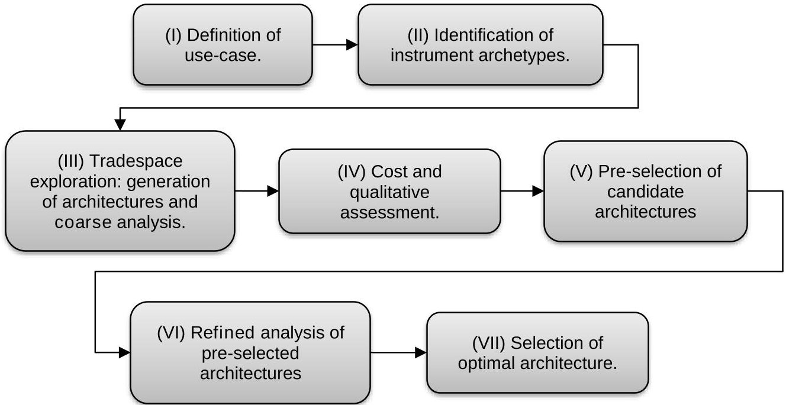

Figure 2-1 - ONION architecture selection stages.

## 2.1 USE-CASE DEFINITION AND SELECTION OF INSTRUMENT ARCHETYPES

The first stage (I) defines the application and the type of information that shall be delivered by the system (i.e. the measured parameters). The ONION consortium analyzed a large set of uses-cases and defined

<!-- PDF_PAGE: 4 -->

## November 2-3, 2017, ISAE SUPAERO - Toulouse, France

their measurements following the methodology in [8]. From the list of potential use-cases, the ONION study identified that the most relevant and strategic use-case should address marine weather forecast in the arctic and sub-arctic regions [9]. This use-case defines up to seven different parameters that shall be measured by ONION architectures, namely: ocean surface currents; wind speed over the sea surface; significant wave height; dominant wave direction; sea surface temperature; atmospheric pressure; and percentage of sea ice cover. From this list, the use-case specification also identifies four high-priority measurements that should be emphasized during the optimization and selection process.

In ONION, for each of the measurements of a use-case their performance requirements are defined as intervals (minimum and optimal requirements). Such intervals are provided for a given set of performance metrics. Three performance metrics have been considered in order to assess the architectures, namely:

- Spatial resolution: either horizontal or vertical, depending on the actual parameter to measure.

- Revisit time, i.e. temporal resolution.

- Data-access latency: the time between the datatakes and the unprocessed data is received at the ground segment.

With the list of required measurements and their expected performances, a set of potential instrument archetypes is then prepared. The term archetype is used here to refer to a given instrument technology. While performance requirements can be regarded as hard constraints for the architecture generation, the fact that these are usually stringent and that performance metrics are not the only evaluation criteria, implies that some of the generated ONION architectures might not have the capability to measure all the parameters. Additionally, some of the selected instrument archetypes might be able to provide data for more than one parameter at the same time (e.g. synthetic aperture radars allow measuring several terrain and ocean parameters). However, the performance required for each measurement might be different (e.g. different minimum spatial resolutions). Because of that, the OASF may generate and assess architectures that perform worse than the requirements for some of its measured parameters. For the marine weather forecast use-case and its measurements, a reduced set of instrument archetypes was found sufficient to cover the requirements. The list of instruments is detailed in Table 1.

Table 1- Instrument archetypes for ONION marine weather forecast in arctic and subarctic regions.

<table border="1"><tr><td>Instrument archetype</td><td>Reference mission1</td><td>Mass(kg)</td><td>Power(W)</td><td>Datarate(kbps)</td></tr><tr><td>GNSS-R</td><td>CYGNSS,DDMI</td><td>2</td><td>12</td><td>200</td></tr><tr><td>Optical imager,VIS/NIR/TIR</td><td>MetopC,AVHRR/3</td><td>31</td><td>27</td><td>515</td></tr><tr><td>Synthetic Aperture Radar,X band.</td><td>Severjanin-M</td><td>150</td><td>1000</td><td>1000</td></tr></table>

## 2.2 DECISION VARIABLES AND COARSE PERFORMANCE ANALYSIS

The following step (III) in the design-space exploration is devoted to generate candidate architectures. An architecture is considered to encompass a number of platforms orbiting in different planes (i.e. satellite constellation). Each platform (or "node") embarks a given combination of instruments, depending on the available payload mass (i.e. spacecraft class). This generation process gathers the use-case requirements and produces specific satellite constellations by assigning the following decision variables:

<!-- PDF_PAGE: 5 -->

- Orbit altitude (3 options): {510, 657, 807} km.

- Number of nodes (11 options): {4, 6, 8, 10, 12, 16, 20, 24, 32, 40, 48}

- For each node:

- Platform size (3 options): {heavy (~200 kg. payload mass), medium (~50 kg. payload mass), small, 3U CubeSat-like (~2 kg. payload mass)}

- Instruments (4 combinations instruments constrained by the platform mass and power availability): {small: GNSS-R, medium: GNSS-R & Optical Imager, heavy-1: SAR-X, heavy-2: SAR-X & Optical imager}

- Number of planes: where the nodes will be allocated (5 options): {2, 3, 4, 6, 8}

- Walker pattern configuration (2 options): {Delta, Star}

The size of the complete combinatorial set is computationally unfeasible, and hence has been limited by forcing a finite number of platform size combinations for each constellation. Platform homogeneity is not forced for the generated constellations, hence allowing architectures with both small, medium and heavy platforms orbiting together and exchanging information. This tries to represent the idea of DSS in which the functionality of a monolithic, heavy, multi-instrument satellite is divided into multiple, single-instrument satellites. Nonetheless, in order to reduce the number of generated architectures, platforms of the same size are forced to host the same instrument. This is also aligned with the idea that producing several identical nodes can also minimize development costs. Thus, architectures that include small platforms and medium platforms will encompass, respectively, GNSS-R instruments and optical imagers. Architectures that include heavy platforms, present two instrument combination alternatives: one in which a SAR-X instrument is hosted in the satellite, and another in which the satellite hosts both a SAR-X instrument and the optical imager. The latter alternative was feasible in terms of mass and storage constraints and could lead to a revisit time improvement for some of the measurements.

Once the architecture generation process is complete, the performance of each architecture (revisit times and latencies) is evaluated. Reducing the amount of platform size combinations, (i.e. limiting the number of heavy, medium and small platforms that can be combined in a single constellation configuration) allowed reducing the simulation efforts, which computed coarse revisit times for each instrument type and latencies for the architectures. In addition, implementing moderately simplified spacecraft models that ignored power and storage constraints also contributed to reducing the simulation times at this stage. The details of this coarse performance analysis are out of the scope of this paper.

At this stage, revisit times are computed as the mean value between two observations of a point in the southernmost latitude, which is $ 6 0^{\circ} $ N as defined by the use-case. Instrument spatial resolutions and swaths are taken from their reference missions (Table 1) and are adjusted with the architecture's orbital altitude, while keeping instrument's antenna apertures constant. Latencies, on the other hand, are computed with a model that assumes ideal routing capabilities. Inter-satellite data exchanges can take place if and only if the receiving node is in direct contact with a ground station. Different RF Inter-Satellite Link capabilities are assumed for each of the three satellite platforms, mostly characterized in stage (III) by the maximum range of the communications subsystems.

The initial performance analysis, though, does not take into account power and storage constraints on the satellite buses. However, this coarse assessment allows to down-select a relatively small set of candidate architectures for which a detailed analysis is performed at stage (VI). In this final simulation stage, higherfidelity spacecraft, payload and orbital models are used to derive finer revisit times (both mean and maximum values) and independent latency metrics for each use-case measurement. Based on the criteria introduced at the beginning of this section and the data generated by the detailed architecture analyses, the best performing architecture is finally selected in stage (VII).

## 2.3 AGREGGATED FIGURE-OF-MERIT AND SYSTEM "ILITIES"

Once architectures are generated and their performance is evaluated, a figure of merit is computed for each of them. This figure of merit, computed with the expression in (1), encompasses launch and development

<!-- PDF_PAGE: 6 -->

## November 2-3, 2017, ISAE SUPAERO - Toulouse, France

costs (C, normalized) and system "-ilities" (A). This aggregated score will be used as an overall relative performance metric throughout the architecting process to rank architectures and compare solutions. With $ N_{K} $ as the number of measurements of the use-case $ ( N_{K}=7 $ , for arctic marine weather forecast) and $ \Gamma_{i k} $ being the aggregation of weighted performance metrics for each measurement k, the figure-of-merit of an architecture i is partially influenced by the intrinsic performance of the constellation.

$$
\Gamma_ {i} = C _ {i} \Gamma_ {m o d (i)} = C _ {i} A _ {i} \Gamma_ {i} = C _ {i} A _ {i} \sqrt {\frac {1}{N _ {K}} \sum_ {k} \Gamma_ {i k} ^ {2}}
$$

In addition to the aggregation of performance metrics and constellation costs, an additional term $ A_{i} $ modifies figures of merit based on an assessment of their qualitative attributes; the so-called "-ilities" of a system. The ONION Architectural Selection Framework proposed up to 9 "-ilities", to assess relevant characteristics. Five of these qualitative modifiers were finally modelled and used in the optimization process. While an in-depth discussion on their modelling is out of the scope of this paper, the considered qualitative modifiers and their brief description is listed below:

- Criticality: given that the use-case definition identifies four high-priority parameters, the number and quality of the provided data for this four critical measurement will determine the criticality of an architecture.

- Practicality: the need to process large volumes of data can be detrimental (or even unfeasible) at some point. This attribute assesses the aggregated throughput generated by the constellations and reduces their figures of merit if the data volume and processing (at the ground segment) is deemed unfeasible.

- Relevance: while some instruments are capable of providing high-quality data for a given measurement, others may rely upon less reliable models. Similarly, some instruments might be influenced by observation conditions that may worsen the performance of an architecture (e.g. lighting conditions and cloud coverage are critical factors for optical imagers). This quality attribute is computed as an aggregation of instrument- and measurement-specific data relevance factors.

- Versatility: highly versatile architectures are those presenting high instrument- and platformagnostic scores. Given that a constellation configuration (i.e. number of planes and orbital slots per plane) may be shared across some architectures, versatility is computed by aggregating figures of merit of architectures that belong to the same constellation configuration. Thus, versatility is assigned to families of architectures, rather than on an individual basis.

- Maturity: assessed based on the number of emerging sensing technologies (e.g. GNSS-R) embarked in the nodes of each architecture.

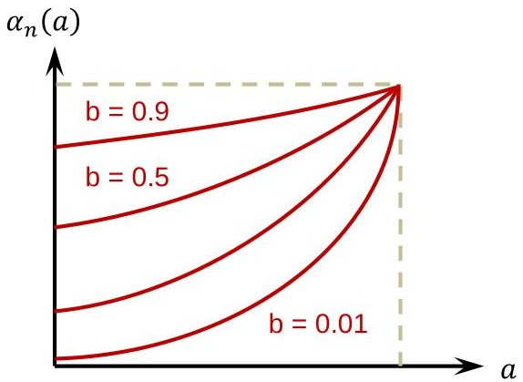

Figure 2-2 - Weighting functions for architectural quality attributes

The aggregation of these qualitative attributes (3) is performed after the application of the exponential weighting function (2). Also illustrated in Figure 2-2, the weighting function takes as inputs the normalized

<!-- PDF_PAGE: 7 -->

November 2-3, 2017, ISAE SUPAERO - Toulouse, France

value for a given "-ility" a, and its weight b. Ilties for which their weight takes lower values (i.e. closer to 0) will strongly influence the value of the figure-of-merit, while "-ilities" with higher weight (i.e. closer to 1) will hardly affect the final score of their architecture.

$$
\alpha = b ^ {1 - a}, \mathrm {w i t h} b = \left\{ \begin{array}{l l} 1 \rightarrow \mathrm {l o w w e i g h t}, \mathrm {n o i n f l u e n c e} \\ 0. 0 1 \rightarrow \mathrm {h i g h w e i g h t}, \mathrm {s t r o n g i n f l u e n c e} \end{array} \right.
$$

$$
A _ {i} = \prod_ {i j} \alpha_ {i j}
$$

The aggregation and weighting function for the abovementioned set of "-ilities" allows ranking architectures based on subjective or strategic criteria. This criterion, numerically represented as different weighting values for each quality attribute, heavily influenced the final choice. For the selected use-case, the weighting vector $ \left(b=\left\{b_{C},b_{D},b_{V},b_{P},b_{M}\right\} \right) $ prioritized architectures that:

- Measure all four critical parameters (i.e. critical architectures, $ b_{C}=0.5 $);

- were capable of producing data of very high quality (i.e. relevant architectures, $ b_{D}=0.5 $);

- exhibited high versatility $ ( b_{V}=0.65) $;

- generated practical volumes of data without this condition not having very strong effect in the choice (i.e. moderately practical architectures, $ b_{P}=0.75 $); and

- did allow emerging instrument technologies (i.e. maturity had much less effect in the choice, $ b_{M}=0.95). $

## 3. RESULTS

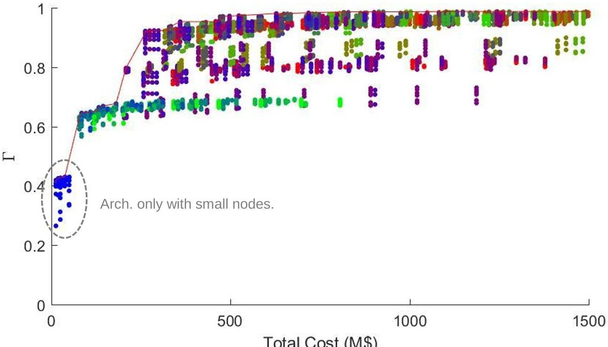

Figure 3-1 - Pareto front Unmodified Figure-of-Merit vs. Cost.

The complete design-space for the MWF use-case resulted in a set of 5586 architectures generated from 204 unique constellation configurations. The remaining of this paper is devoted to the analysis of results, both from coarse simulations and from high-fidelity performance analyses. All the plots presented below, compare the architectures using their computed figures-of-merit, which encapsulate information of the architecture performances as well as high-level qualities and cost. Aside from the domains in which those figures-of-merit are represented in the plots, the color of each point in the series provides information about an additional characteristic: the distribution of small-, medium- and heavy platforms within the architecture.

<!-- PDF_PAGE: 8 -->

November 2-3, 2017, ISAE SUPAERO - Toulouse, France

Encoded with the three primary colors, red for heavy platforms, green for medium ones, and blue for small spacecraft, the combination of these in the exact same proportion that is present in the architectures will yield a specific color code. Thus, red-shaded points correspond to platforms with a large number of heavy platforms, while blue and green ones will correspond to higher percentage of small and medium platforms respectively.

## 3.1 RESULTS BASED ON COARSE PERFORMANCE ANALYSIS

Exploring the results, the Pareto front in Figure 3-1 shows the relative score of each architecture with respect to the cost. The Y-axis corresponds to the unmodified figure-of-merit $ (\Gamma) $ , i.e. the aggregation of weighted performance metrics. Costs in the scoring methodology are mostly affected by the number of nodes, and the platform class (with heavy platforms presenting notoriously higher development and launch costs.) If one only looks at performance metrics, many ONION architectures are scarcely improved by adding more nodes. The increase in costs does not seem to translate into meaningful improvements in score as long as the architectures satisfy the minimum use-case requirements. This insensibility to costs is actually justified by the metric normalization function, which assigns the same maximum value to those performance metrics that are equal or exceed the optimal requirements. However, when qualitative modifiers are also considered, the ranking changes and clusters the data into two separate groups. Figure 3-2 shows the same solution space and Pareto front, and plots the overall score that does include the abovementioned aggregated architectural qualities $ (\Gamma_{mod}) $ . In this case, architectures that do not encompass a SAR-X instrument (i.e. do not have heavy nodes) are not capable of providing data for all the use-case measurements. Despite this effect was also reflected in their unmodified score, it is here emphasized due to the fact that some of their unsatisfied measurements are identified as critical in the use-case specification. As a result, the criticality of these architectures is much more reduced and have their score decreased dramatically.

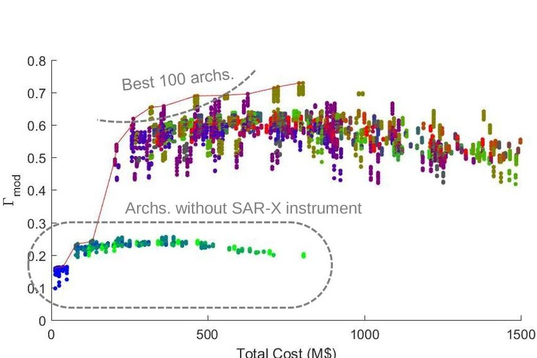

Figure 3-2 - Pareto front Modified Figure-of-Merit vs. Cost.

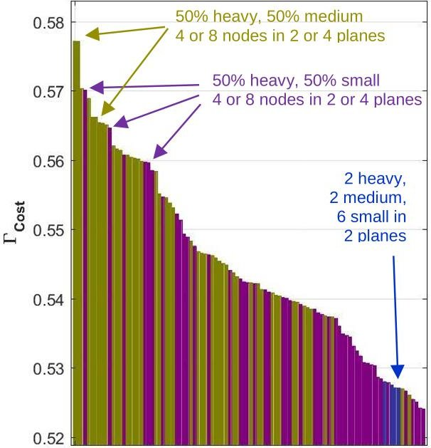

Figure 3-3 - Architecture ranking (best 100). Color indicates platform distribution.

On the other hand, Figure 3-3 shows the relative ranking for the architectures with highest scores. The plot sorts architectures with their overall figures-of-merit (i.e. including the effects of cost, qualitative modifiers and performance metrics), and displays the best 100 solutions (also highlighted in Figure 3-2.) In this case, one can observe that whilst the number of nodes is not always constant, the distribution of platforms only presents three cases (identified in Figure 3-3 with three different colors). Constellations for the most optimal architectures are designed with 2 or 4 heavy nodes plus 2 or 4 medium nodes. Their size is always 4 or 8 nodes and are distributed in 2 or 4 planes (points colored in ochre). However, architectures that replace

<!-- PDF_PAGE: 9 -->

## November 2-3, 2017, ISAE SUPAERO - Toulouse, France

medium nodes by small, CubeSat-like ones also constitute highly optimal solutions in this scenario (displayed in violet). These two configuration options dominate most of the architectures in the list displayed in Figure 3-3. In most cases, this change is possible owing to the payload mass capacity of heavy nodes, which can host both the SAR-X instrument and the optical imager at the same time. When medium platforms (which host optical imagers and GNSS-R instruments) are replaced by small platforms, the optical imager tends to be allocated to the heavy platforms. This notwithstanding, within the first hundred solutions, one can also observe the presence of designs with 2 heavy nodes, 2 medium nodes and 6 small nodes. Distributed in 2 planes, these architectures could still be considered as optimal, since they are within the best 1.8% design solutions.

Observing the performance trends in the space Nodes-Planes also provides additional insight about the design-space for this use-case. Figure 3-4a shows the figure-of-merit in the Z-axis as a surface generated from the maximum values of each point (n,p). Contour curves for this surface have been superimposed in the 2D plane to identify regions with similar scores. In the plot, one can find valleys in constellation configurations that inherently provide worst performances (i.e. 6 or 16 nodes seem to be a detrimental design choice). Counterintuitively, adding more nodes is not always a good choice, highlighting that, apart from the orbital configuration (either Walker Delta or Star patterns), constellation sizes and plane distribution do influence revisit times and latencies. Ultimately, it is also worth noting that the scores of architectures that are largely populated by heavy nodes (red-shaded points) tend to fall to lower parts of the plot as the number of nodes increases. This effect of the cost model, which is much less intense in architectures with medium nodes and almost imperceptible in small nodes, causes large architectures (e.g. 40 or 48 nodes) to be effectively unpractical, given that SAR-X nodes are essential for the use-case and they cannot be hosted in smaller platforms.

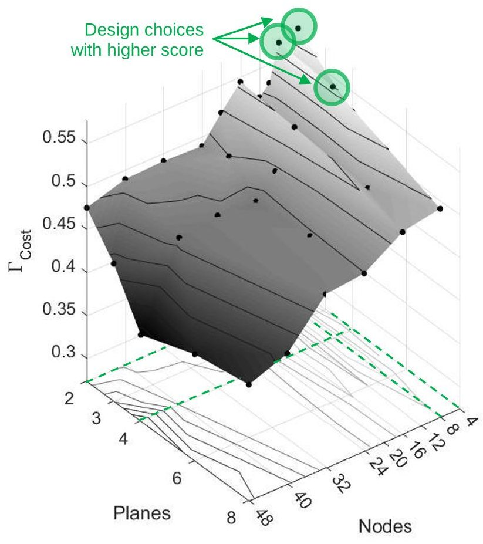

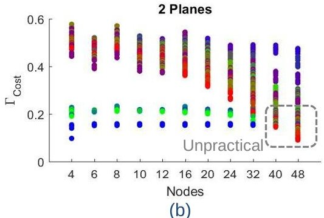

(a)

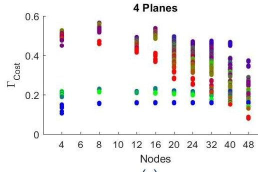

(c)

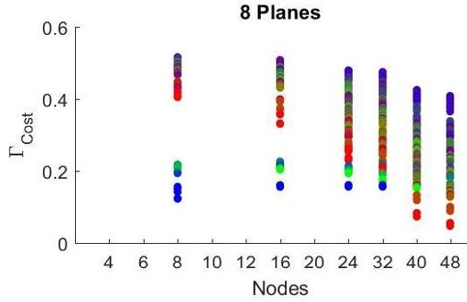

(d)

Figure 3-4 - Performance trends.

<!-- PDF_PAGE: 10 -->

## November 2-3, 2017, ISAE SUPAERO - Toulouse, France

Finally, it is also worth pointing out how the number of nodes of a given platform class, affects the figures of merit of architectures. Figure 3-5 shows the overall figure-of-merit (i.e. with cost and qualitative modifiers applied) and displays the solutions with respect to the number of heavy (a), medium (b) and small (c) platforms. The same conclusions observed at the beginning of this section can be clearly observed in Figure 3-5a: architectures need at least 2 SAR-X instruments to become valuable solutions. Regardless of the fact that having only single heavy platform is not possible (because the minimum number of planes is 2, and they are forced to be homogeneous in number and type of their nodes), a specific revisit time analysis also confirmed that at least 2 SAR-X instruments were required to fulfil the requirements of the use-case.

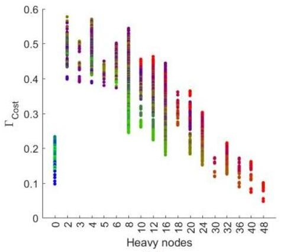

(a)

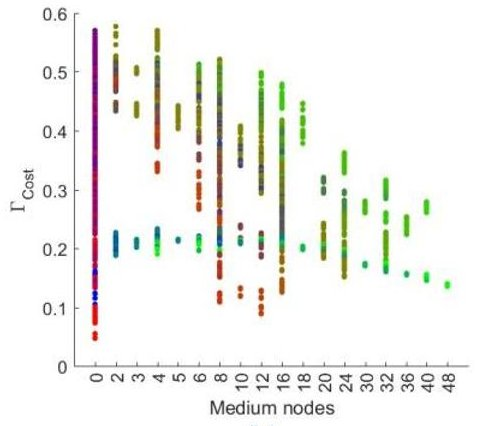

(b)

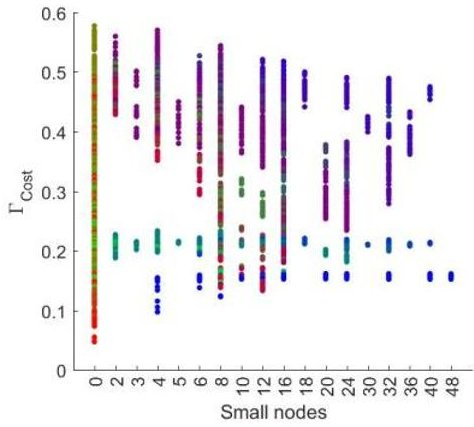

(c)

Figure 3-5 - Influence to the number of platforms of a given class.

## 3.2 RESULTS FROM DETAILED ANALYSIS

This first assessment of architecture performances and their "-ilities" allowed to select a small set of 28 candidate architectures. It is important to note that this selection process was very much influenced by the weights assigned to each of the "-ilities" and that different needs would have triggered the selection of a completely different set. Figure 3-6 compares the actual value given to each "-ility" (in blue) with the resulting figure when the weighting function is applied (in green).

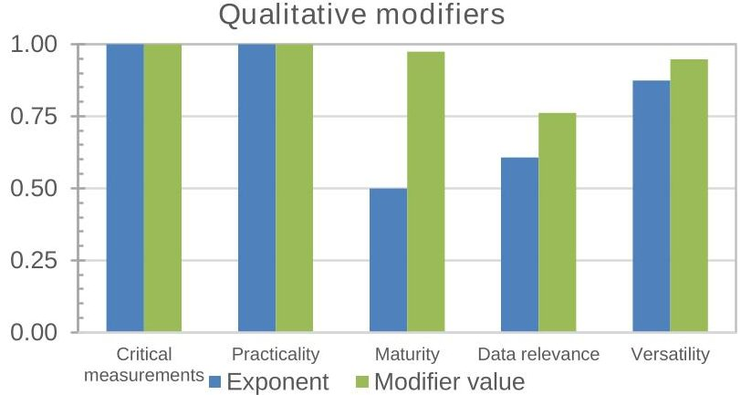

Figure 3-6 - Evaluation of quality attributes for the optimal architecture

Nonetheless, while the preliminary selection allowed to trim the design space to a few options, these still had to be compared in order to identify the most optimal choice. A final detailed analysis of architecture capabilities provided new performance metrics for the architectures, computed from refined spacecraft and payload models. This latter performance assessment did consider power and storage constraints in spacecraft, modelled inter-satellite links with platform-specific consumptions, datarates and antenna visibility constraints. For each platform type, the solar array areas and battery capacities were designed such that all the architectures could operate in nominal conditions (i.e. positive power budgets for each

<!-- PDF_PAGE: 11 -->

node). Similarly, the LTAN for each plane in the constellation was computed such that it maintained the configuration imposed by the decision variables and it provided the best power generation scenario. Noteworthy, selecting LTAN for each plane was not trivial in architectures in which heavy nodes encompassed, simultaneously, both the SAR-X instrument and the optical imager. This situation owed to the fact that optical instruments require specific lighting conditions that, in some cases, conflicted with the power requirements of SAR-X instruments.

Table 2 - Results of the coarse performance analysis, for the optimal architecture.

<table border="1"><tr><td>Coarse performance metrics</td><td>Value</td></tr><tr><td>Revisit time(GNSS-R)[h]</td><td>3.917</td></tr><tr><td>Revisit time(Optical imager)[h]</td><td>3.050</td></tr><tr><td>Revisit time(SAR-X)[h]</td><td>1.417</td></tr><tr><td>Latency[min]</td><td>31.866</td></tr><tr><td>Initial unmodified figure of merit</td><td>0.94801</td></tr></table>

While the coarse performance analysis provided revisit times for each individual instrument type, the refined simulation and analysis tool produced individual metrics for each measurement of the use-case. For both the revisit time and latency, both the maximum value and the mean one were computed by the analysis tool. Finally, the use of resources of each architecture was also reported in the form of battery depth-of-discharge (DoD) and data storage requirements (Table 3). While the latter was unconstrained and was not deemed critical for the selection, battery DoD was an important parameter to take into account. Also in this case, two figures were generated: the maximum DoD found all nodes (i.e. the global maximum DoD) and the average of all the individual DoD's. With all these figures, the most optimal architecture could ultimately be selected. The selected architecture was configured in a Walker delta constellation orbiting at 807 km. It was composed of 16 nodes, distributed in 8 planes. Four of these planes encompassed heavy platforms with both SAR-X and optical imager, while the other four allocated small nodes with GNSS-R instruments. These two types of planes were alternatively distributed in the constellation. Inevitably, the design of this architecture is similar to that of the other candidates, given that they had been pre-selected from an initial analysis that already yielded a narrow solution space. For this architecture, the remaining of this section details the values of this final performance analysis.

Table 3 - Resource assessment for the optimal architecture.

<table border="1"><tr><td>Resource</td><td>Variable</td><td>Value</td><td>Normalized</td></tr><tr><td rowspan="2">Power(battery Depth of Discharge)</td><td>Max. global[%]</td><td>10.1%</td><td>0.596</td></tr><tr><td>Avg.of max.values[%]</td><td>4.9%</td><td>0.805</td></tr><tr><td rowspan="2">Data storage</td><td>Max. global[MB]</td><td>147</td><td>0.734</td></tr><tr><td>Avg.of max.values[MB]</td><td>94</td><td>0.831</td></tr></table>

Table 2 starts by gathering the computed metrics from the coarse analysis. These figures can be compared with those of Table 4, which encompasses mean and maximum figures for the same metrics, albeit the latter are individually computed for each measurement. Noteworthy, some of them differ (e.g. revisit times are actually higher) due to all the constraints enforced during the simulation and as a result of accurate payload modelling. The rightmost column in Table 4 (named "W") corresponds to the normalized value, after the weighting function is applied to metrics. These same values are graphically represented in Figure 3-7 and Figure 3-8, showing that this architecture is capable of satisfying revisit times for all measurements. However, data access latencies are only guaranteed for two measurements of this use-case. This situation is, for this use-case, strongly influenced by the use-case specifications and the location of ground stations. On the one hand, this use-case is focused on data products for Polar Regions, forcing datatakes to be performed in higher latitudes. In order to minimize latency, and with the constellation deployed as a set of polar orbits, the network of ground stations is located also at higher latitudes. This forces data capture

<!-- PDF_PAGE: 12 -->

## November 2-3, 2017, ISAE SUPAERO - Toulouse, France

processes to be done while satellites are also in contact with ground segment. Thus, if inter-satellite links are only enabled when the receiver has established a link with ground, architectures either download their data at the Earth poles (directly or indirectly through ISL), or need to wait an orbital period until their ISL's can be enabled again. In the second case, the latency increases and is approximately 87 min. Curiously enough, this situation can only be observed in maximum figures of latency, while average latencies are always satisfied. Regardless of this situation, which is also reproduced in all the other candidate architectures, the selected design exhibited high scores in its worst-case figure-of-merit (computed with maximum values instead of average ones).

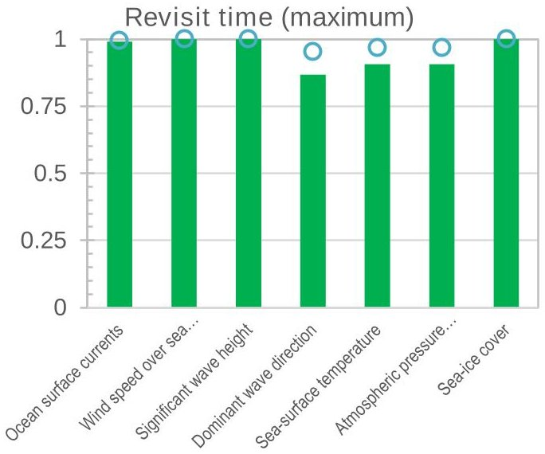

Figure 3-7 - Maximum revisit times for the optimal architecture

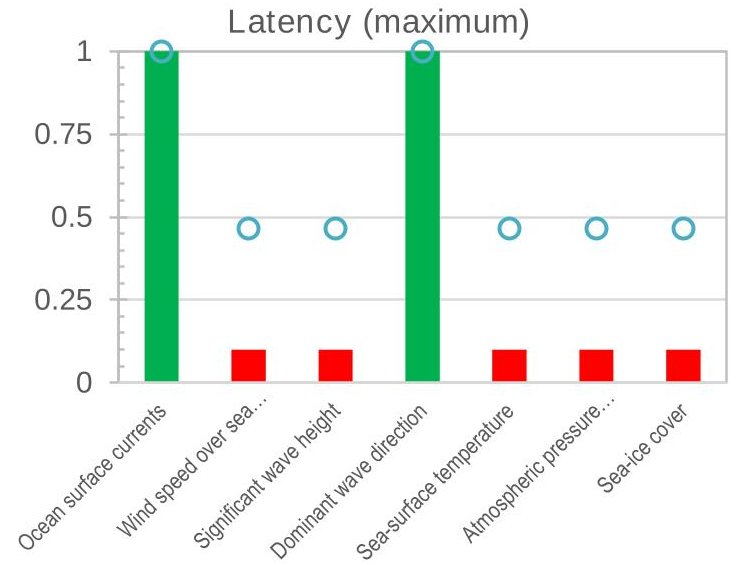

Figure 3-8 - Maximum latency for the optimal architecture.

Table 4 - Refined performance metrics for the optimal architecture.

<table border="1"><tr><td>Use-case param.</td><td>Performance metrics</td><td>Value</td><td>Norm.</td><td>W.</td><td>Use-case param.</td><td>Performance metrics</td><td>Value</td><td>Norm.</td><td>W.</td></tr><tr><td rowspan="4">Ocean surface currents</td><td>Max. Revisit time [h]</td><td>7.017</td><td>0.991</td><td>0.997</td><td rowspan="4">Sea surface temperature</td><td>Max. Revisit time [h]</td><td>10.672</td><td>0.906</td><td>0.968</td></tr><tr><td>Avg. Revisit time [h]</td><td>2.110</td><td>1.000</td><td>1.000</td><td>Avg. Revisit time [h]</td><td>0.454</td><td>1.000</td><td>1.000</td></tr><tr><td>Max. Latency [min]</td><td>0.00</td><td>1.000</td><td>1.000</td><td>Max. Latency [min]</td><td>83.05</td><td>0.100</td><td>0.464</td></tr><tr><td>Avg. Latency [min]</td><td>0.00002</td><td>1.000</td><td>1.000</td><td>Avg. Latency [min]</td><td>0.00037</td><td>1.000</td><td>1.000</td></tr><tr><td rowspan="4">Wind speed over sea surface</td><td>Max. Revisit time [h]</td><td>2.533</td><td>1.000</td><td>1.000</td><td rowspan="4">Atmospheric pressure</td><td>Max. Revisit time [h]</td><td>10.672</td><td>0.906</td><td>0.968</td></tr><tr><td>Avg. Revisit time [h]</td><td>0.670</td><td>1.000</td><td>1.000</td><td>Avg. Revisit time [h]</td><td>0.454</td><td>1.000</td><td>1.000</td></tr><tr><td>Max. Latency [min]</td><td>87.82</td><td>0.100</td><td>0.464</td><td>Max. Latency [min]</td><td>83.05</td><td>0.100</td><td>0.464</td></tr><tr><td>Avg. Latency [min]</td><td>1.083</td><td>1.000</td><td>1.000</td><td>Avg. Latency [min]</td><td>0.00037</td><td>1.000</td><td>1.000</td></tr><tr><td rowspan="4">Significant wave height</td><td>Max. Revisit time [h]</td><td>2.533</td><td>1.000</td><td>1.000</td><td rowspan="4">Sea-ice cover</td><td>Max. Revisit time [h]</td><td>2.533</td><td>1.000</td><td>1.000</td></tr><tr><td>Avg. Revisit time [h]</td><td>0.670</td><td>1.000</td><td>1.000</td><td>Avg. Revisit time [h]</td><td>0.414</td><td>1.000</td><td>1.000</td></tr><tr><td>Max. Latency [min]</td><td>87.82</td><td>0.100</td><td>0.464</td><td>Max. Latency [min]</td><td>87.82</td><td>0.100</td><td>0.464</td></tr><tr><td>Avg. Latency [min]</td><td>1.083</td><td>1.000</td><td>1.000</td><td>Avg. Latency [min]</td><td>0.48107</td><td>1.000</td><td>1.000</td></tr><tr><td rowspan="4">Dominant wave direction</td><td>Max. Revisit time [h]</td><td>7.017</td><td>0.867</td><td>0.954</td><td rowspan="4"></td><td rowspan="4" colspan="4"></td></tr><tr><td>Avg. Revisit time [h]</td><td>2.110</td><td>1.000</td><td>1.000</td></tr><tr><td>Max. Latency [min]</td><td>0.00</td><td>1.000</td><td>1.000</td></tr><tr><td>Avg. Latency [min]</td><td>0.00002</td><td>1.000</td><td>1.000</td></tr></table>

<!-- PDF_PAGE: 13 -->

November 2-3, 2017, ISAE SUPAERO - Toulouse, France

## 4. CONCLUSIONS

This paper presented the results of an architectural selection framework that was specifically designed to return the most optimal DSS architecture for a given Earth observation application. Based on an exhaustive exploration of the design space, this design-oriented methodology has been able to find the optimal constellation configuration that satisfies the user requirements and presents some qualities. Architecture designs are characterized by their altitude, number of nodes, distribution in planes and a given Walker pattern. In addition, the architecture generation process also assigns a set of relevant instruments to each node (i.e. satellite in the network). Based on the required mass capacity, each node is implemented with a platform of a different class: heavy, medium or small (CubeSat-like). Thus, the architecture optimization not only deals with architectures with constellations of heterogeneous instrument technologies, but it also considers architectures composed of heterogeneous satellite platforms that share the same mission goals and engage in a distributed and networked data capture process. Finally, the methodology summarized in this paper assesses the goodness of solutions based upon an aggregated figure of merit that encompasses architecture performances, development and launch costs and system-wide quality attributes (i.e. "-ilities")

The results of this methodology and assessment have been explored in this paper from two different standpoints. On the one hand, the exploration of the design space has been analyzed in its completeness to understand the effects of some decision variables. In order to understand their influence, all the solutions have been studied by comparing their individual figures-of-merit. The design space showed a clear improvement in architecture scores for those architectures composed mainly of 2, 4 or 8 heavy platforms and complemented by a similar number of medium or small platforms. The "-ilities" of the generated architectures have been quantified and their strong influence in the scores has been emphasized in this paper. Ultimately, this optimization framework has been capable of narrowing the solution space to a small set of architectures not only by selecting designs with higher performances and lowest costs, but also by adjusting the impact of some "-ilities" over the others.

On the other hand, this paper also presented the results of a detailed performance analysis that was performed for the reduced set of candidate architectures, pre-selected in the previous exploration. This second analysis provided finer metrics and an insight on the resource consumption for the candidate architectures (i.e. battery Depth-of-Discharge and accumulated data storage on-board), and ultimately allowed to choose the most optimal design.

## 5. ACKNOWLEDGMENTS

This study was conducted in the framework of the Operational Network of Individual Observation Nodes project, and it has received funding from the European Union's Horizon 2020 research and innovation program under grant agreement 687490, coordinated by Thales Alenia Space France.

## 6. BIBLIOGRAPHY

[1] A. Poghosyan and A. Golkar, "CubeSat evolution: Analyzing CubeSat capabilities for conducting science missions," Progress in Aerospace Sciences, vol. 88, p. 59-83, 2017.

[2] D. Selva and D. Krejci, "A survey and assessment of the capabilities of Cubesats for Earth observation," Acta Astronautica, vol. 72, pp. 50-68, 2012.

[3] J. Le Moigne, P. Dabney, O. de Weck, V. Foreman, P. Gorgan, M. Holland, S. Hughes and S. Nag, "TAT-C: A Trade-space Analysis Tool for Constellations," in Earth Science Technology Forum (ESTF2016), Annapolis, MD, 2016.

[4] O. de Weck, R. de Neufville and M. Chaize, "Staged Deployment of Communications Satellite Constellations in Low Earth Orbit," Journal of Aerospace Computing, Information and Communication, vol. 1, pp. 119-135, March 2004.

<!-- PDF_PAGE: 14 -->

November 2-3, 2017, ISAE SUPAERO - Toulouse, France

[5] A. A. Rader, A. M. Ross and M. E. Fitzgerald, "Multi-Epoch Analysis of a Satellite Constellation to Identify Value Robust Deployment across Uncertain Futures," in AIAA SPACE 2014 Concerence and Exposition, San Diego, CA, US, 2014.

[6] A. M. Ross, D. H. Rhodes and D. E. Hastings, "Defining Changeability: Reconciling Flexibility, Adaptability, Scalability, Modifyability, and Robustness for Maintaining System Lifecycle Value," Systems Engineering, vol. 11, no. 3, pp. 246-262, 2008.

[7] S. Nag and O. de Weck, "Satellite Constellation Mission Design using Model-Based Systems Engineering and Observing System Simulation Experiments," in 28th Annual AIAA/USU Conference on Small Satellites, 2014.

[8] H. Metevosyan, I. Lluch, A. Poghosyan and A. Golkar, "A Value-Chain Analysis for the Copernicus Earth Observation Infrastructure Evolution," IEEE Geoscience and Remote Sensing Magazine, vol. 5, no. 3, pp. 19-35, September 2017.

[9] H. Matevosyan, I. Lluch, C. A. Moreno, A. Lamb, R. Akhtyamov, G. De Angelis, O. Lesne, A. Mangin, A. Sousa, U. Pica, A. Camps, A. Golkar and A. Poghosyan, "ONION Publicly available report Stakeholders Needs: User Needs Analysis and Earth Observation Infrastructure State of the Art Assessment," 2016.

[10] S. Nag, J. Le Moigne, D. W. Miller and O. de Weck, "A framework for Orbital Performance Evaluation in Distributed Space Missions for Earth Observation," in IEEE Aerospace Conference, Big Sky, MT, US, 2015.

[11] S. Nag, J. Le Moigne and O. de Weck, "Cost and Risk Analysis of Small Satellite Constellations for Earth Observation," in IEEE Aerospace Conference, Big Sky, MT, US, 2014.