<!-- PDF_PAGE: 1 -->

<div align="center">

# Architecture Internalisation in BIP

</div>

Simon Bliudze, Joseph Sifakis

EPFL, Station 14

CH-1015 Lausanne,

Switzerland

firstname.lastname@epfl.ch

Marius Bozga

UJF-Grenoble 1 / CNRS

VERIMAG UMR 5104

F-38041 Grenoble, France

marius.bozga@imag.fr

Mohamad Jaber

American University of Beirut

Lebanon

mj54@aub.edu.lb

## ABSTRACT

We consider two approaches for building component-based systems, which we call respectively architecture-based and architecture-agnostic. The former consists in describing coordination constraints in a purely declarative manner through parametrizable glue operators; it provides higher abstraction level and, consequently, stronger correctness by construction. The latter uses simple fixed coordination primitives, which are spread across component behaviour; it is more error-prone, but allows performance optimisation. We study architecture internalisation leading from an architecture-based system to an equivalent architecture-agnostic one, focusing, in particular, on component-based systems described in BIP. BIP uses connectors for hierarchical composition of components. We study connector internalisation in three steps. 1) We introduce and study the properties of interaction expressions, which represent the combined information about all the effects of an interaction. We show that they are a very powerful tool for specifying and analysing structured interaction. 2) We formalize the connector semantics of BIP by using interaction expressions. The formalization proves to be mathematically rigorous and concise. 3) We introduce the T/B component model and provide a semantics preserving translation of BIP into this model. The translation is compositional that is, it preserves the structure of the source models. The results are illustrated by simple examples. A Java implementation is evaluated on two case studies.

## Categories and Subject Descriptors

D.3.1 [Programming Languages]: Formal Definitions and Theory; D.3.2 [Programming Languages]: Language Classifications Concurrent, distributed and parallel languages

## Keywords

BIP; interaction expressions; connectors; data transfer; architecture internalisation; Top/Bottom component model

## 1. INTRODUCTION

Architectures depict design principles, paradigms that can be understood by all, allow thinking on a higher plane and avoiding low-level mistakes. They are a means for ensuring correctness by construction by enforcing global properties characterizing the coordination between components.

Using architectures largely accounts for our ability to master complexity and develop systems cost-effectively. System developers extensively use libraries of reference architectures ensuring both functional and non-functional properties, for example fault-tolerant architectures, architectures for resource management and QoS control, time-triggered architectures and security architectures.

Using architectures allows shifting the focus of developers from low-level code to high-level structures ensuring coordination in a component-based system. These structures are constraints between the coordinated components expressed in terms of communication mechanisms such as multiparty interaction, message passing, broadcast etc. Formally they can be understood as the assembly of coordination mechanisms which restrict the behavior of the coordinated components so as to satisfy a global characteristic property.

There exists an abundant literature on software architectures. Most papers study Architecture Description Languages (ADLs) for representing and analyzing architectural designs [15]. ADLs provide both conceptual frameworks and concrete syntax for characterizing software architectures. They also provide tools for parsing, compiling, analyzing, or simulating architectural descriptions written in their associated language. While all ADLs are concerned with architectural design, there is no agreement on what is an ADL, what aspects of architecture should be modeled in an ADL, and which of several possible ADLs is best suited for a particular problem. The borders between the realm of the ADLs and that of programming languages are blurring.

Despite the considerable diversity in the capabilities of different ADLs, they all share a common paradigm: software can be designed as the hierarchical composition of components by application of architectures. Components are computational elements characterized by their behavior and their interface. The latter defines points of interaction between a component and its environment.

ADLs specify the "glue" of architectural designs, usually expressed as the combination of connections between components. Connections may denote simple interaction mechanisms such as rendezvous, broadcast and function call. But they also may represent more complex ones such as protocols, buses and schedulers. In both cases, they are intended

<!-- PDF_PAGE: 2 -->

to specify two main aspects of interaction: 1) control-flow that is synchronization constraints; 2) data-flow that is how data of each component are transformed upon interaction.

If the ADL is expressive enough, it is possible to describe architectures in a purely declarative manner. Architectures can be understood as constraints that adequately restrict the behavior of the coordinated components so as to achieve a desired coordination property. They are defined to a large extent, independently from the components that make up the system. We speak then of an architecture-based approach for building component-based systems. Another approach considers irrelevant the distinction between atomic components and their associated coordination mechanisms: a system consists of a set of components—some providing basic functionality and some ensuring coordination. Dependencies between components are explicitly described by their behavior (code) via import clauses, function calls and read/write instructions. We call this approach architecture-agnostic.

The distinction between architecture-based and architecture-agnostic approaches appears very early in process algebra theories. CCS proposes a single parallel composition operator based on matching between input and output actions occurring in the description of processes. On the contrary, CSP, proposes a parallel composition operator parameterized by a set of actions that must synchronize. The dichotomy illustrated by this example is further accentuated in practice. Architecture-based approaches adopted by ADLs are CSP-like. They consider coordination as external and independent from the evolution of components. Architectures are, to a large extent, entities distinct from behavior. They are combinations of operators parameterized by the allowed interactions. Architecture-agnostic designs are based on a single composition operator. Coordination is described in terms of communication primitives appearing in their code. This approach is taken by most programming languages and by the various process algebras cloned from CCS.

In this paper, we study architecture internalisation leading from an architecture-based system to an equivalent architecture-agnostic one. Two main reasons motivate this study. One is the exploration of relationships between architecturebased and architecture-agnostic approaches. The other is more practically oriented and deals with the possibility to compile declarative-style architectural constraints into executable code. Is it possible to generate from an architecturebased system an equivalent architecture-agnostic one, where architecture glue is cast in dependencies between components explicitly described in their code?

We study the internalisation problem for component-based systems described in BIP [5]. BIP (Behaviour, Interaction, Priority) is a component-based framework that allows hierarchical composition of components by using connectors. Components can be considered as transition systems. A component interface consists of ports that label its transitions with associated exported variables. From some state, a port p can participate in an interaction if the component has a transition labeled by p which is enabled at this state.

In BIP, a connector is composed of two distinct parts:

Control-flow part specifies a relation between a set of bottom ports and a set of top ports. The interaction requires synchronization of all the ports. The top ports can be used to export the results of the interaction.


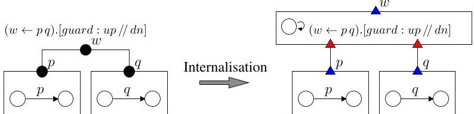


<div align="center">

Figure 2: A BIP and the corresponding T/B component

</div>

Data-flow part specifies the computation associated with the interaction. The computation can affect local variables and those associated with the ports.

In Fig. 1a, we provide the specification of the connector describing the interaction between two ports p and q. The control flow part is described by the relation $ w\leftarrow p q $ meaning that for the interaction w to take place both p and q should participate $ \left\{p,q\right\} $ is the set of bottom ports and $ \{w\} $ is the set of top ports. The data-flow part consists of an upward computation followed by a downward computation separated by " // ". The execution of an interaction is atomic. For the considered example, the interaction between p and q consists in computing $ \max \left(x_{p},x_{q}\right) $ and assigning this value to the variables $ x_{p} $ and $ x_{q} $ . Fig. 1b depicts a hierarchical connector r enforcing the interaction between ports p, q and s. The execution of this interaction results in an upward computation of $ \max \left(\max \left(x_{p},x_{q}\right),x_{s}\right) $ followed by a downward computation assigning this value to the port variables of the atomic components. As shown in [10], hierarchical connectors can be flattened into equivalent connectors. Fig. 1c shows a connector equivalent to the hierarchical connector by eliminating the interaction w.

Internalization of connectors in BIP models, consists in replacing them by a set of coordinators that directly implement their semantics. Coordinators play the role of an Engine that handles each interaction atomically. The internalised BIP model is the plain composition of the atomic BIP components with a set of coordinators, in bijection with the BIP connectors. To describe coordinators, we extend the BIP component model. The behavior of the components of the extended model is a set of transitions labeled with interaction expressions. Their interface is composed of sets of top and bottom ports and associated variables. As all the interaction capabilities of components are specified in their behavior, they can be composed without any additional external information. We show that component composition in the new model, called Top/Bottom (T/B) model, can be expressed by using a single associative partial operator $ \|. $

The correspondence between a connector and the associated coordinator is straightforward. The latter is a T/B component that has the same interface as the connector (same set of top and bottom ports and associated variables). It exhibits a cyclic behavior by computing the data transfer functions of the connector. Fig. 2 illustrates the principle of connector internalisation on a simple example. The corresponding coordinator is a stateless automaton that can perform a transition labeled by the interaction expression. Top and bottom ports are shown by blue outward- and red inward-facing triangles, respectively.

We study the connector internalisation problem for BIP in three steps. First, we study interaction expressions and their properties. We show in particular that they are a very powerful tool for specifying and analyzing structured interaction. Second, we formalize the connector semantics of BIP by using interaction expressions. The formalization proves

<!-- PDF_PAGE: 3 -->


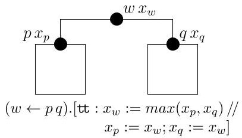


<div align="center">

(a) Simple BIP connector

</div>


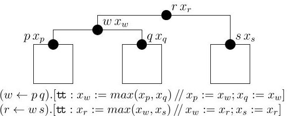


<div align="center">

$(w \leftarrow p q).[\text{tt}: x_w := max(x_p, x_q) // x_p := x_w; x_q := x_w]$

$(r \leftarrow w s).[\text{tt}: x_r := max(x_w, x_s) // x_w := x_r; x_s := x_r]$

</div>

<div align="center">

(b) Hierarchical BIP connector

</div>

<div align="center">

Figure 1: BIP connectors

</div>


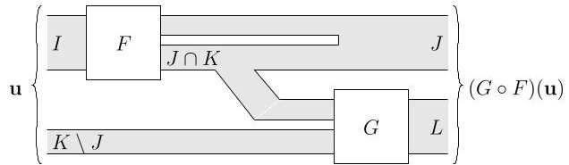


<div align="center">

Figure 3: Composition of structured functions

</div>

to be mathematically rigorous and concise. It treats on an equal footing control and data flow aspects. It differs from previous formalizations that were focusing mainly on control flow. Third, we introduce the T/B component model and provide a semantics preserving translation of BIP into this model. The translation is compositional: it preserves the structure of the source models.

We discuss an implementation of the T/B components and provide an algorithm for their execution. The implementation can be used for the execution of BIP components after internalisation of their connectors. Furthermore, it can be used for the execution of general T/B models.

The paper is structured as follows. In Sect. 2, we introduce the notion of interaction expressions, shared by all the models in the subsequent sections. In Sect. 3, we provide a formalization of connectors in BIP and present their properties. In Sect. 4, we present the T/B component model, study its properties and present a structured encoding of BIP models. In Sect. 5, we provide experimental results about a Java-based implementation.

## 2. INTERACTIONS

## 2.1 Structured Partial Functions

Let $ (\mathsf{D}_{i})_{i\in \mathcal{I}} $ be data domains, $ \mathcal{I} $ a universal index set. For each $ I\subseteq \mathcal{I} $ , denote by $ \mathsf{D}[I]\triangleq \prod_{i\in I}\mathsf{D}_{i} $ the set of unordered tuples $ \mathbf{u}=(u_{i})_{i\in I} $ , such that $ u_{i}\in \mathsf{D}_{i} $ , for all $ i\in I $ . For $ I=\emptyset $ , we have $ \mathsf{D}[\emptyset]=\mathbf{1}\triangleq \{*\} $ . For each $ \mathbf{u}=(u_{i})_{i\in I}\in \mathsf{D}[I] $ and $ I^{\prime}\subseteq I $ define the projection $ \mathbf{u}_{I^{\prime}}=(u_{i})_{i\in I^{\prime}}\in \mathsf{D}[I^{\prime}] $ We also denote $ \mathbf{u}_{\overline{I^{\prime}}}\triangleq \mathbf{u}_{I\setminus I^{\prime}} $ the complementary projection. For $ I,J\subseteq \mathcal{I} $ , the merge of tuples is the partial operation $ \sqcup :\mathsf{D}[I]\times \mathsf{D}[J]\rightarrow \mathsf{D}[I\cup J] $ defined only if $ \exists i\in I\cap J:u_{i}\neq v_{i} $ by putting, for $ \mathbf{u}\in \mathsf{D}[I],\mathbf{v}\in \mathsf{D}[J],\mathbf{u}\sqcup \mathbf{v}\triangleq(w_{i})_{i\in I\cup J} $ , with $ \forall i\in I,w_{i}=u_{i} $ and $ \forall j\in J,w_{j}=v_{j}. $

Consider structured partial functions $ F : \mathsf{D}[I] \to \mathsf{D}[J]. $ For each $ J^{\prime} \subseteq J $ the projection $ F_{J^{\prime}} : \mathsf{D}[I] \to \mathsf{D}[J^{\prime}] $ is defined by putting $ F_{J^{\prime}}(\mathbf{u}) \triangleq F(\mathbf{u})_{J^{\prime}} $ , for all $ \mathbf{u} \in \mathsf{D}[I]. $ The complementary projection notation is extended analogously: $ F_{\overline{J^{\prime}}} \triangleq F_{J \setminus J^{\prime}}. $ The composition of two structured partial functions $ F : \mathsf{D}[I] \to \mathsf{D}[J] $ and $ G : \mathsf{D}[K] \to \mathsf{D}[L] $ is the structured partial function $ G \circ F : \mathsf{D}[I \cup (K \setminus J)] \to \mathsf{D}[J \cup L] $ defined, when all sub-terms are defined, by putting $ (G \circ F)(\mathbf{u}) \triangleq F(\mathbf{u}_{I}) \sqcup G(F_{K \cap J}(\mathbf{u}_{I}) \sqcup \mathbf{u}_{K \setminus J}) $ (see Fig. 3).


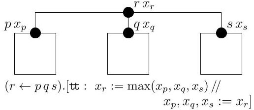


<div align="center">

(c) Simple equivalent of Fig. 1b

</div>

Proposition 2.1 Composition of structured partial functions is associative. It is commutative whenever $ J\cap K=I\cap L=\emptyset. $

For any $I \subseteq \mathcal{I}$, let $X_{I} = \{x_{i}:\mathsf{D}_{i} \mid i \in I\}$ be a set of typed variables $x_{i}$ with corresponding domains $\mathsf{D}_{i}$. We write $X_{I}:\mathsf{D}[I]$ to denote the product domain of the variables in $X_{I}$.

$ \mathrm{D}[I] $ denote the product domain of the variables in $ X_{I}. $ Let $ F:\mathrm{D}[I]\rightarrow\mathrm{D}[J] $ be a structured partial function, such that $ I\cap J\neq\emptyset $ and consider a non-empty set of variables $ X_{L}:\mathrm{D}[L] $ with $ L\subseteq I\cap J. $ The variables $ X_{L} $ can be used with F as local variables to compute values in $ \mathrm{D}[J\setminus L] $ based on values in $ \mathrm{D}[I\setminus L]; $ the variables $ X_{L} $ are updated by side effect. We write $ F[\![X_{L}]\!]:\mathrm{D}[I\setminus L]\rightarrow\mathrm{D}[J\setminus L]. $

Let $ \mathbf{v}\in\mathsf{D}[L] $ be the valuation of $ X_{L} $ and let $ \mathbf{u}\in\mathsf{D}[I\backslash L] $ . If F is defined on $ (\mathbf{u},\mathbf{v}) $ , an application of $ F[[X_{L}]] $ to $ \mathbf{u} $ produces the values $ \mathbf{w}\in\mathsf{D}[J\backslash L] $ and the new valuation $ \mathbf{v}'\in\mathsf{D}[L] $ of $ X_{L} $ , such that $ (\mathbf{w},\mathbf{v}^{\prime})=F(\mathbf{u},\mathbf{v}) $ .

Lemma 2.2 Let $ F_{1}[\![ X_{L_{1}} ]\!] $ and $ F_{2}[\![ X_{L_{2}} ]\!] $ be two structured partial functions and assume $ L_{1}\cap L_{2}=X_{L_{1}}\cap X_{L_{2}}=\emptyset. $ Then holds $ F_{1}[\![ X_{L_{1}} ]\!]\circ F_{2}[\![ X_{L_{2}} ]\!]=\left( F_{1}\circ F_{2}\right) [\![ X_{L_{1}}\cup X_{L_{2}} ]\!]. $

Structured partial functions with local variables are particularly useful for the definition of the semantics of assignment expressions of the form $ ( X_{J}, X_{L} ):= e ( X_{I}, X_{L} ) $ , where e is an expression on variables $ X_{I} $ and $ X_{L} $ . Indeed, the expression defines a structured partial function $ e : \mathrm{D}[I \cup L] \rightarrow \mathrm{D}[J \cup L] $ and the fact that variables $ X_{L} $ appear on both sides of the assignment is reflected by considering $ e [ X_{L} ] $ .

## 2.2 Interaction Expressions

Interaction expressions defined below represent the combined information about all the effects of an interaction involving several ports. We show that they are the basic and general concept for expressing coordination in both architecture-based and architecture agnostic models.

Let $ \mathcal{P} \subseteq \mathcal{I} $ be a set of ports. For each $ p \in \mathcal{P} $ , let $ x_{p}:\mathsf{D}_{p} $ be a typed variable. The interaction expressions represent the combined information about the effects of an interaction involving several ports.

Definition 2.3 An interaction is an expression of the form $ \alpha ( X_{L} )=(P \leftarrow Q).[g ( X_{Q}, X_{L} ):(X_{P}, X_{L}) := up ( X_{Q}, X_{L} ) / / $ $ ( X_{Q}, X_{L} ) := d n ( X_{P}, X_{L} ) ], $ where P, Q $ \subseteq $ P are the top and bottom sets of ports; $ X_{L} : \mathbf{D}[L] $ is the set of local variables; $ g ( X_{Q}, X_{L} ) $ is the boolean guard; $ up ( X_{Q}, X_{L} ) $ and $ d n ( X_{P}, X_{L} ) $ are respectively the up- and downward data transfer expressions.

For an interaction expression $ \alpha ( X_{L} ) $ as above, we denote by top( $ \alpha $ $ \triangleq $ P,bot( $ \alpha $ $ \triangleq $ Q and supp( $ \alpha $ $ \triangleq $ P $ \cup $ Q the sets of top, bottom and by all ports in $ \alpha $ , respectively. We denote $ g_{\alpha} $ , up $ \alpha $ and dn $ \alpha $ the corresponding expressions in $ \alpha $ .

<!-- PDF_PAGE: 4 -->

The first part, $ ( P \leftarrow Q ) $ , of an interaction expression describes the control flow, that is the dependency relation between the bottom and the top ports. The expression in the brackets describes the data flow. The guard $ g ( X_{Q}, X_{L} ) $ gives the dependency between the two parts: interaction is only enabled when the values of the local variables together with those of variables associated to the bottom ports satisfy a boolean condition. As a side effect, the firing of an interaction expression can modify the local variables $ X_{L} $

Notice that an interaction expression can be understood as a generalized synchronous function call involving a set of callees P and a set of callers Q. When the callers Q are enabled, they offer a set of parameter values $ X_{Q} $ that are used to compute sequentially the two functions up and dn. The computation is possible only if the guard g is true depending on the values of the exported parameters and the local variables. The up function updates the variables of the callees and the local variables. The returned values of the caller variables are computed by the dn function that also updates the local variables. As explained in Section 3, when interactions are structured hierarchically, the callees at one level may become callers for the upper levels.

Formally, the data transfer semantics of $ \alpha $ is defined by two parameterised structured partial functions $ \alpha^{\uparrow}[\![X_{L}]\!] : $ $ \mathsf{D}[Q]\rightarrow\mathsf{D}[P] $ and $ \alpha^{\downarrow}[\![X_{L}]\!] : \mathsf{D}[P]\rightarrow\mathsf{D}[Q] $ :

$$
\begin{array}{l} \alpha^ {\uparrow} \llbracket X _ {L} \rrbracket (\mathbf {u}) = u p \llbracket X _ {L} \rrbracket (\mathbf {u}) \mathrm {i f} g (\mathbf {u}, \mathbf {v}) = \mathrm {t t}, \quad \mathrm {f o r a l l} \mathbf {u} \in \mathrm {D} [ Q ], \\ \alpha^ {\downarrow} \llbracket X _ {L} \rrbracket (\mathbf {u}) = d n \llbracket X _ {L} \rrbracket (\mathbf {u}), \quad \mathrm {f o r a l l} \mathbf {u} \in \mathrm {D} [ P ], \\ \end{array}
$$

where $ \mathbf{v} $ is the current valuation of variables $ X_{L} $ . The top level semantics of $ \alpha $ is $ \overset{\frown}{\alpha} $ $ \llbracket X_{L} \rrbracket $ : $ \mathsf{D}[Q] \to \mathsf{D}[Q] $ , with $ \overset{\frown}{\alpha} $ $ \llbracket X_{L} \rrbracket = \alpha^{\downarrow} \llbracket X_{L} \rrbracket \circ \alpha^{\uparrow} \llbracket X_{L} \rrbracket $ .

Example 2.4 The interaction expression $ \alpha_{i o}(\emptyset)=(w\leftarrow out in_{1} in_{2}). $ [tt: $ x_{w}\coloneqq x_{out}//x_{in_{1}},x_{in_{2}}\coloneqq x_{w} $ ] represents the coordination between an port out that delivers simultaneously its value to two ports in1 and in2. To avoid synchronization when the data at ports in have the same value as at out, we add a guard: $ (w\leftarrow out in_{1} in_{2}). $ $ [(x_{out}\neq x_{in_{1}})\vee (x_{out}\neq x_{in_{2}}):\ x_{w}\coloneqq x_{out}//x_{in_{1}},x_{in_{2}}\coloneqq x_{w}]. $ The interaction expression $ Max(\emptyset)=(w\leftarrow p q r). $ [tt: $ x_{w}\coloneqq \max(x_{p}, x_{q}, x_{r})//x_{p},x_{q},x_{r}\coloneqq x_{w} $ ] allows the synchronization between ports p, q and r and returns the maximum of the values associated to these ports.

Definition 2.5 The composition of interaction expressions is a partial operation ';' defined, for two interaction expressions $ \alpha_{1},\alpha_{2} $ ,with $ X_{L_{1}}\cap X_{L_{2}}=\emptyset $ $ X_{L}=X_{L_{1}}\cup X_{L_{2}} $ and $ \alpha_{i}(X_{L_{i}})=(P_{i}\leftarrow Q_{i}).[g_{i}(X_{Q_{i}},X_{L_{i}}):(X_{P_{i}},X_{L_{i}}):=up_{i}(X_{Q_{i}}, $ $ X_{L_{i}})\parallel(X_{Q_{i}},X_{L_{i}}):=dn_{i}(X_{P_{i}},X_{L_{i}})] $ ,for $ i=1,2 $ ,by putting

$$
(\alpha_ {1}; \alpha_ {2}) \left(X _ {L}\right) \triangleq (P \leftarrow Q). [ g \left(X _ {Q}, X _ {L}\right) ]:
$$

$$
\left(X _ {P}, X _ {L}\right) := u p \left(X _ {Q}, X _ {L}\right) / / \left(X _ {Q}, X _ {L}\right) := d n \left(X _ {P}, X _ {L}\right) ],
$$

where $ P=P_{1}\cup P_{2} $ and $ Q=Q_{1}\cup Q_{2}, up(X_{Q},X_{L})= $ $ up_{2}(X_{Q_{2}},X_{L_{2}})\circ up_{1}(X_{Q_{1}},X_{L_{1}}),dn(X_{P},X_{L})= $ $ dn_{1}(X_{P_{1}},X_{L_{1}})\circ dn_{2}(X_{P_{2}},X_{L_{2}}),g(X_{Q},X_{L})= $

$$
g _ {1} \left(X _ {Q _ {1}}, X _ {L _ {1}}\right) \wedge \left[ g _ {2} \left(X _ {Q _ {2}}, X _ {L _ {2}}\right) \circ u p _ {1} \left(X _ {Q _ {1}}, X _ {L _ {1}}\right) \right] _ {\overline {{P _ {1} \cup L _ {1}}}}
$$

(the projection in the second conjunct removes the outputs of $ up_{1} $ , keeping only the boolean value of $ g_{2} $ -cf. Fig. 3).

Notice that three expressions $ g ( X_{Q}, X_{L} ) $ , $ up ( X_{Q}, X_{L} ) $ and $ dn ( X_{P}, X_{L} ) $ do not involve variables in $ X_{P_{1} \cap Q_{2}}. $

Example 2.6 We continue Ex. 2.4. The composition of two interaction expressions, $ Max_{1}(\emptyset) $ and $ Max_{2}(\emptyset) $ , respectively

$$
\begin{array}{l} (w \leftarrow p q r). [ \mathrm {t t}: x _ {w} := \max \left(x _ {p}, x _ {q}, x _ {r}\right) / / x _ {p}, x _ {q}, x _ {r} := x _ {w} ] \\ (z \leftarrow u v w). [ \mathrm {t t}: x _ {z} := \max \left(x _ {u}, x _ {v}, x _ {w}\right) / / x _ {u}, x _ {v}, x _ {w} := x _ {z} ] \\ \end{array}
$$

is the new interaction expression:

$$
\begin{array}{l} \left(M a x _ {1}; M a x _ {2}\right) (\emptyset) = \left(w z \leftarrow p q r u v w\right). [ \mathrm {t t}: \\ x _ {w} := \max \left(x _ {p}, x _ {q}, x _ {r}\right), x _ {z} := \max \left(x _ {u}, x _ {v}, \max \left(x _ {p}, x _ {q}, x _ {r}\right) / / \right. \\ x _ {p}, x _ {q}, x _ {r}, x _ {u}, x _ {v}, x _ {w} := x _ {z} ] \\ \end{array}
$$

Proposition 2.7 The operator ';' is associative. When $ P_{1}\cap $ $ Q_{2}=P_{2}\cap Q_{1}=X_{L_{1}}\cap X_{L_{2}}=\emptyset $ , it is also commutative.

Under this disjointness condition, we write $ \alpha_{1}|\alpha_{2}\triangleq\alpha_{1};\alpha_{2} $ $ = \alpha_{2};\alpha_{1} $ and speak of interaction synchronisation.

## 3. ARCHITECTURE-BASED MODEL

This section provides a brief overview of BIP and a formalisation for simple and hierarchical connectors in BIP. The latter formalisation comprises abstract syntax and denotational semantics in terms of partial functions operating on structured domains. In addition, it formalises the flattening as a rewriting rule on hierarchical connectors and proves its soundness as a semantics-preserving transformation.

## 3.1 Simple Connectors in BIP

In BIP, systems are build by composing atomic components with interactions defined using connectors. As in Sect. 2, let $ \mathcal{P}\subseteq\mathcal{I} $ be a set of ports and assume that a variable $ x_{p} $ : $ \mathsf{D}_{p} $ is associated with each port $ p\in\mathcal{P}. $

Definition 3.1 An atomic component B is a tuple $ B=(\Sigma,P,X_{L}:\mathsf{D}[L],\rightarrow) $ where $ \Sigma $ is a finite set of control locations; $ P\subseteq \mathcal{P} $ is a finite set of ports—the interface of $ B $ ; $ X_{L}:\mathsf{D}[L] $ is a set of local variables, with $ X_{L}\cap X_{P}=\emptyset $ $ \rightarrow\subseteq\Sigma\times\mathcal{E}\times\Sigma $ is a finite transition relation, with $ \mathcal{E} $ the set of interaction expressions of the form $ p(X)=(p\leftarrow\emptyset).[g(X): $ $ x_{p}:=up(X)//X:=dn(x_{p},X)] $ , for $ p\in P $ and $ X\subseteq X_{L} $ Henceforth, we call interaction expressions of this form actions. We use p for both the port and the action.

Definition 3.2 The operational semantics of an atomic component $ B=(\Sigma,P,X_{L}:\mathsf{D}[L],\rightarrow) $ is given by an LTS $ \sigma(B)=\left(\Sigma\times\mathsf{D}[L],2^{P}\times\left(\bigcup_{p\in P}\mathsf{D}_{p}\right)^{2},\rightarrow\right) $ , where a state (q,v) consists of a control state of B and the valuation $ v\in\mathsf{D}[L] $ of local variables; $ \rightarrow $ is the minimal transition relation defined by the following rule:

$$
\frac {p (X) = \left(p \leftarrow \emptyset\right). \left[ g (X) : x _ {p} := u p (X) / / X := d n \left(x _ {p}, X\right)\right]}{q \xrightarrow {p (X)} q ^ {\prime}, g (v) = \mathrm {t t}, v _ {u p} ^ {p} = u p _ {p} (v), v ^ {\prime} = d n \left(v _ {d n} ^ {p}, u p _ {X} (v)\right)} {(q, v) \xrightarrow {p} \frac {v _ {u p} ^ {p}: v _ {d n} ^ {p}}{v _ {u p} ^ {p}: v _ {d n} ^ {p}} \left(q ^ {\prime}, v ^ {\prime}\right)},
$$

where up $ p $ and up $ X $ are the corresponding components of the up expression; $ v_{up}^{p},v_{dn}^{p}\in\mathsf{D}_{p} $ are the data values associated to the port p at the upward and downward data transfer.

<!-- PDF_PAGE: 5 -->


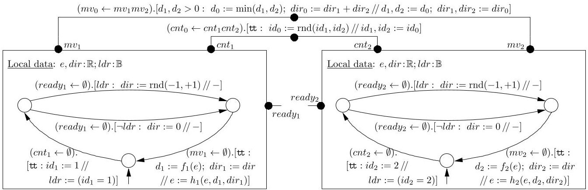


<div align="center">

Figure 4: Leader/Follower example

</div>

Example 3.3 The system shown in Fig. 4 consists of two identical atomic components that can toghether move in one of two opposite directions. They have to agree on the distance, based on their respective energy levels. Each component has two real local variables: e to store its energy level and dir to store its opinion on the direction to follow, as well as a boolean variable ldr to remember whether it is a leader or not. In each operation cycle the i-th component performs the following three steps:

First, the component performs the connect action $ cnt_{i}(ldr)=\left(cnt_{i}\leftarrow \emptyset\right). $ [tt: $ id_{i}:=i//ldr:=(id_{i}=i)] $ , where i is the constant component id (see Fig. 4) and $ id_{i} $ is the variable associated to the port $ cnt_{i} $ . In the upward transfer, the component proposes itself as a candidate for the leadership. In the downward transfer, the updated value of $ id_{i} $ is compared to the component id. The result of this comparison is stored in the local variable $ ldr. $

In the second step, the component performs its corresponding action ready $ i $ （dir,ldr).The leader randomly picks the direction and stores it in the local variable dir: （ready $ i \leftarrow $ $ \emptyset $ ].[ldr:dir] $ := $ \mathrm{rnd}(-1,+1) $ // $ - $ ].The follower stores zero: （ready $ i \leftarrow $ $ \emptyset $ ].[ $ \neg $ ldr:dir] $ := 0 $ // $ - $ ].These actions do not have any downward data transfer, but only update the local data in the upward transfer.

In the last step, the leader and the direction of the movement are chosen. The component performs the action move: $ ( m v_{i} \leftarrow \emptyset ). $ $ [ \mathrm {t t} : d_{i} := f_{i} ( e ) ; d i r_{i} := d i r / / e := h_{i} ( e , d_{i} , d i r_{i} ) ] $ In the upward transfer, the component exposes the distance it can cover based on its available energy stored in the local variable e, as well as its direction suggestion stored in the local variable dir from the previous step. In the downward transfer, the move is materialised by updating the energy level of the component, based on the new values of the direction and distance of the move.

Definition 3.4 A simple connector is an interaction expression $ \alpha(X_{L}) $ , such that $ top(\alpha)=\{w\} $ is a single port $ w\in\mathcal{P} $ , $ bot(\alpha)=a\subseteq\mathcal{P} $ , such that $ w\notin a $ , and both up and g expressions do not involve local variables, i.e. $ \alpha(X_{L})=(w\leftarrow a). $ $ [g(X_{a}):(x_{w},X_{L}):=up(X_{a})/ / X_{a}:=dn(x_{w},X_{L})]. $

Example 3.5 Consider the connector (without local variables) shown in Fig. 4:

$$
\left(c n t _ {0} \leftarrow c n t _ {1} c n t _ {2}\right). \left[ \mathrm {t t}: i d _ {0} := \operatorname {r n d} \left(i d _ {1}, i d _ {2}\right) / / i d _ {1}, i d _ {2} := i d _ {0} \right].
$$

On every cnt $ i $ port the value $ id_{i} $ represents the id of a component interacting through this port. The guard of the interaction expression is a constant true, hence no additional restrictions are imposed on the interaction. As part

of the upward data transfer the connector randomly picks and propagates one of the proposed id's. At the downward data transfer, the updated value is communicated to both participating ports.

Definition 3.6 Let $ \mathcal{B}=\{B_{1},\dots,B_{n}\} $ be a finite set of atomic components with $ B_{i}=(\Sigma_{i},P_{i},X_{L_{i}}:\mathsf{D}[L_{i}],\rightarrow) $ such that their respective sets of ports and variables are pairwise disjoint. Let $ \Gamma $ be a set of simple connectors such that, for every $ \alpha\in\Gamma $ , $ top(\alpha)\notin\bigcup_{i=1}^{n}P_{i} $ , $ bot(\alpha)\subseteq\bigcup_{i=1}^{n}P_{i} $ and $ |supp(\alpha)\cap P_{i}| \leq 1 $ for all $ i\in[1,n] $ . The operational semantics of the parallel composition $ \Gamma(\mathcal{B}) $ is defined as the LTS $ (\Sigma,P,\rightarrow) $ where $ \Sigma=\prod_{i=1}^{n}(\Sigma_{i}\times\mathsf{D}[L_{i}]) $ , $ P=\{top(\alpha)|\alpha\in\Gamma\} $ $ \rightarrow $ is the minimal transition relation defined by the rule

$$
\alpha \left(X _ {L}\right) \in \Gamma \quad t o p (\alpha) = w \quad b o t (\alpha) = a = \left\{p _ {i} \mid i \in I \right\}
$$

$$
\begin{array}{l} \alpha \left(X _ {L}\right) \in I \quad i o p (\alpha) = w \quad v o l (\alpha) = a = \left\{p _ {i} \mid i \in I \right\} \\ \forall i \in I, q _ {i} \xrightarrow {p _ {i} \left(X _ {i}\right)} q _ {i} ^ {\prime} \quad \forall i \notin I, \left(q _ {i} = q _ {i} ^ {\prime} \wedge \mathbf {u} _ {i} = \mathbf {u} _ {i} ^ {\prime}\right) \\ \alpha_ {\star} = (| a); \alpha \quad \left(\mathbf {u} _ {i} ^ {\prime}\right) _ {i \in I} = \left[ \widehat {\alpha} _ {\star} \llbracket X _ {L} \rrbracket \left(\left(\mathbf {u} _ {i}\right) _ {i \in I}\right) \right] _ {\bigcup_ {i \in I} L _ {i}} \\ \frac {(q _ {1} , \mathbf {u} _ {1}) , \dots , (q _ {n} , \mathbf {u} _ {n}) \xrightarrow {w} \left(q _ {1} ^ {\prime} , \mathbf {u} _ {1} ^ {\prime}\right) , \dots , \left(q _ {n} ^ {\prime} , \mathbf {u} _ {n} ^ {\prime}\right)} {(q _ {1} , \mathbf {u} _ {1}) , \dots , (q _ {n} , \mathbf {u} _ {n})}, \\ \end{array}
$$

where $|a$ is the synchronisation of all $p_{i}(X_{i})$ with $p_{i}\in a$.

Notice that the involved interaction expressions are partial. Hence, for instance, when the guard of one of the actions is not satisfied, the values $ \left(\mathbf{u}_{i}^{\prime}\right)_{i\in I} $ are undefined and, thus, the rule is not applicable.

Intuitively, an interaction can be fired only if its guard and all guards associated to the corresponding component actions are true. When an interaction is fired, its upward transfer is computed first using the exposed values offered by the participating components. Then, the downward transfer modifies back all the port variables followed by execution of the update functions associated to component actions.

Example 3.7 The first synchronisation among the atomic components of Ex. 3.3 is performed through the connector $ ( c n t_{0}\leftarrow c n t_{1} c n t_{2} ). $ $ [ \mathrm{t t}: i d_{0} \!:=\! \mathrm{r n d} ( i d_{1}, i d_{2} ) / / i d_{1}, i d_{2} \!:=\! i d_{0} ] $ The id of the leader is randomly selected in the connector and transferred downward through both participating ports. In the next step each component independently performs its corresponding step ready $ i $ (see Ex. 3.3). Finally, components synchronise again through the connector

$$
\begin{array}{l} \left(m v _ {0} \leftarrow m v _ {1} m v _ {2}\right). \left[ d _ {1}, d _ {2} > 0: \right. \\ d _ {0} := \min \left(d _ {1}, d _ {2}\right); d i r _ {0} := d i r _ {1} + d i r _ {2} / / \\ d _ {1}, d _ {2} := d _ {0}; d i r _ {1}, d i r _ {2} := d i r _ {0}) ]. \\ \end{array}
$$

The distances each component can cover and their direction suggestions are combined in the connector to compute the

<!-- PDF_PAGE: 6 -->

global distance and direction (variables $ d_{0} $ and $ dir_{0} $), which are propagated further, updated and then distributed down to components.

## 3.2 Hierarchical Connectors in BIP

Definition 3.8 A hierarchical connector $ h\alpha $ is a term generated by the grammar $ h\alpha ::= \alpha \mid \alpha \langle h\alpha_{1},\dots,h\alpha_{n}\rangle $ , where $ \alpha $ denotes an arbitrary simple connector. We extend the top(), bot() and supp() to hierarchical connectors:

$$
t o p \left(\alpha \langle h \alpha_ {1}, \dots , h \alpha_ {n} \rangle\right) = t o p (\alpha),
$$

$$
b o t \left(\alpha \langle h \alpha_ {1}, \dots , h \alpha_ {n} \rangle\right) = \bigcup_ {i = 1} ^ {n} b o t \left(\alpha_ {i}\right),
$$

$$
s u p p \left(\alpha \langle h \alpha_ {1}, \dots , h \alpha_ {n} \rangle\right) = s u p p (\alpha) \cup \bigcup_ {i = 1} ^ {n} s u p p \left(h \alpha_ {i}\right).
$$

$h\alpha = \alpha \langle h\alpha_{1},\dots,h\alpha_{n}\rangle$ is valid iff all sets $supp(h\alpha_{i})$, for $i\in[1,n]$ , are pairwise disjoint; for all $i\in[1,n]$ , holds $supp(h\alpha_{i})\cap supp(\alpha) = \{top(h\alpha_{i})\}$ and $top(h\alpha_{i})\in bot(\alpha)$ ; and all hierarchical sub-connectors $h\alpha_{1},\dots,h\alpha_{n}$ are valid.

We tacitly restrict ourselves to valid hierarchical connectors. Their data transfer semantics is defined structurally:

$$
\alpha \langle h \alpha_ {1}, \dots , h \alpha_ {n} \rangle^ {\uparrow} = \alpha^ {\uparrow} \circ \left(h \alpha_ {1} ^ {\uparrow} \circ \dots \circ h \alpha_ {n} ^ {\uparrow}\right)
$$

$$
\alpha \langle h \alpha_ {1}, \dots , h \alpha_ {n} \rangle^ {\downarrow} = \left(h \alpha_ {1} ^ {\downarrow} \circ \dots \circ h \alpha_ {n} ^ {\downarrow}\right) \circ \alpha^ {\downarrow}
$$

Notice that the order of composition for sub-connector functions is irrelevant as they operate on disjoint sets of ports.

Example 3.9 We continue the running example of this section. Consider a system shown in Fig. 5, combining that of Fig. 4 with a third atomic component of exactly the same type as the other two. The behaviour of the systems is generalised by a hierarchical application of the same (up to port renaming) connectors mv and cnt. Composing the interaction expressions for simple connectors cnt $ _{0} $ and cnt gives $ (cnt_{0}cnt\leftarrow cnt_{0}cnt_{1}cnt_{2}cnt_{3}). $ [tt : $ id_{0}:=rnd(id_{1},id_{2}) $ $ id:=rnd(id_{1},id_{2},id_{3})//id_{0},id_{1},id_{2},id_{3}:=id]. $ Notice that, by discarding the port cnt $ _{0} $ and the associated variable $ id_{0} $ , we obtain an equivalent simple connector $ (cnt\leftarrow cnt_{1}cnt_{2}cnt_{3}). $ [tt : $ id:=rnd(id_{1},id_{2},id_{3})//id_{1},id_{2},id_{3}:=id]. $

Similarly, any hierarchical connector can be flattened into a simple one [10], allowing us to extend BIP operational semantics (Def. 3.6) to hierarchical connectors. This is done formally in the extended version of this paper [6].

## 4. ARCHITECTURE AGNOSTIC MODEL

## 4.1 T/B Component Model

Architecture-agnostic models are obtained from BIP models as the plain composition of Top/Bottom (T/B) components. In the translation, BIP connectors are replaced by T/B components that play the role of coordinators. These are extensions of the BIP components whose transitions are labeled with interaction expressions. The parallel composition mechanism relies on the matching between bottom and top ports (as for hierarchical connectors).

Interaction execution exhibits a cyclic pattern. In each cycle, the data of interacting atomic components are propagated upwards through top ports towards all relevant coordinators. At each stage, the computation can influence the

decision as to what transitions of atomic components are enabled. Finally, once a global interaction has been choosen at the top level, the updated data is propagated back to atomic components. As above, we assume a universal set of ports $ \mathcal{P} $ and, for each port $ p\in\mathcal{P} $ , a typed variable $ x_{p}:\mathsf{D}_{p}. $

Definition 4.1 A T/B component is a tuple $ T = (\Sigma, P^{bot}, P^{top}, X_{L}:\mathsf{D}[L],\rightarrow) $ , where $ \Sigma $ is a set of states, $ P^{bot}, P^{top}\subseteq \mathcal{P} $ are finite sets of bottom and top ports; $ X_{L}:\mathsf{D}[L] $ is a set of local data variables; $ \rightarrow \subseteq \Sigma \times \mathcal{E} \times \Sigma $ is a transition relation, with $ \mathcal{E} $ being the set of action expressions $ \alpha(X) $ such that $ X\subseteq X_{L},\operatorname{top}(\alpha)\subseteq P^{top},\operatorname{bot}(\alpha)\subseteq P^{bot} $ . We write $ q\xrightarrow{\alpha(X)} q^{\prime} $ for $ \left(q,\alpha(X),q^{\prime}\right)\in \rightarrow $

$ q \xrightarrow{\mathrm{(1)}} q^{\prime} $ for $ \left( q,\alpha\left( X\right),q^{\prime}\right)\in\to. $ A T/B component $ \left( \Sigma,P^{bot},P^{top},X_{L}:\mathsf{D}[L],\to\right) $ is an atomic component, if $ P^{bot}=\emptyset $ ; it is a coordinator if $ P^{bot}\neq\emptyset $ , but $ P^{bot}\cap P^{top}=\emptyset $ . Finally, if $ P^{bot}\cap P^{top}\neq\emptyset $ , the T/B component is compound (obtained by hierarchically composing atomic components and coordinators).

Denition 4.2 The operational semantics of a T/B component $ T = (\Sigma, P^{bot}, P^{top}, X_{L}: \mathsf{D}[L], \rightarrow) $ is given by an LTS $ \sigma (T) = (\Sigma \times \mathsf{D}[L], 2^{P} \times \mathsf{D}[P]^{2}, \rightarrow), $ where a state $(q,v)$ consists of a control state of $ T $ and the value $ v \in \mathsf{D}[L]; \rightarrow $ is the minimal transition relation defined by the following rule:

$ \alpha (X) = (a^{top} \leftarrow a^{bot}). [ g (X_{a^{bot}}, X) : $ $ (X_{a^{top}}, X) := up (X_{a^{bot}}, X) / / (X_{a^{bot}}, X) := dn (X_{a^{top}}, X) ] $ $ q \xrightarrow{\alpha (X)} q^{\prime} \quad g (\mathbf{v}_{up}^{bot}, v) = \mathsf{tt} \quad \mathbf{v}_{up}^{top} = up_{a^{top}} (\mathbf{v}_{up}^{bot}, v) $ $ (\mathbf{v}_{dn}^{bot}, v^{\prime}) = dn \bigl( \mathbf{v}_{dn}^{top}, up_{X} (\mathbf{v}_{up}^{bot}, v) \bigr) $ $ \frac {(q,v) \xrightarrow [ \mathbf{v}_{up} : \mathbf{v}_{dn} ]{a} (q^{\prime}, v^{\prime})}{(q,v)} $

where a = a $ ^{top} $ $ \cup $ a $ ^{bot} $ ; up $ a_{top} $ and up $ X $ are the corresponding components of the up expression; $ \mathbf{v}_{up},\mathbf{v}_{dn}\in \mathsf{D}[P] $ are partial data valuations associated to ports at the upward and downward data transfer phases respectively (the values of variables assocaited to ports that do not participate in the interaction are undefined).

Notice that T/B components and their operational semantics generalise atomic BIP components (Def. 3.2). In particular, all components in the examples of Sect. 3 are T/B components without bottom ports.

Note 4.3 Notice that the values $ \mathbf{v}_{up} $ and $ \mathbf{v}_{dn} $ do not directly correspond to inputs and outputs. Indeed, in terms of the transferred data, the component input is the pair $ (\mathbf{v}_{up}^{bot},\mathbf{v}_{dn}^{top}) $ , whereas its output is the pair $ (\mathbf{v}_{up}^{top},\mathbf{v}_{dn}^{bot}) $ .

Recall the generalised function call metaphor (see the discussion after Def. 2.3). When a transition labelled by $ \alpha (X) $ is called, it is provided the values $ \mathbf{v}_{up}^{bot} $ . If these values satisfy the guard g, they are used by the function up to compute the values $ \mathbf{v}_{up}^{top} $ , which are provided to the subsequent callees. In return, the latter provide the updated values $ \mathbf{v}_{dn}^{top} $ , which are, finally, used by the function dn to compute $ \mathbf{v}_{dn}^{bot} $ .

## 4.2 Systems and Composition

Definition 4.4 Let $ S=\{(\Sigma_{i}, P_{i}^{bot}, P_{i}^{top}, X_{L_{i}}: \mathsf{D}[L_{i}], \to)\}_{i=1}^{n} $ be a finite set of T/B components and denote $ P^{bot}\triangleq \bigcup_{i=1}^{n} P_{i}^{bot} $ and $ P^{top}\triangleq \bigcup_{i=1}^{n} P_{i}^{top} $ . Here and below, we skip the index on $ \to $ since it is always clear from the context. S is a system iff

<!-- PDF_PAGE: 7 -->


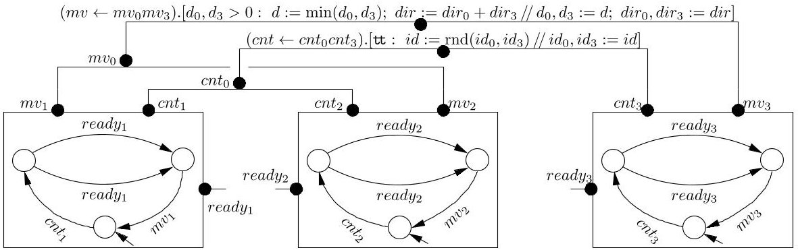


<div align="center">

Figure 5: Leader/follower example with three atomic components

</div>

the sets of local variables and top ports of all the components are pairwise disjoint, i.e. $ \forall i \neq j $ $ X_{i}\cap X_{j}=P_{i}^{top}\cap P_{j}^{top}=\emptyset. $ A system is closed if $ P^{bot}=P^{top}. $

Definition 4.5 Let $ T_{i}=\left( \Sigma_{i}, P_{i}^{bot}, P_{i}^{top}, X_{L_{i}}:\mathsf{D}[L_{i}],\rightarrow) $ for $ i=1,2 $ , be two T/B components, such that $ P_{2}^{top}\cap P_{1}^{bot}=\emptyset $ (cf. Def. 4.8 below). Their parallel composition is a compound T/B component $ T_{1}\parallel T_{2}\triangleq\left( \Sigma, P^{bot}, P^{top}, X_{L}: \mathsf{D}[L],\rightarrow) $ , where $ \Sigma=\Sigma_{1}\times\Sigma_{2}, $ $ P^{bot}=P_{1}^{bot}\cup P_{2}^{bot}, $ $ P^{top}=P_{1}^{top}\cup P_{2}^{top}, $ $ X_{L}=X_{L_{1}}\cup X_{L_{2}} $ and $ \rightarrow $ is the minimal transition relation defined by the following rules $ (i\neq j\in\{1,2\}) $ :

$$
\frac {q _ {i} \xrightarrow {\alpha_ {i} \left(X _ {i}\right)} q _ {i} ^ {\prime}}{q _ {i} q _ {j} \xrightarrow {\alpha_ {i} \left(X _ {i}\right)} q _ {i} ^ {\prime} q _ {j}}, \quad \frac {q _ {1} \xrightarrow {\alpha_ {1} \left(X _ {1}\right)} q _ {1} ^ {\prime} q _ {2} \xrightarrow {\alpha_ {2} \left(X _ {2}\right)} q _ {2} ^ {\prime}}{q _ {1} q _ {2} \xrightarrow {\left(\alpha_ {1} ; \alpha_ {2}\right) (X)} q _ {1} ^ {\prime} q _ {2} ^ {\prime}}.
$$

When $ P_{1}^{top}\cap P_{2}^{bot}=\emptyset $ , we put $ T_{1}\parallel T_{2}\triangleq T_{2}\parallel T_{1} $ Thus, $ \parallel $ is a commutative partial operator defined when $ P_{2}^{top}\cap P_{1}^{bot}=\emptyset $ or $ P_{1}^{top}\cap P_{2}^{bot}=\emptyset $ . When both equalities hold, the transition in the conclusion of the second rule is labelled by $ \alpha_{1}\parallel\alpha_{2} $ , which is symmetric in the order of its operands. When both $ P_{2}^{top}\cap P_{1}^{bot}\neq\emptyset $ and $ P_{1}^{top}\cap P_{2}^{bot}\neq\emptyset $ this means that there is a data-flow causality loop among the two components (as in I/O models [11, 14]) and the composition is undefined.

Example 4.6 Fig. 6a shows a simple model consisting of two T/B components $ R_{0} $ and $ R_{1} $ without data variables and transfer, identical up to port renaming. Each models a Mod-2 counter, which produces one event on its top port (shown by blue outward-facing triangles) for every second event on its bottom port (shown by red inward-facing triangles). $ R_{0} $ and $ R_{1} $ share port $ t_{1} $ . Fig. 6b shows the T/B component $ R_{0}\parallel R_{1} $ (for clarity we omit two transitions indicated by the dotted green arrow).

Proposition 4.7 Composition operator $ \parallel $ is associative.

Definition 4.8 Let S be a system and consider the directed graph $ \tau(S)=(S,E), $ having the components of the system as vertices and the set of edges $ E=\{(T_{i},T_{j})\mid P_{i}^{top}\cap P_{j}^{bot}\neq\emptyset\} $ In other words, there is an edge from $ T_{i} $ to $ T_{j} $ if some of the top ports of the former are bottom ports of the latter. S is composable iff $ \tau(S) $ is a directed acyclic graph.

In a composable system $ S $ , any pair of components can be ordered so as to satisfy the requirement of Def. 4.5. Thus, by Prop. 4.7, the composed T/B component $ \| S $ is well-defined.

As in process calculi like CCS [16], in order for the composition operator $ \parallel $ to be associative, it must allow interleaving (i.e. independent firing) of transitions involving matchable

ports (compare first and third rules in Def. 4.5 with the second rule). The meaning of a complete system is defined as the largest closed sub-system obtained by pruning out all the non-matching transitions; thus the following definition.

Definition 4.9 Let $ S=\left\{\left(\Sigma_{i},P_{i}^{bot},P_{i}^{top},X_{L_{i}}:\mathsf{D}[L_{i}],\rightarrow\right)\right\}_{i=1}^{n} $ be a closed composable system and let $ \parallel S=\left(\Sigma,P^{bot},P^{top},X_{L}: \mathsf{D}[L],\rightarrow\right). $ The restriction of S is given by a T/B component $ \rho(S)=\left(\Sigma,P^{bot},P^{top},X_{L}:\mathsf{D}[L],\rightarrow\right), $ where $ \xrightarrow[pr]{} $ is the minimal transition relation defined by the rule

$$
\frac {q \xrightarrow [ p a r ]{\alpha (X)} q ^ {\prime} \quad b o t (\alpha) = t o p (\alpha)}{q \xrightarrow [ p r ]{\alpha (X)} q ^ {\prime}}.
$$

The second premise means that, for every bottom (resp. top) port, $ \alpha $ must also contain the corresponding top (resp. bottom) port. Restriction, in our context, is the generalisation of the CCS restriction operator.

Example 4.10 Fig. 6c shows a system comprising T/B components $ R_{0} $ and $ R_{1} $ as in Ex. 4.6 and closed with two additional components: an atomic T/B component that generates events $ t_{0} $ and a top-level T/B component that consumes $ t_{2} $ . One can easily see that the restriction of this system, shown in Fig. 6d is, indeed, a Mod-4 counter.

Lemma 4.11 For any transition in the restriction of a closed composable system, the data transfer coincides with the toplevel semantics of the composition of the corresponding interaction expressions.

## 4.3 T/B Component Encoding of BIP Models

Any atomic BIP component $ B=\left( \Sigma,P,X_{L}: \mathsf{D}[L],\rightarrow\right) $ can be trivially encoded as a T/B component by making all ports of B top ports, i.e. $ \tau(B)=\left( \Sigma,\emptyset,P,X_{L}: \mathsf{D}[L],\rightarrow\right). $ Thus, we only have to provide the encoding for connectors. Let $ \alpha(X)=\left(w\leftarrow a\right). \left[ g\left(X_{a}\right):\left(x_{w},X\right):=up\left(X_{a}\right) / / X_{a}:=dn\left(x_{w},X\right)\right] $ be a simple connector with a set of local variables $ X:\mathsf{D}. $ The T/B component encoding of $ \alpha $ is given by $ \tau(\alpha)\overset{\Delta}{=}\left(\{*\},P,\{w\},X:\mathsf{D},\{*\xrightarrow{\alpha(X)}*\}\right). $

$$
\tau \left(\alpha \langle h \alpha_ {1}, \dots , h \alpha_ {n} \rangle\right) \triangleq \left\{\tau (\alpha) \right\} \cup \bigcup_ {i = 1} ^ {n} \tau \left(h \alpha_ {i}\right).
$$

In the BIP operational semantics Def. 3.6, only one connector $ \alpha\in\Gamma $ can be fired at a time. On the contrary, parallel composition of T/B components allows any number of component transitions to synchronise. To enforce BIP semantics, for a set of connectors $ \Gamma $ , we add an arbiter: $ \tau(\Gamma)=\left(\{*\},P_{\Gamma},\emptyset,\{y_{w}:\mathsf{D}_{w}\mid w\in P_{\Gamma}\}\{*\xrightarrow{\tilde{\alpha}}*\mid\alpha\in\Gamma\}\right), $

<!-- PDF_PAGE: 8 -->


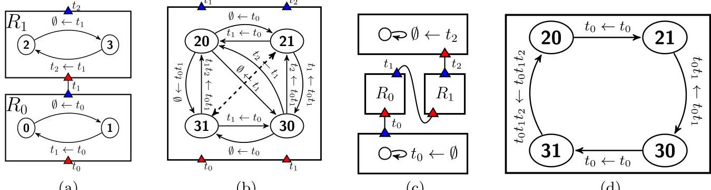


<div align="center">

(a)

</div>

<div align="center">

(b)

</div>

<div align="center">

(c)

</div>

<div align="center">

(d)

</div>

<div align="center">

Figure 6: T/B component model for the Mod-4 Counter

</div>

where $ P_{\Gamma}=\bigcup_{\alpha\in \Gamma} top(\alpha), y_{w} $ are fresh variables and, for each $ \alpha\in\Gamma $ and $ \{w\}=top(\alpha), $ we put $ \tilde{\alpha} (y_{w})=(\emptyset\leftarrow w). $ [tt: $ y_{w}:=x_{w}//x_{w}:=y_{w}], $ that is the data provided by $ \alpha $ in the upward data transfer is reinjected back into the downward data transfer by $ \tilde{\alpha}. $

Theorem 4.12 Let $ \mathcal{B} $ be a set of atomic BIP components and $ \Gamma $ be a set of hierarchical connectors and put $ S=\{\tau(\Gamma)\} \cup \bigcup_{B\in\mathcal{B}}\left\{\tau(B)\right\}\cup \bigcup_{\alpha\in\Gamma}\tau(\alpha). $ The LTS $ \sigma\left(\rho(S)\right) $ and $ \Gamma(\mathcal{B}) $ are isomorphic: there exist agreeing bijections between their sets of states and transitions.

## 5. EXPERIMENTAL RESULTS

## 5.1 Java Implementation

The implementation consists mainly of: 1) atomic components; 2) coordinators; and 3) connections. Recall that, atomic components have no bottom ports. Connections connect top ports to bottom ports. For composable system they define a hierarchy on T/B components. We assume that a bottom port is connected to exactly one top port; a top port may be connected to more than one bottom port (cf. Def. 4.4). In [6], we provide the Java implementation of the Mod-4 counter from Ex. 4.6.

At runtime, we create a Java thread for each atomic component and a thread that plays the role of an arbiter for all the coordinators. The implementation of the execution engine can be drastically optimized in case where the coordinators are deterministic, i.e. if from any state: 1) there exists only one outgoing transition; or 2) the guards of all the outgoing transitions are mutually exclusive. Non-deterministic coordinators may contain a state with more than one outgoing transitions that could be enabled at the same time. That is, more than one up function may be executed. For the sake of clarity, we first provide the algorithm for deterministic coordinators. Atomic component threads cyclically execute the following protocol: 1) Notify the top ports of the current outgoing transitions, whereof the guards are satisfied; 2) Notify the arbiter thread; 3) Wait for a notification from the arbiter; 4) Upon the notification from the arbiter, execute the action that corresponds to the received top port; 5) Modify the current state according to transition labeled by the received top port. Below is the algorithm of the atomic component thread.

```javascript

// atomic component's thread

run() {

  while(true) {

    for all current outgoing transitions t {

      if guard of t is true {

        t.sendPort.notify();

      } }

```

```javascript

notify arbiter thread;

wait for arbiter thread;

port = notification received from arbiter thread;

performTransition(port);

}

```

Notification of the top ports is executed by the threads of the atomic components. It is propagated upward by the atomic component thread until it reaches a top-level coordinator component (i.e. a coordinator whereof current outgoing transition does not have a top port).

```javascript

topPort.notify() {

  notify bottom ports that are connected to topPort;

  for each coordinator component c that has a

  bottom port notified {

    if exists a current outgoing transition t in c

    where all its bottom ports have been notified

    and its guard is true {

      store the values of the variables of c;

      execute its corresponding up function;

      if t is labeled by a top port {

        t.topPort.notify();

    }  }  } }

```

2. Execute the dn function of the selected transition and update the state of the coordinator accordingly.

Note that, upward propagation is done in parallel by the atomic components' threads. Arbiter thread resumes its execution when the upward propagation is completed by all the atomic components' threads. Arbiter's thread cyclically executes the following:

1. Select non-deterministically an enabled top-level coordinator component, i.e. such that its the current outgoing transition has no top ports and all its bottom ports have been notified. (If such a component does not exist, a deadlock has occurred.)

3. Notify all the top ports that are connected to the bottom ports of the selected transition until we reach atomic components. Execute the dn function of the transition that has a top port notified.

4. When the downward propagation is completed, notify all the atomic components to execute their corresponding transitions. Moreover, recover the values of the variables of all the coordinators that have been notified during the upward propagation without being modified during the downward propagation.

Notice that arbiter selects only one top-level coordinator even though there exits more than one top-level coordinator that are non conflicting. Two top-level coordinators are conflicting if the downward propagation will lead to notify the same atomic component but with two different top

<!-- PDF_PAGE: 9 -->

ports. Obviously, selecting two top-level coordinators that are conflicting will lead to the violation of the semantics presented in Sect. 4. Thread arbiter is parameterized to support the two implementations (one top-level selection, or multiple non-conflicting top level selection).

For non-deterministic coordinators, the upward propagation has to be modified as follows. First the up function does not modify the actual data of a coordinator but it creates a copy of its variables. If a transition has a top port, we notify that port with an index which represents the values of the data that make this transition enabled. Recall that, the guard of a given transition depends on the value of the variables of the coordinator and the variables of the top ports that are connected to the bottom ports of that transition. So that, before evaluating the guard of a given transition of a coordinator component, we should first set the indices of the bottom coordinators. As the upward propagation is done in parallel, we should also lock those bottom coordinators to avoid the evaluation of other guards that depend on those coordinators but with different indices.

## 5.2 Case Studies

## 5.2.1 Network Sorting Algorithm (NSA)

NSA [2] can be considered as the coordinated product of $ 2^{n} $ atomic components, each containing an array of N items. The goal is to sort the items, so that all the items in the first component are smaller than those of the second component and so on. In [10], we have provided a BIP application implementing this algorithm. In order to evaluate the results of the present paper, we have implemented an internalised version using T/B components. We have also implemented a modified version of this model, where we merge some coordinators, which might improve the performance. Detailed descriptions are available in [6].

Figures 7a and 7b provide benchmarks for NSA by considering the initial and merged models for the two implementations (deterministic and non-deterministic). Fig. 7a shows that the non-deterministic implementation introduces some overhead. We also study the efficiency of selecting all nonconflicting top-level coordinators versus selecting only one top-level coordinator. Fig. 7b shows that the former implies slightly better performance.

## 5.2.2 Plain Old Telephone Service (POTS)

We have implemented a T/B component model for POTS [12], which provides voice connections between pairs of clients. We distinguish between clients and coordinators. Clients are atomic components with three states. Initially a client can start a new call by dialing the callee id, or it can receive a call from another caller. Then, a voice connection is established between the two clients. When a client hangs up the call is disconnected. We have two-level hierarchy of coordinators. The first level includes coordinators that collect requests coming from the clients as follows: 1) CallerAgregation collects dialing requests, 2) CalleeAgregation collects waiting requests, 3) VoiceAgregation $ _{1} $ and VoiceAgregation $ _{2} $ collect voice requests, 4) DiscAgregation $ _{1} $ and DiscAgregation $ _{2} $ collect disconnect requests. The second level includes coordinators that synchronize requests of bottom coordinators. More precisely, DialWaitSync synchronizes a dialing request (from CallerAgregation) with its corresponding waiting request

(from CalleeAgregation). VoiceSync synchronizes voice request (from VoiceAgregation $ _{1} $ ) with its corresponding voice request (from VoiceAgregation $ _{2} $ ). DiscSync synchronizes a disconnect request (from DiscAgregation $ _{1} $ ) with its corresponding disconnect request (from DiscAgregation $ _{2} $ ). More detailed description is available in [6]. The proposed model is very concise and can be modified incrementally, e.g. by adding new clients.

Fig. 7c shows the performance of POTS for three different values of the number of calls to be satisfied.

## 6. RELATED WORK

Coordination [13] as a means to alleviate complexity in complex system design by distinguishing between a computing part comprising components involved in manipulating data and a coordination part responsible for the harmonious cooperation between the components. The paper points out two main approaches to coordination and studies their relationship. The key concept relating the two approaches is internalisation meaning that external architectural constraints applied to a set of components are cast into their code. To the best of our knowledge, there is no work clearly addressing the problem. In [17], a survey of coordination models and languages is presented and their classification as either "data-driven" or "control-driven". Data-driven coordination languages offer coordination primitives which are mixed within the purely computational part of the code. In the control-driven category, there is a complete separation of coordination from computational concerns. The state of the computation at any moment in time is defined in terms of only the coordinated patterns that the components involved in some computation adhere to. There exists a broad literature on bridging the gap between the design level, as this is expressed by some ADL, and the implementation level, as this is realized by some computational model. ArchJava [1,3] is a small, backwardscompatible extension to Java that smoothly integrates software architecture specifications into Java implementation code. It seamlessly unifies architectural structure and implementation in one language, allowing flexible implementation techniques, ensuring traceability between architecture and code, and supporting the co-evolution of architecture and implementation. In [18], is presented a methodology for mapping architectural representations written in ACME a generic language for describing software architectures, down to executable code. The mapping process involves the use of the coordination paradigm. All these works lack formal foundation and do not allow a deep understanding of the differences between architecture-based and architectureagnostic approaches. The T/B-component model has some similarities with formalisms using an input/output interaction mechanism for the description of hierarchically structured automata such as Argos [14] and Statecharts [11]. Our model extends the interaction mechanism with data transfer. To avoid causality anomalies [14], we restrict composition to composable systems where hierarchical structure of interaction eliminates by construction cyclic dependencies.

## 7. CONCLUSION AND FUTURE WORK

We study a formal framework bridging the gap between architecture description languages and their implementation. The framework clearly distinguishes between two main

<!-- PDF_PAGE: 10 -->


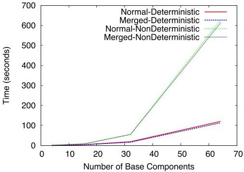


<div align="center">

(a) Deterministic/Non-Deterministic

</div>


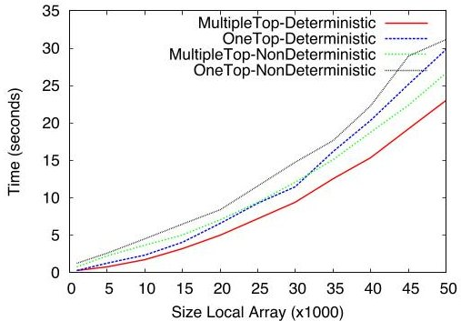


<div align="center">

(b) One Top/Multiple-Top

</div>


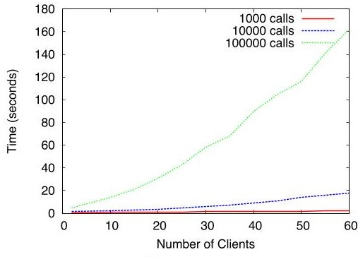


<div align="center">

Figure 7: Performance (execution time in seconds) of the case-study examples: (a),(b) NSA; (c) POTS

</div>

approaches for tackling the coordination paradigm. One approach is based on the separation between computational and coordination mechanisms; the latter are described as constraints that are independent from the internal behavior of the coordinated components. The other approach consists in internalising the constraints by generating a set of coordinators that play the role of an execution engine. Formally relating the two approaches opens the way for consistent code generation and guarantees that important architectural properties are guaranteed to hold in the implementation.

Interaction expressions are a key concept, fully describing the control- and data-flow involved in an interaction. They are used both to specify connectors, i.e. architectural constraints, and executable code in the coordinators. They directly express multiparty interactions and have features for hierarchical structuring. They can be assimilated to synchronous function calls from the bottom ports, that return values computed when the interaction occurs. The proposed coordination mechanism is general enough to directly encompass existing mechanisms. In particular it can express data-driven and event-driven interaction. Usually, ADLs use connectors that do not involve computation. For example, data-flow is defined by distinguishing between input and output ports. When an interaction occurs the value of an output is copied into possibly many inputs. For such languages, the expression of interactions involving computation requires the use of additional components.

<div align="center">

(c) POTS

</div>

We have already published formal operational semantics for BIP and developed implementations in the form of various execution engines [4]. Nonetheless, so far the relation between semantics and the corresponding implementation was not fully formalized. The proposed translation provides a full formalization of the execution engine as a set of interacting coordinators and an arbiter. It preserves the structure of the BIP models: each connector is implemented by a coordinator. Furthermore, by applying the T/B component composition rule the executable model can be flattened in different possible ways. As shown in [10] flattening allows the generation of more efficient code.

The implementation of T/B component models can be used either for the execution of BIP models after internalisation of their connectors or for the execution of such models written independently of BIP.

We see two main directions for future work. One is to study extensions of interaction expressions to encompass dynamic coordination. This can be achieved by including in the set of local variables $ X_{L} $ , port and component variables as in the Dy-BIP coordination language [9]. These could be used in the guards and affected by the up and dn functions, making possible dynamic configuration of a model.

The second direction is to study techniques for distributing the generated engine in the form of a T/B component model. So far, we have studied code generation techniques for BIP, that generate distributed implementations for flattened models [7, 8]. This limits the possibility of physically distributing coordinators by preserving the architecture hierarchy. The new techniques will allow full preservation of the coordination structure and enhanced freedom for discovering optimal implementations.

## 8. REFERENCES

[1] Marwan Abi-Antoun et al. Modeling and implementing software architecture with ACME and ArchJava. In ICSE, pages 676-677. ACM, 2005.

[2] Miklós Ajtai, János Komlós, and Endre Szemerédi. Sorting in $ c $ log $ n $ parallel steps. Combinatorica, 3(1):1-19, 1983.

[3] Jonathan Aldrich, Craig Chambers, and David Notkin. ArchJava: connecting software architecture to implementation. In ICSE, pages 187-197. ACM, 2002.

[4] Ananda Basu et al. Distributed semantics and implementation for systems with interaction and priority. In FORTE, volume 5048 of LNCS, pages 116-133. Springer, 2008.

[5] Ananda Basu, Marius Bozga, and Joseph Sifakis. Modeling heterogeneous real-time components in BIP. In SEFM06, pages 3-12, September 2006. Invited talk.

[6] Simon Bliudze et al. Architecture internalisation in BIP Technical Report EPFL-REPORT-196997, February 2014. http://infoscience.epfl.ch/record/196997.

[7] Borzoo Bonakdarpour et al. From high-level component-based models to distributed implementations. In EMSOFT, pages 209-218, 2010.

[8] Borzoo Bonakdarpour et al. A framework for automated distributed implementation of component-based models. Distributed Computing, 25(5):383-409, 2012.

[9] Marius Bozga et al. Modeling dynamic architectures using Dy-BIP. In SC, LNCS 7306, pages 1-16. Springer, 2012.

[10] Marius Bozga, Mohamad Jaber, and Joseph Sifakis. Source-to-source architecture transformation for performance optimization in BIP. IEEE Trans. Industrial Informatics, 6(4):708-718, 2010.

[11] David Harel. Statecharts: A visual formalism for complex systems. Sci. Comput. Program., 8(3):231-274, 1987.

[12] Jonathan D. Hay and Joanne M. Atlee. Composing features and resolving interactions. In FSE, pages 110-119. ACM, 2000.

[13] Thomas W. Malone and Kevin Crowston. The interdisciplinary study of coordination. ACM Comp. Surv., 26(1):87-119, 1994.

[14] Florence Maraninchi and Yann Rémond. Argos: an automaton-based synchronous language. Comput. Lang., 27(1/3):61-92, 2001.

[15] Nenad Medvidovic and Richard N. Taylor. A framework for classifying and comparing architecture description languages. In ESEC/FSE, LNCS 1301, pages 60-76. Springer, 1997.

[16] Robin Milner. Communication and Concurrency. PHI Series in Computer Science. Prentice Hall, 1989.

[17] George A. Papadopoulos and Farhad Arbab. Coordination models and languages. Adv. in Computers, 46:329-400, 1998.

[18] George A. Papadopoulos, Aristos Stavrou, and Odysseas Papapetrou. An implementation framework for software architectures based on the coordination paradigm. Sci. Comput. Program., 60(1):27-67, March 2006.