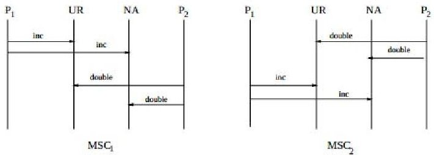
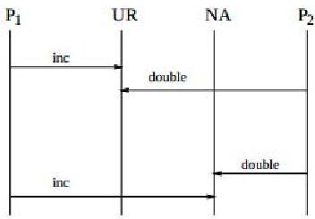

<!-- PDF_PAGE: 1 -->

# Are We There Yet? Analyzing Architecture Description Languages for Formal Analysis, Usability, and Realizability

Mert Ozkaya

Department of Computer Science

City University London

Email: mert.ozkaya.1@city.ac.uk

London, EC1V 0HB, UK

Christos Kloukinas

Department of Computer Science

City University London

London, EC1V 0HB, UK

Email: C.Kloukinas@city.ac.uk

Abstract—Research on Software Architectures has been active since the early nineties, leading to a number of different architecture description languages (ADL). Given their importance in facilitating the communication of crucial system properties to different stakeholders and their analysis early on in the development of a system this is understandable. After all these years one would have hoped that we could point to a handful of ADLs as the clear winners as the languages of choice of practitioners for specifying software system architectures. However it seems that ADLs have still not entered the mainstream. We believe this is so because practitioners find the current offering either too difficult to use or not supporting automated analysis commensurate to the level of effort they require for specifying a system, especially so for complex systems.

In this paper we present a comparative analysis of a number of ADLs, both of first generation and more recent ones, against a small set of language properties that we believe are crucial for an ADL that would be easy for practitioners to adopt in their design and development practices. These properties are: formal semantics, usability, and realizability.

Keywords—Architecture Description Language, Comparison, Formal Semantics, Usability, Realizability

## I. INTRODUCTION

The main notions in software architectures were identified already from the early papers on the subject [16], [41] - components abstracting computations and data repositories and connectors abstracting the interaction protocols used among components. Researchers have developed a number of ADLs, experimenting with different ways of specifying architectures of complex systems, e.g. Darwin [27], UniCon [45], Wright [1], Rapide [24], C2 [49], LEDA [7], and Koala [51].

Design patterns [14] were also introduced during the same period. While design patterns have by now entered the mainstream [19] and are part of the vocabulary of software developers, software architectures have still not matured in the same way. We believe that among the reasons for this is the fact that the ADLs developed so far have a number of shortcomings that hinder their application in practice. Indeed, as shown in [30], practitioners insist on using UML even though it is known that UML has very weak support for architecture specification (e.g., no first-class connectors, no formal semantics, etc.) [21]. First of all, some ADLs do not have any formal semantics

either, thus making early analysis of system architectures difficult, if not impossible. This decreases substantially the benefit of having an architectural description of a system. Such specifications are difficult to produce and one would need to be able to perform some early analysis with them instead of simply using them as documentation. Approaches that use architectural descriptions to produce code skeletons are in our view pushing too far too fast. An architecture is usually at a much higher level of abstraction than actual code and can be implemented in different ways, just like "high-level design" classes do not need to be reflected in "low-level design" classes in OO. With major frameworks like CORBA, JavaBeans, OSGi, Web Services, etc. been revised so often and falling out of fashion quickly $ ^{1} $ , it is also extremely difficult for a code-generation tool to keep up-to-date and runs the danger of simply becoming irrelevant quite quickly, unlike tools that analyze architectures. The ADLs that do have formal semantics, usually require practitioners to use formal languages that are far from what they are familiar with, e.g. process algebras. As also discussed in [30], this results in steep learning curve for practitioners. Furthermore, the chances that they will get their specifications wrong would highly be likely too because they do not understand the semantics of the language they are using. Usability is in fact a main source of problems and it goes beyond the use of some formal language - sometimes ADLs fail to even support user-defined abstractions of complex architectural units, such as complex connectors. Finally, a number of ADLs use constructs that are not so easy to map to lower-level designs - some even allow the description of systems that are unrealizable.

In our attempt to produce a new ADL [23], we have analyzed a number of early and the most well-known ADLs like those aforementioned, as well as more recent ones like SOFA [43], PiLar [44], PRISMA [40], COSA [38], AADL [12], and CONNECT [20]. We analyzed these ADLs against three main properties: (i) support for formal analysis of system architectures in principle $ ^{2} $ , (ii) level of usability of their notations for specifying large and complex system architectures, and (iii) protection against the accidental specification of unrealizable designs. Usability in particular is further subdivided into two

<!-- PDF_PAGE: 2 -->

sub-properties: (a) easy-to-use formal behavioural specifications and (b) support for user-defined, complex connectors. We have used these properties to guide our analysis of thirteen different ADLs in the rest of the paper. The analysis is split into two sections - one considering the first-generation ADLs and the other considering the more recent ones. The paper then summarizes the results of the analysis before considering the related work and concluding.

## II. EARLY ADLS

A number of different ADLs were developed during the early days of research in software architectures, with researchers experimenting on the proper structures needed for supporting architectural descriptions and their relations. Here we consider the main ones from that period, presented in an almost chronological order.

## A. Darwin

Darwin is one of the first ADLs, intended as a generalpurpose language for specifying distributed systems as configurations of components [27].

Connector support As opposed to what has been suggested in [16], [41], Darwin does not support specification of connectors in architectural designs. Components interact with each other through bindings described in composite component specifications. However, such bindings cannot give the semantics of the way interaction occurs between components (i.e., the interaction protocol), thus resulting in complex connector information being hard-wired inside components.

Behaviour Specification Originally Darwin focused on structural architectural aspects and dynamic component creation [26]. It was later on extended in the Tracta approach [17] so that the formal behaviour of components can be specified using the Finite State Process (FSP) [28]. Primitive FSP processes are attached to simple component types that offer or require services only. For composite components, a composite FSP process composes in parallel the processes corresponding to sub-components of the composite type.

Semantics of Darwin The semantics of Darwin were initially defined [26] using $ \pi $ -calculus [36], so as to support dynamic architectures and later [17] using FSP so as to facilitate automated analysis.

## B. Wright

The Wright ADL is well-known for its formal and explicit treatment of connectors in architectural designs [1].

Connector support In Wright, besides first-class component elements, connector elements also have first-class, thus enabling the explicit specification of interactions among components. Indeed, one can describe with Wright connectors either simple interconnection mechanisms (e.g., procedure call) or complex ones (e.g., complex interaction protocols such as an auction).

Connectors in Wright are instantiated from connector types, which enables reuse of the same interaction pattern on different contexts and also the analysis of connectors in isolation. A

Fig. 1: Alur's Nuclear Power Plant Unrealizable MSCs [3]

$$
\textbf {r o l e} \mathrm {D o u b l e r} = \mathrm {u r} \rightarrow \mathrm {n a} \rightarrow \mathrm {D o u b l e r} \quad ; \mathrm {s h o w n a s} P _ {2}
$$

Fig. 2: Wright's (unrealizable) connector for Alur's Nuclear Power Plant

connector type is described with roles representing the participating components and a glue coordinating the behaviour of the roles. Roles and glue are each specified with a protocol representing their behaviours.

Behaviour specification Behaviour specification in Wright is done in CSP [18]. The behaviour specification of component types is structured in two parts: port processes (or protocols) and spec process, where the ports represent the external (visible) behaviour of components and spec their internal behaviour for complex, composite types. Similarly, the behaviour of connector types is structured as role processes and glue process.

Semantics of Wright Semantics of Wright are also defined in CSP. Connectors are the parallel composition of the CSP role processes with the glue CSP process that coordinates them. Similarly, component semantics are defined by composing the port CSP processes with the spec process that coordinates the ports. In a configuration participating component ports replace connector roles, when they are "compatible" [1], i.e., the ports restricted over the traces of the roles refine the roles. Apart from this compatibility check, role processes are not used, instead the glue process is composed with the port processes directly.

Realizability Glue specifications used in Wright connectors serve two purposes. First, they connect together component port actions, e.g., Incrementor.ur $ \rightarrow $ UR.inc. Second, they impose a global ordering of component actions, e.g., UR.inc $ \rightarrow $ NA.inc. Unfortunately, this second feature can lead to potentially unrealizable system specifications. Components in distributed systems have partial observability of system state. That is, they cannot know at which state the other components are at all points in time. However, with glue specification, one can easily specify a global ordering of actions that is only possible if all components can always observe the full system state. As shown in [3], [4] for Message Sequence Charts,

<!-- PDF_PAGE: 3 -->

Fig. 3: An unavoidable bad behaviour in Alur's plant [3] (hidden by Wright's glue specification)

connector Plant_Connector2 =

...

role Cntrl = incI $ \rightarrow $ incUR $ \rightarrow $ incNA $ \rightarrow $ Cntrl

$ \Box $ dblI $ \rightarrow $ dblUR $ \rightarrow $ dblNA $ \rightarrow $ Cntrl

glue = Incrementor.ur $ \rightarrow $ Cntrl.incI $ \rightarrow $ glue

$ \Box $ Doubler.ur $ \rightarrow $ Cntrl.dblI $ \rightarrow $ glue

$ \Box $ Incrementor.na $ \rightarrow $ glue $ \Box $ Doubler.na $ \rightarrow $ glue

$ \Box $ Cntrl.incUR $ \rightarrow $ UR.inc $ \rightarrow $ glue $ \Box $ Cntrl.incNA $ \rightarrow $ ...

$ \Box $ Cntrl.dblUR $ \rightarrow $ UR.double $ \rightarrow $ glue $ \Box $ Cntrl.dblNA $ \rightarrow $ ...

Fig. 4: A realizable connector

(contains an extra, centralized controller, role Cntrl)

realizability of a globally ordered protocol is an undecidable problem in general. For instance, Alur described in [3] an unrealizable MSC representing a simplified nuclear power plant, shown in Fig. 1. The interaction therein involves an Incrementor $ ( P_{1} ) $ and a Doubler $ ( P_{2} ) $ client updating the amounts of Uranium fuel (UR) and Nitric Acid (NA) in a nuclear reactor. After the update operations, the amounts of UR and NA must be equal to avoid any nuclear accident. The interaction of the two clients with the NA and UR variables, can easily be specified in Wright as in Fig. 2. This specification is however unrealizable as Alur has shown because it is impossible to implement it in a decentralized manner with these four roles $ ( P_{1}, P_{2}, $ UR, NA) in a way that avoids behaviours excluded by the glue, such as the one shown in Fig. 3. In order to realize it one needs to transform the protocol to a centralized one, introducing a central controller as in Fig. 4. As the realizability problem is undecidable in general, there is no way to verify a design against it.

## C. UniCon

UniCon is another early ADL allowing designers to specify components and connectors [45].

Connector support Connectors are introduced as connector templates in UniCon. A connector template is essentially described with a protocol, acting as a mediator of interaction among components. Protocols, just like Wright connectors, consist essentially of roles. However, unlike Wright, UniCon restricts protocols to be of certain types, e.g., Pipe, DataAccess, ProcedureCall, thus preventing designers from freely specifying their own (complex) types.

Behaviour Specification Unlike Darwin and Wright, UniCon does not allow for formal behavioural specification of architectural elements. Nevertheless, UniCon offers a set of built-in attributes for component/connector templates and also players/roles. Through the attributes, designers can specify further details, e.g., non-functional properties and constraints,

about the architectural elements. It is however still problematic that designers are restricted with certain attributes and certain set of values for each.

Semantics of UniCon UniCon does not have formally defined semantics as its focus is rather upon early code generation from architecture specifications. UniCon offers a tool-set for mapping architectures into C source code. While this enables system simulation, it is problematic for formal verification.

## D. Rapide

Rapide ADL is known with specific support for dynamic system architectures and simulation of architectures [24], [25].

Connector support Like Darwin, Rapide adopts an approach that considers system architectures as collections of components which are wired together via mere connections. Unlike Wright, there is no first-class connector element offered thus leading to complex interaction patterns being implicitly specified in component specifications. With Rapide, one can only specify explicit links between the required and provided services of components.

On the other hand, Rapide introduces architectural constraints through which interaction protocols among components can be specified. But, unlike Wright, where connectors are independent elements, Rapide constraints are embedded within an architecture specification (corresponding to composite component types in Darwin), and thus cannot be re-used by different architecture specifications.

Behaviour Specification Rapide adopts event patterns to formally specify the behaviour of interface types (corresponding to component types in Darwin). Interface types essentially include service specifications (in and out actions for asynchronous communication, provided and required features of functions for synchronous communication). Furthermore, it can include behavior part through which one can specify event pattern rules imposed on actions or functions. These rules, just like Wright protocols, represent the expected behaviour of components.

Semantics of Rapide The event pattern language is also used for defining the precise semantics of Rapide [25]. Indeed, component semantics (described as interface types) are defined as a partially ordered set of events that can have either dependency (causality) or timing relationships with each other.

Realizability As aforementioned, Rapide allows architectural constraints to be imposed on the interaction of components within architecture specifications. These architectural constraints coordinate the actions taken by the components, ensuring their compliance to some specific protocol. However, these constraints are global ones and thus suffer from the same issues as Wright's glue - they permit the specification of unrealizable protocols.

## E. C2

C2 is a message based architectural style with a particular focus on architectural descriptions of event-driven applications, where complex, distributed components operate concurrently and communicate via message exchange [31], [32], [49].

<!-- PDF_PAGE: 4 -->

Connector support Connectors in C2 are just a medium of message routing and broadcasting, which can also perform message filtering. Unlike Wright, they cannot be used for representing interaction protocols. Nor can they be specified independently as abstractions. Instead, in C2, connectors are embodied within the architecture elements, which represent architectural configurations comprising component instances, connectors and also their topologies. Thus, unlike Wright, connector specifications cannot be re-used in different configurations and be analyzed in isolation independently of their use.

Behaviour specification Behavioural specification in C2 is limited to component behaviours. C2 component types comprise method and behavior parts. The method part is a list of procedures representing internal component functionality. The behavior part describes what message (receipt of notification or request) causes what procedure to be executed or message (emission of notification or response) to be triggered.

Semantics of C2 C2 is formally specified using the Z notation [47], as explained in [31].

## F. LEDA

LEDA, like Darwin, views architectures as collections of components [7].

Connector support Like Darwin, LEDA does not support connectors. Indeed, it only offers as interaction mechanism the attachments embodied within composite component types for linking the interfaces of ports (called roles). As such, the independent specification of complex interaction mechanisms is not possible with LEDA; these have to be embedded in component specifications.

Behaviour Specification Behaviour specification for components in LEDA is two fold: external (i.e., observable) behaviour and internal behaviour. External behaviour is specified through role types, which are specified separately and instantiated within component types; internal behaviour is specified using (optional) spec construct in component types. The role types and the spec part of component types are specified formally as processes in $ \pi $ -calculus.

Semantics of LEDA Like the original Darwin components and bindings, the semantics of components and attachments in LEDA are formally defined using $ \pi $ -calculus [36] too.

Connector support Like Darwin and LEDA, Koala does not support connectors in system architectures. Interaction between components are merely specified by connects in composite component types. Being simple links, these cannot be used to specify complex interaction protocols independently of components.

Inspired by Darwin, Koala ADL aims at specifying architectures of consumer electronics products [51].

## G. Koala

Behaviour Specification Koala supports only a structural view of software architectures and does not allow for behavioural specifications. Indeed, it places its main emphasis on automatic code-generation from structural specifications, rather than early formal analysis of behaviours.

Semantics of Koala Like UniCon, Koala does not have formally defined semantics, as it focuses on code generation through mappings to the C language.

## III. RECENT ADLS

Experience with the first-generation ADLs led to the development of further ones, usually with a focus on code generation. This section considers a number of the most prominent of these.

## A. SOFA

SOFA is a second-generation ADL, focusing mainly on components and their formalization [6], [42], [43].

Connector support As it was initially intended as a component-only approach [42], SOFA did not first treat connectors explicitly. However, it was later on extended with constructs for explicit specification of connectors [6]. It supports four basic styles of communication (procedure call, messaging, streaming, and blackboard) that designers can use when specifying their connectors.

Behaviour specification Behaviour in SOFA is essentially centred on components. Components are instantiated from component templates which comprise a component frame and optionally a component architecture (if composite). The behaviour of a template is specified in terms of the behaviours of frame, architecture, and the interface types whose instances are employed as the template's provided/required services. Each of these parts are augmented with a protocol specified in Behaviour Protocols (BP) [43]. BP is a simplified form of CSP, with additional support for regular expressions. Using BP, protocols are described as agents. An agent is simply an event processing unit, e.g., CSP process or Rapide's event pattern, that orders the events (corresponding to interface methods) which are emitted or received by the element for which the agent is specified.

The behaviour of connectors is, by contrast, not specified using BP; instead, one can only specify values for built-in nonfunctional properties attached to connectors. This is because SOFA focuses on automatic code generation from connector specifications [5], rather than their formal analysis as is the case in Wright.

Semantics of SOFA BP is also used for defining the semantics of SOFA.

## B. PiLar

PiLar is another recent ADL which separates architecture specification into two levels - base-level and meta-level where the former represents primitive (controlled) elements and the latter the complex, composite (controlling) elements [44].

Connector Support PiLar views connectors as first-class elements in software architecture, which can be specified at either base-level or meta-level. While the former is specified as bindings (just like Darwin and LEDA), the latter is specified as typed bindings. Typed bindings are essentially (meta-)component specifications consisting of services and constraints; the services herein are matched with the respective

<!-- PDF_PAGE: 5 -->

primitive component services that the bindings link together and the constraints are glue-like units that coordinate the linked component services - this is in effect similar to Wright.

Behaviour Specification Behaviour of components and connectors is specified in a process-algebraic form inspired by CCS [35]. Alternatively, PiLar also provides a more understandable syntax for specifying constraint rules so that designers do not need to use CCS directly.

Semantics of PiLar Just like Darwin and LEDA, the semantics of PiLar are defined using $ \pi $ -calculus - the use of the CCS-inspired language is not inconsistent with these semantics.

Realizability As aforementioned, connector constraints are essentially similar to the centralized glues of Wright. Therefore, they can also lead to unrealizable architectures.

## C. PRISMA

PRISMA is an Aspect-Oriented ADL that aims at combining Component-based Software Engineering with Aspect-Oriented Software Engineering [40].

Connector Support Inspired from Wright, PRISMA also views connectors as first-class elements. Connector types are specified with a set of roles representing the participating components and an aspect which coordinates the behaviour of the roles.

Semantics of PRISMA PRISMA is defined using the Modal Logic of Actions [48] and $ \pi $ -calculus.

Behaviour Specification The behaviour of components and connectors are specified through the aspect constructs embodied within them. An aspect can serve different purposes such as coordination for connectors and functional for components. Those aspects are formally specified using an extended form of the OASIS language [39].

Realizability The connector coordination aspect is similar to a Wright glue, thus unrealizable designs are possible in PRISMA as well.

## D. COSA

The COSA ADL adopts an approach combining the principles of component-based engineering with those of objectoriented (OO) paradigm (e.g., inheritance) [38], [46].

Connector support Like Wright and UniCon, COSA treats connectors explicitly as the mediators of interactions among components. A connector type is described in terms of an interface that, like Wright connectors, comprises a collection of roles for participating components and a glue representing an interaction protocol. Moreover, like component types, connector types also allow to specify complex interaction mechanisms via composition and inheritance.

Behaviour Specification Behaviour in COSA is specified via protocol specifications for component ports, connector roles and also glues. A protocol here specifies a sequence of port/role actions that describes how the elements are to behave in their environments. However, unlike Wright where protocols are specified formally with CSP, COSA does not adopt a formal approach.

Semantics of COSA The semantics of COSA are defined using a UML 2.0 profile [2].

Realizability Like Wright, COSA introduces a glue element in connector specifications, through which component interaction protocols are specified. As aforementioned, this permits the specification of potentially unrealizable architectures.

## E. AADL

AADL is an ADL that aims to support software, hardware, and mixed system architectures [12], [13], specialized for embedded systems. Perhaps due to its specialization, AADL has the highest usage rate among ADLs [30]. However, unlike all other ADLs, AADL does not provide a generic component type. Instead, component types are categorized into three groups. There is one group for specifying software architectures: thread, thread group, process, data, and subprogram. Another group serves for hardware architectures: processor, memory, device, and bus. The last group consists of a single system type for specifying composite types containing component types of the other two groups.

Connector support Like some of the aforementioned ADLs, AADL provides no support for connectors. Components interact via ports or via subprogram-calls and the interactions are restricted to the following mechanisms: port connections, component access connections, subprogram calls, and parameter connections.

Port connections represent sending or receiving data/events asynchronously. Component access connections are used for shared data. Subprogram calls and parameter connections are for synchronous interactions between components through subprogram calls.

However, there is no support for specifying new connector types that can represent complex interaction protocols.

Behaviour specification Behaviour specification in AADL is performed via a behavior annex attached to component specifications [13]. The behavior annex is essentially an automaton.

Semantics of AADL AADL was not originally developed with a precise semantics; instead, the semantics of its architectural constructs are described in natural language. However, several attempts have been made in this sense later on, e.g., [9], [37].

## F. CONNECT

One of the most recent ADLs has been developed in the CONNECT EU project [20]. While following the general approach of Wright, CONNECT has made it easier to describe interaction behaviours by adopting the FSP process algebra rather than the more complex one CSP. CONNECT has also extended their ADL in order to be able to perform stochastic analyses of systems.

Connector support Just like Wright connectors, connectors in CONNECT are described with roles and a glue, where the roles represent the expected interaction behaviour of the participating components and the glue composes and constrains these roles into an entire (sub-)system.

<!-- PDF_PAGE: 6 -->

TABLE I: ADL survey results

<table border="1"><tr><td rowspan="2">ADL</td><td colspan="3">Usability</td><td rowspan="2">Formally analyzable</td><td rowspan="2">Always Realizable</td></tr><tr><td>High-level components</td><td>User-defined connectors</td><td>Formal behaviour specification</td></tr><tr><td>Darwin[27]</td><td>Yes</td><td>No</td><td>FSP</td><td>Yes</td><td>Yes</td></tr><tr><td>Wright[1]</td><td>Yes</td><td>Yes</td><td>CSP</td><td>Yes</td><td>No</td></tr><tr><td>Rapide[24]</td><td>Yes</td><td>No</td><td>Event patterns</td><td>Yes</td><td>No</td></tr><tr><td>UniCon[45]</td><td>Yes</td><td>No</td><td>No</td><td>No</td><td>Yes</td></tr><tr><td>C2[32]</td><td>Yes</td><td>No</td><td>Method call ordering,Z</td><td>Yes</td><td>Yes</td></tr><tr><td>LEDA[7]</td><td>Yes</td><td>No</td><td>$\pi$ Calculus</td><td>Yes</td><td>Yes</td></tr><tr><td>Koala[51]</td><td>Yes</td><td>No</td><td>No</td><td>No</td><td>Yes</td></tr><tr><td>SOFA[43]</td><td>Yes</td><td>Yes</td><td>Behaviour Protocols $\dagger$</td><td>Only for components</td><td>Yes</td></tr><tr><td>PiLar[44]</td><td>Yes</td><td>Yes</td><td>CCS</td><td>Yes</td><td>No</td></tr><tr><td>PRISMA[40]</td><td>Yes</td><td>Yes</td><td>OASIS</td><td>Yes</td><td>No</td></tr><tr><td>COSA[38]</td><td>Yes</td><td>Yes</td><td>No</td><td>No</td><td>No</td></tr><tr><td>AADL[12]</td><td>No $\ddagger$</td><td>No</td><td>Automata</td><td>Yes</td><td>Yes</td></tr><tr><td>CONNECT[20]</td><td>Yes</td><td>Yes</td><td>FSP</td><td>Yes</td><td>No</td></tr></table>

Simplified CSP

Built-in low-level components

Behaviour specification As aforementioned, CONNECT adopts the FSP process algebra for specifying components, connectors, and their configurations, instead of CSP that is used by Wright.

Semantics of CONNECT In specifying software architectures, CONNECT adopts not only the FSP syntax but also its semantics [29]. A component corresponds to a composite process comprising the component port primitive processes. Similarly, a connector is the parallel composition of the connector role primitive processes with the glue process. Finally, a system configuration is again a composite process that composes the processes corresponding to the components and connectors.

## IV. EVALUATION

Realizability Just like Wright specifications, CONNECT specifications are potentially unrealizable, due to the glue element in connector specifications.

TABLE I summarizes the results of our analysis and shows that none of the surveyed ADLs are easy-to-use, formally analyzable, and ensure realizable designs at the same time each suffers from at least one of these problems.

Difficult to use ADLs As TABLE I shows, the ADLs considered are not so easy to use for specifying the architecture of large and complex systems. Indeed, they either lack support for user-defined, complex connector specification, or adopt a notation for specifying the behaviours of architectural elements that practitioners consider as imposing a "steep learning curve" [30]. In fact, AADL, one of the newer ADLs, has also limited its support for specifying high-level, generic components, possibly in its quest to support code-generation better. AADL restricts designers to use only built-in components. As AADL built-in types are rather low-level, this leads to architectural designs that look more like low-level designs [11]. In this way, software architectures become difficult to manage, requiring extra work to develop and analyze.

The bulk of the current ADLs (e.g., Wright, LEDA, Darwin, PiLar, PRISMA, CONNECT, and SOFA) adopt a formal notation for specifying the behaviours of architectural elements. The notation is usually some process algebra (e.g.,

FSP [28], CSP [18], CCS [35], or $ \pi $ -calculus [36]), even though other formalisms are also used (e.g., Z [47]). Although it is important that they provide a formal means of specifying behaviours of architectures, process algebras, etc., are unfortunately not viewed favourably by practitioners [30].

Support for user-defined connectors seems to be another major concern over existing ADLs (especially the early ones). Darwin, LEDA, Koala, and AADL view connectors at best as simple interconnection mechanisms, e.g., procedure call and event broadcasting, providing no support for complex interaction protocols, or worse as mere connection links communicating no interaction information at all. With minimal support for connectors, components have to incorporate specific interaction protocols, thus reducing their re-usability and increasing their complexity. If architects choose to omit these protocols from their component specifications they may end up facing the architectural mismatch problem [15], i.e., the inability to compose seemingly compatible components into a whole system due to wrong assumptions they make about their interaction. This also hinders the formal analysis of architectural designs, as protocols can no longer be analyzed in isolation from components. UniCon, Rapide, C2 provide only partial support for connectors too, by either restricting designers with simple built-in connectors or restricting their existence as part of other elements (e.g., components, architecture).

Potentially unrealizable designs Realizability of system architectures is a major issue with a number of the existing ADLs. As shown in TABLE I, all ADLs (apart from SOFA) supporting user-defined connectors allow the specification of unrealizable architectures. SOFA does not suffer from potential un-realizability because its connectors contain no behavioural specifications at all and therefore impose no constraints on the behaviour of the connected components. Wright, COSA, and CONNECT require architectural connectors to include a glue element, that is, a centralized unit coordinating the behaviour of components that interact through the connector. Likewise, Rapide's global event pattern constraints, PiLar's constraint construct, and PRISMA's coordination aspects, all act like a Wright glue. However, the glue is deeply problematic, as we have shown by using it to specify Alur's unrealizable protocol [3]. As shown in [3], [4], realizability is undecidable in general, which means that not only these ADLs do not guard architects against specifying unrealizable protocols, but that there is no general method that we could use to warn them after the fact. Indeed, this may be the reason why recent ADLs focusing on code generation such as AADL, LEDA, Koala, and SOFA do not offer support for user-defined connectors.

Early vs Recent ADLs As discussed so far, the more recent ADLs have no major difference with the earlier ones when compared against the properties of interest here. This is because the recent ADLs have taken the basic structures more or less as granted, either following Darwin's componentonly approach or Wright's component-and-connector one, and focused more on other issues such as how to better support code generation.

UML and derivatives The most successful language for specifying architectures in practice is UML [30] it is used by more people than all the other languages put together. This is probably because it is well known and used extensively for lower-level designs, despite the fact that it is not yet a very

<!-- PDF_PAGE: 7 -->

good solution for specifying architectures [22]. Indeed, UML lacks formal semantics (though tools exist to analyze tool-specific versions of it), and it does not support user-defined connectors well. Apart from AADL and Rapide a language that is used rather often for specifying architectures is ArchiMate [50]. ArchiMate introduces three views for architectures: a business, an application, and a technology one. The business layer is described using a business process and it is linked to the application one that is described using essentially UML. We view these two layers as a component diagram (the application layer) upon which one maps a centralized protocol/connector (the business layer), with the aforementioned problems that this creates (potential un-realizability).

A way forward We are currently working on a new ADL called XCD [23], which attempts to avoid these problems by supporting user-defined connectors but doing so in a way that does not employ a glue entity. Each connector role describes the behaviour constraints for the component that will assume it only, behaving as a sort of a component wrapper. In this manner, XCD architectures are realizable by construction, as there is no element that introduces global interaction constraints. Indeed, the connector of Fig. 2 is impossible to specify in XCD- one can specify the roles and their behaviour but not the glue. Essentially, the glue is broken down into the part that connects actions, which is kept, and the part that defines global interaction constraints, which is removed. In XCD global interaction constraints can be verified but not imposed - this turns an undecidable problem (how to realize a glue) into a decidable one (how to verify that the roles' composition satisfies the glue). Behaviours in XCD are specified in a formal manner but this is done through a Design-by-Contract approach [34], that practitioners have already embraced as it is close to the programming languages they are accustomed to (e.g. JML [8]) and it allows them to improve their testing methods.

## V. RELATED WORK

There have already been different surveys conducted about ADLs, e.g. Vestal's [52], Clements's [10], Medvidovic and Taylor's [33], Woods and Hilliard's [53], and Malavolta et al.'s [30]. The first three [10], [33], [52] primarily focused on identifying the defining characteristics of an ADL and its architectural elements. While they are quite helpful in understanding what an ADL is, their possible features, and the degree of support that current ADLs provide for them, our survey focuses on what we believe keeps industry away from using ADLs. This is why we assessed ADLs for usability and considered explicitly the problem of realizability of architectural designs specified with ADLs. After all, no one wants to produce a design that is impossible to implement. Furthermore, these surveys did not cover new-generation ADLs, e.g., SOFA, AADL, COSA, LEDA, etc., that were developed more recently. The latter two surveys [30], [53] considered the use of ADLs in the industry, so ADL usability was a main concern in them. Practitioners seemed to agree that code generation is not very useful [30], as we believe. There was also almost a consensus that formal analysis is less important than effective communication of architectures. We believe that this is indeed the case, as the primary purpose of an architecture is to establish a common understanding of what a system is supposed to do and the main ways it will achieve so. However, the two are

not contradictory. The formal languages used so far (CSP, Z, etc.) hamper understanding and require a lot of investment to produce architectural specifications. We strongly believe that were the formal specification done in a language similar to JML [8], practitioners would adopt it overwhelmingly and actively use tools to analyze their designs, even those that currently only use them for communication. After all, effectively communicating flawed architectural designs through the use of informal languages is not the way forward - discovering an architectural flaw during implementation, integration, or system use is too costly.

## VI. CONCLUSIONS

Since the early nineties, various architecture description languages (ADLs) have been proposed allowing designers to specify their system architectures in a formal, precise way. ADLs are generally known with their comprehensive support for system architecture specification and its early formal analysis. However, despite the advantages promised by ADLs, they still have not entered the mainstream. The lack of interest shown is we believe a consequence of three main problems that no ADL has managed to solve at the same time: (i) lack of support for formal analysis of architectures, (ii) notations that sometimes make specifying large and complex system architectures harder than it should be, and (iii) potential un-realizability of system architectures. This paper surveyed thirteen different ADLs, half of which are widely-known early ADLs and the other half are recent works, identifying some of the above stated problems in all these ADLs. As we stand, practitioners are still unable to find an ADL that facilitates the specification of complex systems in a way that enables early formal analysis and at the same time guarantees that the architecture is realizable. Our work on the XCD ADL aims at developing such a language.

## VII. ACKNOWLEDGEMENTS

This work has been partially supported by the EU project FP7-257367 IoT@Work - "Internet of Things at Work".

## REFERENCES

[1] R. Allen and D. Garlan. A formal basis for architectural connection. ACM Trans. Softw. Eng. Methodol., 6(3):213-249, 1997.

[2] A. Alti, T. Khammaci, and A. Smeda. Representing and formally modeling COSA software architecture with UML 2.0 profile. International Review on Computers and Software, 2:30-37, 2007.

[3] R. Alur, K. Etessami, and M. Yannakakis. Inference of message sequence charts. IEEE Trans. Software Eng., 29(7):623-633, 2003.

[4] R. Alur, K. Etessami, and M. Yannakakis. Realizability and verification of MSC graphs. Theor. Comput. Sci., 331(1):97-114, 2005.

[5] T. Bures, M. Malohlava, and P. Hnetynka. Using DSL for automatic generation of software connectors. In ICCBSS, pages 138-147. IEEE Computer Society, 2008.

[6] T. Bures and F. Plasil. Communication style driven connector configurations. In C. Ramamoorthy, R. Lee, and K. Lee, editors, Software Engineering Research and Applications, volume 3026 of Lecture Notes in Computer Science, pages 102-116. Springer Berlin Heidelberg, 2004.

[7] C. Canal, E. Pimentel, and J. M. Troya. Specification and refinement of dynamic software architectures. In P. Donohoe, editor, WICSA, volume 140 of IFIP Conference Proceedings, pages 107-126. Kluwer, 1999.

[8] Y. Cheon and G. T. Leavens. A simple and practical approach to unit testing: The JML and JUnit way. In B. Magnusson, editor, ECOOP, volume 2374 of Lecture Notes in Computer Science, pages 231-255. Springer, 2002.

<!-- PDF_PAGE: 8 -->

[9] M. Y. Chkouri, A. Robert, M. Bozga, and J. Sifakis. Translating AADL into BIP - application to the verification of real-time systems. In M. R. V. Chaudron, editor, MoDELS Workshops, volume 5421 of Lecture Notes in Computer Science, pages 5-19. Springer, 2008.

[10] P. C. Clements. A survey of architecture description languages. In Proceedings of the 8th International Workshop on Software Specification and Design, IWSSD '96, pages 16- , Washington, DC, USA, 1996. IEEE Computer Society.

[11] D. Delanote, S. V. Baelen, W. Joosen, and Y. Berbers. Using AADL to model a protocol stack. In ICECCS, pages 277-281. IEEE Computer Society, 2008.

[12] P. H. Feiler, D. P. Gluch, and J. J. Hudak. The Architecture Analysis & Design Language (AADL): An Introduction. Technical report, Software Engineering Institute, 2006.

[13] R. B. França, J.-P. Bodeveix, M. Filali, J.-F. Rolland, D. Chemouil, and D. Thomas. The AADL behaviour annex - experiments and roadmap. In ICECCS, pages 377-382. IEEE Computer Society, 2007.

[14] E. Gamma, R. Helm, R. Johnson, and J. Vlissides. Design patterns: Elements of reusable object-oriented software. Addison Wesley, Oct. 1994. ISBN-13: 978-0201633610.

[15] D. Garlan, R. Allen, and J. Ockerbloom. Architectural mismatch or why it's hard to build systems out of existing parts. In ICSE, pages 179-185, 1995.

[16] D. Garlan and M. Shaw. An introduction to software architecture. In V. Ambriola and G. Tortora, editors, Advances in Software Engineering and Knowledge Engineering, pages 1-39, Singapore, 1993. World Scientific Publishing Company. Also appears as SCS and SEI technical reports: CMU-CS-94-166, CMU/SEI-94-TR-21, ESC-TR-94-021.

[17] D. Giannakopoulou, J. Kramer, and S.-C. Cheung. Behaviour analysis of distributed systems using the Tracta approach. Autom. Softw. Eng., 6(1):7-35, 1999.

[18] C. A. R. Hoare. Communicating sequential processes. Commun. ACM, 21(8):666-677, 1978.

[19] S. Holzner. Design Patterns For Dummies. John Wiley & Sons, May 2006. ISBN-13: 978-0471798545.

[20] V. Issarny, A. Bennaceur, and Y.-D. Bromberg. Middleware-layer connector synthesis: Beyond state of the art in middleware interoperability. In M. Bernardo and V. Issarny, editors, SFM, volume 6659 of Lecture Notes in Computer Science, pages 217-255. Springer, 2011.

[21] J. Ivers, P. Clements, D. Garlan, R. Nord, B. Schmerl, and J. R. O. Silva. Documenting component and connector views with UML 2.0. Technical Report CMU/SEI-2004-TR-008, Software Engineering Institute (Carnegie Mellon University), 2004.

[22] J. Ivers, P. Clements, D. Garlan, R. Nord, B. Schmerl, and J. R. O. Silva. Documenting component and connector views with UML 2.0. TR CMU/SEI-2004-TR-008, 2004.

[23] C. Kloukinas and M. Ozkaya. Xcd - Modular, realizable software architectures. In C. S. Pasareanu and G. Salaun, editors, FACS, volume 7684 of Lecture Notes in Computer Science, pages 152-169. Springer, 2012.

[24] D. C. Luckham. Rapide: A language and toolset for simulation of distributed systems by partial orderings of events. Technical report, Stanford University, Stanford, CA, USA, 1996.

[25] D. C. Luckham and J. Vera. An event-based architecture definition language. IEEE Trans. Software Eng., 21(9):717-734, 1995.

[26] J. Magee, N. Dulay, S. Eisenbach, and J. Kramer. Specifying distributed software architectures. In W. Schafer and P. Botella, editors, ESEC, volume 989 of Lecture Notes in Computer Science, pages 137-153. Springer, 1995.

[27] J. Magee and J. Kramer. Dynamic structure in software architectures. In SIGSOFT FSE, pages 3-14, 1996.

[28] J. Magee and J. Kramer. Concurrency-State models and Java programs (2. ed.). Wiley, 2006.

[29] J. Magee, J. Kramer, and D. Giannakopoulou. Analysing the behaviour of distributed software architectures: A case study. In FTDCS, pages 240-247. IEEE Computer Society, 1997.

[30] I. Malavolta, P. Lago, H. Muccini, P. Pelliccione, and A. Tang. What industry needs from architectural languages: A survey. IEEE Transactions on Software Engineering, 99, 2012.

[31] N. Medvidovic. Formal Definition of the Chiron-2 Software Architectural Style. Technical report (University of California, Irvine. Dept. of Information and Computer Science). Department of Information and Computer Science, University of California, Irvine, 1995.

[32] N. Medvidovic, P. Oreizy, J. E. Robbins, and R. N. Taylor. Using object-oriented typing to support architectural design in the C2 style. In SIGSOFT FSE, pages 24-32, 1996.

[33] N. Medvidovic and R. N. Taylor. A classification and comparison framework for software architecture description languages. IEEE Trans. Software Eng., 26(1):70-93, 2000.

[34] B. Meyer. Applying "Design by Contract". IEEE Computer, 25(10):40- 51, 1992.

[35] R. Milner. A Calculus of Communicating Systems, volume 92 of Lecture Notes in Computer Science. Springer, 1980.

[36] R. Milner, J. Parrow, and D. Walker. A calculus of mobile processes, i. Inf. Comput., 100(1):1-40, 1992.

[37] P. C. Olveczky, A. Boronat, and J. Meseguer. Formal semantics and analysis of behavioral AADL models in real-time Maude. In J. Hatcliff and E. Zucca, editors, FMOODS/FORTE, volume 6117 of Lecture Notes in Computer Science, pages 47-62. Springer, 2010.

[38] M. Oussalah, A. Smeda, and T. Khammaci. An explicit definition of connectors for component-based software architecture. In ECBS, pages 44-51. IEEE Computer Society, 2004.

[39] O. Pastor, I. Ramos, and J. H. C. Cerdá. Oasis v2: A class definition language. In N. Revell and A. M. Tjoa, editors, DEXA, volume 978 of Lecture Notes in Computer Science, pages 79-90. Springer, 1995.

[40] J. Pérez. PRISMA: Aspect-Oriented Software Architectures. PhD thesis, Universidad Politécnica de Valencia, Valencia, 2006.

[41] D. E. Perry and A. L. Wolf. Foundations for the study of software architecture. SIGSOFT Softw. Eng. Notes, 17(4):40-52, Oct. 1992.

[42] F. Plasil, D. Bálek, and R. Janecek. SOFA/DCUP: Architecture for component trading and dynamic updating. In CDS, pages 43-51. IEEE, 1998.

[43] F. Plasil and S. Visnovsky. Behavior protocols for software components. IEEE Trans. Software Eng., 28(11):1056-1076, 2002.

[44] C. E. C. Quintero, P. de la Fuente, M. Barrio-Solórzano, and M. E. B. Gutiérrez. Coordination in a reflective architecture description language. In F. Arbab and C. L. Talcott, editors, COORDINATION, volume 2315 of Lecture Notes in Computer Science, pages 141-148. Springer, 2002.

[45] M. Shaw, R. DeLine, D. V. Klein, T. L. Ross, D. M. Young, and G. Zelesnik. Abstractions for software architecture and tools to support them. IEEE Trans. Software Eng., 21(4):314-335, 1995.

[46] A. Smeda, M. Oussalah, and T. Khammaci. A multi-paradigm approach to describe software systems. In Proceedings of the WSEAS International Conferences on Software Engineering, Parallel and Distributed Systems, Salzburg, Austria, 2004.

[47] J. M. Spivey. Z Notation - A reference manual (2. ed.). Prentice Hall International Series in Computer Science. Prentice Hall, 1992.

[48] C. Stirling. Handbook of logic in computer science (vol. 2). chapter Modal and temporal logics, pages 477-563. Oxford University Press, Inc., New York, NY, USA, 1992.

[49] R. N. Taylor, N. Medvidovic, K. M. Anderson, E. J. W. Jr., J. E. Robbins, K. A. Nies, P. Oreizy, and D. L. Dubrow. A component- and message-based architectural style for GUI software. IEEE Trans. Software Eng., 22(6):390-406, 1996.

[50] The Open Group. Archimate 1.0 specification. Technical standard, Feb. 2009.

[51] R. C. van Ommering, F. van der Linden, J. Kramer, and J. Magee. The Koala component model for consumer electronics software. IEEE Computer, 33(3):78-85, 2000.

[52] S. Vestal. A cursory overview and comparison of four architecture description languages. Technical report, Honeywell Technology Center, 1993.

[53] E. Woods and R. Hilliard. Architecture description languages in practice session report. In Proceedings of the 5th Working IEEE/IFIP Conference on Software Architecture, WICSA'05, pages 243-246, Washington, DC, USA, 2005. IEEE Computer Society.