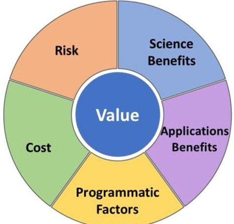
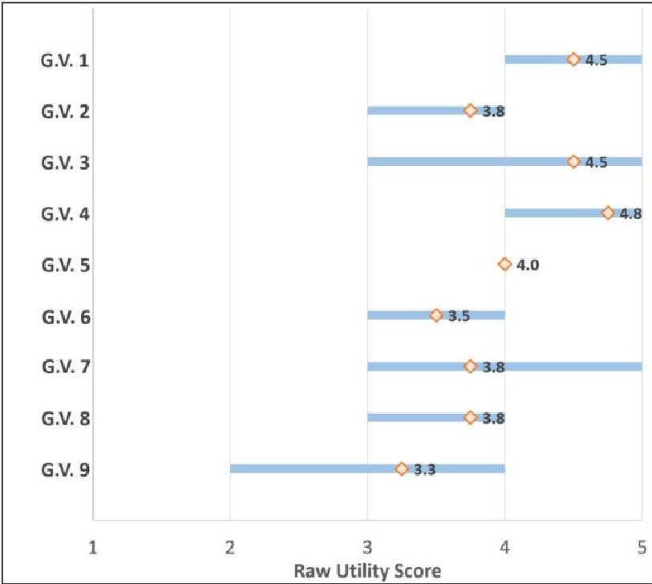

<!-- PDF_PAGE: 1 -->

# Assessing the Science Benefit of Space Mission Concepts in the Formulation Phase

Marie L. Ivanco

NASA Langley Research Center

1 North Dryden Street

Hampton, VA 23681

marie.l.ivanco@nasa.gov

Christopher A. Jones

NASA Langley Research Center

1 North Dryden Street

Hampton, VA 23681

christopher.a.jones-2@nasa.gov

Abstract—The formulation of science-driven space mission concepts is challenging - possibly even more so than the development and production of the space systems themselves. The formulation of these missions involves defining science objectives, surveying the state of the art of instrument capabilities, documenting the Program of Record and forecasting satellite lifetimes, defining feasible alternatives for spacecraft platforms and access to space, and identifying potentially enabled applications to cite only some of the tasks faced by mission design teams. The trade space is vast, especially in an era of novel platform concepts where constellations of SmallSats are changing the current paradigm of spaceborne observations. A crucial component of the formulation of science mission concepts is the assessment of the alternatives defined in this trade space. The assessment of the concepts is so complex that a heuristic approach does not sufficiently articulates the benefits of the alternatives under consideration. This complexity can be attributed to several factors. Science missions have to satisfy multiple science goals and their associated science objectives, therefore entering the realm of multi-criteria decision problems. In addition, multiple instruments, platforms, launchers, and ground system options are combined to define the architectures. The alternatives under assessment in these multi-criteria decision problems are numerous, as are the possible components of the segments that make up the architectures. Finally, stakeholders involved in the design and assessment of these science mission concepts have varying value systems: priorities relevant to stakeholders vary from group to group based on interests, objectives, and experiences.

The complexity is such that the assessment requires a deliberate and structured approach to provide a comprehensive assessment of the mission concepts. This paper presents an approach that enables the assessment of the science benefits achieved by a space mission concept in the formulation phase. The approach combines Utility and Quality assessments provided by Subject Matter Experts to produce a Science Benefit score for each identified science objective. The paper discusses how this approach was tailored for the assessment of Observing Systems in the Aerosols, Cloud, Convection, and Precipitation (ACCP) study. In this Earth Science application, Utility quantifies how important a given geophysical variable is to addressing an identified science objective, while Quality quantifies how well an architecture obtains a geophysical variable with respect to Minimum levels listed in the Science Traceability Matrix. The resulting Benefit score articulates the science capability of a given architecture to address a given objective. This paper also presents the processes implemented

to obtain the assessments from Subject Matter Experts in the ACCP study.

## TABLE OF CONTENTS

1. INTRODUCTION ...1

2. LEVERAGING PREVIOUS NASA VALUE MODELS ..2

3. ON SUBJECTIVE AND OBJECTIVE ASSESSMENTS..4

4. QUANTIFYING UTILITY ...5

5. QUANTIFYING QUALITY...7

6. SCIENCE BENEFIT SCORE...8

7. SUMMARY...9

REFERENCES...10

BIOGRAPHIES...10

U.S. Government work not protected by U.S. copyright

## 1. INTRODUCTION

In the formulation phase of science-driven space mission concepts, the assessment of prospective mission candidates is both fundamental and complex. The complexity can be attributed to several factors. Science missions have to satisfy multiple science goals and their associated science objectives, therefore entering the realm of multi-criteria decision problems. In addition, multiple instruments, platforms, launchers, and ground system options are combined to define the architectures; thus, the alternatives under assessment in these multi-criteria decision problems are numerous, and so are the possible components of the segments that make up the architectures. Finally, stakeholders involved in the design and assessment of these science mission concepts have varying value systems: priorities relevant to stakeholders vary from group to group based on interests, objectives, and experiences. Programmatic constraints such as annual funding profiles, tolerance towards risk, or the innovative character of the proposed solutions impact mission formulation and implementation. Mission concept alternatives might be valued predominantly for their technical merit by one set of stakeholders, while another set may prefer alternatives that better satisfy programmatic constraints [1]. The complexity of the assessment is such that a heuristic-only approach is insufficient to articulate the value of the various concepts under examination. A deliberate and structured approach is

<!-- PDF_PAGE: 2 -->

required to provide a comprehensive analysis of the mission concepts.

The 2017 Earth Science Decadal Survey identified 35 objectives, classified as "Most Important," "Very Important," or "Important," that are priorities for the next decade of NASA Earth Science [2]. The Earth Science Division of NASA's Science Mission Directorate tasked several NASA centers to conduct studies to formulate and assess Observing Systems that are responsive to the objectives identified in the Earth Science Decadal Survey. The formulation of these missions involves defining science objectives, surveying the state of the art of instrument capabilities, documenting the Program of Record and forecasting satellite lifetimes, defining feasible alternatives for spacecraft platforms and access to space, and identifying potentially enabled applications to cite some of the tasks faced by these mission study teams. The trade space is vast, especially in an era of novel platform concepts where constellations of SmallSats are changing the current paradigm of spaceborne observations. The assessment of the defined Observing Systems requires a structured approach to articulate the responsiveness of the concepts with respect to science and programmatic objectives.

The authors have developed a Value Framework to enable the assessment of the Observing Systems formulated in the Aerosols, Cloud, Convection, and Precipitation (ACCP) study, a joint study that combines two of the five Designated Observables defined in the Earth Science Decadal Survey to accommodate science synergies. This Value Framework defines five elements of value: the benefits obtained from the achieved science, the benefits obtained by the enabled science applications, the benefits obtained by selected programmatic factors, the cost of the Observing System, and the risks associated with the Observing System (Figure 1). This paper focuses on the first component of value: the assessment of the benefits obtained from the achieved science. Future papers will document the methods and processes designed to assess the other components of value.

Figure 1: The Five Elements of Value

In designing the assessment approach for the Science Benefit of the Observing System concepts, the authors posed the following question: is there a generic approach that enables the assessment of the Science Benefit of space mission concepts in the formulation phase that can be easily tailored across concepts, while involving stakeholders throughout the implementation? This paper presents how previous work was leveraged to develop a generic approach to assess the Science Benefit of space mission concepts. This approach decomposes Science Benefit into the Utility of a set of measurements (the degree to which those measurements address science objectives) and the Quality of those measurements (how well an Observing System obtains those measurements). A discussion on subjectivity and objectivity is then included to provide some necessary context for the definition of the approach. The paper then includes a description of each component of the assessment of Science Benefit, as well as processes specifically tailored for the ACCP study.

## 2. LEVERAGING PREVIOUS NASA VALUE MODELS

Previous approaches have been proposed at NASA to describe Science Benefit [3,4] for Earth Science mission concepts. The Value Framework in the ACCP study leverages concepts from this body of work to develop an approach that can be applied to a variety of science missions while being tailored for the needs of the ACCP study. A summary of the metrics used in these approaches is shown in Table 1.

## The Continuity Report

The Continuity of Earth Observations from Space: A Value Framework report [3] proposed a five-factor model for quantifying the value a given measurement would provide towards maintaining the continuity of Earth observations. The five factors were importance (does the measurement address an important scientific objective requiring continuity), utility (does the measurement contribute substantially to the objective), quality (does the measurement have sufficient quality to contribute to the objective), success probability (can the quality be readily obtained and maintained), and affordability (is the measurement affordable within the available NASA budget). To implement the Continuity Report approach, scores would be developed using a mix of subjective and objective methods for each of the five factors, and the product of these individual scores would result in a value metric for a measurement. This approach combined components of benefit (the importance, utility, and quality), risk (the probability of success), and cost (the affordability) into a single metric.

In the ACCP study, the importance factor is outside the scope of the Value Framework. As currently implemented, the framework does not attempt to compare the benefit of achieving one science objective relative to another. The

<!-- PDF_PAGE: 3 -->

ACCP Value Framework retains separate assessments for each source of benefit, as well as for cost and risk, rather than aggregating these individual components of value into a single metric. This approach maintains the ability to identify discriminators among Observing Systems to retain insights into the origin of value for the concepts and to retain knowledge of where trade-offs occur. This approach also avoids combining multiple sources of uncertainty and gives stakeholders the ability to assess each component of value with its associated uncertainty. In addition, reporting each component of value separately offers a strategy to mitigate anchoring, or focalism, a cognitive bias that leads individuals to rely heavily on information obtained early in the information cycle [5]. Focalism is mitigated in the absence of a single assessment score on which to anchor. By not combining the components of value into a single metric, the probability of success and affordability factors are therefore not included in the Science Benefit quantification. Finally, an affordability factor was not achievable for the ACCP study. Affordability is traditionally defined as the cost of the system with respect to available funding. In the case of the ACCP study, there was no firm cost cap or funding profile against which to benchmark the cost of concepts. Therefore, only cost, and not affordability, could be included in the Value Framework.

## The CLARREO Science Value Matrix

The CLARREO (Climate Absolute Radiance and Refractivity Observatory) science value matrix proposed a five factor model for quantifying the value of a mission option relative to a science objective; the five factors were science impact (the importance of the science objective as well as the uniqueness of CLARREO's contribution to it), accuracy (the relative accuracy for CLARREO's determination of decadal change trends relative to a perfect climate observing system), calibration verification (whether the CLARREO observation has independent verification or not), climate record length (the number of years of CLARREO data with a 75% likelihood of survival on orbit), and risk (a factor to be adjusted based on instrument development) [4].

To implement the CLARREO science value matrix approach, scores are obtained for each of the five factors. The product of those scores then results in a value metric for a mission option relative to a science objective, and the values for the individual science objectives are summed to a total mission science value. This approach combines components of benefit (science impact, accuracy, calibration verification, and climate record length) with risk into a single metric.

In the ACCP study, the science impact factor is outside the scope of the Value Framework. The Value Framework does not compare science objectives against each other, nor does it attempt to quantify the uniqueness of an Observing System relative to other options. The calibration verification and climate record length factors are specific to the question

being assessed by the CLARREO science value matrix and do not apply to the ACCP study. In addition, risks are assessed separately rather than combined into a common score with Science Benefit for the reasons cited previously in support of not combining the components of value into a single metric.

## The Value Framework Approach

Leveraging elements of this previous work, a Value Framework was developed to provide a structured, transparent, and traceable approach to assess the value of Observing Systems in the formulation phase. By design, the Value Framework combines Decision Science methods that are independent of the specific decision problem with tailored processes that depend on the specifics of the decision. It offers the advantage of providing a structure that is applicable to a variety of science mission concepts while being adaptive to support effective decision-making.

The Decision Science methods include, among others, best practices for defining the (science) objectives, their attributes, the alternatives under assessment, the ability to support decision-making under uncertainty, the ability to blend quantitative and qualitative (e.g. linguistic) scales for assessment, and the techniques available for soliciting and aggregating input from multiple experts. The tailored processes are collaboratively developed between the facilitators of the Value Framework and the other stakeholders of the decision problem. They include, among others, the selection of Decision Science methods that are most suited to the specific decision problem, the identification of activities, deliverables, and owners that support project execution, and the techniques for facilitating and documenting conversations effectively and impartially.

The Science Benefit of an Observing System alternative is the evaluation of the degree to which that alternative addresses each science objective. In the ACCP Value Framework, Science Benefit is based on two components: Utility (the importance of a geophysical variable to addressing a science objective) and Quality (how well an Observing System obtains a geophysical variable). Utility and Quality will be discussed in detail in subsequent sections of the paper. The alternatives $ ^{1} $ are the different Observing Systems, which consist of a suite of instruments, their associated spacecraft, and other elements of the architecture (e.g. ground systems). This simple decomposition of the benefits obtained from the achieved science can easily be translated to other science-driven mission concepts besides ACCP, with specific tailoring to accommodate variations in science objectives, geophysical variables, and Observing Systems.

<!-- PDF_PAGE: 4 -->

Table 1. Summary of Metrics used in selected NASA Science Value Models

<table border="1"><tr><td>Continuity Report</td><td>CLARREO</td><td>Value Framework</td></tr><tr><td>Importance: does the measurement address an important scientific objective requiring continuity?</td><td>Science Impact:
- Importance of the science objective
- Uniqueness of CLARREO&#x27;s contribution to the science objective</td><td>Science benefit
- Utility: the degree to which measurements address science objectives
- Quality: how well an Observing System obtains these measurements</td></tr><tr><td>Utility: does the measurement contribute substantially to the objective?</td><td>Accuracy: the relative accuracy for CLARREO&#x27;s determination of decadal change trends relative to a perfect climate observing system</td><td>Applications benefit: the benefit derived from enabled applications, computed on the basis of relevant attributes</td></tr><tr><td>Quality: does the measurement have sufficient quality to contribute to the objective?</td><td>Calibration verification: whether the CLARREO observation has independent verification or not</td><td>Programmatic factors: the benefit of an Observing System resulting from satisfying objectives other than the science or applications objectives</td></tr><tr><td>Success probability: can the quality be readily obtained and maintained?</td><td>Climate record length: the number of years of CLARREO data with a 75% likelihood of survival on orbit</td><td>Cost: the estimated cost of the Observing System, independent of forecasted budgets</td></tr><tr><td>Affordability: is the measurement affordable within the available NASA budget?</td><td>Risk: factor adjusted based on instrument development</td><td>Risk: the technical and programmatic risks associated with the Observing System</td></tr><tr><td>Metrics are aggregated in a single value</td><td>Metrics are aggregated in a single value</td><td>Metrics are not aggregated in a single value and are reported independently</td></tr></table>

The approach offers the benefit of structuring the assessment of Observing Systems. The science team identifies science objectives and geophysical variables, which inform the design of candidate Observing Systems to be responsive to the objectives of the mission. This structure provides a mechanism to formalize the decision problem and defines a common language to be used by all individuals involved in the assessment process. This commonality in terminology enables the facilitation of conversations necessary to perform the assessments. The structure also enables the refinement of the decision problem by identifying missing or redundant elements and integrates quantified analysis with stakeholder expertise to enable effective decision-making. The Value Framework approach relies on a full integration of the facilitators with the stakeholders, enabling the facilitators to tailor the processes to best suit the stakeholders' needs.

## 3. ON SUBJECTIVE AND OBJECTIVE ASSESSMENTS

In this paper, the adjectives "subjective", "qualitative", "objective", and "quantitative" each have specific

definitions that describe the properties of an object (whether via a subjective or an objective approach) and the nature of those properties (whether the properties are quantitative or qualitative).

Buchanan et al. define the difference between subjective and objective as follows: "subjective pertains to elements which belong to the mind; elements that are outside the mind and which can be shared by other people are objective." [6] They further define three types of subjectivity. The first relates to "transcendent" phenomena which cannot be evaluated by reason alone (the examples given include religious and philosophical questions), while the second relates to internal personal experiences (the examples given include pleasure and pain) that may not be measurable by objective means. Of particular interest to the assessment of Science Benefit is their third—judgement. Judgement is based on "professional opinion and expertise in a particular area which reflects knowledge acquired by extensive training, by experience, and by the application of scientific methods." Thus, judgement leverages the relevant knowledge and experiences of an expert to provide an answer to a question; this definition articulates the

<!-- PDF_PAGE: 5 -->

components of a subjective judgement that can provide a valuable answer to a science question.

A quantitative property can be defined as one that is numerical, and a qualitative property can be defined as one that is non-numerical [7, 8]. These properties serve to describe an object in different ways. For example, a car might have the (qualitative) property of being a sedan, or the (quantitative) property of weighing 1685 kg. They can be determined via a subjective approach (for example, by using an expert's judgement), or via an objective approach (for example, by using an instrument to measure that property). The terms "subjective" and "qualitative", and similarly the terms "objective" and "quantitative", are often used interchangeably in the common language. Clarifying their definitions is important in the discussion of the approach selected to assess Science Benefit. We therefore make the distinction between "subjective" and "qualitative": a subjective approach leverages an individual mind's knowledge and experience, while a qualitative property is a non-numerical description of an object. "Objective" and "quantitative" are similarly differentiated: an objective approach leverages means that exist outside the mind that can be shared by multiple people, while a quantitative property is a numerical description of an object.

In some situations, an objective evaluation may be infeasible due to a lack of time or resources, or because the nature of the assessment does not lend itself to an objective approach. A subjective evaluation may then be the only approach available. While subjective evaluations are often seen as non-scientific or non-rigorous enough to answer a science or engineering decision problem, we would like to highlight that in addition to being at times the only approach feasible, a subjective approach can also incorporate expertise in ways that an objective approach may miss. Ratner observes that objectivity "renders the observer a passive recipient of external information, devoid of agency." [9] Further, subjective judgement may also yield novel findings. This was observed in the development of Utility scores described below, when following the process highlighted that several geophysical variables could be derived from other variables and were therefore superfluous in the Science Traceability Matrix (STM). It is not intrinsically more correct to make a determination with an objective rather than a subjective approach; rather the objective or subjective nature of the assessment should be selected to meet the needs of the decision problem.

## 4. QUANTIFYING UTILITY

## Definition

When thinking of the benefits received from the science achieved by an Observing System, the Quality of the measurements is an intuitive attribute. Different instrument suites in different configurations can lead to measurements of varying Quality. Quality is sometimes expressed in terms of instrument performance or effectiveness, but we prefer

the term Quality, which points to reduced uncertainty in the measurements with greater linguistic precision. A less obvious, yet essential, component of the Science Benefit is the relative importance of these measurements in addressing the science objectives of the mission. The concept of Utility is used here to convey this information in the assessment. In Decision Science, Utility theory typically refers to the risk posture of the decision maker, based on the "numerical representations of the decision agent's preferences and values." [10] In the more specific context of an Earth science mission, we define Utility as the relative importance of a geophysical variable in achieving a science objective of the STM. Utility is architecture-agnostic and therefore remains constant for all architectures under evaluation.

## Method

Utility is typically assessed with a numerical quantification of a subjective judgment. These subjective judgments are elicited from Subject Matter Experts. As expert backgrounds, group size, and granularity of the numerical quantifications vary, it is essential to tailor an elicitation protocol to the needs of the specific decision problem.

Background of Subject Matter Experts—The design of the elicitation protocol needs to take the background of the experts into account. Aly & Vrana articulate experts backgrounds in terms of "Knowledge: the amount of important knowledge and information each expert bears. Experience: the age and historical deepness of the expertise contained in each expert. Relevance: the degree of how much each expert has knowledge pertaining and relating to the decision problem" [11]. Combinations of knowledge, experience, and relevance across experts is often times required, as it is challenging and impractical to form panels of experts that satisfy these three qualifications individually. Experts' backgrounds should be complimentary to address all aspects of the science discussed during the assessment. There should also be some overlap of expertise to ensure plurality in the sources of the assessment.

Number of Subject Matter ExpertsThe question of the ideal number of Subject Matter Experts is often asked by the participants when the elicitation protocol is designed. A common perception is that the larger the group of experts the more statistical significance can be achieved. While this is true from a statistical perspective, there are other factors to consider when forming expert panels. A large number of experts is not preferable if it is at the expense of the knowledge, experience, and relevance discussed previously. Large groups are also less conducive to information exchange and consensus building. Studies have investigated the ideal size of expert panels [12, 13]. The Handbook of Decision Analysis recommends targeting panels of 6-12 experts to balance the need for gaining enough perspective while still enabling meaningful information exchange [14].

Granularity of the numerical quantificationThe level of granularity of the numerical quantification of the subjective

<!-- PDF_PAGE: 6 -->

judgments also needs to be considered while defining the elicitation protocol. Linear scales based on crisp numbers are most often selected. The number of points on the scales needs to be defined to reflect the level of detail required in the expert judgement. Scales of integers might not always be the best candidate to represent the vagueness of some decision problems. Likert scales can be used to express degrees of agreement or disagreement. Fuzzy numbers and their associated membership functions can be considered to express mathematically the vagueness of qualitative criteria or of the experts' preferences [15].

## Process for ACCP

The assessment of Utility for the ACCP study was performed by a group of ten subject matter experts, who has collective knowledge, experience, and relevance across Aerosols, Cloud, Convection, and Precipitation science topics. The objective of the assessment was to obtain consensus-based Utility scores, which represent the group's assessment of the importance of the geophysical variables of the STM with respect to their associated science objectives. The elicitation approach was based on a modified Delphi method. In the traditional Delphi method, experts provide their input to a set of questions; these inputs are anonymous to encourage the expression of personal opinions and avoid the "bandwagon effect" [16]. Experts have the opportunity to submit comments to substantiate their responses. The facilitator then summarizes inputs obtained from the experts and shares the summary products with the panel. After a review of the panel inputs, experts participate in a second round of scoring, which gives them the opportunity to edit their individual scores based on knowledge gained from other experts' inputs and comments. Subsequent rounds of summary and score editing are held until consensus that meets an agreed upon consensus criterion is reached. The Delphi method in its traditional instantiation has been applied to space architecting decision problems. Aliakbargolkar [17] and Golkar [18] have applied a Delphibased Systems Architecting Framework to in-orbit exploration infrastructure for human exploration and the Mars sample return campaign respectively.

A non-anonymous processThe Delphi method was modified for the ACCP study to allow the identification of experts. The benefits of lifting the anonymity requirement of the Delphi method were two-fold. First, it enabled increased transparency in the process by providing traceability into the scores provided by the experts. This traceability had a greater priority for the ACCP study than encouraging the expression of personal opinion by preserving anonymity. Second, identifying experts contributed to accelerating the consensus building process. By giving outliers the opportunity to articulate their position, conversations could focus on areas with the greatest disagreement. This in turn enabled the team to minimize the number of scoring rounds by reaching consensus rapidly. Experts were first introduced to the modified Delphi process and were given the opportunity to participate in a practice run. This increased

familiarization with the process and also provided a venue to provide feedback on potential issues.

Collection of inputs—Google Forms were produced for each of the science objectives in the STM with minimum and enhanced objectives being assessed independently for a total of 16 forms. Each form requested that experts provide a score on a 1-5 scale (Table 2) for each of the geophysical variables of a science objective that would not be obtained from the Program of Record. Experts were given the opportunity to provide comments to support their score or raise concerns. The scale was defined in conjunction with the expert panel and based on their recommendations. Google Forms document user names as well as the day and time of submission of the inputs.

Table 2. Utility Scoring Scale

<table border="1"><tr><td></td><td>Linguistic Value</td><td>Definition</td></tr><tr><td>1</td><td>Low Importance</td><td>The science objective is not compromised without this GV</td></tr><tr><td>3</td><td>Medium Importance</td><td>The science objective will be compromised without this GV</td></tr><tr><td>5</td><td>High Importance</td><td>The science objective cannot be achieved without this GV</td></tr><tr><td>2,4</td><td>Intermediate Values</td><td>-</td></tr></table>

Summary Products After the first round of scoring, the facilitators shared a summary of scores and comments with the panel of experts. Conditional formatting was used to highlight scoring patterns. In addition, dispersion and means were plotted to visualize the degree of consensus that was achieved (Figure 2). These summaries were used during a face-to-face meeting with the expert panel and the facilitators, and provided a roadmap for the discussion. These summary products enabled the group to focus on Utility scores that had the greatest disagreement among the group. Outliers had the opportunity to articulate their position and rationale with the group. Experts were able to adjust their scores in real time and dispersions of scores were greatly reduced over the course of the workshop. Discussions and Utility scores adjustments were carefully documented to increase traceability.

OutcomeThe approach produced Utility scores for the geophysical variables of the STM at a level of consensus that was deemed acceptable by the panel of experts. These scores were included in Release E of the ACCP STM and are currently under review as of October 2019 by a larger group from the science community. In addition to the numerical Utility scores needed for the evaluation of the Science Benefit of the Observing Systems, the process designed to obtain these scores provided several additional

<!-- PDF_PAGE: 7 -->

benefits. The process provided a structured and consistent approach to facilitate productive conversations on a multitude of science topics. It provided direction to channel these conversations and fostered momentum in the assessment of the importance of the geophysical variables. The process also served as a forcing function to refine the science approach adopted for each science objective of the STM, as it was a pre-requisite to the assessment of Utility. Lastly, as mentioned previously, the process also highlighted which geophysical variables were essential to the objectives of the STM and which ones were secondary variables that could be derived from the primary set. As a result, the STM was streamlined and the list of geophysical variables was improved.

Figure 2. Notional Plot of Dispersion and Mean of Raw Utility Scores used in the modified Delphi Process

## 5. QUANTIFYING QUALITY

## Definition

The decision problem requires that the multiple Observing Systems be differentiated from each other in part by the degree to which they achieve the science objectives. While the need to assess Quality (for ACCP: how well an Observing System obtains a geophysical variable) is apparent, the execution of the assessment is challenging. Different Observing Systems use varying combinations of instruments, platforms, and other architectural elements in ways that do not allow a straightforward evaluation of instrument capabilities. This section discusses methodology topics to consider in order to obtain Quality scores, as well as the process tailored for the ACCP study as of the date of publication of this paper.

## Method

Quality scores depend on the mapping of characteristics of an Observing System (including its instruments, spacecraft, ground systems, and concepts of operations) to a quantification of its performance with respect to science objectives. In the case of an Earth Science mission, the latter is the quantification of the Observing System's ability to obtain a geophysical variable. This mapping, in turn, requires a structured definition of the Observing System, an assessment of the capabilities of the Observing System, and a Quality Indicator to relate those capabilities to the requirements for the geophysical variables as described in the STM.

Structured Definition of the Observing SystemThe evaluation of the Observing System begins with a thorough description of the constituent elements of the Observing System. The Observing System includes one or more in-space platforms (e.g. traditional satellite buses or CubeSats), each of which supports one or more instruments. The concepts of operations for each of those platforms include the definition and documentation of elements including the launch and deployment steps, the orbits the platforms are in, and the estimated lifetime. Instrument parameters can be classified as parameters that impact the ability to make measurements (e.g. signal-to-noise ratio, footprint) and parameters that impact the configuration of the associated platform (e.g. instrument mass, power, volume, and data rates). All of these constituent elements of an Observing System need to be well documented to enable meaningful assessments of Quality. Graphical visualizations of the systems have proven to be helpful in the assessment phase as supplements to tabulated data. The visualizations provide a visual aid for experts to organize and differentiate the architectures identified in the trade space.

Assessing Capabilities Observing System Simulation Experiments (OSSE) provide a quantitative method to assess the capabilities of either a single instrument or an integrated suite of instruments by simulating that system's capabilities. OSSEs use "computer models to test different designs of the new satellite systems before their instruments are actually built or deployed, and to compare the performance of the new satellites against current observing platforms." [19] These simulations support the assessment of the instrument's capabilities across a variety of geophysical scenes to then enable comparisons across instruments or instruments suites.

Quality IndicatorThe assessed capability of an Observing System may be described in terms of the collection of uncertainties in obtaining geophysical variables. On its own, such an assessment provides information about the Observing System, but does not put it in the context of the science objectives of the mission. Contextualizing the assessment requires the definition of a Quality Indicator, which relates the capabilities of the Observing System to minimum levels of capability as defined in the STM. For

<!-- PDF_PAGE: 8 -->

example, the Quality Indicator might be the ratio of the uncertainty in a geophysical variable as provided by the Observing System to the uncertainty needed to advance the Science Objective. This Quality Indicator is the basis for the calculation of the Observing System Quality for a geophysical variable. One implementation for Quality is to represent the degree to which an Observing System is better than the minimum; in this implementation, the mapping between Quality Indicator and Quality Score would be such that an Observing System that meets the minimum would receive a Quality Score of 0, and a better system would receive a positive Quality (bounded at an upper value of 1 by the definition of some point beyond which further improvements in Observing System capability do not provide additional Benefit).

## Process for ACCP

The assessment process for Quality is tailored to the needs and resources of the ACCP study. As of October 2019, the structured definition for the first Observing System defined by the study is being performed. The instruments and platforms have been identified, and the integrated concepts of operations are being detailed and refined. Individual simulations of some of the instruments are in progress, and additional modeling capability is being developed and validated by the Science Impact Team, who is charged with defining and performing the Quality assessments of the Observing Systems. Many of the minimum levels of capability for the geophysical variables have been defined in Release E of the STM, and the functional forms of the Quality Indicators are being developed by the study team. To enable the evaluation of Observing Systems that may not meet the minima for all geophysical variables, the mapping from Quality Indicators to Quality Scores is defined in ACCP such that achieving the minimum leads to a Quality score of 0.5. This mapping allows quantifying the Quality of Observing Systems that do not meet the minima of the STM, yet provide contributions to science objectives, in the 0 to 0.5 range of scores. Enhanced objectives of the STM are assessed separately, which allows the science provided towards these objectives to be seen as "extra credit", beyond the science defined by the minimum objectives.

Several questions remain open ended and need to be resolved to finalize the Quality scoring process for ACCP. OSSEs are limited to a set of instruments and limited number of scenes, and do not provide modeling of the end-to-end processes of an integrated architecture. The complexity of the ACCP Observing Systems, which integrate multiple instruments on multiple platforms, is such that OSSEs cannot be the sole source of quantification of Quality. The information gained from the OSSEs should be supplemented by expert judgement to articulate the Quality of the integrated systems. This process to elicit expert judgment on the output of the simulations is still under refinement. A great emphasis is placed on defining a rigorous selection of experts who participate in the interpretation of the quantitative results, as well as what

constitutes consensus for the group. Special attention is also placed on defining who has decision-making authority, when changes to Quality scores are allowed, and how consistency of scoring will be achieved for all Observing Systems assessed throughout the Value Framework evaluation.

## 6. SCIENCE BENEFIT SCORE

The Benefit that an Observing System provides with respect to a science objective depends on the Quality of the Observing System for each of the science objective's constituent geophysical variables, as well as the (architecture-agnostic) Utility of each of those geophysical variables. The Benefit at the geophysical variable level is based on normalizations of both the Utility and Quality scores. Utility scores from the modified Delphi process are normalized such that they sum to 1, with the normalized Utility serving as a proportional weight of the relative importance of one geophysical variable relative to the rest of the geophysical variables for that science objective. The Quality scores, after mapping from the Quality Indicators, are on a scale from 0 to 1. The Benefit at the geophysical variable level is the product of the normalized Utility and the Quality score and is thus bounded between 0 and 1. The Benefit at the science objective level is the sum of the Benefits at the geophysical variable level.

To further articulate the Benefit of an Observing System in the ACCP study, it was essential to convey two additional properties: whether or not the system addressed all geophysical variables of a science objective, and whether or not the system achieved the minima of the STM for all geophysical variables. In the ACCP Value Framework documentation (notional example shown in Figure 3), for each Observing System, each science objective is therefore flagged for whether or not the selected Observing System obtains all the associated geophysical variables (the All GV column), and whether it meets all the minima for those geophysical variables (the All Min column). In addition, the Quality scores for each geophysical variable are documented to allow subsequent inspection by the study team and other stakeholders of the contributors to the Benefit score.

<table border="1"><tr><td></td><td colspan="3">Minimum Objective</td><td>Enhanced Objective</td></tr><tr><td></td><td>B</td><td>All GV</td><td>All Min</td><td>B</td></tr><tr><td>Objective 1</td><td>0.37</td><td>Y</td><td>Y</td><td>0.06</td></tr><tr><td>Objective 2</td><td>0.66</td><td>Y</td><td></td><td>0.15</td></tr><tr><td>Objective 3</td><td>0.45</td><td>Y</td><td>Y</td><td>0.23</td></tr><tr><td>Objective 4</td><td>0.95</td><td></td><td></td><td>0.18</td></tr><tr><td>...</td><td>...</td><td></td><td></td><td>...</td></tr><tr><td>Objective N</td><td>0.14</td><td>Y</td><td></td><td>0.27</td></tr></table>

Figure 3: Science Benefit documentation (all values are notional and for illustrative purposes only)

<!-- PDF_PAGE: 9 -->

The resulting Benefit scores combine information obtained from both the Utility and the Quality assessment. While aggregate Benefit scores are used to summarize the assessment at the science objective level, the constituent scores, their sources, and their rationales are also documented to maintain traceability and retain the ability to revisit the sources of the evaluation.

## 7. SUMMARY

The complexity of the assessment of prospective science mission candidates is such that a heuristic-only approach is insufficient to articulate the value of the various concepts under examination. A structured, transparent, and traceable approach is required to provide a comprehensive analysis of the mission concepts. The authors have developed a Value Framework to provide this structure in the assessment of the Observing Systems formulated in the Aerosols, Cloud, Convection, and Precipitation (ACCP) study that is based on previously developed value models. The intent of the authors was to develop a framework that is generic enough to be applied to other science mission concepts. This was achieved by developing an approach based on Decision Science methods that are crosscutting and that exist independent of the specific decision problem. These methods are then implemented through tailored processes that depend on the specifics of the decision problem to support effective decision-making. It was also the authors' deliberate intent to develop a Value Framework that involves the participation of stakeholders throughout the assessment process. The motivation for this approach was three-fold. First, the integration of stakeholders and decision-makers in the design of the approach is essential to develop a framework that best serves their interest. The activities need to match the resources available to the stakeholders to implement the assessments, and the output products need to be responsive the decision-makers' needs. Second, numerical assessments must be augmented by the knowledge of experts. Individuals who have the knowledge of the field supplement quantitative scores with valuable additional analysis. Third, it is the authors' opinion that the true benefit gained from the Value Framework is less about the numerical output of the assessment and more about the process itself. The framework provides a construct to facilitate complex conversations and help teams engage in productive activities as a cohesive group.

The authors acknowledge that other approaches that assess value for system architectures have been proposed. Selva and Crawley have developed VASSAR (Value Assessment of System Architectures using Rules), a rule-based methodology that enables the selection of architectures not only on the basis of performance but also taking into account stakeholder requirements that are harder to quantify [20]. Value-driven design enables the refinement of complex systems and has been applied to numerous aerospace design problems. Collopy and Hollingsworth provide a very comprehensive history of the evolution of the research on value-driven design in [21]. Future refinements

of the Value Framework discussed in this paper for subsequent applications will leverage these other approaches in tailoring the methods of the Value Framework to those applications.

The authors would also like to highlight that the presented approach is not well suited to perform tradespace exploration, a key step of mission formulation. The approach discussed in this paper is not easily deployable when the number of architectures under consideration is still large. Rather, the Value Framework approach is best suited to assess Observing Systems after an initial down-select has been performed and when a manageable sub-set of high potential architectures has been defined. In the ACCP study, the Value Framework has been applied after an initial subjective down-select of candidate architectures had been performed. In addition, the potential for rank reversal has not been studied for the approach described in this paper and will be considered by the authors as they continue their work with the method.

This paper focused on the Science Benefit component of the Value Framework, one of five key components of value, and presented the approaches adopted to obtain Utility and Quality scores. Other papers will follow to describe the methods and processes designed to assess the other components of value for the study.

<!-- PDF_PAGE: 10 -->

## REFERENCES

[1] Ivanco, M. L. and Jones, C. A., (2018) Assessing Alternatives in the System Engineering Process: Case Study of an Earth Observing Satellite Concept, Proceedings of the 2018 Industrial and Systems Engineering Conference.

[2] National Academies of Science, Thriving on Our Changing Planet: A Decadal Strategy for Earth Observation from Space, National Academies Press, 2018.

[3] Committee on a Framework for Analyzing the Needs for Continuity of NASA-Sustained Remote Sensing Observations of the Earth from Space, Continuity of NASA Earth Observations from Space: A value Framework, National Academies Press, 2015.

[4] Wielicki, B., et al, (2016) Climate Change Observation Accuracy: Requirements and Economic Value, SPIE Asia-Pacific Remote Sensing Conference, April 04, 2016-April 07, 2016, New Dehli, India.

[5] Rüdiger P., Eisenhauer, M., and Hardt, O., (2003) SARA: A cognitive process model to simulate the anchoring effect and hindsight bias, Memory, 11:4- 5, 337-356, DOI: 10.1080/09658210244000487

[6] Buchanan, J. T., Henig, E. J., and Henig, M. I., (1998) Objectivity and Subjectivity in the Decision Making Process, Annals of Operations Research, 80: 333-345.

[7] Punch, K., (2013) Introduction to Social Research: Quantitative and Qualitative Approaches, SAGE.

[8] Teddlie, C. and Tashakkori, A., (2009) Foundations of Mixed Methods Research: Integrating Quantitative and Qualitative Approaches in the Social and Behavioral Sciences, SAGE.

[9] Ratner, C., (2002) Subjectivity and Objectivity in Qualitative Methodology, Qualitative Social Research, Vol 3, No 3.

[10] Fishburn P.C. (1990) Utility Theory and Decision Theory. In: Eatwell J., Milgate M., Newman P. (eds) Utility and Probability. The New Palgrave. Palgrave Macmillan, London.

[11] Aly S., Vrana I. (2008) Evaluating the knowledge, relevance and experience of expert decision makers utilizing the Fuzzy-AHP. Agric. Econ. - Czech, 54: 529-535.

[12] Nemet, G. F., Anadon, L. D. and Verdolini, E. (2017), Quantifying the Effects of Expert Selection and Elicitation Design on Experts' Confidence in Their Judgments About Future Energy Technologies. Risk Analysis, 37: 315-330. doi:10.1111/risa.12604

[13] Tsyganok, V.V., Kadenko, S.V. & Andriichuk, O.V., (2012) Significance of expert competence consideration in group decision making using AHP, International Journal of Production Research, 50:17, 4785- 4792, DOI: 10.1080/00207543.2012.657967

[14] Parnell, G. S., Bresnick, T. A., Tani, S. N., and Johnson, E. R., (2013) Handbook of Decision Analysis, Wiley.

[15] El-Wahed W.F.A. (2008) Intelligent Fuzzy Multi-Criteria Decision Making: Review and Analysis. In: Kahraman C. (eds) Fuzzy Multi-Criteria Decision Making. Springer Optimization and Its Applications, vol 16. Springer, Boston, MA.

[16] Linstone, Harold A., and Murray, Turoff (1975) The Delphi Method Techniques and Applications. Reading, Mass.: Addison-Wesley Pub., Advanced Book Program, 1975

[17] Aliakbargolkar, A., Rudat, A., Crawley, E.F. (2012) A Delphi-based Framework for Systems Architecting of inorbit Exploration Infrastructure for Human Exploration beyond Low Earth Orbit, 63d International Astronautical Congress, Naples, Italy

[18] Golkar, A., Crawley, E.F. (2014) A Framework for Space Systems Architecture under Stakeholder Objectives Ambiguity, Systems Engineering, 17: 479-502

[19] NASA Goddard Space Flight Center Global Modeling and Assimilation Office, Observing System Simulation Experiments, https://gmao.gsfc.nasa.gov/observing_sys_science/OSSE/ , Accessed 10/3/2019.

[20] Selva, D., Crawley, E.F. (2013) VASSAR: Value Assessment of System Architectures using Rules, 2013 IEEE Aerospace Conference, 1-21.

[21] Collopy, P., Hollingsworth, P. (2011) Value-Driven Design, Journal of Aircraft, Vol. 48, No. 3.

## BIOGRAPHIES

Marie Ivanco is an Aerospace Engineer working in the Space Mission Analysis Branch in the Systems Analysis and Concepts Directorate of NASA Langley Research Center. Mrs. Ivanco received her B.S. and M.S. degrees in Mechanical Engineering from Old Dominion University. Mrs. Ivanco also

holds a B.A. in Political Science from IEP Lyon, France and a M.A. in International Public Management from La Sorbonne Law School, Paris, France. Her work at NASA

<!-- PDF_PAGE: 11 -->

focuses on the design and analysis of space missions, with a special focus on Decision Science. Mrs. Ivanco currently leads the development and implementation of a Value Framework to enable the formulation and assessment of several Observing Systems concepts for the Aerosols, Clouds, Convection, and Precipitation Designated Observables of the 2017 Earth Science Decadal Survey.

Dr. Christopher Jones works in the Space Mission Analysis Branch at NASA's Langley Research Center in Hampton, VA. His current work includes the design of a Value Framework for articulating benefits, costs, and risks for Earth Science observing systems, evaluation of the architectural trades of using

lunar resources for human missions on the Moon and to Mars, and technology assessments in support of the Space Technology Mission Directorate. His previous work includes leading development of a Venus atmospheric exploration concept, performing trajectory analysis in support of future NASA missions, and modeling in-situ resource utilization architectures for the Moon and Mars. He obtained his Masters and Ph.D. in aerospace engineering from Georgia Tech in 2009 and 2016, respectively, and his Bachelors in mechanical engineering from the University of South Carolina in 2007.