<!-- PDF_PAGE: 1 -->

# Deep-space CubeSats: thinking inside the box

Roger Walker and colleagues consider the potential for sending nanospacecraft into deep space.

Since the introduction of the CubeSat standard in the early 2000s, there has been a proliferation of nano-/small microsatellites in low Earth orbit, with 100-300 or more launched annually and at a growing rate (according to reports from SpaceWorks and Euroconsult). CubeSats have reduced entry-level costs for space missions in low Earth orbit (LEO) by more than an order of magnitude (see box "CubeSats: small but perfectly formed"). This has brought new players into the space sector and launch opportunities for CubeSats have increased significantly in the last decade to address the associated demand. With more piggyback opportunities, platform capabilities and small payloads have rapidly advanced to a level that are suitable for real operational missions. Niche commercial applications are emerging based on operating multiple CubeSats together in distributed systems, e.g. constellations and swarms.

How far can this new paradigm be extended from the safety of LEO out to cis-lunar and deep space, and what unique new missions can be performed? Piggyback opportunities for CubeSats to lunar orbit and interplanetary space are already becoming available, and innovative miniaturized technologies are being developed to overcome the severe technical challenges of deep-space missions. Performance has reached a level where the first interplanetary nanospacecraft mission (NASA's Mars Cube One-MarCO) was launched in May 2018 as part of the InSight mission (Klesh & Krajewski 2018). And, as was the case for LEO, it is expected that there will be an order of magnitude reduction in the entry-level cost of interplanetary missions, thus paving the way to new mission applications and architectures based on distributed systems of deep-space nanospacecraft. This article addresses some of the missions that may be performed with such distributed systems, their system architectures and enabling technologies, based on a number of studies completely

## CubeSats: small but perfectly formed

CubeSats are modular spacecraft, using multiple standard-sized units of 10x10x10cm (figure 1); the size of the resulting spacecraft is measured by the number of units, e.g. 3U or 6U. The capabilities of these satellites have increased significantly in recent years, notably in pointing, propulsion and communications as well as the availability of compact optical radio frequency/environment payloads.

CubeSats are launched inside a standard container which simplifies launcher accommodation while ensuring safety for the primary passenger, thus facilitating widespread low-cost piggyback launch opportunities on many different launch vehicles worldwide. At the same time, the extensive use of miniaturized electronics sensors/actuators and a stacked integration approach has cut spacecraft production and integration costs. The dramatically lower

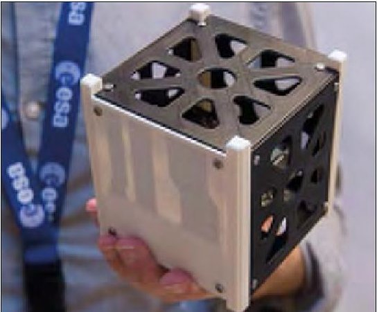

1 Example of a 1U CubeSat shell. There is a weight standard too - the finished launch unit must not exceed 1.33 kg. (ESA/G Porter)

entry-level costs mean that the true power of CubeSat-based nano- or small microsatellites lies in their operation as distributed systems, such as constellations or swarm formations.

within the frame of the ESA General Studies Programme on lunar and interplanetary CubeSat mission concepts.

These studies have involved either mother-daughter system architectures where the CubeSats are carried to a target

destination such as lunar orbit or to a near-Earth object (NEO) on a larger spacecraft and deployed at the target in order to fulfil their mission, or a completely stand-alone

system executing its own mission. The mother-daughter architecture alleviates the technical challenges of propulsion, long-range communication and deep-space environment survivability, because the host spacecraft provides resources and accommodation during the cruise, as well as communications to Earth ground stations, in conjunction with local inter-satellite links with the deployed CubeSats. For a stand-alone deep-space CubeSat (i.e. where there is no mothercraft), these challenges have to be tackled and suitable technology solutions identified and/or developed.

There are presently no dedicated small launchers that can cost-effectively inject nanospacecraft onto specific near-Earth

"The first interplanetary nanospacecraft mission was launched in May, to Mars"

escape or Earth escape trajectories. For the time being, piggyback flight opportunities must be found, either on a launcher upper stage carrying a primary spacecraft, or on the primary spacecraft itself as part of its mission. However, these opportunities are

rare, and the constraints on nanospacecraft deployment can significantly influence the $ \Delta v $ (velocity impulse) and transfer window needed to reach the final mission destination and hence the feasibility of such a mission. Table 1 shows our assessment of a range of missions that could be performed beyond Earth orbit for a given set of piggyback flight opportunities.

## Asteroid Impact Mission

Within the ESA General Studies Programme, the third edition of the Sysnova technical challenge focused on Cubesat Opportunity Payload of Intersatellite Networking Sensors (COPINS). The overall objective of the challenge was to investigate new mission concepts involving a number of CubeSats operating together in interplanetary space in support of the objectives of the proposed ESA Asteroid Impact

<!-- PDF_PAGE: 2 -->

1 Mission scenarios with respect to different piggyback flight opportunities

<table border="1"><tr><td>piggyback on</td><td>launcher</td><td>primary spacecraft</td><td>CubeSat deployment</td><td>CubeSat final destination</td><td>propulsion type</td><td>feasibility(≤12U)</td></tr><tr><td>spacecraft</td><td>PSLV/Ariane 6</td><td>Lunar Pathfinder</td><td>highly eccentric lunar orbit</td><td>low lunar orbit/Earth-Moon L2</td><td>chemical mono-propellant</td><td>yes</td></tr><tr><td>spacecraft</td><td>Soyuz/Ariane 6</td><td>HERA</td><td>Didymos binary NEO</td><td>Didymos binary NEO</td><td>cold gas</td><td>yes</td></tr><tr><td>launcher</td><td>Ariane 5</td><td>JUICE</td><td>Venus-bound trajectory</td><td>Venus high-altitude atmosphere swing-by</td><td>chemical mono-propellant</td><td>yes(4×3U CubeSat entry probes with microcarrier)</td></tr><tr><td>launcher</td><td>Soyuz/Ariane 6/Falcon 9/Atlas V</td><td>various telecom</td><td>geostationary transfer orbit</td><td>lunar orbit/NEO rendezvous</td><td>electric</td><td>no(excessive Δv, time and radiation dose)</td></tr><tr><td>launcher</td><td>Ariane 6</td><td>various astronomy</td><td>transfer to Sun-Earth L2</td><td>NEO rendezvous/Sun-Earth L5/heliocentric(&lt;1au)</td><td>electric</td><td>yes(use of L2 halo orbit for waiting until transfer to target)</td></tr><tr><td>launcher</td><td>Space Launch System</td><td>Orion</td><td>lunar transfer trajectory</td><td>lunar orbit/NEO rendezvous</td><td>electric</td><td>yes</td></tr><tr><td>launcher</td><td>Space Launch System</td><td>Orion</td><td>lunar transfer trajectory</td><td>lunar orbit/NEO rendezvous</td><td>chemical</td><td>no(excessive Δv)</td></tr><tr><td>launcher</td><td>Proton/Atlas V</td><td>ExoMars/Mars 2020</td><td>Mars transfer trajectory</td><td>Mars orbit</td><td>electric</td><td>yes(but excessive duration for spiral down)</td></tr><tr><td>launcher</td><td>Proton/Atlas V</td><td>ExoMars/Mars 2020</td><td>Mars transfer trajectory</td><td>Mars orbit</td><td>chemical</td><td>no(excessive Δv)</td></tr></table>

2 Illustration of the AIM spacecraft and deployed CubeSats at asteroid Didymos during the DART hypervelocity impact. (ESA)

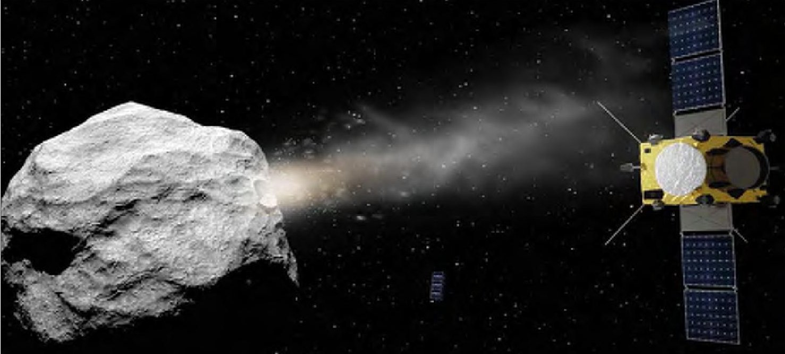

Mission (AIM). AIM had three different objectives relating to technology flight demonstration in interplanetary space investigation of NEO mitigation techniques and acquiring new scientific knowledge for understanding solar system evolution. The proposed COPINS payload consisted of two or more CubeSats carried on the main AIM spacecraft in their deployment systems (two 3U deployers), and released in the vicinity of the target asteroid Didymos, where the main AIM spacecraft acted as a communications data relay between the CubeSats and Earth ground stations (figure 2).

The ESA AIM mission (ESA AIM Team 2015) was proposed as part of the AIDA international cooperation, together with a US spacecraft, Double Asteroid Redirection Test (DART). DART is planned to impact

the smaller component of the Didymos binary asteroid (nicknamed Didymoon) at very high velocity; AIM was envisaged as a means to rendezvous with the target asteroid in advance, in April 2022, and characterize the binary system before, during and after the impact event. The launch of the AIM spacecraft was proposed for 2020 on the Soyuz/Fregat launcher from Kourou into a direct escape trajectory, with arrival at the asteroid after about 22 months. During the rendezvous phase, the distance to the Sun and Earth is close to 1 au and from 0.5 to 0.1 au respectively.

After an initial measurement phase, the AIM spacecraft would be manoeuvred to within 10km of the binary asteroid. Before DART's impact, the COPINS CubeSats (Walker et al. 2016) would be released and

the main spacecraft would then retreat to a distance of 100km, ready for the impact up to a month later. The CubeSats would perform their mission up until two months after the impact date, i.e. for three months in total, using a 1 Mbps S-band intersatellite link (ISL) with the main spacecraft's communications system (and each other) for telecommand, housekeeping and payload telemetry transfer. Five different CubeSat concepts were selected by ESA for parallel studies via an open competitive announcement of opportunity (AO) process, as described in table 2.

The AIM mission did not receive the required funding for implementation, but the objectives and concept remain valid. Therefore a new mission proposal called HERA has since been formulated based

<!-- PDF_PAGE: 3 -->

2 Overview of the five AIM COPINS CubeSat mission concepts

<table border="1"><tr><td>name</td><td>organization</td><td>system</td><td>mission</td><td>payload</td></tr><tr><td>ASPECT:Asteroid Spectral Imaging</td><td>VTT,Uni.Helsinki,Aalto Uni.</td><td>single 3U CubeSat with&lt;1° pointing,cold gas propulsion1mS-1Δv</td><td>spectral imaging of Didymoon before/after impact from4km orbit</td><td>imaging spectrometer inVIS/NIR:1-2mGSD;SWIR spectrometer</td></tr><tr><td>DustCube</td><td>Uni.Vigo,Uni.Bologna,MICOS</td><td>single 3U CubeSat withcold gas propulsion2mS-1Δv, optical IR rel. navigation</td><td>characterize ejected dust plume after impact from3-5km orbit, transfer toL4/L5 orbit pre-impact,DRO280m alt.post-impact</td><td>in situ nephelometer,remote nephelometer</td></tr><tr><td>CUBATA</td><td>GMV,Uni.La Sapienza,INTA</td><td>two 3U CubeSats withcold gas propulsionΔv1.5mS-1,&lt;1° pointing, optical rel. navigation</td><td>gravity field determination ofDidymos system before and after impact</td><td>radio science:Cube-Cube LoS Doppler tracking withS-band transponder and ultrastable oscillator</td></tr><tr><td>PALS:Payload of Advanced Little Satellites</td><td>Swedish Institute ofSpace Physics,KTH,DLR,IEEC,AAC Microtec</td><td>two 3U CubeSats withcold gas propulsion12.5mS-1Δv,&lt;1° pointing, optical rel. navigation</td><td>magnetization,bulk chemical composition,presence of volatiles,super-resolution surface imaging ofDidymos components impact ejecta via tour ofDidymos system</td><td>narrow angle camera,volatile composition analyser,fluxgate magnetometer,video emission spectrometer</td></tr><tr><td>AGEX:Asteroid Geophysical Explorer</td><td>ROB,ISAE Supaero,Emxys,Antwerp Space</td><td>two 3U CubeSats:one lander,one orbiter</td><td>determination of dynamical state,geophysical surface properties,subsurface structure ofDidymoon before/after impact</td><td>lander:three-axis seismometer,accelerometers,three-axis gravimeter;orbiter:30 chipsats deployed to surface</td></tr></table>

3 Illustration of the Surrey Satellite Technology Ltd/ Goonhilly Earth Station Lunar Pathfinder and deployed lunar CubeSats. (SSTL)

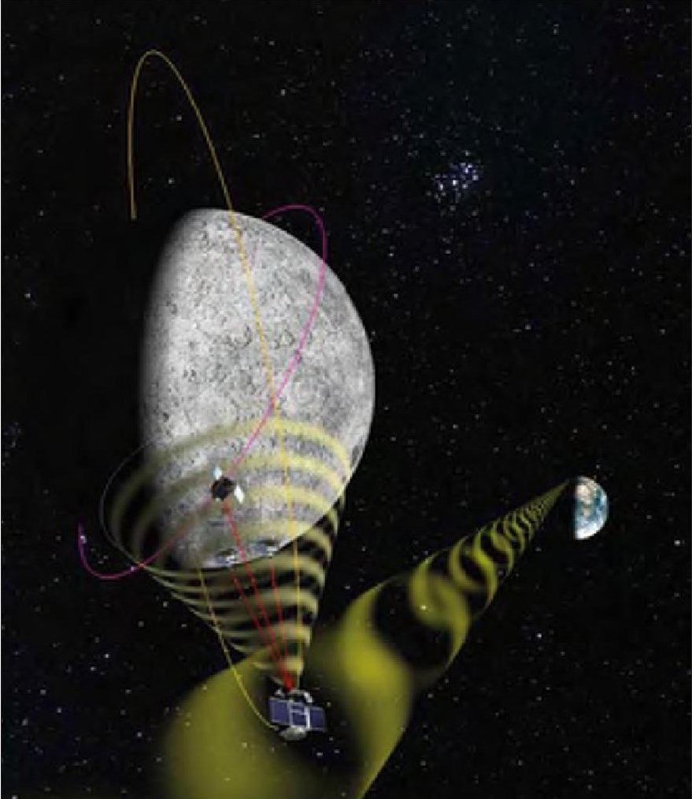

on a consolidation of the extensive technical work performed for AIM, focused on the asteroid deflection objectives. This has led to a change in the CubeSat payload to a single 6U CubeSat with a payload to be refined during 2018. During the COPINS studies, a number of key technologies have been identified that would require development, including short-range S-band ISLs with ranging (1 Mbps, 1 m accuracy)

and time synchronization, a low-velocity （<5cm s $ ^{-1} $ $ \pm 20\% $ ）CubeSat deployer with power/data interfaces, and optical relative navigation techniques such as centre of brightness determination.

## LUnar CubeSats for Exploration

Within the ESA General Studies Programme, the fourth edition of the Sysnova technical challenge focused on "LUnar

CubeSats for Exploration (LUCE)". The overall rationale for the challenge is to prepare European teams for flight opportunities to the Moon that may arise, while addressing and supporting ESA's lunar exploration objectives. The activity was run through an open competitive AO process. Proposals responding to the AO were able to address one or more themes in their mission concepts and were required to comply with a common set of mission and system constraints. Single spacecraft as well as multiple distributed spacecraft were permitted, provided they complied with the constraints. It was assumed that a larger lunar orbiter spacecraft would provide transportation for up to 60kg of CubeSat payload (a maximum of 12U per spacecraft) to a >500km circular, >50° inclination lunar orbit, and data relay services to/from Earth ground stations via a predefined ISL operating at UHF frequencies with Proximity-1 protocol, providing maximum data rate of 512kbps with one hour per day link availability over one year. The SSTL/GES Lunar Pathfinder (Saunders et al. 2016) mission (see figure 3), proposed to be undertaken in partnership with ESA, is aimed at providing these capabilities for lunar CubeSats as a commercial service, and is planned for launch in the 2023 timeframe. Hence, the associated propulsion and communications challenges were alleviated for the deployed CubeSats.

More than 30 innovative CubeSat mission concept proposals were submitted to the AO, covering a diverse range of operations concepts, platform designs and instruments, demonstrating a significant

<!-- PDF_PAGE: 4 -->

3 Overview of LUCE mission concept studies

<table border="1"><tr><td>name</td><td>organization</td><td>system</td><td>mission</td><td>payload</td></tr><tr><td>LUMIO:Lunar Meteoroid Impact Observer</td><td>Politecnico Di Milano,TU Delft,EPFL,S[&amp;]TNorway,Leonardo S.p.A,Uni.Arizona</td><td>single 12U CubeSat with chemical propulsion for L2 transfer, lunar disc optical navigation</td><td>meteoroid impact flash monitoring of the far side from an Earth-Moon L2 halo orbit</td><td>optical camera with3.4km/pixel spatial resolution,3Hz frame rate,FOV3.5°</td></tr><tr><td>MoonCARE:Moon CubeSat for the Analysis of the Radiation Environment</td><td>Von Karman Institute,DLR,Tyvak International,Politecnico di Torino</td><td>three 12U CubeSats with chemical propulsion for orbit transfer</td><td>lunar radiation environment characterization,study radiation effects on specific microorganisms</td><td>radiation detector(0.06-200MeV),astrobiology experiment(VIS/UV spectrometer,four microorganisms)</td></tr><tr><td>CLE:CubeSat Low frequency Explorer</td><td>ISIS bv,ASTRON,Radboud Uni.Nijmegen,Uni.Twente,TU Delft</td><td>three 12U CubeSats with inter-satellite link for ranging/time synchronization/data transfer for interferometry,propulsion for loose formation flying</td><td>technology demonstrator for distributed low-frequency radio interferometric telescopes in lunar orbit,operated in radio quiet zone around far side</td><td>&lt;30MHz software-defined radio receiver,three deployable monopole antennae per spacecraft</td></tr><tr><td>VMMO:Lunar Volatile and Mineralogy Mapping Orbiter</td><td>MPB Communications,Uni.Surrey,Lens R&amp;D,Uni.Winnipeg</td><td>single 12U CubeSat with electric propulsion for transfer to very low lunar orbit</td><td>content of water ice deposits in permanently shadowed craters at south pole,other volatiles(e.g. ilmenite) on the day side,lunar radiation environment</td><td>active fibre laser at 1560and 530nm with 10m spot size,VIS/NIR spectrometer,radiation environment sensor</td></tr></table>

4 Deep-space CubeSat configuration and key technologies. (ESA)

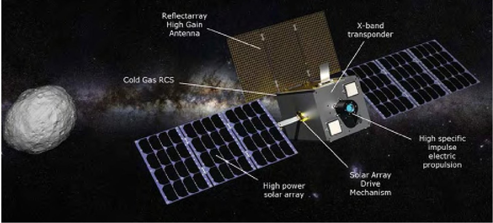

interest in lunar CubeSats. As a result, four mission concepts (Walker et al. 2017a and summarized in table 3) were awarded parallel six-month study contracts.

Based on an evaluation of the parallel study results, an ESA panel selected the

LUMIO and VMMO mission concepts as joint winners of the Sysnova challenge. The winners received a prize consisting of a further study on their concept in the ESA

Concurrent Design Facility (CDF) supported by an ESA engineering team.

The main refinements made were on the mission design to ensure compatibility with feasible injection from Lunar Pathfinder, the resulting propulsion subsystem selection (chemical propulsion >200 m s $ ^{-1} $ for both), increase in power, and increase of the baffle length for the optical payload (both LUMIO and VMMO) for improved stray

light rejection. Additionally, a near-infrared (NIR) channel was added to the LUMIO payload for improved detection of impact flashes and determination of impact energy.

"Four mission concepts were awarded parallel six-month study contracts"

The CDF studies identified several key technologies for lunar CubeSats operating

in mother-daughter system architectures. These include chemical propulsion with a $ \Delta v $ capability of $ > 2 0 0 \mathrm{m s}^{-1} $ in order to either transfer from the injection orbit provided

by, e.g. Lunar Pathfinder, to final operation orbit (LUMIO) or maintain the orbit to ensure perilune at low altitude over the south pole region (VMMO). Additionally, long-range (4000-8000km) UHF or S-band ISLs with the mothercraft are required for communication back to Earth. For navigation, there are different options depending on the accuracy requirements including: ISL with ranging/Doppler, optical relative

navigation (e.g. full lunar disc at high altitude, or feature tracking at low altitude), X-band transponder with ranging directly from/to Earth ground stations, or GNSS receiver with medium gain antenna.

## M-ARGO

For deep-space missions, assuming a piggyback launch opportunity to near-Earth escape as a starting point, truly standalone nanospacecraft- those with no larger mothercraft- have to be independently capable of reaching their target destination using on-board propulsion with several km s $ ^{-1} $ of $ \Delta v $ , and communicating directly back to Earth over distances of up to 1-2 au. A deep-space CubeSat system called M-ARGO (Miniaturised Asteroid Remote Geophysical Observer; Walker et al. 2017b) has been designed, using the requirements for a near-Earth object (NEO) rendezvous reference mission as a design driver.

<!-- PDF_PAGE: 5 -->

A bottom-up approach was used to investigate how much propulsive $ \Delta v $ could be achieved within a 12U CubeSat, while still accommodating a science payload of 1-2U and downlinking the science data back to Earth at a reasonable data rate when the spacecraft is operating in close proximity to the NEO. Figure 4 shows the spacecraft design and key enabling technologies, and the design specifications are provided in table 4. Achieving very high $ \Delta v $ requires electric propulsion. Because the duration of the interplanetary transfer phase using an electric propulsion system is proportional to the spacecraft thrust-to-mass ratio, a great deal of effort was made to maximize the thrust within the mass constraints while achieving a high specific impulse $ ( I_{\mathrm{sp}}) $ to minimize propellant storage mass. This involved: maximizing power generation; selecting an available propulsion technology with a moderate power-to-thrust ratio for high $ I_{\mathrm{sp}} $ ; and minimizing electrical losses from sunbeam to ion beam. This trade-off and optimization process led to the engine model shown in figure 5 for two different solar array configurations (six-panel or eight-panel array with extra body-mounted panel) for the selected miniaturized gridded ion engine.

This engine model was used as a key input to the low-thrust trajectory optimization during the analysis of specific mission scenarios. For direct-to-Earth communications, the downlink performance in figure 6 was investigated for different antenna diameters of the ESTRACK deep-space ground station network (15 and 35 m), as well as the Sardinia Radio Telescope (64 m), and for different RF transmit power levels (5 and 15 W) as a function of spacecraft- Earth distance. With 15W radio frequency power, it is possible to achieve rates of 25 kbps and 7 kbps for the 64 m and 35 m antennas respectively at 1 au from Earth. Initial thermal analysis suggests that the heat dissipation from the electric propulsion could be marginally sustained with a passive thermal control using a large area of the spacecraft body as radiator panels.

Apart from the electric propulsion and X-band communications system, other key enabling technologies identified during the study include a cold gas reaction control system for detumbling/wheel offloading, and a solar array drive mechanism to maximize power generation. With the system design presented in this section, a number of different mission scenarios for standalone distributed nanospacecraft systems were investigated.

## The near-Earth object population

4 Overview of M-ARGO deep-space CubeSat design

While quite a number of asteroids have been visited by spacecraft, so far only four are NEO: (433) Eros, (25143) Itokawa, (4179)

<table border="1"><tr><td>attribute</td><td colspan="2">specification</td></tr><tr><td>volume</td><td colspan="2">12U form factor(226x226x340mm)</td></tr><tr><td>propulsion</td><td colspan="2">mini-RIT gridded ion engine,gimbal,PPU,neutralizer,two Xenon propellant tanks and feed system(max.2.8kg)</td></tr><tr><td>communications</td><td colspan="2">X-band deep space transponder with ranging/Doppler(two receive,three transmit channels),four patch antennas for omni-directional TT&amp;C,deployable high gain antenna reflect-array for payload data</td></tr><tr><td>power</td><td colspan="2">single body-mounted panel(6U face)+Li-ion batterytwo-wing deployable solar array with drive mechanism</td></tr><tr><td>power to EP at1au</td><td>93W(six panels)</td><td>120W(eight panels)</td></tr><tr><td>thrust at1au</td><td>1.7mN</td><td>2.4mN</td></tr><tr><td>Ispat1au</td><td>3050s</td><td>3180s</td></tr><tr><td>Δv(low thrust)</td><td colspan="2">~3750km/s-1</td></tr><tr><td>wet mass(w/margins)</td><td>21.6kg</td><td>22.3kg</td></tr><tr><td>altitude and orbitcontrol system</td><td colspan="2">sensors:visnav camera,star tracker,six Sun sensors,IMU actuators:three reaction wheels,eight Xe cold gas RCS thrusters</td></tr><tr><td>data handling</td><td colspan="2">modular avionics with payload data processing</td></tr><tr><td>thermal control</td><td colspan="2">passive with radiator panels and heaters</td></tr></table>

Key: RIT = radio frequency ion thruster. PPU = power processing unit. TT&C = telemetry, tracking and command. EP = electric propulsion. IMU = inertial measurement unit. RCS = reaction control system.

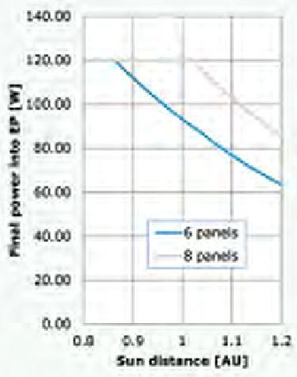

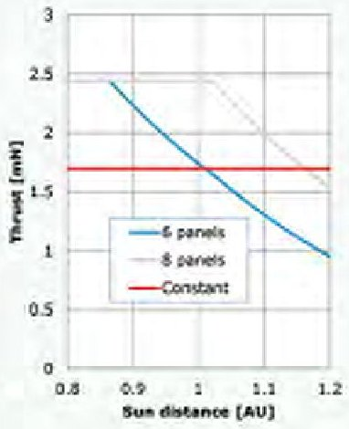

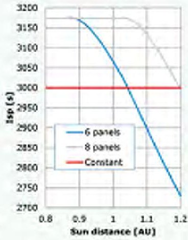

5 Sunbeam to ion beam optimization for the M-ARGO CubeSat using gridded ion engine.

Toutatis and (162173) Ryugu, all up to a kilometre in diameter. Almost no objects larger than about 100m in diameter rotate faster than a period of a few hours. It is assumed that this is because the centrifugal force arising from the rotation is larger than the tensile strength of the object. Some models suggest that the larger objects are typically built up from small "monolithic" objects, which can have larger spin rates. It can be expected that these smaller objects do not have regolith on their surface and are more homogenous than larger asteroids. Just confirming the absence of regolith on a smaller asteroid would contribute to refining formation models of asteroids. With a NIR spectral imager one could check the mineralogical composition of the object and determine its level of homogeneity. Tracking the spacecraft with high accuracy using radio science during very close fly-bys, the mission can constrain the internal structure of the object, again showing whether it is monolithic or not.

The M-ARGO spacecraft design would give a unique opportunity to rendezvous with one of these small asteroids. A fleet of M-ARGO nanospacecraft deployed from the same piggyback launch opportunity (each targeting a different NEO), could achieve a wide survey of near Earth asteroids very cost-effectively. This would reveal any fundamental differences between these small objects and the previously visited larger asteroids, as well as potentially the compositional diversity among different types of asteroid. Additionally, with commercial interest in space resource exploitation emerging, conducting a wide survey of the closest asteroids to Earth (in $ \Delta v $ terms) would be the first exploratory step to identifying resources in situ for later extraction. Apart from minerals, precious metals would be of high interest, and therefore the addition of a magnetometer to measure magnetic field of the asteroid would be relevant.

A payload assessment was carried out

<!-- PDF_PAGE: 6 -->

5 Summary of payload instrument options for NEO rendezvous missions

<table border="1"><tr><td>name</td><td>details</td><td>mass(kg)</td><td>volume(U)</td><td>maturity</td></tr><tr><td>VIS/IR spectral imager</td><td>VIS(500-900nm),NIR(900-1600nm),SWIR(1600-2500nm)</td><td>1</td><td>1</td><td>Aalto-1(2017),PICASSO(2019),ASPECT</td></tr><tr><td>RSE</td><td>X-band transponder with Doppler tracking</td><td>0</td><td>0</td><td>part of comms subsystem development</td></tr><tr><td>laser altimeter</td><td>1.5km range(10% albedo),0.5-1mm accuracy</td><td>0.033</td><td>0.04</td><td>DLEM20(Jenoptik)to be space qualified</td></tr><tr><td>magnetometer</td><td>&lt;2nT sensitivity, deployed on1m boom</td><td>0.2</td><td>0.2</td><td>MAGIC onCINEMA(2012),RadCube(2019)</td></tr><tr><td>low-frequency radar</td><td>20MHzwith7.5m dipole antenna for interior studies</td><td>1</td><td>1</td><td>DISCUS(MPI)to be developed</td></tr><tr><td>thermal IR imager</td><td>10-14μm(TIR)</td><td>1.5</td><td>1.5</td><td>some adaptation</td></tr><tr><td>thermal IR imager</td><td>2-25μm(IR)</td><td>1</td><td>1.5</td><td>MIMA development forExoMars</td></tr></table>

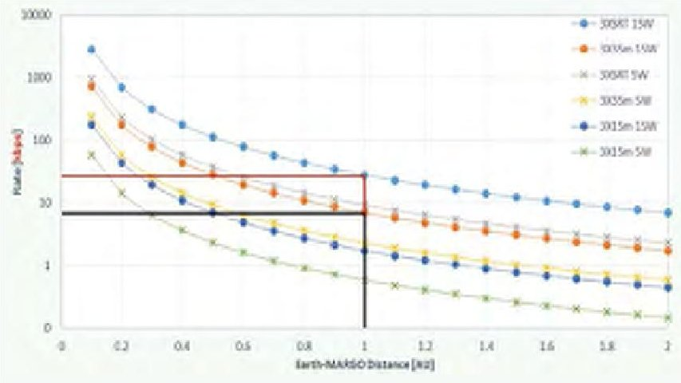

6 Communication downlink data rates as a function of radio frequency power and Earth station antenna.

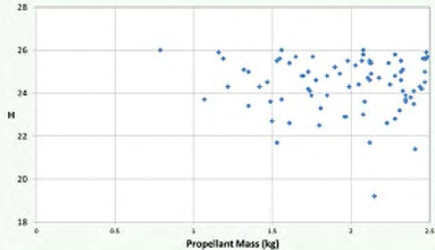

7 Results from the NEO target screening process (visual magnitude vs propellant mass).

to better understand the availability and capabilities of existing or projected miniaturized payloads that can fulfil the science objectives of NEO physical characterization. The results are presented in table 5. The spacecraft design can only accommodate up to 2kg and 1.5U of payload, so the baseline design includes all options with exception of the low-frequency radar and thermal infrared instruments. If these

can be further miniaturized, or later on the payload resources become available, then it would be possible to accommodate them.

"Several potential piggyback launch opportunities in the 2020s have been identified"

It is assumed that the M-ARGO fleet is released after the main payload on a Sun-Earth L2 transfer trajectory and, after reaching the L2 region, they are inserted into a L2 halo orbit where they wait for their optimum low-thrust transfer window to their specific target. A number of potential piggyback launch opportunities in the 2020s timeframe have been identified related to launch of medium/large-class astronomy missions to L2.

In order to identify the possible NEOs accessible by the M-ARGO fleet, a complete NEO target screening process (Mereta & Izzo 2018) was performed within the mission/system design constraints presented above, considering a launch in the 2020-23 period, starting with an L2 parking orbit

and transfer duration less than three years. The complete MPCORB database of more than 700000 objects was taken as a starting point, and a three-impulse chemical approximation used as a pre-filter. This resulted in 143 objects $ \Delta v<3.9\mathrm{km s}^{-1} $ , more

than 40 observations, magnitude H<26). Ephemerides of these objects were input into a global low-thrust trajectory optimization tool in order to calculate rendezvous trajectories for each target, optimizing for minimum propellant mass within the launch window and transfer duration constraints. This step resulted in 83 different targets using a propellant mass of less than 2.5kg (the maximum capacity for xenon propellant). The distribution of these accessible NEO targets over visual magnitude (hence size) and propellant mass is given in figure 7. Most targets are within visual magnitude range 22-26 (i.e. 15-250m diameter depending on albedo).

Low-thrust trajectories for a few targets were then further refined using a low-thrust trajectory local optimization tool with numerical integration. A six-month phase for science is assumed and, in order to minimize the science operations cost, the close proximity operations at the NEO target have been designed to follow a two-week repeat pattern with mission

operations centre tasks performed in normal working hours. The two-week pattern is enabled by flying an M-ARGO CubeSat in a square trajectory relative to the NEO target on its sunward side; small manoeuvres with the electric propulsion system are executed offline at the corners. Between manoeuvres, the spacecraft flies on passively safe hyperbolic arcs. Close approach points for multispectral imager and laser altimeter science observations are centred mid-way through the coast arcs, with navigation and radio science performed in between manoeuvres and close approach points. The navigation scheme includes ground-based navigation (as for Rosetta) used as the basis for manoeuvre command generation together with on-board optical navigation (based on centroiding image processing algorithm and unscented Kalman filter) used to improve pointing and for collision risk assessment.

The distance to Earth during the science phase and the communication link performance shown in figure 6 has been used to determine the total payload data volume that can be transmitted to Earth as a function of ground station utilization time per week. This is shown in figure 8 for object 2012 UV136 (0.71 au from Earth), as well as the other studied targets (2013 BS45 at 1 au, 2016 FU12 at 0.75 au, and 2011 MD at 0.39 au from Earth).

<!-- PDF_PAGE: 7 -->

6 Payload instrument options for space weather heliocentric missions

<table border="1"><tr><td>name</td><td>details</td><td>mass(kg)</td><td>volume(U)</td><td>maturity</td></tr><tr><td>radiation telescope</td><td>electron energy0.3-8MeV,proton energy3.1-500MeV,heavy ions50-1000MeV/n</td><td>0.8</td><td>0.8</td><td>RadTel on RadCube(2019)</td></tr><tr><td>magnetometer</td><td>&lt;2nT sensitivity, deployed on1m boom</td><td>0.2</td><td>0.2</td><td>MAGIC on CINEMA(2012),RadCube(2019)</td></tr><tr><td>solar X-ray flux monitor</td><td>energy range1.5-25keV,energy channels10+,flux accuracy1%</td><td>0.5</td><td>1</td><td>XFM-CS under development, demo in2020</td></tr></table>

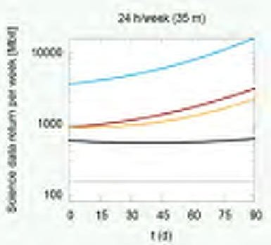

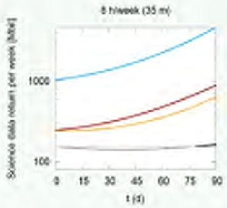

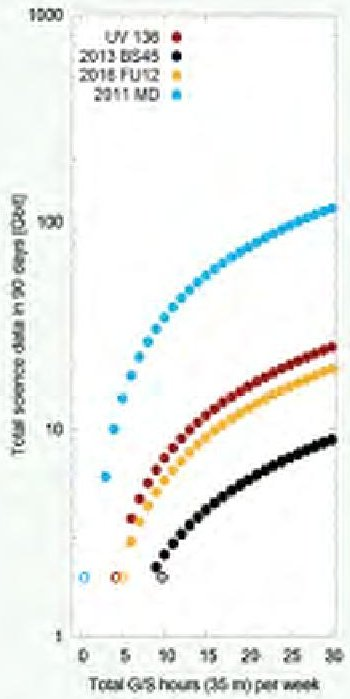

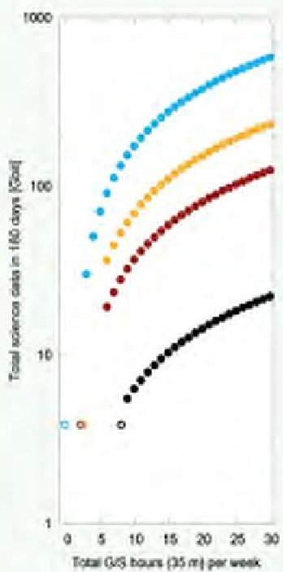

8 Science data return for close proximity operations at 2012 UV136 and other objects.

## Space weather measurements

Space weather and its effects on Earthorbiting satellites and terrestrial infrastructure is driven by particle radiation from the Sun, emanating from solar flare events. Continuous in situ monitoring of the

energetic particle flux, interplanetary magnetic field, and other space weather parameters such as the solar X-ray flux emission at locations other than the Earth, would

dramatically increase our understanding of these processes, even with only rather limited measurement capabilities. A location at Sun-Earth L5 would provide a few hours warning of major storm events. Ideally, a constellation of spacecraft in a circular heliocentric orbit inside that of the Earth would allow us to gain a complete simultaneous picture of solar activity as a function

"Such a spacecraft may reduce the cost of interplanetary missions by an order of magnitude"

of solar longitude, potentially leading to new knowledge on solar-terrestrial physics and even more advance warning of storms.

A payload assessment was carried out in order to identify existing or projected miniaturized payloads that can fulfil the

objectives of space weather monitoring. The results are presented in table 6. All of the payloads can be accommodated in the M-ARGO platform design, replacing

the NEO payload suite.

As with the NEO rendezvous mission scenario, it is assumed that a fleet of nanospacecraft like M-ARGO, equipped with the space weather payload suite are injected onto a Sun-Earth L2 transfer trajectory from a piggyback launch opportunity. From there, the spacecraft are manoeuvred to an L2 parking orbit. One

of the spacecraft then performs a transfer from L2 to L5, while the others perform a spiral-in transfer to a circular heliocentric orbit with a semi-major axis of <1 au, one after the other in order to achieve an equal distribution of spacecraft around the orbit.

The transfer from Sun-Earth L2 to L5 has been optimized in a low-thrust trajectory local optimization tool with numerical integration. The transfer takes around 20 months and consumes 1.7kg of Xe with 342 days of total thruster firing （ $ \Delta v $ of 2.6km s $ ^{-1} $ ）. For the other spacecraft in the fleet, each with 2.5kg of Xe propellant, the lowest semi-major axis that could be achieved for a circular heliocentric orbit (with no plane change) is 0.8au (orbital period 0.72 years) for departure from Sun-Earth L2, and 0.75au (orbital period 0.66 years) for departure from Sun-Earth L1. The transfer takes around 440 days and 395 days respectively. For a fleet of 10 M-ARGO-like spacecraft equally spaced around the final orbit, each spacecraft would need to depart from L2 around 94 days apart, or from L1 approximately 70 days apart, based on the synodic period with respect to Earth.

## Conclusions

Several opportunities exist to embark CubeSats on larger spacecraft to lunar orbit and to a specific NEO, where they can be deployed locally for deep investigation in a mother-daughter system architecture. Numerous feasible mission concepts have been studied for this approach. A standalone deep-space 12U CubeSat nanospacecraft has been designed to be capable of rendezvous and characterization of NEOs or space weather measurements at the Sun-Earth L5 Lagrange point (or other locations inside Earth orbit). Based on exploiting piggyback launch opportunities to near-Earth escape, such a spacecraft is expected to reduce the entry-level cost of deep space missions by an order of magnitude, thus enabling stand-alone distributed systems in deep space with a fleet of nanospacecraft. New missions, such as a cost-effective wide survey of the NEO population for science/resource identification and simultaneous multi-point in situ space weather measurements, would be feasible for the first time, allowing hitchhiking nanospacecraft to write a new chapter in the guide to the solar system.

## AUTHORS

Roger Walker, David Binns, Cristina Bramanti, Massimo Casasco, Paolo Concari, Dario Izzo, Davar Feili, Pablo Fernandez, Jesus Gil Fernandez, Philipp Hager, Detlef Koschny, Vasco Pesquita, Neil Wallace, European Space Agency, ESTEC, Noordwijk, The Netherlands. lan Carnelli, ESA HQ, Paris, France. Michael Khan, Mehdi Scoubeau, Daniela Taubert, ESA, ESOC, Darmstadt, Germany.

REFERENCES ESA's AIM Team 2015 Aiming for asteroids ESA Bulletin no.164

Klesh A & Krajewski J 2018 MarCO: Mars Cube One - lessons learned from readying the first interplanetary CubeSats for flight, 49th LPSC, paper 2923

Mereta A & Izzo D 2018 Target selection for a small low-thrust mission to near-Earth asteroids Astrodynamics 2(3) 249

Saunders C et al. 2016 Solving communications and navigation requirements for small lunar missions, 5th Interplanetary CubeSat Workshop SpaceWorks 2018 Nano/Microsatellite Market Forecast 8th edition