<!-- PDF_PAGE: 1 -->

# The Design, Assembly, and Testing of Magnetorquers for a 1U CubeSat Mission

AE 8900 MS Special Problems Report Space Systems Design Lab (SSDL) Guggenheim School of Aerospace Engineering Georgia Institute of Technology

Author: John Amin

Advisor Dr. E. Glenn Lightsey

December 12,2019

<!-- PDF_PAGE: 2 -->

# The Design, Assembly, and Testing of Magnetorquers for a 1U CubeSat Mission

John Amin $ ^{*} $ and E. Glenn Lightsey $ ^{+} $ Georgia Institute of Technology, Atlanta, GA, 30332

Over the next few years Georgia Tech's Space System Design Lab (SSDL) will design and develop several 1U CubeSat missions starting with GT-1. These missions will include an Attitude Determination and Control Systems (ADCS) utilizing torque rods to control detumble and orbital attitude. This paper describes the design and construction and testing of GT-1's torque rods and will serve as a resource to help guide future torque rod iterations. The first section details the equations and mathematics behind torque rods. Next, the design section considers factors influencing the magnetic dipole moment including core material, part length, and radius. It then describes the manufacturing and assembly process of torque rods involving core shaping and layer winding. It then describes the test setup to test the torque rod's magnetic dipole moment and later indicates topics of future work.

## Nomenclature

T : Torque [N m]

$ \overrightarrow{M}_{dipole} $ : Magnetic dipole moment $ [\mathrm{A m}^{2}] $

B : Magnetic flux density [T]

N : Number of current loops [unitless]

1 : Current [A]

A : Area of current loop $ [\mathrm{m}^{2}] $

M : Magnetization of torque rod core [A/m]

V : Volume of torque rod core $ [\mathrm{m}^{3}] $

L : Length of torque rod core [m]

r : Radius or torque rod core [m]

H : Magnetic field intensity [A/m]

$ \mu_{0} $ : Magnetic permeability of a vacuum $ [\mathrm{N / A^{2}}] $

$ \mu_{\mathrm{r}} $ : Relative magnetic permeability of material [unitless]

$ \mathrm{N_{d}} $ : Demagnetization factor [unitless]

$ L_{\mathrm{W i r e}} $ : Total length of wire [m]

$ R_{\mathrm{Wire}} $ : Total resistance of wire $ [\Omega] $

$ W_{\mathrm{res}} $ : Wire resistance per unit length $ [\Omega /\mathrm{m}] $

$ V_{\mathrm{bus}} $ : Voltage of satellite bus [V]

$ R_{x} $ : Distance from torque rod center to magnetometer [m]

<!-- PDF_PAGE: 3 -->

## I. Introduction

A CubeSat is a miniaturized version of a satellite that is composed of cube units (U) of 10 cm by 10 cm by 10 cm. Georgia Tech is developing several 1U CubeSats, the first of which is called GT-1. Its mission is to serve as a platform for university students to learn to design and develop a 1U CubeSat bus capable of being reused in subsequent missions. A key system in this bus is the Attitude Determination and Control System (ADCS). The ADCS is responsible for determining and controlling a satellite's orientation in orbit. One of its first requirements is to reduce the rotation imparted by the CubeSat's deployer into a more stable motion, a pointing operation often referred to as detumble. This detumbling process can be managed either passively or actively. Passive control mechanisms are simple, often requiring no moving parts or power. For example, a passive control system could use permanent magnets or hysteresis rods to magnetically control orientation. This has several major drawbacks such as a limited attitude pointing accuracy of about +/- 10 degrees about Earth's magnetic field, constraining all other pointing requirements for power, communications and other sensors $ ^{[1]} $ . Another approach uses active control mechanisms like reaction wheels or magnetorquers to control the spacecraft's attitude and orientation. While somewhat more complicated, these systems allow the satellite to be more precisely controlled. GT-1's planned ADCS will utilize an active control system using magnetorquers, also called torque rods, to manage detumble and some pointing requirements. This paper will lay out the design, assembly and testing of these torque rods.

## II. Background

Magnetorquers or magnetic torquers are a very common actuator typically used in Low Earth Orbit (LEO). While there are a variety different magnetorquer designs and configurations, the general control mechanism remains the same: The magnetorquer generates a magnetic dipole moment which interacts with Earth's magnetic field producing a magnetic torque on the spacecraft. This relationship is defined by simple equation 1.

$$
\vec {T} = \vec {M} _ {d i p o l e} \times \vec {B}
$$

Where $ \vec{T} $ is the output torque in N-m, $ \vec{M} $ is the magnetic dipole moment in $ A-m^{2} $ generated by the magnetorquer and $ \vec{B} $ is the magnetic flux density of the Earth in Tesla. In effect, we are utilizing Earth's natural magnetic field to control our satellite, and thus when the magnetic field is stronger, so is the generated torque. For example, magnetorquers are more effective in LEO, and less effective in geostationary earth orbit (GEO). Therefore, a magnetorquer's magnetic dipole moment should be designed in consideration of the desired torque at a given orbital altitude. This magnetic dipole moment is typically generated by current loops defined by equation 2.

$$
\overrightarrow {M} _ {d i p o l e} = N I A
$$

Where N is the number of current loops, I is the current flowing through the loop in Amps and A is the area of the loop in $ m^{2} $ . The magnetic dipole moment will be generated normal to the planar area with direction based on the right-hand rule. This would be considered an open or free air torquer coil, since in this scenario the coils are not wrapped around a metal core. While a magnetic dipole moment is generated, the value could be amplified greatly by introducing a "soft" magnetic or an easily magnetizable core to the coils. These magnetically permeable cores help to dampen oscillations in orbit as the magnetic field changes, effectively functioning as hysteresis rods $ ^{[2]} $ . Thus, the selection of a magnetic core is of critical importance.

There are several key factors in core selection for magnetorquers. The first parameter is the material's magnetic relative permeability. This is the ratio between a material's magnetic permeability $ (\mu) $ and the magnetic permeability of free space $ (\mu_{0}) $ . The higher the magnetic relative permeability, the greater the magnetization of the core and thus, the higher the magnetic dipole moment. Another key factor is a material's ability to saturate at relatively low magnetic field intensities. This is useful to control algorithms when the magnetic dipole needs to change directions quickly. This saturation can be investigated by considering a material's B-H magnetization curve seen in Figure 1. Other important factors are the material strength, density, cost, availability, and ease of machinability. The core material used most frequently in magnetorquers is typically a ferromagnetic alloy. In this

<!-- PDF_PAGE: 4 -->

case, two different grades of stainless steel were examined: Stainless Steel 420 and Stainless Steel 430FR. The material properties of these metals will be discussed in detail later.

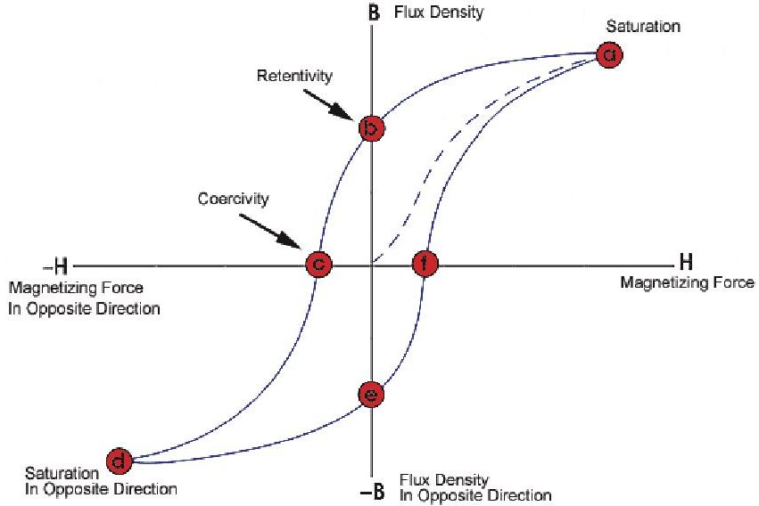

Figure 1: B-H Hysteresis Curve $ ^{[3]} $

We can next create an equation that represents the magnetic dipole moment of a solenoid, or free air coils with the addition of a ferritic solid core. To do this we can sum the dipole moments created by the solenoid's current loops and the magnetization of the volume of the ferritic core with equations 3 and 4.

$$
\overrightarrow {M} _ {d i p o l e} = N I A + M V
$$

$$
\overrightarrow {M} _ {d i p o l e} = \pi r ^ {2} (N I + L M)
$$

Here we have N, I and A as before representing number of coils, current and loop area. In addition to this term we have the core magnetization term made up of volume V and Magnetization factor M. By assuming the torque rod is a cylinder, we can get the loop area as $ \pi r^{2} $ and the core volume as $ \pi r^{2} L $ where r is the radius and L is the length of the core.

Next is the Magnetization term, M which is a bit tricky. This term is not typically listed as a parameter for a material, but instead can be calculated from the magnetic flux density B as well as the magnetic field intensity H. The relationship between B, H and M is normally seen in equation 5 solving for magnetic flux density B. From there we can rearrange for M as with equation 6.

$$
B = \mu_ {0} (H + M)
$$

$$
M = \frac {B}{\mu_ {0}} - H
$$

As previously stated, M is given in terms of B and H. In addition, there is the constant $ \mu_{0} $ , which is the permeability of a vacuum which has the value of $ 4\pi \times10^{-7} \mathrm{~N/A}^{2}. $

The next step is to determine the values for H and B. We can define a simple relationship for H making two assumptions of the core material. It must have a negligible coercive force and a large region on linearity in its hysteresis curve $ ^{[2]][4]} $ . By applying these idealizations, we can define H as:

$$
H = \frac {B}{\mu_ {0} \mu_ {r}}
$$

Finally, we need to define the magnetic flux density B. Mehrjardi $ ^{[2]} $ was able to derive an equation for B a torque rod in his paper based on several terms. The result was equation 8.

<!-- PDF_PAGE: 5 -->

$$
B = \frac {\mu_ {0} N I}{L \left(\frac {1 - N _ {d}}{\mu_ {r}} + N _ {d}\right)}
$$

This term contains some new values. There is $ \mu_{r} $ which is magnetic permeability. There is also $ N_{d} $ which is the demagnetization factor. Mehrjardi $ ^{[2]} $ defined this value asb:

$$
N _ {a} = \frac {4 \left[ \ln \left(\frac {L}{r}\right) - 1 \right]}{\left(\frac {L}{r}\right) ^ {2} - 4 \ln \left(\frac {L}{r}\right)}
$$

This demagnetization factor is only based on the shape of the torque rod where L refers to the length and r refers to its core radius. By taking these definitions for B and H, we can define M as:

$$
M = \frac {B \left(\mu_ {r} - 1\right)}{\mu_ {0} \mu_ {r}}
$$

$$
M = \frac {N I \left(\mu_ {r} - 1\right)}{L \left(1 + N _ {d} \left(\mu_ {r} - 1\right)\right)}
$$

We can substitute M into the original expression for dipole moment and simplify to get the expression:

$$
\vec {M} _ {d i p o l e} = \pi r ^ {2} N I \left(1 + \frac {\mu_ {r} - 1}{1 + \left(\mu_ {r} - 1\right) N _ {d}}\right)
$$

We can see this equation only relies on number of loops N, current I, magnetic permeability $ \mu_{r} $ , and the length L and radius r of the torque rod core. We can then convert the number of loops into the resistance of the wire divided by resistance per unit length, or Wire resistivity.

$$
L _ {w i r e} = \frac {R _ {w i r e}}{W _ {r e s}}
$$

$$
N = \frac {L _ {w i r e}}{2 \pi r} = \frac {R _ {w i r e}}{2 \pi r W _ {r e s}}
$$

Next current I is converted by Ohm's law for bus voltage and wire resistance for N loops to give us:

$$
\vec {M} _ {d i p o l e} = \pi r ^ {2} \frac {R _ {w i r e}}{2 \pi r W _ {r e s}} \frac {V _ {b u s}}{R _ {w i r e}} \left(1 + \frac {\mu_ {r} - 1}{1 + \left(\mu_ {r} - 1\right) N _ {d}}\right)
$$

A final simplification gives the fundamental equation used in torque rod design:

$$
\overrightarrow {M} _ {d i p o l e} = \left(\frac {r V _ {b u s}}{2 W _ {r e s}}\right) \left(1 + \frac {\mu_ {r} - 1}{1 + \left(\mu_ {r} - 1\right) N _ {d}}\right)
$$

Thus, this equation developed in Mehrjardi $ ^{[3]} $ takes an input voltage $ V_{bus} $ , the resistance per length of the wire $ W_{res} $ magnetic relative permeability $ \mu_{r} $ , and demagnetization factor $ N_{d} $ , which is dependent on the length and radius of the core. This equation will serve as a guide in the design process.

<!-- PDF_PAGE: 6 -->

## III. Design

The design of the torque rod was constrained by several factors. First, there was the dipole moment requirement. An analysis from the control estimation group showed that a minimum dipole moment of 0.1 A-m $ ^{2} $ was needed to meet the actuation requirements. Second is a length constraint. Since the torque rod will be housed inside a 1U CubeSat with all the other satellite equipment, space is severely limited. A maximum length of 50 mm was allocated for the torque rod, though a portion of that is required for mount attachments and support, so winding length is reduced to approximately 35 mm. Also, the bus voltage will use a set value of 3.3V, though we can modify what the torque rod receives with the addition of a resistor in series. This will need to be managed so that the current running through the torque rod's coils does not exceed the wire's capacity.

Based on the derived equation, there are several factors to consider. We can select the core radius, the wire gauge and length, and the magnetic permeability. Each of these factors has certain tradeoffs. For the core radius, a thinner value means a greater magnetic dipole moment as seen in Figure 2. At the same time a thinner radius weakens the torque rod structure making it more likely to break while also increasing its susceptibility to inefficiencies due to heating from eddy current losses. There is also the wire gauge to consider; a larger wire gauge corresponds to a thinner wire. This means larger gauge wires will be able to wind more coils and more layers on the torque rod. The tradeoff is that less current can be carried though thinner wires without excessive heating and nonlinear behavior. Finally, there is the core material selection. There are a variety of iron bearing magnetic alloys. As previously mentioned, steel is a popular choice for its strength and iron content. There are many different types of steel although not all are magnetic. For example, Austenitic steels are usually only very slightly magnetic, whereas Martensitic and Ferritic steels have better magnetic properties. These materials also will have varying magnetic permeabilities based on the type of steel along with the way the metal is heat treated. The metal should be annealed to give higher magnetic permeabilities. Typically, Austenitic stainless steels have a magnetic relative permeability between 1 and 7, while Martensitic stainless steels can vary from 40 to 950 depending on the heat treatment $ ^{[5]} $ . Ferritic stainless steels typically give the greatest magnetic permeabilities between 1000 and 1800 $ ^{[5]} $ . As you can see in the plot below, the influence of magnetic relative permeability diminishes quickly past values of 500.

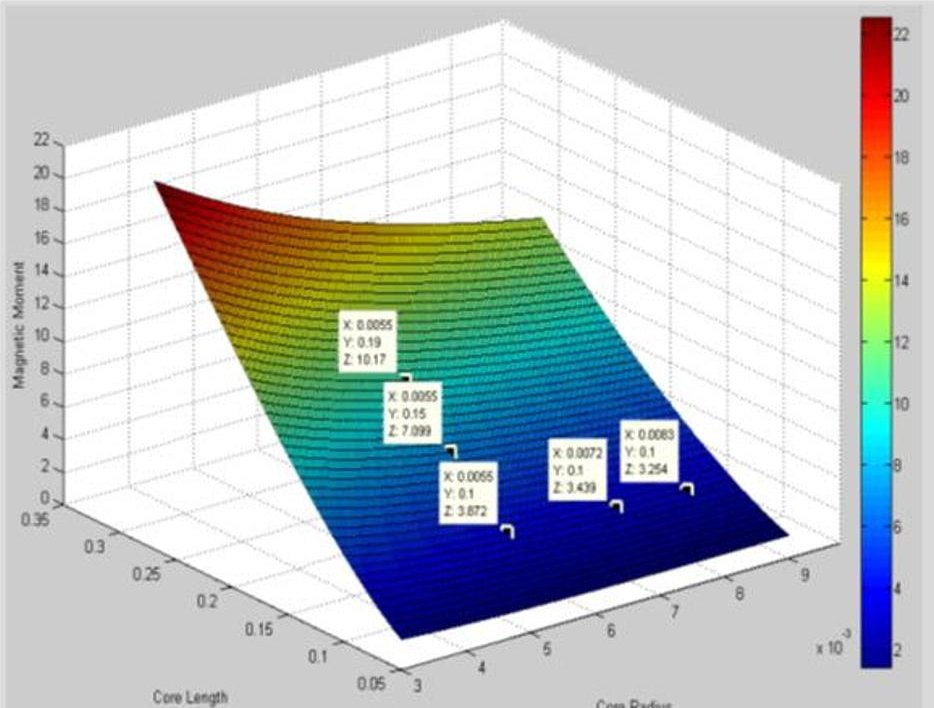

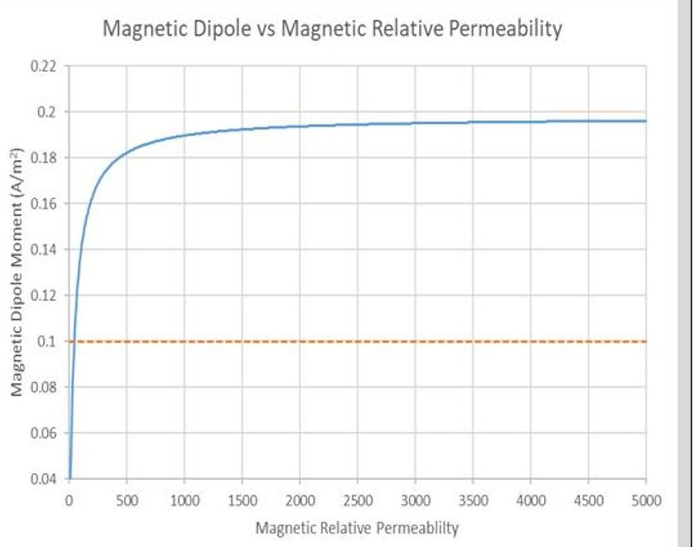

Figure 2: The influence of Core length, radius, (left) and magnetic relative permeability (right) on the magnetic dipole moment.

These factors were evaluated, and a design was selected as seen in Figure 3. The torque rod core was made into a "dumbbell" shape with a thin core of 5.5 mm spanning a length of 35mm. This is the section where the coils will be wrapped. The ends were made thicker to keep the wires compacted in the winding area as multiple layers are stacked upon one another. In addition, holes were added for mounting purposes. The torque rod will be securely mounted with fasteners.

<!-- PDF_PAGE: 7 -->

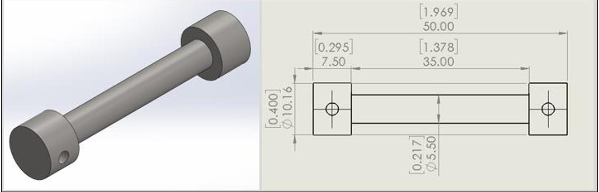

Figure 3: Torque rod design

The wire gauge was selected as well. 30-gauge magnetic wire was selected for the winding. It 's a thin wire specifically used for electromagnetic applications. The wire is covered with a thin enamel coating to prevent the conductors from contacting each other and short circuiting. This 30-gauge wire is rated for a current of up to 0.142 Amps before experiencing excessive heating and damage $ ^{[6]} $ . The core is wrapped in several layers so that when fully wrapped the height of the raised ends matches the wrapped section. This design uses 8 layers. It is placed on the mount shown in Figure 4.

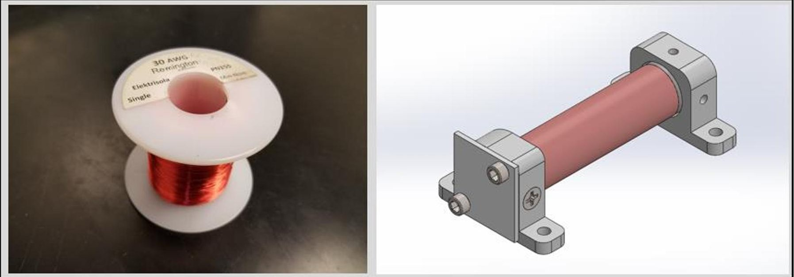

Figure 4: Torque rod with magnetic wire windings

The final design consideration was the type of stainless steel. Two types of steel were selected to test. First was Stainless Steel 420, which was purchased from McMaster Carr. It is a Martensitic stainless steel which has been annealed and hardened. The manufacturers claimed the magnetic relative permeability had a maximum value of 950, though no nominal value was stated. In addition, there was very little other information about its magnetic properties. This steel is very strong and has low sulfur content. The second steel selected is ferritic stainless Steel 430FR, where F stands for free machining and R is for Resistance. This type of stainless steel has a slightly increased sulfur content to make machining easier. It also contains an increased silicon content to increase its resistance. The main purpose of this special type of steel is its use in solenoids, so it seems like a perfect fit. The metal vendor, Vincent metals, sent datasheets with magnetic properties for the steel including a hysteresis curve and a maximum magnetic relative permeability of 1453.

<!-- PDF_PAGE: 8 -->

$$
M _ {d i p o l e} = \left(\frac {r V _ {b u s}}{2 W _ {r e s}}\right) \left(1 + \frac {\mu_ {r} - 1}{1 + \left(\mu_ {r} - 1\right) N _ {d}}\right)
$$

A spreadsheet using equation 16 was used to calculate the magnetic dipole. This value was calculated for torque rods made using each metal. The voltage supplied to the windings was reduced from 3.3 V to 1.25 V with a resistor in series. The calculated resistance for 8 layers of wrappings was 8.83 ohms resulting in a current flow of approximately 0.14 Amps. For the Stainless Steel 420, the magnetic relative permeability applied was 950, and for the 430FR it was 1450. The calculated dipole moments were:

$$
M _ {d i p o l e} (S S 4 2 0) = 0. 1 3 8 A - m ^ {2} \quad M _ {d i p o l e} (S S 4 3 0 F R) = 0. 1 4 0 A - m ^ {2}
$$

They are both extremely close since as stated before, the magnetic relative permeability's influence becomes asymptotic, giving little extra returns past 500. The next step is to manufacture the rods.

## IV. Manufacturing and Assembly

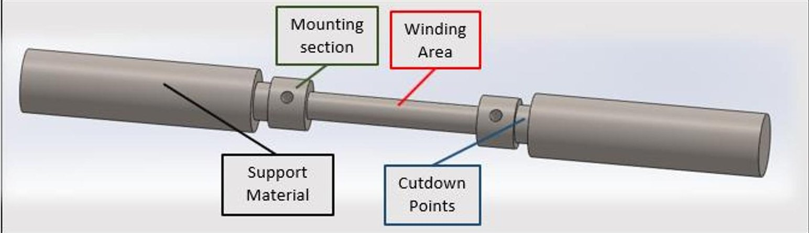

Figure 5:Torque rod manufacturing diagram

Once the design of the torque rod core was decided, the next task was to machine it. The metal stock purchased was in 0.5" diameter stock, cut into 6" lengths, so a lathe was planned to cut the part to the proper dimensions. A few modifications were made to the designed CAD model assuming the part would be machined on the lathe. The resulting design is shown in Figure 5.

The torque rod in the middle is the same as before. Only this time there is support material on the left and right. This extra material was chucked into the lathe or pressed into the running center as shown in Figure 6. This extra support material would help in the winding portion later as well.

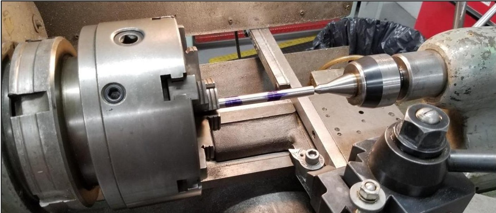

Figure 6: Torque rod core shaped in a lathe

<!-- PDF_PAGE: 9 -->

An engineering drawing was generated from the new CAD and tolerances were established for the part after speaking with the structures team. The piece of stock was then chucked it into the lathe for shaping. The general machining steps are listed in Figure 7.

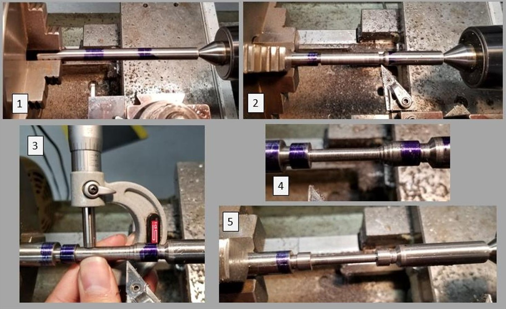

Figure 7: Steps to shaping torque rod core

The two cutdown points were first marked with blue dye as seen in step 1. These points were then reduced to a radius of 0.3" with the cutdown bit to denote the torque rod from the support material in step 2. The diameter of the entire torque rod section was then reduced to 0.4", the diameter of the mounting section also seen in step 2. The next step was to reduce the center winding portion of the torque rod to a diameter of 5mm. Each few times material was removed in a pass, the diameter was measured with a micrometer as seen in step 3. This was to help ensure a precise final cut. The inner corners of mounting section of torque rod core were then squared as seen in step 4. Once the dimensions were property cut and the other corner was squared, sandpaper and a file were used to soften the sharp corners and smooth out the winding portion of the torque rod seen in step 5. If the winding area is rough, it makes the winding process difficult resulting in messy, uneven coils. The last step was to move the nearly finished part over to the mill to drill the mounting holes. The whole machining process took approximately 6 hours. Because the winding core was so thin, the part snapped several times during the manufacturing process, thus delaying completion of the engineering unit. A successful torque rod is shown in Figure 8.

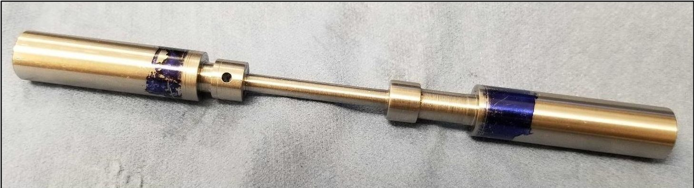

Figure 8: Finished torque rod core

<!-- PDF_PAGE: 10 -->

After the core was machined, the next step was to wrap the torque rod with the magnetic wire. The first step was to cover the wrapping section with Kapton tape to insulate the part. The rationale behind this was if the enamel on any part of the wires became damaged, it would prevent the current from conducting into the steel core. The tape was wrapped at a precise angle to prevent the tape from overlapping. It was then cut straight at the end. Tape was cut into semicircles with an x-acto knife to attach to cover the edges. While this strategy worked, hard anodizing the wrapping portion might be a better solution in the future.

The torque rod was then loaded into a wrapping apparatus that used a drill and a ball bearing ring which clamped to the support material as seen in Figure 9. This allowed the torque rod to rotate as the wire was wrapped around it. One end of the wire was attached to the drill while the rest hung in the spool. The operation required three people: one to operate the drill and check the consistency of the windings, one to hold tension on the wire as it wrapped around the core, and one to feed the wire at an angle behind the direction being wrapped to keep the wires compacted.

The wrapping process was tedious and prone to error. If the angle the wire was feed was to sharp the wires would wrap over each other, if tension was not held tight the windings would be loose and messy. If there was an imperfection in the surface of the wrapping section, it would cause problems in the winding section. Several times there was an issue with the windings, so we would have to unwind part of it to fix the problem. And as the layers stacked up any issues with the windings were amplified.

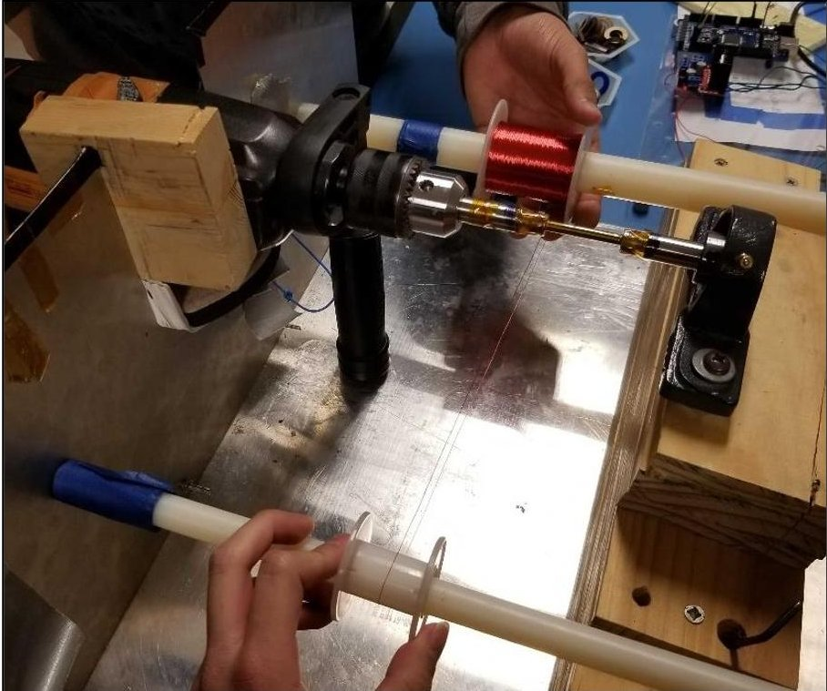

Figure 9: Wrapping Apparatus

Despite all the difficulties however, we were able to successfully wrap the torque rods in usually 1-2 hours. Once all 8 layers were complete, a layer of Kapton tape was added over the wires to keep the wires compacted and protected. The wires connected to the spool were then cut leaving the two leads sticking out of the winding section. The enamel on the end of the two leads was scraped off using sandpaper and an x-acto knife. A multimeter was then used measure the resistance between the two leads and verify there were no short circuits or breaks in the winding. The resulting resistance was close to the previously calculated value 8.83 ohms. There will often be a slight discrepancy between the model and the measured number as the model is just an estimation for the total wire used, which does not consider imperfection in the wrapping, packing efficiency, and several other differences. The resistance should be within around 10% of the expected value.

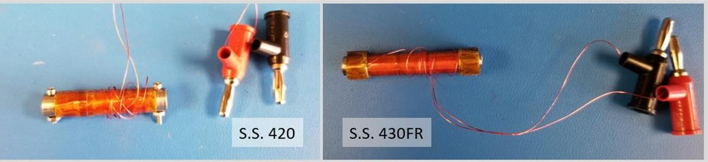

Figure 10: Wrapped torque rods

<!-- PDF_PAGE: 11 -->

The final step was to remove the support material. This was removed with a band saw and the edges were smoothed and finished with the belt sander. The original plan was to use the lathe to cut off the support material, but this caused the torque rod to snap the first few times we attempted. Once the support material was successfully removed the fabrication was mostly completed. One last step was to attach banana plugs to the leads to facilitate the testing stage. The two wrapped torque rods are shown in Figure 10.

## V. Testing

Once the assembly of the Torque Rod is complete, testing must be performed to verify the dipole moment meets the mission requirements. We can calculate the magnetic dipole moment based on the equation derived by Lee et al. $ ^{[7]} $ :

$$
\vec {M} _ {d i p o l e} = \frac {4 \pi}{\mu_ {0}} \left[ \frac {\frac {R _ {x}}{L} - \frac {1}{2}}{\left(R _ {x} ^ {2} - R _ {x} L + \frac {L ^ {2}}{4}\right) ^ {3 / 2}} - \frac {\frac {R _ {x}}{L} + \frac {1}{2}}{\left(R _ {x} ^ {2} + R _ {x} L + \frac {L ^ {2}}{4}\right) ^ {3 / 2}} \right] ^ {- 1} B
$$

In equation 17 we take the length of the Torque Rod L in meters and the magnetic flux density B measured in Tesla at distance R in meters from the center of the torque rod. This equation also assumes the measuring device is in line with the longitudinal axis of the torque rod, where the magnetic field is strongest. The last term $ \mu_{0} $ is the permittivity of free space which has a value of $ 4\pi\mathrm{x}10^{-7}\mathrm{N/A}^{2}. $

To get the magnetic flux density, we need a way to measure the magnetic field. A common way of doing this is with a magnetometer. Nearly all smartphones have magnetometers capable of measuring magnetic field. The magnetometer chip can be located by looking at printed circuit boards (PCBs) of the specific phone model available on sites like iFixit or Gadget-Manual. Once the chip is located, the distance between that and the center of the torque rod can be measured giving the value $ R_{x}. $ The MATLAB Mobile app then gives an easy way to access the sensor values from the smartphone. By turning on the magnetometer sensor and pushing the log button, the magnetic field will be measured in micro-tesla at the default frequency of 10 hz. Once the data collection is done, the data can be uploaded to the MATLAB cloud and downloaded to any connected computer to be processed.

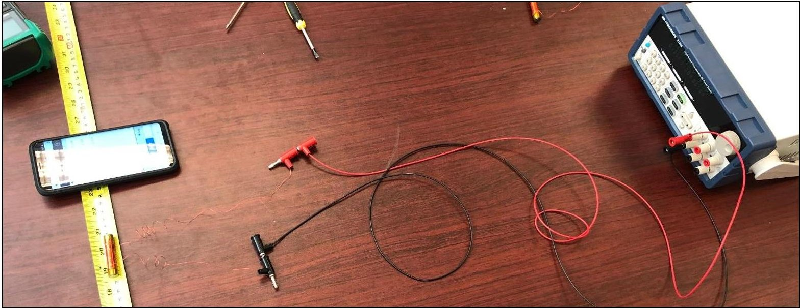

Figure 11: Experimental setup

For the experimental setup, a power supply was connected to the torque rod. Long cables were used to keep the power supply away from the torque rod and the phone's sensor to reduce the electromagnetic interference. The resistance was adjusted to include the resistance of the connection cables. The voltage and current settings on the

<!-- PDF_PAGE: 12 -->

power supply were then adjusted to match the model. The phone's magnetometer chip must be in line with the longitudinal axis of the torque rod. The distance $ R_{x} $ was measured. The L distance was the length of the wired section, or 35 mm. Data collection was started before turning on the power supply to get the ambient magnetic flux values in the environment. After about 30 seconds, the power supply was turned on. The sensors read a noticeable change in magnetic flux for two of the axes. The data was collected for a few minutes and then the power supply was shut off. Data collection continued for about one minute after that to see if there was any residual magnetic flux from the magnetization of the core.

The data was then processed. The sought value was the change in magnetic flux density. This is the difference between the flux density when the power is on vs when the power is off. The components from both axes should then be normalized to get a total magnetic flux density. This value is then used to calculate the magnetic dipole moment.

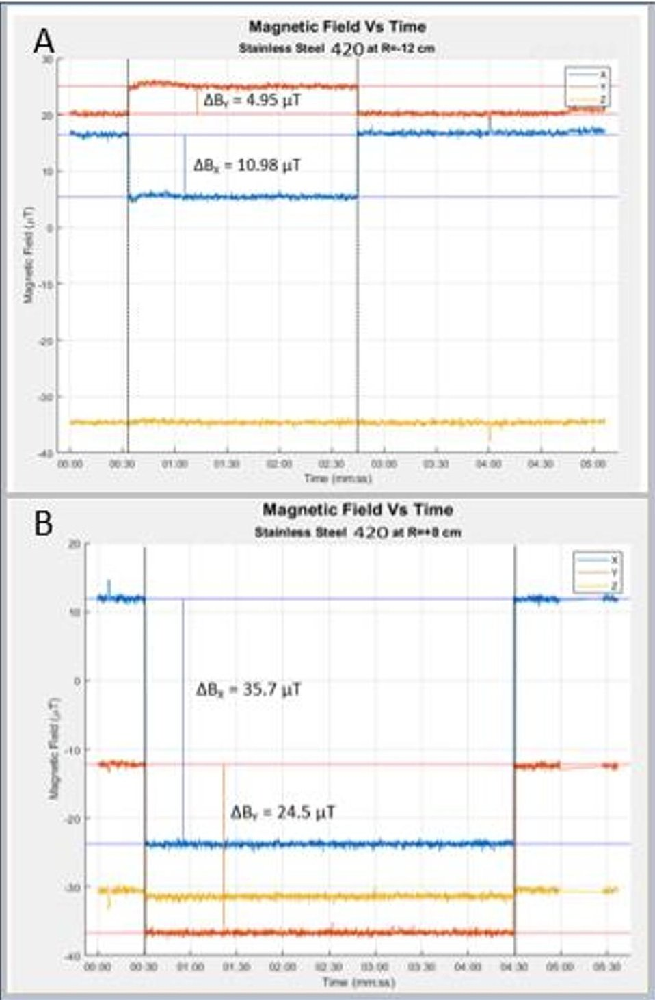

Figure 12: Stainless Steel 420 Magnetic Flux Density

The results are shown in Figure 12A for the Stainless Steel 420 measured at R= -12 cm.

In this case the power supply is seen to turn on at 0:30 s and off at 2:45 s. The $ B_{y} $ jumps by nearly 5 $ \mu\mathrm{T} $ and $ B_{x} $ drops by 11 $ \mu\mathrm{T} $ . This gives a resultant B value of 12 $ \mu\mathrm{T} $

$$
\mathrm {L} = 0. 0 3 5 \mathrm {m}
$$

$$
R = 0. 1 2 \mathrm {m}
$$

$$
\mathrm {B} = 1 2 \mu \mathrm {T}
$$

$$
M = 0. 1 0 0 A - m ^ {2}
$$

The results for the Stainless Steel 420 measured at R= +8 cm are shown in Figure 12B.

In this case the power supply turns on at 0:30 s and off at 4:30 s. The $ B_{y} $ drops by nearly 25 $ \mu $ T and $ B_{x} $ drops by 36 $ \mu $ T. This gives a resultant B value of 43.3 $ \mu $ T

$$
\mathrm {L} = 0. 0 3 5 \mathrm {m}
$$

$$
R = 0. 0 8 \mathrm {m}
$$

$$
\mathrm {B} = 4 3. 3 \mu \mathrm {T}
$$

$$
M = 0. 1 0 1 A - m ^ {2}
$$

As shown, the stainless steel 420 produced a dipole moment of approximately 0.1 A-m $ ^{2} $ . This is less than anticipated, but it meets the requirements. Additional testing should be performed. Next, the stainless steel 430FR core was examined.

<!-- PDF_PAGE: 13 -->

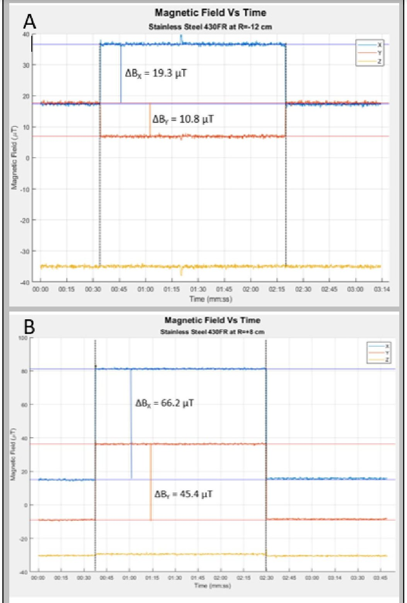

The results for the Stainless Steel 430FR measured at R= -12 cm are shown in Figure 13A.

Figure 13: Stainless Steel 430FR Magnetic Flux Density

In this case the power supply turns on at 0:30 s and off at 2:20 s. The $ B_{y} $ drops by nearly 11 $ \mu $ T and $ B_{x} $ jumps by 19 $ \mu $ T. This gives a resultant B value of 21.85 $ \mu $ T

$$
\mathrm {L} = 0. 0 3 5 \mathrm {m}
$$

$$
R = 0. 1 2 \mathrm {m}
$$

$$
\mathrm {B} = 2 1. 8 5 \mu \mathrm {T}
$$

$$
M = 0. 1 8 3 A - m ^ {2}
$$

The results for the Stainless Steel 430FR measured at R= +8 cm in Figure 13B

In this case we see the power supply turn on at 0:35 s and off at 2:30 s. The $ B_{y} $ jumps by nearly 45 $ \mu $ T and $ B_{x} $ jumps by 66 $ \mu $ T. This gives a resultant B value of 80.3 $ \mu $ T

$$
L=0. 0 3 5 \mathrm {m}
$$

$$
R = 0. 1 2 \mathrm {m}
$$

$$
\mathrm {B} = 8 0. 3 \mu \mathrm {T}
$$

$$
M = 0. 1 8 6 A - m ^ {2}
$$

As shown, the stainless 430FR steel outperformed the stainless 420. All the resultant B values are nearly twice as large. This resulted in a magnetic dipole of 0.186 A-m $ ^{2} $ . This is much greater than the requirement. This is much greater than anticipated. It is unclear if there may be some inaccuracies in the model, issues with the testing, or both. More testing will be required perhaps at additional distances with other sensors, such as the Honeywell 1053 Magnetometer, which will be used on GT-1. The conclusion drawn from this experiment is more testing is necessary, though future torque rods should be built with the Stainless Steel 430FR rather than with the Stainless Steel 420 because of the demonstrated performance improvement.

<!-- PDF_PAGE: 14 -->

## VI. Future Work

These is still a lot of work to do. The torque rods created and measured in this paper were just the engineering units. Two flight units were recently built and still need to be thoroughly tested, though preliminary results indicate magnetic dipole moments greater than 0.2 A $ m^{2} $ . Both torque rods both have stainless steel 430FR cores due to its performance is superior. Also, the core thickness was increased to 0.2" with a total of 9 wrappings to increase part strength and magnetic dipole moment.

In addition to performing testing with the phone's sensor, the torque rods need to be tested with the magnetometer that will be used on GT-1: a Honeywell 1053 Magnetometer. We should also consider additional testing at different distances and angles as mentioned in Lee et al $ ^{[7]} $ . Future tests should also be made after the torque rods are integrated into the CubeSat to characterize the results that will be seen in orbit. Additional tests should be performed in the Helmholtz cage to simulate these actual orbit conditions.

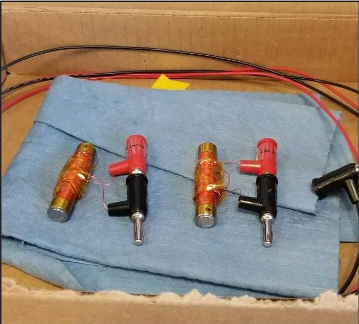

Figure 14: GT-1 Flight torque rods

## References

[1] Li, Junquan, et al. "Design of Attitude Control Systems for CubeSat-Class Nanosatellite." Journal of Control Science and Engineering, vol. 2013, 24 Apr. 2013, pp. 1-15., doi:10.1155/2013/657182.

[2] Mehrjardi, Mohamad Fakhari, and Mehran Mirshams. "Design and Manufacturing of a Research Magnetic Torquer Rod." Fourth International Conference on Experimental Mechanics, 2009 doi:10.1117/12.851652.

[3] "The Hysteresis Loop and Magnetic Properties." Hysteresis Loop, NDT Resource Center, www.ndeed.org/EducationResources/CommunityCollege/MagParticle/Physics/ HysteresisLoop.htm. web.

[4] Marco Lovera, Global Magnetic Attitude Control of Inertially Pointing Spacecraft, JOURNAL OF GUIDANCE, CONTROL, AND DYNAMICS, Vol. 28, No. 5, September-October, 2005.

[5] Engineering Toolbox, (2016). Permeability. [online] Available at: https://www.engineeringtoolbox.com/permeability-d_1923.html [11-2-19].

[6] "Wire Gauge and Current Limits Including Skin Depth and Strength." American Wire Gauge Chart and AWG Electrical Current Load Limits Table with Ampacities, Wire Sizes, Skin Depth Frequencies and Wire Breaking Strength, www.powerstream.com/Wire_Size.htm.

[7] Lee, J., et al. "On Determining Dipole Moments of a Magnetic Torquer Rod - Experiments and Discussions." Canadian Aeronautics and Space Journal, vol. 48, no. 1, 1 Mar. 2002, pp. 61-67., doi:10.5589/q02-014.