<!-- PDF_PAGE: 1 -->

# Augmenting requirements with models to improve the articulation between system engineering levels and optimize V&V practices

Stephane Bonnet

Thales Corporate Engineering

Jean-Luc Voirin

Thales Airborne Systems

stephane.bonnet@thalesgroup.com

Thales Technical Directorate

jean-luc.voirin@fr.thalesgroup.com

Juan Navas

Thales Corporate Engineering

juan.navas@thalesgroup.com

Copyright $ \textcircled{c} $ 2019 by Stéphane Bonnet. Permission granted to INCOSE to publish and use.

Abstract. Model-based systems engineering has developed significantly over the last few years, resulting in an increased usage of models in systems specification and architecture description. The question of the positioning of requirement engineering versus MBSE is a recurrent one. This paper describes one vision of this articulation where textual and model requirements actually complete each other. The results are improved contracts across engineering levels and more formalized verification and validation practices.

## Introduction

In most engineering practices today, requirements constitute the main vector for managing technical contracts between customers and suppliers, at any level of the breakdown. Customers express their needs as requirements using natural language ("the system shall ...") and suppliers analyze, interpret, reformulate, refine, and complete these requirements in order to describe the expectations on the solution system. A flaw of these practices is that requirements are sometimes the main vector to perform design analysis and describe the architecture of the solution.

Model-based systems engineering (MBSE) has gain popularity in the last ten years. MBSE covers a very broad spectrum of applications, spanning from high-level architecture modeling to detailed design at the frontier of simulation. Whatever the scope of application, MBSE is expected to provide a certain level of formalism, to provide a single source of truth, and to make the model a reference that is understood and shared by all engineering stakeholders.

In this paper, MBSE is mostly systems architectural design, which encompasses the capture of the need and the description of the solution with its constituents and their interfaces. The primary objective in this context is to inject the required rigor and formalism in the architectural design activities.

Despite all its promises, the adoption of MBSE remains slower than expected. Elaborating on the factors causing this resistance is beyond the scope of this paper, but one consequence is that model-based practices are not as well established as requirement-based practices. Therefore, basic ques-

<!-- PDF_PAGE: 2 -->

tions are still frequently asked: Are requirements still needed if an MBSE approach is used? Do models describe existing requirements or do they help elicit them?

This paper first provides a brief reminder of the largely implemented requirement-based practices. It then precises the MBSE context of this paper: it introduces the Arcadia MBSE method and provides definition for a reduced set of key Arcadia concepts. This paper then elaborates on the concept of model requirement and presents a workflow where textual and model requirements complete each other and are both parts of the technical contracts between upstream and downstream engineering teams. The happy consequences on integration, verification and validation activities are finally explained.

## Background

## Standard practices based on textual requirements

This section describes the engineering approach that has been implemented on most Thales projects in the last 20 years at least. It relies on two core practices:

- Producing the requirements of a solution element, based on its customer requirements,

- Refining and allocating solution element requirements to solution components.

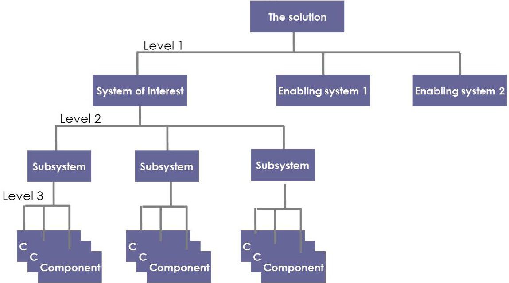

Figure 1: Levels of engineering

Producing the requirements of a solution element. Each engineering team in charge of the development of an element of solution (supplier) at level N inherits a set of requirements reflecting the vision of the N-1 level architects (customer) of what is expected from the element of solution in their scope of responsibility. They are named 'customer requirements' here after for enhanced clarity, even though the customer might be the architect of one particular engineering level.

Each supplier at level N must analyze these customer requirements so as to "formalize" them in a set of corresponding solution requirements that will constitute the reference of its commitment for the verification and acceptance (Figure 2).

- Task 1: Define the "element of solution" requirements by reformulation or enrichment of customer requirements. This task consists in transforming the text of the customer requirements so as to become clear and non-ambiguous solution requirements, in particular when customer requirement have been directly inherited from upper level requirements. For example, the following customer requirement allocated to the system "The user shall be able

<!-- PDF_PAGE: 3 -->

to..." must be reformulated under a form closer to "Upon given user action, the system shall do...".

- Task 2: Ensure the verifiability of each solution requirement. According to the required quality that is applicable, it is highly recommended to concurrently identify the method of verification (Inspection, Analysis, Demonstration, Test, or I/A/D/T) and if possible, the Verification & Validation (V&V) strategy.

- Task 3: Ensure the traceability of each solution requirement

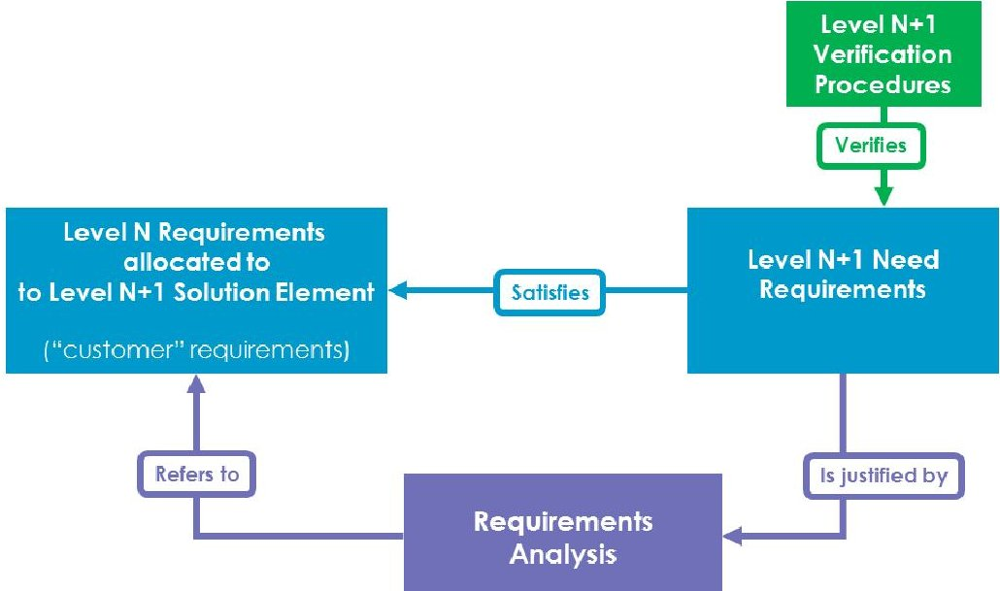

Figure 2: From solution to need requirement

Refining and allocating solution element requirements to solution components. Considering the specifications of an element of solution at level N stabilized and baselined, the architect performs a design analysis (item "2" on Figure 3) to further allocate the need requirements:

- If an N+1 element of solution covers entirely solution need requirement, it fully inherits this requirement （“1” on Figure 3)

- If a collaboration between several N+1 elements of solution is required to satisfy the a requirement, then new solution requirements must be created and allocated to each contributor component ("2" on Figure 3).

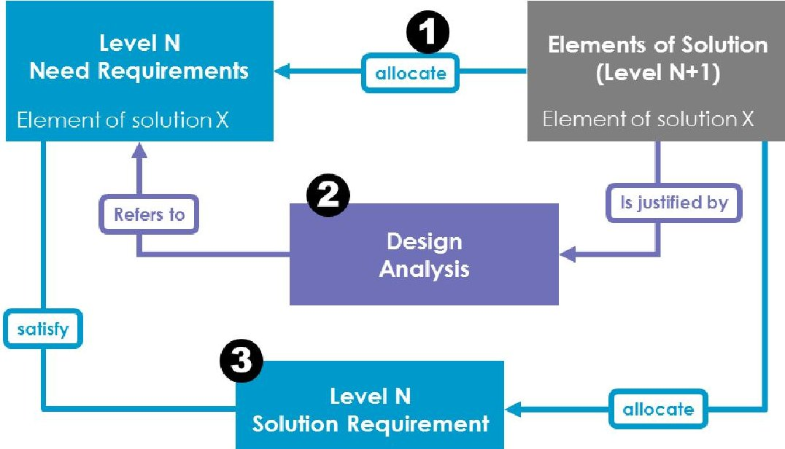

Figure 3: Refinement and allocation of requirements

<!-- PDF_PAGE: 4 -->

Design constraints are elicited in this process. Derived requirements can also be created (for example, for the allocation of mass or power budgets).

## (Some) limits of these standard practices

Textual requirements suffer from weaknesses that may impact engineering and product quality when used too extensively or inappropriately. In particular, these weaknesses are critical when no formalization on architectural design is performed in parallel of requirements engineering.

- Because in most cases textual requirements are written in natural language, they are possibly ambiguous, contradictory, or incoherent with each other.

- The relationships and dependencies between textual requirements are difficult to express.

- In most cases, textual requirements cannot be checked or verified by digital means.

- The process of creating traceability links to each requirement (for design, verification and validation, for sub-contracting, etc.) is often unclear and not guided by a well-defined methodological approach. The means to verify these links are undefined and the quality of these links proves to be insufficient in many cases (this is often only discovered in V&V phases).

- Textual requirements (alone) are not adapted to describing an expected end-to-end system solution: Each of them only expresses a limited and focused expectation.

- They alone can hardly be sufficient to describe subsystems need, including usage scenarios, detailed interfaces, performances, resource consumption, and more.

## Model-based system engineering (MBSE) with Arcadia and Capella

Model-based systems engineering is the formalized application of modelling to support system requirements, design, analysis, verification and validation activities beginning in the conceptual design phase and continuing throughout development and later life cycle phases. [INCOSE 2014]. In addition to providing an increased rigor in these engineering activities, one essential objective of a model-centric approach is to provide a single source of truth that can be shared with all stakeholders.

Arcadia MBSE method. Arcadia is a model-based method devoted to systems, software and hardware architecture engineering [VOIRIN 2017]. It describes the detailed reasoning to understand and capture the customer need, define and share the product architecture among all engineering stakeholders, early validate its design and justify it. Arcadia can be applied to complex systems, equipment, software or hardware architecture definition, especially those dealing with strong constraints to be reconciled such as cost, performance, safety, security, reuse, consumption, weigh, etc. It is intended to be embraced by most stakeholders in system/product/software/hardware definition as their common engineering reference. It has been applied in a large variety of contexts over the last ten years.

<!-- PDF_PAGE: 5 -->

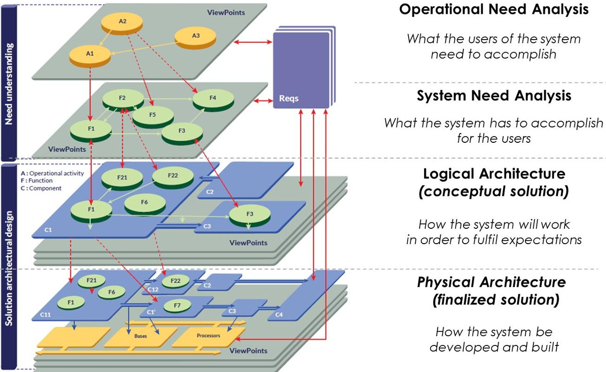

Figure 4: Arcadia engineering perspectives

The Arcadia method intensively relies on functional analysis, which is a very popular technique among systems engineers. Arcadia enforces an approach structured on different engineering perspectives establishing a clear separation between system context and need modeling (operational need analysis and system need analysis) and solution modeling (logical and physical architectures), in accordance with the [IEEE 1220] standard and covering parts of [ISO/IEC/IEEE 15288].

Capella MBSE tool. While the Arcadia method itself is tool-agnostic, it requires a modeling workbench to be implemented efficiently. Capella guides systems engineers in applying the Arcadia method and assists them in managing complexity of systems design with automated simplification mechanisms. A model is built for each Arcadia engineering perspective. All models are related by justification links and can be processed as a whole for impact analysis.

The original audience for the Arcadia/Capella solution is primarily systems engineers with diverse backgrounds and skills (i.e. not necessarily engineers with strong software or modeling backgrounds). Because the targeted scope of the method is well-delimited, strong choices have been made on the language to shorten the learning curve. The Capella notation is inspired by SysML and the diagrams provided are similar to a certain extent. However, when taking the SysML specification as a reference, the meta-model of Capella is simultaneously simplified, modified, and enriched. The equivalences and differences between Arcadia/Capella and SysML-based alternatives are described here [CAPELLA 2018].

## Arcadia systems engineering relevant concepts

This section briefly introduces some of the Arcadia concepts that will be exploited in the remaining parts of this paper. [AFNOR 2018] and [VOIRIN 2017] provide more detailed definitions.

A system Capability designates the ability of the system to provide a service that supports the achievement of high-level business objectives.

A Function is an atomic action or operation performed by the system, or by an actor interacting with the system. It is, by convention, named with a verb. A Capability typically requires the collaboration of several Functions. Functional Exchanges connect Functions and express dependencies between the output of the source Function and the input of the target one.

<!-- PDF_PAGE: 6 -->

A Functional Chain is a set of references towards Functions and Functional Exchanges, describing one possible path within the global dataflow. Typical exploitations include the description of an expected behavior of the system in a given context and the expression of non-functional properties on this path (e.g. latency, criticality, confidentiality, redundancy, etc.).

A Scenario is conceptually close to a Functional Chain in the sense that is illustrates a system behavior in a given context. Compared to Functional Chains, Scenarios provide enriched expression means and in particular, add the concept of time.

A Logical/Physical Component is a constituent part of the system. It can either be a behavioral component responsible for implementing some of the Functions assigned to the system either be a hosting component, providing resource for behavioral physical components.

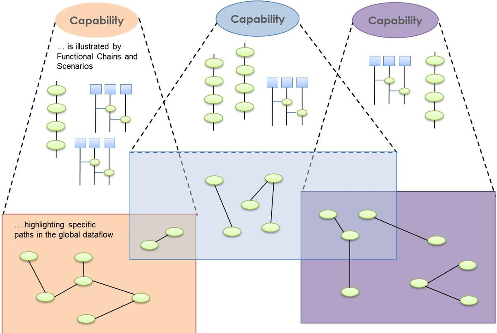

Figure 5: Articulation between Capabilities, Functions, Functional Chains and Scenarios

Figure 5 illustrates how Capabilities are illustrated by Scenarios and Functional Chains typically including nominal and degraded cases. Functional Chains and Scenarios involve atomic Functions.

## An approach to combine requirements engineering and MBSE

MBSE aims at putting the model at the center of the interactions between all engineering stakeholders, in order to benefit from an increased rigor and improved communications. This means not only system architects but also customers, specialty engineers, V&V engineers and others will have to work on the basis of the model information, either by contributing to the model or by consuming its outputs.

This connection of architecture models with the surrounding engineering activities is implemented either by linking models to other engineering artefacts, or by extracting and transforming data in the right format (document generated from the model, data in excel sheets, code structure and interfaces generated from the model, etc.).

MBSE does not replace traditional methods and best practices. It strengthens them with modeling techniques, it adds rigor in the design activities. MBSE cannot be performed in isolation.

<!-- PDF_PAGE: 7 -->

## The triptych requirements / need models / solution models

Requirements engineering is indisputably the backbone of the current engineering practices. Therefore, the question of the articulation of requirements with models is essential. Figure 6 describes a kind of "three-legs stool" where:

- A need model helps formalize and consolidate the customer and system textual requirements. In Arcadia, need models are covered by the two first engineering perspectives: Operational Need Analysis is focusing on the objectives of the system stakeholders while System Need Analysis is focusing on the system itself: what is expected from it, what is its scope.

- A solution/architecture model helps validate the feasibility and elicit/justify new requirements for the system or its subsystems. In Arcadia, solution models are covered by the conceptual (logical) architecture and the developed (physical) architecture.

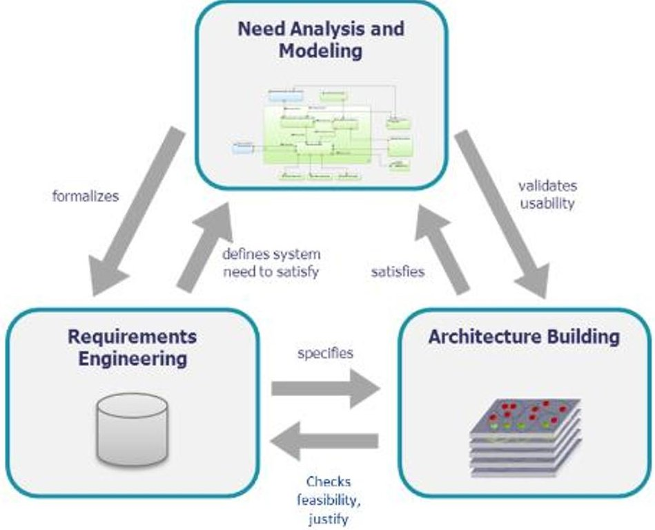

Figure 6: Consolidating requirements engineering with need and solution models

## Concept of "model requirement"

While textual requirements are most of the time written in natural language, models are means to express information in a way that is well defined and structured, with strict syntax and precise semantics. This level of formalism guarantees consistency (in particular, the uniqueness of data while referenced several times) and enables automated processing. For example, data present or extracted from the model can be used in order to:

- Be injected in other tools to perform additional activities (hardware/software design, specialty engineering, simulation, verification and validation...)

- Perform model validation and ensure completeness, well-formedness, etc.

- Assess design progress (number of complete Capabilities, Functional Chains, etc.)

Models thus provide means to describe need and solution in a form which is shareable, analyzable, and verifiable. One can talk about model requirements (Figure 7).

- Functional requirements are likely to be represented by Capabilities, Functions, Functional Exchanges, Functional Chains, Scenarios, Modes, States, etc.

<!-- PDF_PAGE: 8 -->

- Interfaces requirements can be expressed with Functional and Component Exchanges, data structures (Datatypes, Classes, Physical Quantities), Scenarios, Modes, States, etc.

- When possible, non-functional requirements can also be captured through model elements. For example, Functional Chains can carry latency constraints, data can be characterized by confidentiality levels, etc.

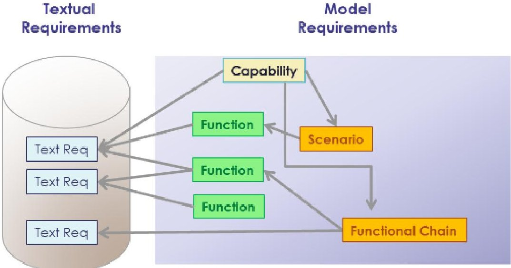

Figure 7: Textual and model requirements

Not all expectations can be expressed or captured in a model. Environmental constraints (temperatures, corrosion, etc.), applicable norms and standards, required maintenance period, for example, would be difficult to express with model elements. Reversely, certain model elements are too complex to be considered as SMART requirements and others are too fine-grained/technical. Therefore, models are not intended to replace textual requirements.

Instead, model elements (including model requirements) and textual requirements complete each other and must typically be related to each other, for example in the following situations:

- Model requirements that formalize a textual requirement should be linked to it by traceability/justification links (this is typically the case with customer requirements);

- Some expectations on a model element are easier or simpler to express by textual description; this description can be captured as one or more textual requirements that will be linked to the model element by satisfaction links;

- Some requirements only apply to a limited part of the system, and/or the model (e.g. weather-resistance apply to a drone, but not necessarily to its command & control ground station); they will be linked to the appropriate model elements (for example, Components).

## Models as parts of the technical contracts

Because they actually contain artifacts that can be considered as requirements, models can and should be used as the central artifacts of the contract between the client and the provider of a system or of a system constituent. The Arcadia clear separation between need and solution perspectives helps implement a workflow combining textual and model requirements.

A need model helps define the boundaries of the system (or of a system constituent) and describe the "what" is a more rigorous form than with textual requirements. The expectations from the system or from the system constituent can be described with a breakdown of Capabilities involving multiple Functions working together. Each Function is named with a verb, and has

<!-- PDF_PAGE: 9 -->

well-defined inputs and outputs. It is typically exploited by several Functional Chains, which specify several usage contexts (Figure 5), under the control of Modes and States governing context changes.

Need models can either be derived from an Operational Need Analysis (analysis of the needs of the system stakeholders) or be derived from an existing architectural / design work (a solution model defined at the upper level of an overarching system) as illustrated by Figure 8.

A solution model typically describes the architecture of the system and provides rationale for this architecture (the "how"). It contains the identification of the subsystems/constituents, the functional and behavioral expectations from each of them, and the description of interfaces. In Arcadia, a strong emphasis is put on the justification of the component interfaces with functional content. Thanks to functional refinement, traceability and allocation, the contribution of a given constituent to each transverse Functional Chain is defined unambiguously. The contract for the downstream engineering is well-specified and justified.

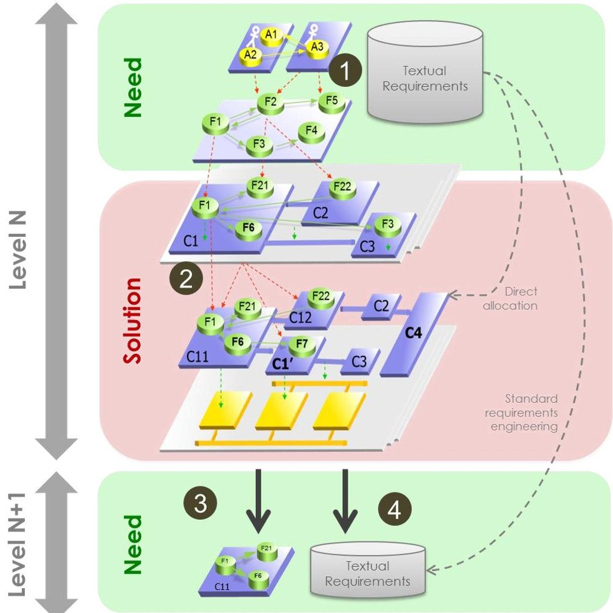

Figure 8: Model and textual requirements in the articulation between engineering levels

Figure 8 illustrates a typical workflow for architectural design based on the Arcadia engineering method. The numbered items below reference the numbered steps present on the figure.

1. Customer high level expectations are described in the Operational Need Analysis perspective where stakeholders and their objectives are modeled using Operational Activities and Processes. Performing the analysis of the customer expectations with a model helps check their consistency and completeness. The System Need Analysis perspective focuses on the expectations on the system itself. The goal in this perspective is to elicit model and textual requirements on the system. Traceability between Operational Need Analysis and System Need Analysis models ensures completeness and paves the ground for later impact analysis.

2. Definition of the solution, justified by the System Need Analysis model. Possibly described at different levels of abstraction (Logical Architecture and/or Physical Architecture), the architecture description specifies with the adequate level of detail how the system works and

<!-- PDF_PAGE: 10 -->

what is expected from each constituent. The goal here is to prepare the contracts for all subsystems and guarantee their proper integration. Instead of simply allocating (or cascading) textual requirements to elements of the Product Breakdown Structure, performing a rigorous, model-based design analysis has multiple benefits. In particular, the solution can easily be shared with all stakeholders: how the system works, what is the contribution of each component, what are the transitions between modes and between states, what are the impacts of modes and states on functional expectations, etc.

3. The specification of the subsystems with model requirements comes at no extra cost when the system architecture has been properly modeled. Arcadia advocates a recursive application of the method and Capella provides an automated, iterative transition from system to subsystem (Figure 9). The context of a given system constituent is entirely computed (anything contributing to the definition of this constituent including allocated Functions, interfacing Components, etc.) and a downstream System Need Analysis model is initialized and maintained based on the evolutions of the system definition. The subsystem Need Analysis Arcadia perspective is a centerpiece of the contract for the downstream engineering team.

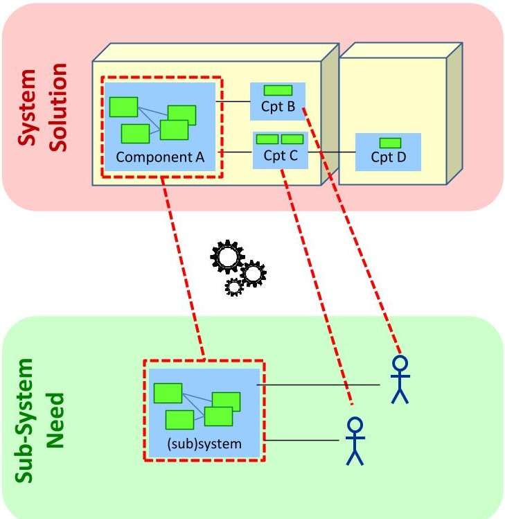

Figure 9: System to subsystem automated transition

4. Textual requirements are created when needed, in addition to the model requirements. These requirements can either emerge from the design analysis either result from a standard requirements engineering on the part that was not covered by the need model. There can be different strategies but the structure of the model (Capabilities, Functional Chains, etc.) can be a good driver for the structuration of the textual requirements in chapters for example.

- When subcontracting the development of a system constituent to a different organization, legal aspects of contracting often requires natural language and thus, textual requirements. In that case, model requirements typically need to be replicated in a textual form (at least partially).

- When working within the same organization and when certification authorities do not prevent it, the scope of textual requirements can be limited to what cannot be efficiently expressed with models (for example, part of non-functional requirements, design or production constraints, etc.).

<!-- PDF_PAGE: 11 -->

- Sometimes, functional requirements are necessary to specify additional expected behavior. For example, the way a Function transforms its inputs in outputs is not specified in Arcadia (the reason is it is often beyond the scope of what is actually required to define the interfaces and specify the global behavior, which is the primary objective of architectural design with Arcadia). However, without diving into the detail of the design of a given Function, the upstream engineering team might need to express requirements on the expected treatments. In that case, the model helps elicit and structure textual requirements.

Customer (textual) requirements relate sometimes more to the solution than to the need. This is typically the case when choices of technology are imposed for design or implementation. It is useless to artificially create corresponding elements in the need models. Instead, customer (textual) requirements can be directly attached to model elements of the Logical / Physical Architectures.

The combination of model-based approach and automated system to subsystem transition as illustrated above favors co-engineering over the traditional differentiation between customer requirements and system requirements, where the stakeholders of the level N define their own response to the need expressed by stakeholders of the level N-1 (typically using reformulation techniques as explained in the first part of this paper).

## Possible organization of requirements artifacts

Figure 10 illustrates the relationships between models and textual requirements across several levels of engineering. A good practice is to separate the artefacts in different modules based on configuration management scopes, so as to preserve independence of lifecycles. Then at each engineering level, need-originated requirements should be separated from the requirements contributing to describe the solution. The latter should be partly need requirement for sub-systems, and partly transverse requirements. Transverse textual requirements are intended to be analyzed using standard practices.

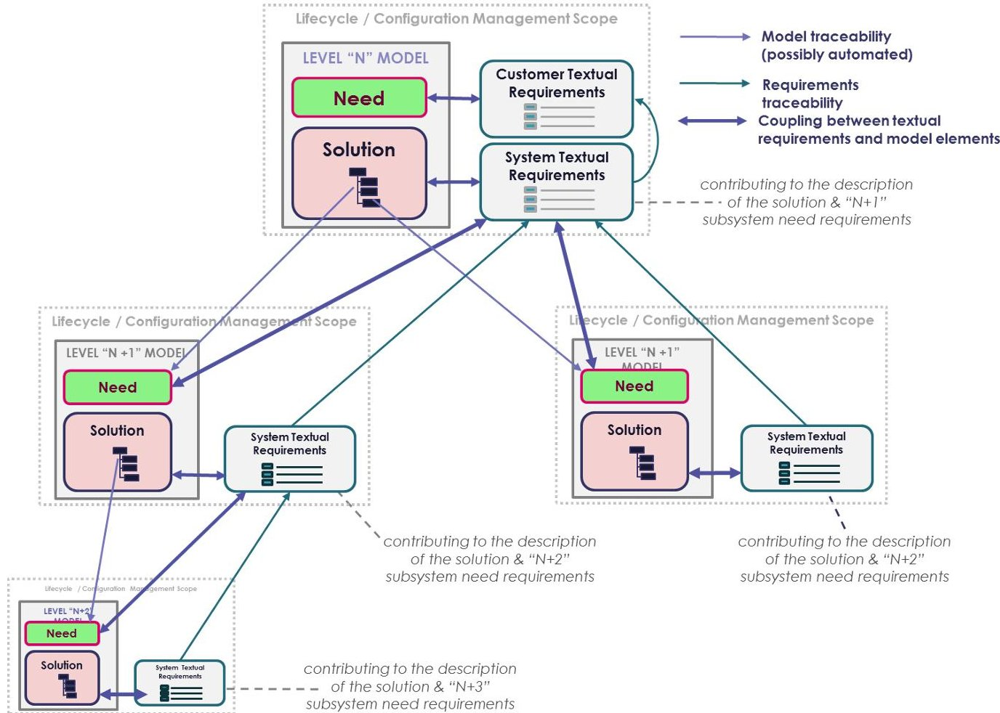

Figure 10: Model and textual requirements across several engineering levels

<!-- PDF_PAGE: 12 -->

# Managing V&V with model requirements

Integration, verification and validation strategies are usually built during the definition and design phases. The content of each increment is determined; test procedures are defined and grouped in campaigns covering this particular increment. The verification process mainly relies on the use of traceability links between need definition, solution description and test campaigns/cases.

In the standard practice based on textual requirements, traceability links are manually created between each requirement and covering test cases. Each increment is defined as a set of requirements. Similarly, traceability links are established between each requirement and elements of the Product Breakdown Structure according to the expected contributions of these elements to fulfill the requirement. This traceability scheme is exploited to establish the list of configuration items to be supplied for this V&V campaign.

Experience shows that when the complexity increases, approaches based on the sole textual requirements reach their limits. Most of the problems find their origin in the lack of rigor and the lack of methodological guidance:

- Textual requirements are not able to properly describe the solution and justify it, which means the links with the Product Breakdown Structure can prove to be difficult to build and check (the contribution of each configuration item to a given requirement is difficult to identify).

- Traceability links are unreliable and difficult to verify, because their manual building is not formalized.

- In the absence of a precise and detailed vision of architecture and system behavior, it is difficult to clearly identify and localize problems and required changes, and to optimize the testing strategy and non-regression testing.

## Testing model requirements rather than textual requirements

For the scope of the textual requirements that are covered or linked to model requirements, an improved practice consists in better exploiting model requirements. Test campaigns can be defined directly with the model as an input (Figure 11).

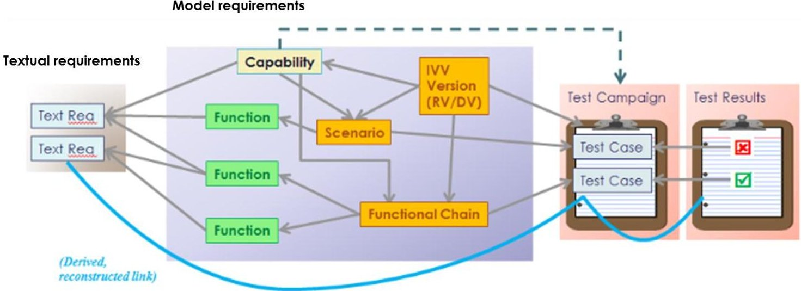

Figure 11: V&V against model requirements

The content of a test campaign is not anymore described only by a set of textual requirements, but rather by a set of model functional artifacts such as Capabilities, Scenarios and Functional Chains, expressing the dynamic use of the system, as specified in Operational and System Need Analysis, and as designed in solution architecture model. A significant improvement of engineering practices becomes possible:

<!-- PDF_PAGE: 13 -->

- Traceability links can be based on a unifying model. An explicit and verifiable process can be applied to ensure the quality of those links and therefore, globally secure the engineering.

- The contents of the V&V campaigns are not defined as abstract requirement sets, but as customer-friendly functional artefacts

- The functional artifacts linked to V&V procedures are by nature related to other model elements such as Functions, Functional Exchanges, Components, Data, Interfaces, non-functional properties, etc. The model internal realization and allocation links between Functions and Components can be exploited to establish stronger traceability with the Product Breakdown Structure.

- Impact analysis can be performed across system to subsystems models.

Links between textual requirements and V&V tests are calculated, which makes them more reliable and easier to review and check. Verification of textual requirements is ensured with the model in the middle:

- A model requirement is considered as verified when all related tests procedures are passed

- A textual requirement is verified when all related model requirements are verified.

## Optimizing V&V strategy

Building a V&V strategy is mainly about defining integration and tests increments, in order to progressively verify the system solution and its adequacy to the need. The previous section explained how the content of the increments can be defined with functional artefacts rather than with textual requirements. For V&V engineers, one key benefit of a model-driven approach is the much better mastering of the system architecture: better understanding of its behavior and greater fault localization accuracy.

In the model, an increment can be expressed with a specific concept called a Requested Version (RV) to which several capabilities, Scenarios or Functional Chains are associated. Based on the content of a given RV, it is possible to automatically obtain the list of Components to integrate, as well as the summary of the functional content that each Component has to provide. It is also straightforward to specify the expected functional content of testing means. This allows an incremental development and delivery of test means, which significantly de-stresses their engineering.

Using dedicated annotations on model elements and using queries, it is not complicated to automatically visualize in diagrams the footprint of a particular RV, as illustrated by Figure 12.

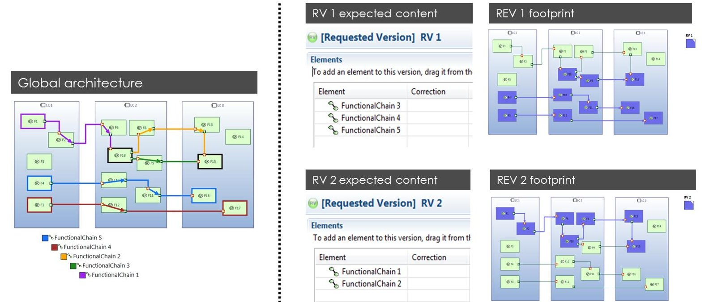

Figure 12: Visualization of the footprints of requested versions in Capella

<!-- PDF_PAGE: 14 -->

Management of unavoidable ups, downs, and hazards occurring during V&V is also greatly facilitated. For this purpose, the notion of actually Developed Version (DV) can been introduced, so as to capture the real structural and functional contents of each built version, according to the real state of components delivered for each test campaign. This allows to analyze what is really available due to components actual contents, and to evaluate how the initial integration strategy has to be adapted accordingly. For example, if a component or subsystem is delivered late, or if its functional content is not aligned with what was planned in the Requested Version (RV), the use of the exploitation of the model allows to identify the operational capabilities or features that are consequently not available.

Similarly, the tool can identify the tests, Scenarios or Functional Chains, which are not to be run because of missing or incomplete components.

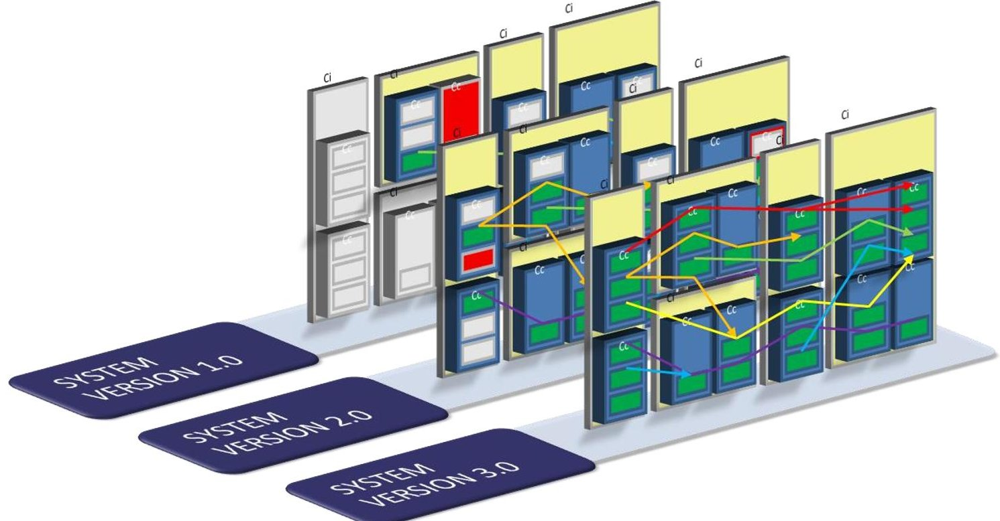

Figure 13: System increments with functional chains and developed versions

In Figure 13, each system increment contains additional expected Functional Chains. For each increment, grey Components and Functions represented elements that were out of scope (i.e. not required to perform the expected Functional Chains / Scenarios). Red elements represent delayed Functions and Components (i.e. not delivered in time or the test campaign).

## Conclusion

The main idea developed in this paper is that even in MBSE contexts, requirements still form the backbone of systems engineering practices. However, requirements can either be textual statements or model elements.

Unlike textual requirements written in natural language, model requirements (Capabilities, Functions, etc.) obey strict syntax and semantics that allow them to be automatically processed for analysis, completeness, and consistency. The paper elaborated on the benefits of considering certain model elements directly as requirements. It explained how the level of formalism brought by modeling techniques helps improve both the transition between systems and subsystems and the V&V practices. Improvement opportunities for other engineering activities were not addressed.

Integrating models in the technical contracts for the subsystems is a way to strengthen their specification and to guarantee their good integration in the global solution. Depending on the engineering organization and context, textual requirements can either complete or reflect model requirements.

<!-- PDF_PAGE: 15 -->

Exploiting models in V&V activities presents multiple advantages among which reduced ambiguities between tests and requirements and more robust traceability schemes between all engineering artefacts, thanks to the central role played by the model. Another possible outcome is the possibility to optimize V&V campaigns according to the ups and downs of the development, thanks to a better mastering of the functional contributions of each system constituent.

This paper did not detail the tooling aspects that are required for this approach to be implemented. There are several alternatives and available solutions: integration of the modeling tool in a PLM (Product Lifecycle Management) solution, coupling of the modeling tool with an integration platform allowing the creation and maintenance of links between any engineering artefacts, or direct management of requirements in the modeling tool.

## References

AFNOR XP Z 67-140, 2018, 'Information Technology ARCADIA - Method for systems engineering supported by its conceptual modelling language General Description - Specification of the engineering definition method and the modelling language'

cation of the engineering definition method and the modelling language'

Capella, 2017, Capella Polarsys Website: https://www.polarsys.org/capella/.

INCOSE, 2014, 'A World in Motion - Systems Engineering Vision 2015'.

ISO/IEC/IEEE 15288,2015, 'Systems and software engineering - System life cycle processes'.

IEEE 1220, 2005, IEEE Standard for Application and Management of the Systems

Voirin J-L, 2017, 'Model-based System and Architecture Engineering with the Arcadia Method', ISTE Press, London & Elsevier, Oxford, 2017

Stéphane Bonnet is MBSE Senior Coach in Thales Corporate Engineering, where he is in charge of the definition, management and delivery of engineering services to Thales business units. He holds a PhD in software engineering and is the design authority of Capella, an open source modeling workbench for systems, hardware and software architectural design. From 2006 to 2015, he has led the development of Capella and has been an active contributor to the Arcadia method. He now dedicates most of his time to evangelization, training and coaching activities, both within and outside Thales. He helps engineering managers and systems architects implement the MBSE cultural change, with a range of activities spanning from strategic engineering transformation planning to project-dedicated assistance to modeling objectives definition and monitoring. As sponsor of the Thales MBSE community, he animates and coordinates networks of experts from all business units to promote cross-fertilization, to capture operational needs, and to orient the method and workbench evolutions and roadmaps.

Juan Navas is a Systems Architect with 10-years' experience on performing and implementing Systems Engineering practices in industrial organizations. He has worked on the design and the procurement of instrumentation & control systems and simulation systems for petrochemical plants, nuclear fuel cycle plants and nuclear power plants. He has lead projects to improve software and systems engineering performance following Model-Based Systems Engineering approaches. He has supported several companies in aerospace, naval and nuclear energy sectors, on implementing best engineering and project management practices. He holds a PhD on embedded software computer science (Brest, France), a MSc Degree on control and computer science from MINES ParisTech (Paris, France) and Electronics and Electrical Engineering Degrees from Universidad de Los Andes (Bogota, Colombia).

Jean-Luc Voirin is Director, Engineering and Modeling, in Thales Defense Missions Systems business unit and Technical Directorate. He holds a MSc & Engineering Degree from ENST Bretagne, France. His fields of interests include architecture, computing and hardware design, algo-

<!-- PDF_PAGE: 16 -->

rithmic and software design on real-time image synthesis systems. He has been an architect of real-time and near real-time computing and mission systems on civil and mission aircraft and fighters. He is the principal author of the Arcadia method and an active contributor to the definition of methods and tools. He is involved in coaching activities across all Thales business units, in particular on flagship and critical projects.