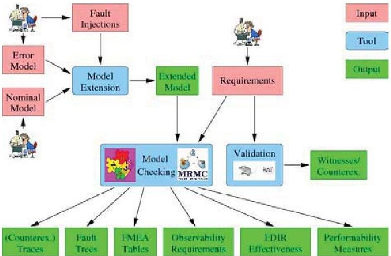
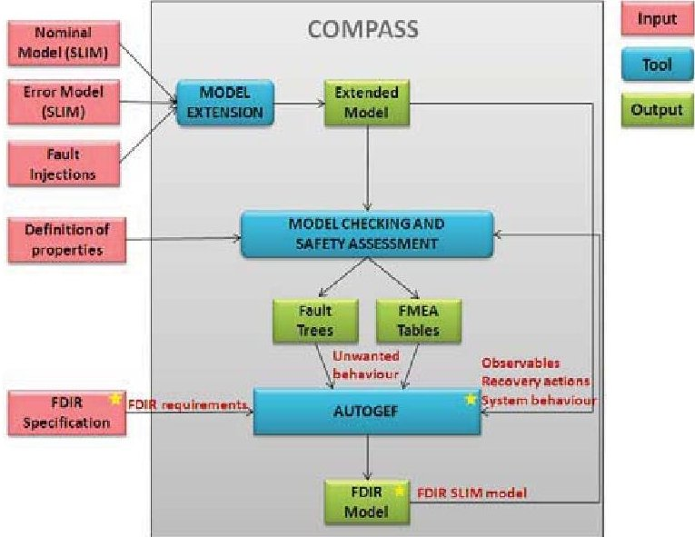
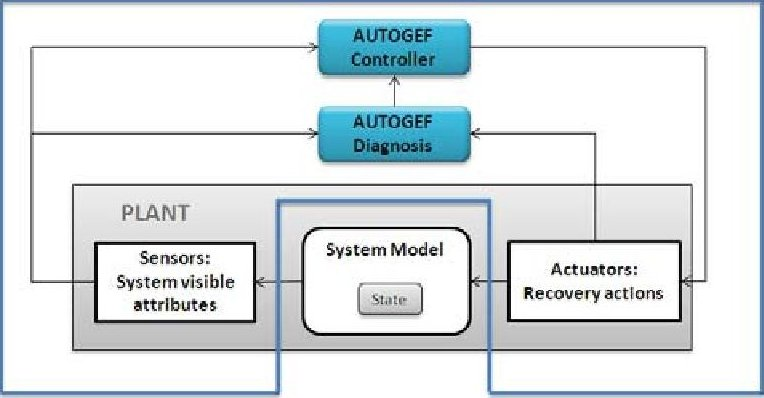
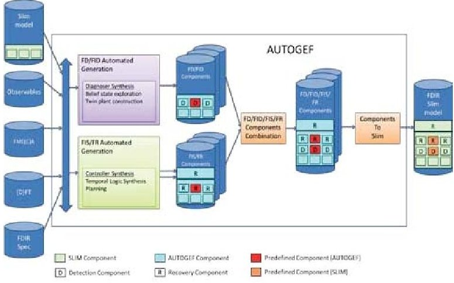
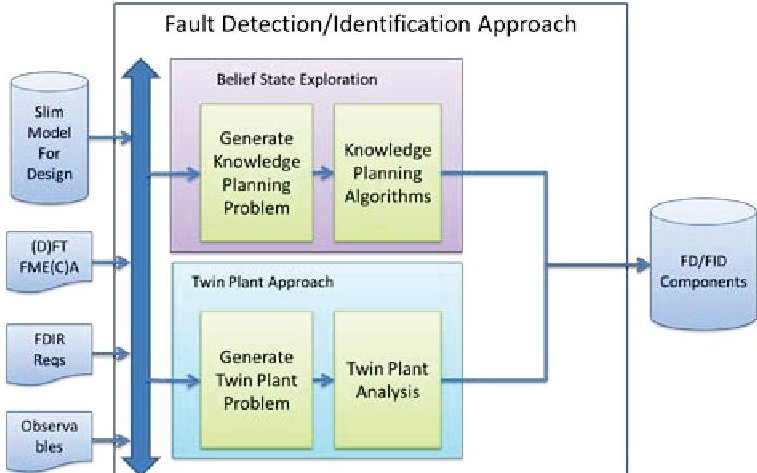
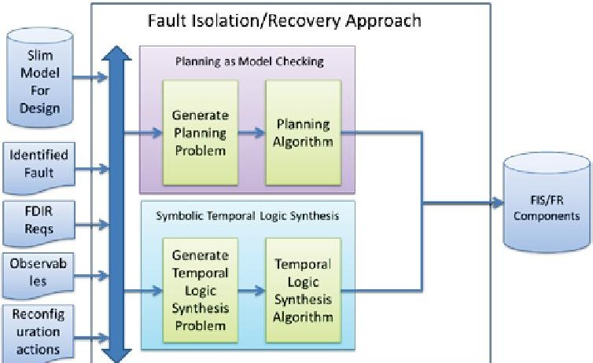

<!-- PDF_PAGE: 1 -->

# AUTOMATED GENERATION OF FDIR FOR THE COMPASS INTEGRATED TOOLSET (AUTOGEF)

$ ^{(1)} $ Elena Alaña, Héctor Naranjo,

$ ^{(2)} $ Yuri Yushtein,

$ ^{(3)} $ Marco Bozzano, Alessandro Cimatti, Marco Gario,

$ ^{(4)} $ Régis de Ferluc, Gérard Garcia

$ ^{1} $GMV, Isaac Newton, 11, Tres Cantos, Madrid, 28760, Spain, Email: {ealana, hnaranjo}@gmv.com $ ^{2} $European Space Agency (ESA), ESTEC Noordwijk - The Netherlands, Email: yuri.yushtein@esa.int $ ^{3} $Fondazione Bruno Kessler (FBK), Italy, Email: {bozzano, cimatti, gario}@fbk.eu $ ^{4} $Thales Alenia Space, France, Email: {regis.deferluc, gerald.garcia}@thalesaleniaspace.com

## ABSTRACT

The ESA AUTOGEF (Dependability Design Approach for Critical Flight Software) study is a direct follow-on of the ESA TRP COMPASS (Correctness, Modelling and Performance of Aerospace Systems).

The aim of COMPASS project was to develop a modelbased approach to system-software co-engineering, tailored to the specifics of critical on-board spacecraft systems. COMPASS included the development of a platform based on formal methods, which offers a wide range of techniques for system verification and validation.

AUTOGEF aims to demonstrate that synthesis approaches can allow for effective automated FDIR development in accordance with the dependability requirements, through the implementation of an add-on to the COMPASS tool.

## 1. INTRODUCTION

Achieving mission objectives and ultimate mission success depends on the space system's resilience, survivability, ability to sustain continued operation, reliability, availability, and safety. As software plays more and more a prominent role in space systems, its contribution to the achievement of the mission objectives and system dependability becomes a vital aspect of the system development.

Failure Detection, Isolation and Recovery (FDIR) represents one of the main functionalities currently implemented in the On-Board Software (OBSW) of the spacecrafts. Its complexity is high as it links together hardware and software behaviour, failures and reconfigurations. However, FDIR definition and design is often performed in the last stages of the project due to its strong coupling with other parts of the system. This late initiation of the FDIR development has a detrimental effect on the eventual FDIR maturity.

Defining an adequate FDIR strategy is inherently complex and implies considering all possible fault and failure combinations. The dependencies of the FDIR on the mission phase, spacecraft operational mode, and FDIR operation history are usually considered only after the FDIR development has been initiated. In order to accommodate for these dependencies, exceptions must be introduced in the FDIR operation logic.

As various sub-systems and equipment tend to incorporate some local FDIR functionalities, the global FDIR concept shall account for coordination of the local FDIR elements to achieve FDIR coherency. As a result, FDIR development proves to be a very challenging process.

Currently employed approaches to FDIR development are poorly phased. In fact, no existing approach to FDIR development can be carried out starting from the early

<!-- PDF_PAGE: 2 -->

system development phases, being able to consider the design and Reliability, Availability, Maintainability and Safety (RAMS) data from both, software and system perspectives.

## 2. COMPASS

The ESA project COMPASS [1] has developed a model-based approach from the system-software coengineering perspective, tailored to the specifics of critical on-board systems for the space domain to describe nominal hardware and software operations, hybridity, (probabilistic) faults and their propagation, error recovery, and degraded modes of operation.

The COMPASS project required the development of an integrated language equipped with a unified semantic model for system design, called SLIM: System-Level Integrated Modelling Language ([2] and [3]). This specification formalism has been inspired by the Architecture Analysis and Design Language AADL [4] and its Error Model Annex [5]. AADL is currently being used in the space domain to support the software and system engineering process.

The techniques investigated in the project have been incorporated into a modelling and verification platform, called the COMPASS platform [6] which provides a facility for automatic model extension, that is, integration of nominal and error models, and simulation of the behaviour of the system in presence of faults once one or more fault injections are defined.

The COMPASS framework supports several capabilities by using a single model description, including requirements validation, functional verification, dependability and safety assessment, fault tolerance evaluation, and FDIR reliability and performability analyses [7].

The results of the COMPASS project provide a good basis for FDIR development. However, while providing the necessary elements for the FDIR design and modelling together with the facilities for diagnosability and FDIR analyses, this toolset does not implement the synthesis of any of the FDIR elements, which is thus assumed to be manually designed, modelled and codified.

The functionalities provided by the COMPASS platform are summarized in Figure 1.

Figure 1: Functionalities of the COMPASS platform

## 3. AUTOGEF CONTEXT

The ESA TRP AUTOGEF is an on-going study which has a global objective of demonstrating that synthesis approaches, in the context of the system-software coengineering environment, can allow for effective automated FDIR development in accordance with the dependability requirements. Another aim of the project is to provide automated FDIR synthesis functionality as an add-on tool for the COMPASS platform.

An innovative model-based and dependability-oriented FDIR development approach is required, which considers current FDIR architectures and strategies, development phasing, and schedule constraints concerning FDIR development. This approach shall be supported by rigorous formal methods, providing the possibility of application in the early development stages with short automated development iterations and allowing for effective use of the available software and system designs and corresponding RAMS analysis data. Furthermore, FDIR design shall be implemented in accordance with the FDIR requirements, software and system architectural design, and system-level dependability requirements.

This approach shall fit into the system-software coengineering environment developed in the COMPASS project, and leverage the SLIM modelling for architecture, nominal and fault behaviours, and the results of the automated analyses (e.g., FMEA/FMECA, FTA, Diagnosability).

<!-- PDF_PAGE: 3 -->

Synthesis techniques shall provide facilities for automated generation of the FDIR sub-system(s) based on, not only the available SLIM model(s) and analyses results, but also the FDIR specification which configures it for a specific spacecraft mission.

## 4. FDIR SPECIFICATION

The FDIR operational behaviour, its architectural requirements and the dependability and safety characteristics are called "FDIR Specification". These features are not captured in the system model, and its definition is needed to tailor the FDIR model according to the mission goals.

FDIR implementation depends on the architectural constraints of the system and additionally, as there is currently no standardized architecture for the FDIR component, the architecture design varies depending on the type of spacecraft mission.

Generally, local FDIR provides a faster detection and recovery, whereas a global FDIR is preferred when the recovery actions involve different subsystems. FDIR is typically distributed across different levels, and FDIR mechanisms and operational behaviours may vary depending on the hardware or software layers. Therefore, each level in the hierarchical architecture may be designed following a different design pattern.

AUTOGEF will support the following types of architectures: centralized, decentralized/ distributed and hierarchical, which can be combined in the different components of a synthesized single FDIR system (e.g., decentralized architecture for fault detection and identification in each subsystem, but centralized for fault isolation and recovery).

Pre-existing components can be provided by the user, together with additional constraints (operational and architectural requirements) that describe how they have to be inserted in the FDIR system, and their purpose.

Recovery actions can be prioritized based on the target dependability characteristics (e.g., criticality of top feared events). The system has to guarantee the selected dependability policy, implementing fault tolerance mechanisms, and the implementation of allowed margins to be applied along the design process. The FDIR has to comply with this policy and execute the recovery actions accordingly.

In addition, synthesis routines can use predefined recovery strategies to reduce the workload of the synthesis process. Predefined recovery strategies are provided similarly to pre-existing components. The user can define constraints (operational and architectural requirements) that describe how a specific strategy has to be used in the synthesized FDIR, and its purpose.

Finally, a common FDIR specification can be defined for the whole mission but also specific requirements may be raised depending on the mission phase or active operational mode.

## 5. AUTOGEF INTEGRATION INTO COMPASS

The implementation of AUTOGEF capabilities requires interacting with COMPASS data and tools. Figure 2 illustrates the general schema of the integration between AUTOGEF and COMPASS. A star identifies those inputs, outputs and tools that will be developed during AUTOGEF study.

Figure 2. AUTOGEF integration into COMPASS platform

As depicted in Figure 2, AUTOGEF inherits the SLIM system model (nominal and error behaviour) and the set of system unwanted behaviours identified by COMPASS safety assessment artefacts (i.e., FMEA tables and Fault Trees) from the COMPASS platform.

Nevertheless, FDIR design also relies on the FDIR specification which is neither captured in the system model nor standardized. Currently, there is a lack of FDIR reference architecture and, additionally, the operational behaviour and dependability and safety requirements are mission-specific. Therefore, FDIR

<!-- PDF_PAGE: 4 -->

specification may differ along different types of spacecraft missions, mission phases or even operational modes. To take these requirements into account, the System/RAMS Engineer shall load this information for a particular space mission.

## 6. AUTOGEF PROCESS

The AUTOGEF tool automatically generates the FDIR subsystem(s)/component(s) model based on the following inputs:

- COMPASS extended model which integrates nominal and error models. It is automatically generated by COMPASS once both models are designed and one or more fault injections are defined.

- The set of system observables. An "Observable" represents a system parameter in the nominal model which is accessible or visible by the FDIR component(s).

- The set of recovery actions defined in the nominal model.

- COMPASS dependability and safety analyses: FTA and FMEA.

- FDIR specification: operational objectives, target system dependability (safety) characteristics and architectural requirements. This data shall be specified by the System/RAMS Engineer.

To achieve this, the System/RAMS Engineer has to perform the following set of steps to generate the FDIR model in SLIM language:

1) Design nominal and error system models (SLIM language).

2) Specify the set of observable attributes in the nominal model.

3) Specify one or more fault injections.

4) Define the properties to be verified during Fault Tree and FMEA analyses.

5) Generate the FTA:

o Selection of the properties to be analysed.

o Generation of FTA which shows how the state of the property is reached expressed in terms of fault events in the SLIM language.

6) Generation of FMEA tables:

o Selection of those properties to be analysed.

o Selection of the cardinality.

o Generation of FMEA which shows the failure modes and effects.

7) Specify FDIR requirements.

8) Start AUTOGEF execution.

The implementation of AUTOGEF requires synthesising one or more diagnosers and controllers which are compliant with the FDIR specification.

## 7. DIAGNOSER AND CONTROLLER SYNTHESIS

The design and implementation of FDIR synthesis routines is based on a special case of system controller (Figure 3) Error! No se encuentra el origen de la referencia.. Fault detection and identification can be reduced to the diagnoser synthesis problem whereas the fault isolation and recovery can be reduced to the controller synthesis problem.

Figure 3. Architecture of a diagnosis system in the scope of AUTOGEF

The sensors represent a set (or subset) of the system visible attributes (observables) that AUTOGEF monitors to perform the diagnosis and controller functionalities.

The system is continuously monitored for inconsistencies and its state is estimated by the diagnosis functionality. Unexpected behaviours can be defined analysing the FTA and FMEA faults and failure modes as well as considering the FDIR detection means and operational conditions specified by the System/RAMS Engineer.

The FDIR design is constrained by the number of sensors (observables) available. Generally, systems are not fully observable and diagnosis has to infer the set of causes for the unexpected behaviour just considering the set of observables available.

Taking this into account, in some circumstances the state of the system cannot be determined for an

<!-- PDF_PAGE: 5 -->

unexpected behaviour (e.g., several causes generate the same failure mode). In this case, the system is not diagnosable [8], and it might be possible to apply some action that overcomes any of the possible causes.

Additionally, the diagnoser and controller synthesis depends on the FDIR specification. For instance, instead of having just one controller for the whole system model as shown in Figure 3, the FDIR specification may state that there must be one controller for each subsystem: a distributed FDIR system.

## 8. AUTOGEF SYNTHESIS ROUTINES

The core of AUTOGEF are the synthesis routines for FDIR and the generation of the corresponding SLIM code. They are illustrated in Figure 4, Figure 5 and Figure 6 below.

Figure 4 illustrates the overall approach of AUTOGEF. In this picture, the following entities are included:

- SLIM components (light green boxes). The SLIM model may contain, in general, several components, organized in a distributed / hierarchical manner.

- AUTOGEF components (light blue boxes). An AUTOGEF component is stored using an internal format.

- Predefined components (red and orange boxes). A predefined component is:

o An existing component for Fault Detection (FD) / Fault Identification (FID), or

o An existing component for Fault Isolation (FIS) / Fault Recovery (FR), or

o A predefined recovery strategy (for FR).

They can be implemented either in SLIM format (orange boxes) or AUTOGEF format (red boxes).

- In addition, components for fault detection are marked as 'D' and components for fault recovery are marked as 'R'.

The objective of AUTOGEF is to synthesize an FDIR sub-system, organized in accordance with the user's architectural constraints (e.g., centralized, distributed, hierarchical), possibly split into several components.

As an example, Figure 4 illustrates the case of an input SLIM model which contains one top-level component and three nested sub-components. It is assumed that the user requirements specify the synthesis of a fully distributed FD (one detection component for each SLIM

sub-component; no central detection) and a partially distributed FR (one recovery component for each SLIM sub-component, coordinated by one top-level recovery component). Moreover, it is assumed that for one component (red box), AUTOGEF must re-use an existing component and a predefined recovery strategy.

Figure 4. AUTOGEF overall approach

AUTOGEF flow consists of synthesizing two separate sets of components for FD/FID and FIS/FR, blending them using components combination, and translating the result into SLIM, producing the final SLIM model for FDIR. Logically, four main components are distinguished:

- The FD/FID synthesizer which produces a set of components for FD/FID.

- The FIS/FR synthesizer which produces a set of components for FIS/FR.

- The module that combines the two sets of components for FD/FID and FIS/FR into one single set of components.

- The component which translates a set of components into SLIM language.

Figure 5 and Figure 6 illustrate the approach for synthesizing the sets of components for FD/FID and FIS/FR, respectively. Both approaches can exploit different techniques.

<!-- PDF_PAGE: 6 -->

Figure 5. AUTOGEF approach to FD and FID

For FD/FID, belief state exploration [9], [10] and [11]) and the twin plant approach [8] will be used. It is envisaged that the twin-plant approach will be employed to implement a diagnosability check that could (optionally) be run before the synthesis routines, in order to verify if the diagnosis synthesis problem is solvable. This diagnosability check will leverage existing functionalities of the COMPASS platform, such as diagnosability analysis, although AUTOGEF diagnosability analysis might implement more advanced functionalities than COMPASS. In some case, it might be inconvenient to run the diagnosability check (e.g., due to efficiency reasons), and therefore AUTOGEF is allowed for running directly the synthesis routine. It is envisaged that the synthesis routine itself will be implemented using a mixed approach based on belief state exploration, and inheriting some characteristics from the twin-plant approach.

Figure 6. AUTOGEF approach to FIS and FR

For FIS/FR, planning as model checking ([12], [13], [14] and [10]), and temporal logic synthesis ([15], [16], [17] and [18]) will be used. It is envisaged that two distinct algorithms, based on these techniques, will be implemented and evaluated in terms of adequacy and efficiency.

## 9. CONCLUSIONS

FDIR plays a key role in the On-Board Software of the spacecrafts. However, FDIR, which is in charge of handling most of the failures occurring on the satellite, is often defined very late in the process, and based on inputs from safety analysis which are hard to link with the software items.

An innovative model-based and dependability-oriented FDIR development approach is required, which considers current FDIR architectures and strategies, and relies on existing technical issues, development phasing, and schedule constraints concerning FDIR development. Hence, this approach shall be supported by rigorous formal techniques, providing the possibility of application in the early development stages with short automated development iterations and allowing for effective use of the available software and system designs and corresponding RAMS analysis data.

The ESA project COMPASS focused on the development of a theoretical and technological basis for the system-software co-engineering approach, based on a coherent set of specification and analysis techniques for evaluation of system-level correctness, safety, dependability and performability of on-board computerbased aerospace systems, with the aim of significantly improving the reliability of modern and future space missions.

The COMPASS project results provide a good basis for FDIR development. However, while providing facilities for FDIR and dependability analyses, and the necessary elements for the FDIR design and modelling, it does not implement the synthesis of any of the FDIR elements.

The AUTOGEF project is an on-going study which will provide automated FDIR synthesis functionality as an add-on tool for the COMPASS platform.

The use of COMPASS and AUTOGEF toolset approach shall allow for FDIR design in accordance with the FDIR requirements, software and system architectural design, and system-level dependability requirements and will provide the following improvements to the current FDIR process:

1. Larger vision on the system to define the FDIR. AUTOGEF does not only answer to a fault in isolation, but has a complete vision of the consequences of the fault.

<!-- PDF_PAGE: 7 -->

2. Consideration of hardware parts and their associated Reliability, Maintainability, Availability and Safety (RAMS) analyses in the FDIR development process.

3. Early verification framework, supported by a model of the system for FDIR analysis.

In order to check that AUTOGEF tool overcomes existing drawbacks in current FDIR development processes, the tool will be evaluated on a case study involving FDIR development for critical on-board space systems. The results will be analysed in terms of applicability, scalability, usability and performance.

The objective of this case-study is to measure different criteria to check if the final product fulfils the project aims. These criteria shall measure the applicability of the AUTOGEF approach for its use in the context of software development for critical on-board space systems and its compliance with current FDIR development processes.

Therefore, different metrics are generated to evaluate whether the FDIR process and the selected FDIR operational objectives, architectural constraints, target dependability and safety characteristics are representative for the whole critical on-board space system and identify the exceptions that are left behind.

## 10. REFERENCES

[1] COMPASS project and Integrated Tool-set. Webpage: http://compass.informatik.rwth-aachen.de

[2] "Specification of the COMPASS System-Level Integrated Modeling (SLIM) Language". 09/06/2011.

[3] "Model-Based Analysis and Verification: Potential Solutions". Technical Note D1-2, Issue 2.0, COMPASS Project, July 2008.

[4] Architecture Analysis and Design Language (AADL) V2. SAE Draft Standard AS5506 V2, International Society of Automotive Engineers, March 2008.

[5] Architecture Analysis and Design Language Annex (AADL), Volume 1, Annex E: Error Model Annex. SAE Standard AS5506/1, International Society of Automotive Engineers, June 2006.

[6] "Integrated platform user manual". Technical Note D9. COMPASS Project, Dec. 2009.

[7] M.Bozzano, A.Cimatti, J.-P.Katoen, V. Y.Nguyen, T.Noll and M.Roveri. Safety, Dependability, and Performance Analysis of Extended AADL Models. The Computer Journal, 54(5):754-775, 2011.

[8] Cimatti, A., Pecheur, C., and Cavada, R., "Formal Verification of Diagnosability via Symbolic Model Checking". International Joint Conference on Artificial Intelligence (IJCAI 2003), Morgan Kaufmann, 2003, pp. 363-369.

[9] B. Bonet and H. Geffner. Planning with Incomplete Information as Heuristic Search in Belief Space. In Proc. 5th International Conference on Artificial Intelligence Planning and Scheduling (AIPS 2000), pages 52-61, 2000.

[10] P. Bertoli, A. Cimatti, M. Roveri, and P. Traverso. Strong Planning under Partial Observability. Artificial Intelligence, 2006.

[11] J. Rintanen. Backward Plan Construction for Planning as Search in Belief Space. In Proc. of 6th International Conference on Artificial Intelligence Planning and Scheduling (AIPS'02), pages 93-102, 2002.

[12] A. Cimatti, M. Pistore, M. Roveri, P. Traverso. Weak, strong, and strong cyclic planning via symbolic model checking. Artif. Intell. 147(1-2): 35-84 (2003).

[13] A. Cimatti, M. Roveri, P. Bertoli. Conformant planning via symbolic model checking and heuristic search. Artif. Intell. 159(1-2): 127-206 (2004).

[14] M. Pistore, P. Traverso. Planning as Model-Checking for Extended Goals in Non-Deterministic Domains, In Proc. of the International Joint Conference on Artificial Intelligence (IJCAI-01), 479-484, 2001.

[15] P. C. Attie, A. Arora, and E. A. Emerson. Synthesis of fault-tolerant concurrent programs. ACM Transactions on Programming Languages and Systems (TOPLAS). (A preliminary version of this paper appeared in Proceedings of the 17th ACM Symposium on Principles of Distributed Computing (PODC), 1998.). 26(1):125-185, 2004.

[16] A. Cimatti, M. Roveri, V .Schuppan, and A. Tchaltsev. Diagnostic Information for Realizability In proc. VMCAI 2008, pages 52-67.

[17] S. Sohail and F. Somenzi. Safety First: A Two-Stage Algorithm for LTL Games. In FMCAD, pages 77-84, 2009.

[18] B. Jobstmann and R. Bloem. Optimizations for LTL Synthesis. In FMCAD, pages 117-124, 2006.