<!-- PDF_PAGE: 1 -->

# AUTOMATED SYSTEM ANALYSIS AND DESIGN FOR ELECTRIC PROPULSION SYSTEMS SEVILLE,SPAIN/14-18MAY2018

Manfred Ehresmann $ ^{(1)} $ , Jonathan Skalden $ ^{(2)} $ , Georg Herdrich $ ^{(3)} $ , Stefanos Fasoulas $ ^{(4)} $

$ ^{(1)} $Institute of Space Systems University of Stuttgart, Pfaffenwaldring 29, 70569 Stuttgart, Germany, ehresmann@irs.uni-stuttgart.de

$ ^{(2)} $Institute of Space Systems University of Stuttgart, Pfaffenwaldring 29, 70569 Stuttgart, Germany, skalden@irs.uni-stuttgart.de

$ ^{(3)} $Institute of Space Systems University of Stuttgart, Pfaffenwaldring 29, 70569 Stuttgart, Germany, herdrich@irs.uni-stuttgart.de

$ ^{(4)} $Institute of Space Systems University of Stuttgart, Pfaffenwaldring 29, 70569 Stuttgart, Germany, fasoulas@irs.uni-stuttgart.de

KEYWORDS: Electric Propulsion, Systems Engineering, Arcjets, Evolutionary Algorithms

## ABSTRACT:

In this paper the capability of evolutionary algorithms to analyse and design spacecraft (subsystems is shown. An arcjet based electric propulsion system of a small satellite is used as an example. A scaling model for an arcjet system including auxiliary components like power processing unit, tank, propellant mass, photovoltaic power generator has been developed and implemented to quantify the mass fraction of the electric propulsion system with respect to desired thrust, effective exhaust velocity and utilized propellant.

An evolutionary algorithm is applied to the arcjet system scaling model to demonstrate that evolutionary algorithms are capable to bypass complex multidimensional design optimisation problems. An evolutionary algorithm is any algorithm that uses a method of random mutation to change input parameters and a defined selection criteria (i.e. mass fraction) to successively refine solutions. With sufficient generations of design points local optima are determined and thus optimal system configurations are found.

## INTRODUCTION

The Integrated Research Platform for Affordable Satellites (IRAS) [1] is an on-going project of the German Aerospace Center (DLR) with the Institute of Space Systems of the University of Stuttgart (IRS) as subcontractor. The project aims for reducing the overall costs of satellite design and production by considering commercial of the shelf products currently utilized in the automotive industry, accelerating and improving the development process through novel (additive) manufacturing processes and methods as well as the creation of a digital concurrent engineering platform (DCEP). The DCEP is a toolbox

that will incorporate multiple integrated system and mission design tools available to the project partners. It will allow the remote access to the tool set and the integrated communication capability of individual design tools allows for a much quicker design process as a multitude of engineering problems can be tackled in a streamlined way.

The presented work is part of an IRS contribution to the DCEP currently in development with far reaching generic application as evolutionary algorithms can be applied to optimize systems of arbitrary complexity.

The development of this tool is in the spirit of IRAS in general and the DCEP in particular as designing a spacecraft is a process that consumes significant amount of time and funding. Conventionally, human developed concepts are explored by applying mathematical modelling of systems and subsystems to find a suitable solution manually.

Manual design does not necessarily lead to the most efficient and effective spacecraft design. An engineer is advised to produce simple solutions with concepts that have well established heritage. Following this approach innovation is mainly achieved by successive and sometimes incremental improvement of previous designs, while each increment of design iteration will consume a significant amount of time. The human element can become an issues as a personnel might get fatigued by too many numbers of design iteration loops or designers might become attached to a developed solution and loose their objectivity.

The development speed is furthermore directly limited by the effectiveness of the humans involved. Today significant computing power is available to aid the design process qualitatively and quantitatively and shorten the overall development duration. In this paper it is explored whether a automated design approach by evolutionary algorithms produces viable solutions for utilizing an electric propulsion systems in a quick and ideally innovative way and give indications for optimization potential.

<!-- PDF_PAGE: 2 -->

Such an optimization is by nature multidimensional Each optimize able parameter such as mass, volume, power consumption, heat generation of each individual subsystem is a dimension of the problem. Hence, the total parameter space is very large and an exhaustive search through all possible system configurations is beyond current computing capabilities due to the large number of possible system configuration permutations.

The problem can still be solved, when utilizing evolutionary algorithms. A very rough initial set of data points / or system configurations is calculated and rated with respect to given requirements. Suitable configurations/data points are selected for the next generation of iteration. These are mutated by varying permitted degrees of freedom in the configuration and re-rating the newly generated solutions for further selection. This process of mutation and selection is repeated until convergence is achieved. By this method it is possible to successively optimize a system to find multiple optimal points in the multidimensional hyperspace of possible solutions.

This principle is applied here for the design optimisation of electric propulsion systems with an explicit example of an arcjet based system. The software allows to scale several arcjet propulsion technologies, with respect to generated thrust and effective exhaust velocity and varying propellants, while considering physical limitations.

An important reference for this work is the arcjet thruster database [2] available to the Institute of Space Systems of the University of Stuttgart.

## SYSTEM BASELINE

A nominal IRAS satellite has a mass of $ m_{0}=150 $ kg and an operational orbit altitude of $ h=800 $ km above ground with an inclination of $ i\approx 89^{\circ} $ [3].

Two transfer orbit concepts are compared as a baseline trade-off.

For concept A a circular orbit at height $ h_{A}=7 5 9 \ km $ and inclination $ i_{A}=8 7. 2 4^{\circ} $ is considered, which results in requiring a velocity increment of $ \Delta v_{A}=6 8 5. 9 7 \frac{m}{s} $ [3].

For concept B an elliptical circular orbit with perigee height of $ h_{\mathrm{peri},\mathrm{B}}=4 0 0 ~ \mathrm{k m} $ and apogee height $ h_{\mathrm{peri},\mathrm{B}}=8 0 0 ~ \mathrm{k m} $ with an ideal initial inclination of $ i_{B}=8 9^{\circ} $ is considered. This results in a velocity increment requirement of $ \Delta v_{B}=5 2 6. 2 5 \frac{m}{s} $ [3].

## Electric propulsion system

The arcjet system concept is simplistic as in the current baseline only self-pressurizing propellants are considered. These are ammonia (NH3) and helium (He). A concept schematic is given in Fig. 1.

Ammonia can be considered a system with uniform operational pressure until end of life is reached, as it is stored in liquid phase and vaporizes and therefore self-pressurizes constantly. At end of life the remaining gaseous ammonia experiences a blow down effect.

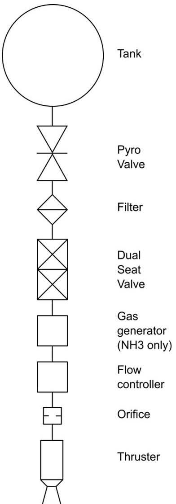

Figure 1. Generic flow schematic of electric propulsion system for NH3 and He propellants.

In contrast helium is stored in highly pressurized gaseous form, where blow-down occurs over the full operational lifespan. Reducing the efficiency of the propulsion system.

In both cases propellant is stored in a respective tank, which is intended to flow through a pyro valve and dual-seat valve. A filter in between will catch occurring debris after triggering the pyro valve. In the case of NH3 an additional gas generator is required to ensure that a it is present completely in gaseous form A flow controller in combination with an orifice is utilized to adjust the supplied pressure to the desired operational pressure of the utilized arcjet thruster.

As arcjet thruster the Very Low Power Arcjet - VELARC [4] with supplied power of $ P_{1}=1 5 0 $ to $ P_{2}= 3 0 0 $ W is taken as current baseline. To further explore the parameter space of potential systems with power supply up to several kilowatt are considered.

## EP SYSTEM SCALING MODEL

The scaling of the electric propulsion system pivots around a total mass budget estimation $ m_{\mathrm{EP}} $ of the individual component given in Eqn. 1. In its current form thruster mass $ m_{\mathrm{Thruster}} $ , mass of power processing unit $ m_{\mathrm{PPU}} $ , propellant mass $ m_{\mathrm{Prop.}} $ , tank mass $ m_{\mathrm{Tank}} $ , photovoltaic mass $ m_{\mathrm{PV}} $ and structural

<!-- PDF_PAGE: 3 -->

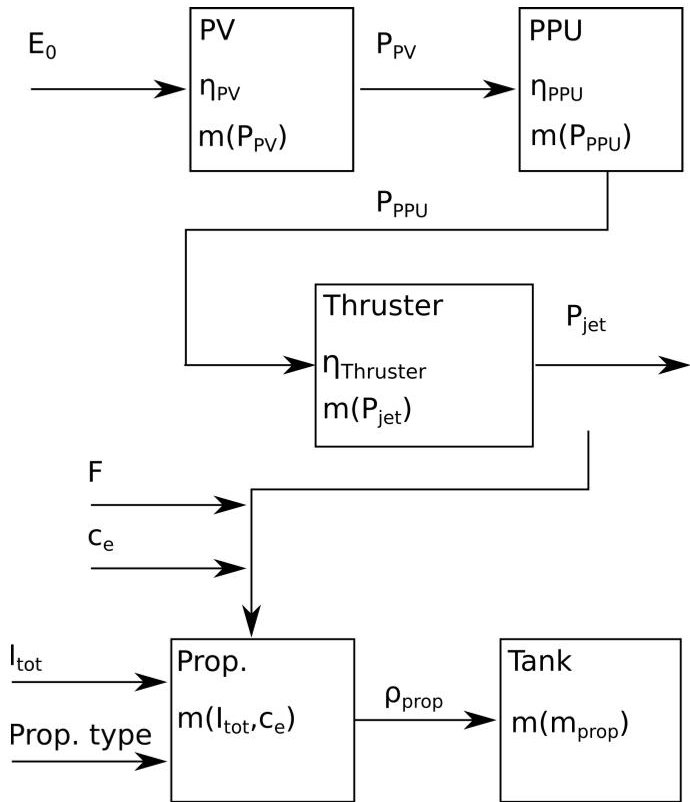

Figure 2. Parameter inputs and dependencies of implemented electric propulsion system model.

$$
\begin{array}{l} m _ {\mathrm {E P}} = m _ {\mathrm {T h r u s t e r}} + m _ {\mathrm {P P U}} + m _ {\mathrm {P r o p .}} + \\ + m _ {\mathrm {T a n k}} + m _ {\mathrm {P V}} + m _ {\mathrm {S t r u c t}}. \\ \end{array}
$$

mass $ m_{\mathrm{Struct}} $ is considered. Thus, the following equation yields the mass budget:

To be able to automatically select an advantageous system over another an objective criteria is required. Subjective ratings like trade-off matrices should be avoided. Thus, the electric propulsion system mass fraction $ \mu_{\mathrm{EP}} $ is introduced, which is obtained by dividing the system mass $ m_{\mathrm{EP}} $ by the total satellite mass $ m_{0} $

$$
\mu_ {\mathrm {E P}} = \frac {m _ {\mathrm {E P}}}{m _ {0}}.
$$

The logical decomposition of the electric propulsion system mass is illustrated in Fig. 2. As input parameter the mission required total impulse $ I_{\mathrm{t o t}} $ can be seen as a constant, while other parameters like thrust F, effective exhaust velocity $ c_{e} $ and propellant type are degrees of freedom for optimization.

By this the jet power $ P_{\mathrm{jet}} $ becomes defined, which defines the mass of the respective arcjet thruster. When considering the efficiency of the thruster $ \eta_{\mathrm{Thruster}} $ the required output power $ P_{\mathrm{PPU,out}} $ of the power processing unit (PPU) can be calculated to scale the mass of the PPU $ m_{\mathrm{PPU}} $ . By considering the PPU efficiency $ \eta_{PPU} $ the required input power for the PPU $ P_{\mathrm{PPU,in}} $ defines the output power of the photo voltaic system $ P_{\mathrm{PPU,out}} $ , which mass $ m_{\mathrm{PV}} $ scales with the area specific input power of solar irradiation $ E_{0} $ Propellant mass $ m_{\mathrm{prop}} $ on the other hand is mainly dependent on the required total impulse $ I_{\mathrm{tot}} $ and considered effective exhaust velocity $ c_{e} $ . With the density of the considered propellant $ \rho_{\mathrm{prop}} $ and the resulting propellant volume the tank mass $ m_{\mathrm{tank}} $ can be defined.

## Scaling of components

In this subsection the scaling laws applied to the individual components are detailed. Potential of varying degree for refined scaling resolution exists in each category.

Furthermore, this modular approach can be utilized for the more generic extension of the software application, as additional case distinctions or specialized performance parameters can be introduced on any level.

## 3.1 Thruster

To scale the mass of the arcjet thruster $ m_{\mathrm{Thruster}} $ a dependency with the jet power $ P_{\mathrm{jet}} $ is required. The jet power $ P_{\mathrm{jet}} $ is defined as:

$$
P _ {\mathrm {j e t}} = \frac {1}{2} \dot {m} c _ {e} ^ {2},
$$

with the efficiency of the thruster

$$
\eta_ {\mathrm {T h r u s t e r}} = \frac {P _ {\mathrm {j e t}}}{P _ {\mathrm {P P U , o u t}}}
$$

the arcjet thruster input power $ P_{\mathrm{Thruster,in}} $ serves as a basis for scaling. For NH3 the $ \eta_{\mathrm{Thruster,NH3}} $ is within the range of 28.3 and 29.3 %. Helium achieves much higher efficiencies due to the absence of dissociation and other losses. Thus $ eta_{\mathrm{Thruster,NH3}} $ reaches between 67.8 and 69.3 %. With the aid of the arcjet database available to the IRS [2] a linear interpolated mass estimation for four power classes has been obtained:

$$
m (P) = \left\{ \begin{array}{l l} 0. 3 0 \mathrm {k g} & | P \leq 3 0 0 W, \\ 0. 2 0 \mathrm {k g} + 3. 3 3 \cdot 1 0 ^ {- 3} \frac {\mathrm {k g}}{W} \cdot P & | 3 0 0 W \leq P \leq 1. 5 k W, \\ 0. 4 9 \mathrm {k g} + 1. 4 \cdot 1 0 ^ {- 4} \frac {\mathrm {k g}}{W} \cdot P & | 1. 5 k W \leq P \leq 1 0 k W, \\ 0. 0 2 \mathrm {k g} + 1. 8 \cdot 1 0 ^ {- 4} \frac {\mathrm {k g}}{W} \cdot P & | P \geq 1 0 k W. \end{array} \right.
$$

It is assumed that for a power demand of less than 300 W at least the mass of the VELARC thruster of 0.3 kg is taken as conservative assumption. For power consumption between 300 and 1500 W the mass of VELARC and the ATOS/ARTUS [2] thrusters is linearly interpolated, where the end points of the defined domain are the exact masses of the respective thrusters. For up to 10 kW the MARC [2] thruster is used as reference, while the HIPARC [2] thruster serves as reference for the domain beyond with a confidence up to 100 kW.

## 3.2 PPU

The power processing unit conditions the supplied power to the specific current and voltage ratings required to operate the arcjet. It is conservatively assumed to have an efficiency of $ \eta_{\mathrm{PPU}}=92\% $ [5]. While the mass of the PPU $ m_{\mathrm{PPU}} $ scales linearly as follows:

$$
m (P) = 1. 0 1 1 \mathrm {k g} + 2. 4 6 5 \cdot 1 0 ^ {- 3} \frac {\mathrm {k g}}{W} \cdot P,
$$

<!-- PDF_PAGE: 4 -->

where the empirical constant for the y-intercept and the slope have been obtained by linear regression of public data of arcjet PPUs [5]. In future work, the mass of an attached thermal management system to cope with the PPUs heat losses will be considered additionally.

## 3.3 Power generation

Electric power is generated by photo voltaic elements. As the IRAS constellation considers a medium Earth orbit the solar constant of $ E_{0}=1 3 6 1 \frac{W}{m} $ is taken as constant power input for the solar cells. Commercially available triple junction Germanium substrate cells offer an efficiency of at least $ \eta_{\mathrm{P V}}=2 9 \% $ [6].

A simple scaling law has been extracted from public available data [6] as the following:

$$
m (P) = 1. 5 6 \cdot 1 0 ^ {- 2} \frac {k g}{W} \cdot P.
$$

A minor error is introduced as for $ P \rightarrow 0 W $ the mass of the power generation system also converges to zero. This error can be neglected as low electric power input produces by definition highly ineffective electric propulsion systems.

## 3.4 Propellant

The required propellant mass $ m_{\mathrm{prop}} $ is obtained through rearranging the definition for total impulse $ I_{\mathrm{tot}} $ , which is a mission specific constant and utilizing the effective exhaust velocity $ c_{e} $ :

$$
m _ {\mathrm {p r o p}} = \frac {I _ {\mathrm {t o t}}}{c _ {e}},
$$

where $ c_{e} $ is a function of the jet power of the arcjet $ P_{\mathrm{jet}} $ , when the mass flow m of Eqn. 3 is given. The mass flow is obtained by:

$$
\dot {m} = \frac {F _ {\mathrm {T h r u s t e r}}}{c _ {e}}.
$$

## 3.5 Tank

To scale the tank mass currently only spherical tanks are assumed, while public available data on tank mass, volume and operational pressure of Orbital ATK [7] is utilized.

As scaling law the following equation has been derived:

$$
m = m _ {0} + a \cdot \left(\frac {m _ {\mathrm {p r o p}}}{\rho_ {\mathrm {p r o p}}}\right) ^ {\frac {3}{2}},
$$

The exponent of $ \frac{3}{2} $ comes from the fact that an area which scales with a power of $ m^{2} $ , is set into relation with a volume, which scales with a power of $ m^{3} $ The following data is implemented for each propellant type.

Helium is stored in fully gaseous form at 300 bar operational pressure: $ m_{0,\mathrm{He}}=2. 7 7 \mathrm{~ k g}, $ $ a_{\mathrm{He}}= 2 5 0. 8 m^{\frac{2}{3}} k g, $ $ \rho_{\mathrm{He},3 0 0 \mathrm{~ b a r}}=4 3. 1 4 \frac{\mathrm{k g}}{m^{3}}. $

Ammonia is stored in liquid form. Thus the following data is used: $ m_{0,\mathrm{NH3}}=1.45 \mathrm{~kg}, $ $ a_{\mathrm{NH3}}=282.0 \, m^{\frac{2}{3}} \mathrm{~kg}, $ $ \rho_{\mathrm{NH3},l}=681.9 \frac{\mathrm{kg}}{m^{3}}. $ Additional level of scaling resolution can be achieved by implementing a full table of available tanks with their respective volumes and directly integrating operational pressures to obtain individually scaled propellant densities for specific tanks.

## 3.6 Structure

The structural mass $ m_{\mathrm{struct}} $ does not necessarily scale with the previous factors that rely on some form of electric power scaling, as thrust and mass flows are comparatively small and structural loads are mainly given be the launcher. Thus, a constant structural mass is considered, which is for helium based concepts assumed as $ m_{\mathrm{struct, He}}=0.49 $ kg and for ammonia based concepts $ m_{\mathrm{struct, NH3}}=0.95 $ kg. The structural mass of a helium based system is lower due to fact that no gas generator is required.

## Concept Comparison

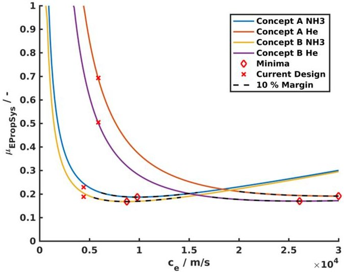

Figure 3. Mass fraction comparison of concept A and B orbital transfers for NH3 and He based arcjet systems for variations of effective exhaust velocity

The electric propulsion system scaling model is applied to compare the different orbital concepts A and B, with utilizing the propellants NH3 and He. Furthermore a variation of $ c_{e} $ is considered to analyse whether an increase or decrease would benefit the mass fraction $ \mu_{\mathrm{EP}} $

A scaling of the arcjet system with constant thrust $ F_{\mathrm{Thruster}} $ is given in Fig. 1, where a theoretical effective exhaust velocity of up to $ 30\frac{\mathrm{km}}{s} $ is considered.

The graph of Fig. 1 clearly demonstrates that in both orbit transfer cases the ammonia based concepts is superior in terms of $ \mu_{\mathrm{E P}} $ as 20 to 25 % is achieved. In comparison with a helium based system for current designs - marked as red cross - mass fractions of 50 and respectively 70 % of the total system mass are required.

Furthermore, it can be obtained that the break even

<!-- PDF_PAGE: 5 -->

point for a helium based arcjet system for this configuration and the orbit transfer of concept B requires at least a $ c_{e} $ of 15 $ \frac{\mathrm{km}}{s} $ .

Additionally, all current designs do profit from an increase of $ c_{e} $ , while helium based systems can experience a significant performance increase the benefit for ammonia based systems is comparatively low. For the convenience of analysis a black dashed line has been added to mark a 10% area around the theoretical achievable optimum. It is important to stretch that the domain around the minima is rather flat. Which means that no significant increase or decrease of $ c_{e} $ changes the achievable $ \mu_{\mathrm{EP}} $ significantly.

For both ammonia based concepts the systems are already in the vicinity of this domain.

## System Component Analysis

The implemented scaling model can furthermore be utilized to analyze the scaling of the individual components. In Fig. 4 to Fig. 7 the electric propulsion system mass fraction $ \mu_{\mathrm{E P}} $ is normed to 1 and the constituting subsystems components depicted as a fraction thereof. For the convenience of the reader a black vertical line is utilized to indicate the actual minimum of each system configuration, as the information of the overall minimum can not be read from the graphs itself. In Fig. 4 as well as in Fig. 6

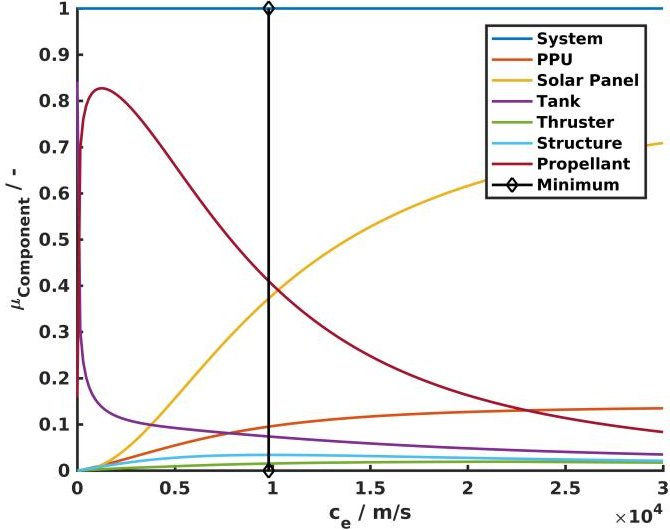

Figure 4. Mass fraction of individual components of the electric propulsion system based on NH3 for constant thrust and variation of $ c_{e} $ for orbit transfer concept A

a similar trend can be observed as both consider the same propellant ammonia. The contributing masses, when approach the theoretical optimum is a decreasing propellant mass and an increasing solar panel mass, as the required power increases proportionally with the square of $ c_{e} $ (see Eqn. 3). The relative tank mass does slightly decrease, while the PPU mass becomes increasingly relevant. Thruster and structural mass do not significantly impact the system as their combined contribution is approximately less than 5 %. When analyzing the trends of the helium based systems in Fig. 5 and Fig. 7

another pattern becomes evident. For a large fraction of the total $ c_{e} $ domain the mass of the propellant tank is a significant contribution, while the solar panel mass becomes relevant for very large $ c_{e} $ .

The propellant mass of helium has a moderate influence due to the fact that it can achieve a high efficiency when utilized in an arcjet, but this advantage is for most applications negated by a required large tank mass.

Structural and thruster masses are similarly small as in the ammonia based concepts. The difference between orbital transfer concept A and B is significant as the theoretical optimum lies at $ c_{e}=3 0 \frac{\mathrm{k m}}{s} $ , while for concept B "only" $ c_{e}\approx 2 6 \frac{\mathrm{k m}}{s} $ is required, making the system sensitive to changes in required total impulse $ I_{\mathrm{tot}}. $

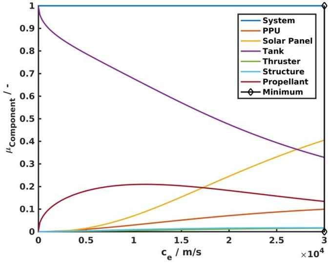

Figure 5. Mass fraction of individual components of the electric propulsion system based on He for constant thrust and variation of $ c_{e} $ for for orbit transfer concept A

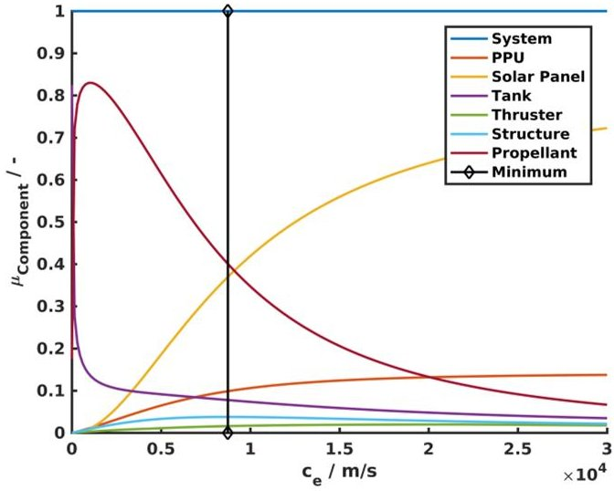

Figure 6. Mass fraction of individual components of the electric propulsion system based on NH3 for constant thrust and variation of $ c_{e} $ for for orbit transfer concept B

<!-- PDF_PAGE: 6 -->

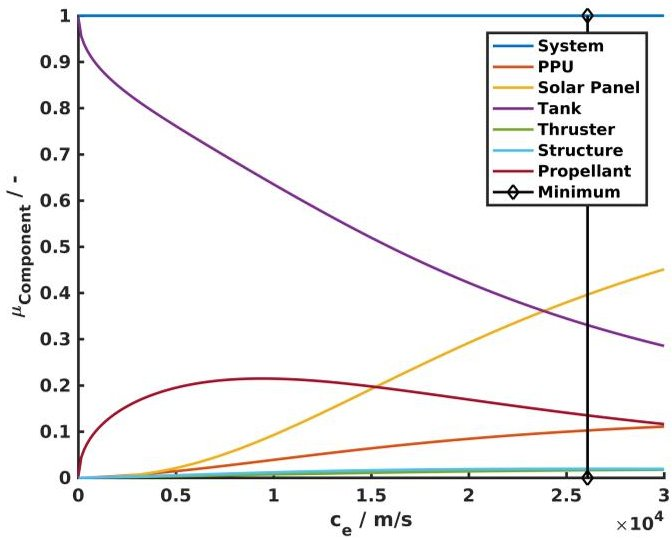

Figure 7. Mass fraction of individual components of the electric propulsion system based on He for constant thrust and variation of $ c_{e} $ for for orbit transfer concept B

## EVOLUTIONARY ALGORITHM

Up until this point the thrust $ F_{\mathrm{Thruster}} $ of the arcjet has been neglected as a degree of freedom. For the permitted thrust domain a minimum of $ F_{\mathrm{Thruster},\mathrm{min}}= 0.01 $ N and a maximum of $ F_{\mathrm{Thruster},\mathrm{min}}= 0.1 $ N is chosen. Thus, the optimization problem presents itself as 4 dimensional, with the parameters $ c_{e}, $ F, propellant type and transfer orbit concept. The fifth dimension is the resulting mass fraction $ \mu_{\mathrm{EP}} $ , when aforementioned input parameters are defined.

A simple evolutionary algorithm with a mutation and selection mechanism has been developed to solve this multidimensional optimization problem.

## Fitness landscape

A fitness landscape is a representation of the available hyperspace of traversable design solutions. Design points will traverse this landscape as they are changed and try to optimize their configuration.

To be able to visualize and verify the performance of the evolutionary algorithm first a full fitness landscape is calculated and given in Fig. 8. This figure already illustrates that although a simple scaling model is applied the determination of optimal solutions is already non-trivial, as complex 3D intersection do exists between individual conceptual hyperplanes.

To allow for better understanding a minimal fitness landscape can be generated, when the current minimum hyperplane is consistently taken to produce a unified mesh. The resulting unified minimal hyperplane is given in Fig. 9.

When colouring the resulting plane for propellant ammonia in green and helium in purple one can obtain a clear demarcation line, where each respective propellant concept system offers a beneficial i.e. lower - electric propulsion system mass fraction $ \mu_{\mathrm{EP}} $ .It is shown that for arcjets that are capable to produce less than $ c_{e}=1 0 \frac{\mathrm{k m}}{s} $ ammonia is the advantageous propellant. For very high $ c_{e} $ and high thrust application helium based arcjet systems can be considered as favourable.

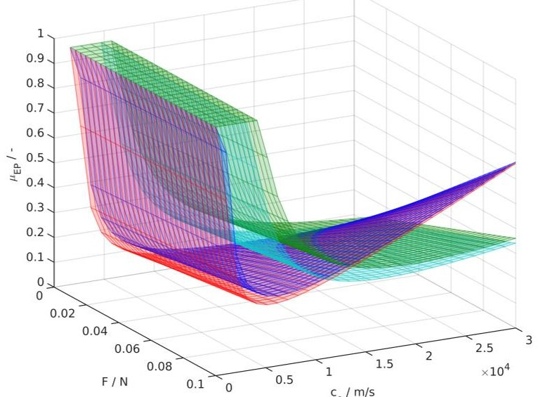

Figure 8. Full five dimensional fitness landscape. Blue plane - concept A ammonia. Green plane concept A helium. Red plane - concept B ammonia. Light blue plane - concept B helium.

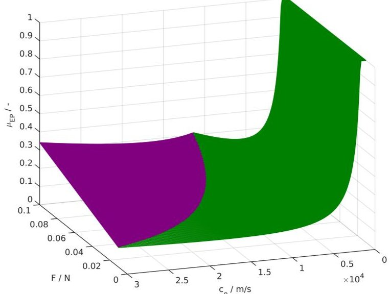

Figure 9. Minimal fitness landscape of scaled EP system for variation of $ c_{e} $ and F. Green area - Ammonia systems. Purple area - Helium systems.

## Mutator

To be able to incrementally improve a given design point with an evolutionary mechanism mutation is required. Mutation is here defined as random variation of defined parameters. In this case specific exhaust velocity and $ c_{e} $ the thrust F as well as the propellant type are mutated.

For the first two parameters that are of type float the following equation has been developed:

$$
x _ {2} = x _ {1} + (- 1) ^ {a} \cdot b \cdot c \cdot d,
$$

where a is a random integer of either one or two which randomly determines whether x is to be increased or decreased.

b is a random integer that decides the maximum in-

<!-- PDF_PAGE: 7 -->

crement a mutation can achieve. Currently it is arbitrarily set to b=100. This means that the individual step size can be anything of 1 to a 100-fold of a permitted minimal increment.

c determines the maximum span of allowed parameters, which is in the case of $ c_{c_{e}}=30,000\frac{m}{s} $ and for thrust $ c_{F}=0.09 $ N.

d is a arbitrary constant to reduce the span of c and reduce the mutation step size to a practical level. It is currently set for the effective exhaust velocity $ d_{c_{e}}=10^{-4} $ and for thrust $ d_{F}=10^{-3}. $

In the case of mutations that occur beyond the permitted parameter space, a reset to the respective boundary value is implemented.

In the case of propellant type mutation a simple random integer is utilized to randomly switch between considered propellants.

It has to be noted that huge potential of improvement exists by further developing the applied mutation principle, as the arbitrary nature of the constants b and d should be avoided as subjective human influence is introduced by it. Furthermore, it is not necessarily required that these parameters are constant, as reiteration after a certain generation number, convergence quality or with respect to a localized area solution can be developed and implemented.

## Selector

Evolutionary optimization is lead by random mutation followed by targeted selection. It is critical to remove the human element from this process. Thus, the objective criteria of $ \mu_{\mathrm{E P}} $ has been determined to be useful for selection.

In the current form a simple selection of improved points in the following form is implemented to determine successively improving parameter sets:

$$
\mathrm {s e t} _ {\mathrm {n e w}} = \left\{ \begin{array}{l l} \mathrm {s e t} _ {\mathrm {m u t a t e}} & | \mu_ {\mathrm {E P}, 1} \leq \mu_ {\mathrm {E P}, 2}, \\ \mathrm {s e t} _ {\mathrm {o l d}} & | \mu_ {\mathrm {E P}, 2} > \mu_ {\mathrm {E P}, 2}. \end{array} \right.
$$

It is critical to note that the $ \leq $ sign in the first line of Eqn. 12 should be favoured in comparison to > as equal solutions with changing input parameters are more likely to serendipitously find new optima in contrast to static design points.

For the point of suitable selection mechanism a great potential for variation exists. For example complete generations with low development performance can be selected for termination to reduce the overall computing power. This could be achieved when considering the global performance span of the current generation of design points and certain fraction on the lower performing end is successively cut off. Alternative selectors might consider the current speed of improvement - i.e. evolution rate - of individual lineages.

## Application

This simple evolutionary algorithm is now applied to the arcjet scaling model. As initial starting points or

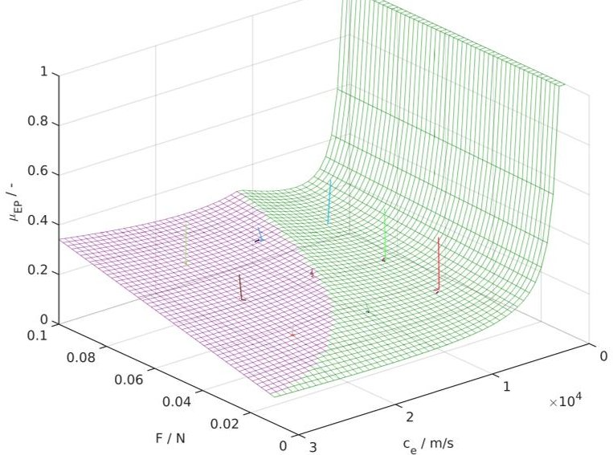

Figure 10. Application of evolutionary algorithm with 18 equally space seed points over 10 generations. Quick drop from initial seed points to minimal plane is visible.

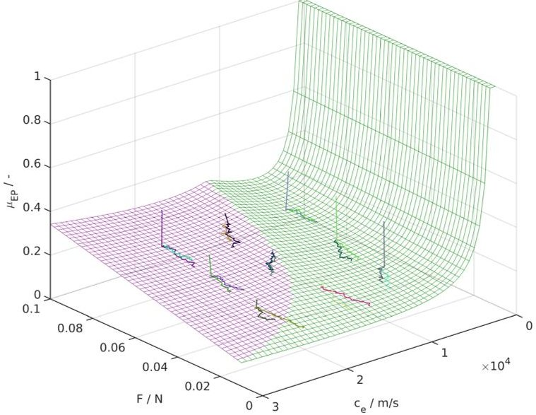

Figure 11. Application of evolutionary algorithm with 18 equally space seed points over 100 generations. Consistent convergence from initial seed points to optimal $ c_{e} $ and F convergence us visible.

seeds an equally spaced grid of three points within the $ c_{e} $ domain as well as the F domain is utilized. This initial set is doubled, by considering both propellant types for all of these initial nice seed points. Thus, the generation 0 of solutions does consist of 18 individual points.

The result of 10,100 and 1000 successive generations of evolution are visible in Fig. 10, Fig. 11 and Fig. 12, where multiple interesting effects can be observed. First, the "squiggly" behaviour of a single lineage in Fig. 11 and Fig. 12 is exactly the behaviour that is expected by a random input parameter mutation. Furthermore, the consistent movement "downhill" most notable in Fig. 12 demonstrates that the selection mechanism works as intended. Overall a minimisation in thrust for minimisation of mass fraction can be expected. Expected ranges of $ c_{e} $ like shown in Fig. 3 are equally confirmed, when initial seed points are in the vicinity before thrust optimisa-

<!-- PDF_PAGE: 8 -->

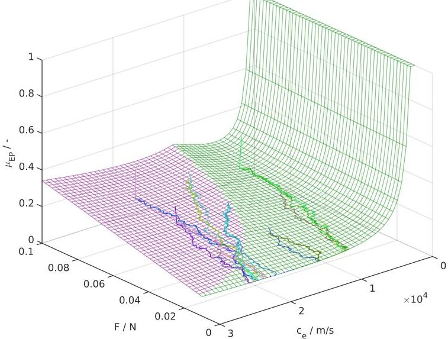

Figure 12. Application of evolutionary algorithm with 18 equally space seed points over 1000 generations. Consistent convergence from center of the parameter space to a minimum thrust configuration is visible.

tion effects become dominant.

For half of the initial seed point population an initial vertical "drop" of a starting point on the minimum plane can be seen after 10 generations in Fig. 10. This is explained by a mutation of propellant type input to a more optimal solution.

Another interesting effect can be observed in Fig. 11 and more notably in Fig. 12, where lineages switch from the helium domain to the ammonia domain. When considering the propellant type demarcation hill shown in Fig. 9 this can be counter intuitive. For an evolutionary algorithm of infinitesimal improvement increments this hill should not be passable, as "moving uphill" would require intermediate less optimal solutions.

As it is evident that the algorithm is still capable to optimize the electric propulsion system beyond this obstacle is due to the fact that the step size is finite and not infinitesimal. A sufficiently large mutation range is thus recommended to allow for the navigation in complex optimisation spaces.

The explicit result of this analysis is that a electric propulsion system mass fraction of $ \mu_{\mathrm{EP}}=0.0955 $ can be achieved for an ammonia based arcjet thruster with a thrust of F=0.01 N and an effective exhaust velocity of $ c_{e}=1 7 3 6 4 \frac{m}{s} $ . It needs to be admitted, that this $ c_{e} $ is unrealistically high for the current state of the art systems, but it gives a clear indication that a larger $ c_{e} $ is favourable for an arcjet based system. Constraining the permitted $ c_{e} $ domain to realistic values allows to generate another optimal and more realistic solution. The ATOS thruster of the IRS with an effective exhaust velocity of $ c_{e}=6 2 0 0 \frac{m}{s} $ is used as a realistic reference [8], which will produce the solution for ammonia, orbit transfer concept B and a thrust of F=0.1 N an electric propulsion system mass fraction of $ \mu_{\mathrm{EP}}=0.1 3 8 0. $

## CONCLUSION

In this paper a generic model for scaling an electric propulsion system at the example of an arcjet based system has been developed. The model relies on scaling laws that hinges on data and performance parameters from available hardware. The scaling model aids in deciding for performance parameters like desired thrust, effective exhaust velocity and propellant type. Furthermore, the scaling model can be used to analyse the component wise contribution of each subsystem mass to the total electric propulsion system mass and indicate where further developments are useful for effective decrease in total mass or respective mass fraction. A simple evolutionary algorithm has been developed to navigate the multidimensional space for determining successively optimal solutions for system configurations, which has been demonstrated.

## OUTLOOK

Significant potential of improvement has been identified during the development of the software.

Interesting technical features of future development are for example the clustering of thrusters or the hybrid application of different propulsion systems.

An improved dependency of the desired $ \Delta v $ instead of the total impulse $ I_{\mathrm{tot}} $ will increase the overall applicability as well as the interchangeability of differing mutate able input parameters (e.g. $ P_{\mathrm{jet}} $ or $ \dot{m} $ ) or limiting parameters like heat generation Q or volume constraints.

A bachelor thesis for the scaling of thermal management systems is ongoing at the IRS and will be implemented as soon as it is ready.

For the evolutionary aspects mutation as well as selection mechanisms will be further improved to become more adaptive to the local vicinity of the parameter space. Especially the forking of lineages into multiple promising branches as well as the removal of unsatisfying lineages will increase the applicability of the software.

## ACKNOWLEDGEMENT

The support of the IRAS project as well as the Ministry of Economic Affairs Baden-Wurttemberg is greatly acknowledged.

## References

[1] Skalden, J., Ehresmann, M. & Herdrich, G. (2017). Electric and Hybrid Propulsion Concepts for IRAS, IRAS Report D3.2.1.

[2] university of stuttgart (2017). Institute of Space Systems Electronic Arcjet Database for Low, Medium and High Power Arcjets.

[3] Skalden, J., Ehresmann, M. & Herdrich, G. (2018). System Component Design of an Electric Propulsion System, IRAS Report D3.2.2.

<!-- PDF_PAGE: 9 -->

[4] Wollenhaupt, B., Hammer, A., Herdrich, G., Fasoulas, S. & Roeser, H.P. Very Low Power Arcjet (VELARC) for Small Satellite Missions, 32nd International Electric Propulsion Conference, Wiesbaden, Germany, URL http://erps.spacegrant.org/uploads/ images/images/iepc_articledownload_ 1988-2007/2011index/IEPC-2011-257.pdf.

[5] Dropmann, M., Ehresmann, M., Le, Q.H., Pagan, A.S., Romano, F., Montag, C. & Herdrich, G. (2017). Final report Cleansat Building Block 28 IRS-16-P07.

[6] dhv technology (2018). Solar Panels for Aerospace Application, URL http://dhvtechnology.com/wp-content/uploads/ 2017/07/Datasheet-Julio-v1-front-back. pdf.

[7] orbital atk (2018). Diaphragm Tanks Data Sheets, URL https://www.orbitalatk.com/ commerce/Data_Sheet_Index_Diaphragm-VOL.aspx.

[8] Wollenhaupt, B., Quand, H.L. & Herdrich, G. (2018). Overview of thermal arcjet thruster development, Aircraft Engineering and Aerospace Technology, 90 (2), 280-301, URL https://www.orbitalatk.com/commerce/ Data_Sheet_Index_Diaphragm-VOL.aspx.