<!-- PDF_PAGE: 1 -->

# Reliving 24 Years in the Next 12 Minutes: A Statistical and Personal History of University-Class Satellites

Michael Swartwout Saint Louis University 3450 Lindell Blvd, St. Louis, MO 63103; 314-977-8214 mswartwo@slu.edu

## ABSTRACT

In 2018, university-class satellites -- spacecraft built by university students for the express purpose of student training -- are widely accepted as a means to recruit undergraduate students into the space workforce, train them effectively before graduation and retain them in the field after graduation. Hundreds of undergraduates at dozens of schools around the world have directly contributed to missions that operated on-orbit. The spacecraft themselves are capable of performance research-grade science or demonstrate new enabling technologies. This was not always the case. For the first forty years of spaceflight, there were exceedingly few university-class missions; those that flew were expensive, marginally-performing and had modest success rates. What changed? Why are university-class missions now commonplace? And, with respect to on-orbit success, are they as good (or as bad) as rumor and hearsay make them out to be?

In this paper and all-too-brief talk, the history of university-class spacecraft will be discussed, with an emphasis on the types of missions and their success rates. Beginning in 1994 (the author's first time attending this conference, as a wide-eyed student) and reaching through to 2018 (the author's 21st, now as a world-weary professor) a statistical and anecdotal review of university-class spacecraft will be presented. Particular attention will be paid to addressing these questions:

1) What kinds of missions have been flown, are being flown and should be flown?

2) What are historical and present-day mission success rates for university-class missions?

3) Why are the mission success rates so poor?

## INTRODUCTION

This author has been documenting the history of university-class space missions nearly 15 years. $ ^{1-12} $ The result of those studies can be broadly summarized as follows:

1) There sure are a lot of student-built satellites, and there will be even more next year.

2) University-class missions have had three watershed years:

1981 The second university-class mission flew (UoSAT-1), starting a steady stream of university-class missions;

2000 A string of on-orbit failures nearly ended student satellite missions in the United States (and directly led to the introduction of the CubeSat standard);

2012 The CubeSat standard was fully embraced by industry professionals, greatly reducing barriers to entry for universities and broadening the numbers and types of participants.

3) While almost all modern university-class missions are CubeSats, not all CubeSats are university-class missions.

4) The student launchspace is dominated by three groups:

a. Flagship universities, whose satellites are the most reliable and have the most significant missions. These flagships fly a new spacecraft every few years;

b. Prolific independent universities, who have developed their own string of successful missions, often using a sequence of missions to study specific science phenomena;

c. Hobbyists, who are still learning how to build successful missions, and have low flight rates and high rates of on-orbit failure.

Why do we need another paper? Well, beyond the obvious excuse to attend this conference, the short answer is: new data and new questions. As many more

<!-- PDF_PAGE: 2 -->

missions fly, it is possible to collect statistically-relevant data sets regarding university-class missions.

For this year, three questions are being addressed.

1. What kinds of missions have been flown, are being flown and should be flown?

2. What are the historical and present-day mission success rates for university-class missions?

3. Why are the mission success rates so poor?

Before we do all that, we must first define our terms. Following the definitions, we will issue our standard disclaimers about how this data was collected and how much it can be trusted.

## Taxonomy

As discussed in previous papers, we narrowly define a university-class satellite as having three distinct features:

1. It is a functional spacecraft, rather than a payload instrument or component. To fit the definition, the device must operate in space with its own independent means of communications and command. However, self-contained objects that are attached to other vehicles are allowed under this definition (e.g. PCSat-2, Pehuensat-1).

2. Untrained personnel (i.e. students) performed a significant fraction of key design decisions, integration & testing, and flight operations.

3. The training of these people was as important as (if not more important) the nominal "mission" of the spacecraft itself.

Exclusion from the "university class" category does not imply a lack of educational value on a project's part; it simply indicates that other factors were more important than student education (e.g., schedule or on-orbit performance). Furthermore, several schools have "graduated" from university-class to professional programs - such as the Technical University of Berlin, and the University of Toronto's Space Flight Laboratory (SFL).

Next, we define two broad categories of university-class programs: flagship and independent schools. A flagship university is designated by its government as a national center for spacecraft engineering research and development. Independent schools are not flagships. We further subdivide independent schools by identifying prolific independent schools; those that manifest four or more missions. Achieving this milestone is an indication of perseverance, internal capabilities and mission connections that result in very different outcomes. As of 2017, twelve independent schools are considered to be prolific.

By definition, flagships enjoy financial sponsorship, access to facilities and launch opportunities that the independent schools do not have. Before 2010, these differences had a profound effect: generally speaking, flagship schools built bigger satellites with more "useful" payloads and tended towards sustained programs with multiple launches over many years. By contrast, the satellites built by independent schools were three times more likely to fail, and for most of these programs, their first-ever spacecraft in orbit was also their last, i.e., the financial, administrative and student resources that were gathered together to built the first satellite are not available for the second. Much has changed in the last eight years.

It is generally understood that a CubeSat-class spacecraft is one that adheres to the CubeSat/P-POD standard developed by Cal Poly and Stanford Universities (i.e., it fits inside the P-POD and follows the flight safety guidelines). However, for the purposes of this study, we also include all of the domestic and international analogs to the P-POD, a list that is too numerous to include here!

## Disclaimers

This information was compiled from online sources, past conference proceedings and author interviews with students and faculty at many universities, as noted in the references. The opinions expressed in this paper are just that, opinions, reflecting the author's experience as both student project manager and faculty advisor to university-class projects. The author accepts sole responsibility for any factual (or interpretative) errors found in this paper and welcome any corrections. [The author has been cutting-and-pasting this disclaimer into every one of these papers for fourteen years and has received only a handful of corrections, so he is left to conclude that either (a) he is the greatest fact-checker ever or (b) nobody reads these papers and/or cares enough to send him updates.]

## UNIVERSITY-CLASS MANIFEST, UPDATED

A list of university-class spacecraft launched from 1970 until the end of 2017 is provided in the Appendix. Because the inclusion or omission of a spacecraft from this list may prove to be a contentious issue - not to mention the designation of whether a vehicle failed prematurely, it is worth repeating an explanation of the process for creating these tables.

First, using launch logs, the author's knowledge and several satellite databases, a list was created of all university-class small satellites that were placed on a rocket. $ ^{13-16} $ These remaining spacecraft were researched regarding mission duration, size, type and status, with

<!-- PDF_PAGE: 3 -->

information derived from published reports and project websites.

Regarding mission class, we use the following definitions:

- C (Communications): The primary mission is to relay communications between two points. Amateur radio service and AIS tracking are common examples.

- E (Educational): The primary mission is the education/professional training of the participants in the spacecraft design lifecycle. To be and E-class mission any science returns or technology demonstrations must be of secondary value to the education. Typically, E-class missions have no science or technology value, except to the mission developers themselves. E-class missions are also called "Beepsats", as they don't do anything but "beep" health & status data back to the ground.

- M (Military): The mission has military relevance that does not properly fit in the other categories. (For example, SIGINT missions.)

- I (Earth Imaging): The mission is to return images of the Earth for commercial and/or research purposes. Planet Labs' Dove constellation is the primary example.

- S (Science): The mission collects data for scientific research, including Earth science, atmospheric science, space weather, etc. To be S-class, there must be a clear connection between the data collected and end-user researchers; a spacecraft that measures the Earth's magnetic field and publishes the data on the web, hoping that some scientist will find the data useful, is not an S-class mission. (It's probably an E-class mission.)

- T (Technology Demonstration): The mission involves the first flight of a new technology or capability, such that it is advanced one or more Technology Readiness Levels (or equivalent indicator). As with S-class missions, it is not enough to simply try out some new technology in space; there must be a clear, obvious process by which the behaviors of this new technology in orbit are validated.

We define levels of mission success based on what fraction (if any) of the mission objectives have been achieved. Mission status is distinct from spacecraft functional status; mission status is only concerned with how much of the primary mission has been achieved. An otherwise-functional spacecraft with a broken primary payload would be stuck at Level 3. A spacecraft that cannot downlink its mission data, for whatever reasons, would be stuck at whatever Level it achieved at the point of failure. A spacecraft that achieved its mission success and then died is still at Level 5.

0 Manifested: A launch date has been published. We don't keep track of missions until a launch date has been published.

1 Launched: The rocket began liftoff. (Launch failures usually stop at Mission Status 1.)

2 Deployed: The spacecraft is confirmed to have released from the launch vehicle.

3 Commissioning: The spacecraft has had at least one uplink and downlink.

4 Primary operations: The spacecraft is taking actions that achieve primary mission success (i.e., receiving commands, downlinking mission data)

5 Mission success: Primary mission objectives have been met. The spacecraft may continue to operate, run secondary missions, etc.

This list of spacecraft is complete to the best of the author's ability. The caveats from previous versions of this work still apply: launch masses should be considered approximate, as should mission durations. Special thanks are given to the author of reference 16 for his extensive archive describing satellite contacts.

## CENSUS DATA AND OBSERVATIONS

2018 marks the author's $ 21^{\mathrm{st}} $ Smallsat conference since his first visit, as a wide-eyed graduate student in 1994. Much has changed, for both the author, the conference and university-class missions.

In keeping with the reflective theme of this paper, the census data will be studied in three sections:

- 1994-2001 This period cover's the author's graduate student years, and could be called "BC" (Before CubeSat). It also corresponds to the development lifecycle of the Sapphire mission, the author's first. As will be shown, these years are characterized by a few, large(r) missions coming out of a few schools. During this period, the flagships dominated the university-class category.

- 2002-2009 This middle period marked the start of the CubeSat expansion. Although in 2018, the rise of the CubeSats seems inevitable, it was by no means a sure thing. (Shameless plug: check the bibliography and read my papers from the time.) This period started the growth of the independent university spacecraft developers.

- 2010-2017 CubeSats are firmly entrenched in the smallsat world. This period is also marked by a significant shift from flagships to independents. A lot of independents.

But don't just take my word for it. As shown in Figure 2, there have been 353 university-class spacecraft launched since 1980, and 344 of them since 1994. And while it is not a perfect split to divide the last 24 years

<!-- PDF_PAGE: 4 -->

into 8-year eras, it is still instructive to show how many university-class missions have come along in the latter portion of this time period.

In terms of simple numbers: from 1 January 1994 until 31 December 2017, there have been 344 university-class spacecraft launched from 166 educational institutions in 47 countries worldwide. Two-thirds of those missions have come in the last 8 years.

While, as shown in Figure 1, a significant number of university missions are not CubeSats, CubeSats do comprise a sizeable majority of the missions.

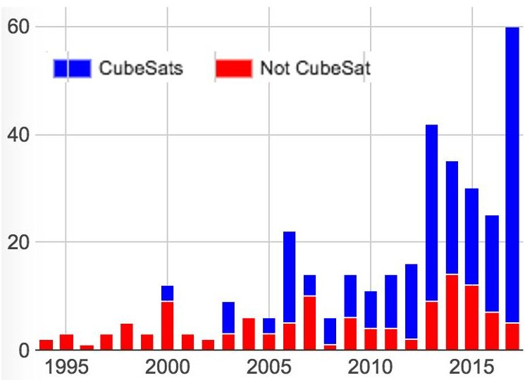

Figure 1: University-Class Missions by Form Factor

As we do in each paper, it is worth repeating how much has changed in the since our first publication on this subject. In 2004, the idea of ten manifested missions a year would have been a delightful notion; today, that would be a significant step backward. CubeSats play an outsized role in the availability of spaceflight to universities. This is worth noting and celebrating.

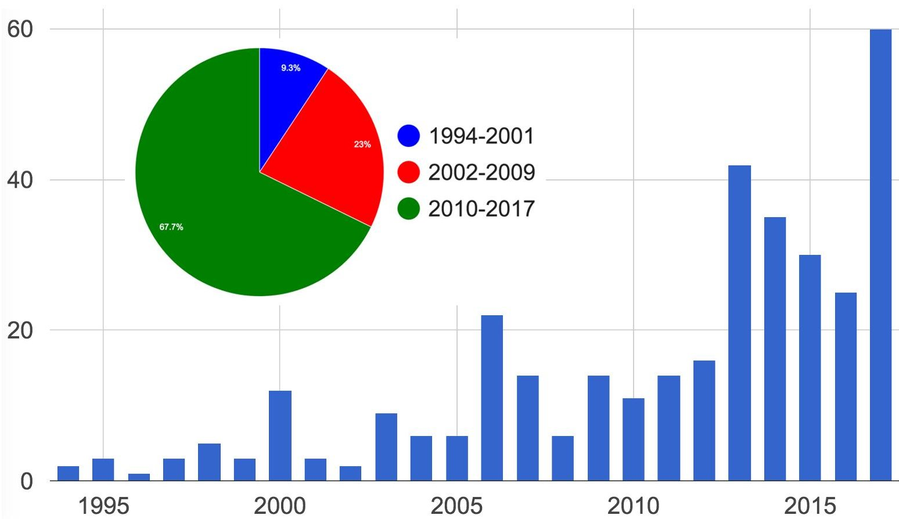

Figure 2: Number of University-Class Missions Launched Each Year, and Grouped by Era

<!-- PDF_PAGE: 5 -->

## Type of Builder

Three hundred fifty-three spacecraft is a large group to study, with a lot of variables within. Next, let us consider the flagship and independent categories of spacecraft builders. It is beneficial to further subdivide the independent category of spacecraft builder into "prolific" and "regular" independent programs. A prolific program has launched four or more CubeSats on at least three separate occasions. We make this distinction because, as will be noted, prolific programs tend to have better overall mission success than the regular independents; these programs are comparable to the flagships in terms of their success.

The other reason for making the distinction is evident in Figure 3 and Figure 4; about a third of all independent missions have been produced by only 12 independent schools. Overall, independent schools produce nearly three-quarters of all university-class space missions and this share is climbing rapidly. As late as 2009, flagships still provided more than half; even two years ago, flagships were one third of the missions flown.

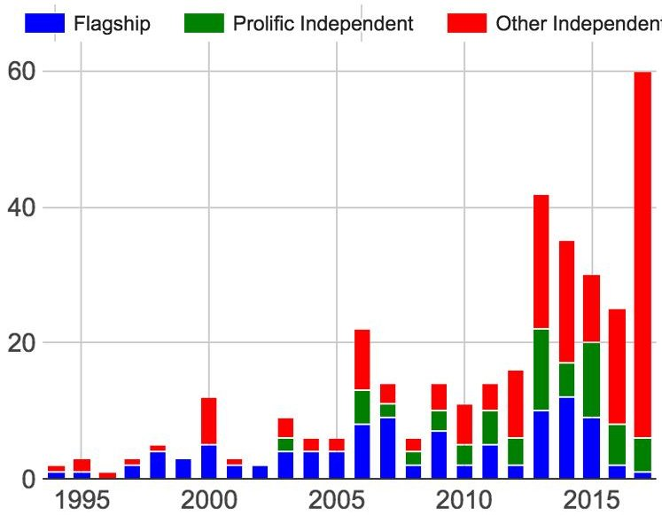

Figure 3: University-Class Missions Each Year by Type of Builder

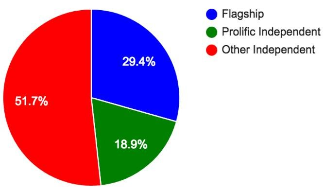

Figure 4: Allocation of University-Class Missions by Builder Type

As of December 2017, we have identified 128 schools that have built at least one university-class mission (Table 1). Flagships comprise 51 of those schools, and 12 of the 117 independent schools are prolific. It should be noted that 27 independent schools have flown their first mission since 2016, and 3 schools have become prolific in that time frame. Note that only 13 of the flagships schools fit the definition of prolific, and only 1 has joined the ranks since our last paper.

These 25 schools have produced 151 missions, an average of 6 per school and more than 40% of all missions; only 37 schools have flown 3 or more missions, and they are responsible for slightly more than half of the missions flown. By contrast, 95 of the 168 schools have produced only one mission. As was true in earlier reports, a subset of the schools are responsible for most of the missions, while the majority of schools only ever launch one.

What has changed are the magnitudes of our counts. In previous papers, we were excited that there were three independent schools with multiple missions. Today, 47 independent schools have flown at least two missions, compared with only 26 flagships. CubeSats have significantly upended the status quo for access to space.

Table 1: Spacefaring Universities.

Flagships are highlighted in yellow, and prolific independents in green

<table border="1"><tr><td></td><td>School</td><td>Nation</td><td>First Launch</td><td>Total</td></tr><tr><td>1</td><td>University of Melbourne</td><td>Australia</td><td>1/23/70</td><td>1</td></tr><tr><td>2</td><td>University of Surrey</td><td>UK</td><td>10/6/81</td><td>4</td></tr><tr><td>3</td><td>Weber State</td><td>USA</td><td>4/29/85</td><td>3</td></tr><tr><td>4</td><td>Technical University of Berlin</td><td>Germany</td><td>7/17/91</td><td>11</td></tr><tr><td>5</td><td>KAIST</td><td>South Korea</td><td>8/10/92</td><td>4</td></tr><tr><td>6</td><td>CNES Amateurs (?)</td><td>France</td><td>5/12/93</td><td>1</td></tr><tr><td>7</td><td>University of Bremen</td><td>Germany</td><td>2/3/94</td><td>1</td></tr><tr><td>8</td><td>National University of Mexico</td><td>Mexico</td><td>3/28/95</td><td>2</td></tr><tr><td>9</td><td>Technion Institute of Technology</td><td>Israel</td><td>3/28/95</td><td>2</td></tr><tr><td>10</td><td>Universidad Politécnica de Madrid</td><td>Spain</td><td>7/7/95</td><td>2</td></tr><tr><td>11</td><td>Russian high school students</td><td>Russia</td><td>10/5/97</td><td>1</td></tr><tr><td>12</td><td>US Air Force Academy</td><td>USA</td><td>10/25/97</td><td>5</td></tr><tr><td>13</td><td>ESTEC</td><td>Europe</td><td>10/30/97</td><td>4</td></tr></table>

<!-- PDF_PAGE: 6 -->

<table border="1"><tr><td>14</td><td>University of Colorado LASP</td><td>USA</td><td>2/26/98</td><td>2</td></tr><tr><td>15</td><td>University of Alabama-Huntsville</td><td>USA</td><td>10/24/98</td><td>2</td></tr><tr><td>16</td><td>Naval Postgraduate School</td><td>USA</td><td>10/29/98</td><td>2</td></tr><tr><td>17</td><td>University of Stellenbosch</td><td>South Africa</td><td>2/23/99</td><td>2</td></tr><tr><td>18</td><td>Arizona State University</td><td>USA</td><td>1/27/00</td><td>2</td></tr><tr><td>19</td><td>Stanford University</td><td>USA</td><td>1/27/00</td><td>3</td></tr><tr><td>20</td><td>Santa Clara University</td><td>USA</td><td>2/10/00</td><td>3</td></tr><tr><td>21</td><td>Tsinghua University</td><td>China</td><td>6/28/00</td><td>4</td></tr><tr><td>22</td><td>King Abdulaziz City for Science &amp; Technology</td><td>Saudi Arabia</td><td>9/26/00</td><td>11</td></tr><tr><td>23</td><td>University of Rome "La Sapienza"</td><td>Italy</td><td>9/26/00</td><td>10</td></tr><tr><td>24</td><td>Umeå University / Luleå University of Technology</td><td>Sweden</td><td>11/21/00</td><td>1</td></tr><tr><td>25</td><td>US Naval Academy</td><td>USA</td><td>9/30/01</td><td>7</td></tr><tr><td>26</td><td>Aalborg University</td><td>Denmark</td><td>6/30/03</td><td>5</td></tr><tr><td>27</td><td>Technical University of Denmark</td><td>Denmark</td><td>6/30/03</td><td>2</td></tr><tr><td>28</td><td>Tokyo Institute of Technology</td><td>Japan</td><td>6/30/03</td><td>4</td></tr><tr><td>29</td><td>University of Tokyo</td><td>Japan</td><td>6/30/03</td><td>6</td></tr><tr><td>30</td><td>UTIAS (University of Toronto)</td><td>Canada</td><td>6/30/03</td><td>4</td></tr><tr><td>31</td><td>Universidade Norte do Paraná</td><td>Brazil</td><td>8/22/03</td><td>1</td></tr><tr><td>32</td><td>Mozhaiskiy Space Engineering Academy</td><td>Russia</td><td>9/27/03</td><td>2</td></tr><tr><td>33</td><td>New Mexico State University</td><td>USA</td><td>12/21/04</td><td>1</td></tr><tr><td>34</td><td>Norweigan Universities</td><td>Norway</td><td>10/27/05</td><td>2</td></tr><tr><td>35</td><td>University of Würzburg</td><td>Germany</td><td>10/27/05</td><td>3</td></tr><tr><td>36</td><td>Bauman Moscow State Technical University</td><td>Russia</td><td>7/26/06</td><td>2</td></tr><tr><td>37</td><td>Cal Poly</td><td>USA</td><td>7/26/06</td><td>11</td></tr><tr><td>38</td><td>Cornell University</td><td>USA</td><td>7/26/06</td><td>4</td></tr><tr><td>39</td><td>Hankuk Aviation University</td><td>South Korea</td><td>7/26/06</td><td>1</td></tr><tr><td>40</td><td>Montana State University</td><td>USA</td><td>7/26/06</td><td>8</td></tr><tr><td>41</td><td>Nihon University</td><td>Japan</td><td>7/26/06</td><td>3</td></tr><tr><td>42</td><td>Politecnico di Torino</td><td>Italy</td><td>7/26/06</td><td>3</td></tr><tr><td>43</td><td>University of Arizona</td><td>USA</td><td>7/26/06</td><td>2</td></tr><tr><td>44</td><td>University of Hawaii</td><td>USA</td><td>7/26/06</td><td>3</td></tr></table>

<table border="1"><tr><td>45</td><td>University of Illinois</td><td>USA</td><td>7/26/06</td><td>1</td></tr><tr><td>46</td><td>University of Kansas</td><td>USA</td><td>7/26/06</td><td>1</td></tr><tr><td>47</td><td>Hokkaido Institute of Technology</td><td>Japan</td><td>9/22/06</td><td>1</td></tr><tr><td>48</td><td>National University of Comahue</td><td>Argentina</td><td>1/10/07</td><td>1</td></tr><tr><td>49</td><td>University of Louisiana</td><td>USA</td><td>4/17/07</td><td>2</td></tr><tr><td>50</td><td>University of Sergio Arboleda</td><td>Colombia</td><td>4/17/07</td><td>1</td></tr><tr><td>51</td><td>Fachochschule Aachen</td><td>Germany</td><td>4/28/08</td><td>2</td></tr><tr><td>52</td><td>Technical University of Delft</td><td>Netherlands</td><td>4/28/08</td><td>2</td></tr><tr><td>53</td><td>Kagawa University</td><td>Japan</td><td>1/23/09</td><td>3</td></tr><tr><td>54</td><td>Tohoku University</td><td>Japan</td><td>1/23/09</td><td>4</td></tr><tr><td>55</td><td>Tokyo Metropolitan College of Industrial Technology</td><td>Japan</td><td>1/23/09</td><td>1</td></tr><tr><td>56</td><td>Anna University</td><td>India</td><td>4/20/09</td><td>1</td></tr><tr><td>57</td><td>Texas A&amp;M University</td><td>USA</td><td>7/15/09</td><td>2</td></tr><tr><td>58</td><td>University of Texas</td><td>USA</td><td>7/15/09</td><td>5</td></tr><tr><td>59</td><td>Ufa State Aviation Technical University</td><td>Russia</td><td>9/17/09</td><td>1</td></tr><tr><td>60</td><td>Ecole Polytechnique Fédérale de Lausanne</td><td>Switzerland</td><td>9/23/09</td><td>1</td></tr><tr><td>61</td><td>Istanbul Technical University</td><td>Turkey</td><td>9/23/09</td><td>4</td></tr><tr><td>62</td><td>Kagoshima University</td><td>Japan</td><td>5/20/10</td><td>2</td></tr><tr><td>63</td><td>Soka University</td><td>Japan</td><td>5/20/10</td><td>1</td></tr><tr><td>64</td><td>University Space Engineering Consortium</td><td>Japan</td><td>5/20/10</td><td>1</td></tr><tr><td>65</td><td>Waseda University</td><td>Japan</td><td>5/20/10</td><td>2</td></tr><tr><td>66</td><td>Indian university consortium</td><td>India</td><td>7/12/10</td><td>1</td></tr><tr><td>67</td><td>Scuola universitaria della Svizzera italiana</td><td>Switzerland</td><td>7/12/10</td><td>1</td></tr><tr><td>68</td><td>University of Michigan</td><td>USA</td><td>11/20/10</td><td>6</td></tr><tr><td>69</td><td>University of Southern California</td><td>USA</td><td>12/8/10</td><td>1</td></tr><tr><td>70</td><td>Colorado Space Grant Consortium</td><td>USA</td><td>3/4/11</td><td>3</td></tr><tr><td>71</td><td>Kentucky Space</td><td>USA</td><td>3/4/11</td><td>7</td></tr><tr><td>72</td><td>M.V. Lomonosov Moscow state university</td><td>Russia</td><td>4/20/11</td><td>1</td></tr><tr><td>73</td><td>Nanyang Technological University</td><td>Singapore</td><td>4/20/11</td><td>7</td></tr></table>

<!-- PDF_PAGE: 7 -->

<table border="1"><tr><td>74</td><td>Indian Institute of Technology Kanpur</td><td>India</td><td>10/12/11</td><td>1</td></tr><tr><td>75</td><td>Auburn University</td><td>USA</td><td>10/28/11</td><td>1</td></tr><tr><td>76</td><td>Utah State University</td><td>USA</td><td>10/28/11</td><td>2</td></tr><tr><td>77</td><td>Nanjing University</td><td>China</td><td>11/9/11</td><td>2</td></tr><tr><td>78</td><td>Budapest University of Technology and Economics</td><td>Hungary</td><td>2/13/12</td><td>1</td></tr><tr><td>79</td><td>University of Bologna</td><td>Italy</td><td>2/13/12</td><td>1</td></tr><tr><td>80</td><td>University of Bucharest</td><td>Romania</td><td>2/13/12</td><td>1</td></tr><tr><td>81</td><td>University of Montpellier II</td><td>France</td><td>2/13/12</td><td>2</td></tr><tr><td>82</td><td>University of Vigo</td><td>Spain</td><td>2/13/12</td><td>2</td></tr><tr><td>83</td><td>Warsaw University of Technology</td><td>Poland</td><td>2/13/12</td><td>1</td></tr><tr><td>84</td><td>Kyushu Institute of Technology</td><td>Japan</td><td>5/17/12</td><td>7</td></tr><tr><td>85</td><td>FPT Technology Research Institute</td><td>Vietnam</td><td>10/4/12</td><td>1</td></tr><tr><td>86</td><td>Fukuoka Institute of Technology</td><td>Japan</td><td>10/4/12</td><td>1</td></tr><tr><td>87</td><td>San Jose State University</td><td>USA</td><td>10/4/12</td><td>5</td></tr><tr><td>88</td><td>Samara Aerospace University</td><td>Russia</td><td>4/19/13</td><td>4</td></tr><tr><td>89</td><td>Technical University of Dresden</td><td>Germany</td><td>4/19/13</td><td>2</td></tr><tr><td>90</td><td>University of Tartu</td><td>Estonia</td><td>5/7/13</td><td>1</td></tr><tr><td>91</td><td>COSMIAC</td><td>USA</td><td>11/20/13</td><td>1</td></tr><tr><td>92</td><td>Drexel University</td><td>USA</td><td>11/20/13</td><td>1</td></tr><tr><td>93</td><td>Saint Louis University</td><td>USA</td><td>11/20/13</td><td>2</td></tr><tr><td>94</td><td>Thomas Jefferson High School</td><td>USA</td><td>11/20/13</td><td>1</td></tr><tr><td>95</td><td>University of Florida</td><td>USA</td><td>11/20/13</td><td>1</td></tr><tr><td>96</td><td>US Military Academy</td><td>USA</td><td>11/20/13</td><td>1</td></tr><tr><td>97</td><td>Vermont Technical College</td><td>USA</td><td>11/20/13</td><td>1</td></tr><tr><td>98</td><td>Cape Peninsula University of Technology</td><td>South Africa</td><td>11/21/13</td><td>1</td></tr><tr><td>99</td><td>Institute of Space Technology Islamabad</td><td>Turkey</td><td>11/21/13</td><td>1</td></tr><tr><td>100</td><td>Narvik University College</td><td>Norway</td><td>11/21/13</td><td>1</td></tr><tr><td>101</td><td>Pontifical Catholic University of Peru</td><td>Peru</td><td>11/21/13</td><td>3</td></tr><tr><td>102</td><td>Technical University of Munich</td><td>Germany</td><td>11/21/13</td><td>1</td></tr></table>

<table border="1"><tr><td>103</td><td>University of Maryland Baltimore County</td><td>USA</td><td>11/21/13</td><td>1</td></tr><tr><td>104</td><td>City University of New York</td><td>USA</td><td>12/6/13</td><td>1</td></tr><tr><td>105</td><td>Kaunas University of Technology</td><td>Lithuania</td><td>1/9/14</td><td>2</td></tr><tr><td>106</td><td>Osaka Prefecture University</td><td>Japan</td><td>2/27/14</td><td>1</td></tr><tr><td>107</td><td>Shinsu University</td><td>Japan</td><td>2/27/14</td><td>1</td></tr><tr><td>108</td><td>Tama Art University</td><td>Japan</td><td>2/27/14</td><td>1</td></tr><tr><td>109</td><td>Teikyou University</td><td>Japan</td><td>2/27/14</td><td>1</td></tr><tr><td>110</td><td>University of Tsukuba</td><td>Japan</td><td>2/27/14</td><td>2</td></tr><tr><td>111</td><td>Taylor University</td><td>USA</td><td>4/18/14</td><td>1</td></tr><tr><td>112</td><td>Wakayama University</td><td>Japan</td><td>5/24/14</td><td>1</td></tr><tr><td>113</td><td>National Cheng Kung University</td><td>Taiwan</td><td>6/19/14</td><td>2</td></tr><tr><td>114</td><td>National Technical University of Ukraine</td><td>Ukraine</td><td>6/19/14</td><td>2</td></tr><tr><td>115</td><td>Space Lab Herzliya Science Center</td><td>Israel</td><td>6/19/14</td><td>1</td></tr><tr><td>116</td><td>University of the Republic (Uruguay)</td><td>Uruguay</td><td>6/19/14</td><td>1</td></tr><tr><td>117</td><td>Greek Silicon Valley Folks</td><td>USA</td><td>7/13/14</td><td>1</td></tr><tr><td>118</td><td>MIT/SSL</td><td>USA</td><td>7/13/14</td><td>2</td></tr><tr><td>119</td><td>National University of Engineering</td><td>Peru</td><td>8/19/14</td><td>1</td></tr><tr><td>120</td><td>Kyushu University</td><td>Japan</td><td>11/6/14</td><td>1</td></tr><tr><td>121</td><td>Nagoya University, Daido University</td><td>Japan</td><td>11/6/14</td><td>3</td></tr><tr><td>122</td><td>SERPENS</td><td>Brazil</td><td>8/19/15</td><td>1</td></tr><tr><td>123</td><td>Harbin Institute of Technology</td><td>China</td><td>9/19/15</td><td>2</td></tr><tr><td>124</td><td>Zhejiang University</td><td>China</td><td>9/19/15</td><td>2</td></tr><tr><td>125</td><td>Salish Kootenai College</td><td>USA</td><td>10/8/15</td><td>1</td></tr><tr><td>126</td><td>University of Alaska Fairbanks</td><td>USA</td><td>10/8/15</td><td>1</td></tr><tr><td>127</td><td>St. Thomas More Cathedral School</td><td>USA</td><td>12/6/15</td><td>1</td></tr><tr><td>128</td><td>National University of Singapore</td><td>Singapore</td><td>12/16/15</td><td>1</td></tr><tr><td>129</td><td>Tomsk Polytechnic University</td><td>Russia</td><td>3/31/16</td><td>1</td></tr><tr><td>130</td><td>Université de Liège</td><td>Belgium</td><td>4/25/16</td><td>1</td></tr><tr><td>131</td><td>College of Engineering, Pune</td><td>India</td><td>6/22/16</td><td>1</td></tr></table>

<!-- PDF_PAGE: 8 -->

<table border="1"><tr><td>132</td><td>Sathyabama University</td><td>India</td><td>6/22/16</td><td>1</td></tr><tr><td>133</td><td>Shaanxi Engineering Laboratory</td><td>China</td><td>6/25/16</td><td>1</td></tr><tr><td>134</td><td>Universidad Politécnica de Cataluña</td><td>Spain</td><td>8/15/16</td><td>1</td></tr><tr><td>135</td><td>IIT Bombay</td><td>India</td><td>9/26/16</td><td>1</td></tr><tr><td>136</td><td>Escola Municipal Presidente Tancredo de Almeida Neves</td><td>Brazil</td><td>12/9/16</td><td>1</td></tr><tr><td>137</td><td>Nakashimada Engineering Works, Tohoku University</td><td>Japan</td><td>12/9/16</td><td>1</td></tr><tr><td>138</td><td>CAST</td><td>China</td><td>12/28/16</td><td>1</td></tr><tr><td>139</td><td>Nanjing University of Technology</td><td>China</td><td>1/9/17</td><td>1</td></tr><tr><td>140</td><td>Northwestern Polytechnical University</td><td>China</td><td>1/9/17</td><td>2</td></tr><tr><td>141</td><td>Al-Farabi Kazakh National University</td><td>Kazakhstan</td><td>2/15/17</td><td>1</td></tr><tr><td>142</td><td>Aalto University</td><td>Finland</td><td>4/18/17</td><td>2</td></tr><tr><td>143</td><td>Cal State Northridge</td><td>USA</td><td>4/18/17</td><td>1</td></tr><tr><td>144</td><td>Democritus University of Thrace</td><td>Greece</td><td>4/18/17</td><td>1</td></tr><tr><td>145</td><td>École de Mines</td><td>France</td><td>4/18/17</td><td>1</td></tr><tr><td>146</td><td>École Polytechnique</td><td>France</td><td>4/18/17</td><td>1</td></tr><tr><td>147</td><td>Nanjin University of Science and Technology</td><td>China</td><td>4/18/17</td><td>1</td></tr><tr><td>148</td><td>Seoul National University</td><td>South Korea</td><td>4/18/17</td><td>2</td></tr><tr><td>149</td><td>Universidad del Turabo</td><td>USA</td><td>4/18/17</td><td>1</td></tr><tr><td>150</td><td>University of Adelaide</td><td>Australia</td><td>4/18/17</td><td>1</td></tr><tr><td>151</td><td>University of Alberta</td><td>Canada</td><td>4/18/17</td><td>1</td></tr><tr><td>152</td><td>University of Colorado</td><td>USA</td><td>4/18/17</td><td>1</td></tr><tr><td>153</td><td>University of New South Wales</td><td>Australia</td><td>4/18/17</td><td>2</td></tr><tr><td>154</td><td>University of Patras</td><td>Greece</td><td>4/18/17</td><td>1</td></tr><tr><td>155</td><td>University of Sydney</td><td>Australia</td><td>4/18/17</td><td>1</td></tr><tr><td>156</td><td>Southwestern State University</td><td>Russia</td><td>6/14/17</td><td>3</td></tr><tr><td>157</td><td>Fachhochschule Wiener Neustadt</td><td>Austria</td><td>6/23/17</td><td>1</td></tr></table>

<table border="1"><tr><td>158</td><td>Noorul Islam University</td><td>India</td><td>6/23/17</td><td>1</td></tr><tr><td>159</td><td>Slovak Organization for Space Activities</td><td>Slovakia</td><td>6/23/17</td><td>1</td></tr><tr><td>160</td><td>Universidad de Chile</td><td>Chile</td><td>6/23/17</td><td>1</td></tr><tr><td>161</td><td>University College London</td><td>UK</td><td>6/23/17</td><td>1</td></tr><tr><td>162</td><td>Ventspils University</td><td>Latvia</td><td>6/23/17</td><td>1</td></tr><tr><td>163</td><td>CosmoMayak</td><td>Russia</td><td>7/14/17</td><td>1</td></tr><tr><td>164</td><td>Moscow Aviation Institute</td><td>Russia</td><td>7/14/17</td><td>1</td></tr><tr><td>165</td><td>University of Stuttgart</td><td>Germany</td><td>7/14/17</td><td>1</td></tr><tr><td>166</td><td>Penn State University</td><td>USA</td><td>8/14/17</td><td>1</td></tr><tr><td>167</td><td>Embry-Riddle</td><td>USA</td><td>11/18/17</td><td>1</td></tr><tr><td>168</td><td>Northwest Nazarene University</td><td>USA</td><td>11/18/17</td><td>1</td></tr></table>

## MISSIONS AND SUCCESS RATES

And that brings us back to the original question.

## Do these missions matter?

Do university-class missions have useful outcomes? Do these spacecraft produce science, engineering and/or educational results that justify their launch slots, or are they expensive educational vanity projects?

As shown in Figure 5 and Figure 6, university-class missions have pursued a wide assortment of industry-relevant activities. If we split by our three eras (Figure 7, Figure 8, Figure 9), interesting trends emerge. The number of communications missions has remained relatively constant even as the total number of missions has increased; this indicates a trend away from the radio Amateur payloads from which the university-class programs emerged. For a time in the start of this century, most university-class missions were E-class (Beepsats), though the percentage has dropped off in the most recent era, replaced by science and technology demonstrations. This shift is indicative of two trends: the increased capability of small spacecraft, and the higher standards placed by NASA, NSF, JAXA, etc when sponsoring launches. Moreover, among the flagships and prolific independents, E-class missions have been seen as a "starter mission", a way to quickly gain flight experience before taking on more advanced missions. $ ^{10} $

<!-- PDF_PAGE: 9 -->

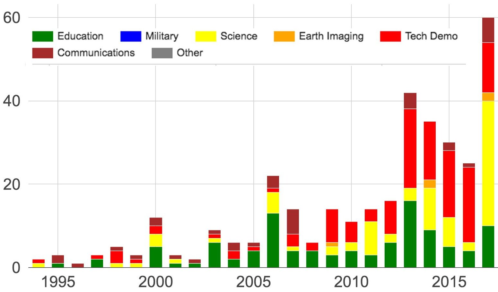

Figure 5: Mission Type by Launch Year

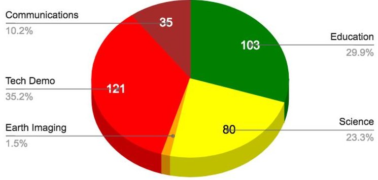

Figure 6. University-Class Missions by Mission Type, 1994-2017

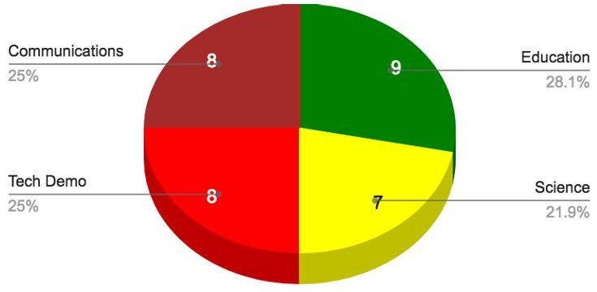

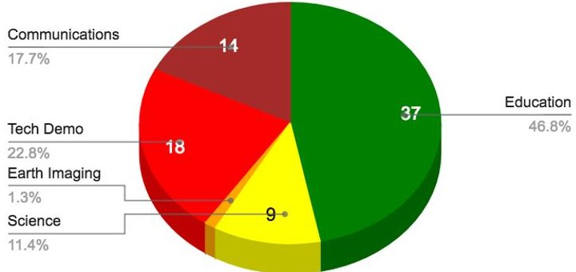

Figure 8. University-Class Missions by Mission Type, 2002-2009

Figure 7. University-Class Missions by Mission Type, 1994-2001

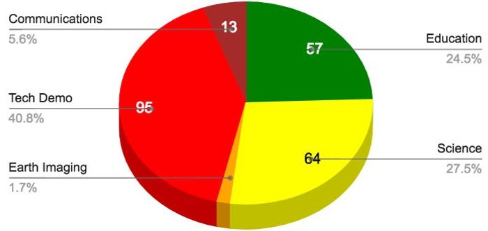

Figure 9. University-Class Missions by Mission Type, 2010-2017

<!-- PDF_PAGE: 10 -->

As seen in Figures 9-11, the regular independent schools pursue a different mission profile than the flagships and prolific independents. However, even the regular independents have relevant missions more than half the time. As noted in previous papers, credit must be given to NSF and the NASA ELaNa program, who made mission relevance a necessary criteria for securing launch sponsorship.

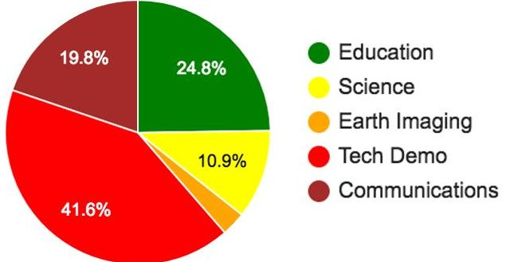

Figure 10: Mission Types for Flagship Schools

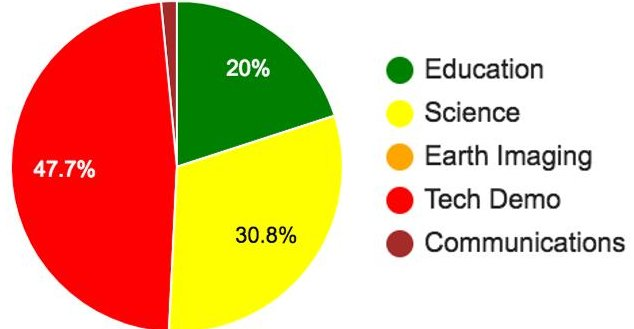

Figure 11: Mission Types for Prolific Independent Schools

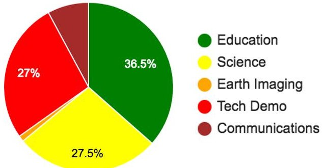

Figure 12: Mission Types for Regular Independent Schools

Still, having a mission is "relevant" to industry is not the same as a mission that actually contributes. It is beyond the scope of this paper to discuss and verify the science or technology relevance of individual missions although we would very much like to see such a paper!

Instead, we will point out that we only assign S-class status to missions with a publishing science PI with an instrument on the spacecraft and/or an external peer-reviewed science sponsor (e.g. NSF or NASA EPSCOR). Similarly, the C-class missions carry capable Amateur radio transponders or participate in Automatic Identification System (AIS) tracking and communications. And the T-class missions must be operating and collecting data on a device or subsystem that advances the state of the art for small satellites. It is not enough to fly a camera that no one has flown before; that camera must have capabilities that have not flown before.

The last, admittedly anecdotal, evidence for the relevance of university-class missions has two parts: first, the ubiquitous acceptance of the CubeSat standard and the ubiquitous presence of university-class mission alumni in every part of the space industry. The latter claim is easy to justify to the target audience for this paper, as the Smallsat conference is overrun with alumni of student-built spacecraft missions. As for the former, References 4, 6 and 8 detail the fact that the overwhelming fraction of the first hundred CubeSats were university-class missions, and now the overwhelming fraction of CubeSat launches in 2015 were not. As early adopters, the universities retired risk associated with CubeSat component development and served as the launch customers for qualifying dispensers and multi-mission opportunities. $ ^{1} $

## Whose Risk Is It, Anyway?

Next, let us consider the issue of mission success and failure. Using the mission status scale discussed, above, we first examine the results for all university-class missions (Figure 13). What is striking about this plot is first that about one-tenth of all university missions are lost to launch failure. This is a number out of proportion with the number of launch failures each year. The reason for this high rate is twofold: university missions are often placed on rocket platforms making their first-ever launch attempt (e.g, ORS-4). First-flights have a significantly higher failure rate than later flights. Secondly, as noted i, university-class missions tend to be launched in groups of 6 to 20. When a rocket fails, a lot of university missions are lost.

When we take a closer look at each of the eras (Figure 14, Figure 15, Figure 16), it looks as though universityclass missions went through a string of bad luck in the middle era (2002-2009)

<!-- PDF_PAGE: 11 -->

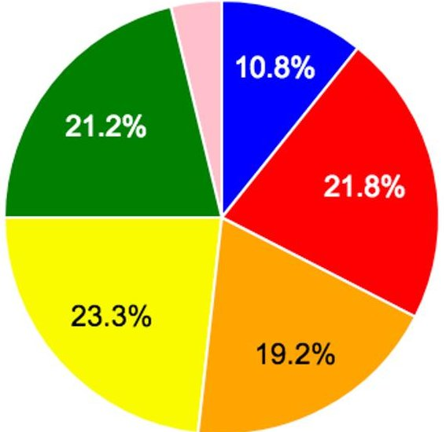

Figure 13. Mission Status for All University-Class Missions (1994-2017)

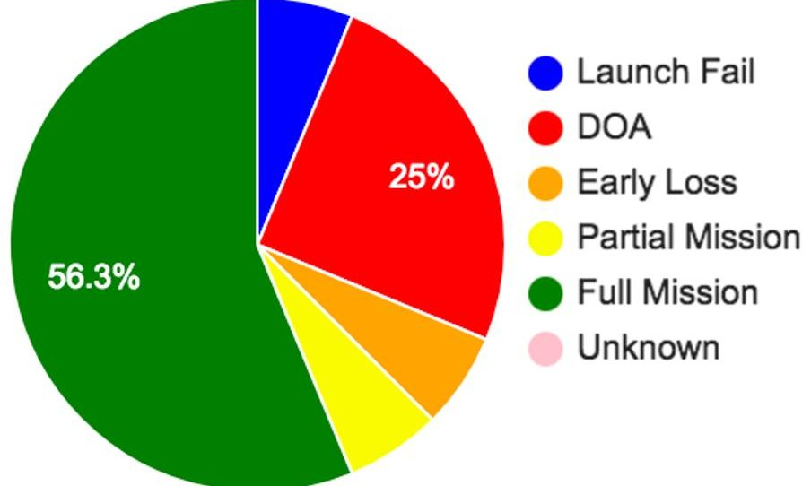

Figure 14. Mission Status for University-Class Missions (1994-2001)

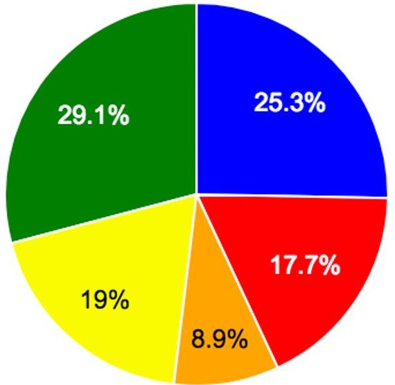

Figure 15. Mission Status for University-Class Missions (2002-2009)

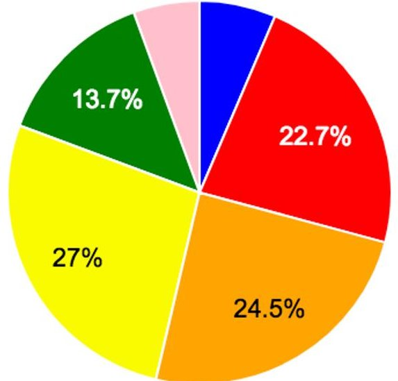

Figure 16. Mission Status for University-Class Missions (2010-2017)

The second observation from Figure 13 is that about 40% of all manifested university-class missions fail to achieve any of their primary mission objectives (i.e. the DOA and Early Loss categories on the chart). When the launch failures are factored out, the failure rate approaches 50%. Furthermore, mission success rates appear to be decreasing over time, from roughly two-thirds in the first era to on the order of 40% in over the last eight years.

What is happening? First, let us factor out the launch failures and subdivide missions into our three builder categories: flagships, prolific independents, and regular independents. Let us look at the performance of each of

those categories during our three eras of study. This results in eight plots (there were no prolific independents flying in the 1994-2001 era), displayed in Figures 17-24.

Doing so confirms observations from previous papers: flagships have a relatively low failure rate (25%) compared to regular independents (65%). Prolific programs split the difference. However, as noted in Figures 20 and 21, the success rate for prolific missions has increased notably in the last eight years. Given that these schools are by definition flying multiple missions over multiple years, there is evidence that they are learning from past mistakes.

<!-- PDF_PAGE: 12 -->

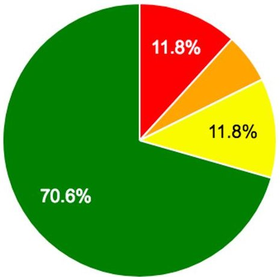

Figure 17. Mission Status (1994- 2001) for Flagship Schools

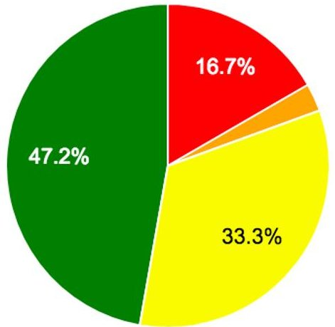

Figure 18. Mission Status (2002- 2009) for Flagship Schools

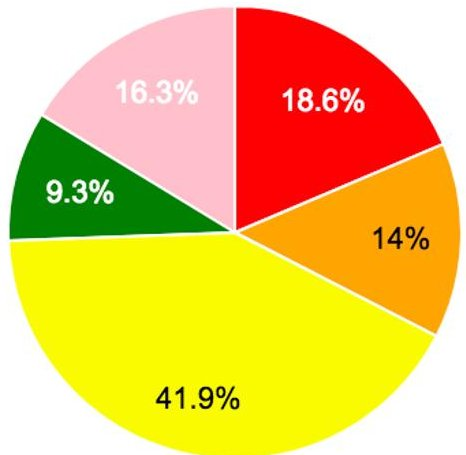

Figure 19. Mission Status (2010- 2017) for Flagship Schools

DOA

Early Loss

Partial Mission

Full Mission

Unknown

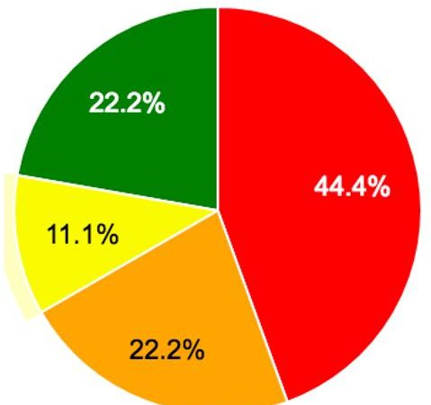

Figure 20. Mission Status (2002- 2009) for Prolific Independent Schools

Figure 22. Mission Status (1994- 2001) for Regular Independent Schools

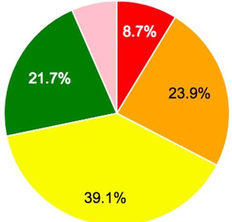

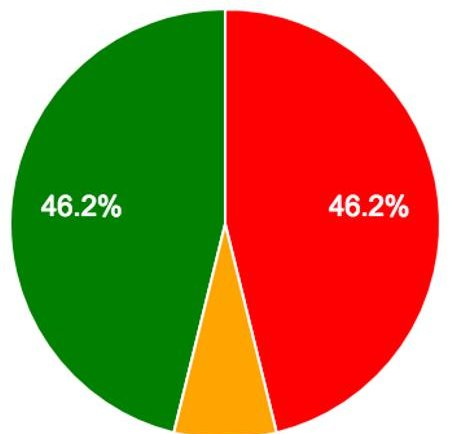

Figure 21. Mission Status (2010- 2017) for Prolific Independent Schools

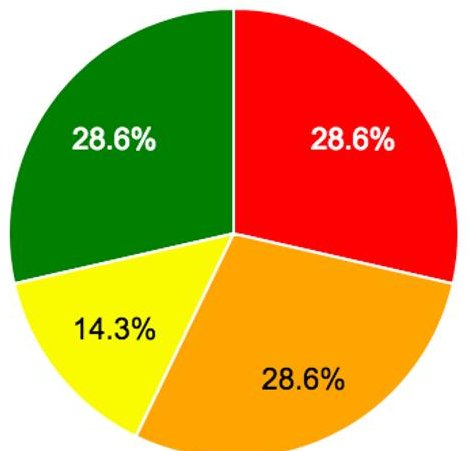

Figure 23. Mission Status (2002- 2009) for Regular Independent Schools

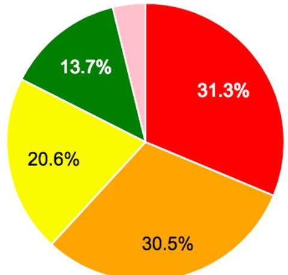

Figure 24. Mission Status (2010- 2017) for Regular Independent Schools

<!-- PDF_PAGE: 13 -->

The news is not so good for the regular independents however. As shown in Figures 22-24, the success rate for regular independents has stalled at around 33%, a slight drop from earlier eras. Contrasted with the prolific independents, this group as whole does not seem to be learning from mistakes.

Why is there such a difference? As outlined in previous papers, we believe that flagship programs, by nature of their national government sponsorship, have access to resources, facilities and mentoring that lead to greater mission success. By their very nature, independent schools do not have such access. And, since prolific schools manage to produce multiple missions, they have an opportunity to implement lessons learned and best practices into their development process. The prolific schools managed to persist through failure. Regardless of whether their persistence is due to visionary leadership, persuasive project managers or just sheer stubbornness, it would be worthwhile to study those twelve prolific schools to identify common characteristics. In fact, the twelve prolific programs appear to be overtaking the flagship schools in terms of mission performance. Again, this is likely evidence that the prolific programs have developed good mission assurance practices; it also indicates that our "flagship" definition may not be as useful as it was 10 years ago.

But we are sidestepping the question. Is a 65% failure rate among regular independent schools too high? Yes!

Why do we continue to sponsor regular independent schools in the face of those dismal numbers? We don't know. But we think it is a combination of (a) the lack of knowledge of the actual failure rates and (b) the high turnover among regular independent schools. In the past seven years, between 5 and 11 regular independent schools produce their first spacecraft each year, and then never produce a second. In that way the loss of each mission is viewed in isolation, and not as a trend.

What can be done? In the lead author's twenty-five years of experience with university-class missions, he has noted that student-led projects often fail because of a lack of time/resources given to systems-level testing. This lack of testing is driven by a lack of time; university missions fly as secondaries, and they cannot force a slip in the launch schedule when typical integration problems arise. The only available option to these programs is to reduce or eliminate system-level testing.

[Full, sad disclosure: the previous two paragraphs are direct cut-and-pastes from the author's 2016 Smallsat conference paper. Nothing has changed.]

Since it is unlikely that launch vehicles will slip their schedules to accommodate secondary payloads (and we are not recommending that they do!), the only option is to better prepare independent programs for the likelihood of schedule constraints, and help them prepare their design/complexity accordingly.

At the other end, is a 25% failure rate among flagships and the prolific independents too high? Maybe! We strongly assert that a failure rate in the 10-20% is an acceptable figure for university-class missions; these programs have cost and schedule constraints that will force an elevated risk profile. Universities should also accept an elevated risk profile as a matter of course; universities should be pushing the envelope of mission performance to develop new missions and new capabilities.

Therefore, to finally address the original question: the fact that university missions fail at a greater rate than professional missions is not a reason to dismiss university missions. The failure rate is too high for certain groups, and more could be done to introduce and enforce best practices for those groups.

## CONCLUSIONS

University-class missions are a relatively small element of the overall secondary launch market, but their significance is outsized. University-led spacecraft programs are an important source of recruitment and training for engineers and scientists entering the workforce. Such programs can flight-test novel or risky concepts - with no example more obvious, or more significant than the very CubeSat itself.

While the failure rate of university missions is too high, the high rates are concentrated with "one-and-done" independent schools; schools that produce multiple spacecraft see significant improvements in success. The failure rates of university programs should not approach zero, as universities are uniquely situated in the space industry to approach higher-risk, novel missions and technologies.

Finally, it was extremely rewarding to review the earlier papers we have published on this topic, and compare the concerns of five and ten years ago to the situation today. We can happily report that we were wrong about all of most dire predictions, and even our optimistic predictions were not optimistic enough. Ten years ago, a launch rate of 8-10 university-class missions per year was thought to be too good to be sustainable, whereas now 8 missions is the average quarterly output.

Such an observation causes us to be thankful for all of the industry professionals who went far out of their way to support university projects - too many to name in this paper, but AFRL, NSF and NASA ELaNa deserve special recognition, as do the organizers and sponsors of

<!-- PDF_PAGE: 14 -->

this conference. We hope that they are able to see and enjoy the fruits of their efforts. We look forward to revisiting this topic in another 2-3 years to see how much everything has changed, again. We hope that it is as pleasant a paper to write as this one has been.

## ACKNOWLEDGMENTS

This work is supported by the NASA Electronics and Packing Program under grant 80NSSC18K0637.

## REFERENCES

1. M. A. Swartwout, "University-Class Satellites: From Marginal Utility to 'Disruptive' Research Platforms," Proceedings of the 18th Annual AIAA/USU Conference on Small Satellites, Logan, UT, 9-12 August, 2004, Paper SSC04-II05.

2. M. A. Swartwout, "Twenty (plus) Years of University-Class Spacecraft: A Review of What Was, An Understanding of What Is, And a Look at What Should Be Next," Proceedings of the 20th Annual AIAA/USU Conference on Small Satellites, Logan, UT, 14 August 2006, Paper SSC06-I-03.

3. M. A. Swartwout, "Beyond the Beep: Student-Built Satellites with Educational and 'Real' Missions," 21 $ ^{st} $ Annual AIAA/USU Conference on Small Satellites, Logan, UT, 15 August 2007, Paper SSC07-XI-10.

4. M. A. Swartwout, "The first one hundred university-class spacecraft 1981-2008," IEEE Aerospace and Electronic Systems Magazine, vol. 24, no. 3, 2009.

5. M. A. Swartwout, "Student-Built Gossamer Spacecraft: Why Aren't There More (Yet)?", Proceedings of the 50th AIAA/ASME/ASCE/AHS/ASC Structures, Structural Dynamics, and Materials Conference, Palm Springs, CA, 4 - 7 May 2009, Paper AIAA- 2009-2158-359.

6. M. A. Swartwout, "The Promise of Innovation from University Space Systems: Are We Meeting It?" $ 2 3 ^{rd} $ Annual AIAA/USU Conference on Small

Satellites, Logan, UT, 13 August 2009, Paper SSC09-XII-03.

7. M. A. Swartwout, "A Brief History of Rideshares (and Attack of The CubeSats)," Proceedings of the 2011 IEEE Aerospace Conference, Big Sky, MT, 8 March 2011, Paper 1518.

8. M. A. Swartwout, "Attack of the CubeSats: A Statistical Look" 25th Annual AIAA/USU Conference on Small Satellites, Logan, UT, 9 August 2011, Paper SSC11-VI-04.

9. M. A. Swartwout, "Cheaper by the Dozen: The Avalanche of Rideshares in the $ 21^{\mathrm{st}} $ Century", 2013 IEEE Aerospace Conference, Big Sky, MT, 4 March 2013, paper 2472.

10. M. A. Swartwout, "The Long-Threatened Flood of University-Class Spacecraft (and CubeSats) Has Come: Analyzing the Numbers", 27th Annual AIAA/USU Conference on Small Satellites, Logan, UT, 14 August 2013, Paper SSC13-IX-01.

11. M. A. Swartwout, "Secondary Spacecraft in 2016: Why Some Succeed (And Too Many Do Not)”， 2016 IEEE Aerospace Conference, Big Sky, MT, 11 March 2016, Paper 2.0403.

12. M. A. Swartwout, W. C. Jayne, "University-Class Spacecraft by the Numbers: Success, Failure, Debris. (But Mostly Success.)", $ 30^{\mathrm{th}} $ Annual AIAA/USU Conference on Small Satellites, Logan, UT, 11 August 2016, Paper SSC16-XIII-1.

13. Krebs, Gunter, "Gunter's Space Page," http://www.skyrocket.de/space/space.html, June 2016.

14. Union of Concerned Scientists Satellite Database, http://www.ucsusa.org/nuclear_weapons_and_global_security/space_weapons/technical_issues/ucs-satellite-database.html, June 2016.

15. Rupprecht, Mike, "Amateurfunk", http:// www.dk3wn.info, accessed 14 June 2016.

16. Klofas, Bryan, "CubeSat Communications Table", http://www.klofas.com/comm-table/, accessed 14 June 2016.

<!-- PDF_PAGE: 15 -->

## APPENDIX

All University-Class Missions, 1971-2017

<table border="1"><tr><td>Launch Date</td><td>Contractor</td><td>Name</td><td>Mission Status</td></tr><tr><td>1/23/70</td><td>University of Melbourne</td><td>Australis OSCAR 5</td><td>5</td></tr><tr><td>10/6/81</td><td>University of Surrey</td><td>OSCAR 9(UoSAT1)</td><td>5</td></tr><tr><td>3/1/84</td><td>University of Surrey</td><td>OSCAR 11(UoSAT2)</td><td>5</td></tr><tr><td>4/29/85</td><td>Weber State</td><td>NUSAT1</td><td>5</td></tr><tr><td>1/22/90</td><td>Weber State</td><td>OSCAR 18(WEBERSAT)</td><td>5</td></tr><tr><td>7/17/91</td><td>Technical University of Berlin</td><td>TUBSATA</td><td>5</td></tr><tr><td>8/10/92</td><td>Korean Advanced Institute of Science and Technology</td><td>OSCAR 23(KITSAT1)</td><td>5</td></tr><tr><td>5/12/93</td><td>CNES Amateurs(?)</td><td>ARASENE</td><td>5</td></tr><tr><td>9/26/93</td><td>Korean Advanced Institute of Science and Technology</td><td>KITSATB</td><td>5</td></tr><tr><td>1/25/94</td><td>Technical University of Berlin</td><td>TUBSATB</td><td>2</td></tr><tr><td>2/3/94</td><td>University of Bremen</td><td>BREMSAT</td><td>5</td></tr><tr><td>3/28/95</td><td>National University of Mexico</td><td>UNAMSATA</td><td>1</td></tr><tr><td>3/28/95</td><td>Technion Institute of Technology</td><td>Techsat1(Gurwin1Oscar(29))</td><td>1</td></tr><tr><td>7/7/95</td><td>Universidad Politécnica de Madrid</td><td>UPMSat-1</td><td>5</td></tr><tr><td>9/5/96</td><td>National University of Mexico</td><td>UNAMSATB</td><td>2</td></tr><tr><td>10/5/97</td><td>Russian high school students</td><td>SPUTNIKJR</td><td>5</td></tr><tr><td>10/25/97</td><td>US Air Force Academy</td><td>Falcon Gold</td><td>5</td></tr><tr><td>10/30/97</td><td>ESTEC</td><td>TEAMSAT</td><td>4</td></tr><tr><td>7/7/98</td><td>Technical University of Berlin</td><td>TUBSATN</td><td>4</td></tr><tr><td>7/7/98</td><td>Technical University of Berlin</td><td>TUBSATN1</td><td>5</td></tr><tr><td>7/10/98</td><td>Technion Institute of Technology</td><td>TECHSAT1B</td><td>5</td></tr><tr><td>10/24/98</td><td>University of Alabama-Huntsville</td><td>SEDSAT1</td><td>2</td></tr><tr><td>10/29/98</td><td>Naval Postgraduate School</td><td>PAN SAT</td><td>5</td></tr><tr><td>2/23/99</td><td>University of Stellenbosch</td><td>SUNSAT</td><td>5</td></tr><tr><td>5/26/99</td><td>Korean Advanced Institute of Science and Technology</td><td>KITSAT3</td><td>5</td></tr><tr><td>5/26/99</td><td>Technical University of Berlin</td><td>TUBSAT-A</td><td>5</td></tr><tr><td>1/27/00</td><td>Weber State</td><td>JAWSAT</td><td>2</td></tr><tr><td>1/27/00</td><td>Stanford University</td><td>OPAL</td><td>5</td></tr><tr><td>1/27/00</td><td>US Air Force Academy</td><td>FALCONSAT</td><td>3</td></tr><tr><td>1/27/00</td><td>Arizona State University</td><td>ASUSAT</td><td>3</td></tr><tr><td>2/10/00</td><td>Santa Clara University</td><td>PICOSAT3(JAK)</td><td>2</td></tr><tr><td>2/12/00</td><td>Santa Clara University</td><td>PICOSAT4(Thelma)</td><td>2</td></tr><tr><td>2/12/00</td><td>Santa Clara University</td><td>PICOSAT5(Louise)</td><td>2</td></tr><tr><td>6/28/00</td><td>Tsinghua University</td><td>TZINGHUA1</td><td>5</td></tr><tr><td>9/26/00</td><td>King Abdulaziz City for Science &amp; Technology</td><td>SAUDISAT1A</td><td>5</td></tr><tr><td>9/26/00</td><td>University of Rome "La Sapienza"</td><td>UNISAT</td><td>5</td></tr><tr><td>9/26/00</td><td>King Abdulaziz City for Science &amp; Technology</td><td>SAUDISAT1B</td><td>2</td></tr><tr><td>11/21/00</td><td>UmeåUniversity / LuleåUniversity of Technology</td><td>MUNIN</td><td>5</td></tr><tr><td>9/30/01</td><td>US Naval Academy</td><td>PCSAT</td><td>5</td></tr><tr><td>9/30/01</td><td>Stanford University</td><td>SAPPHIRE</td><td>5</td></tr><tr><td>12/10/01</td><td>Technical University of Berlin</td><td>MAROC TUBSAT</td><td>5</td></tr><tr><td>12/20/02</td><td>King Abdulaziz City for Science &amp; Technology</td><td>SAUDISAT1C</td><td>5</td></tr><tr><td>12/20/02</td><td>University of Rome "La Sapienza"</td><td>UNISAT2</td><td>5</td></tr><tr><td>6/30/03</td><td>Technical University of Denmark</td><td>DTUSAT1</td><td>2</td></tr><tr><td>6/30/03</td><td>Tokyo Institute of Technology</td><td>CUTE-1(CO-55)</td><td>3</td></tr><tr><td>6/30/03</td><td>Stanford University</td><td>QUAKESAT1</td><td>5</td></tr><tr><td>6/30/03</td><td>Aalborg University</td><td>AAU CUBESAT1</td><td>2</td></tr><tr><td>6/30/03</td><td>UTIAS(University of Toronto)</td><td>CANX-1</td><td>2</td></tr><tr><td>6/30/03</td><td>University of Tokyo</td><td>CUBESAT XI-IV(CO-57)</td><td>4</td></tr><tr><td>8/22/03</td><td>Universidade Norte do Paraná</td><td>UNOSAT1</td><td>1</td></tr><tr><td>9/27/03</td><td>Mozhaiskiy Space Engineering Academy</td><td>MOZHAYETS4</td><td>5</td></tr><tr><td>9/27/03</td><td>Korean Advanced Institute of Science and Technology</td><td>KAISTSAT4/STSAT-1</td><td>5</td></tr><tr><td>6/29/04</td><td>King Abdulaziz City for Science &amp; Technology</td><td>SAUDICOMSAT1</td><td>4</td></tr><tr><td>6/29/04</td><td>King Abdulaziz City for Science &amp; Technology</td><td>SAUDICOMSAT2</td><td>4</td></tr><tr><td>6/29/04</td><td>King Abdulaziz City for Science &amp; Technology</td><td>SAUDISAT2</td><td>4</td></tr><tr><td>6/29/04</td><td>University of Rome "La Sapienza"</td><td>UNISAT3</td><td>5</td></tr><tr><td>12/21/04</td><td>New Mexico State University</td><td>3CS:Ralphie</td><td>1</td></tr><tr><td>12/21/04</td><td>Arizona State University</td><td>3CS:Sparkie</td><td>1</td></tr><tr><td>8/3/05</td><td>US Naval Academy</td><td>PCSat2</td><td>5</td></tr></table>

<!-- PDF_PAGE: 16 -->

<table border="1"><tr><td>10/27/05</td><td>Mozhaiskiy Space Engineering Academy</td><td>Mozhayets 5</td><td>2</td></tr><tr><td>10/27/05</td><td>University of W√ozburg</td><td>UWE-1</td><td>3</td></tr><tr><td>10/27/05</td><td>ESTEC</td><td>SSETI-EXPRESS</td><td>2</td></tr><tr><td>10/27/05</td><td>University of Tokyo</td><td>CUBESAT XI-V(CO-58)</td><td>5</td></tr><tr><td>10/27/05</td><td>Norweigan Universities</td><td>Ncube 2</td><td>2</td></tr><tr><td>2/21/06</td><td>Tokyo Institute of Technology</td><td>CUTE 1.7</td><td>2</td></tr><tr><td>3/24/06</td><td>US Air Force Academy</td><td>FalconSat 2</td><td>1</td></tr><tr><td>7/26/06</td><td>Nihon University</td><td>SEEDS</td><td>1</td></tr><tr><td>7/26/06</td><td>University of Arizona</td><td>SACRED</td><td>1</td></tr><tr><td>7/26/06</td><td>University of Arizona</td><td>Rincon 1</td><td>1</td></tr><tr><td>7/26/06</td><td>Norweigan Universities</td><td>Ncube 1</td><td>1</td></tr><tr><td>7/26/06</td><td>Montana State University</td><td>MEROPE</td><td>1</td></tr><tr><td>7/26/06</td><td>University of Hawaii</td><td>Mea Huaka'I(Voyager)</td><td>1</td></tr><tr><td>7/26/06</td><td>University of Kansas</td><td>KUTESat Pathfinder</td><td>1</td></tr><tr><td>7/26/06</td><td>University of Illinois</td><td>ION</td><td>1</td></tr><tr><td>7/26/06</td><td>Cornell University</td><td>ICECube 2</td><td>1</td></tr><tr><td>7/26/06</td><td>Cornell University</td><td>ICECube 1</td><td>1</td></tr><tr><td>7/26/06</td><td>Hankuk Aviation University</td><td>HAUSAT 1</td><td>1</td></tr><tr><td>7/26/06</td><td>Cal Poly</td><td>CP 2</td><td>1</td></tr><tr><td>7/26/06</td><td>Cal Poly</td><td>CP 1(K7RR-Sat)</td><td>1</td></tr><tr><td>7/26/06</td><td>Politecnico di Torino</td><td>PicPot</td><td>1</td></tr><tr><td>7/26/06</td><td>University of Rome "La Sapienza"</td><td>Unisat 4</td><td>1</td></tr><tr><td>7/26/06</td><td>Bauman Moscow State Technical University</td><td>Baumanets 1</td><td>1</td></tr><tr><td>9/22/06</td><td>Hokkaido Institute of Technology</td><td>HITSAT(HO-59)</td><td>4</td></tr><tr><td>12/10/06</td><td>US Naval Academy</td><td>ANDE FCAL SPHERE 2</td><td>5</td></tr><tr><td>12/20/06</td><td>US Naval Academy</td><td>RAFT(NO 60)</td><td>5</td></tr><tr><td>12/20/06</td><td>US Naval Academy</td><td>MARSCOM</td><td>5</td></tr><tr><td>1/10/07</td><td>National University of Comahue</td><td>PEHUENSAT 1</td><td>5</td></tr><tr><td>3/9/07</td><td>US Naval Academy</td><td>MIDSTAR 1</td><td>4</td></tr><tr><td>3/9/07</td><td>US Air Force Academy</td><td>FALCONSAT 3</td><td>4</td></tr><tr><td>4/17/07</td><td>King Abdulaziz City for Science &amp; Technology</td><td>SAUDICOMSAT 7</td><td>4</td></tr><tr><td>4/17/07</td><td>King Abdulaziz City for Science &amp; Technology</td><td>SAUDICOMSAT 6</td><td>4</td></tr><tr><td>4/17/07</td><td>King Abdulaziz City for Science &amp; Technology</td><td>SAUDICOMSAT 5</td><td>4</td></tr><tr><td>4/17/07</td><td>King Abdulaziz City for Science &amp; Technology</td><td>SAUDICOMSAT 3</td><td>4</td></tr><tr><td>4/17/07</td><td>King Abdulaziz City for Science &amp; Technology</td><td>SAUDICOMSAT 4</td><td>4</td></tr><tr><td>4/17/07</td><td>University of Sergio Arboleda</td><td>LIBERTAD 1</td><td>2</td></tr><tr><td>4/17/07</td><td>Cal Poly</td><td>CP3</td><td>2</td></tr><tr><td>4/17/07</td><td>University of Louisiana</td><td>CAPE 1</td><td>3</td></tr><tr><td>4/17/07</td><td>Cal Poly</td><td>CP4</td><td>3</td></tr><tr><td>9/25/07</td><td>ESTEC</td><td>YES2/FOTINO</td><td>2</td></tr><tr><td>9/25/07</td><td>ESTEC</td><td>YES2/FLOYD</td><td>5</td></tr><tr><td>4/28/08</td><td>Tokyo Institute of Technology</td><td>CUTE-1.7+APD II</td><td>5</td></tr><tr><td>4/28/08</td><td>Fachhochschule Aachen</td><td>COMPASS 1</td><td>5</td></tr><tr><td>4/28/08</td><td>Aalborg University</td><td>AAUSAT 2</td><td>5</td></tr><tr><td>4/28/08</td><td>Technical University of Delft</td><td>DELFI C3(DO-64)</td><td>5</td></tr><tr><td>4/28/08</td><td>UTIAS(University of Toronto)</td><td>CANX 2</td><td>5</td></tr><tr><td>4/28/08</td><td>Nihon University</td><td>SEEDS 2(CO-66)</td><td>5</td></tr><tr><td>1/23/09</td><td>University of Tokyo</td><td>PRISM(HITOMI)</td><td>5</td></tr><tr><td>1/23/09</td><td>Tohoku University</td><td>SPRITE-SAT(RISING)</td><td>3</td></tr><tr><td>1/23/09</td><td>Kagawa University</td><td>STARS(KUKAI)</td><td>3</td></tr><tr><td>1/23/09</td><td>Tokyo Metropolitan College of Industrial Technology</td><td>KKS-1(KISEKI)</td><td>3</td></tr><tr><td>4/20/09</td><td>Anna University</td><td>ANUSAT</td><td>5</td></tr><tr><td>5/19/09</td><td>Cal Poly</td><td>CP 6</td><td>4</td></tr><tr><td>7/15/09</td><td>University of Texas</td><td>BEVO 1</td><td>2</td></tr><tr><td>7/15/09</td><td>Texas A&amp;M University</td><td>DRAGONSAT 2(AggieSat 2)</td><td>4</td></tr><tr><td>9/17/09</td><td>Ufa State Aviation Technical University</td><td>UGATUSAT</td><td>2</td></tr><tr><td>9/17/09</td><td>University of Stellenbosch</td><td>SUMBANDILA</td><td>5</td></tr><tr><td>9/23/09</td><td>Ecole Polytechnique F√©d√©rale de Lausanne</td><td>SWISSCUBE(SwissCube 1)</td><td>4</td></tr><tr><td>9/23/09</td><td>Technical University of Berlin</td><td>BEESAT</td><td>5</td></tr><tr><td>9/23/09</td><td>University of W√ozburg</td><td>UWE-2</td><td>2</td></tr><tr><td>9/23/09</td><td>Istanbul Technical University</td><td>ITu-pSAT 1</td><td>2</td></tr><tr><td>5/20/10</td><td>Kagoshima University</td><td>HAYATO(K-SAT)</td><td>2</td></tr><tr><td>5/20/10</td><td>Waseda University</td><td>WASEDA-SAT2</td><td>2</td></tr><tr><td>5/20/10</td><td>Soka University</td><td>NEGAI-STAR(Negai-Boshi)</td><td>5</td></tr><tr><td>5/20/10</td><td>University Space Engineering Consortium</td><td>UNITEC-1</td><td>2</td></tr><tr><td>7/12/10</td><td>Indian university consortium</td><td>STUDSAT</td><td>2</td></tr></table>

<!-- PDF_PAGE: 17 -->

<table border="1"><tr><td>7/12/10</td><td>Scuola universitaria della Svizzera italiana</td><td>TISAT1</td><td>5</td></tr><tr><td>11/20/10</td><td>University of Michigan</td><td>RAX1(USA218)</td><td>4</td></tr><tr><td>11/20/10</td><td>US Air Force Academy</td><td>FALCONSAT5(USA221)</td><td>4</td></tr><tr><td>11/20/10</td><td>University of Texas</td><td>FAST1(USA222)</td><td>4</td></tr><tr><td>11/20/10</td><td>University of Texas</td><td>FAST2(USA228)</td><td>4</td></tr><tr><td>12/8/10</td><td>University of Southern California</td><td>Mayflower-Caerus</td><td>2</td></tr><tr><td>3/4/11</td><td>Colorado Space Grant Consortium</td><td>Hermes</td><td>1</td></tr><tr><td>3/4/11</td><td>Kentucky Space</td><td>KySat1</td><td>1</td></tr><tr><td>3/4/11</td><td>Montana State University</td><td>E1P(Explorer1Prime)</td><td>1</td></tr><tr><td>4/20/11</td><td>M.V. Lomonosov Moscow state university</td><td>YOUTHSAT</td><td>4</td></tr><tr><td>4/20/11</td><td>Nanyang Technological University</td><td>XSAT</td><td>5</td></tr><tr><td>8/17/11</td><td>University of Rome"La Sapienza"</td><td>EDUSAT</td><td>4</td></tr><tr><td>10/12/11</td><td>Indian Institute of Technology Kanpur</td><td>JUGNU</td><td>4</td></tr><tr><td>10/28/11</td><td>Utah State University</td><td>DICE1(DICEX)</td><td>5</td></tr><tr><td>10/28/11</td><td>Utah State University</td><td>DICE2(DICEY)</td><td>5</td></tr><tr><td>10/28/11</td><td>University of Michigan</td><td>RAX2</td><td>5</td></tr><tr><td>10/28/11</td><td>Auburn University</td><td>AubieSat1(AO-71)</td><td>3</td></tr><tr><td>10/28/11</td><td>Montana State University</td><td>HRBE(Explorer-1PRIME)</td><td>4</td></tr><tr><td>10/28/11</td><td>University of Michigan</td><td>M-Cubed(w/HRBE)</td><td>2</td></tr><tr><td>11/9/11</td><td>Nanjing University</td><td>TX1</td><td>4</td></tr><tr><td>2/13/12</td><td>University of Bologna</td><td>ALMASAT-1</td><td>2</td></tr><tr><td>2/13/12</td><td>Politecnico di Torino</td><td>e-st@r</td><td>2</td></tr><tr><td>2/13/12</td><td>University of Bucharest</td><td>Goliat</td><td>2</td></tr><tr><td>2/13/12</td><td>Budapest University of Technology and Economics</td><td>MaSat1(MO-72)</td><td>5</td></tr><tr><td>2/13/12</td><td>University of Vigo</td><td>XaTcobeo</td><td>5</td></tr><tr><td>2/13/12</td><td>Warsaw University of Technology</td><td>PW-Sat1</td><td>2</td></tr><tr><td>2/13/12</td><td>University of MontpellierII</td><td>ROBUSTA</td><td>2</td></tr><tr><td>2/13/12</td><td>University of Rome"La Sapienza"</td><td>UniCubeSat-GGs</td><td>2</td></tr><tr><td>5/17/12</td><td>Kyushu Institute of Technology</td><td>HORYU2</td><td>4</td></tr><tr><td>9/13/12</td><td>University of Colorado LASP</td><td>CSSWE</td><td>5</td></tr><tr><td>9/13/12</td><td>Kentucky Space</td><td>CXBN</td><td>3</td></tr><tr><td>9/13/12</td><td>Cal Poly</td><td>CP5</td><td>3</td></tr><tr><td>10/4/12</td><td>Tohoku University</td><td>Raiko</td><td>5</td></tr><tr><td>10/4/12</td><td>Fukuoka Institute of Technology</td><td>FITSAT-1(NIWAKA)</td><td>5</td></tr><tr><td>10/4/12</td><td>San Jose State University</td><td>TechEdSat</td><td>4</td></tr><tr><td>10/4/12</td><td>FPT Technology Research Institute</td><td>F1</td><td>2</td></tr><tr><td>2/25/13</td><td>Aalborg University</td><td>AAUSAT3</td><td>5</td></tr><tr><td>2/25/13</td><td>University of Surrey</td><td>STRAND-1</td><td>4</td></tr><tr><td>4/19/13</td><td>Samara Aerospace University</td><td>AIST2</td><td>4</td></tr><tr><td>4/19/13</td><td>Technical University of Berlin</td><td>BeeSat3</td><td>2</td></tr><tr><td>4/19/13</td><td>Technical University of Dresden</td><td>SOMP</td><td>3</td></tr><tr><td>4/19/13</td><td>Technical University of Berlin</td><td>BeeSat2</td><td>4</td></tr><tr><td>4/26/13</td><td>Istanbul Technical University</td><td>TURKSAT3USAT</td><td>3</td></tr><tr><td>5/7/13</td><td>University of Tartu</td><td>ESTCube-1</td><td>4</td></tr><tr><td>9/29/13</td><td>Cornell University</td><td>CUSat</td><td>3</td></tr><tr><td>9/29/13</td><td>Colorado Space Grant Consortium</td><td>Dande</td><td>3</td></tr><tr><td>11/20/13</td><td>University of Louisiana</td><td>CAPE2</td><td>4</td></tr><tr><td>11/20/13</td><td>Drexel University</td><td>DragonSat</td><td>2</td></tr><tr><td>11/20/13</td><td>Kentucky Space</td><td>KYSatII</td><td>4</td></tr><tr><td>11/20/13</td><td>Thomas Jefferson High School</td><td>TJSat</td><td>2</td></tr><tr><td>11/20/13</td><td>Naval Postgraduate School</td><td>NPS-SCAT</td><td>3</td></tr><tr><td>11/20/13</td><td>Saint Louis University</td><td>COPPER</td><td>2</td></tr><tr><td>11/20/13</td><td>US Military Academy</td><td>Black Knight</td><td>2</td></tr><tr><td>11/20/13</td><td>COSMIAC</td><td>SPA-1 Trailblazer</td><td>2</td></tr><tr><td>11/20/13</td><td>University of Florida</td><td>SwampSat</td><td>2</td></tr><tr><td>11/20/13</td><td>University of Hawaii</td><td>Ho'oponopono-2</td><td>2</td></tr><tr><td>11/20/13</td><td>University of Alabama-Huntsville</td><td>ChargerSat</td><td>2</td></tr><tr><td>11/20/13</td><td>Vermont Technical College</td><td>Vermont Lunar</td><td>5</td></tr><tr><td>11/20/13</td><td>San Jose State University</td><td>TechEdSat-3</td><td>4</td></tr><tr><td>11/21/13</td><td>Cape Peninsula University of Technology</td><td>ZACUBE1</td><td>4</td></tr><tr><td>11/21/13</td><td>University of Rome"La Sapienza"</td><td>UniSat5</td><td>5</td></tr><tr><td>11/21/13</td><td>Technical University of Delft</td><td>Delfi-n3Xt</td><td>4</td></tr><tr><td>11/21/13</td><td>Institute of Space Technology Islamabad</td><td>ICube1</td><td>2</td></tr><tr><td>11/21/13</td><td>University of Vigo</td><td>HumSat-D</td><td>5</td></tr><tr><td>11/21/13</td><td>Kentucky Space</td><td>$50SAT/BeakerSat2/Eagle2</td><td>4</td></tr><tr><td>11/21/13</td><td>Kentucky Space</td><td>BeakerSat1/Eagle1</td><td>4</td></tr></table>

<!-- PDF_PAGE: 18 -->

<table border="1"><tr><td>11/21/13</td><td>Nanyang Technological University</td><td>VELOX-P2</td><td>4</td></tr><tr><td>11/21/13</td><td>Technical University of Munich</td><td>First-MOVE</td><td>3</td></tr><tr><td>11/21/13</td><td>Pontifical Catholic University of Peru</td><td>PUCP-SAT1</td><td>3</td></tr><tr><td>11/21/13</td><td>University of Maryland Baltimore County</td><td>QubeScout</td><td>2</td></tr><tr><td>11/21/13</td><td>Narvik University College</td><td>HiNCube</td><td>2</td></tr><tr><td>11/21/13</td><td>University of W√0rzburg</td><td>UWE3</td><td>4</td></tr><tr><td>12/6/13</td><td>Pontifical Catholic University of Peru</td><td>Pocket-PUCP</td><td>2</td></tr><tr><td>12/6/13</td><td>Montana State University</td><td>FIREBIRD1</td><td>4</td></tr><tr><td>12/6/13</td><td>Montana State University</td><td>FIREBIRD2</td><td>4</td></tr><tr><td>12/6/13</td><td>University of Michigan</td><td>M-Cubed-2</td><td>4</td></tr><tr><td>12/6/13</td><td>City University of New York</td><td>CUNYSat-1</td><td>2</td></tr><tr><td>12/28/13</td><td>Samara Aerospace University</td><td>AIST1(RS-41)</td><td>4</td></tr><tr><td>2/27/14</td><td>Shinsu University</td><td>ShindaiSat</td><td>3</td></tr><tr><td>2/27/14</td><td>University of Tsukuba</td><td>IFT1(Yui)</td><td>2</td></tr><tr><td>2/27/14</td><td>Osaka Prefecture University</td><td>OPUSAT(CosMoz)</td><td>3</td></tr><tr><td>2/27/14</td><td>Teikyou University</td><td>TeikyoSat3</td><td>2</td></tr><tr><td>2/27/14</td><td>Tama Art University</td><td>INVADER(CO-77)</td><td>5</td></tr><tr><td>2/27/14</td><td>Kagoshima University</td><td>KSAT2(Hayato2)</td><td>3</td></tr><tr><td>2/27/14</td><td>Kagawa University</td><td>STARS2(Gennai)</td><td>3</td></tr><tr><td>1/9/14</td><td>Pontifical Catholic University of Peru</td><td>UAPSat</td><td>2</td></tr><tr><td>1/9/14</td><td>Kaunas University of Technology</td><td>LitSat1</td><td>5</td></tr><tr><td>1/9/14</td><td>Kaunas University of Technology</td><td>LituanicaSAT1</td><td>4</td></tr><tr><td>4/18/14</td><td>Taylor University</td><td>TSAT(TestSat-Lite)</td><td>4</td></tr><tr><td>4/18/14</td><td>Colorado Space Grant Consortium</td><td>ALL-STAR/THEIA</td><td>2</td></tr><tr><td>4/18/14</td><td>Cornell University</td><td>KickSat1</td><td>3</td></tr><tr><td>5/24/14</td><td>Wakayama University</td><td>UNIFORM1</td><td>4</td></tr><tr><td>5/24/14</td><td>Tohoku University</td><td>Rising2</td><td>5</td></tr><tr><td>5/24/14</td><td>Nihon University</td><td>SPROUT</td><td>4</td></tr><tr><td>6/19/14</td><td>University of Tokyo</td><td>Hodoyoshi4</td><td>4</td></tr><tr><td>6/19/14</td><td>University of Rome "La Sapienza"</td><td>UniSat6</td><td>4</td></tr><tr><td>6/19/14</td><td>University of Tokyo</td><td>Hodoyoshi3</td><td>4</td></tr><tr><td>6/19/14</td><td>National Cheng Kung University</td><td>PACE</td><td>2</td></tr><tr><td>6/19/14</td><td>Technical University of Denmark</td><td>DTUSat2</td><td>2</td></tr><tr><td>6/19/14</td><td>University of the Republic (Uruguay)</td><td>ANTELSAT</td><td>4</td></tr><tr><td>6/19/14</td><td>National Technical University of Ukraine</td><td>PolyITAN1</td><td>4</td></tr><tr><td>6/19/14</td><td>University of Rome "La Sapienza"</td><td>Tigrisat</td><td>4</td></tr><tr><td>6/19/14</td><td>UTIAS(University of Toronto)</td><td>BRITE-CA2(BRITE-MontrealCanX3F)</td><td>1</td></tr><tr><td>6/30/14</td><td>Nanyang Technological University</td><td>VELOXPIII</td><td>1</td></tr><tr><td>6/30/14</td><td>Nanyang Technological University</td><td>VELOXI-NSAT</td><td>3</td></tr><tr><td>8/19/14</td><td>National University of Engineering</td><td>Chasqui1</td><td>2</td></tr><tr><td>10/28/14</td><td>University of Texas</td><td>RACE</td><td>1</td></tr><tr><td>11/6/14</td><td>Nagoya University Daido University</td><td>ChubuSat1</td><td>3</td></tr><tr><td>11/6/14</td><td>Kyushu University</td><td>QSAT-EOS</td><td>4</td></tr><tr><td>11/6/14</td><td>Tokyo Institute of Technology</td><td>Tsubame</td><td>3</td></tr><tr><td>1/31/15</td><td>Montana State University</td><td>FIREBIRD-IIA</td><td>5</td></tr><tr><td>1/31/15</td><td>Montana State University</td><td>FIREBIRD-IIB</td><td>5</td></tr><tr><td>1/31/15</td><td>Cal Poly</td><td>EXOCUBE(CP10)</td><td>3</td></tr><tr><td>7/13/14</td><td>San Jose State University</td><td>TechEdSat4(TES4)</td><td>2</td></tr><tr><td>7/13/14</td><td>MIT/SSL</td><td>MicroMAS</td><td>3</td></tr><tr><td>7/13/14</td><td>Greek Silicon Valley folks</td><td>Lambdasat</td><td>3</td></tr><tr><td>5/20/15</td><td>US Naval Academy</td><td>USS Langley</td><td>2</td></tr><tr><td>5/20/15</td><td>Cal Poly</td><td>OptiCube1</td><td>5</td></tr><tr><td>5/20/15</td><td>Cal Poly</td><td>OptiCube2</td><td>5</td></tr><tr><td>5/20/15</td><td>Cal Poly</td><td>OptiCube3</td><td>5</td></tr><tr><td>8/19/15</td><td>SERPENS</td><td>SERPENS</td><td>5</td></tr><tr><td>8/19/15</td><td>Tohoku University</td><td>S-CUBE</td><td>2</td></tr><tr><td>9/19/15</td><td>Zhejiang University</td><td>Zheda Pixing2A</td><td>?</td></tr><tr><td>9/19/15</td><td>Zhejiang University</td><td>Zheda Pixing2B</td><td>?</td></tr><tr><td>9/19/15</td><td>Tsinghua University</td><td>ZJ2(Kongjian Shiyan1)</td><td>?</td></tr><tr><td>9/19/15</td><td>Tsinghua University</td><td>Naxing2</td><td>?</td></tr><tr><td>9/19/15</td><td>Harbin Institute of Technology</td><td>LilacSat2(CAS3H)</td><td>4</td></tr><tr><td>9/19/15</td><td>Tsinghua University</td><td>Zijing1</td><td>?</td></tr><tr><td>9/25/15</td><td>Nanjing University</td><td>STU-2B(TW1B)</td><td>4</td></tr><tr><td>10/5/15</td><td>Aalborg University</td><td>AAUSAT-5</td><td>3</td></tr><tr><td>10/8/15</td><td>Salish Kootenai College</td><td>BisonSat</td><td>3</td></tr><tr><td>10/8/15</td><td>University of Alaska Fairbanks</td><td>ARC-1</td><td>2</td></tr></table>

<!-- PDF_PAGE: 19 -->

<table border="1"><tr><td>11/3/15</td><td>University of Hawaii</td><td>HiakaSat</td><td>1</td></tr><tr><td>11/3/15</td><td>Saint Louis University</td><td>Argus</td><td>1</td></tr><tr><td>11/3/15</td><td>Montana State University</td><td>PrintSat</td><td>1</td></tr><tr><td>12/6/15</td><td>Texas A&amp;M University</td><td>AggieSat 4</td><td>2</td></tr><tr><td>12/6/15</td><td>University of Texas</td><td>Bevo 2</td><td>3</td></tr><tr><td>12/6/15</td><td>University of Michigan</td><td>CADRE</td><td>2</td></tr><tr><td>12/6/15</td><td>University of Colorado LASP</td><td>MinXSS</td><td>5</td></tr><tr><td>12/6/15</td><td>St. Thomas More Cathedral School</td><td>STMSat 1</td><td>2</td></tr><tr><td>12/16/15</td><td>Nanyang Technological University</td><td>VELOX C1</td><td>5</td></tr><tr><td>12/16/15</td><td>National University of Singapore</td><td>Galassia</td><td>4</td></tr><tr><td>12/16/15</td><td>Nanyang Technological University</td><td>VELOX II</td><td>5</td></tr><tr><td>2/17/16</td><td>Nagoya University Daido University</td><td>ChubuSat 2(Kinshachi 2)</td><td>1</td></tr><tr><td>2/17/16</td><td>Nagoya University Daido University</td><td>ChubuSat 3(Kinshachi 3)</td><td>1</td></tr><tr><td>2/17/16</td><td>Kyushu Institute of Technology</td><td>Horyu 4(AEGIS)</td><td>1</td></tr><tr><td>3/31/16</td><td>Tomsk Polytechnic University</td><td>Tomsk-TPU 120</td><td>1</td></tr><tr><td>4/25/16</td><td>Université de Liège</td><td>OUFTI 1</td><td>3</td></tr><tr><td>4/25/16</td><td>Politecnico di Torino</td><td>e-st@r 2</td><td>1</td></tr><tr><td>4/25/16</td><td>Aalborg University</td><td>AAUSAT-4</td><td>4</td></tr><tr><td>4/28/16</td><td>Samara Aerospace University</td><td>Aist 2D</td><td>4</td></tr><tr><td>4/28/16</td><td>Samara Aerospace University</td><td>SamSat-218/D(Kontakt-Nanosputnik)</td><td>3</td></tr><tr><td>6/22/16</td><td>Sathyabama University</td><td>SathyabamaSat</td><td>3</td></tr><tr><td>6/22/16</td><td>College of Engineering Pune</td><td>Swayam</td><td>3</td></tr><tr><td>6/22/16</td><td>Technical University of Berlin</td><td>BeeSat-4</td><td>3</td></tr><tr><td>6/25/16</td><td>Shaanxi Engineering Laboratory</td><td>Aoxiang zhixing</td><td>4</td></tr><tr><td>8/15/16</td><td>Universidad Politécnica de Cataluña</td><td>3CAT-2</td><td>5</td></tr><tr><td>9/26/16</td><td>IIT Bombay</td><td>Pratham</td><td>3</td></tr><tr><td>9/26/16</td><td>UTIAS (University of Toronto)</td><td>CanX-7</td><td>4</td></tr><tr><td>11/11/16</td><td>Cal Poly</td><td>Opticube 4</td><td>?</td></tr><tr><td>12/9/16</td><td>San Jose State University</td><td>TechEdSat 5</td><td>?</td></tr><tr><td>12/9/16</td><td>University of Tokyo</td><td>EGG</td><td>?</td></tr><tr><td>12/9/16</td><td>Nanyang Technological University</td><td>AOBA-VELOX 3</td><td>4</td></tr><tr><td>12/9/16</td><td>Kagawa University</td><td>STARS C</td><td>3</td></tr><tr><td>12/9/16</td><td>University of Tsukuba</td><td>Yui-2(ITF-2)</td><td>5</td></tr><tr><td>12/9/16</td><td>Waseda University</td><td>Waseda-SAT 3</td><td>?</td></tr><tr><td>12/9/16</td><td>Escola Municipal Presidente Tancredo de Almeida Neves</td><td>Tancredo 1</td><td>4</td></tr><tr><td>12/28/16</td><td>CAST</td><td>BY70-1</td><td>5</td></tr><tr><td>1/9/17</td><td>Northwestern Polytechnical University</td><td>Xingyun Shiyan 1</td><td>?</td></tr><tr><td>1/9/17</td><td>Nanjing University of Technology</td><td>Kaidun 1</td><td>?</td></tr><tr><td>2/15/17</td><td>Al-Farabi Kazakh National University</td><td>Al-Farabi</td><td>?</td></tr><tr><td>4/18/17</td><td>Technical University of Dresden</td><td>SOMP-2(QB50 DE02)</td><td>2</td></tr><tr><td>4/18/17</td><td>Istanbul Technical University</td><td>HAVELSAT(QB50 TR02)</td><td>2</td></tr><tr><td>4/18/17</td><td>Universidad del Turabo</td><td>QBUS 4(QB50 US04 Columbia)</td><td>3</td></tr><tr><td>4/18/17</td><td>Kentucky Space</td><td>KySat 3(SGSat)</td><td>3</td></tr><tr><td>4/18/17</td><td>Kentucky Space</td><td>CXBN 2</td><td>3</td></tr><tr><td>4/18/17</td><td>National Cheng Kung University</td><td>Phoenix(QB50 TW01)</td><td>3</td></tr><tr><td>4/18/17</td><td>École Polytechnique</td><td>X-CubeSat(QB50 FR01)</td><td>3</td></tr><tr><td>4/18/17</td><td>Cal State Northridge</td><td>CSUNSat 1</td><td>4</td></tr><tr><td>4/18/17</td><td>University of Patras</td><td>UPSat(QB50 GR02)</td><td>2</td></tr><tr><td>4/18/17</td><td>École de Mines</td><td>SpaceCube(QB50 FR05)</td><td>3</td></tr><tr><td>4/18/17</td><td>Space Lab Herzliya Science Center</td><td>Hoopoe(QB50 IL01)</td><td>3</td></tr><tr><td>4/18/17</td><td>University of New South Wales</td><td>UNSW-ECO(QB50 AU02)</td><td>4</td></tr><tr><td>4/18/17</td><td>Nanjin University of Science and Technology</td><td>NJUST 1(QB50 CN03)</td><td>3</td></tr><tr><td>4/18/17</td><td>University of Colorado</td><td>QBUS 1(QB50 US01 Challenger)</td><td>3</td></tr><tr><td>4/18/17</td><td>Democritus University of Thrace</td><td>DUTHSat(QB50 GR01)</td><td>2</td></tr><tr><td>4/18/17</td><td>Harbin Institute of Technology</td><td>LilacSat 1(QB50 CN02)</td><td>3</td></tr><tr><td>4/18/17</td><td>Seoul National University</td><td>SNUSAT 1b(QB50 KR03)</td><td>3</td></tr><tr><td>4/18/17</td><td>Universidad Politécnica de Madrid</td><td>QBITO(QB50 ES01)</td><td>2</td></tr><tr><td>4/18/17</td><td>Aalto University</td><td>Aalto 2(QB50 FI01)</td><td>3</td></tr><tr><td>4/18/17</td><td>University of Adelaide</td><td>SUSat(QB50 AU01)</td><td>2</td></tr><tr><td>4/18/17</td><td>University of Sydney</td><td>i-INSPIRE 2(QB50 AU03)</td><td>4</td></tr><tr><td>4/18/17</td><td>Seoul National University</td><td>SNUSAT 1(QB50 KR02)</td><td>3</td></tr><tr><td>4/18/17</td><td>National Technical University of Ukraine</td><td>PolyITAN-2-SAU(QB50 UA01)</td><td>3</td></tr><tr><td>4/18/17</td><td>University of Alberta</td><td>Ex-Alta 1(QB50 CA03)</td><td>4</td></tr><tr><td>4/18/17</td><td>Northwestern Polytechnical University</td><td>Aoxiang 1(QB50 CN04)</td><td>2</td></tr><tr><td>4/18/17</td><td>Istanbul Technical University</td><td>BeEagleSat(QB50 TR01)</td><td>3</td></tr><tr><td>4/18/17</td><td>University of Michigan</td><td>QBUS 2(QB50 U202 Atlantis)</td><td>3</td></tr></table>

<!-- PDF_PAGE: 20 -->

<table border="1"><tr><td>6/23/17</td><td>University College London</td><td>UCLSat(QB50 GB03)</td><td>3</td></tr><tr><td>6/23/17</td><td>Noorul Islam University</td><td>NIUSAT(Keralshree)</td><td>3</td></tr><tr><td>6/23/17</td><td>University of Surrey</td><td>InflateSail(QB50 GB06)</td><td>5</td></tr><tr><td>6/23/17</td><td>Aalto University</td><td>Aalto1</td><td>3</td></tr><tr><td>6/23/17</td><td>Fachhochschule Aachen</td><td>COMPASS2</td><td>2</td></tr><tr><td>6/23/17</td><td>Fachhochschule Wiener Neustadt</td><td>Pegasus(QB50 AT03)</td><td>3</td></tr><tr><td>6/23/17</td><td>Universidad de Chile</td><td>SUCHAI</td><td>3</td></tr><tr><td>6/23/17</td><td>Slovak Organization for Space Activities</td><td>skCUBE</td><td>3</td></tr><tr><td>6/23/17</td><td>Ventspils University</td><td>Venta1</td><td>3</td></tr><tr><td>6/23/17</td><td>University of MontpellierII</td><td>ROBUSTA1B</td><td>3</td></tr><tr><td>6/23/17</td><td>University of Rome"La Sapienza"</td><td>URSA MAIOR(QB50 IT02)</td><td>3</td></tr><tr><td>7/14/17</td><td>University of Stuttgart</td><td>Flying Laptop</td><td>4</td></tr><tr><td>7/14/17</td><td>Technical University of Berlin</td><td>TechnoSat</td><td>4</td></tr><tr><td>7/14/17</td><td>CosmoMayak</td><td>Mayak</td><td>2</td></tr><tr><td>7/14/17</td><td>Moscow Aviation Institute</td><td>Iskra-MAI-85</td><td>2</td></tr><tr><td>7/14/17</td><td>Southwestern State University</td><td>Ecuador-UTE-YuZGU</td><td>3</td></tr><tr><td>6/3/17</td><td>Kyushu Institute of Technology</td><td>BirdB(BRAC Onnesha)</td><td>4</td></tr><tr><td>6/3/17</td><td>Kyushu Institute of Technology</td><td>BirdG(GhanaSat1)</td><td>4</td></tr><tr><td>6/3/17</td><td>Kyushu Institute of Technology</td><td>BirdJ(Toki)</td><td>4</td></tr><tr><td>6/3/17</td><td>Kyushu Institute of Technology</td><td>BirdM(Mazaalai NUMSAT1)</td><td>4</td></tr><tr><td>6/3/17</td><td>Kyushu Institute of Technology</td><td>BirdN(EduSat1)</td><td>4</td></tr><tr><td>6/14/17</td><td>Southwestern State University</td><td>Tanyusha-YuZGU1</td><td>4</td></tr><tr><td>6/14/17</td><td>Southwestern State University</td><td>Tanyusha-YuZGU2</td><td>4</td></tr><tr><td>8/14/17</td><td>MIT/SSL</td><td>ASTERIA</td><td>5</td></tr><tr><td>8/14/17</td><td>Penn State University</td><td>OSIRIS-3U</td><td>2</td></tr><tr><td>11/12/17</td><td>San Jose State University</td><td>TechEdSat-6</td><td>?</td></tr><tr><td>11/18/17</td><td>University of New South Wales</td><td>Buccaneer-RRM</td><td>4</td></tr><tr><td>11/18/17</td><td>Embry-Riddle</td><td>EagleSat</td><td>2</td></tr><tr><td>11/18/17</td><td>Northwest Nazarene University</td><td>MakerSat0</td><td>4</td></tr><tr><td>11/28/17</td><td>Bauman Moscow State Technical University</td><td>Baumanets2</td><td>1</td></tr></table>