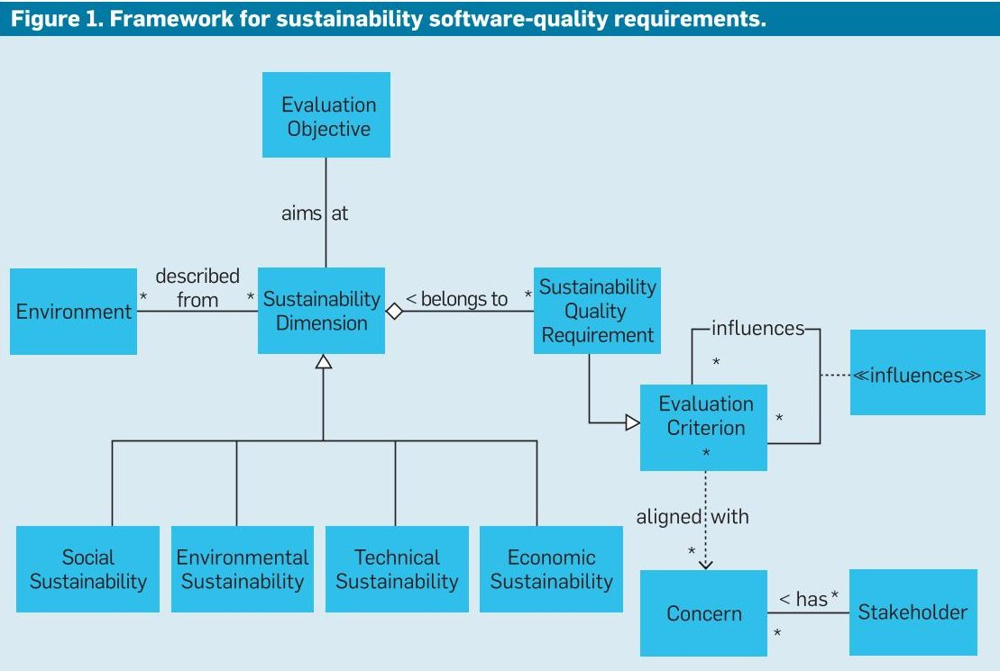
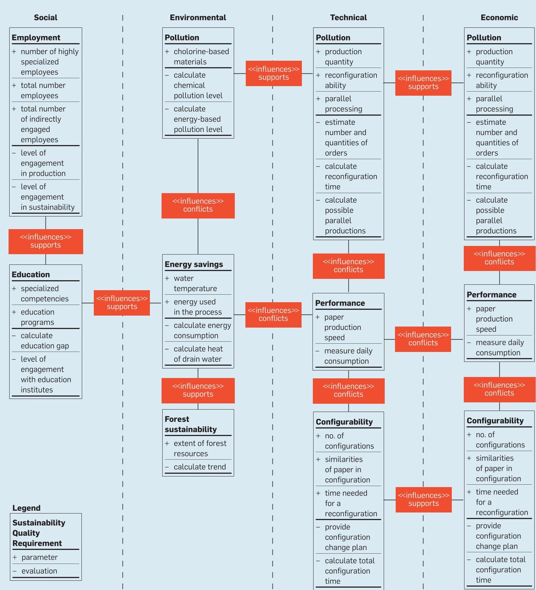
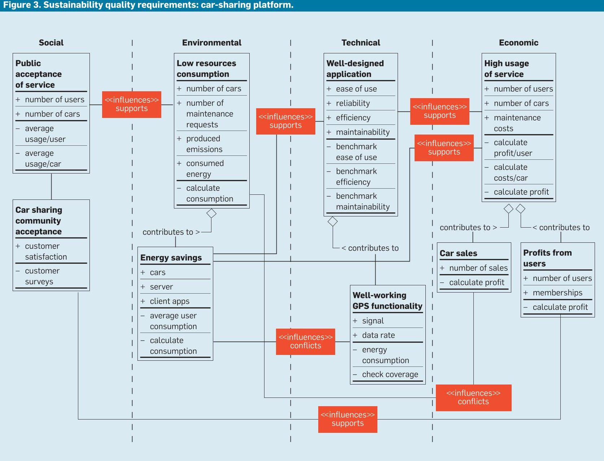

<!-- PDF_PAGE: 1 -->

DOI:10.1145/2714560

This framework addresses the environmental dimension of software performance, as applied here by a paper mill and a car-sharing service.

BY PATRICIA LAGO, SEDEF AKINLI KOÇAK, IVICA CRNKOVIC, AND BIRGIT PENZENSTADLER

<div align="center">

# Framing Sustainability as a Property of Software Quality

</div>

SUSTAINABILITY IS DEFINED as the "capacity to endure" $ ^{34} $ and "preserve the function of a system over an extended period of time." $ ^{13} $ Discussing sustainability consequently requires a concrete system (such as a specific software system) or a specific software-intensive system. Analysis of the sustainability of a specific software system requires software developers weigh four major dimensions of sustainability—economic, social, environmental, and technical—affecting their related trade-offs. $ ^{32} $

The first three stem from the Brundtland report, $ ^{4} $ whereas technical is added for software-intensive systems $ ^{27} $ at a level of abstraction closer to implementation. The economic dimension is concerned with preserving

capital and value. The social dimension is concerned with maintaining communities. The environmental dimension seeks to improve human welfare by protecting natural resources. And the technical dimension is concerned with supporting long-term use and evolution of software-intensive systems. Sustainability is achievable only when accounting for all dimensions. Including the environmental dimension makes it possible to aim at dematerializing production and consumption processes to save natural resources. $ ^{12} $ Connections among the four dimensions involve different dependencies and stakeholders. $ ^{28,31} $ Potential conflicts among stakeholder interests means software developers must understand the relationships among goals of the four dimensions.

The shortcoming of current software engineering practice with regard to sustainability is that the technical and economic dimensions are taken into account while the environmental and social dimensions are not. The question we address here is how these concepts relate to software and how to break down the respective concerns into software-quality requirements. We focus on the (currently neglected) environmental dimension and its relation to the other dimensions. While most efforts in environmental sustainability through software have focused on energy efficiency, we tie the concept of environmental sustainability to other sustainability dimensions of a software system, particularly to ad-

## key insights

The sustainability analysis framework enables software developers to specifically consider environmental and social dimensions relative to technical and economic dimensions.

- Sustainability requirements and concerns will increase system scope, requiring extended analysis during requirements engineering.

The framework helps draw a more comprehensive picture of the relevant quality dimensions and, as a result, improve decision making.

<!-- PDF_PAGE: 2 -->

## 

## 

## ```markdown

```

<!-- PDF_PAGE: 3 -->





dress second-order effects, $ ^{13} $ or those of a software system in its operational context, as with, say, how a car-sharing service used by many users over a number of years affects the surrounding environment.

Our contribution is a sustainability analysis framework that aids practitioners exploring software qualities related to the four dimensions and explicitly representing dependencies among the dimensions. To illustrate the application of this framework we offer two case-study examples from different domains.

## Sustainability Analysis Framework

The framework aims to capture the relevant qualities that characterize sustainability concerns of software systems, helping identify how these qualities influence each other with respect to the different aspects of sustainability (see the sidebar "Software Sustainability"). Software qualities as nonfunctional properties have been studied and adopted in software engineering. In particular, various methods for quality evaluation in software architecture have been defined to support holistic reasoning and decision making that involve software, hardware, human, and system elements. We exploited this holistic approach, defining our framework by extending an existing model, the Third Working Draft of ISO/IEC 42030 Architecture Evaluation, $ ^{14} $ as outlined in Figure 1. The blue boxes denote generalized preexisting components from the working draft. While the draft specifically targets evaluations, the potential context of the framework is broader, embracing any activity that relies on a sound representation of qualities, including requirements engineering, design decision making, trade-off analyses, and quality assessment.

The following paragraphs describe the dimensions used in the framework to characterize sustainability in the context of software-intensive systems:

Social sustainability. Social sustainability focuses on ensuring current and future generations have the same or greater access to social resources by pursuing generational equity. For software-intensive systems, it encompasses the direct support of social communities in any domain, as well as activities or processes that indirectly create benefits for social communities;

Environmental sustainability. Environmental sustainability aims to improve human welfare while protecting natural resources; for software-intensive systems, this means addressing ecological requirements, including energy efficiency and creation of ecological awareness; and

Technical sustainability. Technical sustainability addresses the long-term use of software-intensive systems and their appropriate evolution in a constantly changing execution environment; and

Economic sustainability. Economic sustainability focuses on preserving

capital and financial value.

An evaluation criterion can be a quality requirement, as in Figure 1. In particular, as we focus on characterizing sustainability-related software qualities, we address how quality requirements relate to sustainability, or "sustainability quality requirements." In this context, requirements could include both traditional quality requirements (such as performance, usability, security, and maintainability) and sustainability-related requirements (such as energy efficiency).

Whenever we specifically target sustainability, as in Figure 1, where the association aims to link the evaluation objective to the sustainability dimension, software developers must resolve trade-offs among the various qualities classified as belonging to each of the four dimensions. In particular, traditional software decision making considers trade-offs either between different technical sustainability criteria (such as performance versus availability) or between technical sustainability criteria and economic sustainability criteria (such as performance versus costs). In contrast, sustainability-related software decision making involves trade-offs between environmental sustainability criteria (such as energy efficiency) and social, economic, and technical sustainability criteria.

To frame software qualities this way we position them in the four sustainability dimensions and relate them to the concerns of the relevant stakeholders. For the sake of simplicity, this information is not included in the case-study examples, though the description of a paper-mill control system refers to three main stakeholders: surrounding community and society at large (concerned about environmental sustainability like forest sustainability); customers (concerned about economic sustainability like production savings expressing productivity and economic value creation); and producing organization, including managers and engineers (concerned about technical sustainability like optimization of configurability and performance).

Moreover, interdependent quality requirements may influence one another, as in association/association class influences among sustainability quality requirements; for example, in

<!-- PDF_PAGE: 4 -->

the paper-mill control system (see Figure 2), performance and energy savings could influence each other, while increasing performance could demand more resources that consume more power and ultimately have a negative effect on energy savings. Using our framework to make these influences explicit helps designers of software-intensive systems appreciate the importance of the various qualities.

In addition, the trade-offs software developers make among qualities change depending on stakeholders (such as business customers, vendors, and society at large). If a company's main stakeholder is a vendor, performance probably wins over energy savings; the opposite is probably true if the stakeholders are consumers. Keeping track of the elements captured by the framework is thus crucial for reasoning about the trade-offs to be made among the various qualities in the four sustainability dimensions.

## Examples

We show the applicability of the sustainability analysis framework through examples. For each, we briefly introduce the domain, then discuss its sustainability qualities and their interdependencies. We illustrate the





<!-- PDF_PAGE: 5 -->

<div align="center">

# Software Sustainability

</div>

The past few years has seen the transformation of the role of IT in sustainability due to rising demand for energy and increasing use of IT systems and potentially negative effects on the environment. As outlined by Gartner analyst Tratz-Ryan, $ ^{36} $ industry is moving toward sustainability to enhance compliance, operational efficiency, and performance, suggesting achieving sustainability objectives should involve IT integration, providing efficiency, performance, and business processes. While industries are integrating IT-enabled solutions, they must also integrate sustainability programs, addressing lack of awareness of emissions reduction and potential financial savings though IT, lack of robust policies for addressing climate change, and lack of frameworks, systems, tools, and practices for decision support and connecting sustainability performance to economic performance. $ ^{9} $

As the IT industry becomes aware of sustainability, the software-engineering research community has begun paying attention to sustainability, as demonstrated by an increasing number of publications, empirical studies, and conferences. Surveys of published studies $ ^{25,29} $ show over 50% of those on sustainability in software engineering were published between 2010 and 2012, indicating the emergence of the topic in the software-development community. Software technology can help systems improve their energy efficiency, streamline processes, and adapt to changes in the environment. There is a rich body of knowledge regarding energy estimation $ ^{11} $ and optimization (such as efficient algorithms) and tools and methods to measure energy efficiency, $ ^{15,21} $ particularly for mobile devices. $ ^{7} $

Researchers often rely on estimates or focus on hardware rather than on software. They increasingly focus on energy efficiency as an objective of the software-development life cycle and related development tools and methodologies. In 2014, Kalaitzoglou et al. $ ^{16} $ developed a practical evaluation model that could serve as a method for evaluating the energy efficiency of software applications.

These energy-related studies emphasize the environmental dimension of sustainability. The other dimensions, as related to software, are also being discussed; for example in 2005, Tate $ ^{35} $ characterized sustainable software engineering as "the ability to react rapidly to any change in the business or technical environment" but considered only financial aspects of sustainability. Mahaux et al. $ ^{22} $ analyzed the use processes of a software system with respect to social and environmental aspects of sustainability. Naumann et al. $ ^{24} $ identified a lack of models and descriptions covering the spectrum of software aspects of sustainability. Razavian et al. $ ^{32} $ applied the four-dimensional sustainability model to the services and conflicts among dimensions. More concrete initiatives are emerging in industrial practice. $ ^{10} $

All related studies help build awareness of sustainability in software engineering. Our own next step is to create best practices and guidance by applying definitions, frameworks, and models to case studies. Our framework is thus a means for developing software sustainability by including all four dimensions of sustainability—economic, social, environmental, and technical—while our case studies could help software developers address the challenges of sustainability practices in software engineering.

Software quality and sustainability. Various systems, including energy, management, and computer, target sustainability as a quality objective. Models, tools, and metrics/ indicators have been developed to instrument systems for sustainability assessment. A 2013 survey by Lago et al. $ ^{18} $ on green software metrics found metrics are limited to energy consumption, while models to assess green software qualities are lacking. Mocigemba $ ^{23} $ defined a sustainable computing model focusing on product, production, and consumption-process assessments for both hardware and software. And Afgan $ ^{1} $ introduced a multi-criteria assessment method, with economic, environmental, and social indicators, as a way to assess energy systems as proxy for sustainable development. Other preliminary initiatives have investigated how to define, measure, and assess sustainability as an attribute of software quality. $ ^{2,18,26} $ In general, these efforts point to the multidimensional nature of sustainability and the need for an interdisciplinary approach.

The quality models introduced by the International Organization for Standardization (http://www.iso.org)—ISO/9126 and ISO/IEC 25010—do not (yet) consider sustainability a quality property of software development. However, the working group on software architecture (WG42, working on ISO/IEC 42030) is considering including Kern et al. $ ^{17} $ who developed a quality model for green software that refers to quality factors from ISO/IEC 25000 based on direct and indirect software-related criteria. Calero et al., $ ^{5} $ who considered sustainability in 2013 as a new factor affecting software quality, presented a quality model based on ISO/25010. In a 2014 study, Akinli Kocak et al. $ ^{3} $ evaluated product quality and environmental criteria within a decision framework, providing a trade-off analysis among the criteria. Studies from before Akinli Kocak et al. $ ^{3} $ covered the relations between software quality and sustainability, highlighting that both product and use qualities should be considered when assessing software sustainability. However, no study has specifically investigated the multidimensionality of sustainability and the trade-off among the dimensions in software engineering practice. Sustainability- analysis frameworks are beginning to appear in software-engineering research. $ ^{30,31} $ Our work, as discussed here, is a first step toward emphasizing the environmental dimension generally neglected in other studies.

framework's added value with various aspects of business sustainability: stakeholders (in the first case) and specialized influences relations between qualities (in the second case). The granularity of requirements ranges from coarse-grain high-level goals to fine-grain detailed system requirements. These case-study examples are at the high-level end of this spectrum (see van Lamsweerde $ ^{20} $ ). Figures 2 and 3 emphasize several framework elements: sustainability quality requirements (for which we detail parameters and metrics to capture quality levels); their influences and interdependencies; and the sustainability dimension they belong to (represented as "swimlanes"). In the figures we do not propose a new notation but the approach we suggest for capturing the relations among the four sustainability dimensions. For formalizing and modeling in more detail, the notations proposed by Chung et al. $ ^{6} $ are also useful. Here, we use a simple notation based on Unified Modeling Language class diagrams.

Paper-mill control system. The worldwide paper-production industry is an example of successful sustainability improvement through advances in technical and economic solutions. $ ^{8} $ A typical plant control system (PCS) some 30 years ago would have involved a paper-production cycle of several days. The energy consumption would have been very high (though the cost of electricity was lower, the energy costs were three times more per ton of pulp than today); so was the pollution, mostly in a form of water polluted by chlorine compounds (water pollution at the time had just started to be an public-policy issue). A PCS would manage the entire process through a few hundred sensors and actuators. A typical plant would employ from 2,000-3,000 people, with a considerable number of them relatively uneducated, and several tens of experts who would optimize the process with respect to production quality through their experience. A PCS today can handle several hundred thousand signals while reducing the production cycle to an hour while lowering the environmental impact significantly; for example, water consumption of 200-300 cubic meters

<!-- PDF_PAGE: 6 -->

per ton of pulp in 1970 decreased to less than 50 cubic meters per ton and in some mills below even 10 cubic meters per ton. The number of employees in Swedish plants (Sweden is a major pulp and paper producer) decreased over 75% , though their qualifications increased; today, over 50% of employees are highly qualified engineers and technical specialists. Production in such plants has increased dramatically, by at least 10 times in the past 30 years. $ ^{a} $ The main concern for mill owners today is energy savings, including energy for the technological process (such as in cooking paper pulp) and energy for the PCS. This gives environmentally sustainable software a double role: decrease energy consumption of the PCS itself, which is distributed and complex, with many devices, and decrease energy consumption of the entire production system through smart algorithms and energy-efficient technologies controlled by software. Consequently, the survival of paper-mill companies in Sweden (and worldwide) depends on all four sustainability dimensions, driven primarily by customers and competitors but also by society, including towns, cities, and municipalities, as well as the entire country.

Figure 2 includes example sustainability quality requirements, sorted by sustainability dimensions and the relations among them. We distinguish between vertical (within a dimension) and horizontal (between dimensions) relations. The social dimension refers to the changes in the infrastructure in the companies and in society needed to support requirements for employee skills. A company would need highly educated people, putting demand on their supply from society. The company would need

to make a short- and long-term plan for requalification of employees, and the local society (typically a municipality or county) would need to take responsibility for retraining people. Increased education level would improve environmental sustainability awareness. Such awareness is an example of a horizontal relation. An example of a vertical relation in the environmental dimension involves the following operating environment. A company might deploy new technologies that leads to less water pollution and greater effectiveness of the process that leads to increased environment sustainability (in terms of cleaner water, less energy, reduced forest resources, and forest regeneration). However, such results would require a wise trade-off between increased production, in terms of scalability, performance, and configurability, and economic and environmental requirements; for example, increased





<!-- PDF_PAGE: 7 -->

productivity could undermine environmental demands, and addressing them would require new technologies, as well as changes in the process, including direct and indirect changes (such as selective tree cutting, paper recycling, and planting new trees) requiring changes in the technology of the control system.

The horizontal relations also reflect a balancing of stakeholder interests; trade-offs are typically required between economic and social sustainability requirements or between economic and environmental sustainability requirements. In contrast, technical requirements provide the solutions that improve economic and environmental dimensions.

This case example illustrates how the sustainability analysis framework can be applied in development processes of large, long-lived systems that require public investment and feature significant profit margins. Economic and technical sustainability are customer-driven. The environmental and social sustainability requirements do not come from the customers of the paper mill but from the surrounding community and society at large, including region and state. Due to the large public investment, society can impose requirements. Since environmental and social sustainability requirements do not come from customers, they tend to be overlooked by managers and engineers. Integrating our four-dimensional sustainability analysis framework into the engineering processes of such long-lived industrial systems provides valuable support to managers and engineers trying to satisfy not only economic and technical but also environmental and social sustainability requirements.

Car-sharing platform. In a 2013 study, we analyzed the sustainability impact of DriveNow, a Munchenbased car-sharing platform $ ^{27} $ created to serve users who do not otherwise have access to a car for short-distance inner-city trips (see Figure 3). The primary quality requirement is significant use of the platform in the economic sustainability dimension. It is supported by a well-designed application that in turn supports (in the social sustainability dimension)

strong public acceptance of the application. The focus was on the different types of influences affecting framework relations. As with any kind of requirement or goal, sustainability can be linked through various types of influence relationships, as in goals. $ ^{20} $ We focus here on support and conflict. In the following paragraphs, we discuss one requirement and its interrelations, illustrating outcomes due to direct and indirect effects on quality requirements. Environmental sustainability, in terms of energy savings, is affected in at least three ways:

GPS. For a well-designed application, reliable GPS functionality is needed, and adding it will, in turn, negatively affect energy savings in the application;

Energy. DriveNow aims to get people to share cars, leading to reduced car production, hence energy savings in production; and

Marketing. DriveNow generates revenue not only through the platform itself but also through the marketing value created by driving new cars around the city; they will be seen by potential customers who may be motivated to buy them, leading in turn to more emissions and less energy savings due to increased car production.

The result is a well-known phenomenon known as first-, second-, and third-order effects. $ ^{13} $ While use of the app leads to more energy consumption due to GPS use, or a firstorder effect (the direct effect of a software system), it also facilitates sharing more cars and thus reduces total energy use, or a second-order effect, the indirect effects triggered by use of a software system in its operational context. On a larger scale, the effect might turn around yet again and lead to a completely different result, or a third-order effect, systemic effects triggered by long-term, widespread use.

The original development of DriveNow did not consider all four dimensions or all these effects. The primary dimension was economic, and the secondary dimension was technical. Both social and environmental were not considered, yielding several consequences:

Social. When the service was available for only a few months and analyzed by the project team, it turned out a user community was developing in which individual users had established an understanding of themselves as part of a larger community supporting shared mobility services. Had the company's founders and developers considered the social dimension in advance, the system's user interface could have been developed to make it easier to form carpools among users;

Environmental. DriveNow uses mostly environmentally friendly hybrid and electric cars, providing a good basis for environmental sustainability. However, as the company's founders and developers did not consider the environmental aspect of the service during their initial business case analysis, no green IT options were explored for the server side. Likewise, they did not do a comparative (simulation) study of how the long-term widespread use of the service would affect Munchen traffic and parking. Consequently, the environmental sustainability of the system still needs improvement; and

Interrelation of dimensions. One example of often-underestimated relations among the dimensions our framework helps analyze is the use of electric cars, which must be driven in the right way to ensure they produce less pollution (environmental dimension). There is thus a need to offer training (social dimension) for that type of driving, including or leading to further investment (economic dimension).

While simplified, this case illustrates the importance of understanding the interdependencies among qualities by business managers and software developers alike. Our framework is useful for understanding and addressing them, avoiding dangerous pitfalls like negative business consequences and environmental effects.

## Observations

These case studies illustrate how our approach to sustainability analysis links the four sustainability dimensions that are seemingly unrelated to software qualities. Determining and analyzing the relations among the qualities, as outlined in Figure 2 and Figure 3, give decision makers a blueprint for analyzing sustain-

<!-- PDF_PAGE: 8 -->

ability qualities and gaining insight into sustainability stewardship. By addressing all four dimensions, the framework enables software practitioners to make trade-offs across different dimensions; for example, in the case of the paper-mill control system, a manager using the framework can easily identify not only technical and environmental but also social and economic trade-offs. The framework also helps capture the influence of various stakeholders on the various qualities regarding the four dimensions. Both studies show sustainability quality relations potentially carry positive or negative influences. Moreover, they reveal that when evaluating a system's sustainability quality, all aspects of the system's performance should be taken into consideration; for example, in the case of DriveNow, environmental and social dimensions were originally not included, hindering potential positive effects on the environment. The framework allows management to draw a more comprehensive picture of the relevant quality aspects and help make more-informed decisions.

Figure 2 and Figure 3 are snapshots at the time of the case studies and do not characterize the systems' overall life cycles. The case studies, four dimensions, and relations have their own life cycles. In particular, the relations and their quantification will likely change over time; the initial deployment of infrastructure for a PCS requires a substantial energy investment up front, but situationaware systems accrue significant benefits over time. While first- and second-order effects could indicate one trajectory in the assessment of sustainability, the effects on global goals can change or even reverse the trend. Moreover, the effect of software systems on the environment could differ dramatically depending on the framework conditions. Any concerns related to sustainability requirements must be prioritized and traded off against business requirements and financial constraints.

The notion of sustainability entails a long chain of (possibly circular) consequences across all the dimensions. When identifying the concerns pertaining to a software system, management must define the sustainability concerns directly influencing the system, the boundaries outside the scope (but that could be useful for decision making), and the boundaries too remote to be considered. The ISO/IEC 42030 working draft models the environment in which a system is situated. In our understanding of the draft, part of such an environment is within the system's scope, while part is outside it. However, sustainability requirements and concerns likely increase system scope.

<div align="center">

# Due to the large public investment in such an industry [paper production], society can impose requirements.

</div>

There are also limitations as to what the sustainability-analysis framework can provide. The influences among the sustainability quality requirements must be determined by developers and/or stakeholders, as the framework can provide only the means for linking them but not the analysis itself. Constraints and parameters must be chosen by the developers, as it is not possible to list them in a way that is generic enough to be applicable in all circumstances and at the same time specific enough to be useful. The best guidance we can provide with this framework is through examples showing how to apply it and its potential benefits. Part of our own future work is to extend this guidance with further examples.

## Conclusion

This article has presented a framework for trading off sustainability quality requirements from the various dimensions of sustainability. It is based on the Third Working Draft of ISO/IEC 42030 Systems and Software Engineering Architecture Evaluation $ ^{14} $ and a first attempt at understanding the multidimensional effect of software on its environment. It can assist software practitioners in making trade-offs, not only among technical and economic aspects of business sustainability but also in relation to society and the environment. We focus on classifying sustainability quality requirements as the first step toward sound decision making, tradeoff analyses, and quality evaluation. Applying the framework enables software developers to specifically consider the neglected environmental and social dimensions in relation to the technical and economic dimen-

<!-- PDF_PAGE: 9 -->

sions. Using the framework, practitioners are better able to determine their sustainability goals and see the potential outcomes of the criteria.

We hope to help provide new research directions and a foundation for discussing the integration of the various ISO quality models. Our own future research will focus on how the framework's sustainability quality requirements can be systematically deduced from a goal model while considering the effects of software on its environment. These requirements include how to refine such information in the form of constraints on design and implementation. Moreover, the resulting models could be useful for cost estimation, specifically in terms of how software design decisions affect architecture and infrastructure. Another open challenge we hope to address is "scoping," or distinguishing sustainability concerns outside the software system but directly influencing it, so the information about such concerns could help take optimal decisions. Finally, as there are no standardized metrics for software sustainability, applying the framework can help establish sound metrics that would serve as as a basis for building satisfactory tool support.

## Acknowledgments

This work was partially sponsored by the European Fund for Regional Development under project RAAK MKB Greening the Cloud, the Deutsche Forschungsgemeinschaft under project EnviroSiSE (grant PE2044/1-1) and the Swedish Foundation for Strategic Research via project RALF3. Thanks, too, to the participants of the GREENS Workshop at the 35th International Conference on Software Engineering in San Francisco, CA, in 2013 who contributed thoughts and ideas, especially Henning Femmer and Hausi Muller.

## References

1. Afgan, N.H. Sustainability paradigm: Intelligent energy system. Sustainability 2, 12 (Dec. 2010), 3812-3830.

2. Akinli Kocak, S., Calienes, G.G., Işiklar Alptekin, G., and Başar Bener, A. Requirements prioritization framework for developing green and sustainable software using ANP-based decision making. In Proceedings of the EnviroInformatics Conference (Hamburg, Germany, Sept. 2-4, 2013), 327-335.

3. AkinLi Kocak, S., Işiklar Alptekin, G., and Başar Bener, A. Evaluation of software product quality attributes and environmental attributes using ANP decision framework. In Proceedings of the Third International

Workshop on Requirement Engineering for Sustainability (Karlskrona, Sweden, Aug. 26, 2014), 37-44.

4. Brundtland, G. et al. Our Common Future (Brundtland Report). United Nations World Commission on Environment and Development, 1987; http://www. un-documents.net/our-common-future.pdf

5. Calero, C. Bertoa, M., and Angeles Moraga, M. Sustainability and quality: Icing on the cake. In Proceedings of the 2013 Workshop on Requirements Engineering for Sustainable Systems (Rio de Janeiro, Brazil, July 15, 2013), 50-59.

6. Chung, L., Nixon, B.A., Yu, E., and Mylopoulos. J. Non-Functional Requirements in Software Engineering. Kluwer Academic Publishers, 1992.

7. Corral, L., Georgiev, A.B., Sillitti, A., and Succi, G. A method for characterizing energy consumption in Android smartphones. In Proceedings of the Second International Workshop on Green and Sustainable Software (San Francisco, CA, May 20). IEEE, Piscataway, NJ, 2013, 38-45.

8. Crnkovic. I. Are ultra-large systems systems of systems? In Proceedings of the Second International Workshop on Ultra-Large-Scale Software-Intensive Systems (Leipzig, Germany, May 10-11). ACM Press, New York, 2008. 57-60.

9. Global e-Sustainability Initiative. GeSI SMARTer 2020: The Role of ICT in Driving a Sustainable Future. Global e-Sustainability Initiative, Brussels, Belgium, 2012; http://gesi.org/portfolio/report/72

10. Gu, Q. and Lago, P. An Open Online Library of Green ICT Practices; www.greenpractice.few.vu.nl

11. Hao, S., Li, D., Halfond, W. G. J., and Govindan, R. Estimating Android applications CPU energy usage via bytecode profiling. In Proceedings of the First International Workshop on Green and Sustainable Software (Zürich, Switzerland, June 3). IEEE Press, Piscataway, NJ, 2012, 1-7.

12. Hilty, L.M. and Ruddy, T.F. Sustainable development and ICT interpreted in a natural science context. Information, Communication & Society 13, 1 (Feb, 2010) 7-22.

13. Hilty, L.M., Arnfalk, P., Erdmann, L., Goodman, J., Lehmann, M., and Wager, P.A. The relevance of information and communication technologies for environmental sustainability: A prospective simulation study. Environmental Modelling & Software 21, 11 (Nov. 2006) 1618-1629.

14. International Organization for Standardization and International Electrotechnical Commission. 42030, Systems and Software Engineering, Architecture Evaluation. Technical Report WD3. ISO/IEC, New York, 2013.

15. Johann, T., Dick, M., Naumann, S., and Kern, E. How to measure energy efficiency of software: Metrics and measurement results. In Proceedings of the First International Workshop on Green and Sustainable Software (Zürich, Switzerland, June 3). IEEE Press, Piscataway, NJ, 2012, 51-54.

16. Kalaitzoglou, G., Bruntink, M., and Visser, J. A practical model for evaluating the energy efficiency of software applications. In Proceedings of the International Conference of ICT for Sustainability (Stockholm, Sweden, Aug. 24-27). Atlantis Press, Amsterdam, the Netherlands, 2014.

17. Kern, E, Dick, M., Naumann, S., Guldner, A., and Johann, T. Green software and green software engineering: Definitions, measurements, and quality aspects. In Proceedings of the First International Conference of ICT for Sustainability (Zurich, Switzerland, Feb. 14-16, 2013), 87-94.

18. Lago, P., Gu, Q., and Bozzelli, P. A Systematic Literature Review of Green Software Metrics. Technical Report. University of Tampere, Finland, 2013; http://www.sis.uta.fi/~pt/TIE5_Thesis_Course/Session_10_2013_02_18/SLR_GreenMetrics.pdf

19. Lago, P., Jansen, T., and Jansen, M. The service greenery: Integrating sustainability in service-oriented software. In Proceedings of the Second International IEEE Workshop on Software Research and Climate Change (Cape Town, South Africa, May 3, 2010).

20. Lamsweerde. A.V. Requirements Engineering. John Wiley & Sons, New York, 2007.

21. Li, D., Sahin, C., Clause, J., and Halfond, W. G. J. Energy-directed test suite optimization. In Proceedings of the Second International Workshop on Green and Sustainable Software (San Francisco, CA, May 20). IEEE Press, Piscataway, NJ, 2013, 62-69.

22. Mahaux, M., Heymans, P., and Saval, G. Discovering sustainability requirements: An experience report. In Proceedings of the International Working Conference on Requirements Engineering: Foundation for

Software Quality. Springer, Heidelberg, Germany, 2011, 19-33.

23. Mocigemba, D. Sustainable computing. Poiesis & Praxis 4, 3 (Dec. 2006) 163-184.

24. Naumann, S., Dick, M., Kern, E., and Johann, T. The GREENSOFT model: A reference model for green and sustainable software and its engineering. Sustainable Computing: Informatics and System 1, 4 (Dec. 2011) 294-304.

25. Penzenstadler, B., Bauer, V., Calero, C., and Franch, X. Sustainability in software engineering: A systematic literature review. In Proceedings of the International Conference on Evaluation and Assessment in Software Engineering (Ciudad Real, Spain, May 14-15). IET, Wales, U.K., 2012, 32-41.

26. Penzenstadler, B., Tomlinson, B., and Richardson, D. RE4ES: Support environmental sustainability by requirements engineering. In Proceedings of the First International Workshop on Requirements Engineering for Sustainable Systems (Essen, Germany, Mar. 19, 2012), 34-39.

27. Penzenstadler, B. and Femmer, H. A generic model for sustainability with process- and product-specific instances. In Proceedings of the 2013 Workshop on Green in/by Software Engineering (Fukuoka, Japan, Mar. 26). ACM Press, New York, 2013, 3-8.

28. Penzenstadler, B. and Femmer, H., and Richardson, D. Who is the advocate? Stakeholders for sustainability. In Proceedings of the Second International Workshop on Green and Sustainable Software at the 35th International Conference on Software Engineering (San Francisco, CA, May 20). IEEE Press, Piscataway, NJ, 2013, 70-77.

29. Penzenstadler, B., Raturi, A., Richardson, D., Calero, C., Femmer, H., and Franch, X. Systematic mapping study on software engineering for sustainability (SE4S). In Proceedings of the $ 18^{\mathrm{th}} $ International Conference on Evaluation and Assessment in Software Engineering (London, U.K., May 13-14). ACM Press, New York, 2014, article 14.

30. Penzenstadler, B., Raturi, A., Richardson, D., and Tomlinson, B. Safety, security, now sustainability: The non-functional requirement for the 21st century. IEEE Software 31, 3 (May-June 2014), 40-47.

31. Procacccianti, G., Lago, P, and Bevini, S. A systematic literature review on energy efficiency in cloud software architectures. Sustainable Computing: Informatics and Systems 4 (Nov. 2014).

32. Razavian, M., Procaccianti, G., and Tamburri, D.A. Four-dimensional sustainable e-services. In Proceedings of the International Conference on Informatics for Environmental Protection (Oldenburg, Germany, Sept. 10-12, 2014), 221-228.

33. Razavian, M., Lago, P., and Gordijn, J. Why is aligning economic-and IT services so difficult? Chapter in Exploring Services Science. Springer, 2014, 92-107.

34. SustainAbility. Sustainability: Can our society endure?; http://www.sustainability.com/sustainability

35. Tate. K. Sustainable Software Development: An Agile Perspective. Addison-Wesley Professional, Boston, MA, 2005.

36. Tratz-Ryan, B. Sustainability Innovation Key Initiative Overview. Gartner RAS Research Note G00251246, June 14, 2013; https://www.gartner.com/doc/2516916/sustainability-innovation-key-initiative-overview

Patricia Lago (p.lago@vu.nl) is a professor of software engineering and leader of the Software and Services Research Group at VU University Amsterdam, the Netherlands.

Sedef Akinli Kocak (Sedef.akinlikocak@ryerson.ca) is a researcher at Environmental Applied Science and Management Data Science Lab at Ryerson University, Toronto, Canada.

Ivica Crnkovic (crnkovic@chalmers.se) is a professor of software engineering and a director of the ICT Area of Advance at Chalmers University of Technology, Gothenburg, Sweden.

Birgit Penzenstadler (birgit.penzenstadler@csulb.edu) is a professor of software engineering and leader of the Software Engineering for Sustainability Lab at the California State University, Long Beach.