<!-- PDF_PAGE: 1 -->

# SONATE - A Nano Satellite for the In-Orbit Verification of Autonomous Detection, Planning and Diagnosis Technologies

H. Kayal $ ^{1} $ , O. Balagurin $ ^{2} $ , K. Djebko $ ^{3} $ , G. Fellinger $ ^{4} $ , A. Schartel $ ^{5} $ , T. Schwarz $ ^{6} $ , A. Vodopivec $ ^{7} $ , H. Wojtkowiak $ ^{8} $ Computer Science VIII, University Würzburg, Würzburg, 97076, Germany

F. Puppe $ ^{9} $

Computer Science VI, University Wurzburg, Wurzburg, 97076, Germany

## I. Abstract

Classical satellite operations are heavily dependent on support of an expert team on ground. Almost all activities are planned by mission control, transmitted to the satellite as time tagged tele commands and executed on board based on the schedule. In the case of transient and unpredictable events like a meteor, which we want to detect and monitor from space or in the case of an on board anomaly, this classical approach is not suitable or even impossible to apply. In both cases it might be too late to react on ground if the event is not predictable and/or transient. A meteor entering Earth's atmosphere can for instance typically not be planned since the time and place of the event is typically not known until it occurs. The primary goal of the SONATE mission is the in-orbit verification of the key components of two new systems, ASAP and ADIA, which are developed currently at the University of Wurzburg to increase the autonomy of nano satellites and enable demanding future missions. SONATE will be using a triple CubeSat form factor and will partly be equipped with bus components developed at the University. The project is started in February 2016, the launch is scheduled for 2019. The satellite will be operated from the mission control center and the ground station of the University. Secondary goals are the education of students and test of other news satellite bus components. Currently the satellite mission is in Phase A, which will be finished in autumn 2016. A successful mission will open the door for use of the developed autonomous systems in future interplanetary nano satellites.

## II. Introduction

The miniaturization of satellites has made a large step forward at the end of the 90's when the first so called "Cubesat's" were introduced by California Polytechnic State University, San Luis Obispo and Stanford University.

The applications of such small satellites were very limited at the very beginning due to the unavailability of reliable components and technologies suitable for the very restricted size, mass and power constraints. Now in 2016, sixteen years later, the situation has changed rapidly. Many universities, companies and other institutions have developed missing components and complete CubeSat's and nano satellites in different sizes and for different applications. While the most typical and well known constraint of the original "CubeSat" standard was the size of approximately 10 x 10 10 cm^3 and a mass of 1 kg, soon double, triple and more CubeSat "units" appeared. Today, it is not unusual to give

<!-- PDF_PAGE: 2 -->

the size of a nano satellite, which is assumed to be larger than a single unit CubeSat, and has less than about 30kg mass, in units of "cubes". So, for example, a 27-Unit (27U) CubeSat with the size of 30x30x30 cm^3 and mass of 10- 20 kg can be called a nano satellite. The components from which such nano satellites are built have reached a more and more mature state. This development is continuing today and one special aspect is the increasing idea of usability of such nano satellites even for interplanetary missions. In this case, the demand on the reliability of both hardware and software is much higher. Especially the level of autonomy has to be much higher then conventional satellites in low earth orbit.

There are at least two reasons for the demand for higher autonomy. The first one is simply that with increasing distance, the communications lag between ground control and satellite is getting larger. The time between an anomaly on board and the reaction time from ground can be in the case of Mars for example at least 1 hour, taking into account a signal traveling time of two times 20 minutes and an analysis and preparations time of another 20 minutes in the best case of an obvious problem solution. But this might be already too late to save the satellite. An an board, autonomous diagnosis system may help to save the satellite from a total loss. One of the projects called ADIA (Autonomous Diagnosis System) which are currently under development at the university of Wurzburg deals exactly with this problem. The objective of ADIA is to develop a system for nano satellites, which should find out the root cause of a failure on board in order to be able to react more appropriate in the future.

The second reason for the demand for higher autonomy is the fact that the conventional way of commanding a satellite is simply unsuitable for the detection of transient events for which we cannot generate a time table on ground in advance. Examples for such events can be lightning's, volcanic eruptions, thunderstorms of meteors. For conventional satellite operations, we need to know, when an event like ground contact opportunities, sun and eclipse times or target visibility will occur, so that time tagged tele commands can be prepared and uplinked to the satellite in advance. In the case of unpredictable and maybe transient events, the satellite must have autonomous detection and planning capabilities. Another project which is under development at the university of Würzburg is ASAP (Autonomous Sensor and Planning System). ASAP is exactly intended to solve this problem of autonomously detection and reaction to transient events on board of nano satellites. One of the many challenges is, that the system is designed for nano satellites with all its limitations described before.

While both SONATE and ADIA are being developed at different levels, it is desirable to test the technologies under real space conditions. This is the task of SONATE, a nano satellite with the main objective to test the key elements of these two new systems on board of a nano satellite.

## III. SONATE Mission Objectives

SONATE is a nano satellite project funded by the German Federal Ministry of Economic Affairs and Energy, represented by the German Space Agency DLR (FKZ 50RM1606) for the in-orbit verification of key elements of two primary payloads (ASAP and ADIA), which are both aimed to increase the autonomy of nano satellites. The mission objectives can be summarized as follows:

- verification of key elements of ASAP and ADIA as payloads in space

- test of new developed parts of the spacecraft bus systems

- education of students in space projects

The primary payloads, ASAP and ADIA as well as secondary payloads are described in the following sections.

<!-- PDF_PAGE: 3 -->

## IV. SONATE Payloads

SONATE will have two primary payloads, ASAP and ADIA. Because both were originally planned for a larger scale nano satellite, only the key elements of both systems are planned to be used as payloads on board SONATE. SONATE will also be used to test further secondary payloads, which are AROS (star sensor), reaction wheels and SSTV system.

## ASAP

ASAP (Autonomous Sensor And Planning) system is a highly autonomous payload for detection and observation of transient, bright events in the optical spectrum [1]. In a project funded by the German Federal Ministry for Economic Affairs / German Space Agency DLR (FKZ 50RM1208), it has been developed and qualified. It comprises of two main components: the ASAP imager and the ASAP planning system. The system and some of its key elements are shown in Figure 1, it has a total mass of about 3 kg and a size of 175 x 245 x 100 mm3.

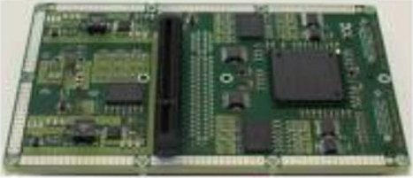

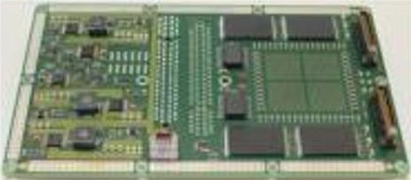

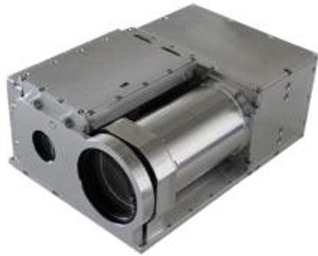

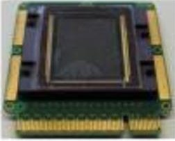

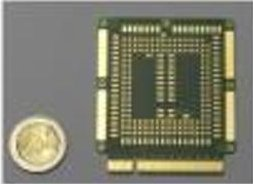

Figure 1. ASAP system and key elementns

The ASAP imager is an optical instrument with the ability to detect changes in the image sequences autonomously [2]. It is made of two high speed CMOS camera systems: one with a narrow field of view (NFOV) of $ 5. 3^{\circ} \times4^{\circ} $ and a second one with a wide field of view (WFOV) of $ 38. 8^{\circ} \times38. 8^{\circ} $ . The WFOV camera is fixed to an infinity focus and can capture up to 100 fps with a resolution of 4 Mpixel. This monochrome system serves as an object finder for the NFOV camera, which can capture color images with a higher resolution of 20 Mpixel at a frame rate of 30 fps. Additionally, the NFOV system can change its focus and aperture electrically. Both systems are able to work independent of each other and recognizes events like meteor passes, lightning's, sprites and other phenomena in the atmosphere. In figure 1, the upper and lower side of one of two PCB's are shown on the left side. In the middle the structure of the systemwith the two optics can be seen. On the right side one of two sensors is shown.

The object recognition process is based on a background subtraction algorithm and runs on a FPGA in parallel to the sensor data read out routine. Furthermore, the logic component of the ASAP imager tries to characterize detected objects. The identification routine is currently being implemented in the hardware of the ASAP system. Its goal is to extract different parameters and properties of detected objects. Information about brightness, dimension, colour, duration, altitude, and motion profile will be determined by image processing and used for object identification. The resulting determined object type will be provided to the on-board planning system for further processing.

As part of ASAP, the planning system can react interactively and intelligently to certain events in an image autonomously captured by the ASAP imager, and can generate appropriate further actions. In this process, the planning systeminteracts with the satellite's board computer and generates a new command list if required. For instance, when a meteor was recognized in the image, the planning system analyses the own and the satellite's resources available and decides, whether to further follow and capture the meteor. If the answer is yes, the planning system generates a new command list with the necessary commands to the attitude control system, to change the satellite's attitude. This all happens without any intervention by a ground operator.

<!-- PDF_PAGE: 4 -->

The autonomous planning functionality of ASAP consists of three processing steps which are implemented in the module called "ASAP Planner" [3]:

## 1. Decide

The planner of ASAP gets meta data as input from different meta data sources. One of these sources is the optical imager of ASAP, which was mentioned in the section before. This special type of data is used in this case to describe the various phenomena and events. A special decision making algorithm processes this meta data and tries to determine a suitable reaction (e.g. tracking a meteor entry). The decision path leading to the reaction is directed by special rules. The decision making process then issues the practical activities for the satellite, which describes the reaction in a formal way. These issued activities are the output of this processing step and the input for the following next one.

## 2. Schedule

Activities for the satellite issued by the former processing step must be augmented with additional information describing their time of execution. This task is performed by the scheduler. It must incorporate additional restrictions imposed by available satellite resources and constraints. The output of the scheduler comes in form of schedules, which are possible solutions that conform to these restrictions.

## 3. Translate

Activities are data constructs suitable for solving scheduling problems, but the onboard computer of the satellite works with commands queued in an internal list on the on board computer (OBC), and executed at a specific time. The purpose of the last processing step of the planner is to translate the provided schedules into commands and/or command procedures which are then updated into the internal command lists of the OBC.

All planning activities are simulated and tested in an environment providing main interfaces to a OBC. The simulation environment is currently under development in the frame of the project ATUS a project funded by the German Federal Ministry for Economic Affairs / German Space Agency DLR (FKZ 50RM1521) and has also graphical interfaces to makes it easy to assess the situation in a 3D visualization.

The described technologies are new, very advanced and risky, and require massive override of the satellite's original operational schedule. Therefore, an independent satellite mission was necessary to test them in space, where it can operate with total disregard of other payloads. Due to the size and mass of the whole system, only the WFOV but not the NFOV systemshall be tested and verified in space in the context of the SONATE mission.

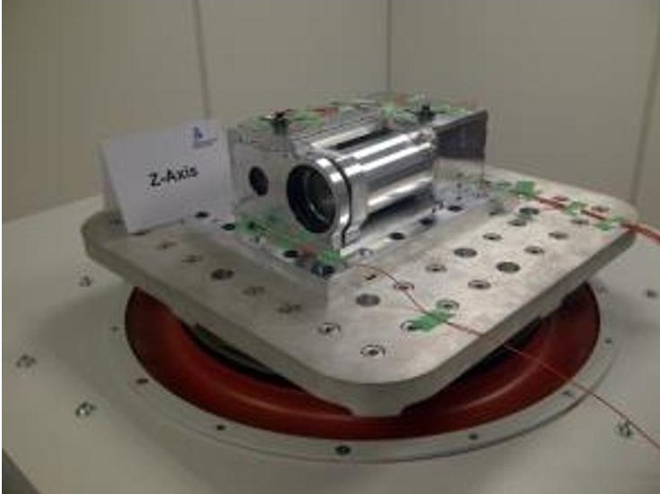

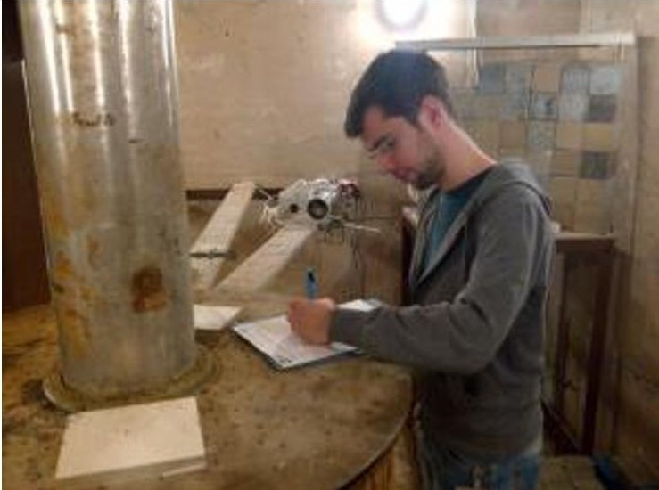

Figure 2. ASAP during qualification tests

The ASAP hardware was qualified on ground for several launchers. The electronic parts and sensors survived different types of radiation tests. Figure 2 shows ASAP during a mechanical test on the shaker (left image) and preparations of a total dose test (right image).

<!-- PDF_PAGE: 5 -->

## ADIA / ADIA++

ADIA is an autonomous system, which is able to detect and analyze past and future faults on board of a satellite [3], [4]. ADIA and its extension ADIA++ are also funded by the German Federal Ministry of Economic Affairs and Energy / German Space Agency DLR (FKZ 50RM1231 and FKZ 50RM1524). Using technologies originating from the area of expert systems, the actual cause of the fault can already be determined autonomously on board of the satellite, which is much faster than finding the cause by direct involvement of the ground operator. ADIA assesses the telemetry data collected and generated periodically by the spacecraft, and tries to recognized anomalies. If all symptoms apply, a diagnosis is suggested and reported to the ground operator via telemetry.

The key element of ADIA is its software. While for SONATE it is planned to run the software on a separate processing unit, this allows it for ADIA to be easily integrated directly into the satellite's board computer in future missions.

Both, the ability to make a diagnosis already on board of the satellite and to predict future anomalies, will be highly useful capabilities especially in the context of future interplanetary nano satellite missions. In SONATE, the key functionality of ADIA/ADIA++ will be tested in low earth orbit.

## AROS

In the AROS research project, funded by the German Federal Ministry of Economic Affairs and Energy, represented by the German Space Agency DLR (FKZ 50RM1522), a software tool is being developed to optimize the design process of star sensors for pico and nano satellites.

As a result of the optimization algorithm and to verify the output two sensors will actually be built. One of those sensors, OP 1, with a size of $ 2 1 \times4 1 \times5 5 \mathrm{~ mm}^{3} $ and a mass of 50g, will be designed for the use on pico satellites, the other one, OP 2, with a size of $ \varnothing 8 0 \times9 5 \mathrm{~ mm} $ and a mass of 150g, for the use on nano satellites. Due to the planned implementation of the SONATE satellite as a 3U CubeSat, which has just very limited space, it is currently planned to only integrate OP 1 as a payload into SONATE for testing in space. If OP 1 shows good results during its initial testing phase, it could also be integrated redundantly into SONATE's attitude control system. Figure 3 shows a CAD model of OP2. [2]

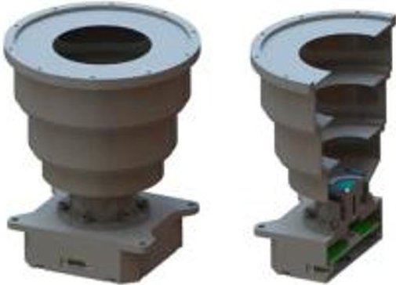

Figure 3. CAD model of AROS, OP 2

## Reaction Wheel(s)

Reaction wheels allow fast and precise changes in the satellite's attitude. This property is vital for the observation of fast moving objects, which can pass in a few milliseconds through the field of view of the ASAP imager. To maximize the duration of the observation, the satellite must be able to perform a tracking maneuver. In the context of

<!-- PDF_PAGE: 6 -->

various student theses, a reaction wheel is being developed at the University of Wurzburg and a prototype was built. This reaction wheel shall be adapted to be tested within the SONATE mission [2].

## SSTV

The communication of the SONATE satellite with the ground station will be conducted on frequencies in the 2m and/or 70cm amateur radio band. As a return service for sharing these frequency bands SONATE will provide some of the images captured on board to the amateur radio community via slow scan television (SSTV). Via SSTV still images can be transmitted analogously line by line. In addition, the inclusion of the amateur radio community by transmitting latest images of the Earth from space increases the public outreach of the SONATE project, because the reception of SSTV does not require much effort for a radio amateur. Because the payloads ASAP and AROS already include several cameras, an own camera for the SSTV payload is not mandatory. Instead, the image signals of those other payloads can be used. Since for the ASAP payload it is planned that the camera is usually pointing towards Earth horizon, those images are especially relevant for the transmission via SSTV. As an option, the communication subsystem of the SONATE satellite bus could be used for the transmission. Hence, the SSTV payload will basically only contain an SSTV encoder, which received the image data from the ASAP payload and generates the SSTV baseband signal. This will then be transmitted to Earth using the communication subsystem of the satellite bus [2].

## V. SONATE Satellite

The space segment of the SONATE satellite comprises of a 3U CubeSat. In Figure 4, which shows the SONATE in a simulated illustration in a typical scenario, the satellite can be seen "in action". A passing meteor is detected by the ASAP WFOV camera. The project started in February 2016, the launch is scheduled for early 2019 into a low earth orbit with an active lifetime of one year and re-entry in less than 25 years to be compliant with the code of conduct regarding space debris mitigation rules.

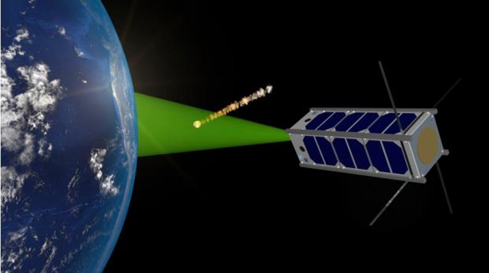

Figure 4. Artistic illustration of SONATE detecting a meteor in low Earth orbit

<!-- PDF_PAGE: 7 -->

For the main mission scenario both payloads will be operated according to a power optimized schedule. ASAP will be operated at least one hour/day, due to power reasons. For ADIA/ADIA++ longer operations times are planned due to the expected lower power consumption of the ADIA unit.

In a typical scenario, ASAP would first detect an event autonomously (meteor, sprite, lightning, other satellite, etc.), then, images of the event would be stored on board of SONATE and transmitted to the ground segment later. If ASAP recognizes a phenomenon, for which a tracking would be desirable to increase the observation time, the relevant commands will be generated on board by the planning system of ASAP but not executed (unless enabled to do so) and verified later on ground, so that a verification of the ASAP planning process will be possible in any case.

In a similar way, the testing of ADIA/ADIA++ will be done in such a way, that it will be possible for ground control to modify regular telemetry in a special way by tele command, on board of SONATE, before it reaches the ADIA/ADIA++ system, so that anomalies will be simulated without really breaking any component of the satellite.

Figure 5 gives an overview over the hardware components that are integrated into the nano satellite [2]. Most of the bus components will be implemented in a redundant way. As this is a technology demonstrator mission with the main objective of verifying and qualifying the payloads,the use of already qualified components in most of the bus subsystems,where possible, instead of own developments will increase the probability of a successful mission and reduces the development expenses.

The attitude determination and control subsystem (ADCS) will use sun sensors, magnetic field sensors and inertial measuring units to measure the attitude of the satellite. A magnetic coil systemand at least one reaction wheel will be used to control the attitude. The primary attitude control mode will be horizon pointing (or nadir pointing). There is no need for a high accuracy, as the only requirement for ASAP is to point its camera roughly to the horizon.

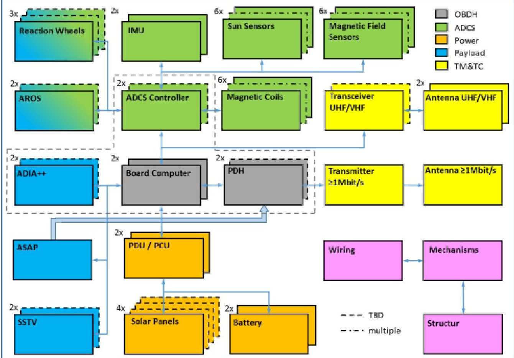

Figure 5. System overview of SONATE

<!-- PDF_PAGE: 8 -->

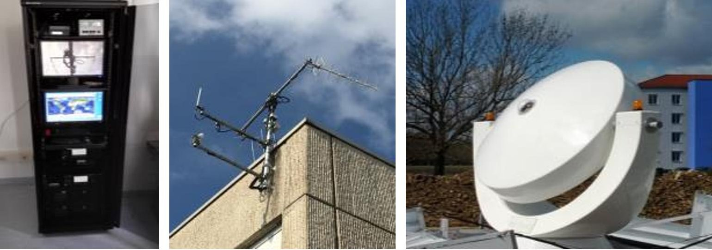

Figure 6. S-band ground station antenna and VHF/UHF ground station antennas

Telemetry and tele commands will be transmitted using either VHF or UHF amateur radio bands. Therefore, the satellite bus includes redundant VHF/UHF transceivers together with low gain antennas. Because the optical payloads can generate big amounts of data, a high speed payload data downlink is required, too. Hence, together with a higher gain antenna, an S-band transmitter will be integrated into SONATE. Figure 6 shows the UHF/VHF ground station equipment rack with redundant transceivers and servers (left), its antenna system(middle) and the mobile 2,4m s-band antenna (right) of the university of Wurzburg, which will be used for SONATE. The satellite will be controlled from the mission control center (MCC), which is currently in preparation (see figure 7). The MCC will also be used for education within the spacecraft operations course.

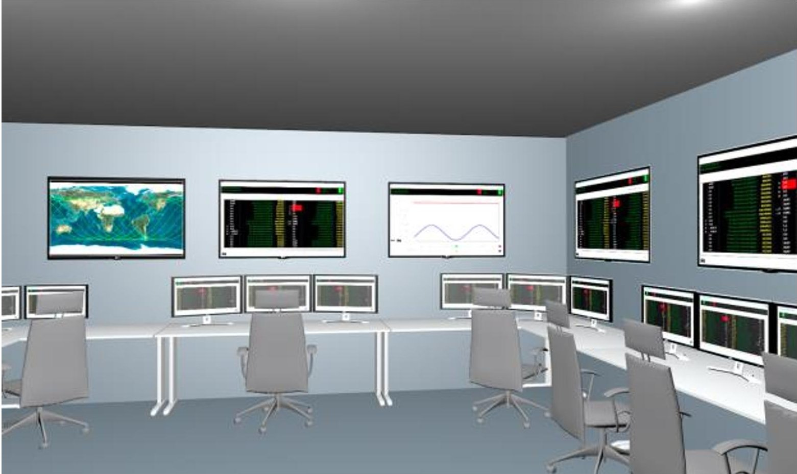

Figure 7. S-band ground station antenna and VHF/UHF ground station antennas

<!-- PDF_PAGE: 9 -->

## VI. Conclusion

SONATE is dedicated to increase autonomy remarkably. By using modern techniques, it will demonstrate higher autonomy for nano satellites by

- autonomously detection of unpredictable, short and transient events (e.g. meteors)

- autonomously planning further steps and

- autonomously finding the root cause of present and possible future failures on board

Although these technologies will be demonstrated in a low Earth orbit, these autonomy features will be key elements of future interplanetary nano satellite missions, where autonomy counts even more.

## References

[1] H. Kayal, "ASAP - A Sensor System for Autonomous Event Detection and on Board Planning", IAC-12-B4.3.2, International Astronautical Congress, Neapel, 2012

[2] O. Balagurin, G. Fellinger, H. Kayal, Tobias Schwarz, Harald Wojtkowiak, "A Novel Nano Satellite Mission to Demonstrate Autonomous System Technologies", Small Satellites Systems and Services - The 4S Symposium. ESA & CNES, Valletta, 2016

[3] O. Balagurin, G. Fellinger, W. Fischer, H. Kayal, H. Wojtkowiak, "Methods and Systems for Increasing Autonomy of Earth Observation Satellites," Small Satellites Systems and Services - The 4S Symposium. ESA & CNES, Porto Petro, 2014

[4] G. Fellinger, "ADIA: Autonomous Detection, Analysis and Prediction of On-Orbit Spacecraft Failures ", IAC-15.B6.2.5, International Astronautical Congress, Jerusalem, 2015