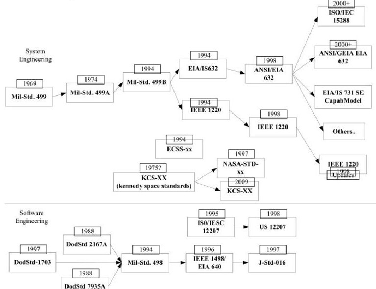
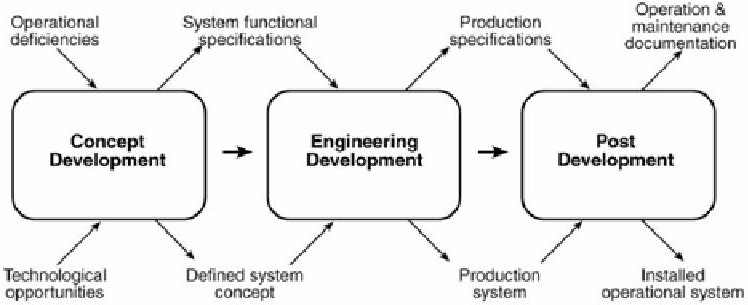
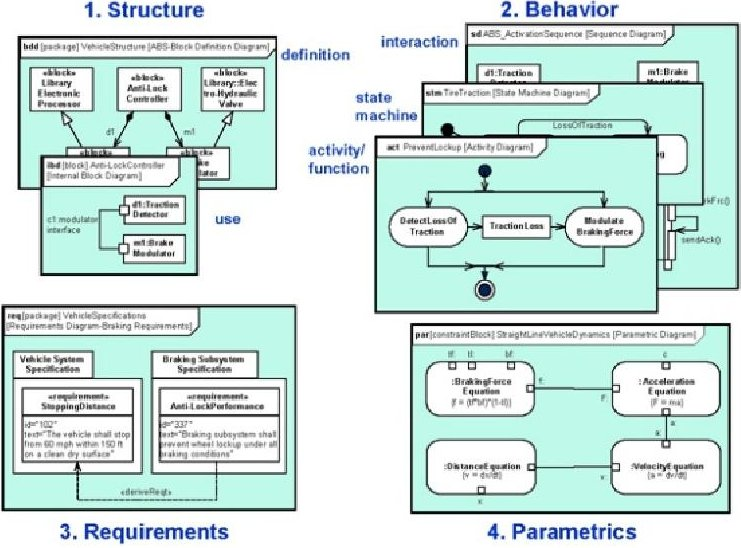
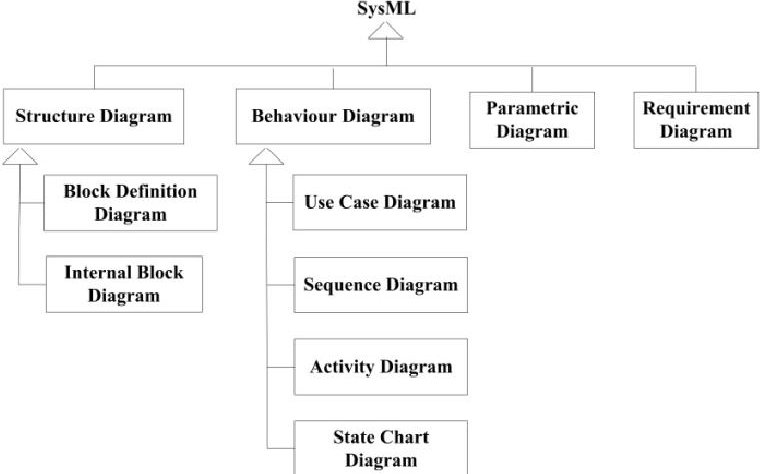
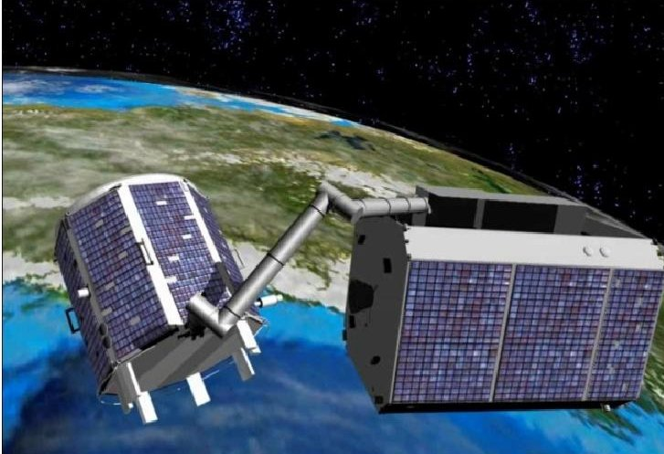
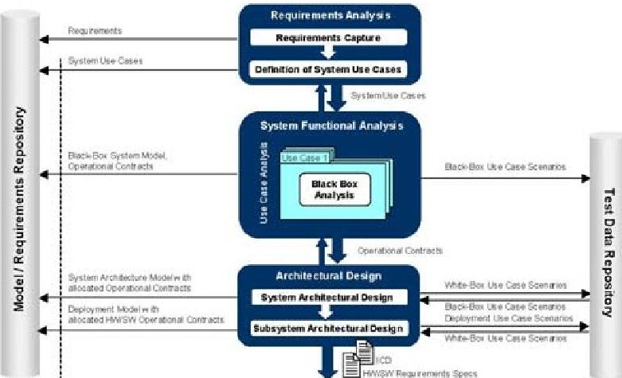
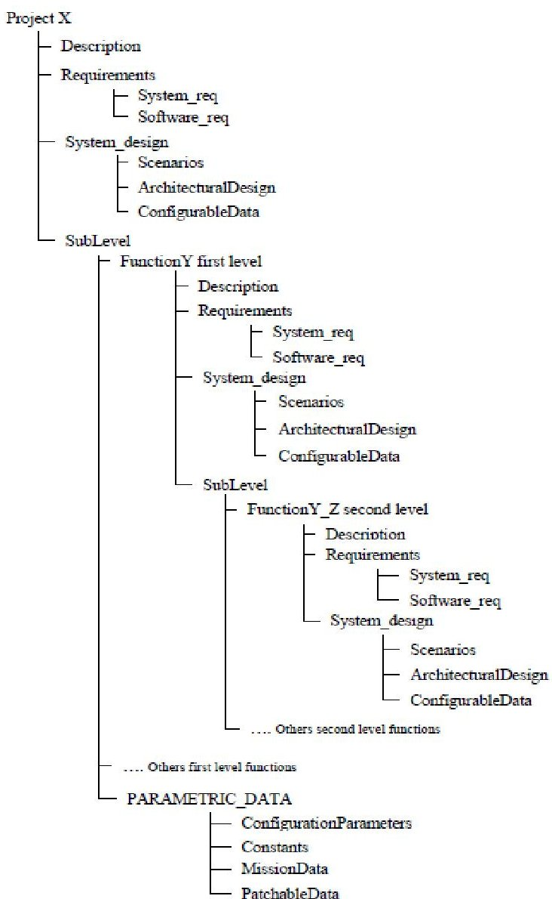
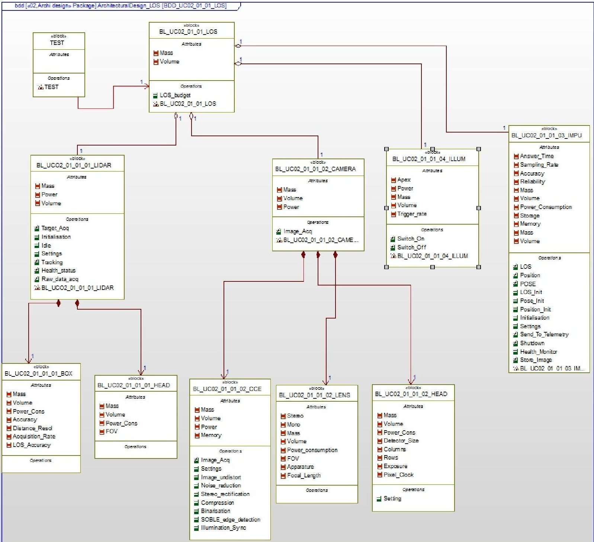

<!-- PDF_PAGE: 1 -->

# MODEL BASED SYSTEM ENGINEERING FOR SPACE ROBOTICS SYSTEMS

S. Chhaniyara $ ^{(1)} $ , C. Saaj $ ^{(1)} $ , M. Althoff-Kotzias $ ^{(2)} $ , I. Ahrns $ ^{(2)} $ , B. Maediger $ ^{(2)} $

$ ^{(1)} $ Surrey Space Centre, University of Surrey, Guildford, UK GU1 7XH Email :{ s.chhaniyara, c.saaj}@surrey.ac.uk $ ^{(2)} $ EADS Astrium GmbH, Space Transportation, Marianne.Althoff-Kotzias, Bernd.Maediger,Ingo.Ahrns}@astrium.eads.net

## ABSTRACT

The success of the Space robotic missions heavily relies on the performance of many interconnected systems and systems of systems. Deep understanding of the mission requirements, accurate system modelling and effective communication between systems, systems of systems and the outside world are critical to the success of these missions. This paper presents a thorough review of past and current system engineering practices and highlights the importance of Model Based System Engineering (MBSE), where model is a central artifact. This paper presents early work on the implementation of Systems Modelling Language (SysML) for modelling multimodal sensor system, which is part of the project INVERITAS for satellite servicing application. This paper also put forwards SysML based system engineering profile structure. The modular package structure would provide excellent portability and will help to create knowledge base for future projects.

## 1 INTRODUCTION

Systems engineering (SE) involves defining and implementing an approach to solving problems, while managing complexity and communicating effectively over the entire lifetime of a project [1]. It is an interdisciplinary field of engineering. System complexity, communication failure and lack of understanding are treated as the 'three evils of systems engineering'. The risk associated with manned or unmanned planetary exploration mission is incredibly high. The interconnectivity among various sub-systems adds further complication to systems. The lack of communication between project personnel, systems, organizations and project stakeholders can lead to ambiguities, which will result in complexity and confusions, leading to mission failure. Quite often, exploration missions involve people from different countries, who speak different languages, which make communication more difficult. Moreover, people with different working backgrounds may understand and interpret things differently. SE thus includes the application of both project management and technical processes and mitigate risks that can impact the success of the project [2].

There is no standardised architecture for SE processes

but over the years many SE standards immerged, that makes up SE approach Fig.1. Software engineering process also evolved parallel to the SE process but recent process guidelines and standards emphasize the need for integrating both these processes [3]. Recently, the European Space Agency (ESA) and National Aeronautics and Space Administration (NASA) have tried to standardise space engineering processes in collaboration with space industries. The European Cooperation for Space Standardization (ECSS) is a result of such effort by ESA and European space industries [4].

Figure 1 Heritage of system engineering standards [5]

SE process broadly consists of three main phases namely concept development, engineering development and post development as shown in Fig. 2.

Traditional SE approaches require to update and to track requirements in a text/graphics/tabular method against their functional or behavioural components manually. On top of that, during early design review stages, mission system engineers may also needs to carefully modify or delete requirements without compromising effects of that on other interconnected systems or subsystems. Moreover, downstream engineering discipline will require to textual language specifications rather than receiving it in more knowledgeable form. This is a very time consuming, error prone and complex procedure especially when multiple stakeholders and teams of engineers involved locally or globally.

<!-- PDF_PAGE: 2 -->

Invariably, systems engineer could play a vital role in rectifying these problems through using appropriate automated tools for space SE.

Figure 2 Principle phases of system engineering process life cycle [6]

## 2 SPACE ROBOTIC SYSTEMS AND SYSTEM ENGINEERING

The successful launch of the first artificial satellite Sputnik marked the beginning of the space revolution. Over the last five decades, space industries have expanded globally and these advancements in the field of space technology has greatly improved the quality of life and the understanding of world around us. In order to broaden the scope of space exploration missions, to improve the economic benefits and to make space affordable to more countries, there is a need to develop technologies that will ultimately reduce the cost of the overall mission and which will introduce new abilities of spacecraft. One main element of such technologies is the integration of robotic elements, used e.g. for the servicing of satellites (lifetime expansion or functional upgrades) or for the transportation and handling of scientific instruments in planetary exploration missions.

Furthermore, there is a potential problem with increasing number and the larger size of satellites. Since the average lifetime of a satellite is only 3-5 years, the space is getting more populated and also polluted every year. The potential problems caused by space debris are numerous and as of today, there is no effective mechanism to mitigate this. As already mentioned, one potential solution is to increase the lifetime of a spacecraft through servicing. Thus intelligent robots could also be used for moving the dead or malfunctioned spacecraft to the graveyard. Both these concepts are premature and there is a great demand to develop robotic technology to resolve this ever alarming problem. A common feature of all these robotic missions, either in an Earth orbit or for planetary exploration, is the close integration of a large number of separate subsystems, where each of these subsystems are again highly-integrated and intelligent elements, which must be controlled from a common system level to achieve the required system performance. Such subsystems are for instance advanced sensor data processing, especially 2D/3D-image processing or control systems for interacting subsystems. However,

the introduction of robotic technologies is very complex, as it would involve executing complex missions semi-autonomously or autonomously using highly nonlinear robotic systems. In order to realise these missions, thorough analysis should commence right at the foundation level, i.e., at the 'systems' level.

## 2.1 Model based system engineering

One emerging approach to this is to employ MBSE, where model is a central artifact. MBSE is a methodology that is the collection of processes, methods and tools to enhance the system engineering process through a model driven approaches [7]. In MBSE, models have a governing role in the requirement engineering, specification, design, integration, validation, and operation of a system. MBSE is a paradigm shift from traditional document-based and acquisition lifecycle model approaches. A key benefit of a formalised system modeling approach is that it provides a rigorous process for defining interfaces between system elements and verifying various inconsistencies within the model. Model enables communication of concepts more effectively between different personals and it also makes concepts to be interpreted clearly among various engineering/management disciplines.

## 2.2 INCOSE Object-Oriented Systems Engineering Method

To support MBSE, INCOSE Object-Oriented Systems Engineering Method (OOSEM) is proposed by the Object Management Group (OMG). It is a model based approach that uses OMG SysML. OOSEM is a hybrid approach that uses object oriented techniques and SE process

## 2.2.1 SysML standard

SysML is a general-purpose modelling language for systems engineering that is a subset of the Unified Modelling Language (UML) with extensions. SysML is designed to provide simple but powerful constructs for modelling a wide range of systems engineering problems. It is particularly effective in specifying system requirements, structure, behaviour and allocations, and constraints on system properties to support engineering analysis [8]. In order to ensure that SysML will not get extensive, even elements explicit to UML but not required in systems engineering are excluded from SysML [8]. This includes, for example, components that are too much on the software side for systems engineering, and several rather exotic elements for class modelling, such as 'power type' and 'package merge'. The core of object orientation - classes, objects, inheritance- is moved into the background. The four main pillars of the SysML are shown in Fig. 3 and the different diagrams of SysML, which helps to capture

<!-- PDF_PAGE: 3 -->

structural, behavioural and parametric analysis of system under consideration are shown in Fig.4.

Figure 3 Four main pillars of the SysML (Source: OMG)

Figure 4 Essential SysML diagrams

One of the advantages of SysML modelling is the inherent organisation and navigability that is possible through the explicit structure of the model. Tools providing design or model organisation will allow the user to view all the information relevant to an element down to the finest grained detail. In addition, they will permit the extraction or filtering of specific information to generate customised reports of the model. Some of benefits of SysML for SE are listed below:

(i) An extended benefit of a fine-grained organizational structure of a SysML model is the ability to provide equally fine-grain version control of the elements. This allows the team to partition a model into logical units and work independently on those segments without disrupting the activities of other team members. It also allows larger team to ensure that they have the most current versions of the elements in their model.

(iii) Because SysML establishes rules, tools that can scan a model and identify mistakes or potential omissions will bring real value to the user. SysML can provide a set of checks on the model to detect any inconsistencies. This feature is not available in other

drawing tools.

(iv) Another benefit of SysML modelling is the ability to model the dynamics of the system under design. Conventional modelling tools can be used to draw, share and manage the design, but they cannot ensure if the specific behaviour of a subsystem or the behaviour of the system as a whole is correct. Without being able to detect these errors or inconsistencies, it becomes necessary to manually simulate or trace through the system, or wait until implementation to discover the problems.

(v) Knowledge of the system and understanding the requirements and functionalities is the key thing to modelling. Systems engineers often verify if their designs meet the specified requirements. This entails utilizing a variety of mechanisms to capture, manage and trace the requirements throughout the entire life cycle of a project. These tools can range from simple spreadsheets to complicated databases, like Telelogic's product 'Doors'. It is imperative that information in the model be linked to the external repository for requirements. Without this capability, requirements satisfied or derived in a model become isolated and potentially out of synch with the requirements repository. One important feature of SysML is its capability to perform requirements traceability using simple mechanism to provide link to the requirements repository.

## 3 SYSML STANDARD BASE SYSTEM ENGINEERING: INVERITAS SYSTEM

The long term aim of this research is to investigate the suitability of SysML standards based SE for modelling complex space robotic systems. The Innovative Technologies for Relative Navigation and Capture of Autonomous Systems (INVERITAS) system is the prototypic realization of a broad spectrum autonomous rendezvous and capture (RvC) system and the development of the necessary core technologies for improving of the technology readiness level. The main emphasis will be given on particularly modeling multimodal sensor system and controller interface using SysML requirement diagrams, use cases, structural and behavioural diagrams. Interaction of the sensors with the low level controller is a critical aspect of a system. The sensor-controller loop is a core building block of all space robotic missions and hence this study will focus on developing generic system architecture for such system level modelling.

## 3.1 Multimodal sensor system

On-Orbit Servicing (OOS) involves inspection maintenance, repair, assembly or de-orbiting in space. OOS concept has been around since decades, but it hasn't picked up so far. This is partly because of enormous complexity associated with autonomous rendezvous, docking and capture phase of OOS mission.

<!-- PDF_PAGE: 4 -->

The technology developed within INVERITAS project would help to achieve OOS- Satellite servicing mission design. The main research thrust areas for INVERITAS project is multi-modal sensor system, GNC for close autonomous rendezvous and SE.

SysML based system engineering processes (SysML-SEP) would focus on modeling of Multimodal Sensor System (MMS). MMS is a system of multi-modality sensory input, data fusion, data exchange and representation. Multi-sensor fusion may result in unified perceptual experiences that are coherent across sensory modalities. The resulting information from multimodal sensor system provides multi layered information which is in some sense better than would be possible when these sources were used individually. The areas that require considerable research focus includes requirement driven modality selection, sensor placement, coverage and planning, data fusion, data exchange among multiple sensors and data representation. In this paper, basic SysML model of MMS system architect is presented in context of the OOS mission scenario.

Figure 5 DEOS space segment with the Client and Servicer spacecraft (source: STI, DLR [17])

## 3.2 SysML-SEP lifecycle

Over the years three major lifecycle development models have been emerged for complex systems and software development projects. This includes the Royce's Waterfall Model [9], Boehm's Spiral Model [10], and Forsberg and Moog's "Vee" Model [11]. The "Vee" model and modified "Vee" model have been extensively applied in the areas of the SE and system development. These lifecycle development models can serve as templates on which projects are built and this could assist the MBSE methodology. A detailed survey of leading MBSE methodologies used in industry today is presented in [12].

## 3.2.1 Tool choice

There are wide varieties of commercially available and

open development platforms which supports SysML based SE. Enterprise Architect from Sparx Systems, Artisan Studio, MagicDraw+ SysML pugin and Rational Rhapsody from IBM are some of the popular commercially available development packages. Many of the drawing tools in the market today do not provide the ability to organise and extract information selectively. There is no easy or straightforward way to filter a model for specific reporting purposes. Only tools that provide a robust and comprehensive means of organising and navigating the complex data found in large system models will be able to exploit the true capabilities and potential of SysML.

In this research, IBM Rhapsody is chosen as a tool for modelling INVERITAS system in SysML due to its ability to perform integrated requirements traceability and real-time validation of system model. Rational Rhapsody also provides the system architecture and design support as well as automatic source-code generation. It supports language-independent and operating system-independent modelling, which allows the development of the design before hardware is available, simulations and also enables to validate functional behaviour. Rhapsody platform also provides domain specific language support graphical C, MARTE or DoDAF, MODAF and UPDM add on. Rhapsody has automated verification and validation capability which could generate the state machine from architectural design that enables verification process. Moreover, IBM provides well established support and they have shown long term product development commitment for the Telelogic Rhapsody products. Interestingly, Rhapsody is fully compatible with IBM Rational DOORS and other requirement management solutions through the Gateway capability of Rational Rhaposdy Tools and utilities add on.

## 3.2.2 SysML-SEP workflow

IBM Rhapsody SE uses a "service request-driven" modeling approach along with Object Management Group $ ^{\mathrm{TM}} $ Systems Modeling Language $ ^{\mathrm{TM}} $ (OMG SysML $ ^{\mathrm{TM}} $ ) artefacts [13]. In the service request-driven modeling approach, system structure is described by means of SysML structural diagrams using blocks as basic structure elements. Communication between blocks is based on messages (services requests). The details of SysML based engineering process is presented below.

The integrated software and SE life cycle using IBM Rhapsody is presented in Fig. 6. In this life cycle there are three main phases, which are described below.

## Requirements analysis

The essential tasks in the requirements analysis phase are requirement capture and the grouping of requirements into use cases.

<!-- PDF_PAGE: 5 -->

## System Functional analysis

The main emphasis of the system functional analysis phase is on the transformation of the identified functional requirements into a logical system functions. Each use case is translated into a respective black-box model. Incrementally these black-box use case models are merged to an overall black-box system model.

## Architectural design

The focus of the system architectural design phase is the allocation of the verified and validated black-box model to a physical architecture. This is an iterative process. In collaboration with domain experts, different architectural concepts and allocation strategies may be analyzed, taking into consideration performance and safety requirements that were captured during the requirements analysis phase. In the subsequent subsystem architectural design phase, decisions are made on which model components within a physical subsystem should be implemented in hardware and which should be implemented in software (hardware/ software trade-off analysis). The different design concepts are captured in the deployment model and verified through regression testing.

Figure 6 SysML based system engineering process [13]

## 3.2.3 SysML-SEP Package structure

One of the advantages of SysML modelling is the inherent organisation and navigability that is possible through the explicit structure of the model. However, SysML has an important drawback that the language is not formal and would require defining strict modeling guidelines as described by [14, 18-19]. This requires developing robust and stringent in-house best practise and SysML guidelines.

The aim of this section is to develop modular and reusable SysML user profile and package structure for the INVERITAS project and for future complex space projects. Astrium Space Transportation (AST) is one of the main users and supporters of static analysis tools in the European space domain. The deployment of the SysML modeling language for the capture of system requirements allocated to the software is in progress at AST [15]. During this study, the main focus was

concentrated on 3 topics related to software engineering namely, type checking, abstract interpretation and model checking. Further to these efforts in software engineering at AST [14], the results presented in this paper would elaborate the SysML guidelines and extend it for complete SE for robotic spacecraft.

A SysML based SE packages structure is proposed as shown in Fig.7. This structure make use of hierarchic organization i.e. one folder for each hierarchical level and use of a standard list of folders for each hierarchic level. Each package and their use are briefly described here after.

Figure 7 Proposed SysML packaged structure for complex Space robotic systems

## 3.2.3.1 Description

This folder contains the general description of the function/system managed at this level and the functional architecture of this function/system. Mainly use case diagrams are developed here. This guideline strongly suggests that a package shall be created for each first and second level functions previously identified by a use case diagram.

<!-- PDF_PAGE: 6 -->

## 3.2.3.2 Requirements

In Fig.7, the requirement folder contains all the requirements (system and software) defined at this function/system level (then applicable to all sub levels). This structure is adapted to ECSS-E-ST-10-06C which is ECSS standard for technical requirements and specification [4]. Requirements folder in hierarchical level can be subdivided depending on the type of requirement they represent, based on ECSS-E-ST-10- 06C standards. For example: functional, mission, interface requirement and so on.

## 3.2.3.3 System design

This folder contains the static and dynamic architecture of the function/system as shown in Fig. 7.

## 3.2.3.4 Sub Level

As shown in Fig 7, sub level contains the details related to the sublevel functions. Each of these primary folders is itself broken down using sub folders.

## 3.2.3.5 System design folder

This folder split up as follow:

Scenarios: This folder contains the description, with a dynamic view, of the interaction involving blocks identified at this level; this description is done through describing the scenarios.

Architectural Design: This folder contains the structural decomposition of the concerned function/system: identification of all blocks composing the function/system; description of all interfaces between these blocks and description of dynamic behaviour of each block.

## 3.2.4 Benefits of SysML user profile

Elements within a model can be grouped and organised to allow for quick and easy navigation, as well as provide a clear contextual framework. In addition, relationships between elements can also be captured and organised to ease the ability to understand. Tools providing design or model organisation will allow the user to view all the information relevant to an element down to the finest grained detail. In addition, they will permit the extraction or filtering of specific information to generate customised reports of the model.

An extended benefit of a fine-grained organizational structure of a model is the ability to provide equally fine-grain version control of the elements. In any medium to large-scale systems endeavour, there are a variety of people concurrently working on a design. For this reason, it is essential that they are able to partition a

model into logical units that can be managed and modified separately. This allows the team to independently work on those segments of the model assigned to them without disrupting the activities of the other team members. It also allows larger team to ensure that they have the most current versions of the elements in their model. Teams working on medium to large scale projects can only effectively use tools that provide a fine-grained version control capability natively. The highlights of the SysML user profile for complex space projects presented in this paper are:

- Excellent portability for future projects and modular packages. This profile is also easily customisable to cater for specific need of a project.

- Supports different views of model for different stakeholder needs and also provides facility to view black box/white box view.

- It captures four main areas of a system: Descriptions, Requirements, System Design and Sublevel.

- Predefined stereotypes

- This structure enforces hierarchical level based unique naming rules.

- It improves quality of automated generated reports.

- It helps to maintain version control as well as it helps to breakdown complex projects into small units for different teams to work in parallel.

## 3.2.5 Architectural model

The «block» is the basic unit of structure in SysML and can be used to represent hardware, software, facilities personnel, or any other system element. The system structure is represented by block definition diagrams and internal block diagrams. A block definition diagram describes the system hierarchy and system/component classifications. The internal block diagram describes the internal structure of a system in terms of its parts, ports, and connectors. The block diagram of MMS system comprising LIDAR, CAMERA and Image processing unit is presented in Fig. 8. There are distinct naming rules applied, for example, the BL_UCO2_01_01_01_LIDAR block is part of architectural design package of Line of Sight (LOS) Block definition diagram. Block (BL) LIDAR is based on Usecase 02 (UC02). The following 01_01_01 represents hierarchical levels in profile.

Verifying and tracking system budget is crucial for any engineering projects. In SysML, this can be easily achieved through establishing relation between block and achieving attribute dependency. This also can be achieved by holding important parameters and types in structured data.

<!-- PDF_PAGE: 7 -->

Figure 8 Block definition diagram - Architectural design UC02_01_01_LOS block

## 3.2.6 Requirement Engineering

Requirement for a system are a collection of needs expressed by stakeholders based on some constraints under which the system must operate. Requirement engineering can include two main groups of activities. Requirement development which includes eliciting, documenting, analysing and validating requirements and Requirement management, which includes activities related to maintenance such as tracing and change management of requirements. Requirements further can be classified based on level of details which is user requirements and system requirements. User requirements can be a high level abstract requirements based on end users and other stakeholders viewpoint

while system requirements are derived from user requirements but with detailed description of what the system should do.

## 3.2.6.1 SysML and Requirement engineering

Modeling requirements with SysML helps managing system complexity from early design stage. Requirements can be decomposed into atomic requirements and may later even be related in the sense that together they are capable of delivering a whole feature. Grouping of requirements can be achieved through SysML package/profile management as described in Section 3.2.3.2.

In SysML, a requirement is a stereotyped class. Two

<!-- PDF_PAGE: 8 -->

elementary properties of a requirement are a unique identifier (ID) and a descriptive text. They are attributes of the stereotypes. The ID is a simple string. The explanatory text is also a simple text. These two properties of a requirement (ID, text) are not attributes of the requirement itself, but modelled as attributes of the stereotype << requirement>>. Operations are not permitted. Stereotypes are enclosed within double chevrons. This is a powerful extension mechanism used in SysML.

SysML requirement diagram is a unique feature compared to UML which can be used to organise requirements and also shows explicitly the various kinds of relationships between different requirements. In SysML, there are various relationships that can be used to relate requirement to requirements, requirements to functional or behavioural elements of a model or with test cases. These relationships are listed below [8].

- Derive: It is a type of relationship for defining requirements hierarchy. High-level business requirements may be gradually decomposed into more detailed software requirements, forming a hierarchy through derive requirement stereotype.

- Satisfy: This requirement relationship is used to show, how a model element or elements satisfies one or more requirements? It represents dependency relationship between a requirement and a model element.

- Verify: It is a type of relationship type which used to show, how a test case can verify a requirement? This includes standard verification methods for inspection, analysis, demonstration or test. For example, given a requirement, the steps necessary for its verification can be summarized by a state-machine diagram.

- Refine: Describes how a model element or elements can be used to later refine a requirement.

- Trace: It is a general purpose relationship between requirement and any model element. In the proposed SysML-SEP, use of trace is banned to avoid complication and confusion or relationships.

- Copy: The hierarchy is built based on master and slave requirements. The slave is a requirement whose text property is a read-only copy of the master.

Requirement traceability is defined as: "the ability to describe and follow the life of a requirement, in both a forward and backward direction, i.e., from it's origins, through its development and specification to its subsequent deployment and use, and through periods of ongoing refinement and iteration in any of these phases" [16]. SysML provides powerful way to represent various relationships in tabular and matrix format to better visualisation and impact analysis.

1. Import requirements from DOORS or other tools into IBM Rhapsody (package "<<Requirements>> Upward_requirements").

The requirement engineering process through SysML can be summarised as below:

2. Requirement refinement: A classification of each atomic requirement should be carried out. Then, the SysML Requirements diagram should be used to represent graphically single user requirements and their relationships.

3. SysML requirements also can be grouped through package/profile managements as per ECSS-E-ST10-06C standard.

4. Finally, use case diagrams as well as model elements should be linked with appropriate requirements through <satisfy> or <verify> relationships.

5. Requirements then can be presented in tabular forms which will help achieve upward and downward tracing.

Next phase of SysML-SEP project for INVERITAS would investigate detail requirement tracing and verification procedure through SysML and also integration with DOORS.

## 4 CONCLUSION AND FUTURE WORK

This paper highlights the need of MBSE process for complex space robotic projects and presents a case study on SysML based SE process for MMS system of project INVERITAS. SysML has an important drawback that the language is not formal and would require defining strict modeling guidelines to ensure streamlined model creation and organisation of complex projects. This paper contributes towards developing a standard modular package structure and guidelines. This guideline would be used for INVERITAS project and to demonstrate requirement tracing and verifications.

Future work would make use of high level requirements in context of satellite servicing mission and particularly for autonomous rendezvous between servicing and client satellite. This high level requirement would then be elaborated into atomic system architectural and behavioural requirements, architectural system elements, behavioural modelling for the part of system or for different satellite servicing scenarios. Detailed requirement tracing, verification and change management would then be analysed. This study would provide further insight into SysML standards and its applicability for complex space projects in industrial environment.

## REFERENCES

1. HOLT, J. UML for Systems Engineering: watching the wheels. [S.I.]: let, 2004.

2. FRIEDENTHAL, S.; MOORE, A.; STEINER, R. A Practical Guide to SysML: Systems

<!-- PDF_PAGE: 9 -->

Model Language. [S.I.]: Morgan Kaufmann, 2008.

3. BOEHM, B. Some future trends and implications for systems and software engineering processes. Systems Engineering, v. 9, n.1, p.1-19, 2006.

4. The European cooperation for space standardization, ECSS-E-ST-10-06C Technical requirements specification, third issue, 03,2009

5. HASKINS, C.; OTHERS. INCOSE Systems Engineering Handbook. Version, v. 3, p. 2003-2.

6. KOSSIAKOFF, A.; SWEET, W. N. Systems engineering: principles and practice. [S.I.]: Wiley-Interscience, 2003.

7. FISHER, J.; OTHERS. Model-Based Systems Engineering: A New Paradigm. INCOSE INSIGHT, p. 3-16, 1998.

8. SYSML, O. Systems Modeling Language (SysML) Specification final report. Object Management Group, 2007.

9. ROYCE, W. W. Managing the development of large software systems. [S.I.]: [s.n.]. 1970. p. 1-9.

10. BOEHM, B. W. A spiral model of software development and enhancement. Computer, v. 21, n. 5, p. 61-72, 1988.

11. FORSBERG, K.; MOOZ, H. The relationship of system engineering to the project cycle. Center for Systems Management, v. 9, p. 11, 1994.

12. ESTEFAN, J. A. Survey of model-based systems engineering (MBSE) methodologies. Incose MBSE Focus Group, v. 25, 2007.

13. HOFFMANN, H. P.; TELELOGIC, A. I. B. M. SysML-based systems engineering using a model-driven development approach. [S.I.]: [s.n.]. 2006.

14. Hiron, E., Miramont, P.: Process based on sysml for new launchers system and software developments. In: Data System In Aerospace, DASIA 2010, Budapest, Hungary (June 2010)

15. Lesens, D., Using static analysis in space: why doing so?, Lecture Notes in Computer Science, Volume 6337/2011 Static Analysis, Springer, pg. 51-70, 2011

16. Gotel O.C.Z and Finklestein A.C.W., "An analysis of the requirements traceability problem", in Proceedings of ICRE94, 1st International Conference on Requirements

Engineering, Colorado Springs, Co, IEEE CS Press, 1994

17. Jörn Spurmann, "DEOS Overview",

http://www.weblab.dlr.de/rbrt/OOS/DEOS/DEOS.html, DLR/GSOC

18. Iulian OBER & Iulia DRAGOMIR : OMEGA2: A new version of the profile and the tools ; UML&AADL'2010 - 15th IEEE ICECCS, IEEE, pages 373-378, 2010

19. Iulian OBER and Iulia DRAGOMIR: Unambiguous UML composite structures: the OMEGA2 experience; SOFSEM 2011 - International Conference on Current Trends in Theory and Practice of Computer Science, Springer, LNCS 6543, p418-430