<!-- PDF_PAGE: 1 -->

# Bench satellite development and testing

$Sam$ Jeffery $^{1}$, Willem Jordaan $^{1}$, Dirk Slabber $^{1}$ and Lourens Visagie $^{1}$

$ ^{1} $ Electrical and Electronic Engineering Department, Stellenbosch University, Banghoek Road, Stellenbosch, 7600, South Africa

Abstract. This paper discusses the development of a satellite-like system to bridge the gap between satellite development and satellite flight missions. The solution takes the form of a bench satellite, BenchSat, that can emulate satellite capabilities and interactions in a controlled environment on the ground. BenchSat utilises surrounding facilities, particularly an air bearing facility and an existing ground station, to produce a realistic test environment for satellite development. The air bearing facility entails a cart with pressurised gas which pushes the cart on a flat surface, creating a low-friction, space like environment. BenchSat comprises an electrical power subsystem, a radio communication subsystem, and an onboard computer subsystem. These systems are created to be a good representation of equivalent flight models and can serve as an initial step in the future development of each of these subsystems. A final experiment was conducted using an integrated BenchSat connected to an air bearing carrier cart. The ground station was used to give commands to the BenchSat to use its thrusters to translate and rotate the carrier cart. This creates a realistic interface to perform satellite rendezvous experiments. It is further extended to interface with a satellite simulator for Hardware-In-Loop testing and flight software development.

## 1 Introduction

Successful satellite component designs need to move from a stage where they are developed in a controlled environment on the ground to where they can be launched and serve a purpose on-board a satellite. However, there is a large gap between an experimental design and a component that can be tested and flown on-board a satellite.

Some of these challenges include the cost and availability of these components. Satellite hardware are normally extremely expensive, compensating for years of development, large scale environmental and verification testing and, in some cases, may contain radiation tolerant components.

For certain stages of development of satellite systems, especially the flight and control software, some sort of host is required to initiate development. This hardware system requirement normally results in flight software to be started very late in the overall system development. This results in very poorly developed systems and software if strict system engineering processes are not followed. Flight software remains the largest reason for mission failure in nanosatellites, within very short development cycles [1, 2]. A solution to

<!-- PDF_PAGE: 2 -->

mitigate and reduce the risks is to make use of a representative bench satellite that can be used during development and testing.

The term bench satellite covers a wide variety of satellite systems that can vary depending on their application. FlatSats are a subgroup of bench satellites that have a distributed structure. Components in a FlatSat are not stacked but rather connected by a shared motherboard that distributes power and connects communication channels [3]. A FlatSat makes it possible to operate a full satellite while retaining the flexibility to swap systems in and out and try different setups. The distributed layout allows a user to have access to individual components that may not be reachable in a flight configuration. This access is particularly useful for debugging and measurement purposes. Examples of FlatSats that serve their function during development and operation include: EIRFLAT-1 [4], the EMM FlatSat [5, 6] and the OPS-SAT FlatSat [7-9].

Other bench satellites that do not have a FlatSat form factor will be referred to as satellite models. Satellite models often have the same goals as a FlatSat but they still have the structure of a normal satellite. EyasSat [10], Pujllay [11] and HEPTA-Sat [12] would all be categorised as satellite models. While FlatSats are often built to emulate or test a specific real satellite, satellite models tend to be standalone systems that are used for educational or development purposes but not necessary for flight.

Stellenbosch University has long been involved in the development of satellite systems and has a number of facilities for testing and operating satellites. Current work includes the development of nanosatellite missions and systems. One proposed mission is DockSat, which entails the development of a pair of nanosatellites that demonstrate rendezvous and docking ability [13]. This article discusses the design and testing of a bench satellite that can be used to develop and emulate satellite capabilities. This satellite model is representative of a real satellite and interact with facilities to best demonstrate operations. This paper will show how it interacts with an airbearing-facility which emulates low friction orbital behaviour. This satellite model is then integrated with a simulation environment to develop and testing of flight software and other flight hardware.

## 2 System Design

A satellite-like system can support the development of satellite projects in multiple ways. The required functions include developing basic functionality (power, communication, and computing) and creating an interface with existing infrastructure. The bench satellite system, referred to as BenchSat, is to be used in conjunction with facilities currently available at Stellenbosch University. BenchSat's scope is focused on producing a bench satellite that is capable of:

1. Controlling experiments and storing generated data

2. Providing power to itself and additional payloads

3. Connecting to the Stellenbosch Ground Station

4. Controlling an air bearing carrier cart

5. Interfacing with satellite simulation software

These abilities will enable the further development of systems for the DockSat mission, a mission to demonstrate rendezvous and docking of nanosatellites [13].

<!-- PDF_PAGE: 3 -->

## 2.1 System Architecture

The system level design of the proposed BenchSat is shown in Figure 1. The demonstration is broken up into the main system components of a satellite. Each of the developed groundsatellite components, are based on commercially available satellite components. The Onboard Computer (OBC) is the main computer which runs the main flight software. It manages all the other components and is responsible for on-board data handling and logging. The Electrical Power System (EPS) is responsible for the power and battery management. It contains Li-Ion cells, and the required voltage conditioning, over-current protection, and power switches. The Radio Communication Subsystem (RCS) is the wireless link of the BenchSat.

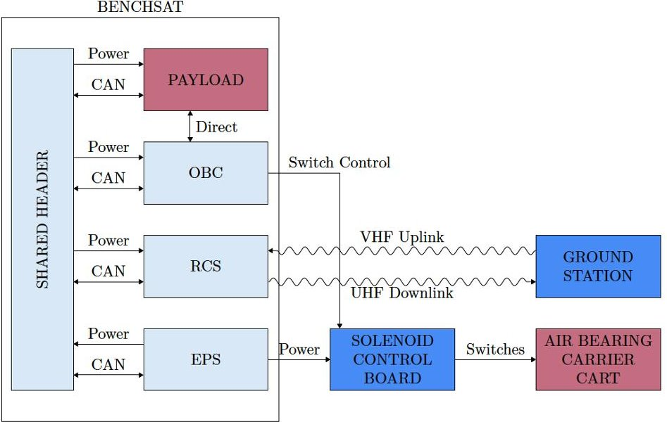

Fig. 1. The system architecture of BenchSat including the surrounding systems and infrastructure.

All these systems are developed, built, and integrated to interface with facilities such as the air-bearing carrier cart and satellite ground station.

## 2.2 On-board Computer (OBC)

The OBC plays multiple roles in the standard functioning of a satellite. The primary goal of the OBC is to manage the tasks taking place on the satellite. These tasks can include managing communication between subsystems, and monitoring and maintaining the correct functioning of the entire system. The OBC is the main source of computing power onboard a satellite. The primary OBC hardware is a microcontroller that is connected to the other subsystems with digital communication links and protocols. On smaller satellites the functions of multiple subsystems can fall under the scope of the OBC.

The high-level architecture is shown in Figure 2. The main processor is chosen to be a STM32F412, which has similar performance specifications of commercial nanosatellite computers. Some simplifications are made in the form of releasing the requisite of external permanent memory and radiation hardened or mitigation strategies. One of the more important requirements were that it would have a floating-point unit for complex control algorithms and have all the necessary electronic communication interfaces and generalpurpose input/output connections to all additional subsystems. The choice in processor is

<!-- PDF_PAGE: 4 -->

also suitable to run different software architectures, including standard low-level implementation using super loops or currently more used real-time operating systems (RTOS). A SD-card holder is added for larger data storage requirements. All these components were integrated along with the required header interfaces onto a single PCB.

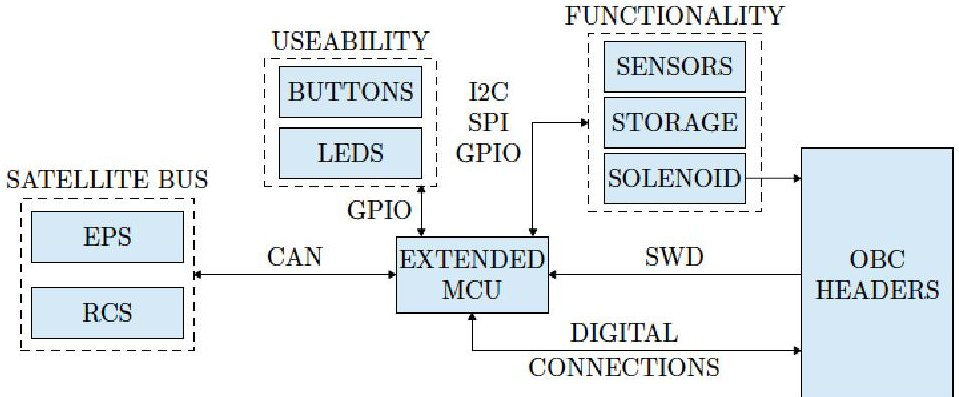

Fig. 2. The architecture of the main On-board Computer (OBC) showing all main interfaces to components and other satellite subsystems.

## 2.3 Electrical Power System (EPS)

The EPS on a satellite is the subsystem that controls the flow of power, managing the power generation, conversion, storage, and distribution. The EPS of BenchSat is required to drive loads requiring 5V and 3V3 regulated power. The EPS must measure the voltage of each level and current usage regularly and store the data to be available upon request. The EPS has a multistage power conversion architecture with a dedicated power converter for output power regulation and a separately attached system for battery charging and solar control. The system is designed to initially accommodate two 18650 Li-Ion batteries in a 2S configuration, which is common for commercial nanosatellite implementations. CAN messages can be used to communicate with the controller which manages the power distribution and obtain the power usage status messages. In most use cases, the BenchSat will be used in a laboratory environment and solar charging will not be used, but the circuit is still available for that option.

## 2.4 Radio Communication Subsystem (RCS)

A radio frequency (RF) communication link consists of a radio transmitter, a free space communication channel and a radio receiver. This link creates a one-way connection where data can be sent to the transmitter, transferred on a high-frequency electromagnetic wave, and received at another location where the data can be used. The task of the radio communication subsystem onboard a satellite is to transmit the signals on the downlink and receive signals on the uplink.

One of the main requirements of the RCS, for BenchSat, is that it needs to interface with the Stellenbosch Ground Station. The ground station is mainly setup for common amateur frequency bands and receives in the UHF-band (430 MHz-440 MHz) and transmits in the VHF-band (144 MHz-148 MHz). An on-board microcontroller is used to pack messages (in a format such as AX.25) and then sends it to the modem where the message is prepared to be transmitted over the antenna using a FSK modulation scheme. This ability will enable the integration of BenchSat into established ground station operations. This will permit future

<!-- PDF_PAGE: 5 -->

ground station experiments but also allow the user to have a similar operations interface to what a real orbiting satellite would have. Figure 3 shows the architecture and main components of the RCS, containing two separate radio communication channels, one for uplink and another for downlink.

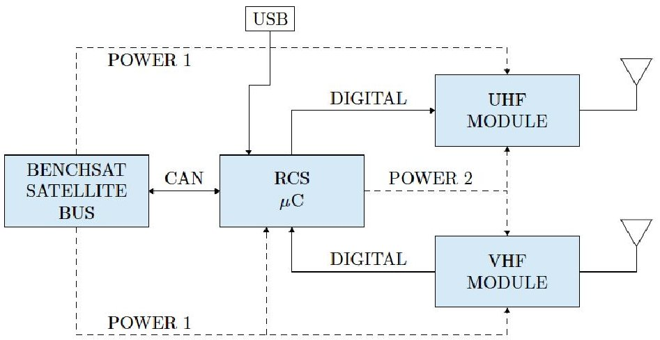

Fig. 3. The main components of the Radio Communication Subsystem (RCS) with two antennae for the VHF uplink and UHF downlink to the ground station.

## 3 Integrated Demonstration Experiment

All the satellite bus systems were developed, built, and tested to create the BenchSat and then further integrated into a Compound Satellite which can be used within the air bearing facility, see Figure 4. The different subsystems are connected through mechanical spacers and with electrical headers creating a single stack.

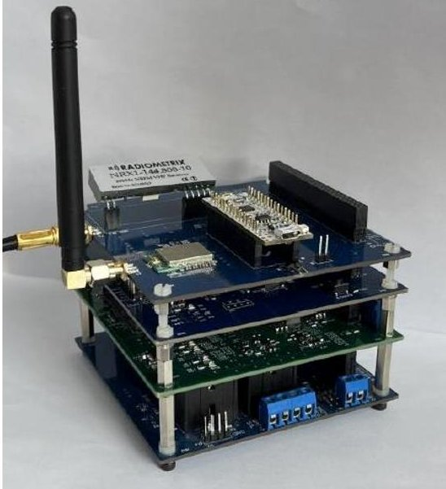

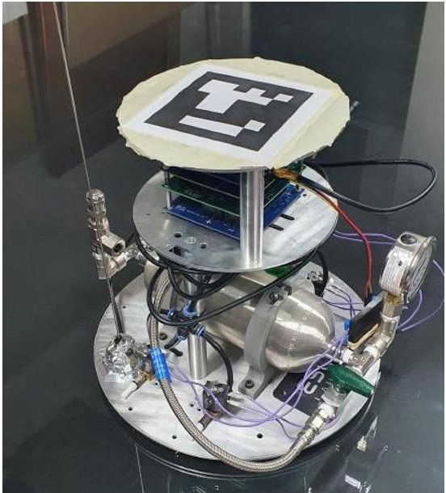

Fig. 4. Integrated BenchSat (left) and the Compound Satellite (right)- BenchSat connected to the air bearing carrier cart.

An experiment is designed to effectively demonstrate the capabilities of the fully integrated system. Flight software was developed on the OBC to interact with all the required subsystems, including a thruster interface board. The pressurised thruster system on the air bearing carrier cart consists of four thrusters which can individually be activated. Along with

<!-- PDF_PAGE: 6 -->

the thrusters, the carrier cart contains an air bearing on the bottom where pressurised gas creates a low friction state on a smooth surface [14]. This creates an environment where the thrusters can effectively move the cart around emulating orbital translation in two axes and single axis rotations. This is an environment in which DockSat rendezvous manoeuvres can be tested and verified in practice. An overhead camera system is available to record the behaviour of the compound satellite in the air-bearing facility.

The Stellenbosch University ground station was used to initiate the test. A telecommand was transmitted to BenchSat by which the flight software initiates a sequence of thruster firings resulting in the spacecraft spinning around its main axis. The sequence first induces a spin and then after a certain period a counter-torque is induced to return the spacecraft to zero angular rate. Telemetry was obtained through the radio link to confirm the behaviour and obtain measurements. The satellite also logged on-board sensor data such as gyroscope and magnetometer readings on its SD-card. Figure 5 shows the resulting gyroscope measurement and also the correlated magnetometer pose compared to the over-head camera system recording, shown in Figure 6.

This experiment showed and demonstrated the full spectrum of capabilities and integration of BenchSat into the existing infrastructure at Stellenbosch University. The ground station was able to communicate and interact with BenchSat, while the demonstration performed orbit manoeuvres within a low-friction air-bearing test facility. Additional experiments can now be defined to test software and control algorithms for docking experiments, debris capture missions, formation flying, and control of flexible space structures.

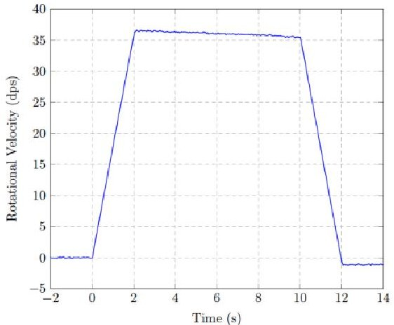

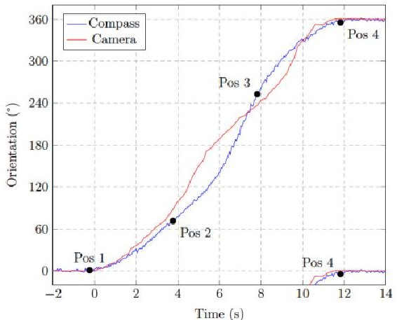

Fig. 5. Measured angular velocity (left) and the measured orientation using magnetometer measurements (right), correlated with over-head camera system, of the compound satellite during the spin demonstration experiment.

<!-- PDF_PAGE: 7 -->

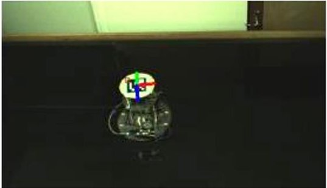

(a) Position 1: t<0s

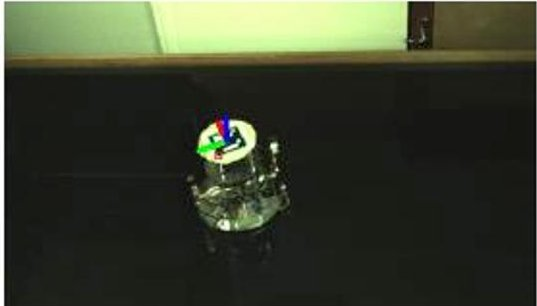

(b) Position 2: t=3.8s

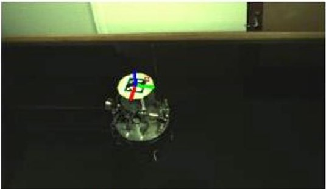

(c) Position 3: t=7.8s

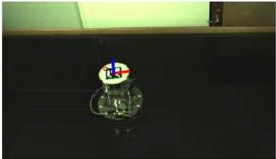

(d) Postion 4: t=11.8s

Fig. 6. Compound satellite image feedback from overhead camera during the spin test using thrusters on the air-bearing.

## 4 Flight Software Development

The fully integrated experiment on the air bearing table proved that BenchSat provides the necessary functionality to mimic realistic satellite behaviour in the space environment while using components that are affordable.

The additional advantage of this demonstration system is the development of system aspects such as the flight software to start earlier in the development cycle of the satellite system. This permit more care to be taken to ensure the robustness of these system aspects. Hardware- and software-in-the-loop (HIL & SIL) testing is a standard process and is often accompanied by software that simulates the space environment in which the systems are tested. D2S2 $ ^{1} $ is a simulation software, see Figure 7 which provides an orbital environment in which satellite components can be virtually created and monitored during a simulated mission.

<!-- PDF_PAGE: 8 -->

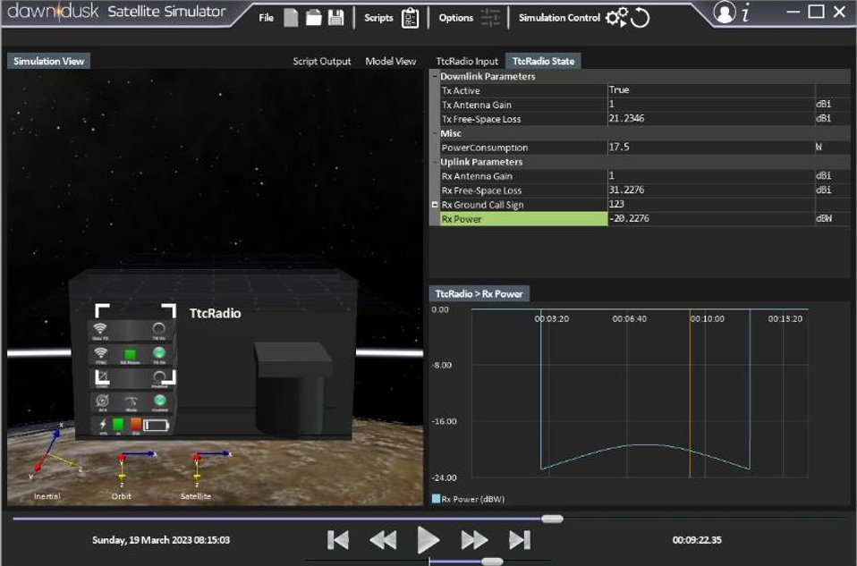

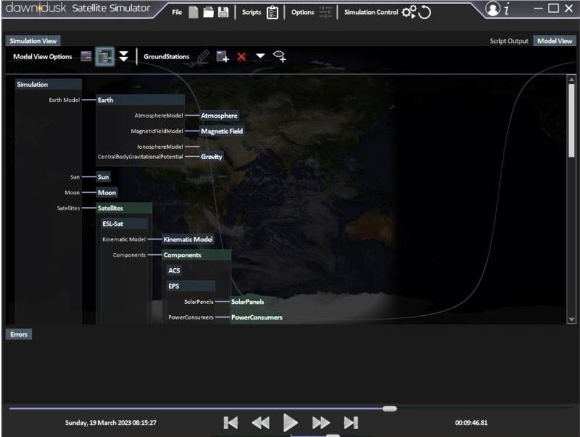

Fig. 7. Sample renderings of D2S2, showing the simulated satellite orbiting around earth with virtual satellite components.

An expanded version of BenchSat is currently developed to integrate with D2S2 to perform system development and testing. The OBC, within BenchSat, acts as a host on which flight software can be loaded, all other components of the satellite are simulated to react to commands sent by the OBC like the commercial counterpart they virtualize. Through this method of virtualization, the flight software can start to be developed and different satellite designs can be iterated without the need for costly real satellite hardware.

Figure 8 shows the system architecture of the combined system of BenchSat and D2S2 software. The OBC can interact with real satellite hardware components or virtualized satellite components. The virtualized components are created by creating a hardware interpreting component. This simply just hardware that is connected to the digital

<!-- PDF_PAGE: 9 -->

communication channels of the spacecraft and relays the activities to the D2S2 software. Within the D2S2 software custom virtualized components are created that interprets these messages and reacts accordingly, either by influencing the virtual satellite's state or by returning telemetry obtained from the virtualized satellite state. This is a powerful tool by which the flight software can be tested within simulated scenarios that closely mimic the real mission scenarios. The quality of this method is dependent on the quality and realism om the virtualized components, and a lot of effort needs to be applied to get good quality behavioural models. An additional feature is the ability to generated possible faults on all layers, begin it hardware communication faults, by using the interface hardware layer, or by functional faults i.e., a space environmental effect or component behaviour fault (such as a failed antenna deployment). This can be used to effectively test and very all the mitigation routines within the flight software. Current development is in the creation of these high-fidelity models of real commercial satellite components that is currently planned to be used within DockSat spacecrafts.

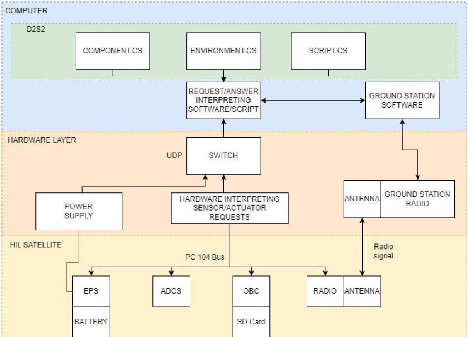

Fig. 8. System architecture of integration of BenchSat with D2S2 satellite simulator software. This system is used for flight software development and virtualization of satellite components.

## 5 Conclusion

A demonstration satellite was developed to assist in the construction of future satellite missions including DockSat. DockSat is a satellite mission which aims to demonstrate miniaturized rendezvous and docking of two spacecraft. BenchSat consists of several fundamental subsystems, which were integrated into an air-bearing carrier cart and have a similar interface to the Stellenbosch Ground Station than a real satellite. All its main functionality was demonstrated with an experiment on the air-bearing cart. The air-bearing cart is used to emulate a satellite within orbit experiencing a low friction environment. It currently being expanded to interface with a satellite simulator to create high fidelity virtualized satellite operations suitable for flight software development and testing. This BenchSat is a vehicle that can be used to develop and test future satellite systems.

<!-- PDF_PAGE: 10 -->

## References

1. M. Langer, and J. Bouwmeester, "Reliability of CubeSats - Statistical Data, Developers' Beliefs and the Way Forward", In 30th Annual AIAA/USU Conference on Small Satellites, Utah, USA, pp. 1-12 (2016).

2. A. Alanazi, and J. Straub, "Statistical Analysis of CubeSat Mission Failure", In $ 32^{\mathrm{nd}} $ Annual AIAA/USU Conference on Small Satellites, Utah, USA, pp. 1-12 (2018).

3. ESA, "Flatsat — a ground-based testbed for CubeSats at ESA/ESTEC," 10 2021. [Online]. Available: https://www.eoportal.org/other-space-activities/flatsat#some- background

4. J. Reilly, D. Murphy, M. Doyle, S. Walsh, S. K. Akarapu, D. De Faoite, R. Dunwoody, J. Erkal, G. Finneran, J. Mangan, and F. Marshall, "EIRFLAT-1: A flatsat platform for the development and testing of the 2U CubeSat EIRSAT-1." In 4th Symposium on Space Educational Activities, Universitat Politecnica de Catalunya, (2022).

5. H. E. S. Amiri, D. Brain, O. Sharaf, P. Withnell, M. McGrath, M. Alloghani, M. Al Awadhi, S. Al Dhafri, O. Al Hamadi, H. Al Matroushi, and Z. Al Shamsi, "The emirates Mars mission." Space Science Reviews, 218(1), p.4.

6. A. Al Suwaidi, "Emirates Mars Mission Flight Simulator: FlatSat Overview." In 2020 IEEE Aerospace Conference, BlueSky, USA, pp. 1-11 (2020).

7. D. J. Evans, "Ops-sat: Operational concept for ESA's first mission dedicated to operational technology." In 14th International Conference on Space Operations, Daejeon, Korea, pp. 1-14 (2016).

8. S. Kacker, A. Meredith, K. Cahoy, and G. Labreche, "Machine learning image processing algorithms onboard ops-sat," In 36th Annual AIAA/USU Conference on Small Satellites, Utah, USA, pp. 1-13 (2022).

9. A. Surivet, "Integration and validation of a nanosatellite flight software," Masters Thesis, (2021).

10. J. J. Sellers, C. A. Bishop, J. R. Gossner, J. J. White, and J. B. Clark, "EyasSAT: a revolution in teaching and learning space systems engineering," In Proceedings of the AIAA Space Systems Engineering Conference, Atlanta, GA, (2005).

11. C. Mucanna, T. I. Burroni, N. V. Conde, M. I. Escobar, L. S. López, M. B. Penida, C. M. Rosito, H. Socolovsky, "Pujllay: the first nanosatellite engineering model developed in UNSAM," In $ 2^{\mathrm{nd}} $ IAA Latin American Symposium on Small Satellites p. 4, pp. 1-9 (2019).

12. M. Yamazaki, and T. Zengo, "HEPTA-sat training program: International knowledge transfer using hands-on type CubeSat education," In 32nd Annual AIAA/USU Conference on Small Satellites, Utah, USA, pp. 1-8 (2018).

13. H. W. Jordaan, G. Serfontein, I. D. Swart, L. Visagie, and J. Lun, "Miniaturizing docking and undocking through DockSat", In 2023 IEEE Aerospace Conference, BlueSky, USA, pp. 1-9 (2023).

14. D. C. Jansen, L. Visagie, and W. Jordaan, "An Experimental Investigation Of 3D Printed Cold Gas Thruster Nozzles," In 2020 International SAUPEC/RobMech/PRASA Conference, Cape Town, South Africa, pp. 1-6 (2020).