<!-- PDF_PAGE: 1 -->

## MBSE Methodologies

Jeff A. Estefan and Tim Weilkiens

## Contents

Introduction 48

Key Concepts and Definition 49

Best Practice Approach 50

Object-Oriented Systems Engineering Method (OOSEM) 51

Object-Process Methodology (OPM) 53

Integrated Systems Engineering and Pipelines of Processes in Object-Oriented

Architectures (ISE&PPOOA) 55

Illustrative Example/Case 57

The Systems Modeling Toolbox (SYSMOD) in Review 58

A Few Examples of SYMOD Core Concepts in Greater Detail 59

Challenges and Gaps 70

Evaluating and Comparing Methodologies 73

Methodology Adoption and Tailoring 74

Expected Advances in the Future 79

Chapter Summary 81

Systems Modeling Toolbox (SYSMOD) 81

Cross-References 82

References 82

## Abstract

A Model-Based Systems Engineering (MBSE) methodology can be characterized as the collection of related processes, methods, tools, and environment used to support the discipline of systems engineering in a "model-based" or "model-

<!-- PDF_PAGE: 2 -->

driven" context. In this chapter, a cursory description of some of the leading MBSE methodologies used in industry today is provided. It is expected that during an organization's candidate MBSE methodology assessment process (including impact to native processes and procedures), a tool survey and assessment will occur concurrently or shortly thereafter, followed by selection and piloting of relevant tools. This latter effort requires participation from the organization's systems engineering practitioner community because that is the community that will most heavily be using the tools. Although a tool survey is beyond the scope of this chapter, guidance and a novel technique for MBSE methodology assessment is provided. In addition, future directions and areas of standardization of various MBSE methodologies is also described.

## Keywords

Process · Methods · Tools · Environment · Methodology · Methodologies MBSE methodology · MBSE methodologies · Object-Oriented Systems Engineering Method (OOSEM) · Object-Process Methodology (OPM) · Systems Modeling Toolbox (SYSMOD) · Integrated Systems Engineering and Pipelines of Processes in Object-Oriented Architectures (ISE&PPOOA)

## Introduction

A methodology is defined as a collection of related processes, methods, and tools [1]. A MBSE methodology can thus be characterized as the collection of related processes, methods, and tools used to support the discipline of systems engineering in a "model-based" or "model-driven" context [2]. In this chapter, section "Key Concepts and Definition" characterizes the difference between methodologies and processes, methods, tools, and environment. Section "Current State of the Practice/ Current State of the Art" provides a brief survey of a selected set of vendor-neutral MBSE methodologies that are widely published and currently used in the current state of the practice today, and most of which are continually evolving to keep up with the current state of the art. Section "Illustrative Example/Case" provides an illustrative example of selected methods and practices for the Systems Modeling Toolbox (SYSMOD) methodology as an example [3]. In addressing current challenges and gaps, section "Challenges and Gaps" describes both a novel approach for evaluating and comparting candidate MBSE methodologies as well as a recommended set of training and consulting practices to help an organization succeed in MBSE methodology adoption. These are the primary challenges, and not so much a candidate set of "off-the-shelf' MBSE methodologies per se. Finally, section "Expected Advances in the Future" looks at a few key expectations for advancement in the future of MBSE methodology development including industry standardization.

<!-- PDF_PAGE: 3 -->

## Key Concepts and Definition

The word methodology is often erroneously considered synonymous with the word process. For purposes of this handbook, the following definitions from [1] are used to distinguish methodology from process, methods, and tools:

- A process (P) is a logical sequence of tasks performed to achieve a particular objective. A process defines "WHAT" is to be done, without specifying "HOW" each task is performed. The structure of a process provides several levels of aggregation to allow analysis and definition to be done at various levels of detail to support different decision-making needs.

- A method (M) consists of techniques for performing a task; in other words, it defines the "HOW" of each task. (In this context, the words "method," "technique," "practice," and "procedure" are often used interchangeably.) At any level, process tasks are performed using methods. However, each method is also a process itself, with a sequence of tasks to be performed for that particular method. In other words, the "HOW" at one level of abstraction becomes the "WHAT" at the next lower level.

- A tool (T) is an instrument that, when applied to a particular method, can enhance the efficiency of the task, provided it is applied properly and by somebody with proper skills and training. The purpose of a tool should be to facilitate the accomplishment of the "HOWs." In a broader sense, a tool enhances the "WHAT" and the "HOW." Most tools used to support systems engineering are computer- or software-based, which is also known as Computer-Aided Engineering (CAE) tools.

Based on these definitions, a methodology can be defined as a collection of related processes, methods, and tools. A methodology is essentially a "recipe" and can be thought of as the application of related processes, methods, and tools to a class of problems that all have something in common [1]. Extending this definition a bit further, an MBSE methodology can thus be characterized as the collection of related processes, methods, and tools used to support the discipline of systems engineering in a "model-based" or "model-driven" context [2].

Associated with the above definitions for process, methods (and methodology), and tools is environment. An environment (E) consists of the surroundings, external objects, conditions, or factors that influence the actions of an object, individual person, or group [1]. These conditions can be social, cultural, personal, physical, organizational, or functional. The purpose of a project environment should be to integrate and support the use of the tools and methods used on that project. An environment thus enables (or disables) the "WHAT" and the "HOW."

A visual graphic that depicts the relationship between the so-called "PMTE" elements (Process, Methods, Tools, and Environment) is illustrated in Fig. 1 along with the effects of technology and people on the PMTE elements.

<!-- PDF_PAGE: 4 -->

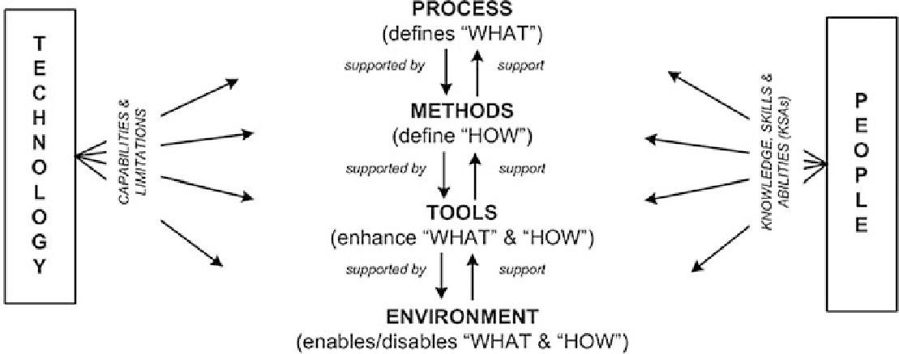

Fig.1 The PMTE elements and effects of technology and people [1]. (Copyright © 1996 CRC Press, Inc. Used by permission)

As stated by Martin [1], the capabilities and limitations of technology must be considered when developing a systems engineering development environment. This argument extends, of course, to an MBSE environment. Technology should not be used "just for the sake of technology." Technology can either help or hinder systems engineering efforts. Similarly, when choosing the right mix of PMTE elements, one must consider the knowledge, skills, and abilities (KSA) of the people involved [1]. When new PMTE elements are used, often the KSAs of the people must be enhanced through special training and special assignments.

## Best Practice Approach

In support of the International Council on Systems Engineering (INCOSE) MBSE Focus Group, an initial comprehensive survey of MBSE methodologies was conducted in 2007 and published as Revision A. A Revision B update to the survey paper was released the following year in the early half of 2008 under the auspices of the INCOSE MBSE Initiative [2]. In an attempt to keep the survey current, for subsequent years, methodologist was asked to publish a short overview of each respective methodology on an open MBSE Wiki forum provided by the Object Management Group $ ^{\mathrm{TM}} $ (OMG $ ^{\mathrm{TM}} $ ) in order to capture any methodology gaps since the 2008 Rev. B survey paper. This is part of a now archived yet still accessible challenge/activity team known as "Methodology and Metrics" (see http://www. omgwiki.org/MBSE/doku.php?id=mbse:methodology).

For purposes of this handbook, a select subset of the MBSE methodologies captured on the Methodologies and Metrics Wiki page is included in the subsections below. The selected methodologies described herein are for purposes of illustration only and were chosen because they are (a) independent of any product vendor or vendor offering, (b) have had or continue to have visibility within the INCOSE

<!-- PDF_PAGE: 5 -->

community and/or international standards committees, and (c) have sufficient literature to support cross-reference and use by the reader of this handbook. Further, the subset described herein does not imply one methodology is superior over another. In section "Evaluating and Comparing Methodologies," an approach for evaluating and comparing methodologies is described to assist individuals and organizations in methodology selection. Finally, it should be noted that newer methodologies continue to evolve, and the reader is encouraged to survey the literature as they are published given the fluid and emerging nature of the MBSE discipline in the past few years.

## Object-Oriented Systems Engineering Method (OOSEM)

## Overview

- Integrates top-down (functional decomposition) approach with model-based approach (see Figs. 2 and 3)

- Leverages object-oriented concepts

- Uses OMG $ ^{\mathrm{TM}} $ SysML $ ^{\mathrm{TM}} $ (formerly UML $ ^{\textcircled{R}} $ ) to support specification, analysis, design, and verification of systems

- Intended to ease integration w/object-oriented S/W development, H/W development, and test

- Includes the following activities:

- Analyze stakeholder needs

- Define system requirements

- Define logical architecture

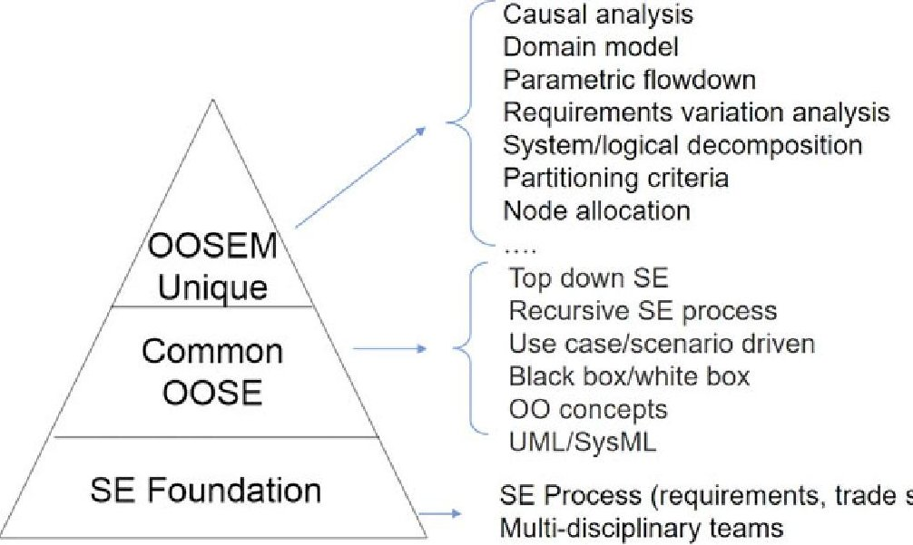

Fig.2 Foundation of OOSEM (Friedenthal 2020). (Copyright $ \textcircled{c} $ 2012-2020. Sanford Friedenthal. Used by permission)

<!-- PDF_PAGE: 6 -->

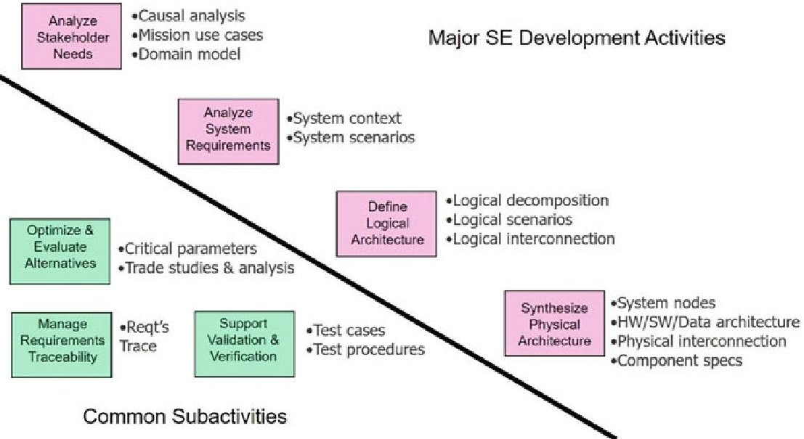

Fig. 3 OOSEM activities and modeling artifacts (Friedenthal 2020). (Copyright $ \textcircled{c} $ 2012-2020 Sanford Friedenthal. Used by permission)

- Synthesize candidate-allocated architectures

- Optimize and evaluate alternatives

- Validate and verify system

- Is tool- and vendor-neutral

## Tool Support

- OOSEM was created as tool- and vendor-neutral, model-based methodology. A dedicated process framework tool for OOSEM does not exist; however, an Eclipse Process Framework (EPF) version of OOSEM developed by J. D. Baker exists (see http://www.omg.org/cgi-bin/doc?syseng/2009-12-09).

- Tool support for OOSEM can be provided by COTS-based OMG $ ^{\mathrm{TM}} $ SysML $ ^{\mathrm{TM}} $ tools and associated requirements management tools. Other tools required to support the full system life cycle should be integrated with the SysML and requirements management tools, such as configuration management, performance modeling, and verification tools. Note, however, this is true for any methodology.

- A more complete set of OOSEM tool requirements is provided in the referenced OOSEM tutorial (see the 9.1.2 References section of this chapter).

## Offering/Availability

- The OOSEM tutorial and training materials are available on the INCOSE Connect site under the INCOSE OOSEM WG page (see http://www.incose.org/login/? ReturnURL=https://connect.incose.org/Pages/Home.aspx). Note: Access requires INCOSE membership.

- Unlike other industry-provided MBSE methodologies, OOSEM is not a formal offering that can be purchased from any specific vendor, including professional

<!-- PDF_PAGE: 7 -->

services. Support services may be available by contacting representatives of the INCOSE OOSEM Working Group.

## Selected Resources

- See 9.1.2 References section under OOSEM.

## Object-Process Methodology (OPM)

- Formal paradigm to systems development, life cycle support, and evolution (see Figs. 4 and 5)

- Combines simple OPDs (diagrams) with OPL (constrained natural language)

- Basic building blocks:

- Object - Thing that exists or has the potential of existence physically or mentally

- Process - Pattern of transformation that the object undergoes

- State - Situation object can be at

- Ratified as ISO/PAS 19450:2015, a publicly available specification of the International Organization for Standardization (ISO) in December 2015

- [Reflective] methodology refers to system life cycle as system evolution

- In OPM, "process" is a reserved word; therefore, "system process" is used.

- System Developing process (SD1) contains three main stages, each can be "zoomed" of which can be further zoomed.

- Requirement specifying

- Analyzing and developing

- Implementing

- [Also, using and implementing stage]

- Visual models tool- and vendor-specific (see Tool Support below)

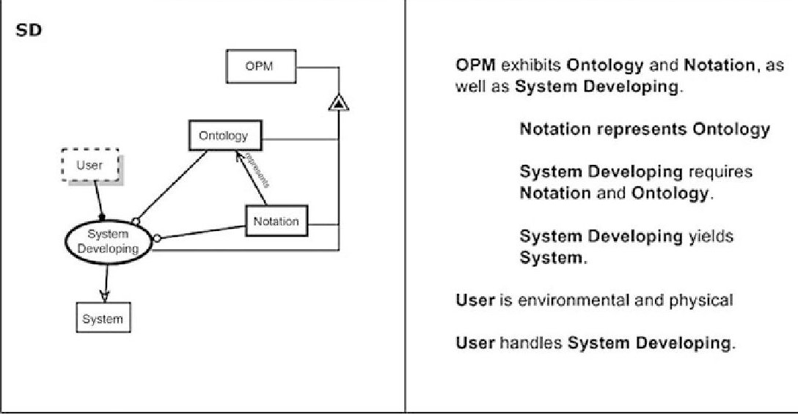

Fig. 4 The top level specification of the OPM metamodel (Dori 2002). (Copyright $ \textcircled{c} $ 2002. Springer. Used by permission)

<!-- PDF_PAGE: 8 -->

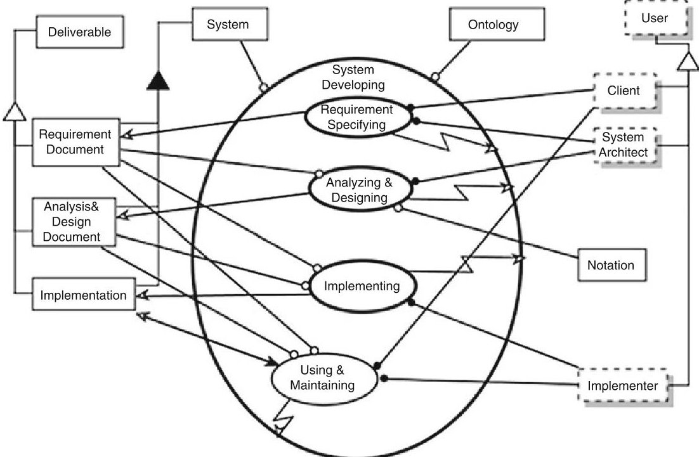

Fig. 5 Zooming into System Developing (Dori 2002). (Copyright $ \textcircled{c} $ 2002. Springer. Used by permission)

## Tool Support

- Tool support for OPM is provided via OPCAT software available under the OPCAT installation page of Enterprise Systems Modeling Laboratory (ESML) of Technion Israeli Institute of Technology website (see esml.iem.technion.ac.il/ opcat-installation/). This product suite supports the concepts related to the OPM metamodel for the system development process, including modeling support of the System Diagram (SD).

- The OPCAT tool suite has a configurable template for a number of types of document artifacts, including but not limited to System Overview, the Current State, Future Goals, Business or Program Constraints, and Hardware and Software Requirements. In addition, OPCAT has facilities for animated simulation, requirements management, and other advanced features.

## Offering/Availability

OPCAT software for OPM systems modeling, systems engineering and life cycle support, as well as support services and education and training material can be obtained via the ESML of Technion Israeli Institute of Technology (see esml.iem.technion.ac.il/).

## Selected Resources

- See 9.1.2 References section under OPM.

<!-- PDF_PAGE: 9 -->

## Integrated Systems Engineering and Pipelines of Processes in Object-Oriented Architectures (ISE&PPOOA)

## Overview

- ISE&PPOOA (Integrated Systems Engineering and PPOOA) provides an integrated process, methods, and a tool for systems engineering of software-intensive mechatronic systems (see Figs. 6 and 7).

- The ISE part of the process includes the first steps of a systems engineering process applicable to any kind of system, not only the software intensive ones. The ISE subprocess integrates traditional systems engineering best practices and MBSE.

- The PPOOA part of the process emphasizes the modeling of concurrency as earlier as possible in the software engineering part of the integrated process.

- ISE&PPOOA provides a collection of guidelines or heuristics to help the engineers in the architecting of a system.

- One of the project deliverables is the functional architecture representing the functional hierarchy using the SysML block definition diagram. This diagram is complemented with activity diagrams for the main system functional flows. The N2 diagram is used as an interface diagram where the main functional interfaces are identified. A textual description of the system functions is also provided as part of the deliverable.

- Other of the deliverables is the physical architecture, representing the system decomposition into subsystems and parts using the SysML block definition diagram. This diagram is complemented with SysML internal block diagrams for each subsystem and activity and state diagrams as needed. A textual description of the system blocks is also provided. The heuristics used for the particular architecture solution are identified and documented.

- ISE&PPOOA makes easy the architecture evaluation from time responsiveness characteristics.

## Tool Support

- ISE&PPOOA was created as tool- and vendor-neutral.

- Currently, tool support for PPOOA is provided via a free add-on for Microsoft Visio 2003 that can be requested at http://www.ppooa.com.es/ppooa_visio.htm.

## Offering/Availability

- A 3-day tutorial dealing with the architecting and evaluation of real-time systems is offered by ISE&PPOOA experts (e.g., http://www.ppooa.com.es/seminar.pdf).

- White papers and articles are available on the PPOOA website: http://www. ppooa.com.es/publications.htm.

## Selected Resources

- See 9.1.2 References section under ISE&PPOOA.

<!-- PDF_PAGE: 10 -->

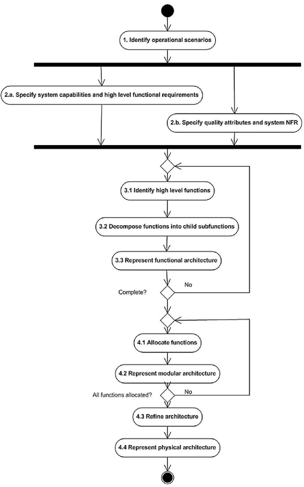

Fig. 6 Integrated Systems Engineering (ISE) subprocesses (Fernandez and Hernandez 2019). (Copyright $ \textcircled{c} $ 2019. Artech House. Used by permission)

<!-- PDF_PAGE: 11 -->

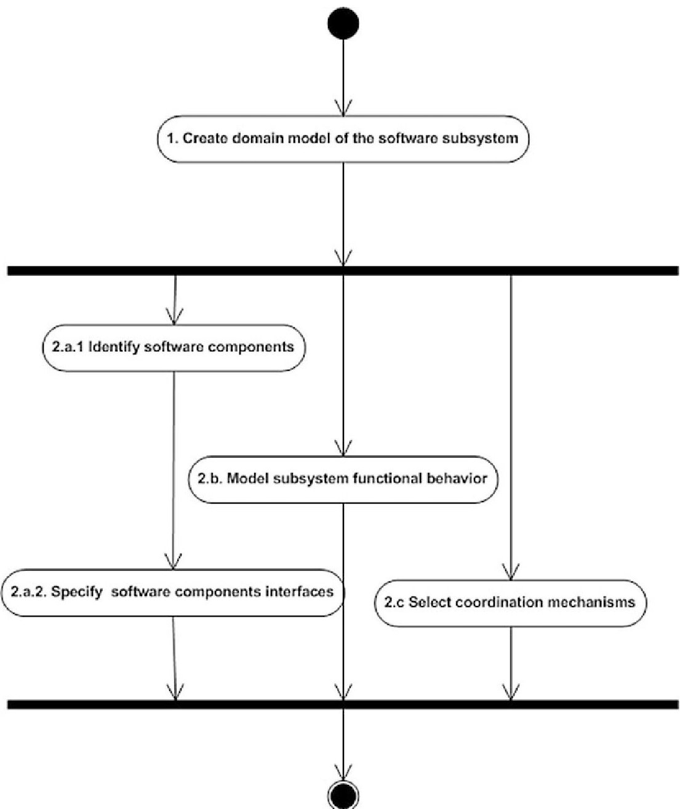

Fig. 7 Process Pipelines in OO Architectures (PPOOA) subprocesses (Fernandez and Hernandez 2019). (Copyright © 2019. Artech House. Used by permission)

## Illustrative Example/Case

In this section, a greater level of specificity is provided for the SYSMOD methodology to be used for elaboration of a select set of methods of this MBSE methodology as well as a few selected examples of the work products produced as a result of these methods.

<!-- PDF_PAGE: 12 -->

The section begins by providing a brief summary of the SYSMOD methodology that includes the full set of core concepts and the relationships as well as a table of artifacts documenting all of the SYSMOD methods at the time of this writing.

This is followed by elaboration of a set of four selected SYSMOD methods, namely, (1) tailor the MBSE methodology, (2) analyze the problem, (3) identify system use cases, and (4) model the logical architecture. With the exception of tailor the MBSE methodology, the primary SYSMOD output products from each SYSMOD method described is also included. Note that all SYSMOD product examples cited are about the same system; a fictional example is a forest fire detection system (FFDS). The FFDS is a multifaceted system, sophisticated enough for a valuable demonstration, and easy to understand without specific domain knowledge [3].

## The Systems Modeling Toolbox (SYSMOD) in Review

Recall from section "Integrated Systems Engineering and Pipelines of Processes in Object-Oriented Architectures (ISE&PPOOA)" that SYSMOD is a general-purpose methodology to create requirements and architecture specifications, mainly used to specify updated and new products or parts [3, 4]. It provides a set of widespread, well-known methods such use case analysis that can be adapted for specific purposes.

The SYSMOD methodology is comprised of the following three core "artifact" kinds:

- SYSMOD products: Crucial artifacts for system development like requirements or architecture descriptions

- SYSMOD methods: Best practices for creating an SYSMOD product

- SYSMOD roles: Work descriptions of a person; responsible for SYSMD products and a primary/additional performer of SYSMOD methods.

Figure 8 illustrates the relationships between SYSMOD methods, products, and roles. A role is responsible for one or more (1..*) methods and supports zero or more (0..*) methods as a coworker. A method has exactly one role that is responsible for the method and some roles as additional performers. Each method requires zero or 0..* products as inputs and produces 1..* products as outputs. Exactly one role is responsible for a product.

As illustrated in Fig. 8, a process is part of 0..* methodologies and performs 1..* methods. A tool is also part of 0..* methodologies and facilitates 1..* methods. (Note: The reader is referred back to section "Key Concepts and Definition" for a definition of the general terms of Process, Methods, Tools, and Environment (PMTE) as well as Methodology and more specifically MBSE methodology.)

A complete list of the most current SYSMOD methods along with their associated input and output products and their primary performing roles is summarized in Table 1.

<!-- PDF_PAGE: 13 -->

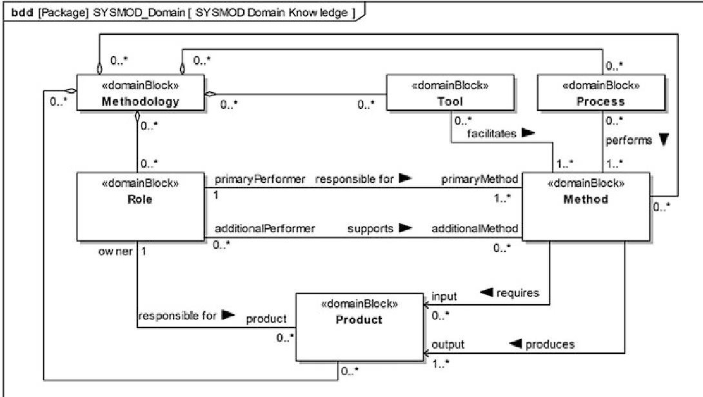

Fig. 8 Overview and relationship of SYSMOD artifact kinds

Although SYSMOD is a toolbox and not a process per se, some default processes are provided to demonstrate a typical logical order of execution of the SYSMOD methods. In practice, a project typically uses a customized set of methods in a different order, including recursions, iteration, and loops [4]. One suggested logical grouping and order of execution of the set of detailed SYSMOD processes to support performance of SYSMOD methods, along with the primary SYSMOD roles that perform those methods, is depicted in the following use case diagram (see Fig. 9).

Each of these high-level default SYSMOD processes is further decomposed into more detailed subprocesses and articulated in the latest edition of the SYSMOD booklet series (see Ref. [3]). It should also be noted that Appendix A of this publication provides a mapping of the ISO/IEC 15288:2015 standard processes to the SYSMOD methods without distinction between full and partial coverage. This mapping is included in Table 1 shown previously.

## A Few Examples of SYMOD Core Concepts in Greater Detail

Copyright Notices: (1) The material used in this section was adapted from the latest edition of the MBSE4U booklet series entitled "SYSMOD, Systems Modeling Toolkit: Pragmatic MBSE with SysML," 3rd edition and used by permission [3]. Copyright (c) 2020. MBE4U. (2) The SYSMOD examples shown herein and adapted from [3] were created with the use of the CATIA/No Magic Cameo Systems Modeler from Dassault Systèmes. Copyright © 2020. No Magic, Inc.

<!-- PDF_PAGE: 14 -->

Table 1 Summary of SYSMOD methods

<table border="1"><tr><td>SYSMOD method</td><td>SYSMOD role(primary performer)</td><td>SYSMOD [input] product</td><td>SYSMOD [output] product</td><td>ISO 15288 process</td></tr><tr><td>Tailor the MBSE methodology</td><td>MBSE methodologist</td><td>None</td><td>MBSE methodology</td><td>Infrastructure management</td></tr><tr><td>Setup and maintain the SME</td><td>SME administrator</td><td>MBSE methodology</td><td>System modeling environment</td><td>Infrastructure management</td></tr><tr><td>Deploy the MBSE methodology</td><td>MBSE methodologist</td><td>MBSE methodology</td><td>None</td><td>Infrastructure management</td></tr><tr><td>Provide MBSE training and coaching</td><td>MBSE methodologist</td><td>MBSE methodology</td><td>None</td><td>Human resource management</td></tr><tr><td>Analyze the problem</td><td>Project manager</td><td>None</td><td>Problem statement</td><td>Business mission analysis</td></tr><tr><td>Describe the system idea and the system objectives</td><td>Project manager</td><td>Problem statement</td><td>System idea and system objectives</td><td>Business mission analysis</td></tr><tr><td>Describe the base architecture</td><td>System architect</td><td>System idea and system objectives</td><td>Base architecture</td><td>Business mission analysis</td></tr><tr><td>Identify stakeholders</td><td>Requirements engineer</td><td>Base architecture, system idea, and system objectives</td><td>Stakeholders</td><td>Business mission analysis, stakeholder needs, and requirements definition</td></tr><tr><td>Model risks</td><td>Requirements engineer</td><td>System idea and system objectives</td><td>Risks</td><td>Risk management</td></tr><tr><td>Model requirements</td><td>Requirements engineer</td><td>Stakeholders, system idea, system objectives, and base architecture</td><td>Requirements</td><td>Stakeholder needs and requirements definition and system requirements definition</td></tr><tr><td>Identify the system context</td><td>Requirements engineer</td><td>Requirements</td><td>System context</td><td>Business mission analysis, stakeholder needs and requirements definition, and architecture definition</td></tr><tr><td>Identify system use cases</td><td>Requirements engineer</td><td>System context and requirements</td><td>System use cases</td><td>Stakeholder needs and requirements definition and system requirements definition</td></tr><tr><td>Identify system processes</td><td>Requirements engineer</td><td>System use cases</td><td>System processes</td><td>Stakeholder needs and requirements definition and system requirements definition</td></tr></table>

(continued)

<!-- PDF_PAGE: 15 -->

Table 1 (continued)

<table border="1"><tr><td>SYSMOD method</td><td>SYSMOD role(primary performer)</td><td>SYSMOD [input] product</td><td>SYSMOD [output] product</td><td>ISO 15288 process</td></tr><tr><td>Model use case activities</td><td>Requirements engineer</td><td>System use cases and requirements</td><td>Use case activities</td><td>Stakeholder needs and requirements definition and system requirements definition</td></tr><tr><td>Model the domain knowledge</td><td>Requirements engineer</td><td>Use case activities</td><td>Domain knowledge</td><td>Stakeholder needs and requirements definition and system requirements definition</td></tr><tr><td>Specify test cases</td><td>System tester</td><td>Requirements and use case activities</td><td>Test Cases</td><td>Verification and validation</td></tr><tr><td>Model the functional architecture</td><td>System architect</td><td>Use case activities</td><td>Functional architecture</td><td>Architecture definition</td></tr><tr><td>Model the logical architecture</td><td>System architect</td><td>System use cases, system context, requirements, base architecture, and functional architecture</td><td>Logical architecture</td><td>Architecture definition</td></tr><tr><td>Model the product architecture</td><td>System architect</td><td>Logical architecture</td><td>Product architecture</td><td>Design definition</td></tr><tr><td>Revise an architecture with scenarios</td><td>System architect</td><td>Physical architecture</td><td>Scenarios</td><td>Architecture definition and design definition</td></tr><tr><td>Define system states</td><td>System architect</td><td>Physical architecture</td><td>System states</td><td>Stakeholder needs and requirements definition, system requirements definition, architecture definition, and design definition</td></tr><tr><td>Model the test architecture</td><td>System tester</td><td>Physical architecture</td><td>Test architecture</td><td>Verification and validation</td></tr></table>

## SYSMOD Method: Tailor the MBSE Methodology

Tailor a given MBSE methodology to the specific needs of an organization or project.

SYSMOD Process

- SYSMOD infrastructure process SYSMOD Role

- MBSE methodologist

<!-- PDF_PAGE: 16 -->

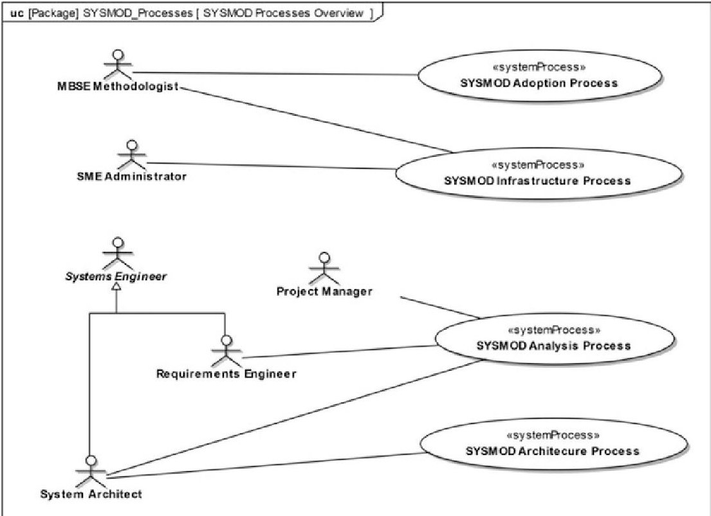

Fig. 9 Logical grouping of SYSMOD processes

SYSMOD [Input] Product None

SYSMOD [Output] Product

- MBSE methodology

ISO 15288 Process

- Infrastructure management

## Purpose

Adapting the MBSE methodology to the specific needs of the engineering project avoids useless overhead on engineering tasks that have no real value to the project and stakeholders.

## Description

An MBSE methodology is a collection of processes, methods, products, roles, and tools. A predefined MBSE methodology like SYSMOD does not fit one-to-one to an organization or project. Some steps need to be more emphasized; others are superfluous and can be skipped, and some engineering artifacts are not even covered by the methodology and need to be added. That is not a lack of methodology. The tailoring is a standard task before you apply the methodology to your projects.

<!-- PDF_PAGE: 17 -->

You can use SYSMOD itself to elaborate your needs for a methodology and to derive the methods. In this case, the MBSE methodology itself is the system of interest.

## SYSMOD Method: Analyze the Problem

SYSMOD Process

- SYSMOD adoption process

- SYSMOD analysis process

SYSMOD Role

- Project manager

SYSMOD [Input] Product

- None

SYSMOD [Output] Product

- Problem statement

ISO 15288 Process

- Business mission analysis

## Purpose

Find out the real problem that should be resolved by the system. Sometimes, it is not the initial problem statement, and the real problem must be identified by a profound analysis.

## Description

An illustrative example of the importance of finding the real problem is the quote by Henry Ford: "If I had asked my customers what they wanted, they would have said a faster horse." The quote hits the point. Even if it is doubted that Henry Ford had really said this, it illustrates very well that the real problem to be solved and the real needs to be satisfied require a profound analysis.

Design Thinking is an approach to solve problems creatively with a particular focus on problem analysis. The origin of Design Thinking lies in the 1960s (Archer 1965). An essential recent publication about Design Thinking is Change by Design: How Design Thinking Transforms Organizations and Inspires Innovation from Tim Brown (2009), and the Design Thinking Playbook (Lewrick et al. 2018).

Design Thinking is well known in the business and engineering domain and used as a standard method for around 15 years. The main drivers were the Stanford University, the company IDEO, and the Hasso Plattner Institute.

Part of the Design Thinking process is the redefinition of the initial problem statement to find the real challenge that satisfies the needs of the stakeholders. Design Thinking does not ask what the users want but what the users need.

The problem statement is codeveloped with a prototype in an iterative process. A first problem statement leads to the first solution attempts that again clarify the problem statement and so on. The user is always in the center of the Design Thinking process. Besides the visible problem, Design Thinking addresses also the invisible emotional needs of the user.

Reinhard Haberfellner et al. describe another approach with the problem-solving process (Fig. 10) (Haberfellner et al. 2019).

<!-- PDF_PAGE: 18 -->

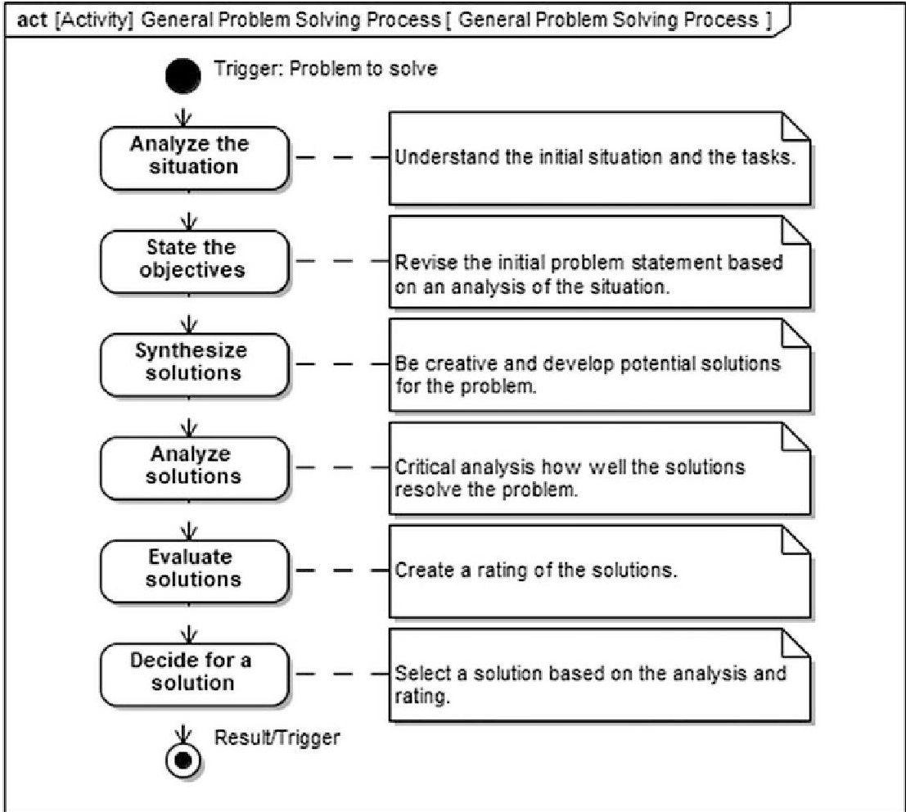

Fig.10 Problem-solving process

The problem-solving process is based on the five steps of problem-solving by John Dewey, published in 1910 (Dewey 1910). The process starts with the analysis of the problem before it proceeds with the development of solutions.

The process in Fig. 10 looks sequential, but it depicts only the logical sequence and not the execution order, which includes lots of feedback cycles.

## Example of SYSMOD Product: FFDS Problem Statement

## Document

Figure 11 shows an extract of a document that covers the problem statement.

## Model

Figure 12 depicts the abstract system element with the problem statement shown in a separate compartment.

<!-- PDF_PAGE: 19 -->

Fig. 11 Problem statement in a text document

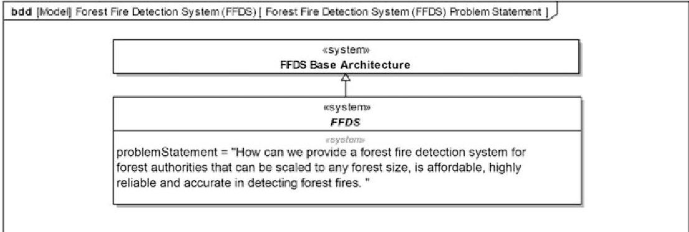

Fig. 12 Problem statement in the model

The system element is located in the package FFDS_Core as depicted in the header of the diagram. Here, it is tightly coupled with the base architecture by using the generalization relationship. If the base architecture also has a problem statement, it is not inherited by the system element. The problemStatement is a property of the stereotype «system», and the generalization relationship does not cover stereotypes and stereotype properties.

## SYSMOD Method: Identify System Use Cases

Identify all services of the system provided for the actors and stakeholders of the system.

SYSMOD Process

- SYSMOD adoption process

SYSMOD Role

- Requirements engineer

SYSMOD [Input] Product

- System context requirements

SYSMOD [Output] Product

- System use cases

ISO 15288 Process

- Stakeholder needs and requirements definition

- System requirements definition

<!-- PDF_PAGE: 20 -->

## Purpose

The system use cases are the services and the essential ends of a system. The system is developed and operated to achieve these services.

## Description

The system use cases provide an outside-in view on the system functions from the perspective of the system actors. That supports the system development to build a system that satisfies the real needs of the system actors. An inside-out perspective on the functional requirements of a system can also lead to a system that satisfies all of them but with the risk that they do not consider the usability needs of the users.

An illustrative example, in most cases, is remote controls for a projector (Fig. 13). They provide all required functions but not from the perspective of the users. The remote control offers lots of buttons, and the primary use cases are hard to find.

The system use case description should at least include:

- The associated system actors

- The trigger that starts the use case

- The result of the use case

- A brief textual description (2-5 sentences)

- Traceable paths to the nonfunctional requirements that are relevant for the use case

- Traceable paths to the functional requirements that are covered by the use case

The set of use cases is a flat list without a hierarchy of super- and sub-use cases. The use case activities specify the functional decomposition of the system use cases.

## Fig.13 Remote control

SYSBEAM

<!-- PDF_PAGE: 21 -->

## Example of SYSMOD Product: FFDS System Use Cases

## Document

Figure 14 depicts a system use case description in a document.

## Model

Figure 15 depicts system use cases of the actor operator in an OMG SysML $ ^{\mathrm{TM}} $ use case diagram.

Figure 16 highlights the operator use case detect and report fire. The comment symbol shows the properties of the use case. The diagram also shows the refine relationships from the use case to some functional requirements. The use case activity owned by the use case is also a functional requirement derived from these high-level functional requirements. Since the information represented by the refine relationships between the use case and the requirements is redundant, the relationships could be skipped. They are only shortcuts and illustrate the relationships on the use case level.

Figure 17 depicts some system use cases of the actor maintenance, who is a specialization of the actor operator. That means the actor can perform the same use cases. However, it does not necessarily mean that the actor maintenance has the same access rights. This is a different aspect of the system.

Figure 18 depicts the system use cases in the system model package structure.

<table border="1"><tr><td colspan="2">Detect and report fire</td><td>continuous</td></tr><tr><td>Description</td><td colspan="2">Continuously observe the region of interest and check for indications of a forest fire. Report the potential fire to the operator and to the responsible fire departments.</td></tr><tr><td>Actorsr</td><td colspan="2">Operator, Fire, Fire Department</td></tr><tr><td>Trigger</td><td colspan="2">Operator activates observation mode.</td></tr><tr><td>Continuous Result</td><td colspan="2">Potential forest fires are reported.</td></tr><tr><td>Precondition</td><td colspan="2">FFDS is in ready mode.</td></tr><tr><td>Postcondition</td><td colspan="2">None</td></tr></table>

Fig.14 A FFDS system use case in a document

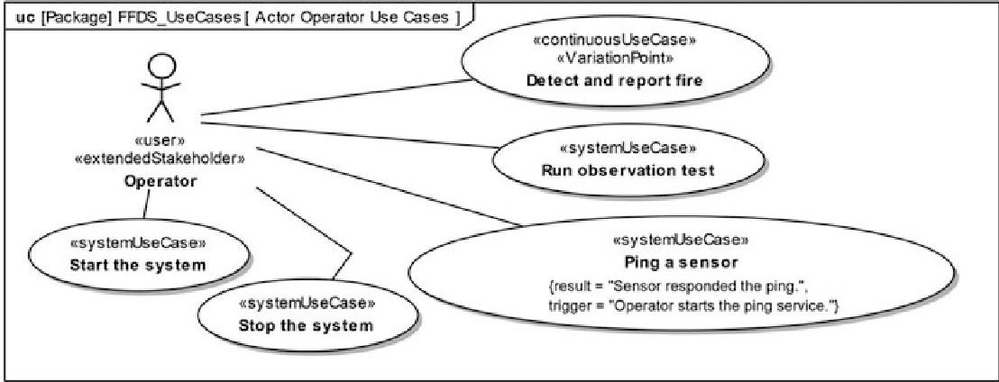

Fig.15 Actor operator use cases

<!-- PDF_PAGE: 22 -->

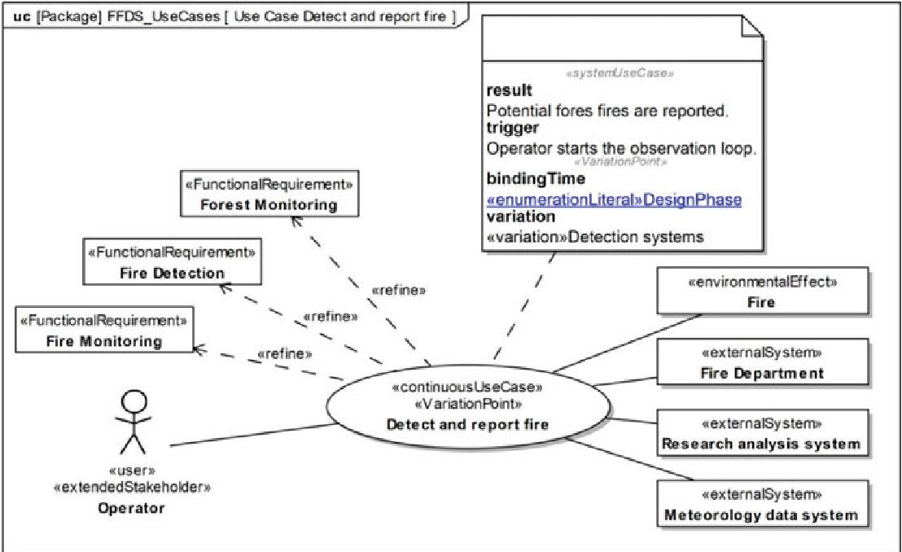

Fig.16 Use case detect and report fire

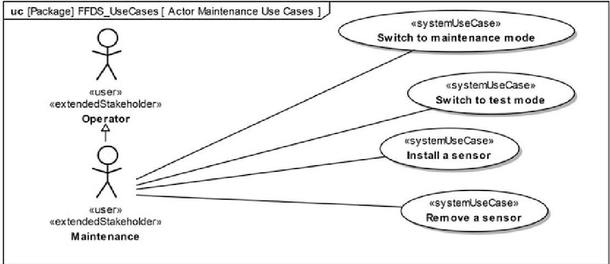

Fig.17 Actor maintenance use cases

## SYSMOD Method: Model the Logical Architecture

Model a physical architecture on a high abstraction level that satisfies the given requirements.

## SYSMOD Process

- SYSMOD architecture process

SYSMOD Role

- System architect

SYSMOD [Input] Product

- System use cases

- System context requirements

<!-- PDF_PAGE: 23 -->

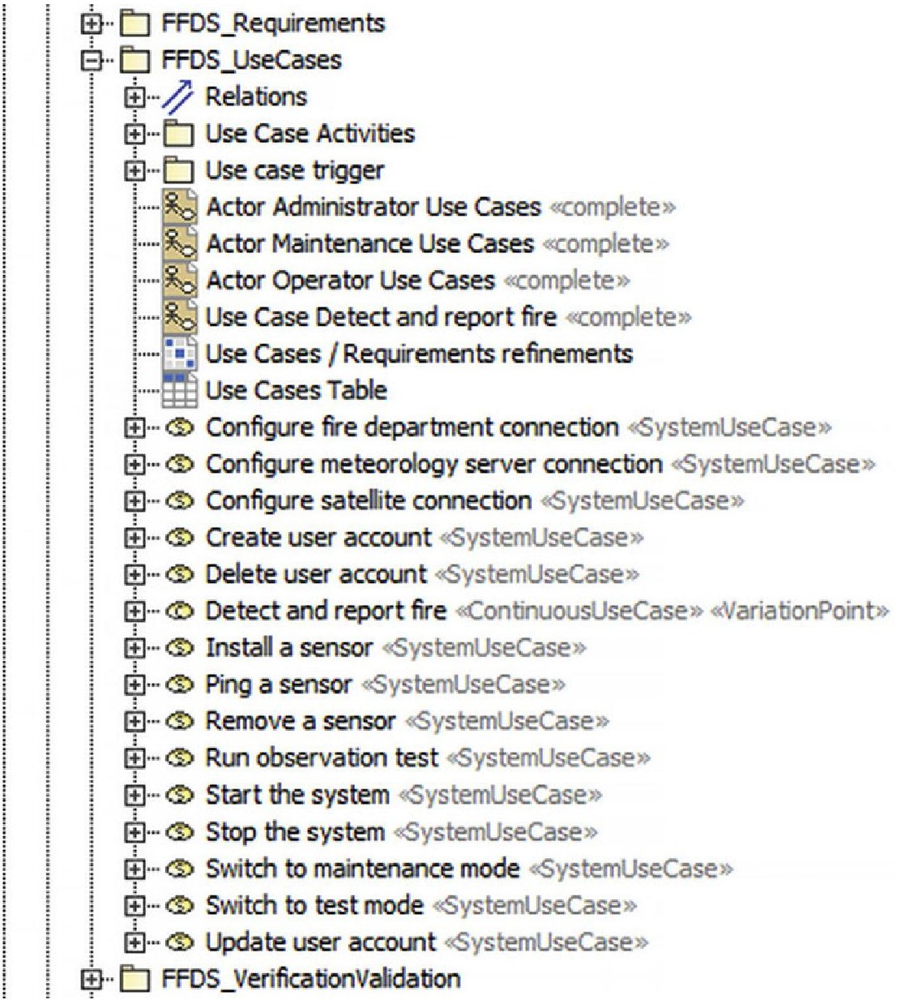

Fig. 18 FFDS system use cases in the model package structure

- Base architecture

- Functional architecture SYSMOD [Output] Product

- Logical architecture

ISO 15288 Process

- Architecture definition

## Purpose

The logical architecture describes the technical concepts and principles of the system.

<!-- PDF_PAGE: 24 -->

## Description

The logical architecture is an abstract physical architecture. Thinking top-down in the development process, the logical architecture is the first version of a physical architecture. It covers architectural and technical principles and concepts, for example, an electric motor, a valve, or a display as technical concepts. Further down in the intended top-down approach, the product architecture is then a concrete and more detailed specification of the concepts.

The logical architecture must conform to the base architecture. If strongly coupled, the logical architecture is a specialization of the base architecture. If loosely coupled, there are only allocate relationships between both architectures.

If you do not need a separate logical architecture, you can merge this step and the architecture with the product architecture. Finally, you have a physical architecture with logical and concrete product aspects.

## Example of SYSMOD Product: FFDS Logical Architecture

## Document

Figure 19 depicts a description of the logical architecture in a text document.

## Model

Figure 20 depicts the definition of the logical architecture elements in a SysML block definition diagram (system breakdown, product tree). Check carefully if the value of the diagram view exceeds the effort in creating the visualization. Alternatively, you can display the block definitions in a table.

Figure 21 depicts the information aspect of the structure of the logical architecture in a SysML $ ^{\mathrm{TM}} $ internal block diagram. This is the main view of an architecture. Typically, it is not valuable to show all different aspects like information, mechanical, electrical, and others in a single diagram. Instead, each aspect is shown in a separate internal block diagram. The diagram name indicates the aspect. However, finally, the stakeholders decide about the view and the format and content of the diagrams.

Figure 22 depicts the logical architecture in the model package structure.

## Challenges and Gaps

In terms of gaps, it was stated earlier in section "Current State of the Practice/Current State of the Art" that the candidate list of MBSE methodologies described herein is not a comprehensive set of methodologies but rather methodologies that have substantial presence in the literature and that are currently in active use, being advanced, and/or actively supported at the time of this publication. The earlier cited MBSE methodology survey was published a dozen years ago [2]; however,

<!-- PDF_PAGE: 25 -->

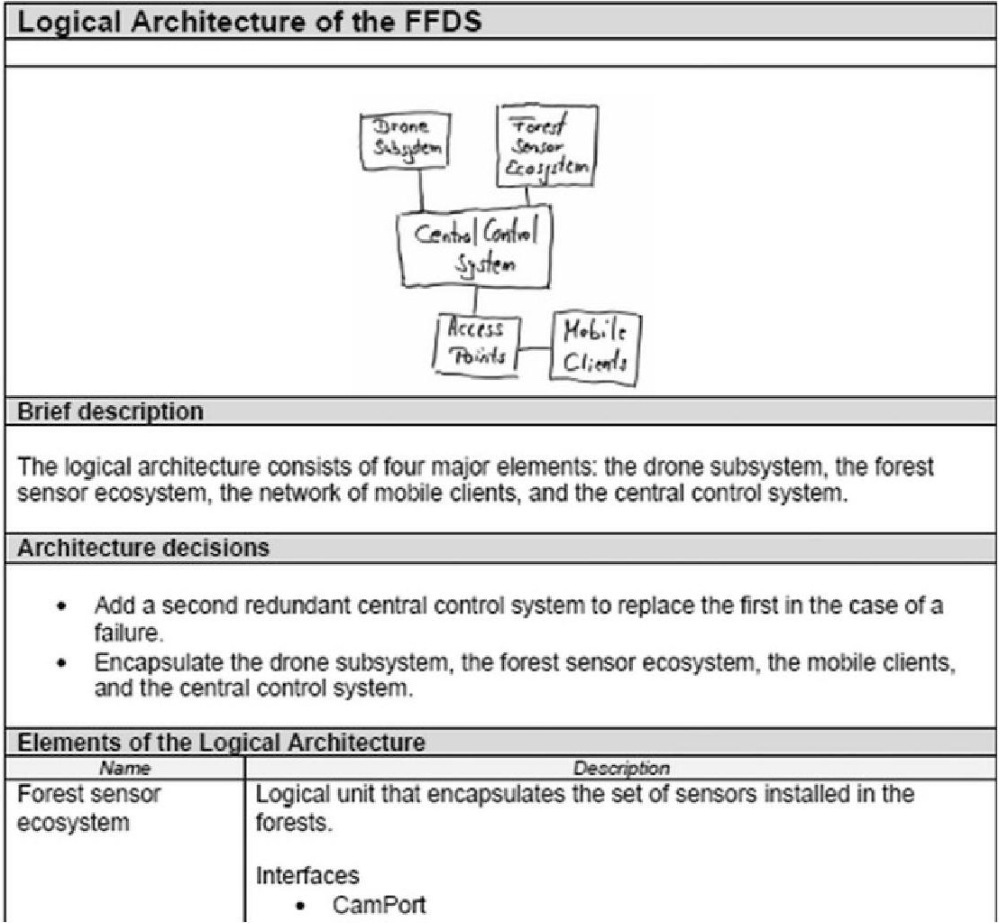

Fig. 19 FFDS logical architecture in the document

following the release of that report, methodologists were encouraged to provide a cursory description of their methodologies on the publicly available MBSE Wiki supported by the Object Management Group $ ^{\mathrm{TM}} $ （OMG $ ^{\mathrm{TM}} $ ). This was intended to facilitate more rapid visibility into gaps in methodologies for the benefit of the broad international systems engineering community that were either not included in the 2008 survey or created since that survey. Brief descriptions of these methodologies and primary points of contact can be found on that OMG MBSE Methodology and Metrics Wiki page (see http://www.omgwiki.org/MBSE/doku.php?id=mbse: methodology).

With respect to challenges, the primary challenges associated with MBSE methodologies are not necessarily complexity, availability, or even supportability as one might expect but rather the following: (a) evaluating and comparing methodologies and (b) methodology adoption and tailoring within an organization. Each of these challenges is further described in the following subsections of this chapter.

<!-- PDF_PAGE: 26 -->

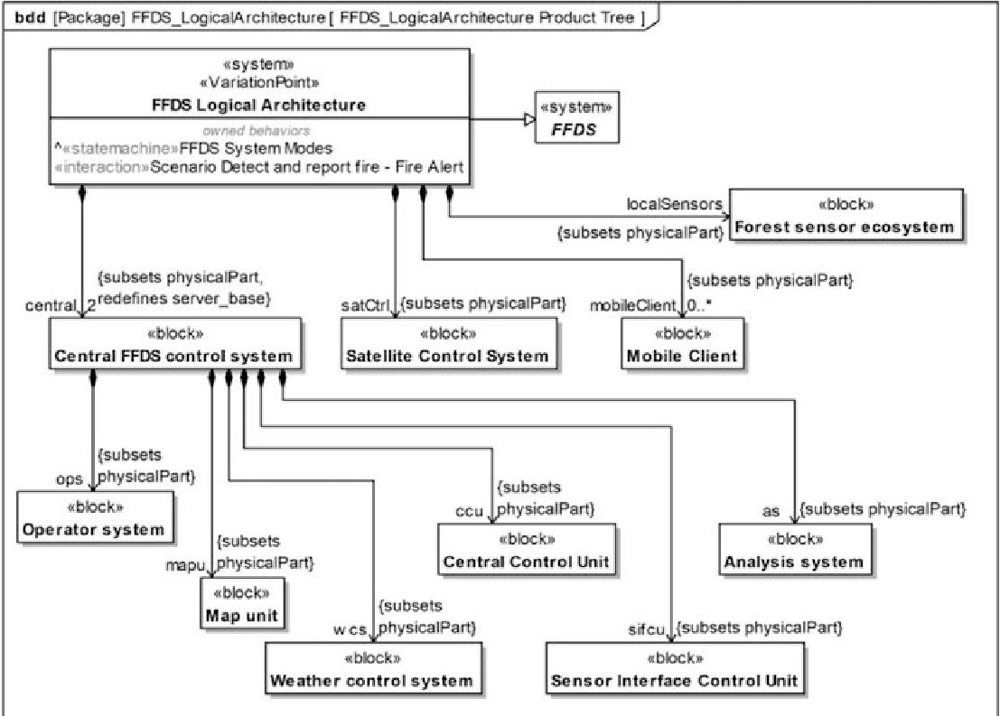

Fig. 20 FFDS logical architecture product tree

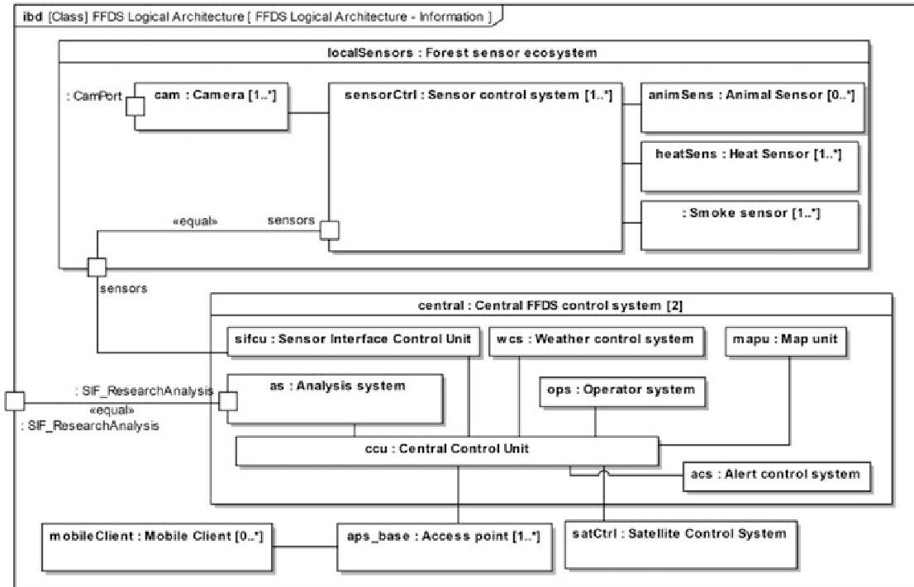

Fig.21 FFDS logical architecture

<!-- PDF_PAGE: 27 -->

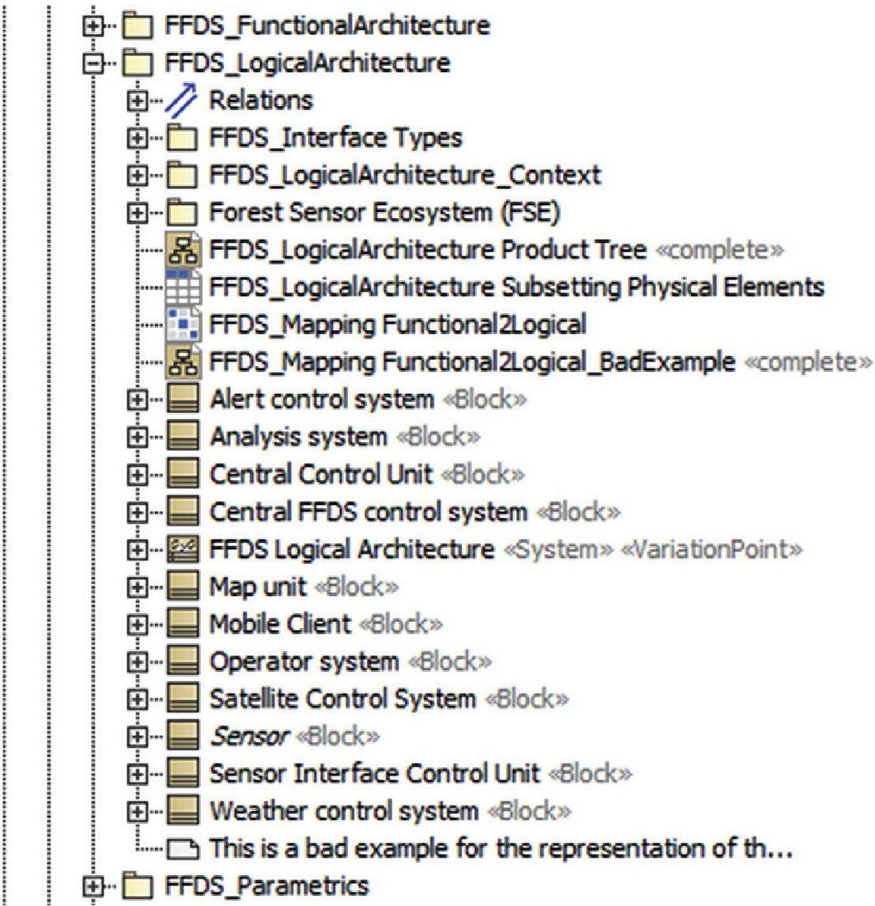

Fig. 22 FFDS logical architecture in the model package structure

## Evaluating and Comparing Methodologies

In addition to the modeling language and the tool, the methodology is an essential building block in the implementation of MBSE. As this handbook shows, there are a variety of methodologies. The Framework for the Evaluation of MBSE Methodologies for Practitioners (FEMMP) [4] enables the assessment of the methodologies by providing an overview without the ambition to rank the methodologies.

The evaluation process for a single methodology consists of five steps:

1. Compile a summary of the methodology with further references.

2. Highlight the unique and most important features of the methodology.

3. Apply the methodology on a simple case study to illustrate it. For example, a steam engine case study is used in Weilkiens et al. [4]. The case study should fit the context in which the methodology is to be applied.

<!-- PDF_PAGE: 28 -->

4. Evaluate the methodology using the framework criteria with answers, explanations, and comments.

5. Discuss and conclude the evaluation (findings, remarkable things, discoveries).

The criteria from step 4 are grouped into five aspects:

1. Essentials: Criteria to be met for the methodology to be considered as MBSE methodology, for example, coverage of ISO 15288 process steps (ISO/IEC 15288:2002 2013)

2. Practicality: Criteria for the practical application of the methodology, for example, the language, engineering scope, or significant features of the methodology

3. Efficiency: Criteria that make the methodology efficient, for example, background validation or (semi)automatic generation of reports

4. Usability: Criteria for the user experience of the available tools used to apply the methodology

5. Support: Criteria how well the methodology is supported by its owners, the community, and tool vendors, for example, by providing documentation or training

Each criterion defines its scope, such as process, language, or tool. People and technology would be other useful scopes. FEMMP is not limited to the predefined scopes.

A weighting controls the focus during the evaluation. Each criterion has a weighting between 1 and 3, with 3 being the ones to focus on first. The weight does not necessarily imply importance.

The evaluation of each criterion can be specified in one of the following metrics:

- Yes/no plus a free text justification

- List of items plus a free text explanation

- Qualitative assessment scale: A, fully compliant; B, acceptable performance; C, limited applicability; G, generalization; and X, not addressed

Table 2 depicts the table with all criteria that were used for the first applications of FEMMP.

FEMMP is a novel framework for the evaluation of MBSE methodologies. Experiences with the framework will lead to further adaptations and calibrations of the framework.

## Methodology Adoption and Tailoring

Once an MBSE methodology has been determined to be a good fit for an organization or specific department within an organization, it is time to put the methodology into practice; this does not happen automatically. There needs to be a concerted effort to tailor the selected methodology and provide training to the practitioner

<!-- PDF_PAGE: 29 -->

Table 2 Framework for the Evaluation of MBSE Methodologies for Practitioners [4]. (Copyright 2016. IEEE. Used by permission)

<table border="1"><tr><td>ID</td><td>Area</td><td>Category</td><td>Title</td><td>Description</td><td>Type</td><td>Wt</td></tr><tr><td>A-00-P</td><td>Essentials</td><td>Process</td><td>ISO Standard</td><td>What process steps of ISO 15288 are covered?</td><td>List</td><td>3</td></tr><tr><td>A-01-P</td><td>Essentials</td><td>Process</td><td>Framework</td><td>What views from the reference framework are used?(MODAF, DODAF...List)</td><td>3</td><td></td></tr><tr><td>A-02-L</td><td>Essentials</td><td>Language</td><td>Philosophy</td><td>Are Model Elements clearly distinguished from Diagram Elements?(separation of content from representation)</td><td>Y/N</td><td>3</td></tr><tr><td>A-03-T</td><td>Essentials</td><td>Tool</td><td>Precision</td><td>How precise does the tool implement process semantics and sequence?(Is the process well enforced,can“wildcard”elements be used,e.g.,an“association relationship,”are constrained clearly communicated and controlled,are“work arounds”allowed that reduce the model quality)</td><td>Scale</td><td>3</td></tr><tr><td>B-00-L</td><td>Practicality</td><td>Language</td><td>Language</td><td>What Modelling Language is used?(If NOT SysML:How well does it define the real-world semantics of the engineering,are elements strictly typed,is their meaning unambiguous,do they have a defined purpose etc.)</td><td>List</td><td>3</td></tr><tr><td>B-01-M</td><td>Practicality</td><td>Methodology</td><td>Scalability</td><td>How well does the model scale?(suitable for large projects,“grows”with time without becoming cumbersome,does it require partitioning,e.g.,in a tree)</td><td>Scale</td><td>3</td></tr><tr><td>B-02-M</td><td>Practicality</td><td>Methodology</td><td>Scope</td><td>For what engineering purpose is the methodology suited(innovation,improved products,refactoring,reverse engineering,...)?</td><td>List</td><td>2</td></tr></table>

(continued)

<!-- PDF_PAGE: 30 -->

Table 2 (continued)

<table border="1"><tr><td>ID</td><td>Area</td><td>Category</td><td>Title</td><td>Description</td><td>Type</td><td>Wt</td></tr><tr><td>B-03-M</td><td>Practicality</td><td>Methodology</td><td>Tailoring</td><td>How easy is it to tailor the methodology? (add, delete or change processes or process steps, object definitions or toggle tool features on and off)</td><td>Scale</td><td>3</td></tr><tr><td>B-04-P</td><td>Practicality</td><td>Process</td><td>Consistency</td><td>Is the process self-contained? (are in/outputs to all steps connected)</td><td>Y/N</td><td>3</td></tr><tr><td>B-05-M</td><td>Practicality</td><td>Methodology</td><td>Variants</td><td>How well does the methodology support the variant management?</td><td>Scale</td><td>3</td></tr><tr><td>B-06-M</td><td>Practicality</td><td>Methodology</td><td>Complexity</td><td>How often is the methodology “interrupted”? (by external processes and/or non-integrated tools)</td><td>Scale</td><td>2</td></tr><tr><td>B-07-T</td><td>Practicality</td><td>Tool</td><td>Connectivity</td><td>How easily can the information be exchanged with other tools? (What standard API are provided by the tool, what API can be added, Is import and export based on open protocols, is it guided, e.g., by a wizard can it be rolled-back, what the quality control mechanism etc.)</td><td>Scale</td><td>3</td></tr><tr><td>B-08-L</td><td>Practicality</td><td>Language</td><td>Integration</td><td>How well can the model be integrated with specialty engineering models? (CAD, PNID, Project Management, Document Management)</td><td>Scale</td><td>1</td></tr><tr><td>B-09-M</td><td>Practicality</td><td>Methodology</td><td>Simulation</td><td>How well does the methodology provide for an integrated simulation?</td><td>Scale</td><td>2</td></tr><tr><td>B-10-M</td><td>Practicality</td><td>Methodology</td><td>Redundancy</td><td>How well does the methodology prevent duplication? (of work, model elements, artefacts, communications and reports)</td><td>Scale</td><td>2</td></tr><tr><td>C-00-T</td><td>Efficiency</td><td>Tool</td><td>Perspectives</td><td>To what level is the creation of experts&#x27; perspectives automated? (can views be defined on the model or do they require manual re-work)</td><td>Scale</td><td>1</td></tr></table>

(continued)

<!-- PDF_PAGE: 31 -->

Table 2 (continued)

<table border="1"><tr><td>ID</td><td>Area</td><td>Category</td><td>Title</td><td>Description</td><td>Type</td><td>Wt</td></tr><tr><td>C-01-T</td><td>Efficiency</td><td>Tool</td><td>Checking</td><td>Does the tool support consistency checking of the model? (Automated detection of wrong content and/or formats, flagging of, “loose ends” etc.)</td><td>Y/N</td><td>2</td></tr><tr><td>C-02-T</td><td>Efficiency</td><td>Tool</td><td>Reporting</td><td>How quickly are standard/custom reports, is design documentation created? (select templates or views, filter reports, re-use of settings, define aggregation, required level of experience, potential level of automation)</td><td>Scale</td><td>1</td></tr><tr><td>C-03-T</td><td>Efficiency</td><td>Tool</td><td>Admin</td><td>How well does the tool help to minimise work that isn’t creating any value? (low admin, auto versioning and back-up)</td><td>Scale</td><td>1</td></tr><tr><td>C-04-T</td><td>Practicality</td><td>Tool</td><td>Reuseability</td><td>Does the tool allow to reuse any type of Modelling Element across projects? (sharing the same object with the same lifecylce in any project)</td><td>Y/N</td><td>2</td></tr><tr><td>D-00-T</td><td>Experience</td><td>Tool</td><td>Navigation</td><td>How easy is it to find the correct model element? (are elements links, users “guided” in the process, information well aggregated, need to “jump” screens)</td><td>Scale</td><td>2</td></tr><tr><td>D-01-T</td><td>Experience</td><td>Tool</td><td>Intuitition</td><td>How intuitive is the tool to work with? (compliance with UX conventions, standard tool reactions, e.g., tool tips, double/right click, drag&amp;drop, delete, Keyboard shortcuts, spell check, familiar operations, e.g., as MS-Office)</td><td>Scale</td><td>2</td></tr><tr><td>D-02-T</td><td>Experience</td><td>Tool</td><td>View</td><td>How easy is it to configure the UX dynamically? (define a matrix with sorting &amp; filtering of columns and rows, store customised view, annotation, comment)</td><td>Scale</td><td>1</td></tr></table>

(continued)

<!-- PDF_PAGE: 32 -->

Table 2 (continued)

<table border="1"><tr><td>ID</td><td>Area</td><td>Category</td><td>Title</td><td>Description</td><td>Type</td><td>Wt</td></tr><tr><td>D-03-T</td><td>Experience</td><td>Tool</td><td>UI</td><td>How readable is the UI? (Good use of screen estate and colour, zoom, can fonts and sizes be changed, is information well presented...)</td><td>Scale</td><td>1</td></tr><tr><td>E-00-M</td><td>Help</td><td>Methodology</td><td>Documentation</td><td>How well is the methodology supported? (books, manuals, case studies, online help, community, websites, interactive support, user feedback etc.)</td><td>Scale</td><td>3</td></tr><tr><td>E-01-M</td><td>Help</td><td>Methodology</td><td>Training</td><td>How well is training supported? (availability, consultants, coaches, e-training, background knowledge required)</td><td>Scale</td><td>1</td></tr><tr><td>E-02-T</td><td>Help</td><td>Tool</td><td>Support</td><td>How well is the tool supported? (vendor response times, 24/7 helpline etc.)</td><td>Scale</td><td>1</td></tr></table>

community. In addition, various commercial and open-source process modeling tools exist in which a process engineer can create a Web-based framework of a particular methodology. A couple of examples include the IBM Engineering Lifecycle Optimizer - Method Composer (formerly IBM Rational Method Composer or RMC) (see http://www.ibm.com/us-en/marketplace/method-composer) and the EPF from the Eclipse Foundation, respectively (see projects.eclipse.org/projects/ technology.epf).

A key element of the training plan is to hold several so-called Methodology Adoption Workshops or "MAWs" in which process engineers are trained in the selected methodology and have developed training material and perhaps even developed a tailoring of the methodology using one of the aforementioned process/method modeling tools. These MAWs could be held as weeklong sessions or split into smaller training segments of a few days at a time over the course of several weeks. Early MBSE adopters within the organization should be targeted first, followed by senior staff and management. It is also highly recommended that external training and MBSE industry leaders be brought in for consultation and training if such training is provided. Consulting services could also be secured to help tailor the selected methodology for the organization. The important point to note here is that continuous training while staying current in the state-of-the-practice is paramount to successful MBSE methodology adoption.

<!-- PDF_PAGE: 33 -->

## Expected Advances in the Future

In addition to being described in a number of MBSE textbooks with application to introductory systems engineering problem sets and in the context of industry-leading modeling languages, the MBSE methodologies surveyed in this chapter continue to evolve and have been applied in a variety of real-world industry applications, for example, medical robotics (Dori 2014), aircraft design and landing constraints (Li et al. 2019), planet sustainability [3], and space exploration (Spangelo et al. 2012; Fernandez et al. 2020), to name a few.

With respect to future advances of the Object-Oriented Systems Engineering Method (OOSEM), there is a dedicated INCOSE OOSEM Working Group currently led by WG chair Howard Lykins (INCOSE OOSEM WG 2020). In addition, there are plans to update the methodology based on OMG $ ^{\mathrm{TM}} $ SysML $ ^{\mathrm{TM}} $ v2. According to S. Friedenthal (S. Friedenthal, private communication, Sep. 28, 2020), that will result in new opportunities to simplify the methodology and to apply it in new ways. For example, there are specific constructs in SysML $ ^{\mathrm{TM}} $ v2 that address modeling of variability. This will make it much more straight forward to specify variant configurations. Also, there is a standardized Application Programming Interface (API) with more sophisticated query capability. The methodology will likely evolve to leverage this capability in ways that were not practical previously, such as for change impact assessment.

The Object-Process Methodology (OPM) made great strides in moving toward industry standardization such as the release of the ISO Publicly Available Specification (PAS) ISO/PAS 19450:2015 entitled Automation systems and integration - Object-Process Methodology. This ISO/PAS was produced under the auspices of the ISO/TC 184/SC 5 Technical Committee on interoperability, integration, and architectures for enterprise systems and automation applications.

OPM has since moved beyond the ISO 19450:2015 specification to fusing conceptual-qualitative modeling with computational modeling (Dori 2020). This enables expanding the span of the life cycle stages that MBSE covers to later (downstream) life cycle stages, including detailed design, model-based testing, simulation, and execution. The OPM model is currently being prepared to serve not just as a blueprint of the system to be but also the actual engine that drives the operational system. OPM methodologist refer to this as "Systems Operating System (SysOS)"; just as a computer has an OS, so does any system that combines humans, hardware, and software (Soskin et al. 2020). The OPM SysOS can already connect to Internet of Things (IoT) sensors and devices and drive them based on data received in real time from the environment. Recent OPM-based developments include IoT security modeling and deep learning to convert free text to OPM models (D. Dori, private communication, Sep. 30, 2020).

The methodology of SYSMOD will use the new possibilities of OMG $ ^{\mathrm{TM}} $ SysML $ ^{\mathrm{TM}} $ v2. The same applies to the related method Variant Modeling with SysML (VAMOS). Although the methodology is independent of the modeling languages, new features enable new possibilities.

<!-- PDF_PAGE: 34 -->

Further developments of SYSMOD will include new technologies and concepts such as the Digital Twin and AI. Special attention will be paid to the user, the systems engineer, and methods for collaborative engineering, and more views on the methodology, for example, a documentation based on the Essence framework, will be included.

And advances are being planned with the Integrated Systems Engineering and Pipelines of Processes in Object-Oriented Architectures (ISE&PPOOA) methodology as well, including the following (J. Fernandez, private communication, Sep. 28, 2020):

(a) Creation of ISE&PPOOA profiles for diverse commercial MBSE tools to facilitate the simulation and execution of the models

(b) Extending the ISE&PPOOA conceptual model with new concepts related to particular heuristics and patterns to deal with nonfunctional requirements and quality models

(c) Complementing the ISE&PPOOA MBSE methodology with best practices related to other engineering domains

(d) Using other software architectural frameworks instead of PPOOA architectural framework for implementing the software architecture

As stated in section "Best Practice Approach," the list of MBSE methodologies described in this chapter is reflective of a limited set of leading methodologies that are current, have a high level of maturity, and have been widely described in supporting MBSE textbooks and industry literature. That said, newer and emerging MBSE methodologies should be considered in an organization's overall assessment of potential MBSE methodology adoption. An example of one such methodology is the Arcadia method developed by Jean-Luc Voirin, a Systems Technical Director at Thales [6, 7]. Arcadia is also supported by a dedicated open-source MBSE tool known as Capella (see http://www.eclipse.org/capella/). This and other MBSE methodologies will be reported in future revisions of this handbook as they begin to mature and gain widespread industry adoption.

In closing, exciting new industry trends such as "Digital Transformation (DT or DX)," Data Science, and Artificial Intelligence and Machine Learning as well as the ever-expanding role of the discipline of systems engineering into domains beyond the traditional aerospace and defense sector emerge, and it will be exciting to watch how these trends and disruptive technologies will influence how the MBSE methodologies surveyed herein evolve and respond. To learn more, the interested reader is encouraged to get involved in various industry forums such as the Workshop on MBSE held annually during the INCOSE International Workshops and Symposiums (see http://www.incose.org/IW2021 and http://www.incose.org/symp2021) and the annual Conference on Systems Engineering Research (CSER) (see cser.info). Note: Past INCOSE International Workshop MBSE Workshop materials are posted on the

<!-- PDF_PAGE: 35 -->

OMG $ ^{\mathrm{TM}} $ MBSE Wiki site at the following URL: http://www.omgwiki.org/MBSE/ doku.php#mbse_events_and_relatedmeetings.

## Chapter Summary

In this chapter, a select set of industry-leading MBSE methodologies were introduced along with novel techniques for how to evaluate and compare methodologies as part of an organization's methodology selection process. An illustrative example of one particular methodology, i.e., the Systems Modeling Tool (SYSMOD), was described. In addition, a set of recommended practices for methodology adoption were described to address MBSE methodology challenges, including a novel approach for methodology assessment as well as continuous training by means of Methodology Adoption Workshops (MAWs), use of commercial and open-source process/method modeling tools, and engagement of professional MBSE consulting services to assist with methodology tailoring, training, and adoption. And finally, new insights into future advances in the MBSE methodology field were profiled.

## Systems Modeling Toolbox (SYSMOD)

## Overview

- User-oriented approach for requirements engineering and system architectures (see Fig. 23)

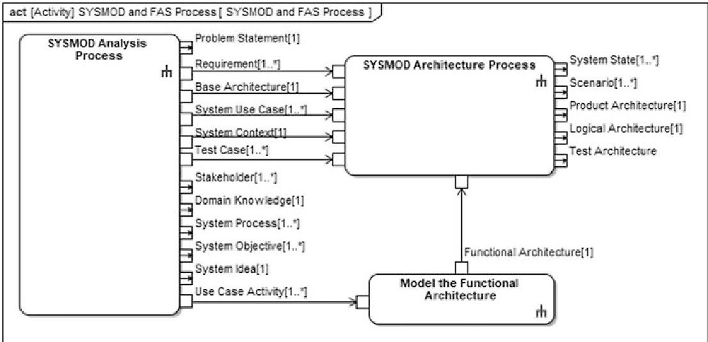

Fig. 23 SYSMOD and FAS process [3]. (Copyright $ \textcircled{c} $ 2020. MBSE4U. Used by permission)

<!-- PDF_PAGE: 36 -->

- Includes processes for the adoption of MBSE in the organization and to set up an MBSE infrastructure

- Guidelines and examples provided for each task

- Includes tasks to specify problem statement, system idea and objectives, requirements, stakeholders, base architecture, systems context, use cases, use case activities, domain model, test cases, logical architecture, physical architecture, scenarios, and test architecture

- Provides a mapping to the ISO/IEC/IEEE 15288:2015 standard [5]

- Provides interfaces to other methods like Functional Architectures for Systems (FAS) or Variant modeling with SysML (VAMOS)

- Tool vendor-independent methodology

## Tool Support

- Free SYSMOD plugins for use with CATIA/No Magic Cameo Systems Modeler and Sparx Systems Enterprise Architect that provides SYSMOD stereotypes, icons, and diagrams, available at mbse4u.com/download/

- Tool support for SYSMOD can be provided by COTS-based OMG $ ^{\mathrm{TM}} $ SysML $ ^{\mathrm{TM}} $ tools.

## Offering/Availability

- Official source and latest version published in the book SYSMOD: The Systems Modeling Toolbox: mbse4u.com/sysmod/

## Selected Resources

- SYSMOD training and coaching provided by consultancy http://www.oose.de/

- See 9.1.2 References section under SYSMOD.

## Cross-References

Model-Based System Architecting and Decision-Making

Overarching Process for Systems Engineering and Design

## References

## General Refences

1. J. N. Martin, Systems Engineering Guidebook: A Process for Developing Systems and Products, CRC Press, Inc.: Boca Raton, FL, 1996.

2. J. A. Estefan, "Survey of Model-Based Systems Engineering (MBSE) Methodologies," INCOSE Technical Document, Publ. No: INCOSE-TD-2007-003-01, Ver/Rev. B, INCOSE MBSE Initiative, International Council on Systems Engineering, Seattle, Washington, Jun. 10, 2008.

3. T. Weilkiens, SYSMOD - The Systems Modeling Toolbox, $ 3^{\mathrm{rd}} $ edition, Pragmatic MBSE with SysML, MBSE4U, 2020.

<!-- PDF_PAGE: 37 -->

4. T. Weilkiens, A. Scheithauer, M. Di Maio and N. Klusmann, "Evaluating and Comparing MBSE Methodologies for Practitioners," 2016 IEEE International Symposium on Systems Engineering (ISSE), Institute of Electrical and Electronics Engineers, Oct. 3-5, 2016.

5. ISO/IEC 15288:2005, Systems Engineering - System Life Cycle Processes, International Organization for Standardization/International Electrotechnical Commission, Jun. 8, 2005.

6. J-L. Voirin, Model-based System and Architecture Engineering with the Arcadia Method, 1st Edition, ISTE Press - Elsevier: Kidlington, Oxford, UK, 2017.

7. S. P. Alaia, "Evaluating ARCADIA/Capella vs. OOSEM/SysML for System Architecture Development," Masters Thesis, Purdue University, West Lafayette, IN, Aug. 2019.

## MBSE Methodology References

## Object-Oriented Systems Engineering Method (OOSEM)

S. Friedenthal, "An Introduction to MBSE with SysML: Part 4 - MBSE Method," Training Vugraphs, Sandford Friedenthal, Feb. 10-14, 2020.

S. Friedenthal, A. Moore, and R. Steiner, A Practical Guide to SysML: The Systems Modeling Language, Third Edition (Refer to Chapter 17), Morgan Kaufmann OMG Press, 2015.

P. Pearce and M. Hause, "ISO-15288, OOSEM and Model-Based Submarine Design," Systems Engineering, Test and Evaluation Conference of The Systems Engineering Society of Australia (SESA) and The Southern Cross Chapter of The International Test and Evaluation Association (ITEA) and INCOSE Region VI Incorporating the 6th Asia Pacific Conference on Systems Engineering (APCOSE 2012), Brisbane, Australia, Apr. 30, 2012.

"Object-Oriented Systems Engineering Method (OOSEM) Tutorial," Ver. 02.42.00, Lockheed Martin Corporation and INCOSE OOSEM Working Group, Apr. 2006.

H. Lykins, S. Friedenthal, and A. Meilich, "Adapting UML for an Object-Oriented Systems Engineering Method (OOSEM)," Proceedings of the INCOSE 2000 International Symposium, Minneapolis, MN, Jul. 2000.

S. Friedenthal, "Object Oriented Systems Engineering," Process Integration for 2000 and Beyond: Systems Engineering and Software Symposium, New Orleans, LA, Lockheed Martin Corporation, 1998.

S. Spangelo, D. Kaslow, C. Delp, B. Cole, L. Anderson, E. Fosse, B. Gilbert, L. Hartman, T. Kahn, and J. Cutler, "Applying Model Based Systems Engineering (MBSE) to a Standard CubeSat," in Proceedings of IEEE Aerospace Conference, Institute of Electrical and Electronics Engineers, Big Sky, MT, Mar. 2012.

INCOSE OOSEM Working Group URL: http://www.incose.org/incose-member-resources/ working-groups/transformational/object-oriented-se-method, International Council on Systems Engineering, San Diego, CA, 2020.

## Object-Process Methodology (OPM)

D. Dori, Model-Based Systems Engineering with OPM and SysML, Springer: New York, New York, 2016.

ISO/PAS 19450:2015, Automation systems and integration - Object-Process Methodology, International Organization for Standardization/Publically Available Specification, Dec. 2015.

Y. Grobshtein and D. Dori, "Generating SysML views from an OPM model: Design and evaluation", Systems Engineering, 14 (3): 327-340, Feb. 2011.

<!-- PDF_PAGE: 38 -->

I. Reinhartz-Berger and D. Dori, "A Reflective Metamodel of Object-Process Methodology: The System Modeling Building Blocks," Business Systems Analysis with Ontologies, P. Green and M. Rosemann (Eds.), Idea Group: Hershey, PA, USA, pp. 130-173, 2005.

D. Dori, I. Reinhartz-Berger, and A. Sturm, "OPCAT - A Bimodal Case Tool for Object-Process Based System Development," 5th International Conference on Enterprise Information Systems (ICEIS 2003), pp. 286-291, 2003.

D. Dori, Object-Process Methodology: A Holistic Systems Paradigm, Springer-Verlag: Berlin Heidelberg, Germany, 2002.

D. Dori, "Medical Robotics and Miscommunication Scenarios. An Object-Process Methodology Conceptual Model.," Artificial Intelligence in Medicine, 62(3) pp. 153-163, 2014.

L. Li, N. L. Soskin, A. Jbara, M. Karpel, and D. Dori, Model-Based Systems Engineering for Aircraft Design with Dynamic Landing Constraints Using Object-Process Methodology, IEEE Access, Institute of Electrical and Electronics Engineers, pp. 61494-61511, 2019.

ISO/PAS 19450:2015, Automation systems and integration - Object-Process Methodology, International Organization for Standardization, Publicly Available Standard, Dec. 2015.

N. L. Soskin, A. Jbara, and D. Dori, "The Model Fidelity Hierarchy: From Text to Conceptual, Computational, and Executable Model," IEEE Systems Journal, Intitute of Electrical and Electronics Engineers, 2020.

## Systems Modeling Toolbox (SYSMOD)

T. Weilkiens, J. G. Lamm, S. Roth, and M. Walker, Model-Based System Architectures, 2nd edition, Wiley, 2022. https://www.wiley.com/en-us/Model+Based+System+Architecture%2C+2nd+Edition-p-9781119746652

T. Weilkiens, VAMOS - Variant Modeling with SysML, MBSE4U Publishing, 2016.

T. Weilkiens, SYSMOD - The Systems Modeling Toolbox, $ 3^{rd} $ Edition, Pragmatic MBSE with SysML, MBSE4U Publishing, 2020.

T. Weilkiens, Systems Engineering with SysML/UML: Modeling, Analysis, Design, Morgan Kaufmann OMG Press, 2008.

ISO/IEC 15288:2015, Systems Engineering - System Life Cycle Processes, International Organization for Standardization/International Electrotechnical Commission, May 2015.

2003. INCOSE MBSE Challenge Team SE^2, MBSE Cookbook, mbse.gfse.de

B. L. Archer, Systematic Method for Designers, Council of Industrial Design, H.M.S.O., 1965.

T. Brown, Change by Design: How Design Thinking Transforms Organizations and Inspires Innovation, Harper-Business, 2009.

M. Lewrick, P. Link, and L. Leifer, The Design Thinking Playbook: Mindful Digital Transformation of Teams, Products, Services, Businesses and Ecosystems, Wiley, 2018.

R Haberfellner, O. de Weck, E. Fricke, and S. Vossner. Systems Engineering - Fundamentals and Applications, Birkhäuser Basel, 2019.

J. Dewey, How we think, D.C. Heath & Co., 1910.

## Integrated Systems Engineering and Process Pipelines in OO Architectures (ISE&PPOOA)

J. L. Fernandez, and C. Hernandez, Practical Model-Based Systems Engineering, Artech House, Boston, MA, 2019.

C. Hernandez and J. L. Fernandez-Sanchez, "Model-Based Systems Engineering to Design Collaborative Robotics Applications," 2017 IEEE International Symposium on Systems Engineering (ISSE) Proceedings, Institute of Electrical and Electronics Engineers, Vienna, Austria, Oct. 11-13, 2017.

<!-- PDF_PAGE: 39 -->

J. L Fernandez, "An Integrated Systems and Software Engineering Process". Tutorial. Aula Artigas. Industrial Engineering School. ETSII-UPM. Madrid (Spain), May 18, 2012.

J. L. Fernandez and G. Marmol, "An Effective Collaboration of a Modeling Tool and a Simulation and Evaluation Framework," 18th Annual International Symposium, International Council on Systems Engineering, Systems Engineering for the Planet, Utrecht, The Netherlands. Jun. 2008.

J. L. Fernandez and W. Mason, "A Process for Architecting Real-Time Systems", 15th International Conference on Software and Systems Engineering (ICSSEA), Paris, France, Dec. 2002.

J. L. Fernandez, C. Hernandez, J. A. Martinez, E. Diez and I. Valiente, "NASA MBSE Challenge Application of the ISE&PPOOA Methodology to the In-Space Habitat," Report on NASA MBSE Challenge, National Aeronautics and Space Administration, Jan. 6, 2020.

Jeff A. Estefan is a Principal Engineer and Technical Consultant for the Multimission Ground Systems and Services (MGSS) program office at NASA's Jet Propulsion Laboratory (JPL) in Pasadena, California. Jeff currently provides consulting expertise to program managers and decision-makers in matters related to long-term strategic planning, program level architectures, technology portfolio management, and systems engineering insight and oversight of the MGSS program office's primary product line known as NASA's Advanced Multi-Mission Operations System (or AMMOS), which is used my multiple NASA space science missions across NASA field and partner centers (see ammos.nasa.gov).

Jeff earned his M.S. in Applied Mathematics from the University of Washington and his B.S. in Mathematics from Washington State University and served as an Aeronautical Engineering Duty office for the US Naval Air Reserve from 1988 to 1998. He received an honorable discharge from military service with the grade of Lieutenant Commander.

Tim Weilkiens is a member of the executive board of the German consulting company oose, a consultant and trainer, a lecturer of master courses, a publisher, a book author, and an active member of the OMG and INCOSE community. Tim has written sections of the initial SysML specification and is still active in the ongoing work on SysML v1 and the next-generation SysML v2.

He is involved in many MBSE activities, and you can meet him on several conferences about MBSE and related topics.

As a consultant, he has advised a lot of companies from different domains. The insights into their challenges are one source of his experience that he shares in his books and presentations.

Tim has written many books about modeling including Systems Engineering with SysML (Morgan Kaufmann, 2008) and Model-Based System Architecture (Wiley, 2022). He is the editor of the pragmatic and independent MBSE methodology SYSMOD - the Systems Modeling Toolbox.