<!-- PDF_PAGE: 1 -->

# Towards a definition of best practices for Model Based Systems Engineering in European Space Agency Projects

Jose Lorenzo Alvarez $ ^{1} $ , Hans-Peter de Koning $ ^{2} $ European Space Agency (ESA), European Space Technology Center (ESTEC), Noordwijk, Netherlands

Daniel Fisher $ ^{3} $ , Marcus Wallum $ ^{4} $ European Space Agency (ESA), European Space Operations Center (ESOC), Darmstadt, Germany

Harold Metselaar $ ^{5} $ Mason IT, Netherlands

Michael Kretzenbacher $ ^{6} $ Loft Orbital Solutions, San Francisco, CA, USA

The use of Model-Based Systems Engineering (MBSE) has been steadily increasing at ESA in the last years with wide application both in a number of running projects, as well as in the early concept and feasibility studies within the ESA Concurrent Design Facility (CDF). The current paper outlines the progress toward a definition of best practices and guidelines for future ESA projects based on the experience gained by early adopters. These best practices are illustrated with examples from on-going projects and studies. To address the transformation to Digital Engineering from different perspective, a number of activities addressing the application of MBSE in the ESA environment are either completed or underway. These activities include: the methodology and relationship to ESA Systems Engineering practices, assessment of modelling needs along the lifecycle of projects, data continuity, modelling approach, interfaces and data exchange, and model usability to different stakeholders.

## I. Nomenclature

ARCADIA= ARChitecture Analysis & Design Integrated Approach

CAD = Computer Aided Design

CDF = Concurrent Design Facility

ECSS = European Cooperation for Space Standardization

ESA = European Space Agency

MBSE = Model Based Systems Engineering

ROI = Return On Investment

<!-- PDF_PAGE: 2 -->

## II. Introduction

Several developments in the last 15 years in the European Space community have significantly advanced in the definition, adoption and deployment of MBSE solutions in space programs [4]. Some of these elements are well consolidated and part of the current practice, like modelling in the engineering domain (e.g. Mechanical and Electrical CAD), collaborative work addressing the distributed nature of teams in large projects, and the use of concurrent engineering [2] in initial phases for most projects within ESA and major industrial partners. On the other hand, the area of system modelling is still in a fluctuating stage between the definition of what it should encompass and how it should be implemented.

As a general statement (albeit simplified) the systems engineering (SE) practices aim to define, orchestrate and maintain full logical linking and traceability between problem specification, solution definition, verification and validation and operations of a system of interest. This requires the creation at each organization or domain of welldefined processes that define what to be done at each stage, of the inputs that are required and the outputs to be produced. The space domain has a strong framework of systems engineering supported with standards defining the required processes. Within the European Space community in particular, standardization was consolidated in the nineties through the framework of the European Cooperation for Space Standardization (ECSS) which covers all the involved disciplines, including SE. The SE processes in the standard are defined in general, specifying the tasks to be performed and the required information produced or consumed, but leave up to the organization in charge of the system the detailed definition of the implementation. The process structure specified in [18] has been proven across all ESA led missions and it is well established. However, its implementation, as noted in [8] relies mostly on a document centred exchange of information, which is prone to inconsistency and suffers inherently of problems related to the timeliness of information.

MBSE or more generically Digital Model Based Engineering, should aim to: (1) merge modelling into (and not replace) current SE processes to improve clarity and consistency and (2) introduce a centralized management of the information across all programmatic and technical domains (i.e. self-consistent single source of truth). The benefits of the latter point are quite clear and it is easy to define the added value or Return-On-Investment (ROI) to advocate for a managerial support for the change. The main issues preventing its introduction are of technical and infrastructure nature as we will discuss later. However, for the former point, the nature of system modelling, its advantages and the required additional effort are not so immediately apparent. The expectations of what a system model provides have to be modulated and based on what the real needs are. However those needs are different across the different lifecycle phases, and it is not possible to define a universal "catch-all" modelling strategy. In addition, the formalism required for modelling needs to be accessible and natural for systems engineers, while powerful enough to capture the required level of complexity. To address these points, we describe in section III the current status on the introduction of MBSE practices in the ESA SE processes and the still open challenges. Section IV discusses the analysis of the modelling needs definition across the lifecycle of a space mission, and the experience gained on a number of either completed or currently running activities.

Apart from the evolution to SE processes that are Model-Based, two other factors have been systematically identified as significant hurdles preventing adoption of the practices [4,10,15,16]: (1) the existence of enabling IT technologies to support the required information exchange and configuration control, and (2) the human aspects related to the introduction of change, including training of the practitioners, but also involvement of the different stakeholders through interaction with the model and the information therein in an efficient and user friendly manner. In these two areas, although very significant progress has occurred in the past years, with an exponential trend at the moment of tools to support MBSE in both modelling and visualization, we still see a critical need to progress on the standardization of the interfaces in order to allow interoperability and foster progress from both tool manufacturers and entities defining methods. In this regard, Section V summarizes the on-going activities towards working on the definition of both suitable interfaces and the approach for data continuity along the project lifecycle. Finally Section VI introduces a few examples of advances with regard to user interfaces and interaction mechanisms for general stakeholders with the system models.

<!-- PDF_PAGE: 3 -->

## III. Methodology and mapping of Systems engineering practices at ESA

Every organization involved in space systems development has specific processes to address the SE processes and a transition to a digital engineering environment should cover the evolution of the practices to embrace modelling support and eventually merge with it. The complete set of information related to a system, from requirements to design solution is already implemented in a series of models (in the broad sense of the word) representing various aspects of the system of interest (e.g. requirements, simulations, 3D CADs, failure mode databases, etc). We understand the system model as the engineering model linking these information elements and providing views specific to a domain. The selection of what views to be included in the system model is classically covered by the creation of Architecture Frameworks (AFs). Frameworks are standardizations of the system representations. The definition and creation of system frameworks is addressed by the ISO/IEC/IEEE 42010:2011 standard. Some of the best known AFs are DoDAF (USA Dept of Defense AF), MoDAF (UK Ministry of Defence AF), TOGAF (The Open Group AF) and The Zachman Framework, but many others are available based on the ISO standard above (see [20] for a nice survey of available AFs). In ESA, the ESAAF (European Space Agency AF) has been created to support decision making in System-of-systems (SoS) design and integration. It is based on existing methodologies (in particular MODAF) while adding space domain specific concepts. Frameworks provide structured approaches to create systematic and uniform representations that can be shared and exchanged between different players, levels and phases of projects. Still, note that a framework, does not provide or link to the methodology used for SE.

With respect to methodologies, different engineering methods based on model-driven engineering are being developed in the European Space sector with focus on specific aspects. Two existing examples of this are: (a) the ARChitecture Analysis & Design Integrated Approach [7] (ARCADIA) which provides a structured engineering method for defining and verifying the architecture of complex systems, it is supported by an Open Source tool implementation (Capella [23]), and which focuses on functional analysis; and (b) Virtual Spacecraft Design (VSD) [18,19], an ESA-led methodology and associated framework to support the organization and engineering data at system level based on a the Common Data Model defined in ECSS-E-TM-10-23 [6]. Nonetheless, there is not still a complete mapping of the SE processes specified in ECSS covering all lifecycle aspects to indicate which system level modelling can be most beneficial to support it. Besides, it is difficult to define a priori what would be the more useful representations of the system for the needs of a project. Along the early experiences at ESA this has affected many MBSE efforts that were seen as theoretically good, but never exercised in real environments due to the pervasive problem of fear to adopt a new solution. Examples like ARCADIA, as described in [7] were developed through feedback based on initial deployments, which in turn provided a solid foundation for the methodology.

Considering this, in the frame of the ESA Euclid [22] science mission, rather than defining a dedicated study, it was decided to introduce modelling practices at the mission system level adopting SysML [21] as the language for formal description. Further details of the specific models used in Euclid are elaborated in section IV, but for the context of the current discussion, the main lesson learned from that work was the need to simplify or hide the language complexity in SysML. This led first, to the development of an ESA specific SysML profile tailoring the language for generic ESA usage and second, to the creation of a set of guidelines for the use of SysML alongside the ESA SE processes. The profile and methodology were compiled in an ESA SysML Toolbox, including a metamodel for the SysML extension, design patterns and modelling guidelines that we describe below.

## A. ESA SysML Profile

Existing modelling languages developed for the application of MBSE had a tendency to be languages of general purpose designed for a wide range of applications. The language concepts can be overly complex and include unnecessary aspects for the needs of space systems. In order to make system modelling more approachable, SysML was extended for application to space system development at ESA. Extending the language involves renaming and customizing elements within the standards of the language to provide a bespoke solution for the modelling required. The benefit of creating such a tailored subset of the language is that it hides the complexity of standard SysML, thereby aiding its usability. The ESA SysML Profile and related metamodel is the result of these extensions.

<!-- PDF_PAGE: 4 -->

Figure 1 shows a section of the first iteration of the metamodel describing the relationships between the various elements used in the modelling of mission level space systems. These elements are defined by their 'stereotype,' which is the classification used to differentiate the various types of model elements. The initial version of this profile covered various sub-domains: architecture, verification, requirements and operational modelling.

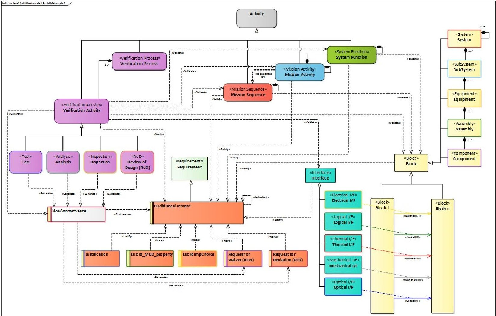

Figure 1 - ESA SysML Metamodel

For the purpose of the architecture modelling, different extensions to the SysML generic block element where introduced to align with the ECSS terminology in ECSS-S-ST-00-01C, including among these System, Subsystem, Equipment, Assembly and Component hierarchy. Interfaces are modelled using an extension of the SysML Association Blocks, with five specific interface stereotypes included (i.e., electrical, logical/data, thermal, mechanical, optical).

For operational modelling, a construct based on the behavioral Activity objects in SysML were extended to incorporate two main layers in functional analysis and decomposition: a Mission Activity in our case refers to an operational activity, composed of several actions to achieve a goal, and also to the different steps in a flow of operational tasks. These Mission Activities can be decomposed iteratively until reaching the basic building block of System functions that are allocated to a physical or logical structural element. These constructs, although simplified, allow to create a basic functional decomposition of the system which addresses a particular weakness of SysML 1.x. Activity diagrams and sequence diagrams from SysML are included in the ESA metamodel for the representation of the operational aspects of the system (see Figure 2 for an example).

<!-- PDF_PAGE: 5 -->

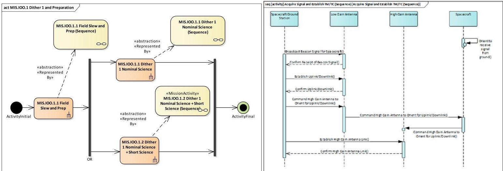

Figure 2 - Representations of operational activities in ESA SysML metamodel

In the area of modelling of requirements, although additional models exist and are integrated in the industry practices that allow requirement tracking and traceability between them (e.g., DOORS), SysML allows to keep a complete view of the system's relationships by extending the semantics with the capability to be able to link requirements to structural or behavioral elements. The SysML stereotype was further extended to capture additional metadata and a few other elements (see Figure 3) were introduced to track typical related information from space project developments like Justifications, Non-Conformances, Requests for Deviation, Request for Waiver and Implementation Choices.

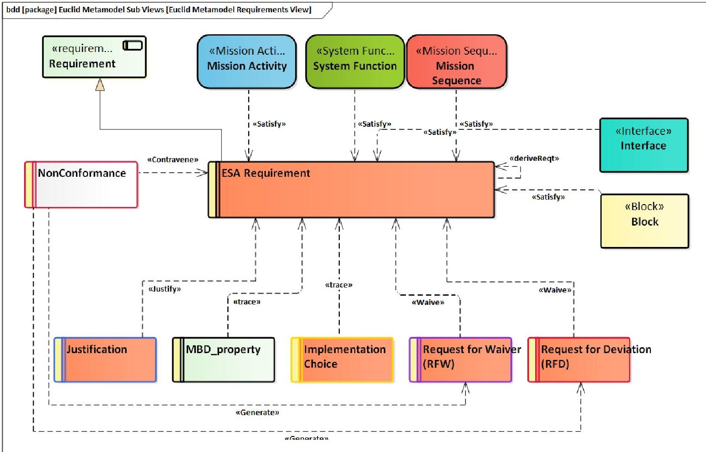

Figure 3 - ESA requirement stereotype extension

Finally, for verification and validation SE processes, a number of specific verification related stereotypes were created by extending the activity stereotype. A Verification Plan is made up of one or more verification processes. These processes are modelled via the 'verification process' stereotype. In turn a Verification Process is composed of a

<!-- PDF_PAGE: 6 -->

number of verification activities. Four types of verification activity stereotypes have been created for the ESA MBSE toolbox, namely test, analysis, inspection and review of design. These verification activities track whether or not requirements are met. If the requirement isn't met, a NonConformance is created. These elements link to both requirements and also to the operational elements as depicted in Figure 4.

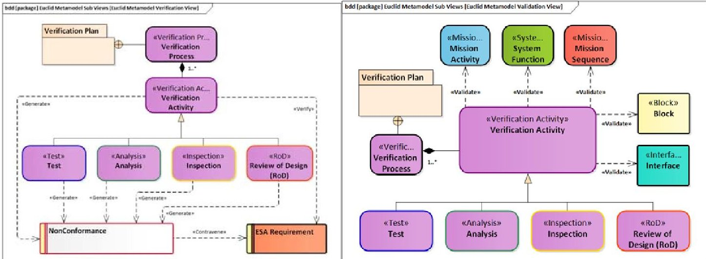

Figure 4 - Relationships between verification stereotypes

The metamodel, briefly summarized above, was produced as a first iteration based on the Euclid experience and is being tested and refined by additional adopters in the Science department (i.e., PLATO and Ariel missions).

## B. ESA MBSE Best Practice definition

The definition of a specific modelling language subset as described above, simplifies the modelling activities and focuses on the required needs. However, it still requires an association to the processes and a recommendation for an integrated SE methodology. Based on the generic ECSS standard processes described in the introduction, each organization establishes their own detailed practices. As part of the exercise to define a generic practice integrating the SE and MBSE, within the Science missions, we produced a mapping of our internal processes to the specific diagrams in a SysML model based on the ESA SysML Profile that should be produced at each step. The internal processes at ESA are controlled by the Internal Quality Management System (QMS), which contains a high-level description of the flow of activities and required inputs and outputs, responding to the ECSS requirements (see Figure 5 for an example). Adherence to QMS ensures the consistency of the process application across the science directory projects and also the integration of the lessons learned in future missions through continuous improvement and refinement. Specific implementation of each of the steps allow for a tailoring and adjustment of the process per project considering specific constraints.

<!-- PDF_PAGE: 7 -->

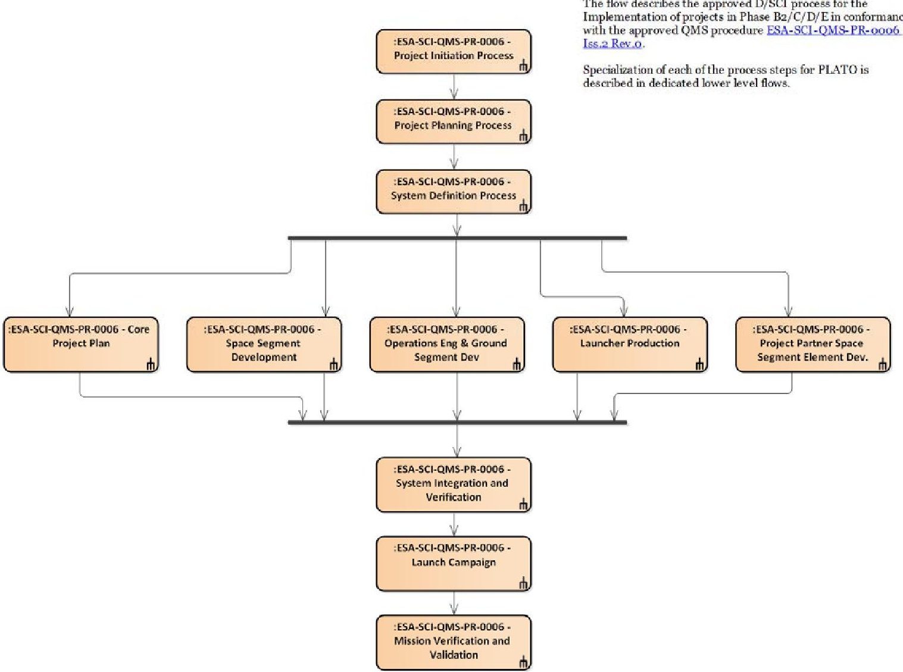

Figure 5 - Example of ESA Science Quality Management Procedure

Taking as an example one of the processes, i.e., the Project Planning Process, Figure 6 shows the breakdown of the process in individual activities as relevant for a science mission, and defines a specific methodology to follow. For each of these elements, as displayed in the table in Figure 7, a task description and associated SysML diagrams to be produced (as a minimum) have been defined. This is performed for all tasks identified for the project, which will in turn allow a first step of integration of modelling in the generic practices. As seen in the table (Figure 7), still there is a document produced at the end of the process, but relevantly, the documentation is now generated from the information in the model, which represents the 'single source of truth' and ensures consistency.

<!-- PDF_PAGE: 8 -->

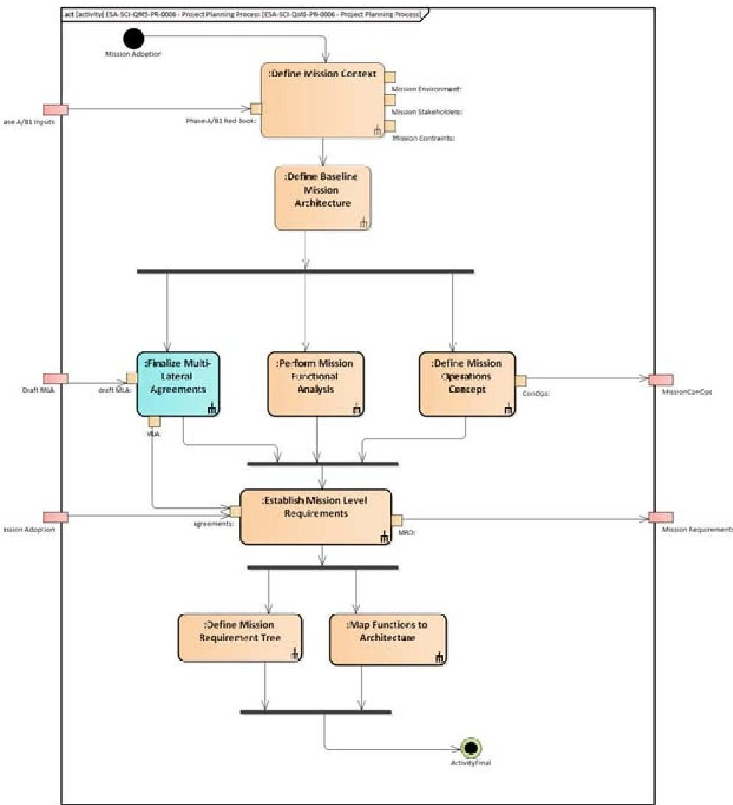

Figure 6 - General Science mission methodology for Project Planning Process (view limited to SE tasks)

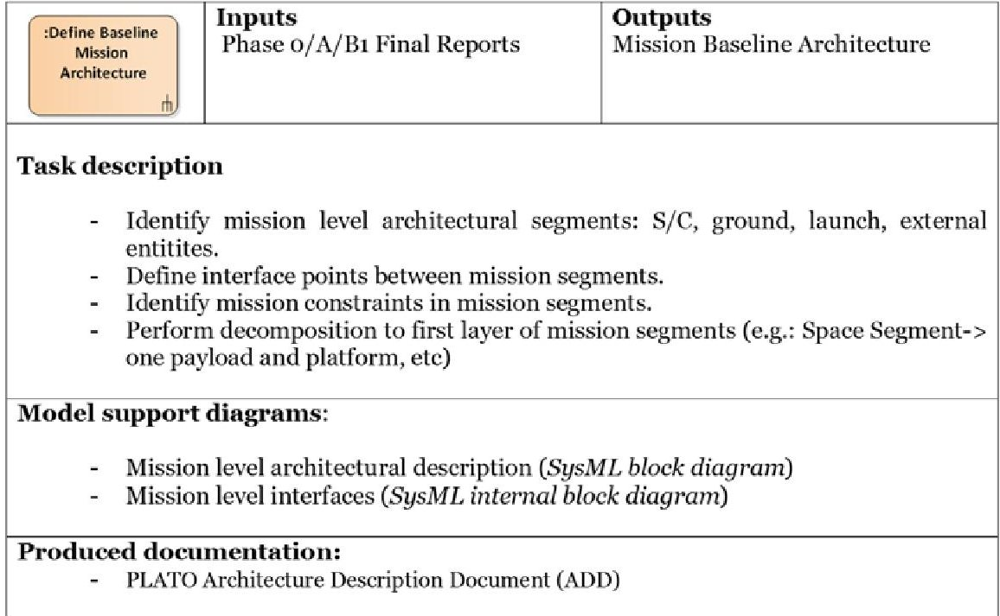

Figure 7 - Brief description of process and related diagrams

<!-- PDF_PAGE: 9 -->

Currently, the set of processes to model diagrams mapping is being compiled into a generic ESA Science MBSE best practices to be used by all new projects in the Science department. Throughout the use of the guidelines in real projects, we expect to quickly refine the methodology incorporating updates in an Agile manner across different MBSE practitioners.

For future work, it remains to identify the optimal way to introduce improvement or changes in currently running projects without causing significant disruption. This shortcoming cannot be ignored, especially at this initial fluid phase, and within the context of developments with an average duration of 10 years.

## C. ESA MBSE Modelling Guidelines, Design Patterns and Libraries

In addition to the formal language restriction and simplification presented in section III.A and the MBSE best practices mapping to representations in SysML described in III.B, another element was crucial in facilitating the adoption of MBSE in new projects: providing detailed guidelines for modelling and pre-defined design patterns and libraries.

The start of a new model creates in practitioners what is sometimes referred to as 'the blank page syndrome'. Systems engineers have learned the language formalisms and seen a number of examples based on simple toy-systems for illustration purposes, but are very often faced with the difficulty to put it into practice for a real project. To address this and to pragmatically take advantage of MBSE to improve re-use and knowledge transfer, we started introducing Modelling Patterns and a library of common elements in the ESA SysML Toolbox. Up to now, five patterns have been created in order to aid the organization of requirements, to model a typical space system operational timeline, package structure and architectural break down. We present a few examples below:

Figure 8 shows the pattern for the top level model organization for a space system. The suggested core structure divides the model into three domains, the system requirements, the system life cycle and the system architecture. A pattern has been created to outline this structure and to create a set of packages to contain these domains.

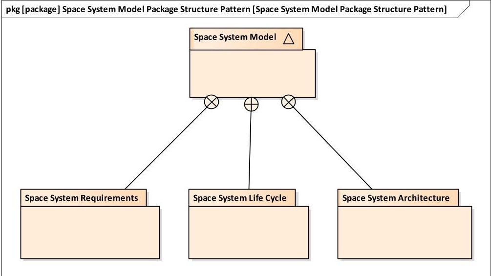

Figure 8 - System Model top level organization pattern

Another useful pattern included allows structuring of space system behavior along the lines of the system lifecycle (Figure 9). This pattern provides an activity diagram that outlines the top-level composition of the system lifecycle that is split into the following sub-activities: pre-launch activities, launch and early operations, spacecraft commissioning and performance verification, nominal spacecraft operations and spacecraft decommissioning. Each of the sub-activities in this lifecycle can then be further decomposed to provide more detailed views of the behavior of the system.

<!-- PDF_PAGE: 10 -->

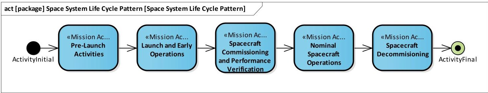

Figure 9 - Space System Life Cycle Pattern

These patterns, together with a definitions for generic blocks were incorporated in the ESA SysML Toolbox developed and made available to all the projects using SysML for their modelling efforts (Figure 10).

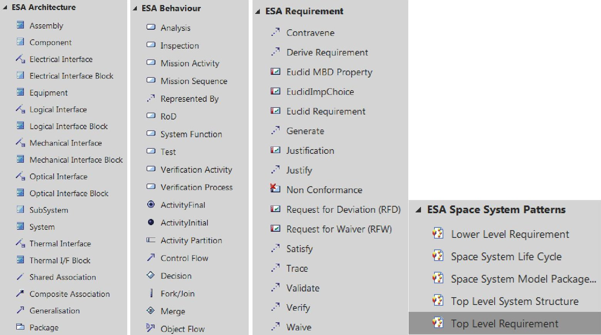

Figure 10 - ESA MBSE SysML Toolbox

The guidelines and toolbox do not pretend to become the de-facto working set for ESA, since, as we will discuss in section V, the intention is not to commit the modelling to one specific language, representation or vendor tool $ ^{7} $ However, we expect to derive generic lessons from their usage and to refine the principles to integrate MBSE on the current SE practices.

## IV. Modelling needs across project phases

Beyond the methodology, the application of MBSE practices requires to identify the scope of usage along the project lifecycle and to evaluate the practical issues and difficulties for implementation and deployment. Although several dedicated studies and demonstrators have been performed in the past years, to focus the effort requires application of MBSE in real examples. Through practice, the areas requiring development are identified and the consolidated concepts evolve and reach a level of maturity required for general deployment. However, the usage in real running projects limits the capability for changes and explorations and in many cases requires additional resources

<!-- PDF_PAGE: 11 -->

to maintain in parallel the old and the new practices. For this, it is essential, as pointed out in [10], to have advocacy and support of a few management and systems engineering champions.

In the current section, we present a few examples at ESA of MBSE practices along the lifecycle of a space project (Figure 11) both completed and on-going along with the main observations to date and the input for the future.

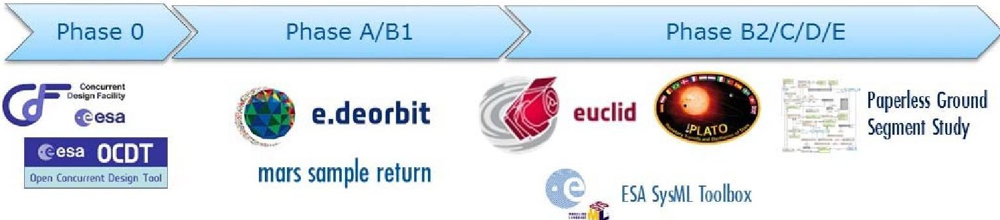

Figure 11 - Sample of MBSE supported projects at ESA

## A. Early concept phases: CDF studies

ESA has pioneered the use of Concurrent Engineering of space systems in Europe in its Concurrent Design Facility (CDF) at ESTEC since 1998, following the example set by NASA/JPL's Team-X in 1996. Concurrent Engineering is an approach in which a team collaborates in a highly interactive and iterative process to achieve an improved problem specification and design definition, including cost, risk and programmatic (schedule, logistics) aspects. The team consists of representatives of the stakeholders, a team leader, and experts representing all domains of expertise needed to develop a space system (between 15 and 25 depending on the targeted space mission). The main part of an ESA concurrent engineering study is typically performed in 4 weeks. It consists of 7 half-day co-located plenary sessions with the whole team and a final full day internal presentation of the results. In-between session individual and smaller group work is done. The plenary sessions are as much as possible with the whole team in a single physical location the CDF main room but are extended with integrated remote audio, video and data connections if needed. The concurrent sessions are followed by a short phase to produce a comprehensive study report. The main purpose of a CDF study is to confirm or refute feasibility and to provide high quality factual information to the ESA decision making bodies.

Since September 2014 all CDF studies (more than 50 to date) use the Open Concurrent Design Tool (OCDT). OCDT is an MBSE tool for the early phases of a system lifecycle (up to first half phase B) and it is the first implementation of the standardized semantic data model defined in ECSS-E-TM-10-25 [5]. It follows where possible SysML concepts but is targeted at fast, near-real-time, multi-user, multi-disciplinary collaboration. All domains of expertise define their part of the functional and physical architectural design using parametric building blocks. All domains also maintain a catalogue of re-usable equipment and component definitions that can be drag-and-dropped into a particular study model, in order to speed up conceptual design. An important principle in [5] and OCDT is that a building block and any parameter always has one single domain of expertise as owner, so that unambiguous responsibility within the team is guaranteed. If one domain of expertise needs to use a parameter from another domain, it takes a subscription on that parameter to use it as input. This establishes automatically a design dependency matrix between all domains and allows to use OCDT as an engineering data sharing hub. The [5] data model mainly captures the structure of an architecture. In terms of behavior modelling it is limited to definition of (nested) finite states and different state-dependent value for parameters. The data model does allow definition of different options for design alternatives as a basis for system trades.

<!-- PDF_PAGE: 12 -->

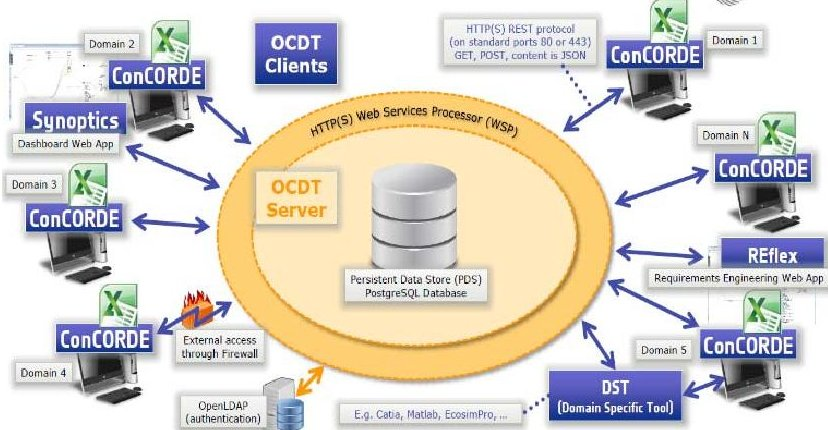

Figure 12 - ESA OCDT Architectural Overview

OCDT implements a 3-tier client / REST API web service / database server software architecture. The main end-user client is an add-in for Excel (called ConCORDE) with the particular intent to make the user interface as easy to use as possible and provide direct interaction with Excel worksheet for simple modelling. For more sophisticated modelling other computer aided engineering tools can be integrated via the REST API. All clients synchronize twice a minute with the OCDT server allowing for near real-time collaboration. There is additional functionality that lets end-users pull and push information on demand into their modelling tool so they can control when they are ready to take or

release new data. Currently alpha version bi-directional interfaces with Catia, Matlab and (MagicDraw) SysML exist and more integrations are foreseen.

The focus of the CDF is therefore rapid prototyping and trade-off studies, and it relies heavily on an efficient data transfer between domains. The output of a CDF study is collected as a study report that forms the basis for the definition phases (Phase A/B1). Traditionally, the generated data model was not transferred or re-used at later phases.

## B. Definition and early design phases: Phase A/B1

During the initial design phases, there is a need to refine and consolidate the stakeholders needs and requirements. In ESA science missions this is a iterative process involving both the science community and the engineering groups. Along this process, a great number of assumptions and considerations are made to refine and converge on the wording of requirements and on a set of mission architecture choices (single or multiple spacecrafts, split between data processing on orbit and on-ground, synergies with existing missions/data, etc). The collection and maintenance of the complete set of assumption and justifications for the chosen selections is the responsibility of the mission SE function. It usually takes the form of a set of reports, spreadsheets, simulations, code snippets, etc., that, -in the best of cases are collectively compiled in a Requirements/Design Justification File. This paper based approach is in many cases sufficient to maintain control of the system and requirements interactions and relationships. However, as the number of interrelating elements and/or parameters grows, the efficiency of this concept decreases at a fast rate. Additionally the risks of missing interactions and propagating errors due to inconsistent information/data duplication increases significantly. The ESA Science Euclid mission decided to adopt a MBSE approach [12] to control requirement flowdown and architecture selection during Phase B1 at mission level to address the complexity. This model evolved and was further adopted for the Phase B2/C/D/E and is briefly discussed in section IV.C.

The start of the design phases introduces also additional organizational complexity factors inherent to the procurement philosophy of ESA missions. Typical science missions are led by ESA and developed with a combination of (a) industrial procurements for the platform elements, (b) scientific payloads provided by nationally funded research institutes and space Agencies and (c) ground segment elements and infrastructure managed by ESA. This multiple actor configuration is maintained until the project end and creates the need to establish a common denominator with regard to data exchange and interface, but also to processes interfaces. In addition, during Phase A/B1 the process is even more complex since several parallel competing contracts are normally awarded for the items under industrial procurement. To deploy MBSE effectively, it is necessary to understand how to establish common practices or exchanges, but also to manage it contractually $ ^{8} $

As a pilot, a Model-Based System Engineering concept to design the e.Deorbit mission since its Phase A to Phase B1 was selected by ESA [7,17] to understand the benefits and the implications with respect to the work of industrial contractors. Three industrial Phase A contracts were awarded by ESA to each of the European Large System Integrators (LSIs), namely Airbus Defense and Space (ADS), OHB and Thales Alenia Space (TAS). The contractors were requested to use MBSE for modelling requirements and both the physical and functional architectures. No

<!-- PDF_PAGE: 13 -->

methodology or tool was imposed and the specification of the task was left fairly open to allow the major industrial players to present their preferred methodology and process. Three different methodologies and approaches were used in Phase A: OHB used the STRATA $ ^{\circledast} $ methodology from Vitech Corporation [24] integrated in their CORE tool; Thales Alenia Space (TAS) employed the ARCADIA methodology [16] to derive the system analysis, logical and physical architecture and Airbus Defense & Space selected SysML as the representation language. In all cases requirements were not integrated in a single modelling environment at this stage, but kept separate. Further work in Phase B1 was followed by two consortiums lead by ADS and OHB that extended the modelling in the behavioral domain. The e.Deorbit Phase B1 was completed at the beginning of 2017 and a full summary of the modeling tools, products generated and lessons learned can be accessed in [17]. We highlight a couple of take-away messages from the conclusions:

- The activity showed the natural tendency to use different tools in parallel for different modelling purposes, and the need to harmonize the interfaces, data exchange processes and as a consequence, on the underlying data model.

- The project tried to perform reviews (following the traditional gate based development) using the provided models with limited success. Involvement of external experts through direct inspection of the system representations in models with a particular notation require considerable learning. It was clear from the experience that the interaction with the model for non-practitioners cannot be directly from the modelling tools but rather including dedicated views tailored to specific domains.

## C. Development Phases: B2/C/D/E

## MBSE at mission level

One common criticism given to the application of MBSE, is the unknowns on the scalability of MBSE practices in large-scale projects. The ESA Science Euclid mission decided to continue the MBSE approach [12] started with requirement management in Phase B1 and extended it to architecture selection, verification and operations definition to deal with the complex interrelationship between the different contributors to the system performance and the number of involved stakeholders. System Modelling Language (SysML) was selected to build a representation of the system and capture the complete traceability of the mission break-down, from science objectives to verification and full life-cycle planning. This was, the first application of MBSE in an running ESA science project in development and it has generated an important number of lessons learned and recommendations for modelling in future missions which were reflected in the generation of the ESA SysML Toolbox described in section III. Figure 1312 shows some sample diagrams from the Euclid SysML model (See [12] for a full description of the level of modelling implemented for Euclid and for readable versions of the images).

<!-- PDF_PAGE: 14 -->

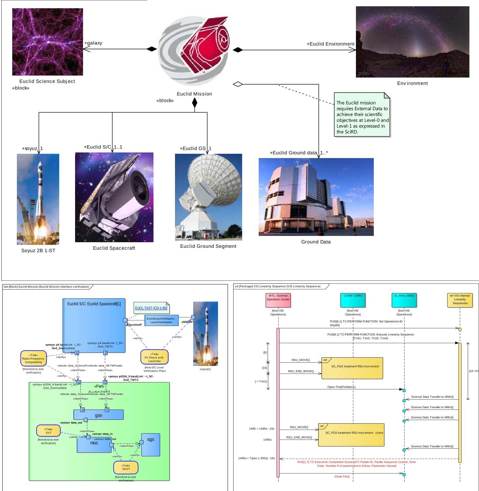

Figure 13 - Euclid mission modelling samples (images reduced for illustration purposes, not intended to be legible)

The MBSE approach in the Euclid instance was not imposed across the full set of partners, which required the definition of: (a) interfacing elements to communicate between different sources of information (e.g., DOORs to SysML for requirements, Excel verification databases to SysML, etc); (b) a robust infrastructure allowing concurrent working by remotely located teams was developed leading to a cloud-based repository; (c) visualization tools for external users. We will come back to this aspects in sections V and VI.

The Euclid MBSE process followed several refinement iterations and continues evolving but has allowed to set initial guidelines for SysML modelling. The ESA PLAnetary Transit and Oscillations (PLATO) mission also adopted the approach based on the Euclid experience and will extend the scope to evaluate the integration with other models (non-SysML) with industrial partners.

These activities cover both the mission aspects with a focus on the space segment. Work is also underway on the ground segment to incorporate MBSE.

<!-- PDF_PAGE: 15 -->

## Deploying MBSE in Ground Segment Engineering

The operational ground segment for a space mission contains all elements required to command and control the spacecraft, including software, hardware, operations concepts, and procedures. Engineering the ground segment for a space mission is a very complex endeavor, with the final product needing to comprehensively satisfy the stringent requirements of the mission. The ground segment engineering lifecycle is a formalized as an ECSS standard [23]. Given the complexity of a mission ground segment, the introduction of MBSE is envisaged to be a natural evolution of the traditional engineering practice, in particular since it is not in conflict with [25]. In the context of the Euclid mission we are currently in the process of developing a paperless Ground Segment Engineering Framework (GSEF) which will implement major MBSE elements and will serve as a proof-of-concept. Following an initial assessment, it was decided that a bottom-up approach towards MBSE would be most successful. This approach is conceptualized around the need of the Operations Ground Segment (OGS) system engineer, who is responsible for the whole ground segment engineering at system level. Reflecting the bottom-up approach, one of the main requirements of this activity was to abstract the complexity of MBSE, in particular the underlying data model and associated modeling language, as much as possible through an easy-to-use software interface.

The ground segment engineering processes (as defined in [25]) have been analyzed to identify the key workflows and roles that the GSEF would need to support. These workflow are supported by key capabilities of the framework:

- Data import: existing engineering data from source documents and/or other tools

- Model editing: the capability to intuitively edit the model in order to develop the system architecture

- Model querying: Completeness, integrity and rules checking

- Collaborative and concurrent engineering: support to associated workflows & model-centric review processes

- Methodology: support to a model-centric implementation of the ECSS E-70 processes

- Management of informal information: model annotations/comments, user forums and discussions, notifications

- Glossary: Definition and management of terminology/acronyms

- Existing engineering tool integration: DOORS, Jira, HP Quality Centre etc.

- Configuration control: Support to multiple design and review baselines, branching and merging

- Systems engineering data model: Functional architecture components, interfaces, tests, requirements, processes

- A subscription/notification model for users to manage changes to the system model

- Access control, permissions and authorization: role hierarchies, mapping to data and approval workflows

- Enterprise-scalability: web-based application, highly scalable performance and architecture

In order to implement the framework requirements outlined above, a number of existing solutions have been analyzed with the intention to re-use as much as possible existing capabilities. Based on the user requirements and the results of the solution assessment, an architectural design and data meta-model for the GSEF is being created in line with the Euclid mission requirements. For the modelling capabilities, via a web UI, the user can login, explore and add projects in a project explorer tree. The tree allows adding different engineering data items such as requirements, components, interfaces, processes, tests. Implementation of a dependency graph for dependency analysis, based on outgoing and incoming references, is foreseen. Diagramming, depicting the system architecture, relationships and cross-cutting views, are supported and are backed by the data model. The engineering data model is defined through an EMF Ecore meta-model, with data stored as associated EMF files. This provides flexibility and the potential for future integration and interoperability with other solutions, pending creation of inter-model mappings and adapters. Configuration control, dedicated reviews, subscriptions etc. are supported via JGit and Git-related features (local/central repositories, branching, cloning, commits). For collaborative engineering capabilities, the demonstrator will address the following major scenarios: (i) free discussions on engineering data model entities; (ii) change review and approval, e.g. for delegated items; (iii) reviews, including major milestone reviews as defined in the ECSS processes. The collaboration features are inspired by JIRA and GitHub and include features such as notifications, labels, status information, creation of actions etc.

Figure 14 shows and example of the current version of the GUI and its focus on representing abstract model relationships in the most simplified way possible. In this example the ground segment engineer is defining an interface

<!-- PDF_PAGE: 16 -->

between two ground segment components (the data distribution system and the science operations ground segment). The GUI can express this interface in terms of different views (requirements view on the left, data flow view on the right).

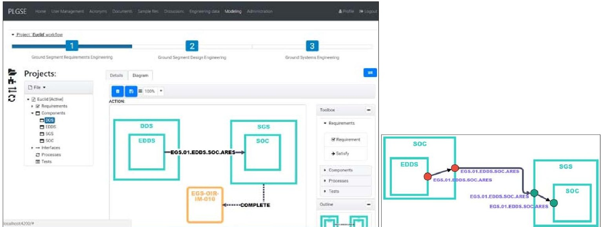

Figure 14 - GSEF GUI Example - interface as link and satisfy requirement (left), data channeling through ports (right).

Once the GSEF has been successfully demonstrated with Euclid as a use case, it is foreseen to develop a fully operational version of it and then also deploy it for other future mission ground segments. At the same time, the scope of the GSEF will be widened to cover also operations and dismissal phases E/F and support the pre-phase A ground segment inputs to the CDF activities. Another key area of focus will be on developing full meta-model compatibility with space segment, payload data ground segment, and industry modelling activities. The final vision is to fully move away from the production of documents in the context of ground segment engineering. This may also require an update of the applicable engineering standards.

## D. Operations and dismissal: Phase E/F

The current GSEF activity discussed above will support a limited number of use cases covering Phase E/F activities, such as anomaly and problem reporting and reviews, configuration control and change requests. In the future, it is foreseen that the GSEF will also support Operations Engineering activities, and other initiatives have started to move in this direction. One of the principal difficulties here is that the modelling of roles and procedures becomes much more prominent. This is also a very established, traditional and review-intensive engineering domain, which relies on multiple data sources from other domains, data which is carried forward from previous phases, and involvement of a large number of teams and stakeholders. A significant challenge is foreseen here to both extend the GSEF and to capture all necessary data from across the lifecycle and other domains, in a way such that MBSE can replace the traditional engineering practices with minimal disruption and add significant value.

## V. Interfaces and Data Continuity

The future development and integration of these pilot digital engineering practices across the different phases requires standardization of interfaces and an infrastructure framework for data exchange that allows independence from the modelling language and tool selection. Across the different activities presented in the previous sections, we can identify already a handful of separate conceptual data models used for the representation of the space systems elements and artifacts: e.g. the SysML ESA metamodel and representation, the OCDT data model based ECSS-E-TM-10-25, the generic data model used in Virtual Spacecraft Designer based on ECSS-E-TM-10-23A, the ARCADIA Modelling Language, requirements representation in DOORs, the Vitech CORE Language considered by OHB in

<!-- PDF_PAGE: 17 -->

Phase A of e.Deorbit, etc... And we have merely described a few activities in the European context. Very significant work has been done in other space projects by NASA, based on SysML, for example that we will not go into. Many of these representations have common characteristics, and it is important to converge and (ideally) reached standardization around a common Conceptual Data Model. This common core model should establish the foundation to build data-hubs or data repositories from which different views can be extracted across domains.

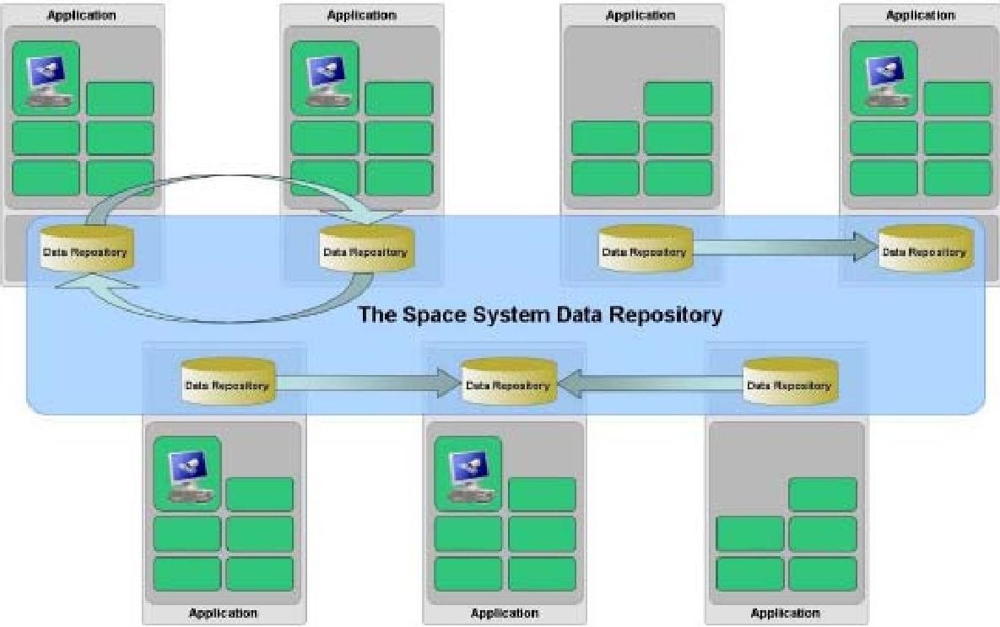

Figure 15 - Data Hub concept

Several activities in parallel are addressing the definition of a conceptual data model, in some instances independently and in different directions:

- Evolution of ECSS to full semantic data models based on ECSS-E-ST-TM-10-25A and ECSS-E-ST-TM-10- 23: These Technical Memoranda establishes a formal specification of the semantics of the engineering data in order to enable the creation of engineering data repositories with standardized data exchange interfaces a so-called space system data repository thereby allowing semantic interoperability between data repositories managed by different stakeholders. Semantic interoperability is understood as a common agreement among stakeholders not only on the encoding and naming of elements but also on the precise concrete meaning of the data exchanged. In this sense, TM-10-23 and -25 achieve only a "weak" semantic interoperability that allows an easy technical integration of tool implementations but does not necessarily guarantee a semantically correct integration. This is, in general, an open problem. TM-10-23 data model is used as basis for the Virtual Spacecraft Design databases, and the RangeDB solution by Airbus Defense and Space. The TM-10-25, as mention is the backbone of the OCDT solution.

- Model-Based Requirements Verification Lifecycle - (MRVL) Common Information Platform (CIP): an ongoing activity at ESA for facilitating and organizing information exchange between stakeholders at any level in the supply chain across the full lifecycle of a space mission and to be used as a data sharing hub for multiple participating engineering disciplines based evolved from TM-10-23.

- EGS-CC CDM [28]: The European Ground Systems - Common Core (EGS-CC) is a European initiative to develop a common infrastructure to support space systems monitoring and control in pre- and post-launch phases for all mission types. The EGS-CC includes a Conceptual Data Model (CDM) which defines the data needed to operate an EGS-CC based system. The EGS-CC CDM is an evolution of the 10-23 CDM. This initiative has a significant support from the European Industry, and although focused on ground segment, the CDM can be extended to cover the required aspects for systems modelling.

- SysML 2.0: A SysML $ ^{\circledR} $ v2 Request For Proposal was issued at the end of 2017containing the requirements for the next-generation systems modeling language, which is intended to improve the precision,

<!-- PDF_PAGE: 18 -->

expressiveness, and usability. SysML 2.0 is an initiative with participation of most MBSE tool vendors industry and Agencies including ESA where it is contributing its MBSE experience. Progress on SysML v2 is very promising, but actual deployment in tools and application to real projects cannot be expected before 2020.

At the current stage all of these work is progressing in parallel and it is not clear which of them will develop into a standard for the community, but the level of high activity is a good sign of the momentum building around this open problem.

In the interim, specific "one-to-one" solutions are implemented to overcome the interfacing problem and allow work to progress. In the Euclid and PLATO cases, for example, a number of different models co-exist and include translation stages and import-export add-ins incorporated to interface between them. At the core of the model we established two information sources: the SysML model with the requirements, architectural, functional and behavioral representation of the system, and a parameter database, part of the science data archive with a dedicated data model to store engineering data (in multiple formats, like values, curves, images, etc), science parameters and in-general all required data to be exchanged between different actors for analysis and simulation. Interfaces to the two databases includes direct SysML tool clients, DOORs exchange for requirements with the Prime and one instrument team through the use of ReqIF and dedicated APIs created in C++ and Python for the parameters database data model access to be used directly in analysis scripts and tools.

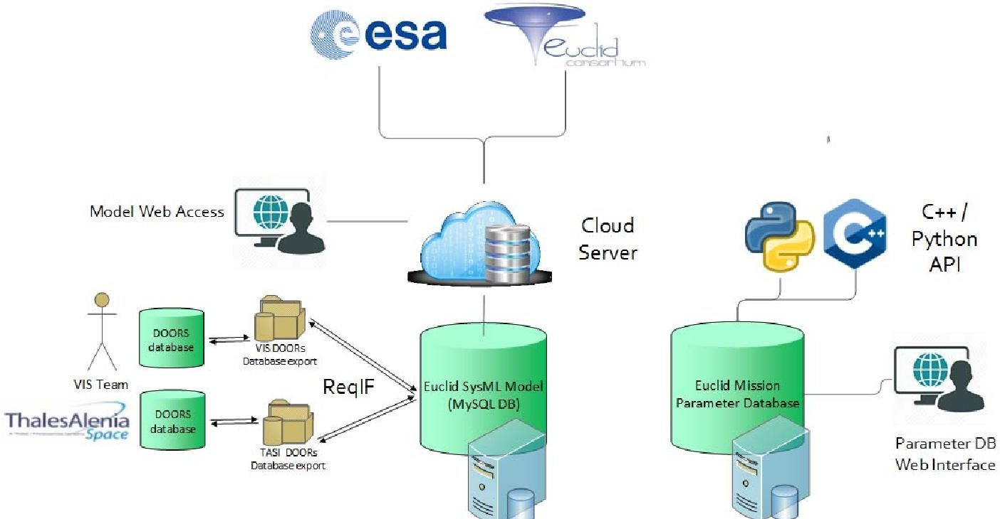

Figure 16 - Euclid MBSE model interfaces and access

## VI. Usability and interaction with the model

Finally, we would like to briefly mention the evolution and current efforts to improve access, usability and user interaction with models. This includes the lessons learned from the e.Deorbit and Euclid programs, where one of the major difficulties identified by users not familiar with modelling concepts is the learning curve required to adjust to the nomenclature and semantics. All modelling languages have a strong foundation on information system models and the software domain (e.g., SysML and UML). Information that can appear obvious and intuitive for the experience practiconer just looks messy to external reviewers trying to understand it in a short time. A study on the problems faced by MBSE adoption [15] highlighted that "bad experiences and frustration about MBSE adoption originate from false or too high expectations". The expectations are commonly for an increased clarity and simplicity to tackle complex information, therefore and initial encounter with a model directly can lead to frustration and close the door

<!-- PDF_PAGE: 19 -->

to a detailed understanding of the benefits. We present a couple of examples of the work done in these areas for Euclid and the Ground Segment Engineering Framework.

## Usability and support of reviews with the Euclid System Model

To address these issues, in Euclid it was attempted to provide access mechanisms for external users that will hide the complexity of the modelling language. As shown in Figure 16 Web Access functionalities have been implemented that allow navigation through diagrams and commenting, without knowledge of SysML. Also, to support reviews [30], it was decided to organize the exploration of documentation around the Euclid model: existing diagrams taken "as is" from the model as well as diagrams specifically created to support the review were used to create a website providing enhanced navigation capabilities through the data pack, supporting the user access and interpretation of relevant information. The diagrams are decorated with text, images and hyperlinks. As an example see Figure 17, where the architectural context with links to different SysML diagrams guides the user through the model. Separate section for Interfaces provided links to the various interface perspectives (Structural/Mechanical, Electrical, Signal, Thermal).

NISP architecture

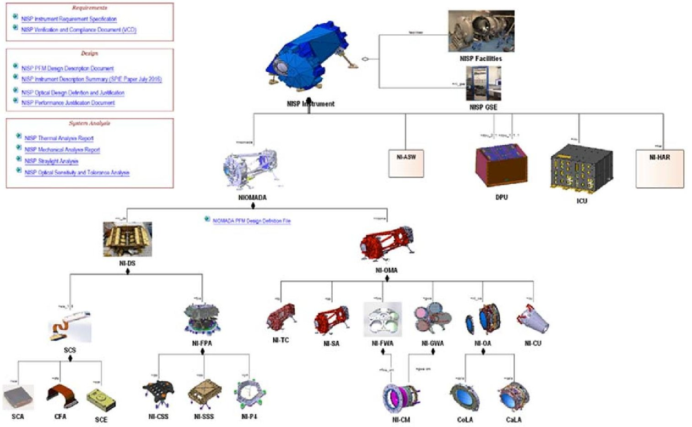

Figure 17 - Sample review datapack with SysML diagrams

The mixed documentation and linked diagrams approach was well received by reviewers and the work focused on the evaluation of critical elements and results rather than on the understanding of the system.

## Usability and accessibility in the Ground Segment Engineering Framework

As mentioned already above, usability and accessibility were key requirements for the development of the GSEF. This was a consequence of the multiple lessons-learned and experiences made by ESA and other organizations when trying to spin-in MBSE approaches into their engineering activities. The reason for non-acceptance or failure was

<!-- PDF_PAGE: 20 -->

usually related to accessibility. System engineers without a modelling background that are confronted with a top-down MBSE approach face an extreme learning curve. This, combined with the fact that such MBSE approaches often demand a significant up-front investment and delayed ROI, leads to a rejection of the concept not only by the engineers, but also by management.

For these reasons, the GSEF project implements a bottom-up approach which follows an iterative, agile development and which will introduce MBSE gradually via an easy-to-use UI that delivers direct benefits to system engineers, whilst maintaining a formal system model "under the hood".

## VII. Conclusion

Although MBSE still has many hurdles to overcome, the authors expect it to stay and gradually become THE normal way of doing systems engineering. MBSE is starting to fulfill its promise of seriously raising the efficiency and precision of capturing the problem specification and architectural design of a space mission and all the associated bookkeeping with respect to interface definition, verification and validation, trade-offs, etc. Different views and reports can be generated from a single source of truth, and they are consistent by construction. This alone is a major benefit.

SysML has been demonstrated to yield real benefits in a full ESA project, namely Euclid, but a significant dedicated effort was needed to develop a dedicated SysML profile as well as additional examples and patterns (called the ESA SysML Toolbox) in order to make it usable and more intuitive for space system engineers. The raw SysML standard has too steep a learning curve and does not provide easily understood system modelling terminology and concepts to be immediately practical. ESA will continue to further evolve this profile, methodology and associated MBSE Best Practices.

Finally, the authors emphasize the need (a) to achieve a coordinated approach in the MBSE community at large to define a conceptual data model to standardize the interface and exchange of information and (b) to progress on the areas of automated visualization, user interfaces and tooling to facilitate the access to information in models.

<!-- PDF_PAGE: 21 -->

## References

[1] Badache, N., Roques, P., "Capella to SysML Bridge: A Tooled-up Methodology for MBSE Interoperability". 9th European Congress on Embedded Real Time Software and Systems (ERTS), Toulouse, France, 2018.

[2] Bandecchi, Massimo, et al. "The ESA/ESTEC concurrent design facility." Proceedings of EUSEC 9, 2000.

[3] Biesbroek, R., Innocenti, L., Wolahan, A., & Morales Serrano, S. M.. "e. Deorbit—ESA's Active Debris Removal Mission." Proceedings of the 7th European Conference on Space Debris. ESA Space Debris Office, 2017.

[4] Eisenmann, H., "MBSE Has a Good Start; Requires More Work for Sufficient Support of System Engineering Activities through Models", Insight Vol. 18, Issue 2, 2015, pp. 14-18. doi: 10.1002/inst.12014

[5] ECSS secretariat: ECSS-E-TM-10-25A - Space Engineering - Engineering design model data exchange (CDF). ESA- ESTEC Requirements and Standards Division, Noordwijk, Netherlands (2010)

[6] ECSS Secretariat: ECSS-E-TM-10-23A - Space Engineering - Space system data repository. ESA-ESTEC Requirements and Standards Devision, Noordwijk, Netherlands (2011)

[7] Estable, S., Granger, T., Lochow, T., Zoebelein, T., Brauer, N., Tolchinsky, I., Generé, S. & de Koning, H-P., "Systems Modelling and Simulation of the ESA e.Deorbit Space Debris Removal Mission", NAFEMs, 2017.

[8] Fischer, D., Keck, F., Spada, M., Wallum, M., & Stoitsev, T.. "Leveraging MBSE for ESA Ground Segment Engineering: Starting with the Euclid Mission", 2018 SpaceOps Conference, SpaceOps Conferences, (AIAA 2018-2572) doi: 10.2514/6.2018-2572.

[9] Gianni, D., Lindman, N., Fuchs, J., & Suzic, R. (2012). Introducing the european space agency architectural framework for space-based systems of systems engineering. In Complex Systems Design & Management (pp. 335-346). Springer, Berlin, Heidelberg.

[10] Hale, J.P., Zimmerman, P., Kukkala, G., Guerrero, J., Kobryn, P., Puckek, B., Bisconti, M., Baldwin, C. & Mulpuri. M. "Digital Model-Based Engineering: Expectations, Prerequisites, and Challenges of Infusion", NASA/TM-2017-219633.

[11] de Koning, H.P., Gerené, S., Ferreira, I., Pickering, A., Beyer, F., Vennekens, J.: Open concurrent design tool - ESA community open source - ready to go! 2014. [Online]. Available: http://esaconferencebureau.com/docs/defaultsource/14c08_docs/open-concurrent-design-tool—esa-community-open-source-ready-to-go!.pdf. Accessed 27 Jan 2017

[12] Lorenzo Alvarez, J., Metselaar, H., Amiaux, J., Saavedra Criado, G., Gaspar Venancio, L.M., Salvignol, J-C., Laureijs, R. J. & Vavrek, R., "Model-based system engineering approach for the Euclid mission to manage scientific and technical complexity", Proceedings SPIE Modelling, Systems Engineering and Project Management for Astronomy VI, Vol. 9911, 2016.

[13] Metselaar, H., Lorenzo Alvarez, J., Kretzenbacher, M., "Model based instrument review for the Euclid mission for NISP and VIS CDR" Simulation and EGSE for Space Programmes (SESP), 2017.

[14] Roques, P., "MBSE with the ARCADIA Method and the Capella Tool." 8th European Congress on Embedded Real Time Software and Systems (ERTS 2016). 2016.

[15] Vogelsang A., Amorim T., Pudlitz F., Gersing P., Philipps J. "Should I Stay or Should I Go? On Forces that Drive and Prevent MBSE Adoption in the Embedded Systems Industry". In: Felderer M., Méndez Fernández D., Turhan B., Kalinowski M., Sarro F., Winkler D. (eds), Product-Focused Software Process Improvement. PROFES 2017. Lecture Notes in Computer Science, vol 10611. Springer, Cham, 2017 doi: 10.1007/978-3-319-69926-4 14

[16] Voirin, J-L., Model-based System and Architecture Engineering with the Arcadia Method, Elsevier, London, 2018.

[17] Wolahan, A., Biesbroek. R., Innocenti, L., Morales Serrano, S. and de Koning, H-P., "Model Based Systems Engineering Applied to ESA's e.Deorbit Mission", 68th International Astronautical Congress (IAC), Adelaide, Australia, 2017. [18] ESA. "The Virtual Spacecraft Design Project" https://www.vsd-project.org/

[18] ESA, "The Virtual Spacecraft Design Project", https://www.vsd-project.org/

[19] Eisenmann, H., Basso, V., Fuchs, J. & De Wilde, D. "ESA virtual spacecraft design." Proceedings of the 4th International Workshop on System & Concurrent Engineering for Space Applications (SECESA), 2010.

[20] “Survey of Architecture Frameworks”, http://www.iso-architecture.org/42010/afs/frameworks-table.html

[21] “SysML Open Source Specification Project”, SysML v1.3, http://sysml.org/docs/specs/OMGSysML-v1.3-12-06-02.pdf

[22] Racca, G., Laureijs, R., Stagnaro. L., Salvignol, J-C., Lorenzo Alvarez, J., Saavedra Criado, G., Gaspar Venancio, L.M., Short, A., Strada, P., Bönke, T. & Colombo, C., "The Euclid Mission Design", Space Telescopes and Instrumentation 2016: Optical, Infrared, and Millimeter Wave, vol. 9904, 2016.

[23] Capella, available at https://www.polarsys.org/capella/

[24] Vitech Corporation, STRATA: Driving Consistent Project Success, http://www.vitechcorp.com/solutions/strata.shtml

[25] Carlson, R. & Montgomery, P., "DoD LSI Transformation: Creating a Model-Based Acquisition Framework", Proceedings of the 11th Annual Acquisition Research Symposium, Naval Postgraduate School, 2014

[26] European Cooperation for Space Standardization (ECSS) (2008). Space Engineering - Ground systems and operations, ECSS-E-ST-70C.

[27] Hoppe, T., Eisenmann, H., Viehl, A. & Bringmann, O., "SEMF - The Semantic Engineering Modelling Framework", Proceedings of the 5th International Conference on Model-Driven Engineering and Software Development, 2017.

[28] ESA, The European Ground Systems - Common Core (EGS-CC), http://www.egscc.esa.int/about.html

[29] OMG, SysML v2.0, http://www.omgsysml.org/SysML-2.htm

[30] Metselaar, H., Lorenzo Alvarez, J., Kretzenbacher, M., "Model-based instrument review for the Euclid mission for NISP and VIS CDR", Workshop on Simulation and EGSE for Space Programs, 2017

<!-- PDF_PAGE: 22 -->

