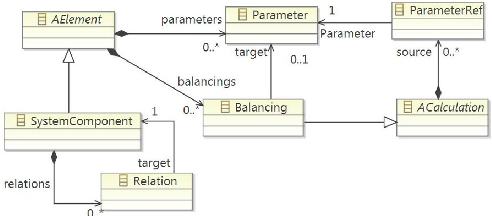
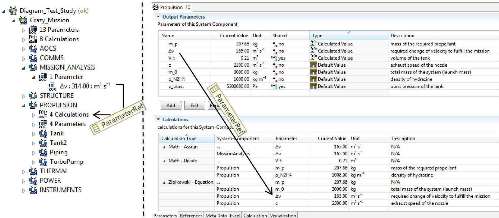
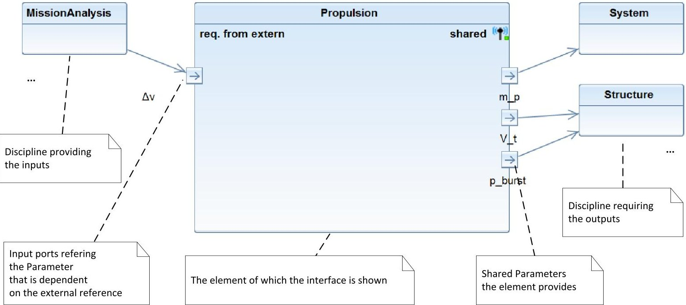
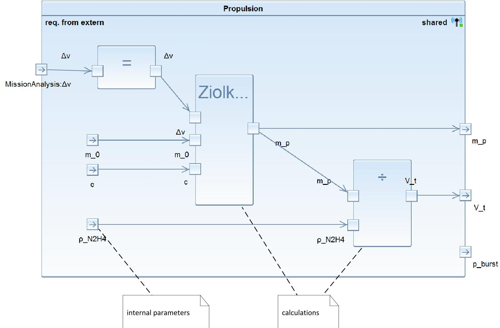
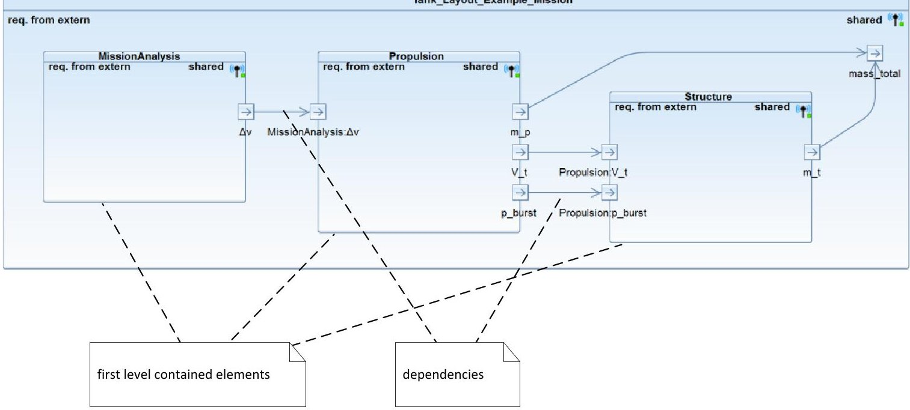
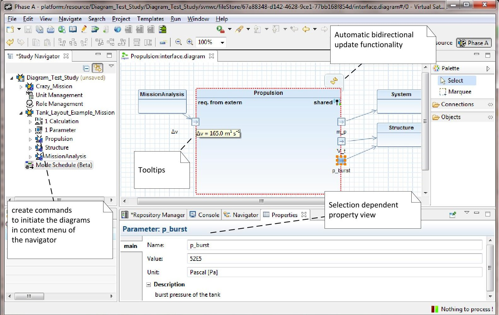

<!-- PDF_PAGE: 1 -->

# BIDIRECTIONAL GRAPHICAL MODELING SUPPORTING CONCURRENT SPACECRAFT DESIGN

- SECESA 2014 -

08-10 October 2014

Vaihingen Campus, University of Stuttgart, Germany

Volker Schaus $ ^{(1)} $ , Juliane Muller $ ^{(1)} $ , Meenakshi Deshmukh $ ^{(1)} $ , Andy Braukhane $ ^{(2)} $ , Andreas Gerndt $ ^{(1)} $

$ ^{(1)} $German Aerospace Center (DLR), Simulation and Software Technology Lilienthalplatz 7, 38108 Braunschweig, Germany Email: volker.schaus@dlr.de Email: juliane.mueller@dlr.de, Email: meenakshi.deshmukh@dlr.de Email: andreas.gerndt@dlr.de

$ ^{(2)} $German Aerospace Center (DLR), Institute of Space Systems Robert-Hooke-Str. 7, 28359 Bremen, Germany Email: andy.braukhane@dlr.de

## ABSTRACT

A graphical representation of the system under design in form of diagrams is a powerful way to present complex relationships. Diagrams appear in almost every concurrent design activity in some way sooner or later in the process Generally they help to explain the design or give an overview so that the other stakeholders can quickly understand a (sub-) system build-up or a proposed solution. Furthermore diagrams are also important for documentation purposes (presentations, reports, interface control documents). Typically the diagrams are made in some external tool and the content is not linked to the constantly changing system model. Especially considering the fast pace of concurrent design studies, such diagrams become quickly inconsistent and outdated, thus breaking the model-based paradigm. This is the motivation for the work presented in this paper to include basic support for graphical modeling within the Model-based System Engineering tool called Virtual Satellite. The paper presents three different diagram types, explains their content and relevance for concurrent engineering sessions. It further mentions implementation details and the used technologies to include bidirectional graphical modeling editors in the Virtual Satellite software.

## INTRODUCTION

Since some years now the German Aerospace Center (DLR) uses an in-house developed software to support their concurrent spacecraft design projects. Similar than in other organizations the projects are carried out in a special facility, in this case namely the Concurrent Engineering Facility (CEF) at the Institute of Space Systems in Bremen, Germany [1]. The software which is now regularly used is called Virtual Satellite and aims to nurture Model-based Systems Engineering methodologies [2]. It was developed by the Institute of Simulation and Software Technology in close cooperation with the colleagues on-site at the CEF. The motivation to develop a diagram component came up during accompanying many design sessions. Our observation was that diagrams are frequently used to describe certain aspects of the design. They appear in final presentations to describe the working principles of a certain subsystem; they are used in Interface Control Documents (ICDs) to clearly specify the interfaces of the components. They are often created in external tools; the contained information is not linked to a central model and therefore the diagrams have to be updated manually, which is tedious and error-prone.

Without doubt, diagrams have major advantages for systems engineering. They can give overviews over complex relationships and are easily understandable by other members of the design team. Thus, they can be used very well for discussions, documentation and monitoring the interfaces of the system under development as was found during a shadow modeling project on an actual space mission at DLR [3]. In the same project, another aspect was, to use the general purpose graphical modeling language SysML [4] [5], which is especially designed for describing systems with models and diagrams. It is stated in the publication that a difficult learning curve was seen for unexperienced modellers and it required considerable time and resources to develop an effective model. In an attempt to apply SysML to early space mission design, the European Space Agency (ESA) gives a similar statement saying that many of the activities required a significant time effort with too little added value [6]. ESA also developed a design tool with a whole set of graphical editors in the Virtual Spacecraft Design (VSD) project. They use SysML like notations and cover a wide range of purposes such as the topological breakdown, the functional design, the description of the activities of the spacecraft, and a diagram explorer for browsing the design [7] [8]. The graphical editors are directly integrated in the

<!-- PDF_PAGE: 2 -->

software suite and are always showing the actual state of the model. This allows effectively working in a model-based way.

Since the model of VSD focusses more on later phases and the related data model for early phases [9] together with a the corresponding Open Concurrent Design Tool (OCDT) is still under development [10], it was decided to base the diagram implementation in Virtual Satellite on the existing data model. This gives the advantage of having full control and flexibility for the development.

The existing data model used to describe the space system is capable of defining SystemComponents which can have relations to other SystemComponents. The relevant parts of the data model are depicted in Fig. 1. Basically it is possible to define relations in two different ways. The first method is to create direct links between SystemComponents by using parent-child relations. This is usually used to split up the system in functional subsystems which is called functional decomposition. Such inheritance relations are typically displayed as trees. The software Virtual Satellite has a build in navigator view that displays this system tree. This view gives the user a direct overview of the hierarchy.

The second way of creating relations between the SystemComponents is more indirect. The data model allows defining Parameters and Calculations. With this additional information it is possible to access Parameters from other components or disciplines in a Calculation. A special class type called ParameterRef is used to store these relations in the model. From a systems engineering perspective it is important to be aware of these dependencies between the disciplines, to monitor and question them, if necessary. These relations are currently not easily visible. A simple example is given on the left hand side of Fig. 2. It shows a typical decomposition of the system with various subsystems. Mission analysis in this case provides the necessary velocity change $ \Delta v $ for the mission. This is used by the propulsion expert to dimension the tank of the propulsion system. So the link in the data model is created and the information is stored. However, in the current implementation it is not easily seen. Especially for the systems engineer it is very difficult to trace the values and interdependencies between the disciplines. Even in the standard editor for SystemComponents it is currently difficult to see the connections.

Fig. 1: Relevant elements of the data model in Virtual Satellite defining SystemComponents, Parameters, Calculations and the possible relations/references.

Fig. 2: The left hand side shows a functional decomposition of a system in a tree view. The right hand side shows the standard table editor of Virtual Satellite used for defining Parameters and Calculations. In both cases connections and links (ParameterRefs) between subsystems and disciplines are hard to trace.

<!-- PDF_PAGE: 3 -->

The editor is based on tables organized by categories. The right hand side of Fig. 2 shows the two relevant sections of the editor, one table listing the parameters and the second listing the calculations. In the list of parameters, there is one column which gives the type of the value. This is at least a hint for the user stating the nature of the value (entered manually or calculated by an analytical equation or external tool). Yet, it remains difficult to check the sequence of calculations, the information flow, the dependencies and connections between parameters and the calculations as indicated by the arrow pointing from a Parameter to a Calculation where it is referenced.

## DEVELOPMENT OF THE DIAGRAM TYPES

This section presents the three diagram types that have been developed and integrated in the software so far. In order to understand the content of the diagrams more easily, the diagrams use a common design example as a test case. The example is the dimensioning the tank of a spacecraft which is a typical recurring task in spacecraft design. It covers three expert domains in sequence:

1. Mission analysis runs certain orbit simulations to determine the total change of velocity $ \Delta v $ required to fulfill the mission with all necessary maneuvers.

2. The propulsion expert takes this value as input for the rocket equation. Selecting the type of propellant, and considering the performance of the jet nozzle it is possible to calculate the required volume of the tank.

3. The third step is to deal with structural aspects of the tank. The structural expert together with the propulsion expert choses an appropriate shape for the tank (e.g. a spherical or cylindrical), the working principle (e.g. a pressurized bladder tank), the material and can calculate the mass of the tank in the end.

The above numeration introduces the example just in brevity. The full design example with the analytical equations and detailed explanations of the parameters involved is given in [11]. However, for understanding the content of the diagrams it is just important to understand the basic principle behind this design task. There are different domain experts involved; in this particular case three, namely mission analysis, propulsion, and structure. The involved disciplines govern certain parameters which can be shared with others. They also make use of calculations which can depend on the input from other domains.

The first diagram is the interface diagram and is depicted in Figure 3. The centerpiece of the diagram is the element of which the user wants to see the interface. In this case the propulsion subsystem was selected. The diagram is read from left to right. On the left hand side it shows the inputs of the propulsion subsystem which come from other domains (here: $ \Delta v $ from mission analysis). The affected parameter is displayed as an incoming port and the providing domain is given as extra block with an arrow link between the two. On the right hand side, the interface diagram indicates the parameters that this element shares with others. Similar than on the input side the shared parameters are displayed as outgoing port and the link to the domain which uses the parameter. Note that it is of course possible to provide parameters which are not actually used by someone else. In this case the parameter will still be shown as port, but will not have a connection to another domain.

In a concurrent design study the interface diagram will be used for monitoring the interface and quickly checking the dependencies of an element. This is most important on subsystem level of the functional decomposition of the system because this is typically where the change of responsibilities is realized. As the name implies, the interface diagram only shows the incoming and outgoing connections and does not reveal any internal information. This is the purpose of the diagram, the internal block diagram.

Fig. 3: The interface diagram with annotations explaining the different parts.

<!-- PDF_PAGE: 4 -->

The internal block diagram shows the internal flow of information within the selected element. Figure 4 shows this type of diagram again with the content of the example case of dimensioning the tank of a spacecraft. The large main block shows the same information than the interface diagram, its name and the input and output parameters of the element. Additionally it shows how parameters and calculations are connected and how the information is processed internally. Calculations are shown as internal blocks, again with inputs and output ports. These block state the type of the equation; in this case they are all built-in equations of the software Virtual Satellite. First an assignment is used to import the $ \Delta v $ This is then used in Ziolkowski's rocket equation in the second block. Finally the volume of the tank is calculated by dividing the mass of the propellant $ m_{p} $ by the density of the selected propellant $ \rho_{N_{2}H_{2}} $ . On the right hand side there is one additional shared parameter, the burst pressure of the tank $ p_{burst} $ . In the example, we assumed that this value will also be provided by the propulsion expert. The diagram shows no connection between this parameters and any calculation which indicates that this value is somehow selected (e.g. using heuristics or datasheets from existing equipment). Still the propulsion expert is responsible for this value.

The first two diagrams are derived from diagram type definitions in SysML. The interface diagram is composed of a selected subset of possibilities in SysML's block definition diagram. It uses block definitions with standard ports and associations to other blocks. The internal block diagram implemented in Virtual Satellite for concurrent engineering has even a corresponding SysML diagram with the exact same name. Again it uses just a subset of the modeling possibilities in SysML. The internal blocks represent the calculations in the data model. Additional we use ports and unidirectional connectors to visualize the flow of information [12] [13].

The third diagram type which was developed is a functional block diagram. It has no direct corresponding diagram type in SysML. However, functional modeling is also widely used in engineering tools, e.g. in MATLAB/Simulink. In this case, the functional block diagram is a diagram type which is solely used on system level. It acts as special aid for the system engineer or the project manager to track the dependencies between the involved disciplines. Fig. 5 depicts the functional block diagram for the tank example. The large main block represents the system. It contains the first level elements, in this case the functional subsystems involved in this design and their inter-dependencies. This view enables a system overview of the dependencies. It can be used to check which other part of the model is potentially affected when a certain parameter changes. Referring to the tank example, if mission analysis changes the demanded $ \Delta v $ , then propulsion and maybe also structure need to review and adapt their design accordingly.

Fig. 4: The internal block diagram with annotations.

<!-- PDF_PAGE: 5 -->

Fig. 5: The functional block diagram with annotations.

## IMPLEMENTATION AND INTEGRATION IN THE VIRTUAL SATELLITE SOFTWARE FRAMEWORK

The implementation section describes the technologies used and gives some insight in the evaluation of technologies with respect to data models and diagrams. The second part of this section explains the integration in the concurrent engineering process. The diagrams are realized as an integral part of the design software and are directly available during the sessions. The initial layout is generated automatically based on the current content in the system model. This is the starting point for the user to modify the diagram according to specific needs. Once created, the diagram is continuously synchronized with the data model. Depending on the user privileges and the type of the diagram, it is also possible to make changes directly in the diagram. The seamless integration in the tool and the bidirectional synchronization offers users yet another possibility (besides textual and form based) to design their system using graphical modeling.

## Implementation and Used Technologies

The software project 'Virtual Satellite' is built on the so called Eclipse Rich Client Platform concept. It uses the Eclipse environment as basis and integrates its own concurrent engineering and systems engineering features on top of this. The programming language is Java. The data model describing the acting objects and logical relations to capture the concurrent design information is defined using the Eclipse Modeling Framework (EMF) [14]. EMF allows to define an abstract meta model in the so called Ecore format. Once defined, the tooling environment of EMF provides Java code generation functionalities. A major advantage of EMF is that it offers a change notification services, thus it is relatively simple for an application to react on changes in the data model. This is especially important for realizing the bidirectional behaviour of a graphical editor for the diagrams.

In the course of this work it was also necessary to select a suitable graphical framework for the diagram implementation. During this process it was necessary to consider certain different aspects like

- Combination and interaction with the existing Ecore model

- Ease-of-use and learning curve at the beginning

- Availability, maintenance, support and maturity of the framework

- Licensing and other third-party library implications

At the end of the selection process we decided to use the graphical tool infrastructure of Graphiti for the diagram editors in Virtual Satellite. The Graphiti project is an Eclipse incubation project and part of the yearly Eclipse release cycle [15]. This means that in terms of licensing and availability the project can be easily combined with the existing Virtual Satellite project setup. Graphiti editors can directly load Ecore models as underlying model resource which makes the combination with the EMF data model more or less straightforward. In terms of usability in the software, we also decided to integrate automatic layouting to arrange the content of the diagrams. We use the KIELER project for layouting of the Graphiti diagrams [16] and the internal structure of the diagram with its shapes, elements and connections is inspired by the Eclispe eTrice project [17]. This approach works in principle, but it needs additional fine-tuning and the definition of more constraints for the layout algorithm to deliver useful results. Please refer to the future work section for more information regarding the automatic layouting.

<!-- PDF_PAGE: 6 -->

The two other options we considered were a tool called yEd Graph Editor of yWorks [18] and the possibility to directly using the Graphical Editing Framework (GEF) and Draw2D library of Eclipse [19].

## Integration of the Diagrams in the Software and in the Concurrent Engineering Process

At the beginning, a design study does not automatically generate all the possible diagrams on all levels. This is left to users to decide which diagrams they want to have on which element of the study. The creation of the diagrams is possible by selecting the element in the Study Navigator view, then going into the context menu and clicking on the appropriate command. The commands in the context menu are only executable when the user has the right privileges to create the diagram for the given element. This is done with an incorporated Role Management concept which is part of the data model. This Role Management is nothing which has been especially developed for the diagrams. It is necessary to manage the distributed collaboration and this is a part of the software since the beginning on. Also, one aspect of the model-based design philosophy is transparency. The way that this transparency is realized is that every participant in the design activity is allowed to see the whole design, but only the expert assigned to a certain part of the model is allowed to make changes. This concept was also applied to the diagrams. Only when one has the correct user rights, it is possible to create and then alter the diagrams. If one has not the correct privileges, one can still open the diagram, see the content, review the design or get inspired by other solutions.

Once executed, the command will create all graphical elements needed and display them in a new editor window. All the three diagram types have an initial layout routine which arranges the graphical elements in an easy readable and understandable way. The diagram files are stored along with the study and linked to the system model. Similar to other external files, such as Excel sheets, the diagram files are also put under version control and are distributed via the central server.

The integration of the diagrams is bidirectional. It means that the graphical modeling editors are available in parallel to the already existing ways of interaction in the software. Changes to the model done in the diagram editors will directly be present in other views, such as the normal table editor or the navigator view. Of course this also works the other way round; if for instance the name of a system component is changed in the navigator, the diagram will automatically receive the update and the corresponding element contour will be highlighted. The software respects the model-viewcontroller pattern [20], thus such functionality is relatively easy to achieve. However, looking at it from the usability perspective, this full-fledged integration offers the participants of concurrent engineering sessions a lightweight entry possibility in graphical modeling. During a study, the users can initiate the diagrams and then explore the options and advantages themselves at their own pace respecting their preferences. The smooth integration makes it relatively easy for unexperienced users to do the first task in the graphical model and in result flattens the learning curve. The fact that the diagrams are automatically generated upon user request makes the advantages of diagrams accessible with little extra effort.

The integration of the diagram editor is further enhanced by using some of Graphiti's extension possibilities. In general they add value for usability and accessibility of the data shown in the diagram. For instance, it is possible to display a tooltip when the user moves the mouse over the elements in the diagram. In Fig. 6 this is indicated for the input parameter $ \Delta v $ of the propulsion system block. The tooltip here shows the current value and unit of the parameter. With this feature it is possible to explore and review the design directly in the diagram without overloading its content with too much information. Another extension point aiming in the same direction is the property view. The property view is an independent part of the user interface and can be freely positioned. In Fig. 6 it can be found at the bottom showing details for a parameter which is currently selected in the diagram. Depending on the selected model item and additional filters, the view adapts its content. As for the tooltip, this feature is used to display additional information when the user selects an item in the diagram. It helps to explore and review the relevant parts of the design.

Other user interaction methods for working with the model use the already existing dialogs. For example, it is possible to directly edit the parameter by double-clicking it in the diagram. This action opens the parameter dialog which is the same one when editing a parameter from the table editor. The reuse is beneficial because on the one hand side, it saves development time and on the other hand, it is easier for the user to work with the diagrams since he is already familiar with the dialog. Of course this idea is used as well for other elements of the diagram, e.g. for editing calculations through the calculation dialog. An even more simple way called direct editing is used for renaming. A single click on an already selected element of the diagram allows the in-place editing of the name. In the internal block diagram, it is also possible to add new parameters and calculations by using a command on the right hand side in the diagrams palette. The command creates the item in the data model and it appears directly in the diagram as well. All those manipulations check if the user has the necessary privileges to perform the changes on the model. The already existing permission controller is consequently applied to the diagram editor.

<!-- PDF_PAGE: 7 -->

Fig. 6: Screenshot of the software Virtual Satellite showing the interface diagram with some of its features: tooltip automatic updates, and the selection dependant property view.

## SUMMARY AND FUTURE WORK

Based on experiences from participating in concurrent engineering studies, looking at the standard definitions in SysML graphical modeling languages and other available tools, the paper presents three diagram types which are integrated in the MBSE Tool Virtual Satellite. The developed diagram types target the different needs of the systems engineers and domain experts during concurrent engineering sessions at the same time. The interface diagram shows the dependencies of the selected element to parameters which are supplied by other domains of expertise. Thus, this type is mainly used for giving an overview, examination of the project and documentation. The second diagram type is the internal block diagram. Its focus is on visualizing the internal flow of information inside an element. The third type is a functional block diagram which is used to show the dependencies between different domains on system level. All the diagrams are seamlessly integrated in the tool and act as full-fledged bidirectional graphical editor for the design respecting the modeling concepts and constraints of the underlying data model. This means that the diagrams are updated automatically as changes are made to the model. And it is also possible to directly alter the design from the graphical editor. Since the Virtual Satellite software is based on the Eclipse Platform, the implementation uses mainly freely available libraries coming from the vicinity of the Eclipse Modeling Project, most importantly the Graphiti suite for the diagram editors.

Arranging elements of the diagram in a way which can be easily understood and makes sense proved to be a challenge. Currently the layout of the diagrams is made statically by defining the initial size and positions of all elements when the diagram is created. As mentioned above, the necessary libraries for automatic layout are already present (KIELER framework), but require more adaptions in order to make useful layouts. This future work needs to include maintaining a certain flow of information (e.g. from left to right), means to minimize crossing of connections, and partial reorganization of elements so that the user still recognizes the diagram. After adding these functionalities, the graphical modeling in Virtual Satellite will master complex and large scale modeling projects.

## REFERENCES

[1] A. Braukhane and D. Quantius, "Interactions in Space Systems Design within a Concurrent Engineering Facility," in Proceedings of the International Conference on Collaboration Technologies and Systems (CTS), Philadelphia, PA, 2011.

[2] V. Schaus, P. M. Fischer, D. Lüdtke, A. Braukhane, O. Romberg and A. Gerndt, "Concurrent Engineering Software Development at German Aerospace Center - Status and Outlook," in Proceedings of the 4th International Workshop on System & Concurrent Engineering for Space Applications (SECESA), Lausanne, Switzerland, 2010.

<!-- PDF_PAGE: 8 -->

[3] M. Kretzenbacher, R. Findlay, C. Lange and W. Yan, "Model Based Systems Engineering (MBSE) Applied Through a SysML Model to the Mascot Asteroid Lander," in Proceedings of the 64th International Astronautical Congress (IAC), Beijing, China, 2013.

[4] Object Management Group, "OMG Systems Modeling Language - The Official OMG SysML site," 2014. [Online]. Available: http://www.omgsysml.org/. [Accessed 13 09 2014].

[5] G. Finance, "SysML Modelling Language explained," 07 10 2010. [Online]. Available: http://www.omgsysml.org/SysML_Modelling_Language_explained-finance.pdf. [Accessed 13 09 2014].

[6] D. de Lange, J. Guo and H.-P. de Koning, "Applicability of SysML to the Early Definition," in Proceedings of the Second International Conference on Complex Systems Design & Management, Paris, France, 2011.

[7] H. Eisenmann, J. Fuchs, D. Wilde de and V. Basso, "ESA Virtual Spacecraft Design," in Proceedings of the 5th International Workshop on System & Concurrent Engineering for Space Applications (SECESA), Lisbon, 2012.

[8] European Space Agency, "The Virtual Spacecraft Design," 11 01 2012. [Online]. Available: http://www.vsdproject.org. [Accessed 13 09 2014].

[9] ESA-ESTEC Requirements & Standards Division, "ECSS-E-TM-10-25 System Engineering - Engineering Design Model Data Exchange (CDF)," European Cooperation for Space Standardization, Noordwijk, The Netherlands, 2010.

[10] European Space Agency, "ESA OCDT community portal," [Online]. Available: https://ocdt.esa.int/. [Accessed 13 09 2014].

[11] V. Schaus, P. M. Fischer, D. Quantius and A. Gerndt, "Automated Sensitivity Analysis in Early Space Mission Design," in Proceedings of the 5th International Workshop on System & Concurrent Engineering for Space Applications (SECESA), Lisbon, 2012.

[12] L. Delligatti, SysML Distilled: A Brief Guide to the Systems Modeling Language, Addison Wesley, 2013.

[13] T. Weilkiens, "SysML Overview - OMG SysML 1.3 Reference Card," [Online]. Available: http://model-based systems-engineering.com/wp-content/uploads/2012/03/sysmod-sysml-1.3-reference-card-weilkiens.pdf. [Accessed 13 09 2014].

[14] The Eclipse Foundation, "Eclipse Modeling Framework Project (EMF)," 2014. [Online]. Available: http://www.eclipse.org/modeling/emf/. [Accessed 13 09 2014].

[15] The Eclipse Foundation, "Graphiti - a Graphical Tooling Infrastructure," 2014. [Online]. Available: http://www.eclipse.org/graphiti/. [Accessed 13 09 2014].

[16] Christian Albrechts University of Kiel, "KIELER Eclipse Project," 12 09 2014. [Online]. Available: http://www.informatik.uni-kiel.de/rtsys/kieler/. [Accessed 13 09 2014].

[17] The Eclipse Foundation, "eTrice - Real-Time Modeling Tools," 2014. [Online]. Available: http://www.eclipse.org/etrice/. [Accessed 13 09 2014].

[18] yWorks, "yEd Graph Editor," [Online]. Available: http://www.yworks.com/en/products_yed_about.html [Accessed 13 09 2014].

[19] The Eclipse Foundation, "GEF (Graphical Editing Framework)," 2014. [Online]. Available: http://www.eclipse.org/gef/. [Accessed 13 09 2014].

[20] E. Freeman, E. Robson, B. Bates and K. Sierra, Head First Design Patterns, O'Reilly & Associates, 2004.