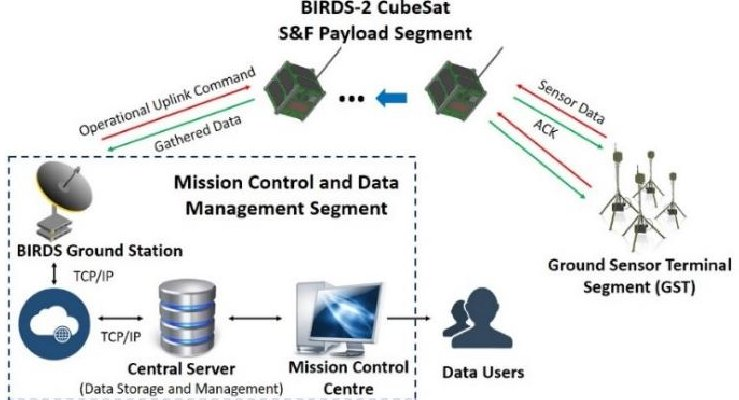
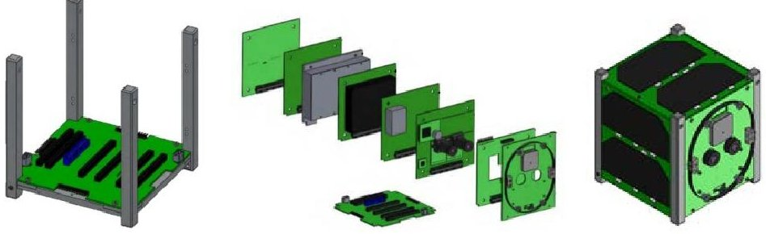
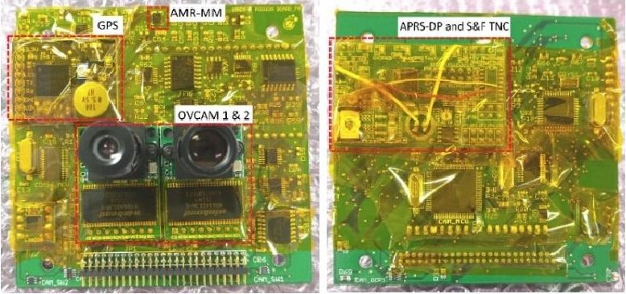
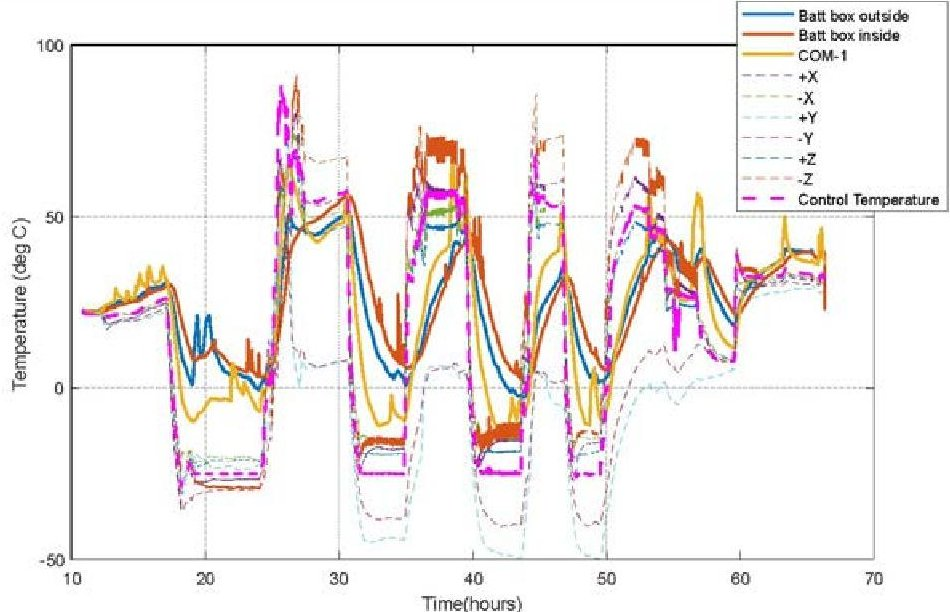
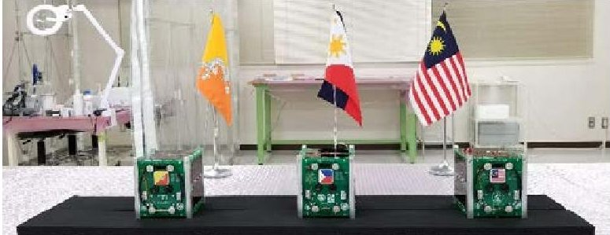

<!-- PDF_PAGE: 1 -->

PAPER • OPEN ACCESS

# BIRDS-2: A Constellation of Joint Global MultiNation 1U CubeSats

To cite this article: M H Azami et al 2019 J. Phys.: Conf. Ser. 1152 012008

View the article online for updates and enhancements.

## You may also like

- Introduction to thermal control design process for CubeSats in Mexico J A Ferrer-Perez, D Gaviria-Arcila, C Romo-Fuentes et al.

- Innovation in the teaching of astrophysics and space science-spacecraft design group study

C Castelli

- Research and educational network of ground stations for receiving and processing information from educational satellites

A A Spiridonov, V A Saechnikov, D V Ushakov et al.

<!-- PDF_PAGE: 2 -->

# BIRDS-2: A Constellation of Joint Global Multi-Nation 1U CubeSats

M H Azami $ ^{1,2} $ , BIRDS Partners, BIRDS-2 Project Members $ ^{1} $ , G. Maeda $ ^{1} $ , P. Faure $ ^{1} $ , T. Yamauchi $ ^{1} $ , S. Kim $ ^{1} $ , H. Masui $ ^{1} $ , and Mengu Cho $ ^{1} $

$ ^{1} $Laboratory of Spacecraft Environment Interaction Engineering, Kyushu Institute of Technology, Japan

$ ^{2} $Faculty of Electrical Engineering, Universiti Teknologi Mara, Shah Alam, Selangor, Malaysia

E-mail: q350939h@mail.kyutech.jp

Abstract BIRDS-2, the second generation of the Joint Global Multi-Nation Birds (JGMNB) project is a constellation of 1U CubeSats from Laboratory of Spacecraft Environment Interaction Engineering (LaSEINE), Kyushu Institute of Technology, Japan. The BIRDS-2 project consists of three identical 1U built by a group of students from four nations; Japan, Malaysia, Philippines, and Bhutan. It consists of 6 missions; Camera, Automatic Radio Packet Service-Digipeater (APRS-DP), Store and Forward (S&F), COTS GPS, Anisotropic Magneto Resistance Magnetometer (AMR-MM), and detection of single-event latch-up (SEL). The objective of BIRDS-2 is to provide an opportunity to learn the entire satellite system cycle, to lay down the foundation of the sustainable space program, and to create international networks of the ground station to assist the infant space program of the participating country. A total of 11 members learns the satellite development in a lean concept of 30m radius of the work area. The paper will describe the bus system of the BIRDS-2 CubeSats and the development process throughout the one year and three months of the project timeline. Completion of BIRDS-2 flight models remarks the successful design of the CubeSats bus system and waiting for the launch and deploy from International Space Station (ISS) around $ 3^{\mathrm{rd}} $ quarter of this year.

## 1. Introduction

BIRDS project started in 2015 led by Professor Mengu Cho from Kyushu Institute of Technology, Japan. It begins with a successful constellation of five 1U CubeSats built by registered students from Japan, Ghana, Nigeria, Bangladesh, and Thailand. The prime mission is to "by successfully building and operating the first satellite of the country, make the first step toward indigenous space program" [1]. The BIRDS-1 CubeSats have been deployed from International Space Station (ISS) in July 2017 and still operating ever since then. The legacy of the BIRDS project keeps moving forward to BIRDS-2, BIRDS-3, and so on. By decreasing the development process about one year and three months, it is a very good platform for students while studying at the university.

CubeSat, by its name, means a cubic-like nano-satellite size originated by California Polytechnic State University and Stanford University in 1999. It has a standardized platform of 1U, which is weighing not more than 1.33kg and volume of 10cm cubic. The main objective of CubeSats platform is to help

<!-- PDF_PAGE: 3 -->

the researchers in universities to perform space exploration in a lean system. Even though CubeSat is considered as miniaturized traditional satellite, but it has been very similar subsystem such as Electric Power System (EPS), Onboard Computer (OBC), Attitude Determination Control (ADCS), Communication subsystem, and also payload subsystem. The payload will define the objective and mission of the CubeSat. Since CubeSats' trend is remarkable growth, the most demand mission payload is by using Commercial off-the-shelf (COTS) components, which are ready-made and available for sale to the general public. The BIRDS-2 CubeSats consist of 6 missions, which suggested by the participating countries at the early stage and have been tested and verified during the development process. We begin the paper with the description of BIRDS-2 missions, the bus system and other subsystems, the development process, and lastly conclusion and future works.

## 2. Satellite Missions

The BIRDS-2 CubeSats sustain the same ultimate objective of the BIRDS project which is to build and operate the first satellite of the nation [2]. Students who are in the BIRDS-2 members have been given the golden opportunity to learn the complete development process from mission planning to satellite disposal. The constellation of three CubeSats has identical six missions, which are (1) Camera (CAM), (2) APRS Digipeater Demonstration on CubeSat (APRS-DP), (3) Demonstration of a CubeSat's Store-and-Forward (S&F), (4) COTS GPS technology demonstration, (5) Anisotropic Magneto Resistance Magnetometer (AMR-MM), and (6) Single Event latch-up detection (SEL).

Camera (CAM): The mission is divided into three successive levels, which are the minimum success is to capture images of Earth's surfaces, the full success is to take pictures of the four countries in desired high resolution, and the extra success is to take a short video. There are 2 COTS camera modules installed onboard capable of capturing 5 Megapixel (MP) of images, store the image data in flash memory and downlink the data to the ground station.

APRS Digipeater (APRS-DP): The objective of the mission is to demonstrate the functionality of low-cost COTS APRS digipeater payload onboard in 1U CubeSat in space. By using handheld radio of VHF communication, the mission can provide real-time digital communication service to the amateur community and also provide alternative communication services during emergencies's situation.

Store-and-Forward (S&F): The mission is combined with APRS-DP mission, which using the same payload and antenna. The objective is to demonstrate the use of a CubeSat constellation-based store-and-forward system for remote data collection. Ground sensor terminal (GST) is developed by each participating country to support the functionality of the mission (as shown in Figure 1).

Figure 1. S&F Mission Block Diagram.

COTS GPS: Due to power-hungry of the GPS module, it is very rare to see a 1U CubeSat installed with a GPS onboard. This COTS GPS uses the low power 80mW for the technology demonstration for BIRDS-2 CubeSats. GPS satellite will continuously beam data to CubeSats where COTS GPS onboard is allowing to locate its position wherever it is in orbit.

<!-- PDF_PAGE: 4 -->

Anisotropic Magneto Resistance Magnetometer (AMR-MM): A scientific mission to conduct measurement of magnetic field in space. It can provide an alternative method of magnetic-field measurement in space, which works as a support data for geomagnetic mapping of the South Asian region.

Single Event latch-up detection (SEL): A continuous mission from BIRDS-1 for the database on SEL occurrence rate of the microprocessor. The mission objective is to identify any correlation of SEL occurrence with satellite locations, time, and space weather. In the future, we can predict SEL rate in orbit using the database as scientific merit of developing less radiation risk of CubeSat.

## 3. Satellite Configuration

Three identical BIRDS-2 CubeSats has a 1U design, volume of 10cm cubic and mass of 1kg. The BIRDS-2 architecture is inherited from the BIRDS-1 design which originated from the design of UWE-3 of University Wurtzburg, Germany. It consists of an aluminium alloy skeleton structural, a base bottom board called the backplane board which integrates a battery box and six boards of front access board (FAB), onboard computer and electrical power system board (OBC/EPS), communication 1 & 2 board (COM1 & COM2), mission board, and rear access board (RAB) as shown in Figure 2. Five solar panels are installed at the external side of the CubeSat where another +Y board is attached the antenna burner circuit to hold two folded antennas of UHF and VHF using string wire. By using this configuration, we can minimize the harness inside the CubeSat. This will make a simple design and optimize the interface between all the subsystems onboard.

Figure 2. BIRDS-2 Configuration.

The following part will describe more details regarding the BIRDS-2 subsystems, explaining an overview of the block diagram of the satellite. We divided the explanation into one mission payload and other bus systems.

## 3.1. Mission Payload

A total of six mission payload is installed on mission board except for SEL mission where the microcontroller unit (MCU) is implemented in OBC/EPS board. The schematic and board are designed such that it can fit the mission modules within 90 x 86 mm PCB board. The mission modules include two units of COTS camera modules, one unit of COTS GPS module and one unit of a terminal node controller (TNC) adapter for APRS-DP and S&F mission as can be seen in Figure 3. Further explanation is discussed as follows;

3. 1.1 COTS Camera. Two identical cameras named OVCAM modules are installed onboard which have the narrow-angle lens and wide-angle lens. Both camera modules are capable of taking an image of 5 MP using the OV5642 sensor. By having the focal length lens of 25mm, the camera can have a spatial resolution of 25m. The camera module is connected to ATmega2560 by using interface of SPI and I2C. It also has a size of $ 3 4 \times2 4 \times3 0 \mathrm{mm} $ , the mass of 20g, and power consumption of 0.9W.

3. 1.2 APRS-DP and S&F. These two missions are sharing single MCU connects to AX.25 TNC adaptor by UART interface. The BIM1H radio of VHF-TRX is installed on

<!-- PDF_PAGE: 5 -->

COM2 board, which connects to the VHF monopole antenna. For the S&F mission, it needs the ground sensor terminal (GST) to communicate with the onboard payload, save the sensor data to the onboard flash memory too and downlink to the BIRDS ground station. On the other hand, the APRS-DP mission needs a minimum of handheld radio, which has APRS functionality to use this application which beneficial to the amateur radio community.

3. 1.3 COTS GPS. A low-power Venus838FLPx-L using interface of UART is connected to the ADCS MCU. Even though the power consumption is low, the GPS module is turned ON only by an uplink command from the ground station. It will not fully turn ON during satellite operation due to saving the power budget for the other mission. This kind of GPS is the first time used in space, which will demonstrate the functionality of the GPS.

3. 1.4 AMR-MM. The magnetometer used is HMC5883L commercially sells in the electronics store. This sensor is also connected to the ADCS MCU using interface of I2C. Due to very low power consumption, the sensor will turn ON all the time. The sensor data will be saved into the flash memory of ADCS subsystem.

Figure 3. BIRDS-2 Mission Board Front-View (left) and Rear-View (right).

## 3.2. Onboard Computer and Electrical Power System

The brain and power system of the satellite are integrated into one board. OBC consists of two H8 MCUs for housekeeping data and to control the other MCUs installed onboard. The reason for having two OBC MCUs is because to support the burden of H8-Main functions and for redundancy.

The electrical power system is divided into two parts: solar arrays and battery. Main power generation comes from five units of solar panels which each consists of two series connected with 30% efficiency of Triple junction solar cells during sunlight. Meanwhile, during an eclipse, the power generated from 3S2P Ni-MH Eneloop Plus batteries. The EPS supplies unregulated line, +5V, and +3.3V line to OBC and other subsystems through ON/OFF controlled and overcurrent protected lines. It has three inhibit in the system, two from deployment switches installed below of two rails, and another one is integrated into the battery.

## 3.3. Attitude Determination Control System

BIRDS-2 CubeSats are applying passive attitude control. Four permanent magnets (ALNICO-5) are glued to each rail, and two hysteresis damper (HYMU80) are glued to the back side of -Z solar panel. These permanent magnets attached to the structure of the satellite are to align the satellite with the Earth's magnetic-field direction, and the dampers will reduce the oscillation and rotational motion of the satellite. By applying this kind of method, we can control the spin rate about the local magnetic direction.

## 3.4. Communication Subsystem

<!-- PDF_PAGE: 6 -->

To communicate between the ground station and satellite, the uplink and downlink communication must be successful work by the transceiver onboard. Using within 435-438 MHz command uplink and a 437 MHz command downlink, the amateur radio bands are used to control and receive the data from the satellite. To receive an uplink command from the ground station, the satellite uses UHF (9600 bps GMSK) with AX.25 protocol. To send telemetry, image, and other mission data to the ground station, the frequency is 437.375 MHz (9600 bps GMSK). The BIRDS-2 have 10 operation network ground stations in different countries (Japan, Malaysia, Philippines, Bhutan, Nigeria, Ghana, Mongolia, Bangladesh, Thailand, and Taiwan) to communicate with the satellite.

## 4. Development process and testing result

The BIRDS-2 project went through three important reviews; Mission Definition Review (MDR), Preliminary Design Review (PDR), and Critical Design Review (CDR). Started from project kick-off meeting in November 2016 up to finish the flight model (FM) in February 2018, it took over one year and three months of the development process. It can be divided into three major parts where the beginning part of MDR was the mission idea and development stage, the middle part of PDR and CDR were the Engineering Model (EM) development stage, and the last part of FM was the flight model stage and satellite delivery to JAXA. The first stage was to discuss and develop the mission idea based on stakeholder needs and also based on system requirement and modes. The second stage was to build the breadboard model (BBM) for each subsystem and create the engineering model by fabricating the PCB boards. Lastly, the flight model stage was the very important phase to integrate all three identical CubeSats and launch to space.

The satellite was mainly tested with two environment testing, which were thermal vacuum testing (TVT) and vibration testing (VT).

## 4.1 Thermal Vacuum Testing

There are two main objectives of TVT, firstly, is to meet (function within) functional requirements under vacuum condition and extreme temperature and secondly is to withstand the thermal stressing environment under vacuum condition. The test will simulate the extreme hot and cold temperatures in vacuum condition of the space. In EM phase, the CubeSat was tested from the worst hot of +55 degrees Celsius to the worst cold of -25 degrees Celsius as shown from the result of six thermocouples attached to the external panels (+X, -X, +Y, -Y, +Z, -Z), two thermocouples at the battery box, and a thermocouple at the communication board (COM-1) in Figure 4 below. The graph verified the satellite had been tested on the range of temperature mentioned.

<!-- PDF_PAGE: 7 -->

Figure 4. Temperature Difference on External Panels, Battery Box, and COM-1 board. 4.2 Vibration Testing

The objective of this testing is to imitate the environment in the rocket launcher. For BIRDS-2 CubeSats, the vibration testing is using HTV and SpaceX launch vehicle profiles. The CubeSats is tested in Random QT level of 6.526 G, and Sine burst AT of 18.1 G. For instance, the camera

Table 1. Vibration Testing Result.

<table border="1"><tr><td>Axis</td><td>Natural Frequency[Hz]</td></tr><tr><td>X</td><td>278</td></tr><tr><td>Y</td><td>231</td></tr><tr><td>Z</td><td>552</td></tr></table>

subsystem, the critical part to be observed after this test is the camera's lens, whether it is moving or remains fix. We used a lock ring of S- mount lens and attached some glue to strengthen the lens. Torque mark on the screws was remained fixed from the initial position before the testing. We can conclude the result of VT from the Table 1. It was shown that every axis had greater natural frequency than the required 100 Hz.

Thus, the results were passed and moreover, the satellite survived the environment in the launch vehicle, and in space based on JAXA Safety Review documents. Table 2 summarizes the environment carried out at each phase of the satellite project. In FM, the environment testing had different parameters due to minimal exposure to the harsh space environment which applied in EM satellite. Random vibration and two cycles were sets as sufficient for the JAXA Safety Review documents.

Table 2. Summary of Environment Test.

<table border="1"><tr><td></td><td>Vibration</td><td>Thermal vacuum</td></tr><tr><td>EM ver.1</td><td>Random(6.526Grms)和Quasi-static(sine-burst)18.1G</td><td>Not tested</td></tr><tr><td>EM ver.2</td><td>Random(6.526Grms)和Quasi-static(sine-burst)18.1G</td><td>4 cycles-25~+55degC</td></tr><tr><td>FM</td><td>Random(4.832Grms)</td><td>2 cycles-25~+65degC</td></tr></table>

Figure 5 shows the photograph of flight models. The satellites will be delivered to JAXA after going through regulation inspection and will be launched to ISS.

<!-- PDF_PAGE: 8 -->

Figure 5. Flight models; Bhutan-1 (left), Maya-1 (middle), and UiTMSAT-1 (right).

## 5. Conclusion

A BIRDS-2 CubeSats approaches the final development process of the flight model in one year and three months. The satellites have been going through all the testing and verified with the space environment testing. The bus system and the mission payload are tested in integrated of 1U CubeSats. The evaluation of all mission's data downlink after BIRDS-2 CubeSats deployed from the ISS is very useful to complete the verification of the whole project so that it will be also beneficial for the continuity of the BIRDS project in the future.

## Acknowledgment

We would like to thank all the BIRDS partners, especially Center for Satellite Communication UiTM for supporting this development. We also would like to extend our appreciation to BIRDS-1 team members who helped to complete this project. A part of the S&F mission and the constellation operation was supported by JSPS Core-to-Core Program, B. Asia-Africa Science Platform.

## References

[1] Cho, M., JGMNB project members, N. Kuruhara, "International Network Operations of Five CubeSats Constellation," Conference on Small Satellites, Utah, 2016.

[2] Arifur R. Khan et al., "Five-nations CubeSat Constellation; An inexpensive test case for learning and capacity building," IAA-CU-15-01-16.

[3] Kiril A. Dontchev et al., "M-Cubed: University of Michigan Multipurpose MiniSatellite with Optical Imager Payload", AIAA Paper.