<!-- PDF_PAGE: 1 -->

# BIRDS-4 1U CubeSat Missions and On-Orbit Results

Hari Ram Shrestha $ ^{1)} $ , BIRDS-4 Project Members $ ^{1)} $ , George Maeda $ ^{1)} $ , Sangkyun Kim $ ^{1)} $ , Hirokazu Masui $ ^{1)} $ , Takashi Yamauchi $ ^{1)} $ , Mengu Cho $ ^{1)} $

$ ^{1)} $ Laboratory of Lean Satellite Enterprises and In-Orbit Experiments, Kyushu Institute of Technology, Japan shrestha.hari-ram852@mail.kyutech.jp birds4-project@kyutech-laseine.net

birds4-project@kyutech-laseine.net

The fourth generation of 1U CubeSat constellations of Kyushu Institute of Technology, BIRDS-4, was deployed from the International Space Station (ISS) in March 2021. The BIRDS-4 project succeeded in building Paraguay's first satellite (GuaraniSat-1) while improving the standardized bus system for future missions. The BIRDS-4 CubeSat constellation exhibited the capability of the BIRDS bus system to handle various total of nine missions, from technology demonstrations to scientific experiments in a 1U platform. The Automatic Packets Reporting System (APRS) that the amateur community could use to relay messages in real-time by dissipating. This module was also used in the Store-and-Forward mission to gather data in remote areas to establish technical viability. The Camera captured images of Earth for outreach and dissemination of space science and technology in participating countries. This BIRDS-4 also successfully executed and demonstrated other missions such as the Henteena mission, Active Attitude Stabilization, Reaction Wheels Manual Rotation Total Ionization Dose measurements, and the design and development of a chip to detect and protect components against single event latch-up mission by Nanyang Technological University (NTU). And The Perovskite Solar Cell was placed to check its performance in space. This paper discusses in detail the BIRDS-4 missions, on-orbit results, and lessons learned with each mission's success level. It also discusses the approach made so that the BIRDS bus system can handle multiple missions

Key Words: BIRDS-4, 1U CubeSat, On-Orbit Results

## 1. Introduction: BIRDS Satellite Project

BIRDS project, also known as the Joint Global Multi-Nation Birds Satellite Project, is a cross-border, interdisciplinary satellite project for emerging and non-space-faring nations supported by Kyushu Institute of Technology, Japan. A total of 13 countries have participated in the program, 9 of which built the first satellite in their countries. The program has deployed a total of 17 satellites in its 5 generations of constellations from 2015 to 2022. 5 in BIRDS-1 and 3 each in BIRD-2, BIRDS-3, BIRDS-4, and BIRDS-5. A total of 16 satellites are 1U CubeSats, while 1 of the 3 satellites in BIRDS-5 is a 2U CubeSat. $ ^{(2,4)} $

The BIRDS constellation satellites are based on the 1U CubeSat standard, with the mass of 1.3kg or less and external dimensions of 10cmx10cmx10cm. The BIRDS-1 through the BIRDS-4 satellites have already been deployed into orbit, and the BIRDS-5 project will be ready to launch to the ISS in October 2022. BIRDS' objective is to establish an Indigenous space program by designing, developing, testing, launching, and managing the first satellites for participating countries. The BIRDS satellite project has already resulted in the launching of the first satellites of more than seven non-spacefaring nations. Between 2017 and 2021, 14 Kyutech (LaSEINE) CubeSats were successfully launched from the Japanese Experiment Development Module "Kibo." This paper focuses on BIRDS-4, a constellation consisting of three 1U CubeSat from Paraguay (GuaraniSat-1), the Philippines (Maya-2), and Japan (Tsuru). This paper will mostly concentrate on in-orbit experiences and data analysis. In addition, the authors will discuss the lessons learned from the BIRDS-4 satellite for the benefit of future satellites. $ ^{(1-2,4)} $

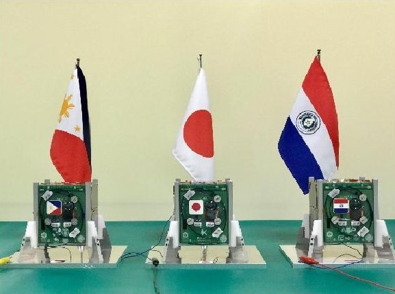

Fig.1. The photo of BIRDS-4 flight models (FM) satellite

## 2. Overview: BIRDS-4 Project

On March 14, 2021, the constellation of BIRDS-4's three satellites were deployed from the ISS as part of the BIRDS satellite program. It was a fourth-generation BIRDS satellite project. The goal of the BIRDS-4 project was to create Paraguay's first satellite while also improving the standardized bus system for future deployments. Furthermore, it is a continuation of satellite advancements made by Japan and the Philippines as well as previous BIRDS generations.

GuaraniSat-1, Paraguay's first satellite, is owned by the Paraguayan Space Agency (AEP) in Asunción, Paraguay. While the Maya-2 satellite is co-developed with the University of the Philippines - Diliman, Mapua University, Adamson University and is funded by the Department of Science and Technology, while the Tsuru satellite is owned by the Kyushu Institute of Technology in Fukuoka prefecture in Kitakyushu city. More than 14 international student representatives are involved in the development and operation of this initiative. All students were enrolled in the space engineering course SEIC Kyutech, either the Master's or Doctoral degree level.

<!-- PDF_PAGE: 2 -->

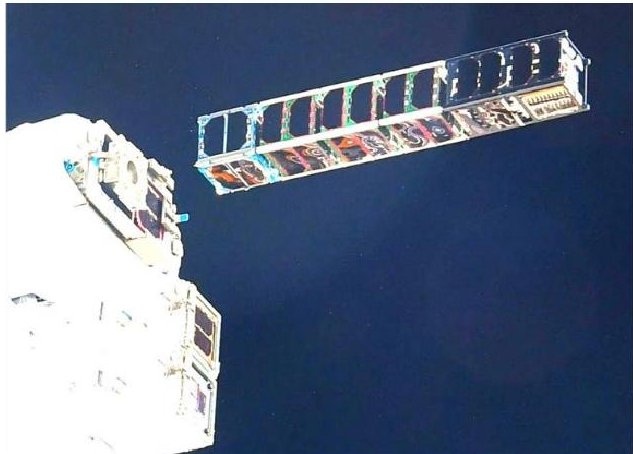

Fig.2. BIRDS-4 image at deployment time from ISS (PC: ISS/JAXA /NASA)

All three satellites were effectively deactivated on June 14, 2022, by sending kill switch commands to each satellite. It spent 15 months in low Earth orbit.

## 3. Satellite Missions

BIRDS-4 has nine missions in total; Imaging Mission (CAM), Store-and Forward mission (SFWARD), APRS Digipeater mission (APRSDP), Loop Hentenna Mission (HNT), Total Ionization Dosage Measurement of COTS components (TMC), Demonstration of Latch-up detection circuit (NTU), Perovskite Solar Cell Mission (PSC), Active attitude Control Mission (ADCS)and Glue Mission (GM). In this paper, the authors shall briefly discuss the on-orbital results of all BIRDS-4 satellite missions.

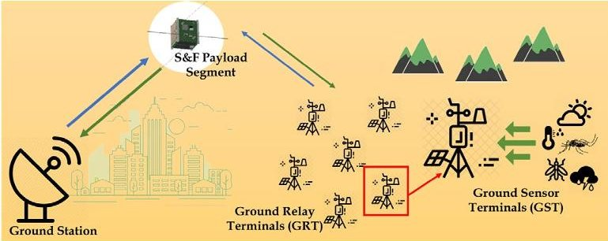

Fig.3. Store & Forward of Weather and Re-infestation Data using CubeSats (SF-WARD)

## 4. Bus system

The BIRDS-4 bus system is based on the BIRDS-1, BIRDS 2, and BIRDS-3 bus systems. The bus system is made up of the following components: the Front Access Board (FAB), the Electrical Power System (EPS), the On Board Computer (OBC), the Communication (COM), and the Rear Access Board (RAB). Figure 4, shows a view of satellite and bus design.

It is made up of an aluminum alloy skeleton structure and a base bottom board called the backplane board that integrates all boards with a 50-pin connector. It is a free harness component. A battery box, and six boards: the FAB, the OBC and EPS board, the COM board, Mission 1 & 2 boards, and the RAB as shown in Figure 4, Five solar panels are installed on the external side of the CubeSat where another -Y panel board is attached to the Antenna burner circuit to hold two folded antennas of

VHF using string wire. The frequencies used for uplink and

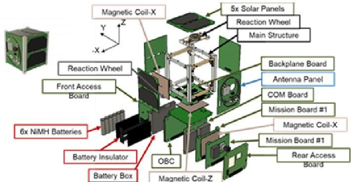

downlink are in the amateur radio band. The downlink frequency is 437.375 MHz. $ ^{(2,4)} $

Fig.4. BIRDS-4 CubeSat overview design

The harness inside the CubeSat can be reduced by adopting this design. The interface between all of the onboard components will be simplified as a result and optimized. The PIC18F67J94 MCU, commonly known as MainPIC, is located on the OBC board. As the OBC's core component, the MainPIC performs its main responsibilities. PIC16F1789, often known as FABPIC and ResetPIC in BIRDS satellite. There is a UART serial line going between the MainPIC, ResetPIC, and COMPIC. With the labels FlashM Main and FlashM COM, respectively, MainPIC and COMPIC each contain a dedicated flash memory. A multiplexed SPI connects MainPIC and COMPIC to a shared Flash Memory.

Table.1. Major components of BIRDS-4 subsystem design

<table border="1"><tr><td rowspan="3">OBC</td><td>C&amp;DH MCU</td><td>PIC18F67J94</td></tr><tr><td>RESET&amp;COM MCU</td><td>PIC16F1789</td></tr><tr><td>Protocol</td><td>UART</td></tr><tr><td rowspan="4">EPS</td><td>Battery&amp;its Configuration</td><td>NiMH(eneloop),3S2P</td></tr><tr><td>Battery Charge Regulator(BCR)</td><td>LTC3119EUFD</td></tr><tr><td>Power Bus Lines</td><td>3.3Vx25Vx1Unregulatedx2</td></tr><tr><td>Solar Cells</td><td>Azur3C30x10</td></tr><tr><td>Harness</td><td>Backplane</td><td>Hardwired</td></tr><tr><td>COM</td><td>Antenna</td><td>Dipole,4800bps</td></tr></table>

The Microchip PIC family of microcontrollers is included in the bus system. The CubeSat's body-mounted solar cells provide the energy needed by the satellite bus and payloads. Based on the size and mass of CubeSats, the BIRDS-4 satellites rely on two Azur space solar cells connected in series. The solar panels are mounted on the CubeSat's +X, +Y, +X, +Z, and -Z faces.

## 5. On-Orbital data

The BIRDS-4 satellite was successfully launched from the ISS. After 30 minutes of deployment, the satellites began to transmit satellite beacons. On the first day, we acquired more

<!-- PDF_PAGE: 3 -->

than 45 Continuous Wave (CWs) from various stations around the world. The total number of CWs recorded in the Kyutech BIRDS-4 CW Master file is 7715. During operation for 458 days, the Tsuru was able to download the data packet size is 14.0MB from Kyutech ground station. The most recent measured voltage was 3.82V, with an average power consumption of 281.81 mA. Data from housekeeping sensors were used to monitor and track the health of the CubeSat. It reads data from the voltage, current, and temperature sensors on the external solar panels and batteries. These sensors' flight data confirms that the EPS is operational and has been powering satellite modules since launch.

However, we lost Guaranisat-1 and Maya-2 in a week due to power system issues. According to the EPS system failure study, the one major issue of power system failure and the reasons that caused an imbalance in the power budget were identified. In the worst-case scenario, the available generated energy was 1604 mWh from five solar panels. If one solar panel is not producing power. Whereas the battery detonations, only four panels' power generation of 1202 mWh is insufficient to recover the battery. Because the nominal power mode consumption was higher. It was 1438 mWh. In Figure 5, Tsuru (JP) satellite data was captured in CW data for the first two months following satellite deployment from the ISS. Based on the beta angle, this graph depicts the voltage condition of the Tsuru satellite.The average nominal load current consumption was 260mA. $ ^{(2,4)} $

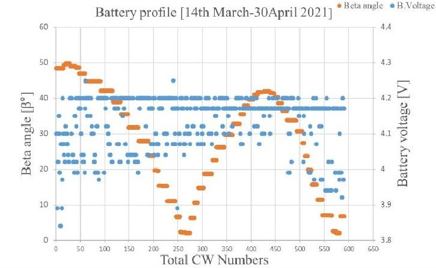

Fig.5. Initial first two-month Satellite battery data

## 5.1. Camera Mission

The mission statement of the camera mission was to allow the satellite to capture the surface of the earth, particularly the member countries (Japan, Philippines, and Paraguay), and store and transmit the data effectively. Based on the BIRDS-4 camera on-orbital data analysis, the camera mission has offered a great deal of importance in terms of media information, dissemination of information, and educational encouragement to the government and education departments for promotional purposes and outreach activities for participating countries. It provided, not only for the member countries but also for the global community, growth in technological and scientific interest. The camera was 5 MP with a ground swath of 1008 km/806.4 km at 400 km altitude with a ground resolution of approximately 300 m. The BIRDS-4 satellite captured a total of 90 images in three modes: normal, timed, and deployment. The

total number of downloaded images is 80, with 2.33 MB of data downloaded. $ ^{(4)} $

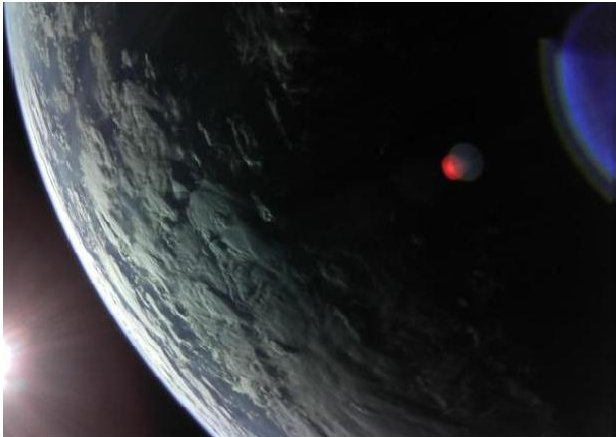

Fig.6. CAM mission at the high-resolution image of BIRDS-4

In terms of its success level, the camera mission achieved medium success while full success was partially fulfilled. In this success level, photos during release in ISS and participating country photos (except for the Philippines) including earth photos with identifiable land masses were taken. Table 2 and 3 shows a summary of the distribution of the target in executing the mission and the distribution of the images taken respectively.

Table.2. Distribution of target for participation countries and ISS

<table border="1"><tr><td>ISS</td><td>2</td></tr><tr><td>Japan</td><td>29</td></tr><tr><td>Paraguay</td><td>40</td></tr><tr><td>Philippines</td><td>11</td></tr><tr><td>Unknown</td><td>8</td></tr></table>

Table.3. The below table shows the total photos taken by Tsuru satellite.

<table border="1"><tr><td>Earth</td><td>44</td></tr><tr><td>Solar flares</td><td>13</td></tr><tr><td>Space</td><td>24</td></tr><tr><td>Unknown</td><td>9</td></tr></table>

## 5.2. APRS digipeater Mission

The Automatic Packet Reporting System (APRS) is a realtime data communications protocol that is used to share information across numerous amateur radios in a local region. A low-cost COTS APRS digipeater payload on board a 1U CubeSat in space was to be evaluated for operation as part of the BIRDS-4 satellite's mission. Receiving data from ground terminals was accomplished via the APRS protocol. It was successful in demonstrating the APRS digipeating mission. Uplinking APRS messages to the satellite required a handheld radio with a 50 W amplifier and a 7 dBi commercial antenna. The digipeated messages could be received at the Kyutech Ground Station VHF setup comprising of a 16 dBi VHF antenna, radio, and UISS software. $ ^{(4-5)} $

The radio was BIM1H (TRX), which had an APRS TNC, and both were placed on Mission Board 2 with the CAM mission. The ATmega was located on a different side of the board from the radio. Since the operating frequency was the same, we chose a dipole antenna with a frequency of 145.825 MHZ for the

<!-- PDF_PAGE: 4 -->

antenna. The difference between BIRDS-2 and BIRDS-4, which both had APRS missions, was the antenna: BIRDS-2 used a monopole, whereas BIRDS-4 used a dipole.

The received messages from the Kyutech ground station setup as well as those that the satellite dispersed are depicted in the above picture in Figure 6. The blue text in the red boxes tells us

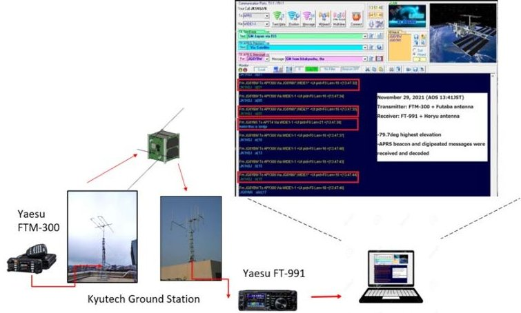

Fig.6. The above figure was testing set up during on-orbit operation In Kyutech Ground Station

that the beacon was sent for 45 seconds when the Tsuru satellite was. When the green text is the message that BIRDS-4 Tsuru has dissipated. The event was carried out on November 29, 2021, at an elevation of 79.9 Deg. $ ^{(4)} $

## 5.3. Store and Forward Mission

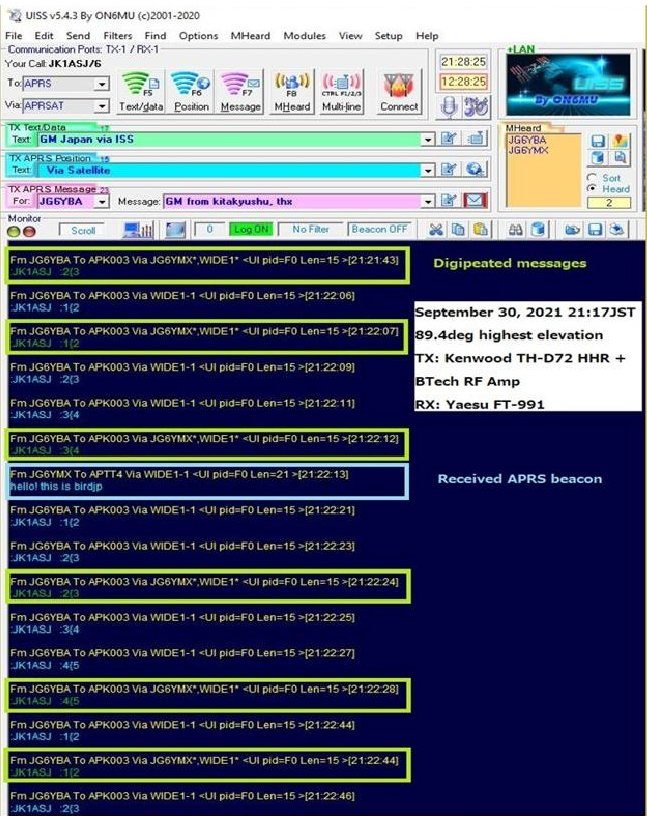

Fig.7. APRS digipeated message result recorded information

SFward uses the APRS format because it is widely supported and benefits from its useful acknowledgment feature. Regarding the flight module, unfortunately, the mission could not collect flight data due to a communication failure between the SFward MCU and the APRS MCU. The main reason for

that is the code was written to receive TEXT MODE packets, but the APRS MCU was configured to send KISS MODE. However, the mission code and its connection with the satellite bus were proven to work. $ ^{(4-5)} $

## 5.4. Hentenna Mission

The Hentenna (HNT) mission aims to use a 1U CubeSat main frame as an antenna. The "Hentenna" is designed by a Japanese amateur radio operator and a looped version of Hentenna called "Loop Hentenna" could fit into the 1U CubeSat structure if the resonance frequency is set to 430MHz band. The picture shown in Figure 8 depicts the 1U satellite structure of a loop Hentenna.

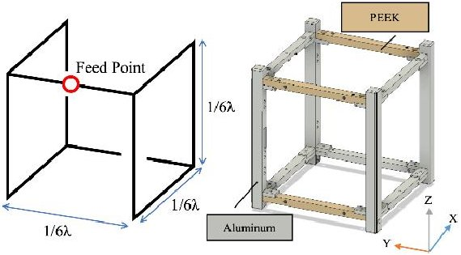

Fig.8. 1U satellite design structure of Hentenna

A UHF band antenna serves as the satellite construction. On December 15,2021, we completed the HNT mission. The Loop Hentenna and the Dipole Antenna alternated in sending CW beacons. It was a successful mission. The RTL-SDR receiver was utilized, and the IQ signal was recorded as a wave file.

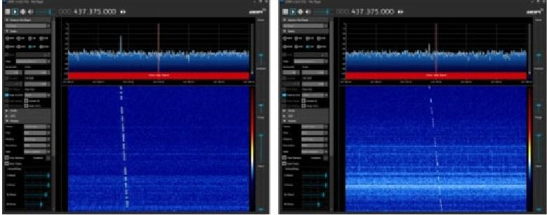

Fig.9. CW signals from the dipole antenna (left) and from the Loop Hentenna (right)

The HNT mission of the Tsuru satellite was activated by command on 15 December 2021 at 06:01 (all times are in UTC). The picture data is shown in the figure below.

The Tsuru satellite passed over the Kyushu Institute of Technology between 06:14 and 06:25. At 06:20, the highest elevation was 68.5 degrees. During this pass, the ground station got signals from both the dipole antenna and the Loop Hentenna. Figure 9 shows an example of the receiving spectrum using RTLSDR and SDR#. This confirms that the Loop Hentenna on BIRDS-4 was functional. $ ^{(3)} $

## 5.5. Perovskite solar Cell (PSC) Mission

For this mission, each satellite was attached with two samples of perovskite solar cells attached on the -X panel of the satellite. The Rear access board (RAB) of the satellite has a solar cell measuring circuit which records the current and

<!-- PDF_PAGE: 5 -->

voltage characteristics of the PSCs, as well as the temperature and the project was able to collect on-orbit data from the Perovskite solar cell which is the first demonstration as far as the authors are concerned. $ ^{(3)} $ The graph in Figure 10 shows the first set of J-V curve data from the two CuSCN PSC samples attached to the Tsuru satellite, obtained on April 15, 2021, one month after the satellites were released into space. Unfortunately, the two other satellites carrying spiro-OMeTAD and carbon hole transport material PSCs had issues which is the reason for the unavailability of data.

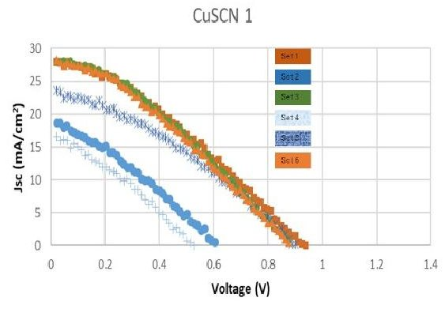

Fig.10. The first set of Space data

The sun angle measurements are inconsistent with the short circuit current and the maximum power of the cells, based on this set of data. Due to different data sets having a 90-degree angle measurement and some sets having a lower angle measurement, but their short circuit current and maximum output power are similar. This is due primarily to the satellite's rotation, which causes variations in the irradiance received and logged by the satellite during each measurement. The photodiode sun sensor's inconsistency could be attributed to shadows cast by other parts of the Y-panel on the photodiode sun sensor. The maximum power density was recorded at 14.73 mW/cm2 and the average power density from the last data is 0.76mW/cm2. In terms of power conversion efficiency, the highest recorded data is at 11% $ ^{(6)} $

## 5.6. ADCS Mission

The goal of the ADCS was to demonstrate active attitude stabilization control and 3-axis satellite attitude pointing control for future BIRDS under various (component check, stabilization, determination, and pointing) MODES conditions, so that the mission could do some mission execution while the satellite was operating. These were successful: attitude determination, reaction wheels manual rotation, and MTQ power on (dipole). We did not have enough time to complete the ADCS mission mode operation and execution because we only had one satellite, Tsuru. SGP4, GPS, b-dot attitude stabilization, and Nadir pointing control, on the other hand, could not be activated.

In April 2022, the attitude determination mission was activated three times for ten minutes each to log array data for use in recording the gyro, magnetometer, MTQ, and other data for analysis. We only received 28 bytes until the end, which was all 0x00, and the data could not be analyzed.

On the other mission, the RW and MTQ was powered on. The

mission was activated on different days in May and June 2022. For the first time, the activation time was 1 minute for the reaction wheel. Then it was activated in different sequences of 2, 3, and 4 minutes, and the log array data was successfully received. As a result, the angular velocity after activation of the reaction wheel could be seen in Figure 11 on these dates. After the first RW activation, the angular velocity in the Z axis reaches around -10 deg/sec. With this data, we can conclude that the RW has some effect on the satellite, because the log data prior to activation showed an angular velocity of -4 to -5 deg/sec. For the remaining dates, the satellite's angular velocity after RW activation ranged from -10 to -14 deg/sec in the Z axis. The minimum ADCS level of success was met with the sensors and actuators working in space, with the exception of GPS. $ ^{(4)} $

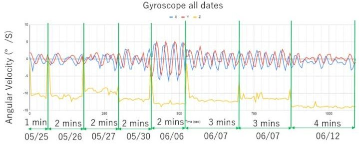

Fig.11. Gyroscope data analysis image

## 5.7. TMCR mission

TMCR's mission had two objectives. The first was to confirm the accuracy of the TID (Total Ionized Dose Effect) tests that have been conducted on the ground while the second was to verify a system that predicts the number of doses from the change of drain current. If the accuracy of the TID test on the ground is confirmed by the on-orbit experiment, the radiation dose on--orbit can be predicted by observing the change in the drain current of MOSFETs, and it may be used as a simple dosimeter. The semiconductors should show more degradation than in the ground tests, but the results of the on-orbit experiments showed no clear signs of degradation even after 237 days. The cumulative radiation dose is low, and the voltage is not always applied to the semiconductors for experiments due to power consumption issues. $ ^{(4)} $

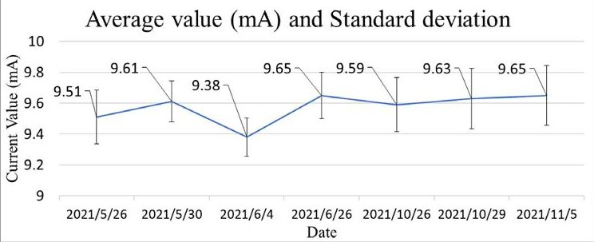

Fig.12. Average value mA and standard deviation

## 5.8. Glue Mission

The Glue mission used commercially available glue (EP007 model) as an alternative to RTV-S 691 space-qualified adhesive to reduce costs and ease of purchase. The glue was applied to one of Tsuru's Japanese satellites (+X) solar panels. The red curve represents the solar panel (+X) using commercial glue,

<!-- PDF_PAGE: 6 -->

whereas the green curve represents the solar panel (-X) with RTV. Due to power consumption by the battery, until the battery is fully charged, the maximum power production occurs at the beginning period of sunlight. When there is direct sunlight, power generation is higher; when there is no direct sunlight, power generation is lower. $ ^{(4)} $

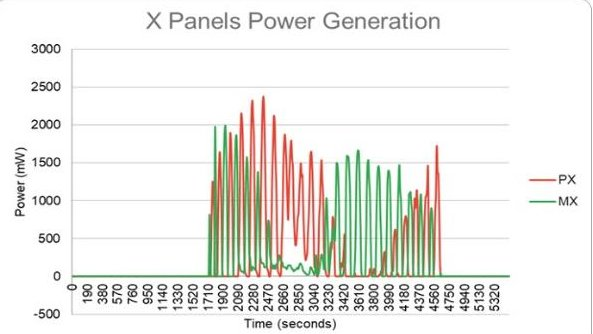

Fig.13. According to high sampling data, the +X solar panel generates 411 mWh per orbit. The sampling time was 10 seconds.

## 5.9. NTU Mission

The main mission goals were to evaluate the protection function and effectiveness of Nanyang Technological University's (NTU) Latch-up Detection and Protection (LDAP) chip in low earth orbit. The result of the test missions' execution for a total of 41 days that the NTU mission was activated and 20 latch-ups were recorded. Unfortunately, we could not receive the GPS data with the latch-up data and we could not recognize where it happened. $ ^{(4)} $

## 6. Communication Success rate of Tsuru satellite

In relation to communication, the analysis of the successful uplink rate of Tsuru from March 14 to October 22, 2021, a total of 218 days of operation, it was observed that the uplink success rate varies depending on the time of operation with the highest success rate of 80% in a single pass. The success rate was very low during the daytime, especially late afternoon when interference around the area is high. This can be attributed to the use of amateur radio frequencies where some illegal transmissions are done by private individuals.

## 7. Improvement suggestions

The generation of satellite energy should be greater than or equal to the consumption of power. Within the time period in orbit, all subsystems and payloads must be considered during nominal and mission execution conditions. Also, make sure that the power generated by the solar panels has enough margin to charge the battery and deliver power to the load even if some of the solar panels are having issues. Long duration test - This test is an emulation of how the satellite should operate in orbit. Therefore, the entire test should not only focus on the individual mission execution but, more importantly, the system performance as a whole. In cases where software-related issues at the subsystem level, mission level, or system level are encountered, these should be addressed and fixed. Another run of long-duration tests is recommended. $ ^{(2,4)} $

## 8. Conclusion

Although two satellites were not able to give sufficient in-

orbit results, BIRDS-4 has executed its missions in orbit through the Tsuru satellite. Thanks to the constellation configuration of BIRDS-4, despite failure of two satellites, all the missions can still be executed by a single satellite. This can be observed through the success levels attained by each of the missions of the satellites. From the in-orbit data and further investigation, we were able to collect technology demonstration data that can help in the improvement of future satellite development and similar missions. The observations the project had in both ground test and in-orbit results were also used by succeeding satellite projects being developed in Kyutech.

## Acknowledgment

This project was supported in part by the JSPS Core to Core program, B. Asia-Africa Science Platforms.

The authors would like to express gratitude to the BIRDS-4 engineering team members in particular: Daisuke Nakayama, Mark Angelo Cabrera Purio, Adolfo Javier Jara Cespedes, Marloun Pelayo Sejera, Yigit Cay, Izrael Zenar Casople Bautista, Anibal Antonio Mendoza Ruiz, Hiroki Hisatsugu, Hoda Awny Elmegharbel, Timothy Ivan Leong, Tomoaki Murase, Yasir Abbas, Yuma Nozaki, Ariel Manabe, Esteban Fretes, Akihiro Obosi. The authors would like to acknowledge the support shown by stakeholders at the University of Philippines -Diliman, Mapua University, Adamson University, the Department of Science and Technology and the Paraguayan Space Agency. Moreover, we thank Prof. Joseph Chang and Dr. Shu Wei of Nanyang Technological University including the members of BIRDS ground station network, the amateur radio community, JAXA and LaSEINE staff members.

## References

1. Abhas M., Pooja L., Hari.R.S.,Withange D.C.,Tharindu L.D.M,Makiko,K.,Yuta K, yuji S.,Turotogtokh T.,George M.,Sangkyun .hirokazu .m.,Takashi Y.,Mengu C.,Mengu C. -kyushu Institute of Cubesats project- One Year On-Orbit Results of Improved Bus, LoRa Demonstration and Novel Backplane Mission of a 1U CubeSat Constellation, Trans. Japan Soc. Aero. Space Sci. Vol. 59, No.1, pp. 107-109, 2016

2. Hari.R.S, Izrael C.B., Adolfo J.J..C, ,BIRDS-4 P.T.,Takashi Y.,Mengu C.,Mengu C.-kyushu Institute of Cubesats project- Results of BIRDS-4 Satellite On-Orbit Power Performance for Enhancing 1U Satellite Power System Reliability, 73rd International Astronautical Congress (IAC), Paris, France, 18-22 September 2022.

3 Daisuke N.,Takashi.,Y.,Hirokazu.M.,Sangkyun K.,Kazuhiro T.,Tharindu L.D.M.,Mengu c.,BIRDS-4 Team,-kyushu Institute of Cubesats project On-Orbit Experimental Result of a Non-Deployable 430-MHz-Band Antenna Using a 1U CubeSat Structure,Article,https://doi.org/10.3390/electronics11071163

4 Adolfo J.J..C, Izrael C.B,BIRDS-4 P.M., George M. Sankyun K. .hirokazu .m.,Takashi Y.,Mengu C.,Mengu C.: -kyushu Institute of Cubesats project- An Overview of the BIRDS-4 Satellite Project and the First Satellite of Paraguay, 35th Annual Small Satellite Conference, SSC21-WKIII-03

5 Yasir M.O.,Marloun S.,Izrael Z.B.,BIRDS-4,P.M,Mengu C.,Kenichi A. -kyushu Institute of Cubesats project Store and Forward Mission Design in Birds-4 Satellites

6 Izrael Z.C.B., shuzhang Y., Aekjira K., Minoru I.,Tingli Ma.,Menguc.,-kyushu Institute of Cubesats project Perovskite Solar Cells in Space: Evaluation of Perovskite Solar Cell Hole Transport Material in Space Environment Trans. Japan Soc. Aero. Space Sci.Vol.59, No.1, pp.107-109, 2016