<!-- PDF_PAGE: 1 -->

# BIRDS BUS: A Standard CubeSat BUS for an Annual Educational Satellite Project

Sangkyun Kim, Takashi Yamauchi, Hirokazu Masui, Mengu Cho

Laboratory of Space Environmental Interaction Engineering

Kyushu Institute of Technology

Kitakyushu-shi, Fukuoka-ken, Japan

## Abstract

The BIRDS program, carried out by the Kyushu Institute of Technology since 2015, consists of educational projects that use 1U CubeSats for capacity building of non-space-faring nations. The first and second generations of the program, BIRDS-1 and BIRDS-2, were launched and deployed to orbit in 2017 and 2018, respectively. BIRDS project members begin as students with no experience in space engineering, but they must design, build, and operate the satellite within two years, to meet a master's degree timeline. A new BIRDS project begins every year, each one requiring satellite design changes to accommodate the new year's mission objectives. To meet the rapid project pace, this study introduces a standard CubeSat bus focused on the electrical architecture: the BIRDS BUS. The BIRDS BUS puts an emphasis on two key ideas for easy training: simplification and unification. The standard bus was applied to the third generation (BIRDS-3) project. The BIRDS BUS has been tested extensively on the ground and has passed all environmental tests. Three BIRDS-3 satellites were launched to the International Space Station (ISS) in April 2019; after the satellites were deployed to orbit (June 17, 2019), the final validation of the BIRDS BUS was successfully conducted in orbit.

## 1. Introduction

A 1U CubeSat is a small cube-shaped satellite measuring 10 x 10 x 11.35 cm in size, with a mass less than 1.33 kg (Japan Aerospace Exploration Agency, 2015). Originally, it was developed as an educational tool for space engineering technology, given its small size, light mass, and low budget requirements. The first CubeSats were launched in June 2003, successfully demonstrating their potential in orbit and making huge impacts on the space community. From 2012 through 2017, over 700 CubeSats were launched, and that number is still rapidly increasing. Currently, many

CubeSat programs are employed for the purposes of remote sensing, communication and scientific research (Sandau, 2010), although NASA has begun using CubeSats even for deep space exploration.

The chief benefits of using CubeSats are their low cost, short development time, limited number of team members needed, and aggressive use of more economical commercial-off-the-shelf (COTS) parts. (While the use of COTS parts provides no guarantees against harsh space environments, such as strong radiation on orbit, they do provide a short delivery time and low cost, which generally benefit CubeSat projects.) The

Corresponding Author: Sangkyun Kim - kim.sangkyun571@mail.kyutech.jp

Publication History: Submitted - 02/27/20; Revision Accepted - 04/21/21; Published - 07/10/21

<!-- PDF_PAGE: 2 -->

CubeSat is a good representation of the "Lean Satellite" concept recently proposed by an International Academy of Astronautics (IAA) study (Cho and Graziani, 2017). The CubeSat has a well-defined standard for its mechanical design, including its deployment method, creating the possibility for mass production of CubeSats, in many fields. A constellation made of hundreds of 3U CubeSats is already being used for commercial remote sensing business (eoPortal Directory, 2014). CubeSats also remain important tools for educational programs, satisfying their original objective when they were first proposed. As another example of important uses and purposes of CubeSats, many developing and emerging countries are looking to the use CubeSats to build their space technology capacity (Wood and Weigel, 2014).

Standards are an important issue for all satellite research, to reduce cost and increase the efficiency of development (Graziani et al., 2010). With regard to CubeSats, much research is focused on trying to find proper standards for the use of their electrical design. Some study aims to establish a standard interface for each subsystem (Bouwmeester et al., 2018); plug-and play systems are also examined, for flexible development with greater efficiency (Mughal et al., 2014). To date, however, electrical design has no dominant universal standard, because of the problem of overhead.

If CubeSat projects for different mission objectives intend to use the same satellite bus design with minimal modification, some amount of resource waste is inevitable. CubeSats already have very limited resources in many respects, due to their limited mass and size, and extremely low power generation. Even a small waste of their resources can make it impossible to accomplish their mission objective. For this reason, a CubeSat bus system is usually developed following mission system design. However, if a CubeSat has a specific objective, and if it follows a similar design, the standard CubeSat bus can be designed with minimum overhead.

The BIRDS BUS is of such a design, as a standard CubeSat bus with an electrical design to support BIRDS projects. BIRDS projects are annual educational 1U CubeSat development projects for the capacity building of non-space-faring nations. The annual development of the multiple CubeSats is one of the

key advantages of the BIRDS project, but that also places a heavy burden on inexperienced project members; having a standardized CubeSat bus design can be important for their expedited training. Inexperienced space engineers need a clear and simple reference design for easy understanding as they learn. Also, fasttracked standard bus training makes it possible to focus on more of the development resources on the mission system. On the mission system development itself, project members use the standard bus with their training. Even project members that do not design the bus system by themselves accumulate the knowledge of the bus system, through their training and experience.

The BIRDS BUS has a specific goal for its design as a standard bus for the educational CubeSat project, and has some different characteristics when compared with other research on standard CubeSat buses. Performance, efficiency, and flexibility are usually important factors in standardized bus design, and are also aspirations of the BIRDS BUS. However, BIRDS BUS design starts with a focus on ease, as its primary design goal. It should be easy to learn and easy for beginners to use. For example, the BIRDS BUS used a distributed system design not for its performance, but for easy work sharing and simple coding work. In addition, the BIRDS BUS needs to satisfy safety requirements without additional work, to save on development time (Japan Aerospace Exploration Agency, 2015).

This study introduces the standard CubeSat bus system of the BIRDS BUS to share the concept and information with small satellite developers. First, the BIRDS project is described briefly in section 2 with lessons learned, and the requirements of the standard bus are explained in section 3. Section 4 presents the design of the BIRDS BUS, and the BIRDS-3 satellites project is briefly discussed to explain how the standardized bus design was used in an actual satellite project. Study conclusions are presented in section 5.

## 2. The BIRDS Project

BIRDS projects are educational capacity-building projects with international cooperation (Polansky and Cho, 2016). Two or three young engineers are sent

<!-- PDF_PAGE: 3 -->

from each participating country to the Kyushu Institute of Technology (Kyutech) to learn space engineering using 1U CubeSat development work. In many cases, the resulting BIRDS satellite is the first satellite for their country. The first generation (BIRDS-1) project started in October 2015 with five countries (Bangladesh, Mongolia, Ghana, Nigeria, and Japan), which successfully deployed their satellites from the International Space Station (ISS) in July 2017. Three countries (Bhutan, Malaysia, and the Philippines) started the second generation (BIRDS-2) project in October 2016, and deployed their satellites in August 2018. As of January 2019, BIRDS-1 and BIRDS-2 are still in operation through the BIRDS ground-station network (Cho et al., 2017).

The BIRDS-3 project, which started with three countries (Sri Lanka, Nepal, and Japan) in October

2017, deployed their three satellites to orbit, and the operation has been successfully continuing. The BIRDS-4 project, which started in October 2018 with three countries (the Philippines, Paraguay, and Japan) is already underway. Figure 1 shows the flight model of BIRDS-1; Figure 2 shows BIRDS-2; and Figure 3 is a photo of the flight model of BIRDS-3.In a BIRDS project, young engineers experience all the processes of satellite development, from mission definition to operation, within two years. Figure 4 shows the rough timeline for each BIRDS project from BIRDS-1 to BIRDS-3. The biggest advantage of BIRDS projects is the overlapping of each generation, due to the fact that two-year projects start every year; that way, the project

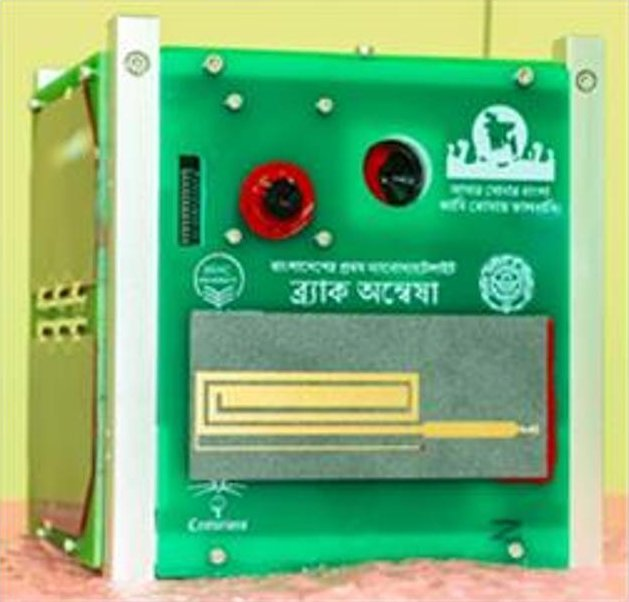

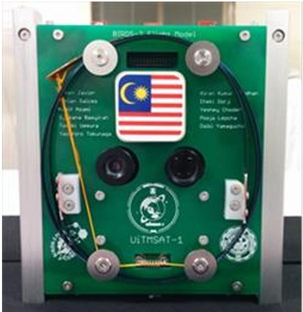

Figure 1. Flight model of BIRDS-1.

Figure 2. Flight model of BIRDS-2.

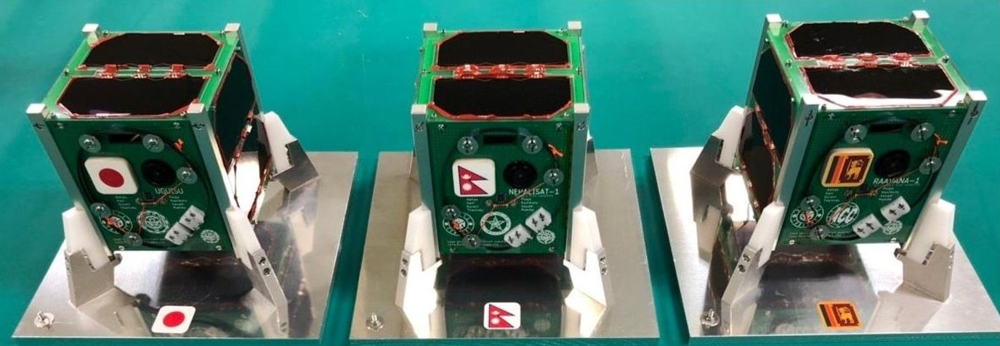

Figure 3. BIRDS-3 flight models.

<!-- PDF_PAGE: 4 -->

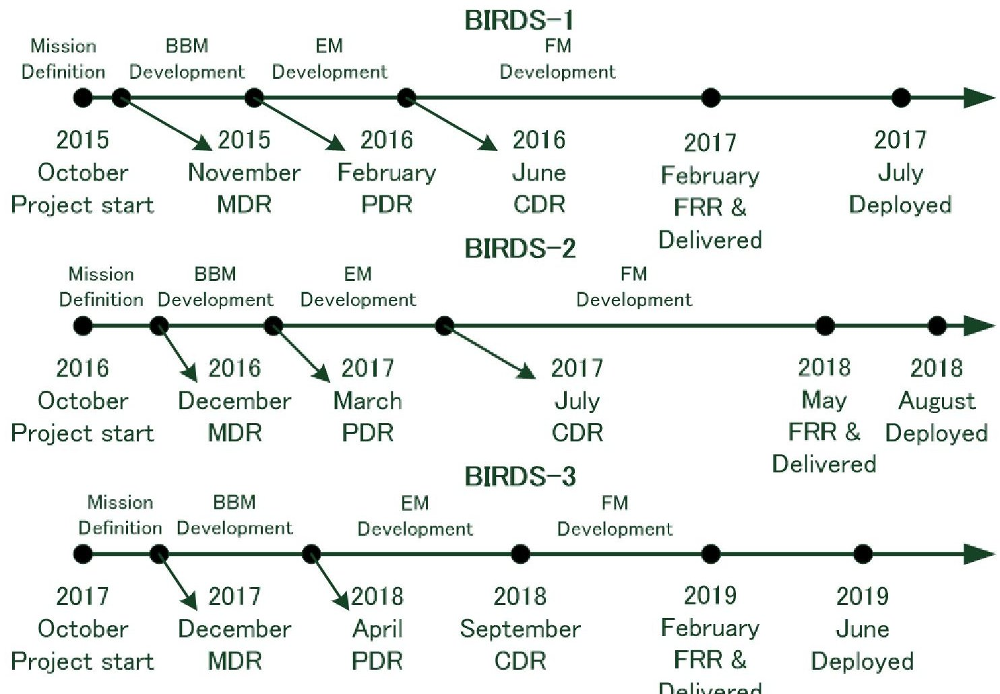

Figure 4. Rough timeline of each BIRDS project.

members of multiple BIRDS generations can work together, transferring their experience to the next generation, and quickly improving the satellite design. For example, when BIRDS-2 began, BIRDS-2 members could work together with BIRDS-1 members. The BIRDS-1 team could help the BIRDS-2 team modify and improve the BIRDS-2 bus system.

BIRDS-1 and BIRDS-2 satellite development faced challenges as an educational project to develop and modify the bus system. First, it was very hard to finish the satellite development on schedule. From the date of the project kickoff in October or November, the members spend the first two or three months defining the specific satellite missions, leading to Mission Definition Review (MDR) in December. Project members start actual development work with a simple BBM (Bread Board Model) after MDR. Until then, the team members do not touch any hardware. The satellite configuration is not yet defined, except that each satellite is a 1U CubeSat. Because the project members of each generation define the satellite

missions themselves, each BIRDS generation has a different mission payload. From MDR to satellite delivery usually takes 13 to 15 months, during which the team members build their satellites.

Although the outline of the bus system is similar to that of the previous generation, the interface between the satellite bus and the mission payload changes for each generation. BIRDS-1, the first generation project, designed the CubeSat satellite bus system from scratch, inheriting the design of HORYU-II and HORYU-IV: 30-cm,10-kg-class non-CubeSat satellites developed at the Kyushu Institute of Technology (Cho et al., 2013; Faure et al., 2018). The BIRDS-2 satellite bus was based on BIRDS-1. The satellite bus cannot be exactly the same for each generation if it has to be developed again based on the previous generation. Moreover, even after each mission's requirements have been defined, the data and power interface between the satellite bus and the mission payloads frequently need to be modified. Bus system modification can consume too many project

<!-- PDF_PAGE: 5 -->

resources, leaving only a small amount of resources left for mission system development.

Actually, the modification work continued even after the Critical Design Review (CDR) for the first two BIRDS project generations, because the project members had no solid reference for their design, and an important goal of theirs was to follow the development schedule. That was one of the major reasons for having a long time between CDR and FRR (Flight Readiness Review) for the delivery to launch service. In the case of BIRDS-3, the BIRDS BUS provided a solid bus system to begin with, and they were able to finish the actual development work with the engineering model (EM) before CDR. Minimal modification took place from the engineering model to the flight model (FM) in the BIRDS-3 project after CDR.

Modification of the electrical power system (EPS) usually creates additional work for the safety review. For every design change, compliance with the safety requirements imposed by the launch provider (JAXA, for the BIRDS projects) must be verified. Sometimes, the work involves many tests and volumes of documentation. To comply with safety requirements, the design often needs to be further changed. The sudden design changes can severely affect the already tight schedule. A typical example of this is when a critical device for the EPS must be modified. BIRDS-1 supported ordinary batteries; however, the electrical power system of BIRDS-2 could not, because it simplified protection-switch assignment. The BIRDS-2 EPS supports only a battery that has an internal protection system to comply with the safety requirements, using the internal protection functions of the battery. This battery replacement required additional testing to guarantee the protection functions of the new battery, and the safety conditions were checked with thorough, complete documentation. Enough flexibility is recommended for the electrical power system to undergo a design change or launch environment change.

The electrical power supply system also showed several points that need to be improved. Three battery charge regulators (BCRs) are used for each panel. The first one is for X+ and external power, the second is for Y+ and Y-, and the third is for Z+ and Z-. These

multiple BCRs require a blocking diode after each BCR. The power loss at the regulators was significant for a 1U CubeSat. Moreover, the BCR did not support the maximum power-point control of solar cells in BIRDS-1 and BIRDS-2. These inefficiencies led to a very tight power budget and created many difficulties when the project members designed their mission system. The power system should use the maximum power point of solar cells to generate as much electricity as possible.

The remove-before-flight pin, FP1 of Figure 5, is also difficult to use, because of its complexity. FP1 is the connector for the external power of the ground test and the battery charging work. However, it is also the control signal for controlling deployment switch 1 (SW1) and deployment switch 2 (SW2). When the flight pin is inserted without power, it opens the two switches. SW1 and SW2 are closed when FP1 supplies electrical power. If FP1 is pulled out mechanically, the two switches close. One difficult point of this complexity is seen when the battery needs charging without activation of the satellite. The deployment switches for SW3 and SW4 are nominally closed status because both switches should be closed when the satellite is deployed from the pod. SW3 or SW4 needs to be forced to stay open so as not to activate the satellite. Another difficult point is when FP1 is inserted but the satellite needs to remain activated for a ground test. If FP1 is mechanically inserted and the external power is turned off, and the satellite is deactivated even when it needs to keep the electrical power with external power for tests.

Figure 6 shows the schematic diagram of the BIRDS-2 command and data-handling system. The command and data-handling system of BIRDS-1 and BIRDS-2 was also difficult for inexperienced young engineers, because it is too complex. The microcontrollers of the data-handling system were from two different companies, because the project members wanted to use inherited components from previous Kyutech projects, HORYU-II and HORYU-IV. One of them was a PIC microcontroller from Microchip Technology Inc. and the other was an H8 microcontroller from Renesas Electronics. Even though there are reference books for those two popular microcontrollers, the project members had to learn two

<!-- PDF_PAGE: 6 -->

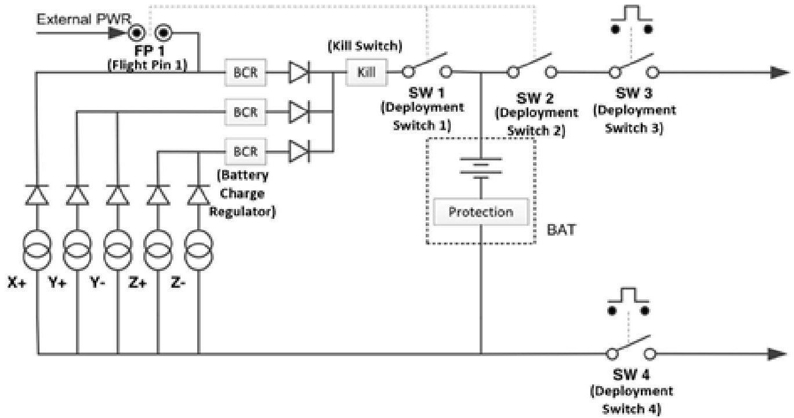

Fig. 5. BIRDS-2 electrical power system schematics.

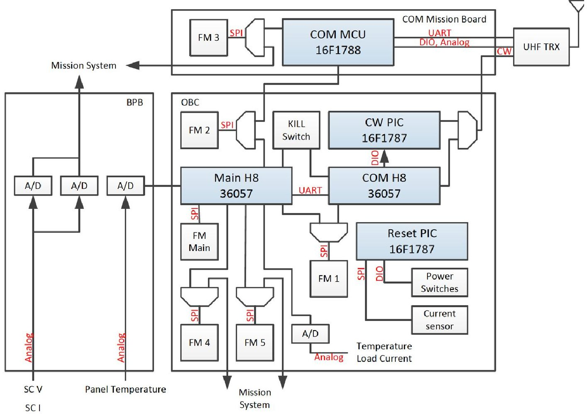

Fig. 6. Schematic diagram of BIRDS-2 command and data-handling system.

<!-- PDF_PAGE: 7 -->

different development environments. Besides the microcontrollers, memory and other major devices were also diverse based on their requirements, which led to longer training times for project members.

The microcontroller connections were also too complicated. Three microcontrollers shared the work of being the communication system between the satellite and the ground station. Among the three microcontrollers, two of them, a CW (Continuous Wave) PIC and a COM H8, handled the CW transmission together, and one COM MCU handled the frequency modulation communication on another mission board. The satellite data was also handled by multiple microcontrollers, and the mission system had its own data path to the COM MCU. Major satellite information is collected by the Main H8; however, solar-cell power information is collected by the mission system first and then transferred to the Main H8 using shared flash memory. The COM MCU has two different shared flash memories with the Main H8 and the mission system. The direct connection between the COM MCU and the mission system made a short way to transfer mission data to the communication system, but also increased the complexity of the communication system.

Another problem was the lack of direct serial interfaces between the microcontrollers. The shared flash memory used a multiplexer to change the data path between the memory and the microcontroller. The path control was very slow and complex without a direct serial interface between the microcontrollers. The lack of interface creates trouble in the power control, as well. One Reset PIC microcontroller controls the entire electrical power supply of the satellite, but it had no interface with other microcontrollers to isolate the microcontroller as much as possible. Isolation provides simplicity to the power system; however, it is too difficult to make a cooperative process between the electrical power system and other subsystems of the satellite.

## 3. Approaches for the Standard BUS

The educational CubeSat bus needs to be standardized to support more efficient development work. It has to be useable with future projects with minimal

modification, making it possible to put more resources towards mission payload development. Also, BIRDS-1 and BIRDS-2 heritage should be used as much as possible, because the functionality of many devices and designs have already been validated in orbit. There are many requirements for the standard CubeSat bus design. However, too many requirements make the design very complex and difficult to use for actual development on the field. BIRDS BUS chose three requirements to satisfy the conditions BIRDS project members thought during their development as simple as possible, as follows:

## 3.1. Simple Design with Dedicated Microcontrollers

A standard BUS should be easy to learn for CubeSat development beginners. All young engineers have very different backgrounds when they come to Kyutech. They occasionally have to start with very basic training, but the program cannot allocate much time for that. The project members need to learn through on-the-job training while working on actual subsystems. If each subsystem has its own microcontroller, the training can be easy. If the BIRDS projects had not been educational projects, multiple subsystems could have been developed with one microcontroller to minimize overhead. However, when one microcontroller handles multiple subsystems, one member has to know each of those subsystems. Also, multiple members have to share a single microcontroller to develop different subsystems. That makes the development work very complicated, and training takes a long time. The development work and on-the-job training become easier when each subsystem uses its own microcontroller. Each microcontroller is dedicated to one subsystem, and each subsystem needs to use only one microcontroller for ease of design. Microcontroller selection should be more focused on simplicity of training than performance. However, this distributed network system with multiple microcontrollers makes a complex system; simple and reliable ring network is required to avoid complexity.

<!-- PDF_PAGE: 8 -->

## 3.2. Flexible Designs for Changes in Safety Requirements

BIRDS projects have been using the deployment service of the JAXA Kibo module on the ISS, in order to secure an annual launch slot. JAXA imposes very strict safety requirements because the ISS is a manned space system, and any hazard risk should be minimized by following the JAXA safety requirements. BIRDS-1 and BIRDS-2 were designed to comply with those strict requirements, but the design was customized to the generation without flexibility. Other launch services have their own safety requirements, and the conventional rocket-launch service has very different characteristics, depending on the launch environment. Even for the same launch service, the safety requirements change because the launch environment may change. If the design has to be changed for each generation of the BIRDS satellite, many resources can be depleted: development time, human resources, and so on. Therefore, while educational CubeSat design should be as simple as possible, the design needs to be flexible enough to meet the safety requirements of various launch services, at the same time. At this time, the ISS release is the most affordable and secure way of launching educational CubeSats; however, this may not be true in the future. The BIRDS program needs to prepare for that possibility.

This flexibility is especially necessary in the electrical power system (EPS) design. In EPS, the critical safety requirements are for cold launch and battery protection. Inhibit switches and a protection circuit must be properly designed to comply with safety requirements. The design for inhibits and protection needs flexibility so that it does not have to be modified, even if we change the launch service in the future.

When a satellite ends its mission in orbit, so-called kill switches should be activated to permanently cut off the electrical power line of the satellite. This termination issue also needs to be considered as a debris mitigation requirement, i.e., passivation. Any remaining energy source onboard the satellite should be nullified. In the case of CubeSats, this means that the battery energy is completely depleted. Functionality to terminate satellite operation and deplete the battery energy must be included.

## 3.3. Scalability for Future Use

Even if it is not the first target of the BIRDS BUS, scalability of design is also important for a standard bus. For BIRDS-1 and BIRDS-2, the bus design has been for a 1U CubeSat only, and its design has supported only ISS deployment. However, this can be changed at any time, and BIRDS projects need to be sustainable if there are sudden changes to the project environment. The BIRDS BUS must be as scalable as possible, in order not to sacrifice meeting other requirements. These days, many CubeSat projects use a relatively large satellite, 3U or larger, because many missions require that for more power and volume. Therefore, a standard bus must support a CubeSat up to 3U in size with minimal modifications. Hence, for use in the future, kill switches need to be kept in the bus system for permanent deactivation of the satellite in the case of higher altitude.

## 4. The BIRDS BUS and its Application

Keeping in mind that the BIRDS BUS design is a standard bus, focused on electrical architecture for an educational CubeSat development project, the EPS and data-handling system are mainly designed to satisfy the requirements of a standard bus. The communication system and external interfaces are also included as reference designs. The EPS design is meant to support various launch service safety requirements and scalability. The data-handling system is mainly designed for easy training with dedicated microcontrollers for each subsystem. The microcontrollers are connected with simple serial interfaces and shared flash memories. The BIRDS BUS used two boards for its actual fabrication for the BIRDS-3 satellite: a Front Access Board (FAB/EPS) and an OnBoard Computer board (OBC/EPS). The FAB/EPS handles the collection of electrical power, the electrical power safety control, and the external interfaces. The OBC/EPS has the function of data handling, and an electrical power distribution component is also installed. These two boards are explained at the end of this section for the application of the BIRDS BUS. The communication system uses a different board with a UHF transceiver,

<!-- PDF_PAGE: 9 -->

and a deployable dipole antenna is attached to the external panel board. These boards are connected by a Back-Plane Board (BPB) without any harness.

## 4.1. Backplane Board

Many CubeSat designs have already been developed to minimize the use of a harness, which increases the complexity of assembly work and risk of failure (Busch et al., 2015). The backplane board (BPB) system is one of those designs. Kyutech has used the backplane style since BIRDS-1. The BIRDS BUS also uses the BPB system to connect each board on the satellite. It provides many advantages, not just for harnessless design but for standard design. The BIRDS BUS BPB uses 50-pin connectors, as shown in Figure 7. It has fixed pin assignments for the power lines, the bus system data lines, and the mission system. When a board is developed for a new project, it can be used with boards of previous projects without trouble if it follows the fixed pin assignments. With a fixed pin assignment, little trouble with the bus system is expected. However, for mission payloads, the fixed pin assignment sometimes limits design flexibility. To assure flexibility, one idea is to have software-defined routing. One example is to use a device such as a Complex Programmable Logic Device (CPLD), the details

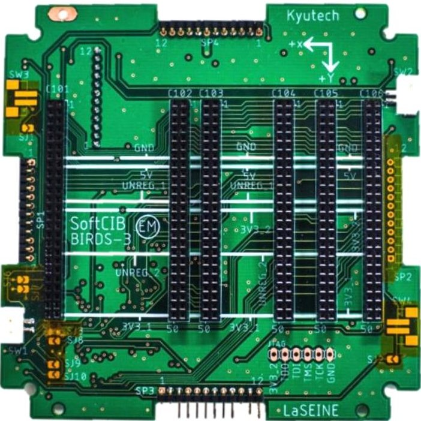

Fig. 7. BIRDS-3 backplane board.

of which are given in (Tumenjargal et al., 2019). CPLD changes electrical signal lines by software configuration, with no need to change hardware even if mission payload has design changes for the interface. In the view of scalability, developed backplane board supports from 1U size CubeSat to 3U size CubeSat, and two connectors are for mission system. If mission system does not need more connectors than the two connectors which BIRDS BUS has, this backplane board can be used with minimal modification. If the mission system needs more connectors, the backplane board should be modified.

## 4.2. Electrical Power System

Two critical safety requirements are the cold-launch condition and the battery-protection condition for the EPS, because failure can lead to a catastrophic disaster of the launch site and the launch vehicle. Usually, multiple switches or protection devices are required to comply with these conditions, and the BIRDS BUS uses a three-inhibit condition for these safety requirements. If the CubeSat satisfies the three-inhibit condition, even if two switches simultaneously break, the satellite has no electrical power activation from any power source, solar cell or battery. Also, the battery should be protected from any accidental failure such as, over-charging, over-discharging, or external short-circuit. This three-inhibit condition is difficult to achieve in a CubeSat, but it can comply with the safety regulations of various launch service with minimal modification of design.

Figure 8 shows the schematic diagram of the BIRDS BUS EPS. It has four power switches, SW1, SW2, SW3, and SW4, to satisfy the cold launch requirement of a three-inhibit condition. SW1 is located between the solar cells and the battery to cut off the power from the solar cells to the satellite's other electrical system. SW2 and SW3 are located between the battery and the electrical load to cut off any power to the electrical load of the satellite with redundancy. The battery is the most high-density energy source on the satellite, and usually the most critical item for the safety review. SW4 is located between the battery and the ground of satellite electrical system and separates

<!-- PDF_PAGE: 10 -->

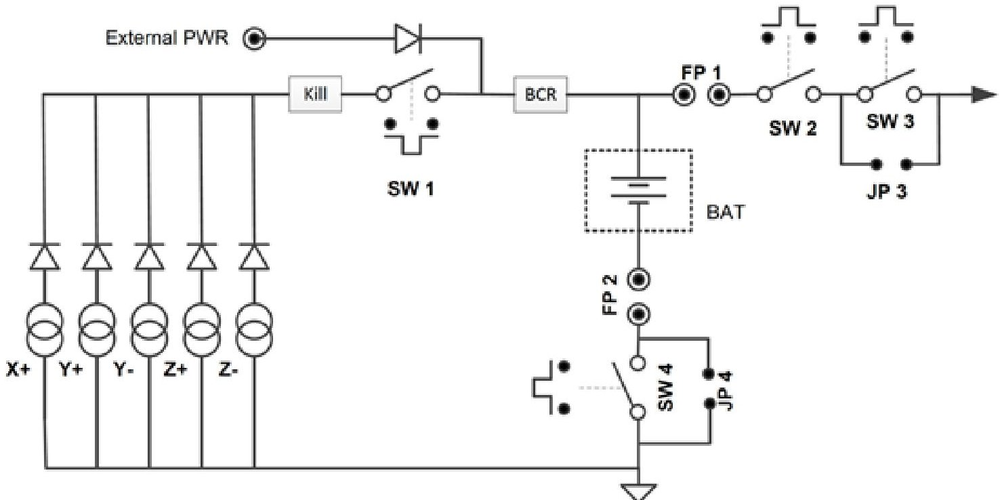

Fig. 8. Schematic diagram of BIRDS BUS electrical power system.

the battery from the satellite system until deployment. These power switches can be controlled one-by-one, with dedicated deployment switches or multiple power switches can be controlled with one flexible deployment switch. The number of switches increased from the design in BIRDS-2; however, the additional switches make it possible to use this design with a completely different launch service, such as a conventional rocket launch service, with minimal modification.

The flight pins, FP1 and FP2, provide mechanical connections to the power system. If the flight pins are inserted, the power lines are mechanically disconnected, and provide with solid disconnection of electrical power between the power sources and the electrical load for the safety of the ground test and the logistics of the satellite. BIRDS BUS separated the flight pins from the external power supply function and the deployment switches completely. The external power is directly connected with the BCR with a protection diode, and supplies external power when the satellite needs a ground test or battery charging.

The safety regulations differ from one launch service to the next, and the three-inhibit condition is not always required. In many launch services, SW3 or SW4 is unnecessary for the safety requirements. If SW3 and SW4 have no reason to be used, the jumper

switches, JP3 and JP4, are connected mechanically to disable SW3 and SW4 for reliability. (See Table 1.)

Table 1. Three-Inhibit Conditions for Cold Launch

<table border="1"><tr><td>Inhibited power</td><td>Switches for inhibit condition</td></tr><tr><td>Solar cell to load</td><td>SW1- SW2- SW3</td></tr><tr><td>Battery to load</td><td>SW2- SW3- SW4</td></tr></table>

The battery must be handled with caution, as a high-energy-density device. Some batteries have builtin protection system such as PTC (Positive Thermal Coefficient) of the Li-ion battery. However, this requires an external protection system to support any battery of non-built-in protection. Actually, BIRDS BUS uses a commercial Ni-MH battery for non-built-in protection. For battery protection, three protection mechanisms are implemented in the BIRDS BUS against overcharging, over-discharging, and external short circuit, shown in Table 2. Switches of the cold launch condition can be used for the protection system to isolate the battery from other systems, the power source, and the electrical load. In the BIRDS BUS, SW1 and SW4 disconnect the battery from the solar cell until the moment of deployment. Also, the BCR

<!-- PDF_PAGE: 11 -->

has the function of protecting the battery against overcharging between the solar cell and the battery. SW2, SW3, and SW4 disconnect the battery from the electrical load and act like a protection system against over-discharging. SW4 has another function of protecting the battery against external short circuit. Usually, the battery has sufficient insulation layers for the wiring of current path, and the BIRDS BUS has an additional insulation layer to the path around the battery to create double insulation layers, rather than a single layer. Even if one layer is broken, another layer protects the battery from short circuit accidents. If any accident causes a break in the double insulation, SW4 isolates the battery and protects against a short circuit as a third protection device.

Table 2. Three Battery-Protection Conditions

<table border="1"><tr><td>Protection items</td><td>Switches for protection</td></tr><tr><td>Overcharging</td><td>SW1-BCR-SW4</td></tr><tr><td>Over-discharging(Load side)</td><td>SW2-SW3-SW4</td></tr><tr><td>Over-discharging(Solar cell side)</td><td>Blocking diode of cell-SW1-SW4</td></tr><tr><td>External short circuit</td><td>Double insulation-SW4</td></tr></table>

The BIRDS BUS uses the LTC3119 from Linear Technology Corporation as the BCR. There are many reasons for this, but the primary reason is that it supports maximum power-point control of solar cells. The LTC3119 has a pin name of maximum power-point control, and the input voltage of the BCR maintains the same value with the pin of maximum power-point control. Because of this control, maximum power from the solar cell is available, even if the electrical load condition changes. The previous EPS used three BCRs, and it needed additional blocking diodes after each regulator. The BIRDS BUS changed the design to use only one BCR and eliminated the blocking diodes to save on energy loss, as the charging regulator contains a blocking function inside.

A satellite should have a passivation function that completely empties the energy source, once its operation has been terminated. The BIRDS BUS has a kill switch unit, which supports the passivation of BIRDS satellites when there is no reason to continue operation

in orbit. The kill switch is a combination of a MOSFET switch, latch relay, and latch-relay driver. Once the switch is activated, the connection between the solar cell and the satellite is completely disconnected, to empty the battery and permanently terminate the satellite. Because its activation is very risky, the BIRDS BUS has two kill switches in parallel as a kill switch unit, to form a redundancy. Each kill switch is independently controlled by two different microcontrollers, so as not to simultaneously activate both kill switches by mistake or have any microcontroller failure.

This electrical power system has been designed to support up to 3U CubeSats. The power generation of a CubeSat depends on many factors, including orbit conditions, performance of solar cells, attitude control capability, and so on. BIRDS satellites use 3G30A solar cells from AZURSPACE, and one solar cell generates 1.2 W in the ideal case of the maximum power point; a 3U CubeSat can have a maximum of 18 solar cells attached on three surfaces if it has a deployable panel system. By very rough assumption, the maximum electrical power generation can be estimated at less than 21.6 W. The BCR (Battery Charge Regulator) of the LTC3119 supports a maximum input voltage of 18 V and a maximum current capacity of 5 A, more than 21.6 W. The current capacity of each power line of a printed circuit board and other devices is also designed to withstand 2 A of continuous current. If battery voltage is selected higher than 11 V, BIRDS BUS can support up to 21.6 W with minimal modification.

Figure 9 shows a block diagram of the power distribution for the BIRDS BUS. Many power switches are controlled by the Reset PIC and distribute the power. Each power output is monitored with the current sensor, and over-current-protection circuits are also in place. The Reset PIC controls the power of the other two microcontrollers, the COM PIC and the Main PIC, and acts like a watchdog over them. The BIRDS BUS has five power lines for the EPS to the mission system. Two of them transfer unregulated power directly from the battery. A 3.3 V power supply also has two power lines, and a 5 V power supply has one line.

<!-- PDF_PAGE: 12 -->

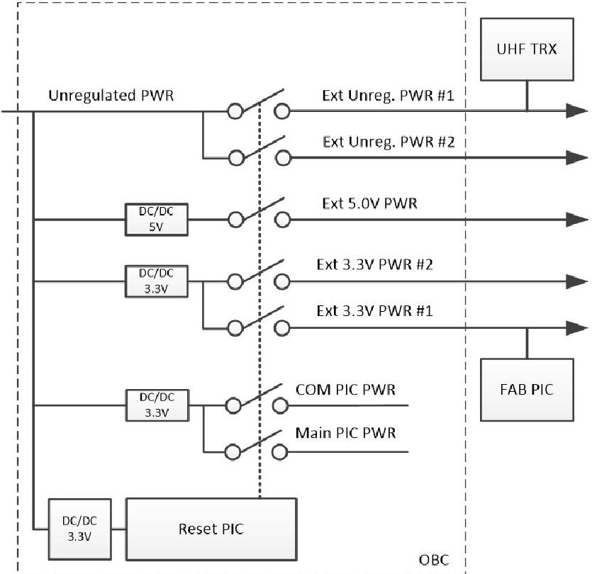

Figure 9. Power distribution on OBC/EPS board.

## 4.3. Command and Data-handling System

The BIRDS BUS uses three dedicated microcontrollers (Reset PIC, COM PIC and Main PIC) for each of the three major subsystems (electrical power supply subsystem, communication subsystem, and command and data-handling subsystem). One additional microcontroller, the FAB PIC, collects electrical power data as a monitoring device. If BIRDS satellites were not educational CubeSats, there would be no reason to use that many microcontrollers. It is inevitable to have some loss of resources from overhead costs with the increased system complexity, when that many microcontrollers have to work together, because they have to handle the cooperation work by using some computing power and for mutual communications. However, each subsystem development should be simple, even though the system itself has more complexity, with a dedicated single microcontroller for project members to easily develop its function while training on the job. If one or two microcontrollers do the work for all bus systems, development becomes very difficult for beginners, as sharing the work with team members is not easy. Also, if multiple microcontrollers share the work for one single subsystem, the system integration work becomes too heavy. One dedicated microcontroller per

subsystem is better for simple training for student engineers.

The BIRDS BUS uses a simple 8-bit microcontroller family for several reasons. BIRDS projects are educational projects, and having simple and easy-to use microcontrollers is better than having high-performance microcontrollers. Actually, BIRDS BUS microcontrollers have quite low performance compared to the microcontrollers of other CubeSat projects with practical missions. However, these simple microcontrollers are sufficient for an educational project with a simple mission. BIRDS BUS is designed to support basic functionality of a satellite with limited resources, not to support attitude control as a default system. When an attitude control system is required for the mission of satellite, it needs to be developed as a mission system.

Figure 10 shows a schematic diagram of the data handling system. For easy training with using microcontrollers, the BIRDS BUS unified the selection of microcontrollers to use just one microcontroller family, PIC. The PIC series was selected because of its flight heritage from many CubeSat projects. For example, a simple 8-bit PIC16F1787 microcontroller has been used in previous Kyutech satellites, and worked without problems. Due to its memory size limitation, the PIC16F1789 with 28 kB of programming memory has been selected for the BIRDS BUS in the same series of the PIC family. It would be better to use the same PIC16F1789 microcontroller for all subsystems. However, the Main PIC requires high speeds and enough computational power compared to the other microcontrollers, because it handles all the satellite data. It can create a bottleneck in data transmission between the BUS system and the mission system, and needs enough programming memory to handle various mission system data in further projects. Because of that, a more powerful PIC microcontroller, the PIC18F67J94, is used for the Main PIC. It has 128 kB programing memory, so it is easy to modify its programs following the mission system requirements. It also supports a maximum 64-MHz clock speed for data handling. The Main PIC has a 10-pin digital interface with the mission system. These digital interface pins can be configured to the serial interfaces, and

<!-- PDF_PAGE: 13 -->

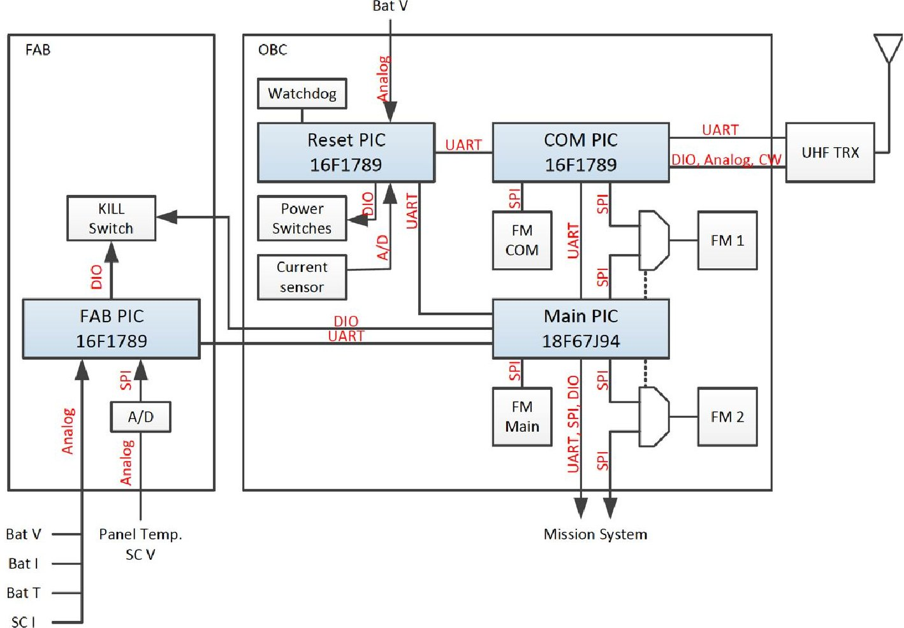

Fig. 10. Schematic diagram of BIRDS BUS data-handling system.

up to five channels of UART interfaces can be available.

Non-volatile memory is required for the data handling system's data storage. The BIRDS BUS has four non-volatile memories, two of which are dedicated storage for the Main PIC and the COM PIC, and the other two shared with the multiplexer. One of the shared memories is between the Main PIC and COM PIC, and the other is between the Main PIC and the mission system. All multiplexer shared memories are controlled by the Main PIC. The BIRDS BUS uses a simple UART serial interface for regular interfaces between microcontrollers. It is easy to use, but not very fast. Shared memories support a large amount of data transfer when the speed of a serial interface is insufficient. The BIRDS BUS uses only one type of flash memory as non-volatile memory, an SPI interface NOR-type flash memory with a 1-GB capacity. For a CubeSat, 1 GB is enough capacity, if it has an ordinary mission objective. Because only one type of flash memory is used, a common library code for memory

handling is available for the coding work. Not only for the non-volatile memory but also for the serial interface, the BIRDS BUS uses just two common serial interface protocols. There are many kinds of serial interfaces for an embedded system, but only UART and SPI serial interfaces are used for the BIRDS BUS.

Because the BIRDS BUS is a kind of distributed system for data handling, it needs well-defined interfaces between the three major microcontrollers. The three microcontrollers are connected to each other by UART for the primary interface, and construct a very simple ring network, like that shown in Figure 11. This simple ring network helps to use commercial microcontrollers of non-radiation tolerance. Regular messages are transmitted between the microcontrollers in this simple ring network. The Reset PIC controls the electrical power supply for all CubeSat systems. If other microcontrollers have no acknowledge response to regular messages, the Reset PIC can reset the microcontroller power to recover it. The regular message transmission acts like watchdog device with the power

<!-- PDF_PAGE: 14 -->

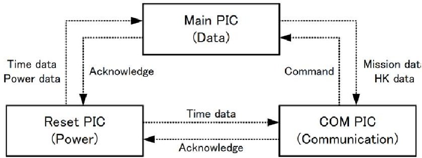

Figure 11. Simple ring network for the data-handling system.

reset. These power controls should be very reliable and the Reset PIC has a very simple and clear programming code to minimize trouble. Because of this low probability of reset chance for the Reset PIC, it also keeps the satellite time data. However, all satellite electronics have the possibility of failure in orbit because of the single-event effect of radiation, and the Reset PIC is no exception. In the case of Reset PIC failure, a simple external watchdog device is attached to the Reset PIC for safety.

The three major microcontrollers need to act as a combined data-handling system, and that requires time synchronization in many cases. Each microcontroller has its own primary clock source with a dedicated oscillator. However, one 32.768-kHz oscillator is in the OBC as a common clock source for all three microcontrollers. The common clock source becomes the secondary clock source for each microcontroller to make a timer interrupt at the same time between the three microcontrollers. This simultaneous timer interrupt simply synchronizes the timing of data-handling activities, and satellite time management becomes very easy because of this common clock source. This synchronized data handling is especially useful for the regular messaging work of the UART ring network.

In the BIRDS BUS, only the COM PIC handles communication between the BIRDS satellite and the ground system. It takes data from the Main PIC through the UART of the ring network or the shared flash memory. The UART interface is sufficient for a small amount of data; however, a larger amount, such as image data, needs to use the shared flash memory for efficiency. Usually, two kinds of data are transferred to the COM PIC from the Main PIC. One is the housekeeping (HK) data, basic information about the satellite condition, and the other is the mission data

from the mission system. The data is transmitted to the ground station by UHF transceiver. The COM PIC receives commands from the ground station and sends most of the commands to the Main PIC for further processing. Also, the COM PIC has its own flash memory for storing data. A simple command to download the data does not need to be processed by the Main PIC, and can be directly processed by the COM PIC with a rapid response. The Main PIC handles all satellite data. It collects EPS data from the FAB PIC and the Reset PIC. In addition, the Main PIC is a data bridge between the bus system and the mission system. All data from the mission system comes to the Main PIC first through the UART serial interface, SPI or shared flash memory. Most of the commands from the ground station are handled by the Main PIC too. The Main PIC also controls one kill switch, and the FAB PIC independently controls another, to minimize the risk.

## 4.4. Communication System

The BIRDS BUS communication system was not newly developed for the standard bus. Its specifications are mainly selected from the heritages of previous BIRDS-1 and BIRDS-2 generations. The BIRDS BUS uses amateur radio band UHF frequencies for both the uplink and the downlink. One transceiver handles the communication as half-duplex mode and Gaussian Mean Shift Key (GMSK) is used for modulation. The BIRDS communication system needs to support an educational mission objective, so there is no need to provide high-speed communication between the satellite and the ground station. Actually, a relatively low communication speed has advantages for the stability of the communication link by its higher energy per bit. The baud rate of communication is just 4800 bps for both directions, and the data format follows the AX.25 protocol. Several types of antennae were tried, including the patch antenna of BIRDS-1, and a simple dipole antenna showed many advantages, such as gain and radiation patterns. The simple dipole antenna is attached on the external panel board for BIRDS BUS, as shown in Figure 12. A 1U CubeSat is too small for a solid dipole antenna of UHF frequency on the structure. The BIRDS BUS uses a deployable antenna with a heat cutter. The antenna is stored with

<!-- PDF_PAGE: 15 -->

winded status on the surface of the panel board by a string of ultra-high molecular weight polyethylene. The heat wire cuts the string after the satellite is deployed in orbit. This external panel board is used for mission system, as well. BIRDS-3 used this external panel board to install GPS patch antenna and camera lens.

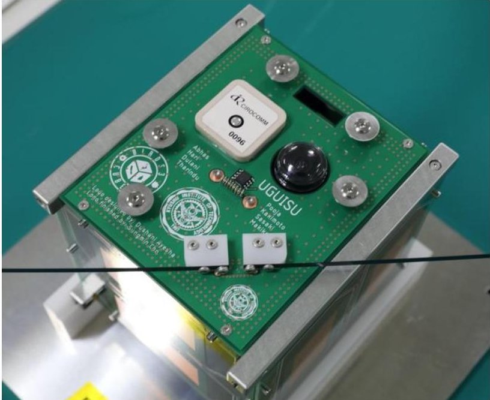

Figure 12. BIRDS-3 external panel board and dipole antenna.

These communication system specifications are determined for easy ground station construction work without any customized devices. The BIRDS project members have to build their own ground station in their countries, for satellite operation. The UHF frequency, the GMSK modulation and the standard AX.25 protocol are very common specifications for amateur radio data communication, and much equipment is available on the market already.

## 4.5. BIRDS-3 Application of the BIRDS BUS

BIRDS-3 is the third generation of the BIRDS project, and the first satellite to use the BIRDS BUS. It is a 1U CubeSat similar to previous BIRDS satellites and has six boards inside. The six boards and one battery module are connected by one BPB, as shown in Figure 13; Figure 14 shows each board. A Front Access Board (FAB) supports external access to the satellite on the front. All deployment switches are connected to the FAB, and external connectors provide interfaces to each microcontroller in the BIRDS BUS. Also, the

FAB collects all electrical power and handles the power with battery module (BAT). An OnBoard Computer board (OBC) is for the command and data handling. The three major microcontrollers, the Reset PIC, COM PIC, and Main PIC, are located on the OBC. The secondary function of the OBC is the distribution of electrical power to the mission system by the Reset PIC. The FAB and OBC mainly construct the standard bus system of the BIRDS BUS, with the BPB. The COM is the UHF transceiver board for communication with the ground station. The three remaining boards are for the mission system. Two Mission Boards (MSN) are used for the mission system, and one Rear-Access Board (RAB) supports external access to the mission system at the rear of the satellite.

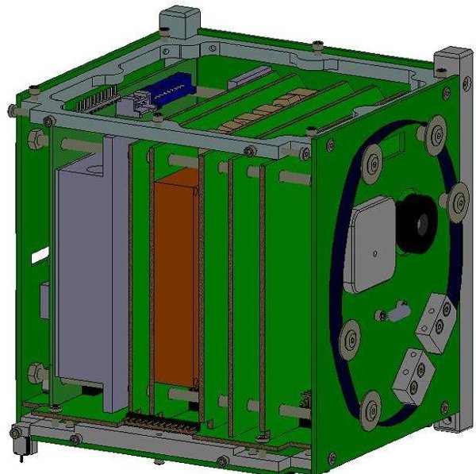

Figure 13. Internal view of BIRDS-3 CubeSat.

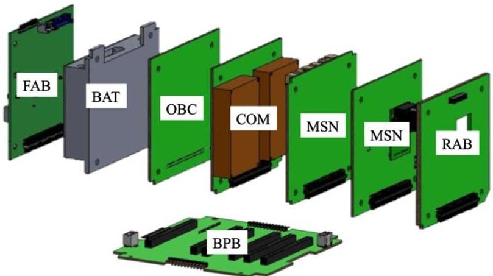

Figure 14. Exploded view of BIRDS-3 CubeSat boards.

<!-- PDF_PAGE: 16 -->

The BIRDS-3 satellite functionality was checked and confirmed by a functional test and long-term operation test. All environmental tests, the vibration test, and the thermal vacuum test were also cleared with the engineering model. BIRDS-1 and BIRDS-2 needed 13 to 15 months to develop the satellites after mission objectives were defined at MDR; BIRDS-3 was developed within 10 months, and the project members had enough time to test the engineering model with various tests, compared to the members of previous generations. This makes it possible to minimize the bugs in hardware and software design, even if project members do not have much experience. After the design of engineering model was confirmed, the flight model was developed, and cleared all environmental tests without trouble.

BIRDS projects each had various mission systems for their payloads. Major mission systems were: a camera system for image of Earth; an APRS (Auto

matic Packet Reporting System) communication system for the amateur community; a radiation hardness check system of commercial electronic devices; and a technological demonstration system. For example, BIRDS-3 had a camera system, a technological demonstration system for LoRa (long range) radio module, and radiation hardness check system of CPLD (Complex Programmable Logic Device) for its major payloads.

The BIRDS BUS has a battery of 3.8[V] nominal voltage, and the electrical path to the mission system is designed to have 2[A] continuous current. For the power of mission system, the BIRDS BUS can support up to 7.6[W], if it is used for 1U size CubeSats. Figure 16 shows the example of mission board for payload development. The mission system can use two mission boards, and the two boards are installed on backplane board, as shown in Figure 15. The mass of payloads needs to be less than 350 [grams].

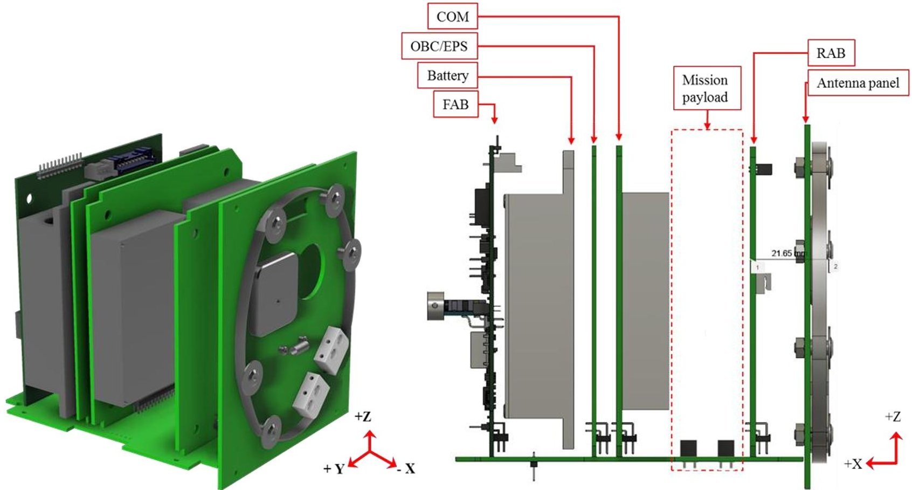

Figure 15. Space for mission payload.

<!-- PDF_PAGE: 17 -->

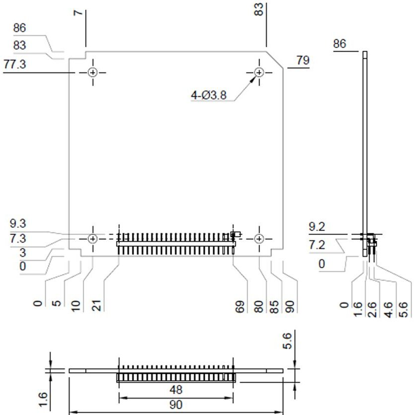

Fig. 16. Sample of mechanical design for mission payload board.

Even if its size is small, a satellite needs to be designed against outgas and whisker of electrical components. All boards confirmed functionality in thermal vacuum tests with a high temperature of 60[ $ ^{\circ} \mathrm{C} $] for several days, and act as a baking process to minimize the outgas. Electrical components are chosen in consideration of the issue of whisker, and do not use a BGA (Ball Grid Array) device, for example.

## 4.5.1. FAB

The FAB is the main body of the EPS for a standard bus. In the BIRDS-3 satellite, it collects the generated electrical power from solar cells of five external panel boards and controls the electrical power using deployment switches (SW1, SW2, SW3, SW4), remove-before-flight pins (FP1, FP2), and the BCR. SW3 and SW4 have jumper pins named JP3 and JP4, and SW3 is deactivated by connecting the jumper pin of JP3. SW4 is deactivated by connecting the jumper pin of JP4 when it is unnecessary. BIRDS-3 uses a small detection switch, shown in Figure 17, which gives the control signal for the MOSFET of deployment switches. Two detection switches are inserted in the tip of the BIRDS-3 CubeSat rail. When BIRDS-3 is inside the pod of deployment, the detection switches are pressed and keep open status of deployment switches. After BIRDS-3 has been deployed from the pod, the detection switches are released and the deployment switches become closed status.

Figure 18 shows the BIRDS-3 satellite FAB. Two remove-before-flight pins are located in the center of the board. This is a jack switch that has two contacts with a 1-A capacity of rated current and supports 2-A of rated current for the BIRDS BUS EPS by parallel connection. The two kill switches are located in the bottom right part of the board, and the battery charger

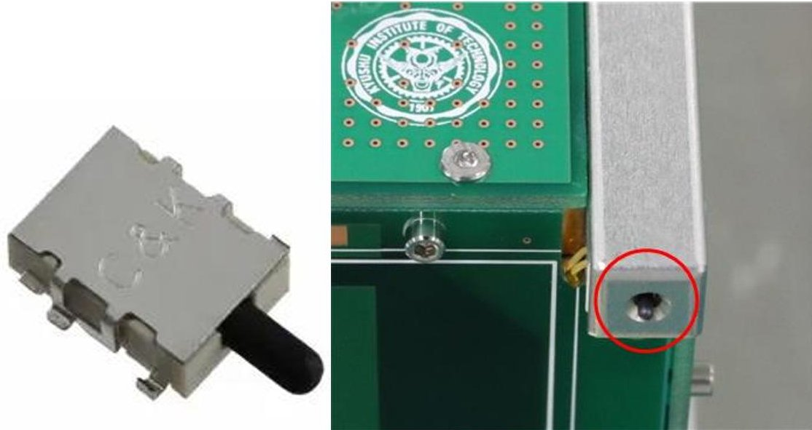

Figure 17. Deployment switch © C&K (left); deployment switch in the rail (right).

<!-- PDF_PAGE: 18 -->

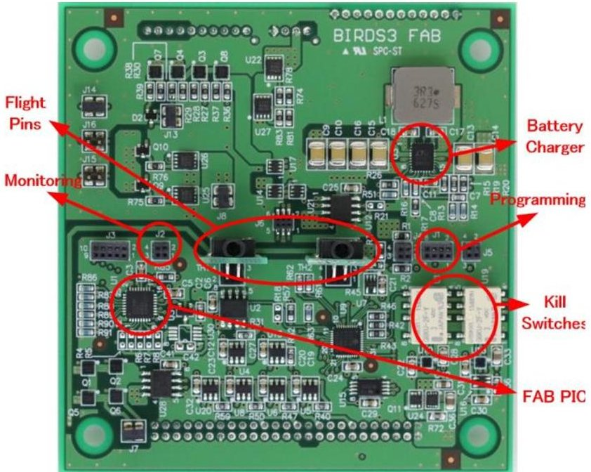

Fig. 18. BIRDS-3 front access board (FAB/EPS).

is also shown on the right side. The FAB PIC is on the left side of the board and monitors the voltage and current from the solar cells, including the temperature of the external panel board. The battery voltage, current, and temperature are also monitored by the FAB PIC and A/D converter. FAB has a connector for programming of PIC processors, indicated with the label "Programming" in Figure 18. Even after the satellite is fully assembled, PIC processors can be updated with new software using this connector. FAB also has a connector for serial interface between the Main PIC and the external device, indicated with the label "Monitoring" in Figure 18. Main PIC combines all the data of the satellite, and send it to the external device. The external device sends a command to the Main PIC when the satellite needs it for tests on ground.

## 4.5.2. OBC

All three major microcontrollers are located on the OBC board with the flash memories for data storage. Each microcontroller is dedicated to a different subsystem and connected with a UART serial interface to build a ring network, following BIRDS BUS design. The COM PIC is the microcontroller responsible for the communication subsystem. The Reset PIC is responsible for the electrical power subsystem. The Main PIC is in charge of the command and data-handling subsystem. Figure 19 shows the simple layout of

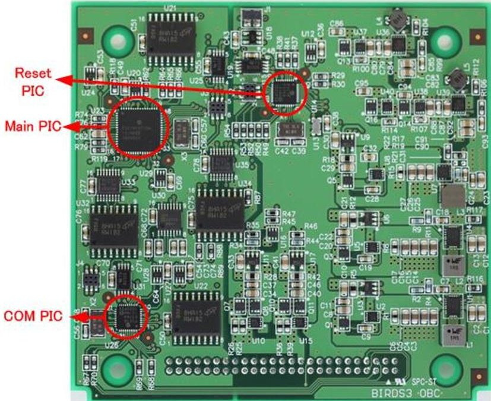

Figure 19. BIRDS-3 onboard computer board (OBC).

the OBC board. The PIC microcontrollers on the OBC board are one-chip microcontrollers with multiple functions. The OBC board also has the power distribution functionality. In the case of BIRDS-3, two unregulated power lines are used for the communication system of UHF transceiver, which has its own regulator inside and antenna deployment system. The two 3.3-V power lines are used for the FAB PIC and mission systems. No devices use 5-V power in BIRDS-3.

## 5. Conclusion

This paper has presented the BIRDS BUS as a standard educational CubeSat bus, with focus on the electrical power system and the data-handling system. The BIRDS BUS is a very simple bus system for quick training and easy development through its simple design and unified device selection. Its power system was improved to avoid the troubles of previous BIRDS project generations and to provide greater efficiency. The data-handling system was designed to support beginners who have no experience in CubeSat development. The effectiveness of the BIRDS BUS has been verified through actual BIRDS-3 CubeSat development work. BIRDS-3 CubeSats were launched on schedule to the ISS on April 17, 2019. Using this standard BIRDS BUS, the development time of BIRDS-3 was much shorter than that for BIRDS-1 and

<!-- PDF_PAGE: 19 -->

BIRDS-2, and the schedule management became easy. By saving on project time, this simple and standardized bus system was more reliable for quick training and allowed for more resources to be dedicated to the BIRDS-3 mission system and other technical issues. BIRDS-3 satellites were released into orbit on June 17, 2019. At the time of writing this paper, three satellites have been functioning well in orbit for more than one month and are sending valuable data to the ground station. For example, Figure 20 shows a photo of Earth taken by a BIRDS-3 satellite in orbit. BIRDS-4 started in October 2018, reusing exactly the same bus system as BIRDS-3 with minimal modifications. The BIRDS BUS is not a universal standard for CubeSats, and its performance has no big difference compare to the other CubeSat design because target of BIRDS BUS is mainly in ease of training and development. It has a very specific target: an educational CubeSat project for rapid development suitable for annual BIRDS projects. It can, however, also support many other educational CubeSat projects because it has the scalability to support CubeSats up to 3U in size and various launch services with minimal modification of design.

## Acknowledgments

This research was supported in part by the "Coordination Funds for Promoting Aerospace Utilization" from the Ministry of Education, Culture, Sports, Science and Technology (MEXT), JAPAN.

## References

Bouwmeester, J. et al. (2018): Towards an Innovative Electrical Interface Standard for PocketQubes and CubeSats. Advances in Space Research, Vol. 62, pp. 3423-3437.

Busch, S., Bangert, P., Dombrovski, S., and Schilling, K. (2015): UWE-3, In-Orbit Performance and Lessons Learned of a Modular and Flexible Satellite Bus for Future Pico-Satellite Formations. Acta Astronautica, Vol. 117, pp. 73-89.

Cho, M. and Graziani, F. (2017): Definition and Requirements of Small Satellites Seeking Low-Cost

Figure 20. Photo of Sri Lanka from BIRDS-3 satellite.

and Fast-Delivery. IAA Study Group Report - SG 4.18, Feb.

Cho, M. et al. (2017): Global Network Operations of CubeSats Constellation, presented at 1st IAA Latin American Symposium on Small Satellites, Buenos Aires, Argentina, Mar. 2017.

Cho, M., Masui, H., and the KIT Satellite Project (2013): Test and Verification of Nanosatellite HORYU-II and Orbital Anomaly Investigation, in Proc. of the 29th ISTS, Nagoya-Aichi, Japan, Jun. 2-8.

eoPortal Directory (2014): Flock 1. Available at: https://earth.esa.int/web/eoportal/satellite-missions/f/flock-1.

Faure, P., Tanaka, A., and Cho, M. (2018): Toward Lean Satellites Reliability Improvement Using HORYU-IV Project as Case Study. Acta Astronautica, Vol. 144, pp. 388-396.

Graziani, F. et al. (2010): A Space Standards Application to University-Class Microsatellites: The UNISAT Experience. Acta Astronautica, Vol. 66, pp. 1534-1543.

Japan Aerospace Exploration Agency (2015): JEM Payload Accommodation Handbook, Vol. 8 - Small Satellite Deployment Interface Control Document.

Mughal, M. R. et al. (2014): Plug-and-Play Design Approach to Smart Harness for Modular Small

<!-- PDF_PAGE: 20 -->

Satellites. Acta Astronautica, Vol. 94, pp. 754 764.

Polansky, J. L. and Cho, M. (2016): A University-Based Model for Space-Related Capacity Building in Emerging Countries. Space Policy, Vol. 36, pp. 19-23.

Sandau, R. (2010): Status and Trends of Small Satellite Missions for Earth Observation. Acta Astronautica, Vol. 66, pp. 1-12.

Tumenjargal, T. et al. (2019): CubeSat Bus Interface with Complex Programmable Logic Device. Acta Astronautica, Vol. 160, pp. 331-342.

Wood, D. and Weigel, A. (2014): Architectures of Small Satellite Programs in Developing Countries. Acta Astronautica, Vol. 97, pp. 109-121.