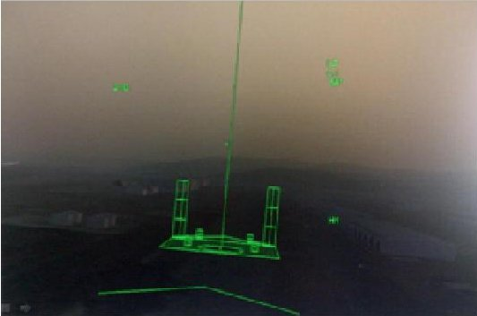
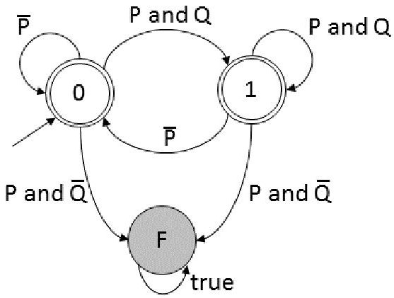
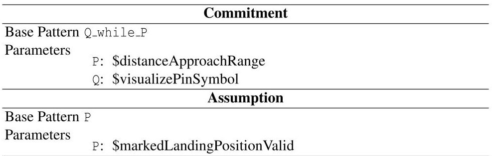
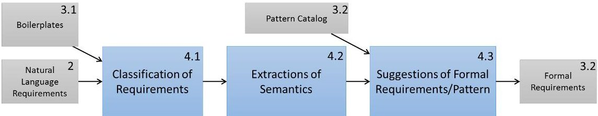
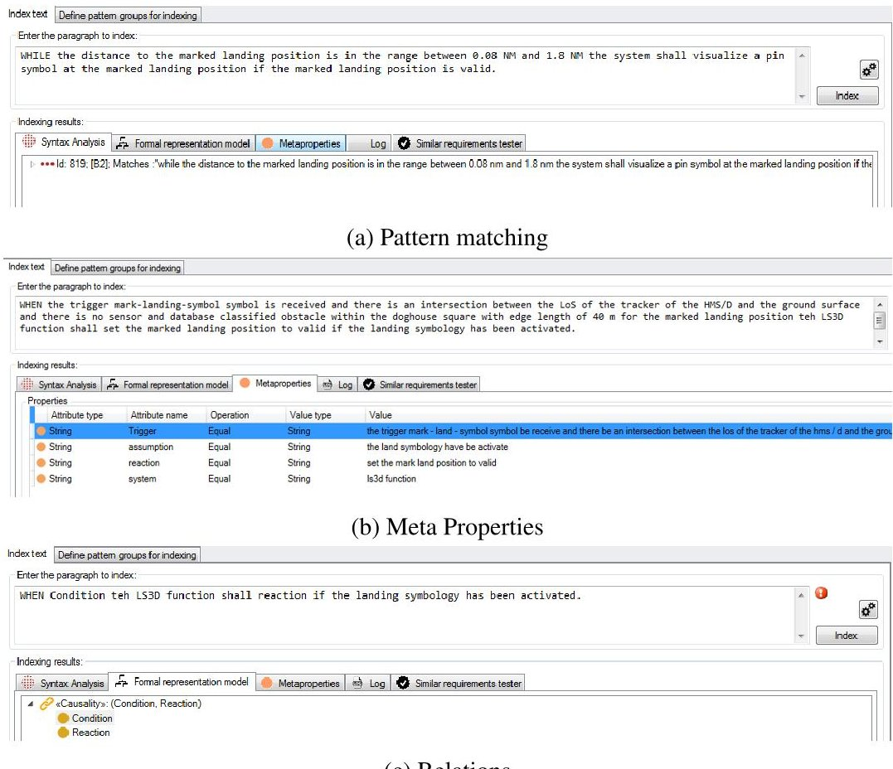

<!-- PDF_PAGE: 1 -->

# Bridging the Gap between Natural Language Requirements and Formal Specifications

Martin Böschen $ ^{1} $ , Ralf Bogusch $ ^{2} $ , Anabel Fraga $ ^{3} $ , and Christian Rudat $ ^{1} $

$ ^{1} $ OFFIS - Institute for Information Technology, Oldenburg, Germany {martin.boeschen, christian.rudat}@offis.de

$ ^{2} $ Airbus DS Electronics and Border Security GmbH, Friedrichshafen, Germany ralf.bogusch@airbus.com $ ^{3} $ Carlos III of Madrid University, Madrid, Spain afraga@inf.uc3m.es

Abstract. In this paper, we discuss the problem of transforming a natural language requirements specification into a formal specification. We present several methods to support the process and implemented them in a commercial tool, the Requirements Quality Suite. We achieve this by enriching the requirement text with additional structure (using a knowledge base) and asking the requirement engineer to formulate the requirements in Boilerplates. The additional structure is used to analyze the requirements automatically or semi-automatically leading finally to a formal specification. The formal specification then enables verification activities, such as testing or formal analysis. We discuss our methods by examples from an industrial case study and report on our experiences.

Keywords: Requirements, Testing, Formalization, Boilerplates, Requirement Patterns

## 1 Introduction

Rigorous safety regulations affect the development of safety-relevant embedded systems in the aerospace domain. Safety standards like SAE ARP4754A and RTCA DO- 178C require high efforts for assuring compliance with applicable airworthiness requirements. In the past years, progress has been made in the area of formal methods. The adoption of formal methods as a verification technique complementary to testing has recently been encouraged by RTCA DO-333, the Formal Methods Supplement to RTCA DO-178C.

Formal methods have the potential to increase safety and reduce the development and verification effort. Experience shows that defining requirements using formal notations has benefits: First, it makes requirements more specific by forcing systems engineers to answer questions that would otherwise be postponed until the implementation phase. Second, it provides the basis to perform advanced verification techniques such as formal analysis or generation of test cases and oracles. Moreover, formal methods may enable exhaustive verification that is usually not possible with testing. For example, model checking allows the verification engineer to explore all possible behaviours of a formal model to determine whether a specified property is satisfied. Formal methods

<!-- PDF_PAGE: 2 -->

are mathematical techniques for the specification, development and verification of computer systems. But today, there is still a large gap between the academic community researching formal methods and industrial practitioners who might benefit. Engineers are more comfortable with tangible requirements and test cases, rather than formal specifications and analysis. Introducing formal methods in industrial practice and overcoming the burden of formalization is a major challenge. An extensive survey about the state of the art of formal methods in industrial use and a discussion about the issues surrounding the industrial adoption of formal methods is provided in [14].

In this paper, we present a tool supported methodology to manage requirements on different levels of formality. In industrial projects, there is a need for natural language requirement documents as well as a formal specification. We do not try to unify the different languages, but show by examples possible ways to manage the interactions between the different levels without restricting either side in an unacceptable way. This makes it much easier to transform system requirements into formal specifications. System and verification engineers agree on a set of Boilerplates and quality metrics for requirements, which ease the process of formalization and which can be evaluated automatically. If these metrics evaluate above a defined threshold, a requirement is stated with the agreed quality. We present a set of different methods, which work together towards the goal of having a simpler management between these two levels of formality. We build our methods on top of the Requirements Quality Suite $ ^{4} $ , an industrial requirements analysis tool. It allows a lot of customization and extensions, so we can integrate our techniques into its user interface and build on services it provides, like natural language processing or pattern matching.

There is a plethora of previous work on the formalization of requirements, [7] and [2] are the closest in spirit to our work. Both are centered around tools (DODT and RETA respectively) and pattern matching is used to make the requirement easier accessible for an analysis. In contrast to these papers, we deliberately choose an industrial tool. This left us with less control over the tools, but makes it easier to discuss the ideas with industrial practitioners.

This paper is organized as follows: In Section 2, we present an industrial case study that exemplifies our approach. Section 3 shows the used representations for the requirements. Section 4 presents several methods that aid formalization of requirements and discusses them on examples. Section 5 concludes and gives an outlook onto future work.

## 2 Industrial Case Study

Airbus Defence and Space develops avionic systems that support helicopter pilots in degraded visual environments (DVE) which can be caused by e.g. rain, fog, sand and snow. Many accidents can directly be attributed to such DVE where pilots often loose spatial and environmental orientation (see Figure 1 on the left side). In this case study we employ the landing symbology function which is part of the pilot assistance landing capabilities of the situational awareness suite Sferion.

The landing symbology function (LS3D) supports helicopter pilots during the landing approach. It enables the pilot to mark the intended landing position on ground using

<!-- PDF_PAGE: 3 -->

a head-tracked HMS/D (Helmet Mounted Sight and Display) and HOCAS (Hands on Collective and Stick). During the final landing approach the landing symbology function enhances the spatial awareness of flying crews by displaying 3D conformal visual cues on the HMS/D (see Figure 1 on the right side). Additionally, obstacles residing in the landing zone can be detected.

The requirements of the system specify its functional behavior and state exactly under which conditions which reactions shall occur. The following two requirements will serve as a running example for the methods to be demonstrated:

R1: The LS3D function shall set the marked landing position to valid, on reception of the trigger mark_landing_symbol, if the landing symbology has been activated and there is an intersection between the LoS of the tracker of the HMS/D and the ground surface and there is no sensor and/or database classified obstacle within the doghouse square with edge length of 40 m for the marked landing position.

R2: The LS3D function shall visualize a pin symbol at the marked landing position if the marked landing position is valid and (0.08NM $ \leq $ distance H/C to landing position $ < $ 1.8NM).

Fig. 1: Landing aid in degraded visual environments

The development process within the case study covers the following activities:

- The systems engineer develops natural language system requirements.

- The system requirements are analyzed using natural language processing techniques and improvements are made to ease subsequent formalization.

- The verification engineer develops the formal system specification.

- The verification engineer uses the formal system specification to perform verification activities.

<!-- PDF_PAGE: 4 -->

A demonstrator has been setup that comprises the following tool chain:

- IBM DOORS: develop natural language requirements, manage requirements.

- TRC Requirements Quality Suite RQS: analyze natural language requirements, guide formalization.

- BTC Embedded Specifier: develop formal specification.

We use DOORS as the requirements repository and management tool. It serves as the central place to store the requirements within the development process. It is customizable and makes its data and functions accessible through an API, so that other tools can access the data and save additional attributes for the requirements. It is widely established in the industry and the Requirements Quality Suite as well as the BTC Embedded Specifier provide an interface to DOORS.

We use the Requirements Quality Suite to author and analyze the requirements as well as manage the knowledge about our requirements. The suite provides a lot of services (like natural language processing and pattern matching) on which we build upon, all accessible through a common interface. The requirements can be analyzed on different levels (syntactic and semantic), it aids in the automatic process to distinguish tokens by its syntactical and its semantic meaning. Given the rules to tokenize and process the requirements in an automatic way, it is possible to measure the quality of requirements based on some metrics established in the quality suite, which provides immediate feedback. It is also possible to integrate custom code to define custom metrics. The systems engineer is assisted in the requirements writing process by using adequate Boilerplates for writing good requirements. These Boilerplates can be customized to fit the needs of one's organization. Boilerplates will be discussed in more detail in Section 3.1. A much more detailed discussion about the capabilities of the Requirements Quality Suite can be found in [9]. While the tool is used in industry mainly to improve the quality of the requirement specifications and to define and check common guidelines for the textual requirements, one of the main motivations of this paper was to use its services and capabilities to make the formalization of the requirements easier, thus making formal methods easier to apply in industrial contexts.

We use the BTC Embedded Specifier to manage our formal requirements. It supports a pattern language (see Section 3.2), which defines temporal relations between observables. It is a variant of Linear Temporal Logic, but instead of building formulas, it provides patterns for commonly used formulas. This makes the tool more accessible for engineers, as they have to just choose a pattern, and then fill in the parameters. The parameters are typically boolean expressions over the observables.

## 3 Requirement Representations

The problem we are considering in this paper is to transform the natural languages requirements into formal specifications. In this section we introduce the representations that are used by systems and verification engineers, respectively.

## 3.1 Boilerplates

Boilerplates [5] are sequential restrictions based on a place-holders structure for the specific terms and values that constitute a particular knowledge statement, where the

<!-- PDF_PAGE: 5 -->

restrictions can be grammatical, semantic, or even both, as well as other Boilerplates (Sub-Boilerplates). There are several Boilerplate languages with EARS [10] being a popular one in industry. We will give two Boilerplates as examples, which are slight variations of the EARS Boilerplates:

B1: WHEN <trigger> the <system> shall <action> if <assumption>.

B2: WHILE <state> the <system> shall <action> if <assumption>.

The Requirements Quality Suite allows the definition of such Boilerplates. One can define sophisticated rules for the restriction of the Boilerplates, in the example we choose a rather general form. Boilerplates consist of some fixed syntax elements, while arbitrary text can be inserted between the angle brackets. Furthermore, the tool can check if a requirement matches a Boilerplate and it can extract the structure of the Boilerplate for further processing. Parts of the Boilerplates can be connected through relationships, forming a so called semantic graph. We will illustrate these features in Section 4 by applying Boilerplates to the use case.

## 3.2 Pattern

Several pattern-based formal requirement languages have been developed within academia (e.g. RSL [12]) and industry (e.g. BTC Pattern [3]) to support an engineer during the formalization process of requirements. The pattern libraries cover the most typical instances of formal system properties, but are also understandable by non-experts of formal methods.

The concept of a pattern is similar to a Boilerplate, in the sense that both define a structural skeleton for requirement texts. The major difference is that a pattern not only provides a syntactical form, but it also provides a precise semantic interpretation. Figure 2 shows as an example the semantic of the pattern Q_while_P. The previous section explained that Boilerplates are able to extract some relationships of a requirement, but not to a level which is necessary to perform formal verification procedures. Therefore, the substitution of parameters defined by a pattern is restricted to formal expressions and does not allow arbitrary texts (which are allowed in Boilerplates).

For this paper, we will use the BTC Patterns which are part of the BTC Embedded Platform. These patterns also support the contract-based approach [11]. The core idea is that a requirement always has a context provided by the environment in which it must hold. A contract states this context explicitly in form of an assumption. The promised behavior (or commitment) of a requirement contract must only hold, if its assumption is fulfilled.

As an example of a requirement formalization by using BTC patterns and contracts, we use the requirement R2. The requirement text describes that the visualization of a Pin symbol shall be displayed as long as two conditions are valid. The first condition is that the landing position is valid, which can be interpreted as assumption on the environment of the requirement. If the positions are not valid, the requirement can not guarantee anything. The second condition is that the helicopter is in an approaching range to the target. We decided to formalize this condition as part of the commitment.

<!-- PDF_PAGE: 6 -->

Fig. 2: Semantic of the pattern Q_while_P represented by its observer automaton. The state labeled with F indicates that the pattern has been violated and is reached if P holds while Q does not hold. The observer accepts any run of a system which does not lead to the failure state. The detailed definition of the semantic can be found in [6]

Table 1 describes the selected patterns for both the commitment and the assumption by using the pattern Q_while_P for the commitment and a simple invariant condition pattern P for the assumption.

Table 1: Formalization of requirement R2

The parameters of the patterns are specified by using special macro variables which are indicated by a $ sign in the name. The macros are Boolean variables which act as placeholders and can be further specified by the definition of a formal expression on interface variables of the actual implementation model. For example, the macro $distanceApproachRange is formalized as:

fabs(evLandingPosition_position - evHelicopterPosition_position) ≥0.08

&& fabs(evLandingPosition_position - evHelicopterPosition_position) <1.8

The macro mechanism allows to specify the semantic of the requirement independent of the availability of architecture information. A requirement formalized to a pattern

<!-- PDF_PAGE: 7 -->

with macros can be formally analyzed without concrete architecture information (e.g. it is possible to check the consistency of multiple requirements [6]). The formalized macros allow to verify the requirements against their implementation either by formal methods or by testing.

## 4 Formalization Process

In this section, we discuss several problems which arise when managing Boilerplates and Patterns, keeping them synced, or formalizing a Boilerplate into the corresponding pattern-based representation. Figure 3 gives an overview about the overall process and how it relates to the sections of the paper.

Fig. 3: Formalization Process

While the different representations of requirements have been discussed in previous sections, this section concentrates on the process steps. The following subsections consist of a short introduction into the problem, our approach to solve the problem and an application to the use case.

## 4.1 Identification of Relevant Requirements

Problem One of the first problems the verification engineer has to face is the identification of the verification-relevant requirements. For functional verification activities, requirements referring to causal relations, ordering and timing are important, which are typically only a subset of the requirements of the system. We need a filtering mechanism that identifies exactly these functional requirements.

Approach We defined several Boilerplates and asked the systems engineer to formulate all functional requirements in terms of these Boilerplates. The Boilerplates can be of great generality, such that they allow a natural formulation. However, they enforce a certain structure, so the engineer cannot choose very complicated sentence structures (illustrated below). Every Boilerplate can be matched to a pattern and the requirement can be easily transformed. To make sure that we did not miss a requirement, we defined a metric, which checks for functional requirements not matching a Boilerplate. Such a requirement is assigned a low quality, and the engineer would need to reformulate it. A simple heuristic to identify a functional requirement is the following rule: If the requirement contains keywords like "if", "when", "whenever", "while", "during" or a similar

<!-- PDF_PAGE: 8 -->

keyword, it is a functional requirement and it must match one of the Boilerplates. More sophisticated methods are also possible: In [13], Nikora described how to identify patterns by using machine learning techniques on large requirement corpora. The learned model could also be implemented as a metric. In that way, we get the following categorization:

- Functional (formalizable) requirements

- Non-functional requirements

- Possibly formalizable requirements

To summarize, we did the following: The requirements are formulated according to Boilerplates. "Possible formalizable requirements" are detected by a heuristic and can be reformulated by the engineer. Finally, all requirements should be formulated as required by the Boilerplates.

Previous research on classifying requirements is for example reported in [4]. In contrast to them, we perform the classification by customization of our tools and guided manual work, not by learning the classification automatically on a set of requirements.

Example We discuss the approach using the example of requirement R2. This requirement can be formulated according to the Boilerplate B2:

WHILE the distance to the marked landing position is in the range between 0.08 NM and 1.8 NM the system shall visualize a pin symbol at the marked landing position if the marked landing position is valid.

To demonstrate how that requirement matches with the Boilerplate, the fixed syntax elements are shown in bold, while the filled gaps are shown in italics. The Boilerplate B2 has been added in the Requirement Quality Suite, so we can check if the requirements match with it. Figure 4a shows a screenshot of the tool, where the matching is demonstrated. Let us now consider the following variation of the requirement R2:

Unless the marked landing position is invalid, the system shall visualize a pin symbol at the marked landing position while the distance to the marked landing position is in the range between 0.08 NM and 1.8 NM.

This requirement defines the same content, but the syntax is slightly more complicated. The requirement does not match to our Boilerplate and because it contains the keyword "while", the metric will classify it as a low quality requirement. This gives the systems engineer the possibility to reformulate it. The metric has been implemented into the Requirement Quality Suite. Metrics can be integrated as custom code, which can decide the quality based on the requirement text and the information attached by the tool - in this case the matching of a Boilerplate. The direct feedback makes it possible to change the requirement immediately.

<!-- PDF_PAGE: 9 -->

(c) Relations

Fig. 4: Requirement Analysis in the Requirement Quality Suite

## 4.2 Extracting Semantics from Boilerplates

Problem There are often many different variations of similar requirements, containing the same relationship and the same properties. For example, there are many different "Trigger-Reaction" requirements, which only have differences in temporal conditions. In the Sferion system, there are triggers which have to hold for a certain time period to cause a reaction. On the other hand, the very same requirement might be expressed in different variations, and it is often desirable to keep this variability as it helps a human reader to understand the requirements and the context.

That leaves us with the problem of how to deal with different language variations on the requirements text side and the same semantics on the formal analysis side. The diversity of language variation makes it hard for the verification engineer to scan the requirement and find the corresponding pattern.

Approach We approach this problem by using the possibility of the Requirement Quality Suite to attach semantics to the different Boilerplates via Semantic Graphs and Meta Properties. The parts of the Boilerplates can be extracted and related to each other. Parts of the Boilerplate can be assigned to Meta Properties, so whenever the Boilerplate matches, we can access the Meta Property. This is similar to the grouping feature

<!-- PDF_PAGE: 10 -->

available in several programming languages when matching regular expression. The relationship is visualized by a semantic graph. In this way, several Boilerplates can generate the same semantic graph.

The extracted information is helpful for the verification engineer, since the different parts are clearly separated, for example one can immediately identify the triggering condition of a requirement. Furthermore, the extracted information is more accessible for automatic processing. In Section 4.3, we will sketch an application which uses this information.

Example Let us consider the Requirement R1. We formulated it according to Boilerplate B1:

WHEN the trigger mark_landing_symbol symbol is received and there is an intersection between the LoS of the tracker of the HMS/D and the ground surface and there is no sensor and database classified obstacle within the doghouse square with edge length of 40 m for the marked landing position the LS3D function shall set the marked landing position to valid if the landing symbology has been activated.

Similar to what we described in Section 4.1, the requirement is matched with the Boilerplate. As we have defined Meta Properties in the Requirements Quality Suite, parts of the requirement can be extracted and accessed as properties of this requirement. Table 2 show the extracted properties, while Figure 4b shows how this is visualized in the Requirement Quality Suite.

Trigger the mark_landing_symbol symbol is received and there is an intersection between the LoS of the tracker of the HMS/D and the ground surface and there is no sensor and database classified obstacle within the doghouse square with edge length of 40 m for the marked landing position

Reaction set the marked landing position to valid

Assumption the landing symbology has been activated

Table 2: Extraction of Meta Properties

It is also possible to extract relationships. In this example, we can find a "Causality" relationship, which we have defined in the tool. A matching Boilerplate will cause this relationship to be automatically extracted from the requirement. In the Requirement Quality Suite (Figure 4c) the relation is represented as a small tree, in which the relation is the root and the values are the leafs of the tree. Much more sophisticated relations can also be extracted as a semantic graph. A more detailed discussion about semantic graphs and how they can be used in requirement engineering can be found in [8].

<!-- PDF_PAGE: 11 -->

## 4.3 Guided Formalization

This section gives an outlook on methods which can be built on top of the methods that we described in the previous sections. We describe them to show the opportunities the previous methods provide and as an outlook on future work.

Problem Deriving a formal specification from a natural language requirement document is still a challenge in industrial real-world projects. The reasons are huge requirement bases, imprecise and missing information, different styles of writing requirements and changes. For a verification engineer, it is quite hard to keep the formal specification in sync with the system requirements. An appealing solution would be an automatic formalization: a program which takes as input the natural language requirements and returns as output the formal specification. We do not believe that such a program is possible in the near future nor that it is desirable. First, a wrong interpretation could be catastrophic. If the system has been tested and verified successfully, but this was the result of an incorrect derivation of the formal specification, it could fail in practice with possibly dangerous consequences. Second, even if the verification of the system succeeds, by taking the human out of the loop we weaken the validation. The careful look of a human expert to build a formal specification is usually an important step in the validation. Errors in the requirements specification are often found when developing the formal specification. Therefore, we propose a semi-automatic system, which can support the human by performing tedious tasks (like scanning manually through long lists), but allowing full control over the process.

Approach When the requirements are matched with Boilerplates and the semantics is extracted, it is possible to process the information automatically and to analyze it. A prerequisite for this is the possibility to access the information which has been built in the previous steps. While the Requirements Quality Suite had no mechanism to access the knowledge, there is extensive ongoing work (see [1]) to make this knowledge accessible and build applications on top of it. It is then possible to build custom applications, using the data via an API. A tool can now make suggestions, which pattern can be used and how the parameters should be filled. The suggestion can be based on following information:

- The matched pattern and the extracted relationships make a certain class more probable, for example invariant pattern vs. "Trigger-Reaction"-Pattern.

- Extracted Meta Properties (for example an assumption) can be parsed into a Boolean expression and then be used as the parameter of a pattern.

- Common terms in the Meta Properties can be matched with same macro of the pattern model.

Using this approach, many hints can be offered to the verification engineer, freeing him from tedious tasks and facilitating the formalization process.

<!-- PDF_PAGE: 12 -->

## 5 Conclusion

The benefits of formal specifications are manifold: the experience from the industrial case study showed that formalization leads to an in-depth understanding of the functional system behaviour. This allows detecting errors and removing ambiguities early in the lifecycle and hence reduces cost of rework in downstream processes. For the development of safety-relevant systems, the effectiveness of the verification process is of particular importance and justifies additional means for assurance. Therefore, Airbus is complementing its traditional testing approach by formal methods. One key technology is the automatic generation of so-called C-code observers from formal specifications. C-code observers representing particular formal requirements can be executed either at model or implementation level during the verification process. In this way, the quality of requirements-based testing is improved: the notion of requirements-based coverage is refined into observer coverage and the system behaviour is monitored against its formal specification during test execution. However, we currently do not intend to claim any certification credit towards certification authorities due to the increased level of automation of the verification process, i.e. formal specifications, test cases and observers must undergo a review.

In this paper, we presented an approach that supports industry in the application of formal methods by addressing the gap between natural-language requirements and formal specifications. Since formal methods are often regarded to be mathematical and too difficult to learn, we propose a more user-friendly way of transforming natural language requirements into a formal specification. We showed several methods to support the process and implemented them in a commercial tool, the Requirement Quality Suite. This is mainly achieved by enriching the requirement text with additional structures and asking the systems engineer to formulate requirements with the help of Boilerplates. The structure can then be used to analyze the requirements automatically. The industrial case study has provided evidence that a small set of generic Boilerplates is sufficient to cover the most relevant variants of functional system requirements.

In our experience, two factors have proven to be especially valuable: the direct feedback when writing requirements and the high degree of customization the Requirements Quality Suite offers. The direct feedback while authoring requirement helps to prevent low quality requirement right at the beginning and shortens the Write-Review-Rewrite-cycle. Furthermore, it is well accepted by users like the spell-checker in a text processor. The high degree of customization makes it possible to integrate the requirement rules of one organization or even custom analysis logic into a common interface. This allows developing and maturing the process of requirement writing and formalizing step-by-step, always within the same tool. On the downside, the customization can be quite tricky and a lot of training is needed to tailor the tool to ones need. There is certainly some further development needed to benefit from the methods we have described.

A natural question which arises in the context of requirement formalization is: if we aim at a formal specification, why dont we just start with it? This would certainly go too far and we already emphasized the value of natural language requirements in this paper. Nevertheless, it leads us to our main future research question: What are the right restrictions on writing natural language requirements, such that they are comprehensible for the system engineer, but facilitate the derivation of a formal specification? These

<!-- PDF_PAGE: 13 -->

questions are addressed in the CRYSTAL project, where we work both on the tool side as well as on the methodological side. In this paper, we chose a specific instance of such restrictions, discussed how we can use them to derive a formal specification and reported on our experiences.

Acknowledgments The research leading to these results has received funding from the ARTEMIS Joint Undertaking under Grant Agreement $ \mathrm{N}^{\circ}332830 $ (CRYSTAL) and national funding agencies.

## References

1. Alvarez-Rodriguez, J.M., Alejandres, M., Llorens, J., Fuentes, J.: OSLC-KM: A knowledge management specification for OSLC-based resources. INCOSE International Symposium 25(1), 16-34 (2015), http://dx.doi.org/10.1002/j.2334-5837.2015.00046.x

2. Arora, C., Sabetzadeh, M., Briand, L.C., Zimmer, F.: Requirement boilerplates: Transition from manually-enforced to automatically-verifiable natural language patterns. In: Requirements Patterns (RePa), 2014 IEEE 4th International Workshop on. pp. 1-8. IEEE (2014)

3. BTC Embedded Systems AG: BTC Embedded Validator Pattern Library (2012), http:// www.btc-es.de/index.php?idcatside=52, Release 3.6

4. Cleland-Huang, J., Settimi, R., Zou, X., Solc, P.: Automated classification of non-functional requirements. Requirements Engineering 12(2), 103-120 (2007)

5. Dick, J., Llorens, J., J.: Using statement-level templates to improve the quality of requirements. ICSSEA (2012)

6. Ellen, C., Sieverding, S., Hungar, H.: Detecting consistencies and inconsistencies of patternbased functional requirements. In: Lang, F., Flammini, F. (eds.) Formal Methods for Industrial Critical Systems. Lecture Notes in Computer Science, vol. 8718, pp. 155-169. Springer Switzerland (2014), http://dx.doi.org/10.1007/978-3-319-10702-8_11

7. Farfeleder, S., Moser, T., Krall, A., Stålhane, T., Zojer, H., Panis, C.: DODT: Increasing requirements formalism using domain ontologies for improved embedded systems development. In: Design and Diagnostics of Electronic Circuits & Systems (DDECS), 2011 IEEE 14th International Symposium on. pp. 271-274. IEEE (2011)

8. Fraga, A., Llorens, J., Alonso, L., Fuentes, J.M.: Ontology-assisted systems engineering process with focus in the requirements engineering process. In: Complex Systems Design & Management, pp. 149-161. Springer (2015)

9. Génova, G., Fuentes, J.M., Llorens, J., Hurtado, O., Moreno, V.: A framework to measure and improve the quality of textual requirements. Requirements Engineering 18(1), 25-41 (2013)

10. Mavin, A., Wilkinson, P., Harwood, A., Novak, M.: Easy approach to requirements syntax (EARS). In: Requirements Engineering Conference, 2009. RE'09. 17th IEEE International. pp. 317-322. IEEE (2009)

11. Meyer, B.: Applying "design by contract". Computer 25(10), 40-51 (1992)

12. Mitschke, A., Loughran, N., Josko, B., Oertel, M., Rehkop, P., Häusler, S., Benveniste, A.: RE Language Definitions to formalize multi-criteria requirements V2 (2010), http://cesarproject.eu/index.php?id=77

13. Nikora, A.P., Balcom, G.: Automated identification of LTL patterns in natural language requirements. In: Software Reliability Engineering, 2009. ISSRE'09. 20th International Symposium on. pp. 185-194. IEEE (2009)

14. Woodcock, J., Larsen, P.G., Bicarregui, J., Fitzgerald, J.: Formal methods: Practice and experience. ACM Computing Surveys (CSUR) 41(4), 19 (2009)