<!-- PDF_PAGE: 1 -->

IAC-18,D1,6,3,x42634

CAESAR: Space Robotics Technology for Assembly, Maintenance, and Repair

Alexander Beyer, Gerhard Grunwald*, Martin Heumos, Manfred Schedl, Ralph Bayer, Wieland Bertleff, Bernhard Brunner, Robert Burger, Joerg Butterfass, Robin Gruber, Thomas Gumpert, Franz Hacker, Erich Kraemer, Maximilian Maier, Sascha Moser, Josef Reill, Maximo Roa, Hans-Juergen Sedlmayr, Nikolaus Seitz, Martin Stelzer, Andreas Stemmer, Gabriel TubioManteiga, Tilman Wimmer, Markus Grebenstein, Christian Ott, Alin Albu-Schaeffer

Institute of Robotics and Mechatronics, German Aerospace Center (DLR) Oberpfaffenhofen, 82234 Weßling E-Mail: firstname.lastname@dlr.de

* Corresponding Author

## Abstract

The Compliant Assistance and Exploration SpAce Robot (CAESAR) is DLR's consistent continuation in the development of force/torque controlled robot systems. The basis is DLR's world-famous light-weight robot technology (LWR III) which was successfully transferred to KUKA, one of the world's leading suppliers of robotics. CAESAR is the space qualified equivalent to the current service robot systems for manufacturing and human-robot cooperation. It is designed for a variety of on-orbit services e.g. assembly, maintenance, repair, and debris removal in LEO/GEO. The dexterity and diversity of CAESAR will push the performance of space robotics to the next level in a comparable way as the current intelligent and sensor based service robots changed robotics on earth.

Keywords: Space Robotics, Impedance Control, Vibration Damping, Assembly, Maintenance, Debris Removal

## 1. Introduction

Currently, there is a worldwide increasing interest in orbital services. This is not only driven by space agencies or defence organizations but also by private, commercial companies. E.g. the Mission Extension Vehicle (MEV) from Northrop Grumman Innovation Systems (formerly Orbital ATK). In 2019 it will dock an IntelSat asset in GEO providing life-extending services by taking over orbit maintenance and attitude control functions. Space robot services are going far beyond that. Space robots are performing exploration, assembly, maintenance, servicing or other tasks. The advantage of the robot technology is that it may be used even for problems that may or may not have been fully understood at the time of the design of the robot [1].

In this paper the Institute of Robotics and Mechatronics at DLR presents the development of the space robot system CAESAR. In the mid-nineties DLR developed a new generation of light weight robots (LWR) with an excellent power to weight ratio as well as impressive control features, which made the system easy to use and safe for terrestrial servicing application. This technology was transferred to the robot manufacturer KUKA. The same hard- and software technology was space ready modified and verified in the space project RObotic Components Verification on the ISS (ROKVISS) from March 2005 to November 2010. The robot was mounted outside of the Russian Service Module on the ISS and operated from ground [2], [3].

Fig. 1: Compliant Assistance and Exploration SpAce Robot (CAESAR)

With the development of the space-qualified robotic system CAESAR, the Institute of Robotics and Mechatronics at DLR is continuing the work on on-orbit servicing that began with the German mission "Deutsche Orbitale Servicing Mission" (DEOS) [4].

<!-- PDF_PAGE: 2 -->

## 1.1 Requirements

The seven degrees of freedom (DoF) robotic system is intended to be capable of catching satellites in LEO/GEO, even ones that are in tumbling, and/or noncooperative states. The dexterity and sensitivity of CAESAR enables assembly, maintenance, and repair of satellites.

The CAESAR development resulted in many space shareholders being interested in the technology. Japan Aerospace Exploration Agency (JAXA) shows a big interest in cooperation between Japan and Europe regarding On-Orbit Servicing (OOS) and Active Debris Removal (ADR). Johns Hopkins University Applied Physics Laboratory (APL) is interested in the robot technology for an application for the comet sample return mission CORSAIR. In addition, Airbus DS and Jena Optronik currently thoroughly investigate a possible technology transfer of CAESAR for commercial use.

The CAESAR design requirements are driven by the use-cases in Low Earth Orbit (LEO), Geostationary Earth Orbit (GEO), deep space mission e.g. CORSAIR [5], as well as on the Moon. Nevertheless, the design of CAESAR is advanced by DLR RM independent of, but aligned with existing missions. The strategic goal is to reach the Engineering Model (EM) level of a compliance-controlled space arm, demonstrating and assuring flight readiness within the time frame of future space missions.

<table border="1"><tr><td>Manipulator</td><td></td></tr><tr><td>Joint Position Sensor Resolution</td><td>82.830 inc/320°</td></tr><tr><td>Motor Position Sensor Resolution after Gear</td><td>11.650.644 inc/320°</td></tr><tr><td>Length of Manipulator arm</td><td>2.4m+x(7dof)</td></tr><tr><td>RA Mass</td><td>~60kg</td></tr><tr><td>Thickness of Aluminum Housing</td><td>2mm</td></tr><tr><td>Internal Databus</td><td>Deterministic, real-time EtherCAT with 100MBit/s</td></tr><tr><td>Range of Motion</td><td>320° for all axis</td></tr><tr><td>Joint output torque</td><td>80Nm for all axis</td></tr><tr><td>Joint velocity</td><td>Up to 10°/s</td></tr><tr><td>Environment</td><td></td></tr><tr><td>Operational Temperature</td><td>-20℃ to+60℃</td></tr><tr><td>Non-Operational Temperature</td><td>-50℃ to+80℃</td></tr><tr><td>Radiation Hardness</td><td>40krad TID(with additional shielding 100krad TID)</td></tr><tr><td>Mission Time</td><td>Up to 10 years</td></tr></table>

Table 1: CAESAR Requirements (excerpt)

The key to CAESAR's high performance is intelligent impedance and position controlled joints. Each joint is a building block for setting up diverse robot kinematics depending on the different mission goals. The

scalability of the robot is determined by the number of joints and the length of the links. CAESAR's seven DoF enables it to meet the dexterity and the kinematic redundancy requirements. Extending the impedance controller, the CAESAR arm can behave compliantly, while maintaining TCP position. The compliant behavior is triggered if any part of the robot detects contact with the environment. Compliance is a significant safety feature in dynamic environments or in close vicinity to the astronauts.

## 1.2 Concepts

As often stated in the past, there is an increasing demand for manipulation devices in On-Orbit Servicing. The main goal of CAESAR is to provide a multipurpose space proof manipulation system that is able to cope with various tasks on cooperative and noncooperative targets. Based on the heritage of ROKVISS and the experience gained in various projects and studies like DEOS we are sure that reliable and robust manipulation on different objects can only be realised with configurable Cartesian impedance control. Therefore the robot needs to provide accurate joint torque control.

In addition, the production and qualification of the system has to be efficient and accurate to ensure commercial success and confidence in operation. The robot system has to be adaptable to various carriers and different types of satellites or spacecrafts.

The system concept consists of a seven axis, impedance controlled articulated arm with integrated electronics, a power conditioning unit and a robot control unit. Fast control loops in the joints and the high speed realtime communication bus EtherCAT, connecting the joints and the Robot Control Unit (RCU), ensure smooth and accurate motion and force control during operation.

As most of the services will be provided to GEO Satellites, radiation hardness and lifetime are designed for 10 years of service in GEO.

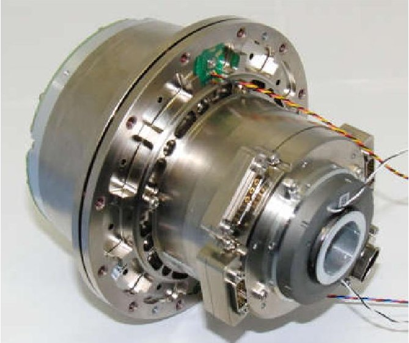

Fig. 2: Joint of CAESAR

<!-- PDF_PAGE: 3 -->

## 1.3 Architecture

The architecture is based on a modular design. Since there's no gravity load in space and the handling of large and heavy objects is envisaged, all joints have the same torque capability. The joint design provides a hollow shaft to enable internal cabling.

To minimize moving harness four electronic blocks (EB) are located between every two joints. Each electronic block controls two joints and provides two redundant control and drive systems per joint. The joint consists of a synchronous motor with commutation sensor, a harmonic drive gear and angular bearings, the torque sensor and a joint position sensor. All sensors and the motor windings are redundant.

If required and for 1G testing purposes, all joints can be equipped with a brake, which also provides redundant windings.

The excessive electronic system of the forth electronic block can be used to operate a gripper or a tool system. Due to the modularity different configurations are possible, especially such, that the system is foldable to achieve minimum stowage volume during transportation.

Depending on the configuration several launch locks are necessary to provide robustness against vibration loads.

necessary to provide robustness against vibration loads. The electronic architecture of a joint is based on a signal processor, which is computing the impedance- and position control for two joints. It is connected by dual ported memory to two motion control DSPs that perform field oriented control of the motor currents. Each of the two redundant motor windings is connected to a MOSFET based power inverter. Data Position Measurement (DPM) and various filters and logics are implemented in an FPGA.

By use of an EtherCAT communication device the joint processors communicate in real time with the RCU, that provides reference values for position and torque to achieve accurate Cartesian motions and damping.

Each joint is powered by a dedicated supply unit. The input voltage level and impedance as well as the inrush current are controlled by a unique Base Power Insulation Unit (BPIU) which is mounted at the base of the robot. Therefor reliable grounding and good EMC for the complete system is guaranteed, independent on the environment of the carrier.

During operation various temperature signals as well as characteristics of the sensors are monitored to ensure reliable failure detection. An independent temperature control system operated by the main controller of the carrier is used to ensure correct heating before powering the robot.

All components are housed and thermally connected by aluminium to stay well within their operating limits and to withstand the individual total dose radiation limits. By additional shielding even higher radiation levels can be achieved.

## 2. Mechanical Structure

The mechanical structure of the manipulator consists of Electronic Blocks, joints and structural parts. Fig. 3 shows the DLR baseline of the manipulator in straight configuration on the left side and in folded stowage configuration on the right side.

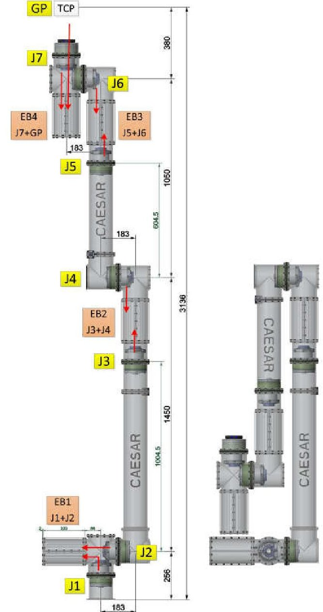

Fig. 3: Baseline manipulator: Straight configuration (left) and storage configuration (right)

## 2.1 Joint

The principal joint design is similar to the joint design of ROKVISS [2]. It is shown in Fig. 4 and comprises the following main parts.

The motor which drives the joint is a brushless DC-Motor from RoboDrive with hollow shaft for internal cabling. The Motor Commutation Sensor is integrated in the motor housing, which is completely closed for shielding of internal EMC.

A gear unit from HarmonicDrive is used to convert the motor torque to the joint torque. The gear unit is

<!-- PDF_PAGE: 4 -->

customized for greater inner diameter and has a torsional stiffness of about 30kNm/rad. The Wave Generator is directly mounted to the rotor of the motor. A Joint Bearing between joint input and output comprises two angular bearings with adjustable bearing preload.

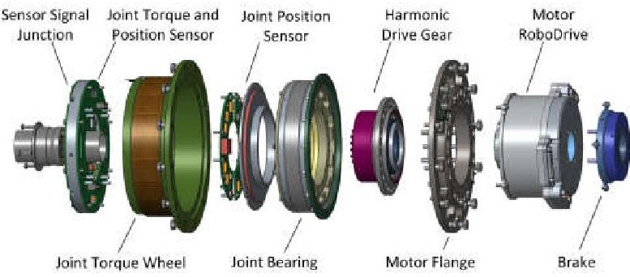

Fig. 4: Joint assembly

Due to a very flat design the Joint Output Position Sensor can be fitted between the Joint Bearing and the Torque Sensor.

The Torque Sensor is an integral part of the output flange and uses strain gauges for torque measurement. The torsional stiffness is about 60kNm/rad, which is twice the torsional stiffness of the gear unit.

Each joint can be optionally equipped with a Holding Brake. The brake torque can be adjusted and is generated by static friction. A spring loads the brake and an electrical winding releases the brake.

An Electrical End Stop is provided by a magnet and a PCB with hall sensor. The magnet can be individually placed for each joint to get the desired range of motion. For redundancy each joint has two End Stop PCBs and two magnets.

## 2.2 Structural parts

The mechanical structure of the manipulator consists of five types of structural parts. All these structural parts are made of aluminium (EN AW-7075) and have the same mechanical interface.

Cross elements connect one EB and two joints. T-Elements provide a $ 9 0^{\circ} $ angle for the kinematics and therefore connect a roll joint and a pitch joint. The unused openings of Cross and T-Elements are closed by a cap and can be used for assembly and inspection of the joints and cables.

The structural elements of an EB comprise two half-shells and a cap at end positions. By removing one of the half-shells easy access to the electronics is provided without the need to split the manipulator.

By variation of the length of the straight elements variable limb lengths are achieved. By splitting a straight element in two parts, extra flanges for launch locks or other purposes can be provided.

Fig. 5 shows these structural elements in the assembly of joint 1 and 2 with the controlling EB. In this picture also a part of the cabling is plotted. The cabling comprises of two parts: fixed cabling and moved cabling.

The fixed cabling connects the EB with the motor sides of the joints and it comprises the motor power cables and the motor commutation sensor cables each for joint 1 and 2 and nominal and redundant part.

The moved cabling is routed through the hollow shafts and therefore it will be twisted by moving a joint. Besides one ground cable following cables are routed through a hollow shaft (each cable is doubled for nominal and redundant part):

- Bus cable to connect the EBs

- Sensor cable for Joint Output Position Sensor and Torque Sensor

- 2 electronic power supply cables (+24 V DC)

- 2 motor power supply cables (+56 V DC)

- Optional 2 cables for temperature sensors

- Optional 2 cables for heaters

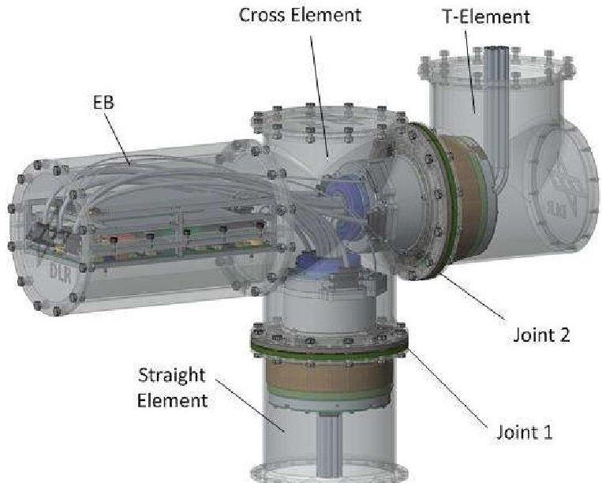

Fig. 5 One EB for two jonts

## 2.3 Kinematics

With the modular design it is possible to realize different kinematics regarding the number of joints, joint configurations and limb lengths.

To be able to route all necessary cables through the hollow shaft of the joints, the EB for controlling two joints must be placed between these two joints.

For smaller stowage requirements foldable kinematics are possible. The minimum foldable length for a manipulator with 7 joints is 1,302 m folded and 2,177 m in straight position (base to TCP).

<!-- PDF_PAGE: 5 -->

The DLR baseline is a manipulator design with 7 joints and alternating roll and pitch joints, starting with a roll joint at the base. In straight configuration the length from base to TCP is 3,136 m and a folded length of 1,781 m.

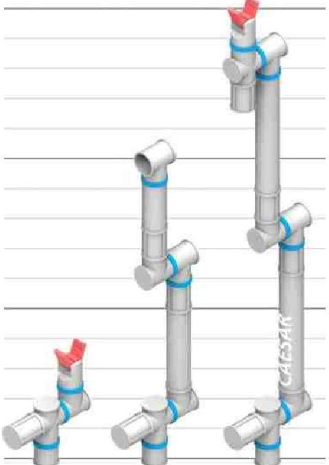

Fig. 6 Different kinematics

## 3 Electronics

## 3.1 Electronic Design

The complete electronic design is cold redundant, including all sensors and the motor windings. There is one Electronic Block (EB) for the controlling of 2 joints, resulting that some electronic parts are used in common for both joints. All 4 EBs within the Robotic Arm (RA) are connected via an EtherCAT real-time bus. All necessary cables (Bus Connection, MotorPower, EB-Power, Heater-Power and independent Temperature Sensors) are routed through the hollowshafts of the motors. The last EB is can be used to control joint 7 and the gripper.

## 3.2 Block Diagram

Fig. 7 shows the Block Diagram of one EB. Some parts like Motor-DSP, Sensors and Power Inverter are required for every motor and joint, other parts like Power Supply, Control-DSP, FPGA and EtherCAT connection are used commonly for 2 joints.

The JCU (Joint Control Unit) consists of a ControlDSP (CDSP) for the EtherCAT communication, FDIR and the Joint Impedance-, Position- and Torque Controllers. The CDSP communicates via a DualPorted-RAM with the two Motor-DSPs (MDSPs). On each of the MDSPs a motor current controller, commutation sensor interface and a PWM-Interface to the Power Inverter (PI) is implemented.

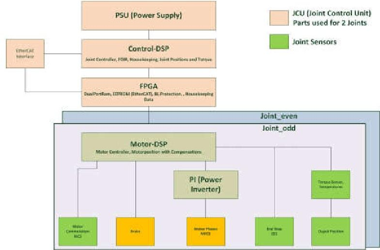

Fig. 7: Block Diagram of one EB with Sensors

The internal power supplies (one for each EB) provide all internally needed voltages. To optimize the design of the power supply with respect to the needed space and power consumption, a hybrid configuration will be used. The main switching supply generates commonly used voltages and an intermediate unregulated voltage as base of small additional local linear regulated supplies. They provide the core voltages of the DSPs and the FPGA. Two analogue temperature signals and a shutdown signal from the temperature supervisor prevent the electronics from being overheated.

The power inverter uses three MOSFET half bridges to invert the 56V DC according to the PWM signal from the Motor-DSP and feeds back the measured phase current to drive the brushless DC motor. It contains the MOSFETs, their drivers, phase current sensing using a shunt resistor with amplifier, a temperature sensor and some DC link capacitance.

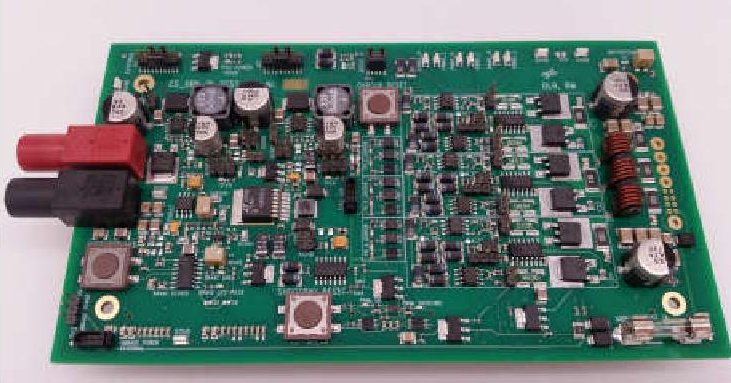

Fig. 8: Power Inverter Breadboard

## 3.3 Interfaces

## 3.3.1 Data Interface

An EtherCAT data bus, with a data rate of 100Mbit/s, for the communication between the RCU and the 4 EBs is implemented, controlling the joints and gripper of the manipulator arm.

<!-- PDF_PAGE: 6 -->

## 3.3.2 Power Interface

A Base Power Isolating Conditioning Unit (BPIU) is used to isolate and condition the RA power supply from the SC power. The input voltage of the BPIU is adaptable to the SC output voltage. Due to the potentially high power consumption of the integrated motors, the BPIU is also used to increase the voltage of the motor supply to 56V. This results in a reduced cable cross-section of the DC supply through the RA because of a smaller current at identical power throughput.

In addition, a 28V rail supplies power to the control electronics. The 56V rail was not used for these electronics, because of a higher efficiency at lower voltages and to ensure failsafe operation in case of a short circuit in the 56V rail. Each voltage rail is independently controlled. The use of a current limiter on the SC power input rail reduces the charging-current for the BPIU input-capacitors. The BPIU implements the necessary housekeeping to monitor its operation for the JCU.

The BPIU is part of the arm but mounted within the spacecraft body.

The local power supplies have daisy chain connections for the power bus.

There is a central grounding point on the base of the manipulator, between the BPIU and the common input filter. All return lines of $ \mathrm{P_{nom}} $ and $ \mathrm{P_{red}} $ are connected on this location to the structure.

For the redundant branch all parts like BPIU central grounding point and input filter are doubled.

## 3.3.3 Heater and Temperature Sensors

To ensure right environment for the robotic arm, heaters are needed. Heater elements are located at the EB, at the motor commutation sensor and at the joint position / torque sensor. For easier assembly there are several heater power junctions located at the manipulator to connect the heater supplies and return to the temperature switches and the heater foils. Two dedicated thermistors with a redundant PTC can be read out independently of the RA power. The heaters have a 28V Power interface.

## 3.3.4 Gripper Interface

For a 7DOF RA design, the unused part of the last EB may be used as an Universal Gripper Interface. The EB provides a 28V and 56V power interface, as well as I/O, SPI, EtherCAT and RS485 data interfaces.

## 3.4 Sensors

The torque sensors in the joints, which are implemented by two strain gauge full bridges each, provide a differential signal for the torque measurement of the joint. These differential signals are fed through an instrumentation amplifier and filtered before A/D conversion.

For the Joint Output Position Sensor a magneto-resistive (MR) sensor principle is be used. This type of sensor has the advantage of having no friction and not being prone to deposition of any condensing material or dirt. The sensor is designed to yield an absolute digital position value within one joint revolution.

For the field oriented control of the three phase brushless DC motor a motor commutation sensor (MCS) is used. For the CAESAR system the sensor will be based on the giant magneto resistive (GMR) effect. All known magneto resistive effects have in common that the electrical resistance of the sensor changes due to the influence of a magnetic field. The position value of this senor is absolute within an electrical revolution of the motor. For the mechanical revolution of the motor shaft these periods are repeated incrementally.

## 3.5 Thermal Design

The thermal design of the robotic system CAESAR is based on three models. The first is a model for the specific modular robotic joint, whereas the second is a thermal model of the EB for two joints.

For the joint and EB analysis, finite element models are used to support the optimization of the thermal behaviour and heat distribution of the mechatronic system in parallel with the mechanical and electronics development.

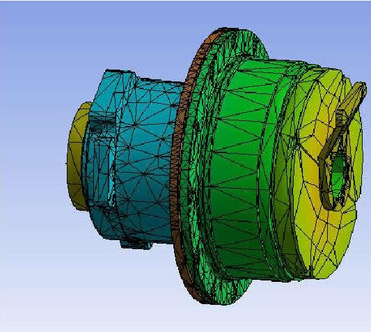

Fig. 9: Thermal Simulation

A third model represents the complete manipulator. Depending on the kinematic setup, the corresponding joints and the EBs interact thermally with each other.

Due to the design of the manipulator combined with its complete internal cabling, the optimal thermal coating can be applied on the housing specific to the orbital environment and the operational usage.

To reach the internal and mission related thermal requirements, a temperature control system based on a thermal state machine is developed, which can be implemented in the CAESAR software.

In addition, the external thermal control system (TCS) of the spacecraft can be used instead.

<!-- PDF_PAGE: 7 -->

## 4 Software and Control

The control of the robot system can be roughly divided in the control on Cartesian level and the control on joint level. The latter is completely executed in the Electronic Boxes. The software for the Cartesian control, the robot applications, and the task directed programming is executed on a separate Robot Control Unit (RCU).

## 4.1 Robot Control

## 4.1.1 Control of light-weight robots

Our light-weight robots are controlled by a cascaded structure of current, joint and Cartesian level controllers. The modular joints are equipped with motor-side position sensors and link-side torque sensors. Additional link-side position sensors are available for safety checks and referencing. The collocated design of the joint with actuator and sensor in close proximity is advantageous from a control point of view and enables robust, passivity-based control approaches.

The fastest and most inner loop is the space-vector modulated PI current control of the RoboDrive BLDC motors. It runs at 20kHz on the local floating point MDSP for every joint and ensures high bandwidth for the upper control layers.

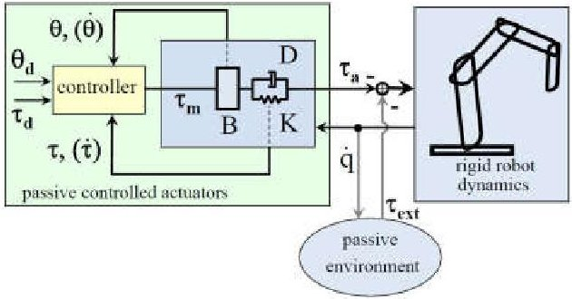

Fig. 10 Structure of joint level control

The middle layer of the control structure is the joint control. It runs at 3kHz on the floating point CDSP on the JCU for two joints. The joint controller is a state feedback controller that uses the motor position and the link-side torque and their derivatives as state. The feedback of the torque signal allows for active vibration damping of the flexible robot joints. Additionally, friction and other disturbances like HarmonicDrive and motor ripple can be observed and compensated online. Depending on the application, the higher level controller can adapt the feedback gains and tune the behavior of the joint seamlessly from compliant torque control to stiff high-performance position control.

The high level control of the complete robot system is done on an external control computer the Robot Control

Unit (RCU), running at 500Hz. Due to the light-weight design and the elasticity in the HarmonicDrive gearboxes and the torque sensors, a flexible joint robot model is considered for the controller design. The high level control calculates the dynamic model of the robot to provide proper feed-forward terms for the joint control. Depending on the desired behavior it also adapts the gains of the joint control loop for optimal performance in position control or implements a compliant control law like Cartesian impedance control.

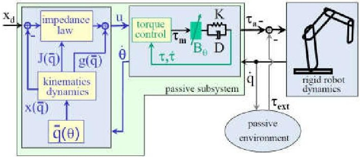

Fig. 11: Structure of Cartesian impedance control

The following controllers are typically used for applications:

- Position control - a full state-feedback position controller for high performance movements in free space, for example for transfer motions. The feedback includes an integral term for high accuracy and the torque feedback actively dampens the vibrations of the structure. Feedback gains are adapted online according to current load and robot configuration.

- Cartesian impedance control - a Cartesian controller that mimics the behavior of a mechanical multidimensional spring-damper-mass system with user-defined stiffness and damping. In contrast to normal admittance controlled industrial robots, the robust passivity-based implementation allows a high range of desired stiffness settings down to zero and a stable execution even under rigid contacts and contact transitions. This mode is especially useful for all movements in contact with the environment, for applying forces to workpieces or for aligning parts in on orbit assembly applications.

The precise knowledge of the dynamic model and the availability of torque measurements in the joints allow a detection of all interaction forces with the environment and therefore a sensitive collision detection. As the control mode can be changed from one control cycle to the next (within 2ms), an immediate reaction to collisions with the environment is possible. This way, CAESAR combines the advantages of high-

<!-- PDF_PAGE: 8 -->

performance position control and sensitive compliant behavior in assembly and on orbit servicing scenarios and physical human-robot interaction [6].

## 4.2 Software

The robot software on the RCU is covering all aspects of communication, the Cartesian commanding, the house keeping data management, and the mission applications.

The EtherCAT Master designed for CAESAR specifies and manages the data packages to be communicated between the joints, the gripper and the application software. The type and profile of a data package can vary from cycle to cycle [7].

The Cartesian impedance, force, and position control offer the user/application programmer a powerful interface for the very individual mission applications and needs. The robot is commanded by giving the needed impedance, force, or position of the tool center point (TCP) in the working area of the manipulator. The according joint values are automatically generated not only for the target configuration but also for the safe trajectory reaching the requested Cartesian target position. Depending on application also software for e.g. visual data processing and visual servoing for autonomous grasping of objects is executed on the RCU.

## 5 Application: Assembly, Maintenance, and Repair, Capturing and berthing

Most of the robotic On-Orbit Servicing (OOS) applications have a terrestrial equivalent. If you look at the tasks of the Canadarm you will see also comparable applications in the manufacturing industry. Large and heavy robots are moving big loads e.g. the chassis of the automobiles. It is strong but not very dexterous and represents the robotics state of the art 20-30 years ago.

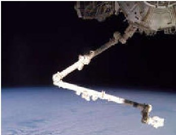

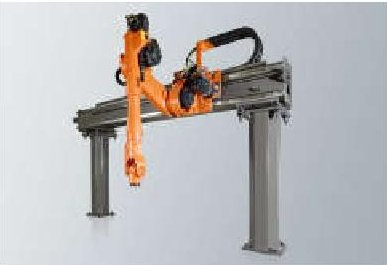

Fig. 12 Canadarm2 and KUKA KR30 Jet

Nowadays the robots on earth are getting smarter, softer and more precise (see Fig. 13).

CAESAR as developed by DLR will bring the current state of the art in robotics manufacturing to space. The impact of its performance is explained on the basis of robotic assembly, one of the most challenging tasks. In

space, robotic assembly took place with the teleoperated assembly of ISS modules. The example presented here is a result of European research project SMErobotics.

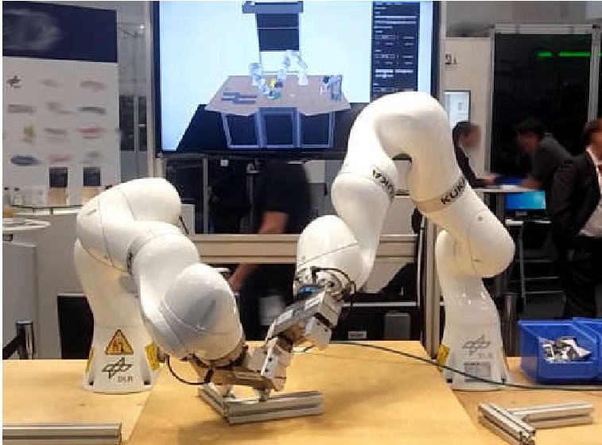

Fig. 13: Two light-weight robot arms (KUKA LBR iiwa) collaborate in the assembly of aluminium structures

## 5.1 Robotic Assembly System

A prototypical system for autonomous assembly of aluminium structures was developed at DLR [8]. It was developed for a terrestrial use case; however, it demonstrates the potential of such systems in space applications. The structures are made up of a modular building kit system typically used in industrial facilities for the setup of production equipment, composed by aluminium profiles of various lengths and angle bracket connectors. The system automatically decomposes a given assembly specification, i.e. a list of parts and their relative configuration, into a task sequence, which is then mapped to a sequence of appropriate robotic skills. Although the first humanoid robot was already in space operation [13], the general dexterity and sensing capabilities for the autonomous execution of complex assembly tasks are not yet reached. For our system, we combine general dexterous manipulators with specialized tools and grippers suitable for the target building kit. The initial demonstration of autonomous assembly was performed with a single arm and a number of specific assembly fixturing units conveniently located in the robot work cell. The setup was recently extended with a second robot arm (Fig. 13), to completely remove the required fixtures, thus increasing the flexibility of the system and enabling the assembly of more complex structures thanks to the implementation of multiarm collaboration and manipulation. The system consists now of two KUKA LBR iiwa R800 manipulators, each arm with 7 DoF and equipped with joint torque sensors. The manipulators are the industrial version of the light-weight robot arm (LWR) technology developed at DLR-RM [9]. The

<!-- PDF_PAGE: 9 -->

sensitivity and the impedance control mode allow robust and stable fine manipulation especially in contacts, which is essential in the autonomous execution of assembly tasks.

## 5.2 Robust Assembly Skills

Modularity is an important requirement for building sets for larger structures. An infinite number of structures can be constructed with the building set used in this demonstrator. The square-shaped profiles are customizable in length, and connections can be freely placed along the four sides. A single connection between two profiles is made with an angle bracket, which is fastened with screws and nuts in the slots of the profiles. The subtasks that the system must combine during the construction of a given assembly are [8]:

- insert slot nuts in the profiles

- position profiles

- ad angle bracket

- add screws

All subtasks require robust assembly strategies. These strategies are implemented in basic skills that encapsulate the robot capabilities in a parametrizable and reusable way. Skills can be adapted to the current task and through a certification process the desired behaviour can be guaranteed for solving a given task. Open-loop robustness on a higher level is achieved thanks to the sensitivity of the robot arm and the impedance controller. A robust strategy for such insertion tasks can be chosen considering the passive alignment properties and the compliance of the robot in the contact [10]. Furthermore, observation algorithms based on the joint torque measurements are currently developed to reduce uncertainties and monitor the execution [11]. A discussion on assembly in space can be found in [12].

Fig. 14 Proportion Alexander Gerst and CAESAR (artview)

## 6. Conclusions

The worldwide increasing interest in orbital services raises the interest in applying service robotics in space. The multi-purpose space proof manipulation system CAESAR offers the requested capabilities to cope with various service tasks on cooperative and even noncooperative targets. The presented assembly scenario has shown which dexterity the robot system has to provide for a reliable, safe, and robust physical interaction with the real world.

The DLR Institute of Robotics and Mechatronics has experience in light weight robotics for decades. In the noughties the DLR LWR technology was finally transferred to one of the world leading robot manufacturer KUKA. Latest at that date, terrestrial service robotics became a global business. Meanwhile every robot manufacturer is offering dedicated service robot systems as could be seen at the automatica 2018, the leading exhibition for smart automation and robotics.

DLR's hard- and software technology was space ready modified and verified in ROKVISS. For six years the robot was mounted outside of the Russian Service Module on the ISS and operated from ground. Based on the heritage of ROKVISS and the experience gained in various projects and studies like DEOS we are sure that reliable and robust manipulation on different objects can only be realised with configurable Cartesian impedance control. Therefore the robot needs to provide accurate joint torque control.

CAESAR is DLR's consistent continuation in the development of force/torque controlled robot system. Due to its modular design different configurations are possible, especially such, that the system is foldable to achieve minimum stowage volume during transportation.

The seven DoF robotic system is capable of catching satellites in LEO/GEO, even ones that are in tumbling, and/or non-cooperative states. The dexterity and sensitivity of CAESAR enables assembly, maintenance, and repair of satellites.

## References

[1.] G. Bekey, R. Ambrose, V. Kumar, A. Sanderson, B. Wilcox, and Y. Zheng. WTEC Panel Report on International Assessment of Research and Development in Robotics: Final Report, 2006.

[2.] G. Hirzinger, K. Landzettel, D. Reintsema, C. Preusche, A. Albu-Schaeffer, B. Rebele, M. Turk. ROKVISS - RRobotics Component Verification on ISS. In: Proc. of. The 8th International Symposium on Artifical Intelligence, Robotics and Automation in Space - iSAIRAS, 2005

<!-- PDF_PAGE: 10 -->

[3.] C. Preusche, D. Reintsema, K. Landzettel, Klaus G. Hirzinger, Robotics Component Verification on ISS ROKVISS - Preliminary Results for Telepresence. IEEE IROS, International Conference on Intelligent Robots and Systems, Beijing China, 2006.

[4.] D. Reintsema, J. Thaeter, A. Rahtke, W. Naumann, P. Rank, and J. Sommer, "DEOS the German robotics approach to secure and deorbit malfunctioned satellites from low earth orbits," in Proc. i-SAIRAS Conf., 2010.

[5.] Van Kane; (accessed 17.09.2018), http://futureplanets.blogspot.com/2017/08/proposed new-frontiers-missions.html.

[6.] A. Albu-Schäffer, C. Ott and G. Hirzinger, "A unified passivity based control framework for position, torque and impedance control of flexible joint robots", International Journal of Robotics Research, vol. 26, no. 1, pp. 23-39, 2007

[7.] Beckhoff. EtherCAT - the real-time Ethernet fieldbus https://www.ethercat.org/default.htm. (accessed 17.09.2018)

[8.] K. Nottensteiner, T. Bodenmueller, M. Kassecker, M. A. Roa, A. Stemmer, T. Stouraitis, D. Seidel, and U. Thomas, "A complete automated chain for flexible assembly using recognition, planning and sensorbased execution," in 47st Int. Symp. on Robotics (ISR), 2016.

[9.] A. Albu-Schaffer, S. Haddadin, C. Ott, A. Stemmer, T. Wimbock, G. Hirzinge; The DLR lightweight robot: design and control concepts for robots in human environments, Industrial Robot: An Int. Journal, vol. 34, no. 5, pp. 376-385, 2007.

[10.] A. Stemmer, A. Albu-Schaffer, G. Hirzinger; An analytical method for the planning of robust assembly tasks of complex shaped planar parts; in Proc. IEEE Int. Conf. on Robotics and Automation (ICRA), 2007, pp. 317-323

[11.] K. Nottensteiner, M. Sagardia, A. Stemmer, C. Borst; Narrow passage sampling in the observation of robotic assembly tasks, in Proc. IEEE Int. Conf. on Robotics and Automation (ICRA), 2016, pp. 130-137.

[12.] Maximo A. Roa, Korbinian Nottensteiner, Armin Wedler, Gerhard Grunwald, Robotic Technologies for In-Space Assembly Operations, Proc. i-SAIRAS Conf., 2017.

[13.] M. Diftler, J. Mehling, M. Abdallah, N. Radford, L. Bridgwater, A. Sanders, R. Askew, D. Linn, J. Yamokoski, F. Permenter, B. Hargrave, R. Platt, R. Savely, and R. Ambrose, "Robonaut 2 the first humanoid robot in space," in Proc. IEEE Int. Conf. on Robotics and Automation (ICRA), 2011, pp. 2178-2183.