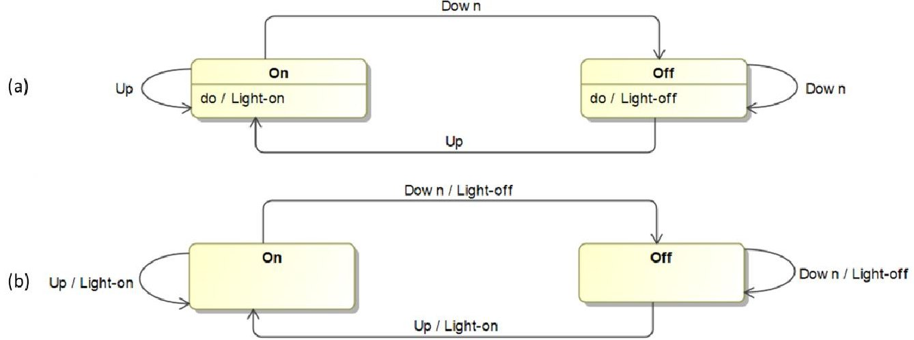
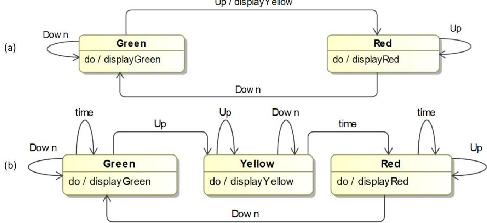
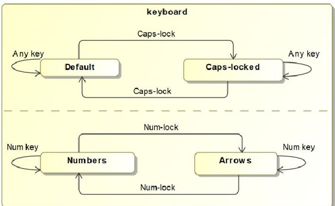
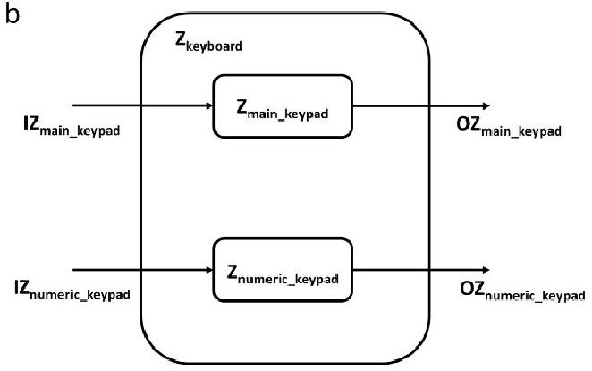
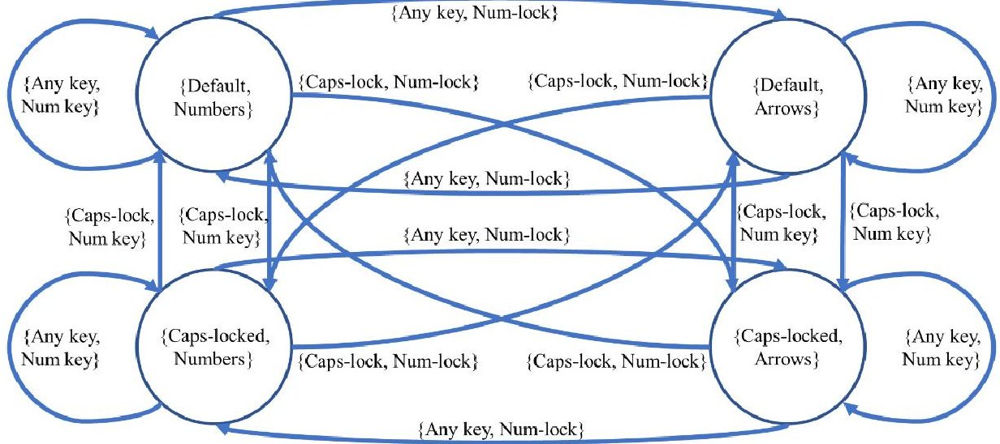

<!-- PDF_PAGE: 1 -->

# 17th Annual Conference on Systems Engineering Research (CSER)

# Can Wymore's Mathematical Framework Underpin SysML? An Initial Investigation of State Machines

Paul Wach $ ^{a} $ $ ^{*} $ , Alejandro Salado $ ^{a} $

$ ^{a} $Virginia Tech, 1145 Perry St, Blacksburg, VA, 24061, USA

## Abstract

Model-based system engineering (MBSE) has been suggested to have significant benefits to include early verification and validation cycles and predictive analytics. Multiple languages for modeling the engineering of systems exist; the most widely used being Systems Modeling Language (SysML). SysML is descriptive in nature, meaning it contextualizes the relationships in the system model. While this is useful, it lacks a rigorously established mathematical framework that would allow for understanding of emergent behavior, pattern recognition, vulnerability assessment, and a scientific approach to modeling of systems among other capabilities. An internally consistent mathematical framework for MBSE was proposed by Wayne Wymore in 1993, which may provide what is necessary to overcome the descriptive limitation of SysML. In this article, we perform an initial assessment of the feasibility of underpinning Wymore mathematical system construct to SysML by comparing Wymore's Moore-based state machines to SysML state machine diagrams. Specifically, we focus on the mathematical capturing of orthogonality through system coupling.

$ \textcircled{c} $ 2019 The Authors. Published by Elsevier B.V. This is an open access article under the CC BY-NC-ND license (https://creativecommons.org/licenses/by-nc-nd/4.0/) Peer-review under responsibility of the scientific committee of the 17th Annual Conference on Systems Engineering Research (CSER).

Keywords: Model-Based Systems Engineering; Architecting Patterns; Theory of System Engineering; System Modeling, Emergent Behavior.

<!-- PDF_PAGE: 2 -->

## 1. Introduction

Model-based systems engineering (MBSE), Model-based engineering (MBE), Model-centric engineering, modeling and simulation-based engineering (M&SBE) are all examples of efforts toward understanding systems through modeling. These efforts are sensible because " [w]e cannot understand that which we have not modeled" [1]. We abstract our interpretation of systems in the form of models, which subsequently allows for better understanding of the system and better communication. The Systems Modeling Language (SysML) has been widely adopted to support system modeling within an MBSE perspective. While effective to achieve visual representation of the logical construct [2], SysML remains a descriptive modeling language. The lack of an underlying mathematical structure limits SysML from enabling formal semantics, logic, and methods that provide consistency throughout design evolution [3].

The International Council on System Engineering (INCOSE) has called for system engineering to "be grounded in a more rigorous foundation of mathematics" [4]. The current trend in systems engineering research suggests that category theory can capture the necessary framework for systems engineering [5]. Others have worked toward modeling a system using set theory [1,6-8]. However, the desire to mathematically understand a system is not new. For example, the general systems theory provided some essential mathematical relationships that captured the behavior of heterogeneous biological systems [9] and Wayne Wymore developed an internally consistent mathematical theory of system engineering, with which one can assess, compare, and predict heterogeneous systems based on their behavioral structures [6].

In this paper, we present an initial investigation about the feasibility to use Wymore's mathematical framework to underpin SysML. We begin our effort by working to understand if Wymore's work can be used to mathematically capture the modeling aspects of state machines in SysML. In particular, we focus on three aspects of SysML's state machines: (1) states and transitions, (2) inputs and outputs, and (3) orthogonality [10, 11]. We use Wymore's definition of system model and the concept of Coupling Recipe [1] to capture those three aspects mathematically.

## 2. Postulate

Wymore defines a discrete system model as a quintuple $ Z=\{S Z, I Z, O Z, N Z, R Z\} $ where Z is the name of the system, SZ is the set of its states, IZ is the set of its inputs, OZ is the set of its outputs, NZ is its next state function (which allows for mathematically capturing how input trajectories lead from one state transition to the next), and RZ is its readout function that specifies the outputs for each state [1]. The author suggests that this construct is able to capture any discrete system model [1]. If this is true, and since SysML allows for constructing discrete system models, then there must exist at least one function that transforms any SysML model into Wymore's mathematical definition of discrete system model.

We begin to explore the truthfulness of this hypothesis in this paper by assessing the feasibility of capturing SysML state machine diagrams with Wymorian mathematical constructs. In addition, it should be noted that this work is limited to models of the external behavior of a system (i.e., we consider the system as a black box) and not models of how the system functions internally.

## 3. Methodology

Our research goal is to underpin Wymore's mathematical framework to SysML, for which we start with state machine diagrams. The fundamental reason to start this work by exploring SysML state machines lays on Wymore's mathematical definition of a discrete system model. As presented in the previous section, such definition resembles a Moore state machine. We have structured the research in three major steps:

- Characterize the different modeling aspects and features of Moore State Machines, on which Wymore's mathematical framework is constructed, and SysML. We inform the characterization by investigating the historical evolution between both types of state machines, including therefore Mealy State Machines and Harel State Charts.

<!-- PDF_PAGE: 3 -->

- Assess the feasibility of capturing in Wymore notation each individual modeling aspect or feature of SysML state machines, as listed in Table 1.

- Assess the feasibility of capturing in Wymore notation all modeling aspects and features of SysML State Machine Diagram, as listed in Table 1, collectively.

Table 1. Summary of the Aspects of SysML State Machine Diagrams.

<table border="1"><tr><td>#</td><td>SysML Aspect</td><td>Description</td></tr><tr><td>1</td><td>Behavior associated to states</td><td>A behavior that is executed upon entering a state (entry); while in the state (do), or upon exit of the state (exit).</td></tr><tr><td>2</td><td>Behavior associated to transitions</td><td>A behavior (effect) that gets executed during transition.</td></tr><tr><td>3</td><td>Behavior associated to both states and transitions</td><td>This occurs when behaviors are captured on both transition and the target state. A sequence of this kind may contain an effect, entry, do, and exit behavior.</td></tr><tr><td>4</td><td>Orthogonality</td><td>A state that has multiple regions, which each have their own set of vertices, their own set of transitions, and act independently from the other.</td></tr><tr><td>5</td><td>Initial state</td><td>Describes a start/beginning of a state machine or hierarchy to articulate history, transition from a different state machine, and can be used for simulation.</td></tr><tr><td>6</td><td>Final state</td><td>Describes an end or exit point of a state hierarchy or state machine to articulate history, transition to different state machine, and can be used for simulation.</td></tr><tr><td>7</td><td>Depth (hierarchy, composite states)</td><td>Used to reflect regions within a state. Allows for reduced scale of complex state-based behavior.</td></tr><tr><td>8</td><td>Transition events and guards</td><td>Events are an input to a state that cause a transition. Guards are a true/false condition that allows or prevents a transition from occurring.</td></tr><tr><td>9</td><td>History, actions, delays, timeouts, conditions</td><td>These are extensions of depth, output, and transition used to reduce the scale of a state machine.</td></tr></table>

In this paper, we address the first step and part of the second step. In particular, we provide evidence of feasibility to capture of aspects 1 through 4 in Table 1: behavior associated states, behavior associated to transitions, behavior associated to both state and transition, and orthogonality. Other aspects are left for future work.

## 4. Overview of state machines

In this section, we review existing work that has addressed the feasibility to transform state machines between different types. Several types of state machines exist. While all of them are used to model system behavior, they do so differently. We focus on four of them: The Mealy State Machine [12, 13], the Moore State Machine [12, 14], the Harel State Machine [15], and the UML/SysML State Machine [10, 11]. These four types of state machines were developed sequentially. With each of them, the creator of each state machine attempted to improve some modeling aspects over previous types of state machines.

The conversions between Moore state machines and Mealy state machines, and vice versa, have been demonstrated to be feasible and are well-documented [12]. The conversion between the two comes from mapping the outputs to states. In Moore state machines, system outputs are associated with states. In a Mealy state machine, system outputs are associated with transitions. By identifying items within either Moore or Mealy state machines as the originating state, transition/input, output, and target state; the conversion process is simple. Therefore, we will not elaborate this case further until we discuss its relation to Wymore and SysML in the next section.

Harel state machines were created to capture increased complexity with system models more efficiently than with Moore and Mealy. Specifically, Harel state machines add the features of orthogonality, depth, broadcast, and historical type conditions [15]. By stating that that his state machines are "a simple extension of the ideas in the so-called Mealy and Moore-automata," Harel suggest that his state machines are able to capture all aspects of Moore and Mealy state machines [15]. However, it is unclear if Moore and Mealy state machines can capture all aspects of Harel state

<!-- PDF_PAGE: 4 -->

machines. For example, Harel state machines can capture outputs both as a function of state and as a function of transition within on state machine. The conversion in this case requires further study.

Harel and UML state machines leverage semantic complexity to simplify diagrammatic complexity. Research shows that, while two machines may be identical diagrammatically (i.e., visually), their execution behavior may be different [16]. With the semantics documented by Crane, the conversion process between state machines appears to be possible.

Converting UML state machines to Moore state machines requires to create unique states and outputs in the Moore state machine [17]. This conversion process is not a result of direct transformations between UML constructs and Moore's mathematical constructs, but rather a manual process that requires a conscious creation of new states and new outputs.

## 5. From SysML to Wymore

## 5.1. Basic states, transitions, inputs, and outputs

SysML modeling features for state machines with respect to states, transitions, inputs, and outputs envelop and extend those of Moore and Mealy state machines. In particular, in a SysML state machine, system behavior can be simultaneously associated to states and transitions, while Moore and Mealy state machines can only capture system outputs on either states or transitions, respectively. Therefore, converting a SysML state machine to a Moore state machine requires reconciling these differences.

First, we note that, according to the general systems theory, a system must have both external inputs and external outputs to be meaningful [9]. Therefore, regardless of whether the SysML specification requires it or not, the system behavior associated to states and/or transitions in a SysML state machine must necessarily capture at least system outputs (since inputs are captured in the transitions). In fact, if the use of hierarchy is excluded, the ultimate behavior of the system in a particular state or transition is to provide an output. Leaving hierarchy aside, as discussed in Section 3, we conclude that the system behavior associated to states and transitions in SysML state machines can be reduced to outputs and hence, there is a direct relationship to Moore and Mealy state machines. With this understanding, SysML state machines that allocate outputs to only states or to only transitions and use external inputs to trigger transitions can be directly converted to Wymorian construct. An example is provided in Fig. 1, which depicts equivalent SysML state machines that model a system that provides light or not as a function of the position of a switch, with their equivalent Wymorian formulation given in Table 2.

Fig. 1. (a) SysML state machine capturing outputs only on states; (b) SysML state machine capturing outputs only on transitions.

<!-- PDF_PAGE: 5 -->

Table 2. Wymorian construct of the 2-state light SysML state machine from Fig. 1.

<table border="1"><tr><td>Wymorian System(Z)={SZ,IZ,OZ,NZ,RZ}</td><td>Wymorian2-StateLightZ_2SL={SZ_2SL,IZ_2SL,OZ_2SL,NZ_2SL,RZ_2SL}</td></tr><tr><td>States(SZ)</td><td>SZ_2SL={On,Off}</td></tr><tr><td>Inputs(IZ)</td><td>IZ_2SL={Up,Down}</td></tr><tr><td>Outputs(OZ)</td><td>OZ_2SL={Light-on,Light-off}</td></tr><tr><td>NextStateFunction(NZ)</td><td>NZ_2SL={((On,Up),On),((On,Down),Off),((Off,Up),On),((Off,Down),Off)}</td></tr><tr><td>ReadoutFunction(RZ)</td><td>RZ_2SL={(On,Light-on),(Off,Light-off)}</td></tr></table>

Second, we note that, if states and transitions are used to capture system behaviors (outputs) simultaneously, then (1) both the states and the transitions must occur during a non-zero time -to be meaningful- and (2) the behavior (output) of a transition cannot be terminated externally, but only when the system arrives to the next state. We suggest that this SysML aspect (as depicted in Fig. 2a) can be modeled using Wymorian construct using the following process, which results in a different state machine diagram with equivalent behavior (ref. Fig. 2b):

- Create a state for the transition that produces a behavior (output) (e.g., from Green to Red).

- The original input causing such transition (e.g. down) causes a transition between the original state (e.g., Green) and the new state (e.g., Yellow).

- A transition is created between the new state (e.g. Yellow) and the original state where the transition pointed to (e.g., Red). Such transition is not triggered by an external input, but by an internal or temporal condition.

Fig. 2. (a) combines Mealy- and Moore-type state machines for a stoplight; (b) shows a Moore-type state machine for the stoplight.

The resulting Wymorian model for the SysML state machine in Fig. 2a (and hence in Fig. 2b, since they are equivalent) is given in Table 3 (note: as discussed in Section 3, the aspects related to transitions not based on external inputs are left for future work).

Table 3. Wymorian construct of the SysML state machines from Fig. 2.

<table border="1"><tr><td>Wymorian System(Z)={SZ,IZ,OZ,NZ,RZ}</td><td>Zstop-lightMo</td></tr><tr><td>States(SZ)</td><td>SZMo={Green,Yellow,Red}</td></tr><tr><td>Inputs(IZ)</td><td>IZMo={Up,Down,time}</td></tr><tr><td>Outputs(OZ)</td><td>OZMo={do/displayGreen,do/displayYellow,do/displayRed}</td></tr></table>

<!-- PDF_PAGE: 6 -->

<table border="1"><tr><td>Next State Function(NZ)</td><td>NZ_Mo={((Green,Up),Yellow),((Green,Down),Green),((Green,time),Green),((Yellow,Up),Yellow),((Yellow,Down),Yellow),((Yellow,time),Red),((Red,Up),Red),((Red,Down),Green),((Red,time),Red)}</td></tr><tr><td>Readout Function(RZ)</td><td>RZ_Mo={(Green,do/displayGreen),(Yellow,do/displayYellow),(Red,do/displayRed)}</td></tr></table>

## 5.2. Orthogonality

Figure 3a shows a SysML state machine using orthogonality, which captures the basic behavior of a computer keyboard. Note that outputs have not been displayed for simplicity, but assume they are associated only with states. Orthogonality is used in SysML to capture the idea that the keypad and the numeric pad work independently, that is, the individual states of the keypad part of the keyboard and of the numeric pad of the keyboard are not affected by the inputs of each other. Although the system, as a whole, is however always in one of four two-dimensional states -i.e., (Default, Numbers), (Default, Arrows), (Caps-locked, Numbers), or (Caps-locked, Arrows) -, orthogonality allows for modeling instead independent component of those vectored states, reducing significantly the number of model elements.

Adapted from https://en.wikipedia.org/wiki/UML_state_machine

Fig. 3. (a) SysML keyboard state machine using orthogonality; (b) conceptualization of joint enclosure of independent systems.

In essence, each region of a SysML state machine diagram captures an independent state machine (they are orthogonal). Hence, orthogonality can be understood as joining two independent systems under a common enclosure (conceptually, not necessarily a physical one; both independent systems are just considered to be within a common boundary), as shown in Fig. 3b. With this understanding, the SysML state machine can then be captured in Wymorian formulation by modeling an independent system for each region, and then joining all systems through a conjunctive coupling recipe [1]. This is shown with the keyboard example from Fig. 3a in Tables 4 and 5. Table 4 captures Wymorian constructs of the keypad and the numeric pad. Table 5 captures the resulting keyboard model after combining the keypad and numeric pad models using the conjunctive coupling recipe.

Table 4. Wymorian model of the keypad and numeric pad of the keyboard SysML state machine in Fig. 3a.

<table border="1"><tr><td>Wymorian System(Z)={SZ,IZ,OZ,NZ,RZ}</td><td>Zmain_keypad</td><td>Znumeric_keypad</td></tr><tr><td>States(SZ)</td><td>SZmain_keypad={Default,Caps-lock}</td><td>SZnumberic_keypad={Numbers,Arrows}</td></tr><tr><td>Inputs(IZ)</td><td>IZmain_keypad={Caps-lock,Any key}</td><td>IZ-main_keypad={Caps-lock,Num key}</td></tr><tr><td>Outputs(OZ)</td><td>Not shown in this example</td><td>Not shown in this example</td></tr><tr><td>Next State Function(NZ)</td><td>NZmain_keypad={((Default,Any key),Default),((Default,Caps-lock),Caps-locked),((Caps-locked,Any key),Caps-locked),((Caps-locked,Caps-lock),Default)}</td><td>NZnumeric_keypad={((Numbers,Num key),Numbers),((Numbers,Num-lock),Arrows),((Arrows,Num key),Arrows),((Arrows,Num-lock),Numbers)}</td></tr><tr><td>Readout Function(RZ)</td><td>Not shown in this example</td><td>Not shown in this example</td></tr></table>

<!-- PDF_PAGE: 7 -->

Table 5. Wymorian model of the keyboard SysML state machine in Fig. 3a, by coupling models in Table 4.

<table border="1"><tr><td>Wymorian System(Z)= {SZ, IZ, OZ, NZ, RZ}</td><td>Zkeyboard={SZkeyboard, IZkeyboard, na, NZkeyboard, na}</td></tr><tr><td>States(SZ)</td><td>SZkeyboard= {SZ_main_keypad x SZ_numberic_keypad} {Default, Numbers}, {Default, Arrows}, {Caps-locked, Numbers}, {Caps-locked, Arrows}}"</td></tr><tr><td>Inputs(IZ)</td><td>IZkeyboard= {IZ_main_keypad x IZ_numberic_keypad} {Any key, Num key}, {Any key, Num-lock}, {Caps-lock, Num key}, {Caps-lock, Num-lock}}"</td></tr><tr><td>Outputs(OZ)</td><td>Not shown in this example, but also form as vectors containing the outputs of each submachine.</td></tr><tr><td>Next State Function(NZ)</td><td>NZkeyboard= {{{Default, Numbers}, {Any key, Num key}}, {Default, Numbers}}, {{{Default, Numbers}, {Any key, Num-lock}}, {Default, Arrows}}, {{{Default, Numbers}, {Caps-lock, Num key}}, {Caps-locked, Numbers}}, {{{Default, Numbers}, {Caps-lock, Num-lock}}, {Caps-locked, Arrows}}, {{{Default, Arrows}, {Any key, Num-lock}}, {Default, Numbers}}, {{{Default, Arrows}, {Caps-lock, Num key}}, {Caps-locked, Arrows}}, {{{Default, Arrows}, {Caps-lock, Num key}}, {Caps-locked, Numbers}}, {{{Default, Arrows}, {Caps-lock, Num key}}, {Caps-locked, Numbers}}, {{{Default, Arrows}, {Caps-lock, Num key}}, {Caps-locked, Numbers}}, {{{Default, Arrows}, {Caps-lock, Num key}}, {Caps-locked, Numbers}}}</td></tr><tr><td>Readout Function(RZ)</td><td>Not shown in this example</td></tr></table>

The Wymorian model for the keyboard in Table 5 is depicted as a Moore-like state machine in Fig. 4. A walk through the model shows that any input trajectory results in state transitions identical to those resulting from applying the same input trajectories to the SysML state machine in Fig. 3a. For example, note how activating Num-lock in any state does not change the first component of the system state, which corresponds to the state of the keypad (e.g., Numlock can trigger transitions from {Default, Numbers} to {Default, Arrows} and vice versa or from {Caps-locked, Numbers} to {Caps-lock, Arrows} and vice versa, but it cannot trigger any transition that changes the first component of the system state).

Fig. 4. Resulting Moore-like state machine from Wymore model of the keyboard example in Table 5.

<!-- PDF_PAGE: 8 -->

## 6. Conclusions

In this paper, we have shown how, under certain conditions, SysML state machines can be expressed using Wymore's mathematical constructs. Specifically, we have shown that SysML state machines that are built of a combination of basic states, behavior reduced to the provision of outputs, transitions triggered external inputs, behavior associated to states and/or transitions, and orthogonal regions can be expressed mathematically using Wymore's framework. Four main constructs or processes are primarily used:

- Wymore's definition of system model, which resembles a Moore state machine.

- Mealy to Moore conversion for SysML state machines that only associate behavior to transitions.

- A conversion process that transforms transitions with allocated behavior into intermediate states for SysML state machines that associate behavior to transitions and to states.

- Wymore's conjunctive coupling recipe, which joins the orthogonal regions in SysML state machines as a single mathematical model.

The transformations between SysML state machines and Wymore's mathematical framework presented in this paper allow for underpinning, to some extent, SysML with a mathematical framework. This allows for maintaining the modeling simplicity (abstraction efficiency) offered by SysML, while still being able to leverage the opportunities offered by mathematical models of system behavior. Future work is needed to address the remaining aspects of SysML state machines (i.e., Initial state, Final state, Depth, Transition events and guards, and History, actions, delays, timeouts, conditions), as well as to address the conversion of non-behavioral modeling in SysML.

## Acknowledgements

This material is based upon work supported by the Acquisition Research Program under HQ0034-18-1-0006. The views expressed in written materials or publications, and/or made by speakers, moderators, and presenters, do not necessarily reflect the official policies of the Department of Defense nor does mention of trade names, commercial practices, or organizations imply endorsement by the U.S. Government.

## References

[1] Wymore, A.W., Model-Based Systems Engineering. 1993: CRC Press LLC.

[2] Vaneman, W.K., Enhancing model-based systems engineering with the Lifecycle Modeling Language, in 2016 Annaul IEEE Systems Conference (SysCon). 2016, IEEE: Orlando, FL, USA. p. 1-7.

[3] Graves H, B. Yvonne, Using formal methods with SysML in aerospace design and engineering. Annals of Mathematics and Artificial Intelligence, 2011. 63(1): p. 53-102.

[4] International Council on Systems Engineering (INCOSE), INCOSE System Engineering Vision 2025 July, 2014. 2014 [cited 2018 November 12]; Available from: https://www.incose.org/docs/default-source/aboutse/se-vision-2025.pdf?sfvrsn=4&sfvrsn=4.

[5] Mabrok, M., J. Michael, Category Theory as a Formal Mathematical Foundation for Model-Based Systems Engineering. Applied Mathematics & Information Sciences, 2017. 11(1): p. 43-51.

[6] Wymore, A.W., A Mathematical Theory of Systems Engineering - The Elements. 1967, Unitesd States of America: John Willye & Sons, Inc.

[7] Chapman, W.L.B., A. Terry, A.W. Wymore, Engineering Modeling and Design. 1992: CRC Press Inc.

[8] Beeson, M.J., Towards a computation system based on set theory. Theoretical Computer Science, 1988. 60(3): p. 297-340.

[9] Bertalanffy, L., General System Theory: Foundations, Development, Applications. 1968, New York, NY: George Braziller, Inc.

[10] Friedenthal, S., A. Moore, and R. Steiner, A practical guide to SysML: the systems modeling language. Third ed. 2015, Amsterdam; Boston; Elsevier, MK, Morgan Kaufmann is an imprint of Elsevier.

[11] Delligatti, L., SysML Distilled. 2014, Crawfordsville, Indiana: Pearson's Education, Inc.

[12] Bisht, R.K.D., H.S. Dhami, Discrete Mathematics. 2015: Oxford University Press.

[13] Mealy, G.H., A method for synthesizing sequential circuits. The Bell System Technical Journal, 1955. 34(5): p. 1045-1079.

[14] Moore, E.F., Gedanken-experiments on Sequential Machines. Automata Studies, Annals of Mathematical Studies. Vol. 34. 1956, Princeton, NJ: Prnceton University Press. 129-153.

[15] Harel, D., Statecharts: A Vidual Formalism of Complex Systems. Science of Computer Programming, 1987. 8: p. 231-274.

[16] Crane, M.L., On the Syntax and Semantics of State Machines, in School of Computing. 2006, Queen's University: Kingston, Ontario, Canada.

[17] Bazydlo, G.A., M.; Węgrzyn, M.; Rosado Munoz, A., From UML State Machine Diagram into FPGA Implementation, in 12th IFAC Conference on Programmable Devices and Embedded Systems, C.R. Velke Karlovice, Editor. 2013: Velke Karlovice, Czech Republic. p. 298-303.