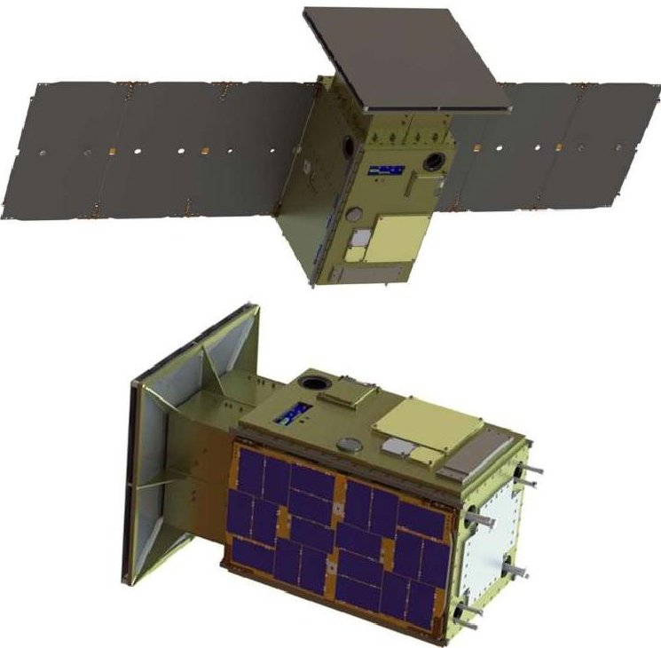
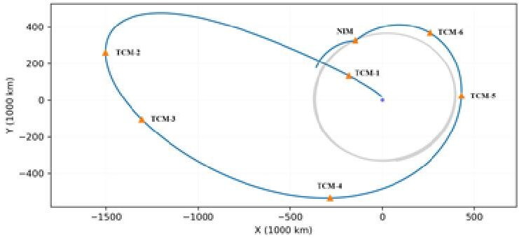
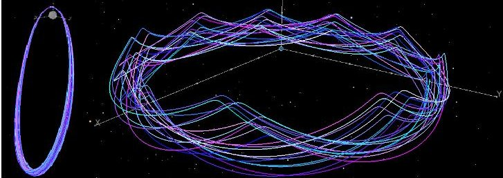

<!-- PDF_PAGE: 1 -->

CAPSTONE: A CubeSat Pathfinder for the Lunar Gateway Ecosystem Thomas Gardner, Brad Cheetham, Alec Forsman, Cameron Meek, Ethan Kayser, Jeff Parker, Michael Thompson Advanced Space, LLC 1400 W 122 $ ^{nd} $ Ave Ste 200, Westminster, CO 80234; (720) 545-9191 gardner@advancedspace.com

Tristan Latchu, Rebecca Rogers Tyvak Nano-Satellite Systems 15333 Barranca Parkway, Irvine, CA 92618; (949) 351-4150 tristan.latchu@tyvak.com

Brennan Bryant, Tomas Svitek Stellar Exploration, Inc 835 Airport Dr, San Luis Obispo, CA 93401; (805) 316-0352 brennan@stellar-exploration.com

## ABSTRACT

The cislunar environment is about to get much busier and with this increase in traffic comes an increase in the demand for limited resources such as Earth based tracking of and communications with assets operating in and around the Moon. With the number of NASA, commercial, and international missions to the Moon growing rapidly in the next few years, the need to make these future endeavors as efficient as possible is a challenge that is being solved now. Advanced Space is aiming to mitigate these resource limitations by enabling the numerous spacecraft in the cislunar environment to navigate autonomously and reduce the need for oversubscribed ground assets for navigation and maneuver planning. Scheduled to launch on a Rocket Lab Electron in October 2021, the Cislunar Autonomous Positioning System Technology Operations and Navigation Experiment (CAPSTONE) mission will leverage a 12U CubeSat to demonstrate both the core software for the Cislunar Autonomous Positioning System (CAPS) as well as a validation of the mission design and operations of the Near Rectilinear Halo Orbit (NRHO) that NASA has baselined for the Artemis Lunar Gateway architecture. Currently being developed in a Phase III of NASA's SBIR program, our CAPS software will allow missions to manage themselves and enable more critical communications to be prioritized between Earth and future cislunar missions without putting these missions at increased risk.

CAPSTONE is the pathfinder mission for NASA's Artemis program. The overall mission will include collaboration with the Lunar Reconnaissance Orbiter (LRO) operations team at NASA Goddard Space Flight Center to demonstrate inter-spacecraft ranging between the CAPSTONE spacecraft and LRO and with the NASA Gateway Operations team at NASA Johnson Space Center to inform the requirements and autonomous mission operations approach for the eventual Gateway systems. Critical success criteria for CAPSTONE in this demonstration are a transfer to and arrival into an NRHO, semi-autonomous operations and orbital maintenance of a spacecraft in an NRHO, collection of interspacecraft ranging data, and execution of the CAPS navigation software system on-board the CAPSTONE spacecraft.

Advanced Space along with our partners at NASA's Space Technology Mission Directorate, Advanced Exploration Systems, Launch Services Program, NASA Ames Small Spacecraft Office, Tyvak Nano-Satellite Systems and Rocket Lab, envision the CAPSTONE mission as a key enabler of both NASA's Gateway operations involving multiple spacecraft and eventually the ever-expanding commercial cislunar economy. This low cost, high value mission will demonstrate an efficient low energy orbital transfer to the lunar vicinity and an insertion and operations approach to the NRHO that ultimately will demonstrate a risk reducing validation of key exploration operations and technologies required for the ultimate success of NASA's lunar exploration plans, including the planned human return to the lunar surface. This presentation will include the current mission status (which would include the launch and early mission operations), the operations plan for the NRHO, and lessons learned to date in order to inform future CubeSat pathfinders in support of national exploration and scientific objectives.

<!-- PDF_PAGE: 2 -->

## INTRODUCTION

The CAPSTONE mission is a pathfinder for NRHO operations that will be vital for future Lunar Gateway activities. Awarded in mid-2019 to Advanced Space, the mission has since completed its key development and implementation milestones and is in final system assembly and test in preparation for launch in October 2021 on a Rocket Lab Electron from Mahia, NZ. Partnering with Tyvak Nanosatellite Systems, Stellar Exploration, and Rocket Lab as well as working closely with NASA through multiple centers, the CAPSTONE mission represents not only the first steps to laying the foundation of the Artemis Program but also a different way of collaboration. By utilizing the best features of commercial and governmental capabilities, this technology demonstration is being executed in a rapid and low-cost mission not typically seen in more traditional NASA small-mission contracts.

In addition to the orbital and operational focuses of this demonstration, the mission will also serve as a technology demonstration of an Advanced Space navigation product developed via a NASA SBIR that recently concluded its Phase II period of performance and has been extended into Phase III for this demonstration mission. The Cislunar Autonomous Positioning System (CAPS) is Advanced Space's solution to the lunar congestion predicted to dramatically increase in the coming years as government, commercial, and international interests bring more missions into the cislunar environment in and about the Moon. By demonstrating this absolute navigation capability on the CAPSTONE mission, it will also rapidly raise the Technology Readiness Level (TRL), commercialization, and infusion of CAPS in preparation of the cislunar traffic to come.

This paper will provide an overview of the mission, through its objectives and operations, as well as insight into the science payloads and their significance to both this mission and future ones.

## MISSION OBJECTIVES

The CAPSTONE mission has objectives that will serve the interests of NASA, Advanced Space, and future participants in the cislunar ecosystem. Detailed below, the objectives cover science, technology, and mission operations as part of the overall demonstration that CAPSTONE will perform:

## 1. Validate and demonstrate NRHO / highly dynamic Earth-Moon Operations

The first mission objective is focused on mitigating technical uncertainties associated with operating in the uniquely beneficial and challenging orbital regime

defined as Near Rectilinear Halo Orbits. This objective will include demonstrating navigation capabilities and validating stationkeeping strategies and operational simulations. This objective will directly support future missions through dissemination of operational information and by obtaining operational experience in this unique orbital regime.

## 2. Inform future lunar exploration requirements and operations

The second CAPSTONE mission objective is focused on building experience operating in complex lunar orbital regimes to inform future lunar exploration requirements and operations, including human exploration flights with lower risk thresholds and higher certainty of success requirements. This will include the establishment of commercially available capacity to support NASA, commercial, and international lunar missions in the future. This objective also seeks to demonstrate the capacity of innovative NASA-industry approaches to rapidly bring capabilities to the Moon and challenge current expectations for cost and schedule.

## 3. Demonstrate and accelerate the infusion of the Cislunar Autonomous Positioning System (CAPS)

The third objective is focused on demonstrating core technical components of CAPS in an orbital demonstration. This objective will include collaboration with the operations team at NASA Goddard Space Flight Center to demonstrate inter-spacecraft ranging between the CAPSTONE spacecraft and the Lunar Reconnaissance Orbiter (LRO) currently in operation at the Moon. In addition to demonstrating key interspacecraft navigation in cislunar space, CAPSTONE will also enhance the technology readiness level of the CAPS software. This accelerated maturation will permit it to be available to support near term flight plans to the Moon and to be more widely adopted by future lunar missions and thus increase the value of this peer-to-peer navigation capability.

## MISSION OVERVIEW

## Payload/Contract

Proposed and funded in mid-2019, the CAPSTONE mission was awarded a contract through NASA's Small Spacecraft Technology Program (SSTP) with a level one objective of achieving launch readiness within 18-24 months of contract award. This mission represents a new way of commercially partnering with NASA to enable rapid and cost-efficient technology demonstrations for highly condensed returns in experience to inform nearterm operational needs.

<!-- PDF_PAGE: 3 -->

## Hardware

The CAPSTONE spacecraft is a 12U CubeSat that has been designed and is being built by Tyvak Nano-satellite Systems based on their exiting, commercial 12U satellite bus. In addition to the CAPS payload flight board, CAPSTONE also includes a color commercial CMOS imager for generating images of the Earth and Moon, two communication systems (X-band and S-band) as well a CSAC for generating additional 1-way navigation data. The X-Band system will be used for two-way communicate with the ground as well as part of the 1-way ranging experiment, while the S-Band system will perform radiometric measurements with LRO to gather data for the CAPS payload using a S-Band patch array antenna. The X-Band system will be used to communicate with the ground, while the S-Band system will perform radiometric measurements with LRO to gather data for the CAPS payload.

Figure 1: CAPSTONE spacecraft in a deployed (top) and stowed (bottom) configuration.

The spacecraft hosts a monopropellant hydrazine propulsion system, delivered by Stellar Exploration, Inc., providing over 200 m/s of total delta-V with eight 0.25-Newton thrusters. Four will be used for translational maneuvers and attitude control, and four will be used for attitude control and momentum desaturation.

## Payloads

The CAPS navigation software will be hosted on a separate flight computer from the spacecraft's primary redundant flight computer boards and will operate distinctly from one another. Being hosted on a separate board allows for the CAPS software to experience

updates and modifications throughout the demonstration as observations are returned, without disrupting the operations of the primary flight computer(s).

Described further below, the CAPS development received follow-on funding through a Phase II-E SBIR award to support development and integration of an additional component added to the CAPSTONE spacecraft design. A Chip Scale Atomic Clock (CSAC) has the potential to provide an additional data 1-way ranging type for navigation measurements to support CAPS when other methods are not readily available/ A significant part of the demonstration is developing and testing the capability of CAPS to ingest these CSAC measurements in addition to the LRO crosslink and ground-link inputs.

## Operations Overview

The mission is scheduled to launch in October 2021 have an approximate three-month, low energy deep space transfer with several maneuvers leading up to the NRHO insertion and then perform its primary and enhanced mission over the next eighteen months. From the launch deployment state, the spacecraft will traverse a low-energy Ballistic Lunar Transfer (BLT), which is a very energy-efficient means of transferring from the LEO environment to an orbit near or about the Moon. The spacecraft will perform up to six Trajectory Correction Maneuvers (TCMs) to clean up launch injection, navigation, and maneuver execution errors prior to arriving at its NRHO insertion point. The spacecraft will then perform a relatively small maneuver to insert into the NRHO; this maneuver is referred to as the NRHO Insertion Maneuver (NIM). Two small cleanup maneuvers are planned to ensure that the spacecraft is successfully inserted into the NRHO: Insertion Correction Maneuvers 1 and 2 (ICM-1 and ICM-2). From there, small stationkeeping maneuvers, known as Orbit Maintenance Maneuvers (OMMs) in combination with momentum desaturation, are performed on a weekly cadence to remain in the NRHO. Finally, a small Decommissioning Maneuver (DM) is performed when the mission is complete to safely decommission the spacecraft to either deep space or to a predetermined designated impact point on the lunar surface.

## Launch

The CAPSTONE spacecraft will launch on a three-stage Electron, a launch vehicle developed by Rocket Lab. After launching into a low Earth orbit from the Rocket Lab LC-1 on Mahia Peninsula, NZ at a latitude of approximately -39°, the Lunar Photon third stage will perform a series of apogee raising maneuvers to achieve the trans-lunar injection (TLI) characteristic energy, C3, of approximately -0.6 km2/s2 to put the spacecraft on its

<!-- PDF_PAGE: 4 -->

deep-space BLT trajectory. A true ballistic BLT (no deterministic maneuvers) requires instantaneous Sun-Earth-Moon geometry, however a deterministic apogee maneuver may be introduced in order to build a TLI period, as well as target a specific NRHO. $ ^{1,2} $

## BLT Maneuver

Ballistic Lunar Transfers (BLTs) are a type of low-energy transfer in which a spacecraft travels to an apogee of 1-1.5 million kilometers to utilize the Sun's gravity to modify the spacecraft's orbital perigee and inclination. $ ^{1,2} $ For CAPSTONE, this effect is used to decrease the inclination from a launch latitude of $ \sim 3 9^{\circ} $ to an inclination in line with the Moon's orbital plane, as well as raise the spacecraft's perigee to the radius of the Moon. This reduces the deterministic spacecraft $ \Delta V $ to approximately 20-60 m/s, compared to the 350-550 m/s required for a direct transfer to an NRHO. This reduction in spacecraft $ \Delta V $ enables the mission to be achieved with a 12U-class CubeSat. The TLI C3 of approximately -0.6 km2/s2 is higher than -2.0 km2/s2, the value needed for a direct transfer. The BLT also requires three to four months of time to traverse, which is substantially longer than a direct transfer. This extended transfer duration provides for advantages from an operational perspective. First, there is ample time to characterize and navigate the spacecraft performance and then perform well-timed trajectory correction maneuvers that allow for a consistent entry time into the NRHO. When the spacecraft reaches perigee, it encounters the Moon and inserts into the NRHO.

Figure 2: TCM Placement in the Earth-Centered EME2000 Frame.

## Trajectory Correction Maneuvers

CAPSTONE must perform multiple Trajectory Correction Maneuvers (TCMs) in order to clean up launch vehicle errors, target the insertion maneuver timing to achieve an Earth-eclipse free NRHO, as well as correct for navigation and maneuver execution errors. Given that the CAPSTONE spacecraft must achieve both a specific state and epoch after insertion to achieve an Earth-eclipse free NRHO, the TCMs and insertion maneuver are designed using a three-burn optimization, rather than a simple one or two-burn targeter. Each

correction maneuver is designed to minimize the sum of the $ \Delta V s $ of the current TCM, the next TCM, and the insertion maneuver to achieve a state along the reference NRHO (and corresponding epoch). The final TCM is not redesigned, but rather executed as it is designed in the previous TCM's optimization. The insertion maneuver initial epoch is also part of the optimization, while the TCMs are fixed in time.

## Insertion into NRHO

Given the objective of demonstrating NRHO stationkeeping and operations to inform future lunar exploration, CAPSTONE will operate in the same sized orbit targeted by the Lunar Gateway: a 9:2 resonant, southern L2 NRHO. For every two lunar synodic periods, approximately 29.53 days each, CAPSTONE will complete 9 revolutions in its NRHO.

There are four families of NRHOs, distinguished by the location of their apolune. The apolune may be stretched towards either the L1 or L2 Earth-Moon Lagrange point, and may be either above (northern) or below (southern), the lunar orbital plane. A 9:2 resonant NRHO only exists in the L2 family, and the southern trajectory was chosen to maximize the Lunar Gateway's time over the lunar south pole, an area especially of interest to lunar exploration.

The NRHO Reference Orbit (NRO) is specifically designed to avoid Earth induced solar eclipses for the duration of the primary and enhanced mission (18 months), as well as align the epoch of the first perilune with the low-energy transfer to minimize the delta-V required to achieve the NRHO. Although periodic in the circular restricted three-body problem, a multi-shoot method is used to build an Earth-eclipse free, 90-revolution NRO with minimal discontinuities in the ephemeris model.

Figure 3: NRHO Reference Orbit in the Earth-Moon Rotating (left) and Sun-Earth Rotating (right) Frames

As the spacecraft arrives at the Moon it targets the reference NRHO periapse passage, and the spacecraft must precisely insert into the NRHO. Planetary missions are often robust to large maneuver execution errors upon insertion into a capture orbit because the capture orbit simply must be safe and otherwise a good transition to the science orbit via additional maneuvers.

<!-- PDF_PAGE: 5 -->

CAPSTONE's insertion is quite different from this model. First, the NRHO Insertion Maneuver (NIM) is on the order of 20 m/s, quite a small maneuver compared with conventional planetary orbit insertions. Second, the maneuver must very accurately target the NRHO. If the post-NIM state, mapped to the nearest periapse, is more than 5 m/s different from the NRO periapse state, the resulting orbit is far different from the NRHO, and the mission must spend a significant amount of fuel to return to the reference NRHO. One way in which CAPSTONE's orbit insertion is similar to conventional planetary insertions is that the NIM is considered a critical maneuver: it must be performed approximately as designed or else the mission is substantially impacted.

CAPSTONE introduces two maneuvers following NIM: ICM-1 is performed one day later to clean up NIM execution errors; ICM-2 is performed three days after ICM-1 to complete the insertion process into the reference NRHO. The two Insertion Cleanup Maneuvers offer six degrees of freedom to achieve a six-state at the time of ICM-2, i.e., they compose a two-burn transfer from the post-NIM orbit to the reference NRHO and must be performed relatively soon after NIM in order to avoid exponentially increasing delta-V cost. Some separation is desirable between the two ICMs to give the spacecraft time to drift from the post-NIM orbit to the reference NRHO, but it is desirable to achieve the transfer prior to the next periapse passage since periapse passages are very sensitive to orbital errors. A full summary of all TCM's, ICM's and OMM's their timing, and purpose are outlined below.

Table 1: CAPSTONE's Planned Maneuvers

<table border="1"><tr><td>Maneuver</td><td>Timing</td><td>Purpose</td></tr><tr><td>TCM-1</td><td>24 hours after separation</td><td>Correct launch vehicle insertion errors</td></tr><tr><td>TCM-2</td><td>55 days before insertion</td><td>Deterministic maneuver to correct for non-optimal Sun-Earth-Moon geometry</td></tr><tr><td>TCM-3</td><td>40 days before insertion</td><td>Correct for errors in the execution and design of TCM-2</td></tr><tr><td>TCM-4</td><td>20 days before insertion</td><td>Target the NRHO insertion state</td></tr><tr><td>TCM-5</td><td>10 days before insertion</td><td>Target the NRHO insertion state</td></tr><tr><td>TCM-6</td><td>5 days before insertion</td><td>Target the NRHO insertion state</td></tr><tr><td>NIM</td><td>90-120 days after launch</td><td>Insert into the NRHO and get captured in lunar orbit</td></tr><tr><td>ICM-1&amp;2</td><td>1,5 days after insertion</td><td>Target the NRHO Reference Orbit (NRO)</td></tr></table>

<table border="1"><tr><td>OMMs</td><td>Every 6-7 days during the primary and enhanced mission</td><td>Maintain the CAPSTONE spacecraft near the NRO</td></tr><tr><td>DM</td><td>21+ months after launch</td><td>Safely dispose of the CAPSTONE spacecraft to heliocentric space or the lunar surface</td></tr></table>

## Daily Operations

The orbit maintenance strategy for CAPSTONE is both informing and responding to projected lunar Gateway requirements. CAPSTONE's orbit maintenance maneuvers (OMM) are based on the "X-axis crossing control" strategy—a low-cost, robust method of maintaining NRHOs for long durations. $ ^{3-5} $ The maneuver is designed to achieve a target 6.5 revolutions downstream (that is, at the seventh perilune crossing), where the target is the X-velocity of the reference orbit (NRO) in the Earth-Moon rotating frame at that perilune. This strategy is low-cost and effective at maintaining the NRHO-like motion, but the controlled spacecraft drifts away from the reference over time. This drift is realized not only in the position and velocity states of the spacecraft, but also the phasing. Such a drift is undesirable because the NRHO for CAPSTONE was designed to avoid Earth induced solar eclipses by targeting strict phasing.

Different approaches to correct this drift have been developed. $ ^{6,7} $ Some of these strategies implement a twoburn sequence to correct the phasing, while others implement small augmentations to the traditional X-axis crossing algorithm. $ ^{8} $ The current OMM approach baselined for CAPSTONE supplements the traditional X-axis crossing control algorithm by adding an epoch constraint to the maneuver targets. This constraint requires the perilune passage time of the controlled spacecraft to match the perilune passage time of the reference spacecraft to some tolerance.

Other OMM augmentations were considered as well. These augmentations incorporated different aspects of phase-control strategies presented in literature, such as where in the NRHO the OMM is performed. In these cases, where the location of the maneuver was changed, the same epoch constraint as discussed in the CAPSTONE baseline OMM strategy are still implemented. $ ^{6} $ The additional maneuver locations chosen were $ 1 6 0^{\circ} $ and $ 2 0 0^{\circ} $ osculating true anomaly (in the Earth-Moon rotating frame).

<!-- PDF_PAGE: 6 -->

## CISLUNAR AUTONOMOUS POSITIONING SYSTEM (CAPS)

CAPS is a unique innovation that operationalizes, and leverages investments made in algorithms, flight computers, and radios over the past decade. At its foundation, CAPS starts with the algorithms and logic of automated navigation layered on top of an innovative approach to absolute orbit determination that requires only relative radiometric ranging and Doppler measurements. In its most streamlined implementation, CAPS will be a software innovation that can be incorporated on any future spacecraft.

## SBIR Development

From 2017 to 2020 the CAPS development was supported via NASA SBIR contract through Goddard Space Flight Center. In this time the software was developed and tested in a lab environment that readied it for further integration and ultimately flight testing. With the Phase II concluded in mid-2020, the CAPS research and development was funded for continuation through a Phase II-e and Phase III SBIR awards. The intent for these awards is the ongoing development and support of the software as it approaches demonstration on the CAPSTONE mission. Part of these funding extensions is also to expand the data types ingestible by CAPS, thereby widening its navigation capabilities in the cislunar environment.

## Crosslink

To demonstrate and accelerate the infusion of the Cislunar Autonomous Positioning System (CAPS), CAPSTONE will perform numerous crosslink communication passes with the Lunar Reconnaissance Orbiter (LRO) using its S-band telecommunication system. The tracking passes will occur when CAPSTONE is nearer to periapse, as LRO is in a polar, low lunar orbit. The availability of these passes will depend on a number of factors, including each spacecraft's power, their relative distances, lunar occultations, pointing constraints, and LRO ongoing science operational priorities. These tracking passes will provide two-way, coherent range and Doppler measurements to the CAPS flight software onboard CAPSTONE. The flight software will demonstrate CAPS in flight, while also downlinking the CAPSTONE-LRO crosslink data to the ground for further refinement, validation, and further development. The objective for CAPSTONE is to accelerate the infusion of autonomous spacecraft navigation, where such crosslink tracking may support the navigation needs of both spacecraft in the link. Eventually, during the enhanced mission phase, the goal is for the CAPS SW to provide full autonomous navigation onboard the

CAPSTONE spacecraft thus demonstrating this capability for future cislunar mission applications

## Vision of a CAPS-enabled future

As cislunar space is poised for significant increases in mission activity, missions large and small are inherently constrained by the current limitations of ground tracking systems such as DSN and the Near-Earth Network (NEN). The increasing the complexity of this problem is the ambiguity with which schedule and mission scope can be accurately projected. Many of these missions will be operating in orbital regimes that require frequent tracking and station keeping, which drives the demand for navigation even higher. NASA's Artemis Program of lunar exploration will return US astronauts to the Moon and lay a foundation for development of lunar resources. The Artemis lunar architecture now in development includes major elements such as the Orion space capsule, the Lunar Gateway, a lunar lander, and the Space Launch System (SLS). Gateway will serve as a departure point for human excursions to the surface of the Moon. Many of these projects, and others from around the world, are now in development and can benefit from the CAPS capabilities for their operational navigation requirements.

Advanced Space foresees a future of increasing scientific and exploration activity within cislunar space. Future missions operated by NASA, commercial entities, and international agencies will face increasing congestion due to limited communication and navigation infrastructure.

## CURRENT MISSION STATUS

Currently, the CAPSTONE mission is in its final stages of development and implementation. The spacecraft has completed assembly and initial test and is currently in environmental testing at Tyvak in preparation for delivery in early September 2020. The Rocket Lab Lunar Photon upper stage has completed system test and is in final preparation for delivery for integration with the CAPSTONE spacecraft at LC-1 in Mahia, NZ. Currently, launch is planned within a launch period of October 20-31 with no operational constraints on the daily launch window related to post-TLI $ \Delta V $ requirements or NRHO insertion geometry. All operational systems are in place at Tyvak (for spacecraft and overall mission operations support), Advanced Space (for navigation and flight dynamics support), the Deep Space Network (for tracking and communications support) as well as the support functions for the LRO spacecraft operations once CAPSTONE is in the NRHO and ready for the CAPS demonstration.

<!-- PDF_PAGE: 7 -->

## CONCLUSION

As the Moon becomes the focus of more entities whether governmental, commercial, or international it is becoming imperative that there is a stronger understanding of the nuances and difficulties faced by future spacecraft as they enter this new environment. Not only is CAPSTONE providing rapid feedback and experience on operational challenges soon to be faced by the future Lunar Gateway and other Artemis Program missions, but it is doing so in a way that is expedited via commercial strengths in schedule and cost management. It is the hope and goal of the Advanced Space team that this technology demonstration will not only support Artemis operations and CAPS maturation but will also model a new way of commercial partnerships for NASA and other agencies to pursue in support of their directives.

## ACKNOWLEDGMENTS

The CAPSTONE mission is a rapid and low-cost small spacecraft pathfinder for the Artemis program that will also demonstrate the CAPS technology. CAPSTONE is supported by NASA's Space Technology Mission Directorate through the Small Spacecraft Technology program and by the Human Exploration and Operations Mission Directorate through the Advanced Exploration Systems program. CAPS is supported by NASA's Small Business Innovation Research (SBIR) program.

The authors would like to thank Christopher Baker (HQSTMD), Elwood Agasid (ARS-SSO), Roger Hunter (ARC-SSO), Scott Higginbothem (KSC-LSP), Jennifer Donaldson (GSFC) and the entire LRO Operations Team (GSFC) at NASA for their ongoing support of the CAPSTONE mission.

## REFERENCES

1. Parker, J. S. & Anderson, R. L. "Low-Energy Lunar Trajectory Design," (John Wiley and Sons, 2014).

2. Parker, J. S. "Low-Energy Ballistic Lunar Transfers," University of Colorado Boulder, 2007.

3. Davis, D. C., S. A. Bhatt, K. C. Howell, J. Jang, R. L. Whitley, F. D. Clark, D. Guzzetti, E. M. Zimovan, and G. H. Barton, "Orbit Maintenance and Navigation of Human Spacecraft at Cislunar Near Rectilinear Halo Orbits," 27th AAS/AIAA Space Flight Mechanics Meeting, San Antonio, Texas, February 2017.

4. Guzzetti, D., E. M. Zimovan, K. C. Howell, and D. C. Davis, "Stationkeeping Methodologies for Spacecraft in Lunar Near Rectilinear Halo Orbits," AAS/AIAA Spaceflight Mechanics Meeting, San Antonio, Texas, February 2017.

5. Newman, C. P., D. C. Davis, R. J. Whitley, J. R. Guinn, and M. S. Ryne, "Stationkeeping, Orbit Determination, and Attitude Control for Spacecraft in Near Rectilinear Halo Orbit," AAS/AIAA Astrodynamics Specialists Conference, Snowbird, Utah, August 2018.

6. Davis, D., C., Khoury, F. S., Howell, K. C., Sweeney D. J., "Phase Control and Eclipse Avoidance in Near Rectilinear Halo Orbits," AAS Guidance Navigation and Control Conference, Breckenridge, CO, 2019. AAS 20-047.

7. Parrish, N. L., Bolliger, M. J., Kayser, E. K., Thompson, M. R., Parker, J. S., Cheetham, B. W., Davis, D. C., Sweeney, D. J., "Near Rectilinear Halo Orbit Determination with Simulated DSN Observations," AIAA Scitech 2020 Forum, Orlando, FL, January 2020. AIAA 2020-1700.

8. Parrish, N. P., Kayser, E., Udupa, S., Parker, J. S., Cheetham, B. W., Davis, D. C., "Survey of Ballistic Lunar Transfers to Near Rectilinear Halo Orbit," AAS 19-740.