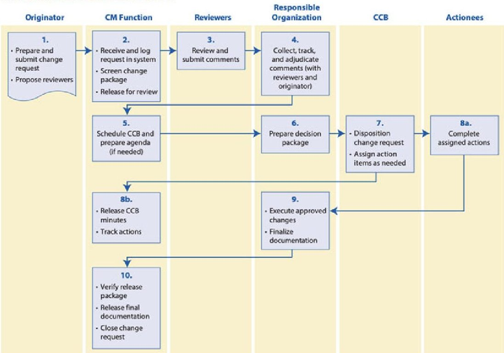
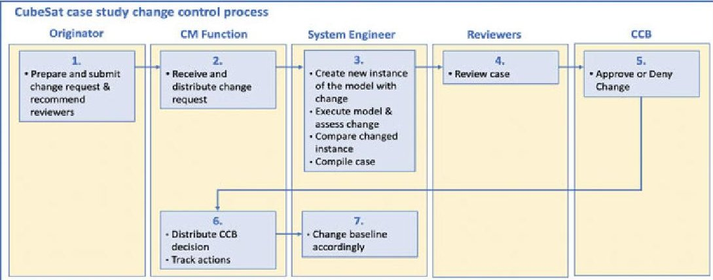

<!-- PDF_PAGE: 1 -->

# Change Management Processes in MBSE

Isabeta Rountree, Victor Lopez, and L. Dale Thomas

## 1 Introduction

Project changes are recognized as key concerns (Stare 2011) relating to schedule delays and cost overruns while being considered intrinsic to system development (Stare 2011). Traditional project management methods seem unable to properly address changes in these complex systems (Saynisch 2010). Dynamic environments are a contributing factor in the difficulty of managing complex systems. Environments are constantly changing, making it hard to predict changes during early planning phases in projects (Stare 2011). Traditional systems engineering methods seem inadequate to account for this inability to predict factors of change. While changes have negative programmatic consequences, such as schedule excess or incurred cost, the benefit to system development from a change can sometimes outweigh the repercussions. Thus, identifying which changes will ultimately result in a better system becomes critical.

## 2 Origin of Changes

Introducing change to a system creates a new design space, with alternatives that need to be compared and evaluated. This comparison is usually performed by looking at the impact of the change in the performance and capabilities of the system as well as the cost and schedule impacts. In traditional, documentbased, systems engineering practice, when a change is proposed, subject-matter

<!-- PDF_PAGE: 2 -->

experts are contacted to evaluate the impact of the change by rerunning analysis and simulations. Oftentimes, physical and behavioral system models must be reorganized based on the change incurred, and an iterative approach must be used to find the new feasible solution. This iterative process typically includes multiple non-integrated physical simulations and is resource-intensive.

During the iterative analysis and design process, unforeseen issues may arise. The introduction of a new solution may interfere with an existing design solution or system interface. Existing interfaces and solutions must then be evaluated and corrected to ensure system success. One change can lead to many smaller changes that may have less apparent or perceived impact and therefore are easier to overlook. These changes have the potential to cause issues during later system development.

Changes can manifest due to controllable and uncontrollable factors. McMahon identifies five modes of design change, two of which involve types of change that may arise during system development due to uncontrollable factors (Mcmahon 1994). It is the uncontrollable factors that are most difficult to anticipate. The first of these two modes introduces changes due to an improved understanding of the development of analytical or experimental techniques. The second introduces changes due to external factors resulting in a change to the product design specification such as changes in the market conditions and stakeholder interests (Mcmahon 1994). The other modes outline change necessitated by the ability to create a more optimized design through parameter space exploration, modification of the feasible design space, and the selection of alternative designs. Changes can incur significant schedule cost, but this loss may be outweighed by system performance and capability enhancements.

## 3 Current Change Management Methods

Changes can be dealt with in a couple of ways. When change is not managed, changes may be made with little to no regulation. This approach leads to a great number of changes that make system integration and development difficult due to constant rework of interfaces and designs. Change is usually managed with a configuration change management process in traditional systems engineering.

Change management processes vary depending on the organization and project. As an example, NASA's configuration change process is shown in Figure 1 (National Aeronautics and Space Administration 2016). NASA defines configuration change management as the "systematic proposal, justification, and evaluation of proposed changes followed by incorporation of approved changes and verification of implementation" (National Aeronautics and Space Administration 2016).

The NASA change management process outlined in the figure involves many steps designed to moderate the number of changes made and ensure there is more benefit than detriment to the system. 58 59 60

This process depicts the participation of six parties, four of which involve multiple people and actions. The coordination of this amount of people, the compilation 61 62

<!-- PDF_PAGE: 3 -->

Fig.1 Illustration of the normal NASA configuration change process (National Aeronautics and Space Administration 2016)

of a decision package, and iteratively evaluating design alternatives are all very involved and time-consuming processes. The traditional change control process is lengthy and can be difficult to implement cleanly and effectively. Additionally, even with the effective implementation of change management processes like the afore outlined one, schedule detriment due to incurred system changes is still a significant issue. This is due to the large number of steps and involved parties in the development and delivery of a change and its respective repercussions.

Other limitations with document-based approaches include limitations in "The completeness, consistency, and relationships between requirements, design, engineering analysis, and test information are difficult to assess since this information is spread across several documents" (Friedenthal et al. 2015) which translate into "to poor synchronization between system-level requirements and design and lowerlevel hardware and software design. It also makes it difficult to maintain or reuse the system requirements and design information for an evolving or variant system design." (Friedenthal et al. 2015).

The difficult traditional change management process paired with the traditional document-based systems engineering approach results in a systems management reality that is unequipped to efficiently address modern complex systems. Furthermore, changes implemented in a system because of the change process may in turn affect other aspects of the system and necessitate rework of system components.

<!-- PDF_PAGE: 4 -->

With the emergence of model-based systems engineering (MBSE), there is the opportunity to re-evaluate and possibly reduce the length of the traditional process of change management in document-based systems engineering. Due to this fact, this is an area of interest for improvement of future processes in systems engineering.

## 4 Using MBSE for Change Management

MBSE has emerged as a process to improve traditional systems engineering practices; "MBSE is intended to facilitate systems engineering activities that have traditionally been performed using the document-based approach and result in enhanced specification and design quality, reuse of system specification and design artifacts, and communications among the development team" (Friedenthal et al. 2015). This paper will focus on how MBSE can be used to reduce schedule impacts associated with change management in large complex systems.

When implementing MBSE, "The system model can also be integrated with engineering analysis and simulation models to perform computation and dynamic execution" (Friedenthal et al. 2015). This capability allows management of all compatible engineering analysis and simulation models in a singular location that can be executed simultaneously when faced with changes to a system. The advantages of MBSE could potentially include "Increased productivity; Faster impact analysis of requirements and design changes, more effective exploration of trade-space, reuse of existing models to support design evolution, reduced errors and time during integration and testing, and automated document generation" (Friedenthal et al. 2015).

The Systems Modeling Language (SysML) is a widely used language for MBSE. This language "supports the practice of model-based systems engineering (MBSE) that is used to develop system solutions in response to complex and often technologically challenging problems" (Friedenthal et al. 2015). There is extensive documentation on this language in texts such as A Practical Guide to SysML: The Systems Modeling Language by Friedenthal, Moore, and Steiner (Friedenthal et al. 2015), and it is well known as an extension of the Unified Modeling Language (UML). For this reason, the implementation of MBSE using SysML is explored towards improving the change management process to reduce time spent managing change when faced with new requirements in complex systems.

It should be noted, however, that while MBSE does have the potential to realize the stated benefits, there are some obstacles. First the implementation of MBSE usually requires the creation of a system model which requires proficiency in both the model's language, usually SysML, and the software tool used, No Magic's Cameo or IBM's Rhapsody for example. Needing to be proficient would mean having to train current systems engineers and might steepen the learning curve for new hires. This necessitates a significant time investment prior to being able to effectively develop a system model.

<!-- PDF_PAGE: 5 -->

Additionally, for large complex projects, an integrated system model would likely be developed by multiple system modelers. Different approaches to model development could lead to consistency or compatibility issues. However, the software development industry has encountered similar issues in software modeling resolved through methodologies and tools such as Agile software development: "...agile methods aim to answer a need to develop software quickly, in an environment of rapidly changing requirements" (Greer & Hamon 2011). Similar approaches are and will need to be developed for systems modeling (Schindel & Dove 2016).

In order to take full advantage of the MBSE approach, a system model should include integrated engineering analysis and simulation models. This integration is not trivial, especially when dealing with very specialized analyses, legacy tools, or geographical and organizational barriers. Although some work and tools are aimed at improving this situation, there is still work to be done until this can become standard practice.

Finally, different common processes in system development such as contracting, acquisition, trade studies, scheduling, and communication rely on traditionally produced documentation. The change from document-based to model-based systems engineering would require an adaptation of all these processes.

## 5 Methodology

Change management practices with respect to MBSE have been introduced as a topic of interest. However, little research has been done on the process itself. Authors Friedenthal, Moore, and Steiner introduce the idea that MBSE needs processes to manage change in their text A Practical Guide to SysML: The Systems Modeling Language: "Disciplined processes and associated tools must be put in place to manage changes to models" (Friedenthal et al. 2015). Further in the text, configuration management approaches with regard to MBSE models are discussed. The general configuration management responsibilities include: "Manage the set of artifacts (often called configuration items) being developed, including managing access to the current working set of artifacts (often called a configuration) and archiving significant versions of that working set (called baselines)," and "Ensure that products built from a project baseline are complete and consistent, including the identification of different variants of system components and the compatibility between them" (Friedenthal et al. 2015). Regarding change management, the configuration management responsibilities implied personnel were to "Manage changes to that working set, including enforcing a consistent change control process, for example based on change requests, and analyzing the impact of changes to configuration items. Tools that fulfill this function are typically called change management tools, and often incorporate configuration management functions" (Friedenthal et al. 2015). This text also includes a reference to the Object Management Group (OMG) Meta Object Facility (MOF) versioning standard (https://

<!-- PDF_PAGE: 6 -->

www.omg.org/spec/MOFVD/2.0/PDF) as a possible framework for configuration management of models. 164 165

The OMG MOF versioning specification was designed to “manage the coexistence of multiple versions of such metadata in a Meta Object Facility and their inclusion in different configurations (for example, a specific version of a Platform Independent Model (PIM), the corresponding version of the derived Platform Specific Model (PSM), and the corresponding version of the generated system)” (https://www.omg.org/spec/MOFVD/2.0/PDF). This specification focuses on the management of specific configurations (model variations and baselines) rather than the process of change management itself. There is otherwise little documentation on a change management process for systems using MBSE. A change management process will be proposed that supports a MBSE-centered environment and highlights the time saving advantage of using a model when faced with system changes.

In a MBSE environment, changes occur just as in a document-based system engineering environment. However, there are some noticeable differences in the management of system artifacts. The following is an outline of a MBSE change process. Likewise, to traditional processes, assume a change request is submitted by someone on the project. This change order would go to a configuration management representative who would then have it reviewed. Then, in preparation for the decision package, the change request would be disseminated to a model owner. The model owner would then execute the change in a branch model and record highlighted changes based on modelled metrics and traceability. This information would then be sent to the change control board (CCB). Following the traditional method, then the CCB would approve or deny the change. Since a model allows the capability of uniformly updating model artifacts through all model documentation and accompanying simulations by a singular model editor, the “actionees” step of the traditional method is skipped. The change control board would send the change decision to the configuration management representative, who would then notify the model owner of approved changes. The model owner would then be able to cleanly and uniformly implement the changes in the model. An illustration showing this potential shortened methodology is shown in Figure 2. This method was developed to be tested using the accompanying case study example.

The traditional NASA change management process depicted in Figure 1 involves many steps. These steps include preparation and submittal of a change request, reception and distribution of the change request by configuration management, a review of the change request by a panel, compilation by the organization, scheduling of a change control board meeting, preparation of a decision package, an analysis of tasks associated with the change, performance of designated tasks, tracking of task completion, execution of approved changes, preparation of final change documentation, and official change documentation release.

The change management methodology shown in Figure 2 varies from the methodology in Figure 1 in a few key aspects. Firstly, it removes the creation and handling of documents between different actors. Information normally depicted in documents is contained within the model. Secondly, it reduces the actions generated

<!-- PDF_PAGE: 7 -->

Fig. 2 Potential change control process for a MBSE project

by the change. The model being linked to most physics models, the subsequent actions needed from the change are automatically generated before the change goes to the CCB. Finally, it allows the CCB to make a more informed decision. Since the model automatically assesses the impact of the change to other parts or metrics, the CCB can use that information to make their decision instead of the information being generated as an action after the change has been approved.

A model allows changes to be implemented quickly and uniformly through all model documentation. This saves time in updating model artifacts and increases document consistency as it is uniform and automatic. Additionally, engineering analysis models will automatically update when tied to model parameters, and affected subsystems can be easily identified. These capabilities significantly reduce the time taken in the traditional method due to the centrally located definition of model artifacts and simulations. A singular model owner has the capability to evaluate a change, see what the change affects, and make the change which will update related model artifacts and simulations.

## 6 Case Study

The planned NASA Artemis 2 mission solicited proposals in the fall of 2019 for secondary payload CubeSat missions aimed at addressing NASA's strategic knowledge gaps. The Alabama Space Grant Consortium has organized a cooperative project between seven universities in Alabama to build a CubeSat. The mission is being called Alabama Experiment for Galactic-ray In-situ Shielding (AEGIS), and it originally was conceived - prior to release of the Artemis 2 secondary payload solicitation - to study gamma ray bursts in cislunar space to improve the ability to localize the source of celestial gamma ray bursts.

A SysML model was developed representing the programmatic, structural, 233 and behavioral aspects of the system. The science mission requirements were 234

<!-- PDF_PAGE: 8 -->

determined by the science group and served as the starting point of the model. All the design decisions and system requirements were derived and traced back to the mission requirements. With the requirements established the engineering solution selected was modelled structurally with the corresponding physical models linked to it. Finally, the behavior of the system was determined and captured in a set of SysML diagrams. Using the behavioral and structural representation, different performance parameters of the system were calculated. The MBSE approach taken allowed for every part of the system to be traced back to the mission requirements.

The design was started before NASA released the specific criteria by which the missions would be selected for secondary payloads. After the official solicitation was released, it was determined that the planned scientific mission was not well aligned with the solicitation criteria and as such was inadequate for the project. The science mission was then modified to study the shielding properties of lunar regolith in a cislunar environment to be more responsive to the Artemis 2 secondary payload solicitation criteria. This change in mission scope would then change the mission requirements and cause multiple changes across different aspects of the design.

In a traditional system one would have to either go into a long change process for every single change or redo the entire design process from the start. The first option would then result in a long process where different changes have individual change processes. These individual changes would have been extremely resource expensive. Additionally, these changes would have been accompanied by the risk that an approved change might have to be reworked after another change is implemented. If the design were to be restarted, the whole documentation would then need to be remade, and all the work previously done would have been useless. In either case, when the change resulted in a parameter change used in one of the physical analyses, the new parameter would need to be sent to the analyst. This analyst would do his analysis and send back the result. Since this project has very strongly coupled analysis, this would result in an iterative loop until a feasible solution is found.

Instead, since the system was under development in a MBSE environment, the requirements that changed were able to be changed in the model; from there it was easy to see what design decisions and what requirements were derived since there was a traceable connection. This was then followed until the complete impact of the design change was evaluated. The changes were translated into changes in the behavioral and structural diagrams. The main difference is that the parametrized physics models relating to model elements did not require rework. When all the changes were made, all the models were able to be run by the systems engineer without the need of the individual analyst, thereby greatly reducing the time to evaluate the impact of the change, although some specialized analyses that were not included in the model had to go through the traditional change process.

Currently, additional physics models are being parametrized and included in the model. The generation of the flight software will also be incorporated into the model through the implementation of F Prime. The introduction of these aspects into the model will allow a quantitative way to measure the benefit of having physics models included in the MBSE approach. An analysis will be done comparing how long 274 275 276 277 278

<!-- PDF_PAGE: 9 -->

some changes took at the beginning of the project against at the end of it. This difference in time could then be used to determine if the benefit of the MBSE approach outweighed the time and resources needed to implement the approach. 279 280 281

## 7 Conclusion

The AEGIS project encountered change during system development. The MBSE change management approach outlined was applied to the project to assist in managing these changes. The result was a CM process with fewer numbers of steps and individuals involved in the process, thereby reducing the time taken to address changes. This implementation allowed for faster change response and continuous system development.

Change is inevitable in large systems; the ability to properly manage them can be the difference between successful and failed systems. Existing traditional change management processes seem unable to properly address the changes of new systems resulting in cost increases and schedule overruns. These effects originate in part from a lengthy process involving multiple parties, people, and actions. MBSE opens the door for new change management processes that could improve on the traditional processes. MBSE allows for the systems engineer to quickly create a different version of the model with the modified physics results. This can then be used to evaluate figures of merit to decide if the change should happen or not. The ability to reduce the number of people involved in the change process coupled with lower analysis time allows reduction in the overall schedule and cost impact incurred due to a change. These new processes could be faster and more reliable and thus could contribute to designing better systems, faster and at a lower cost. Looking forward, a proper change management process should be studied to learn exactly the best way to handle change in a MBSE environment.

Further study is needed to assess the applicability of a MBSE change management process like the one outlined to larger complex projects. Larger projects are likely to include several model-based systems engineers all operating in an integrated model space. With the introduction of more modelers, more steps may be necessary in model management procedures. Further development and analysis of a MBSE change management process applying to variously sized projects needs to be done to broaden the applicability of a general MBSE change management process and validate its effectiveness. The current CM methodologies are the result of years of evolution through many system developments; it can be expected that as new projects are developed in a model-based environment the CM will also evolve to meet a system or organization's needs.

<!-- PDF_PAGE: 10 -->

## References

Friedenthal, Sanford, Alan Moore, and Rick Steiner. 2015. A Practical Guide to Sysml: The Systems Modeling Language. Waltham: Morgan Kaufmann. 316 317

Greer, D., and Y. Hamon. 2011. Agile Software Development 41 (9): 943-944. https://doi.org/ 318 10.1002/spe.1100. 319

Mcmahon, Christopher A. 1994. Observations on Modes of Incremental Change in Design. Journal of Engineering Design 5.3: 195-209. Web. 320 321

National Aeronautics and Space Administration. 2016. NASA Systems Engineering Handbook. Rev 322

2. Washington, DC: National Aeronautics and Space Administration. Print. 323

Object Management Group. "Meta Object Facility (MOF) Versioning and Development Lifecycle Specification, v2.0". https://www.omg.org/spec/MOFVD/2.0/PDF. 324 325

Saynisch, M. 2010. Mastering Complexity and Changes in Projects, Economy, and Society via Project Management Second Order (PM-2). Project Management Journal 41 (5): 4-20. https://doi.org/10.1002/pmj.20167. 326 327 328

Schindel, Bill, and Rick Dove. 2016. Introduction to the Agile Systems Engineering Life Cycle MBSE Pattern. 26th Annual INCOSE International Symposium (IS 2016) Edinburg, Scotland, UK, July 18-21, 2016, www.parshift.com/s/160718IS16- IntroToTheAgileSystemsEngineeringLifeCycleMBSEPattern.pdf. 329 330 331 332

Stare, Aljaz. 2011. Reducing Negative Impact of Project Changes with Risk and Change Management. Zagreb International Review of Economics & Business 14.2: 71-85. Web. https://search-proquest-com.elib.uah.edu/docview/875892187/9D0A393C3B564AF3PQ/ 1?accountid=14476.