<!-- PDF_PAGE: 1 -->

# Cislunar Explorers: Lessons Learned from the Development of an Interplanetary CubeSat

Aaron Zucherman, Kelly Jawork, Aaron Buchwald, Abhinav Naikawadi, Charlie Robinson, Eashaan Kumar, Elliot Kann, George Orellana, Michael Zakoworotny, Oren Alon, Sydney Rzepka, Van Adams, Curran Muhlberger,

Mason Peck

Cornell University

124 Hoy Rd. Ithaca, NY 14853

805. 405.9205

apz24@cornell.edu

## ABSTRACT

The Cislunar Explorers mission is a pair of ~3U nanosatellites (named Hydrogen and Oxygen) launching as a single 6U CubeSat as part of NASA's Artemis-1 mission on the Space Launch System (SLS). The two spacecraft will demonstrate technologies increasing the reach, flexibility, and cost-effectiveness of interplanetary smallsats. These innovations include water electrolysis propulsion, multi-body optical navigation, passive spin-stabilization, and the operation of femtosatellites beyond low earth orbit. Cislunar Explorers also serves as a pathfinder for demonstrating the utility and versatility of water for future In Situ Resource Utilization (ISRU) on space missions. Critical subsystems complement each other to reduce the cost and complexity. Water not only serves as the propellant for the propulsion system, but also as a radiation shield, electronics heat sink, and nutation damper. Each spacecraft's spin provides attitude stabilization, separates electrolyzed gas from the water in the propulsion tank, simplifies the active attitude control system, and enables the optical navigation system to cover a panoramic view around the spacecraft. The unique elements of the mission spacecraft's design provided advantages to traditional CubeSat architectures but also produced unexpected development challenges. By leveraging the lessons learned from the development of the Cislunar Explorers mission, future interplanetary missions can utilize its technology to reduce cost, risk, and complexity.

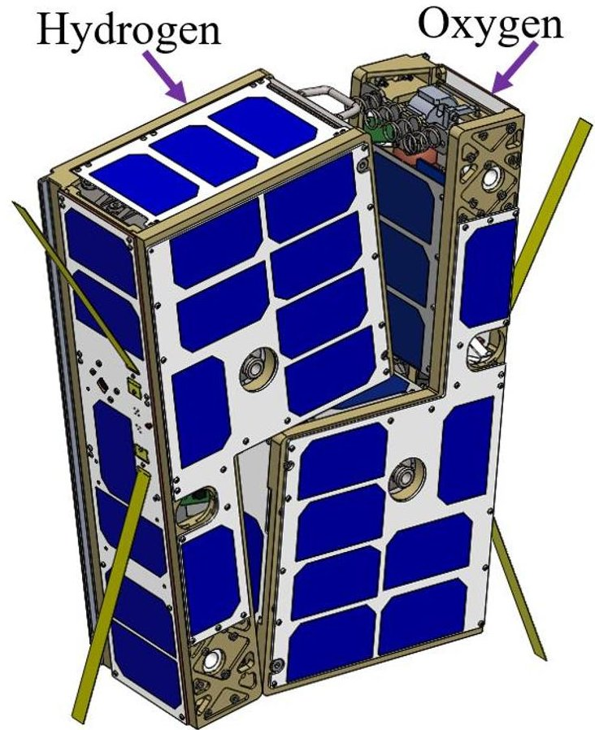

Figure 1: Cislunar Explorers

## INTRODUCTION

The Cislunar Explorers spacecraft will be launched as part of NASA's Artemis-I mission (formally known as Exploration Mission One or EM-1). They will be launched on the SLS rocket as one of thirteen secondary payloads. The Cislunar Explorers mission has been in development at the Space Systems Design Studio (SSDS) at Cornell University since 2015. The mission is a participant in NASA's CubeQuest Challenge, a competition that is part of NASA's Centennial Challenges with the objective of delivering small satellites that operate near or beyond the Moon. After succeeding in the four "ground tournaments" Cislunar Explorers was selected for launch as part of Artemis-I. As a part of the CubeQuest Challenge, Cislunar Explorers is competing for the Lunar Derby and Spacecraft Longevity prizes. $ ^{1} $

## MISSION OVERVIEW

The Cislunar Explorers are two nearly identical L-shaped ~3U spacecraft launched in a 6U CubeSat form factor. $ ^{3} $ They are designed to separate using a spring- loaded mechanism, inducing a desired major-axis spin in each spacecraft. This spin is one of the major features contributing to the mission goals of successfully using a water electrolysis propulsion system and an optical navigation system. The spin centrifugally separates the

<!-- PDF_PAGE: 2 -->

electrolyzed hydrogen and oxygen gases from liquid water in the propulsion system, allowing the gaseous mixture to combust and produce thrust. Each spacecraft also has a novel low-cost optical navigation system to calculate its position and attitude. These concepts were developed at SSDS to demonstrate that water is a viable option for In Situ Resource Utilization (ISRU) and that low-cost terrestrial technology can be used on interplanetary smallsat missions. The subsystems of the Cislunar Explorers interface symbiotically, a key feature of the design and functionality of the mission.

## Water Electrolysis Propulsion System Demo

The primary objective of the Cislunar Explorers mission is a technology demonstration of water electrolysis propulsion as a means of providing high $ \Delta V $ while conforming to CubeSat specifications. CubeSats and other nanosatellites do not traditionally have significant propulsive capability, and a successful demonstration would greatly increase the reach and flexibility of smallsat missions. Water electrolysis technology can in some ways be compared to ion thrusters, due to its electrical characteristics. The required power per unit thrust for a water electrolysis thruster is lower than that of an ion thruster, which advantageously reduces the size of solar panels needed to sustain it. $ ^{2} $ Additionally, distilled water is inert, meaning it can be stored for long periods of time at low pressure. This is especially useful before a launch or for a long-duration mission. Additionally, this mission demonstrates water propulsion as an application of ISRU for future missions. ISRU is the use of materials in space for manufacturing maintenance, or the restoration of resources, such as fuel. It has been identified as a key technology for future space exploration. Water has many advantages as a fuel, compared to conventional liquid propellants. Specifically, it is abundant in the universe, does not require complex components to store and utilize, and is very well documented. It also opens opportunities for refueling during a mission using water collected In-Situ. For more information on the ISRU application of this technology see Doyle & Peck. $ ^{2} $

## Low Cost Optical Navigation Demo

The secondary objective of the mission is to demonstrate its Optical Navigation system (Op-Nav). Op-Nav provides position and attitude data for the spacecraft on its way into lunar orbit. The spacecraft relies on three onboard cameras to obtain measurements of the Sun, the Moon, and the Earth for state estimation. A three-axis gyroscope provides spin measurements for attitude propagation. These quantities are telemetered to the ground station for planning open-loop reorientation maneuvers to align the main thrusters in the direction required by burns during the mission. Many common

navigation systems used on CubeSats are not suitable beyond Earth orbit. Current GPS receivers, horizon sensors, and magnetometers are most applicable for low-Earth orbits but are insufficient for interplanetary trajectories. Other sensors such as star trackers are an expensive alternative. $ ^{4} $ The use of Raspberry Pi cameras for optical navigation is a novel and inexpensive solution for Cislunar Exploration.

## CONCEPT OF OPERATIONS

## Launch and Deployment

Cislunar Explorers will be launched on the SLS rocket, a heavy-lift launch vehicle designed to place high mass and volume exploration elements into low-Earth orbit (LEO) for transfer to higher orbits and Earth escape. As of May 2020, it is expected to launch in late 2021. After the SLS launches, the upper stage performs a trans-lunar injection burn placing the upper stage on a trans-lunar trajectory. Then, the Orion Multi-Purpose Crewed Vehicle (MPCV) separates from Interim Cryogenic Propulsion Stage (ICPS) and continues its lunar flyby. The SLS includes secondary payload adapters that interface with the ICPS.

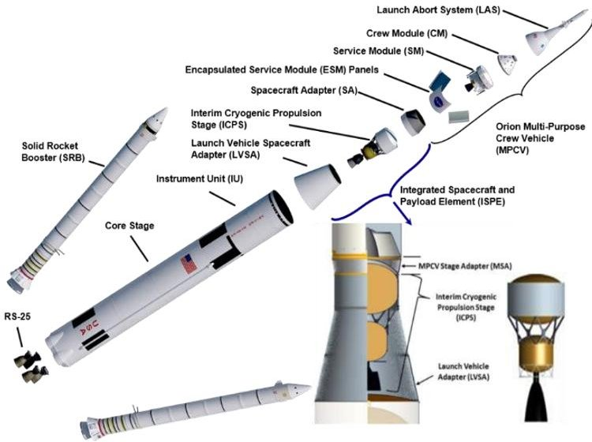

Figure 2: SLS

The secondary payloads are arranged uniformly around the inner surface of MPCV Stage Adapter. The ICPS performs its disposal maneuver after the Orion space capsule has reached escape velocity (11.186 km/s) and separates. The Secondary Payload Deployer System is then activated and will deploy Cislunar Explorers from its dispenser during the deployment interval "Bus Stop One" (with an approximate altitude of 360-500km) around 4 hours after the SLS liftoff. Once Cislunar Explorers is clear of ICPS, it will begin a preprogramed activation and deployment sequence of its onboard systems. $ ^{6} $

<!-- PDF_PAGE: 3 -->

## Initialization and Spin-Up

At this point the two ~3U spacecraft remain joined in their 6U deployment configuration. Separate redundant inhibits keep each spacecraft in an unpowered state inside the CSD until deployment. After activation, each ~3U will perform a health check and compute their attitude and position using the onboard optical navigation system. Then, both will make radio contact with the ground station to relay health, position, and attitude data. Following contact, the Cornell University ground station will command the 6U spin-up and separation maneuver. The spacecraft designated Hydrogen will fire its thruster to reorient the 6U, which will eventually settle into a major axis spin due to the propellant sloshing. After this, a command is sent to the spacecraft Oxygen to separate. Figure 3 shows the movement of the satellites as they separate, with Hydrogen as A and Oxygen as B.

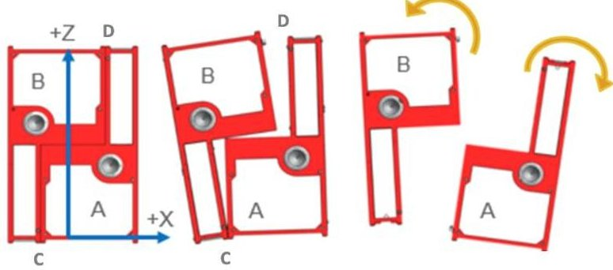

Figure 3: Separation and Spin up.

Using springs mounted at point D, the satellites pivot around point C to spin up before separating from each other. The force balance and constant angular momentum allows for calculations of the linear and rotational velocities of the spacecraft. A trade study was conducted on spring constant vs. compression, and the optimal spring was chosen to yield a 6 rad/s rotation rate. Each ~3U functions independently after individual spin stabilization. The grey circles represent the positions of the water propulsion thruster nozzles.

## Lunar Swing-by

After deployment and spin-up, the next few days are used to reorient and begin adjusting trajectory for the upcoming lunar swing-by using the water electrolysis thruster. The water electrolysis system produces, on average, a 1N pulsed thrust. Conservatively, these thrusts can only occur every 2 to 3 hours, which is the estimated time need to electrolyze enough propellent to fire again. Current estimates show about 0.6kg of fuel will be used to reach lunar capture with the remaining fuel intended for orbital corrections and maintenance after lunar capture. The nominal swing-by from the ICPS trajectory will lead to an escape from the Earth-Moon

system, and an entry into a heliocentric orbit. The midcourse correction is time-sensitive and serves to prevent this ejection, as well as facilitate a swing-by, which will keep the spacecraft in the Earth-Moon system. The spacecraft downlinks position, time, and orientation data, which is used to calculate a command for the necessary correction maneuver. After the command is uplinked, the spacecraft begins the maneuver and downlinks new data. This process iterates until the necessary trajectory is achieved. After the lunar swingby, there is approximately one month before the next lunar encounter. The goal for the spacecraft during this phase will simply be to survive and maintain contact with Earth. The tightest link budget of the entire mission occurs during this phase due to the extreme distance of the spacecraft from Earth (well over 1,000,000 km). Mid-course correction maneuvers will still be needed to make sure the next lunar encounter occurs at the appointed time.

Lunar Capture and Orbit Circularization

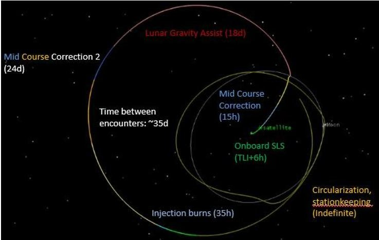

Figure 4: Simplified Cislunar Trajectory

Approximately one month after launch with the approach of the second (or third) lunar encounter, the trajectory needs to be altered to facilitate a capture into the Moon's sphere of influence with a highly elliptical lunar orbit. If capture on the second approach fails, there may be enough $ \Delta V $ margin to try for a third encounter at most. The highly elliptical lunar orbit will have an apoapsis of tens of thousands of km, and a periapsis of hundreds to several thousands of km. For the Lunar Derby prize, the spacecraft must enter a more circular orbit of at most a 10,000 km apoapsis and at least a 300 km altitude of periapsis above the surface of the Moon. It will likely take several months to reach this orbit.

## Station Keeping and End of Life Disposal

After circularizing its orbit, the spacecraft will maintain it against deviations from gravitational and other disturbances. The intent of this phase is to participate in the Spacecraft Longevity Challenge and maintain lunar orbit until the spacecraft reaches the threshold of

<!-- PDF_PAGE: 4 -->

propellent needed for its end of life maneuver. The approximate time until this occurs is one year. The spacecraft needs to be disposed of by impact on the far side of the lunar surface, so it does not become space debris or put historical sites at risk. Remaining propellant will be used to lower the periapsis to intersect with the lunar surface. At least 26 m/s of $ \Delta V $ will be needed to deorbit from the Lunar Derby Prize orbit. Continuous communication with the spacecraft will be attempted until impact is made.

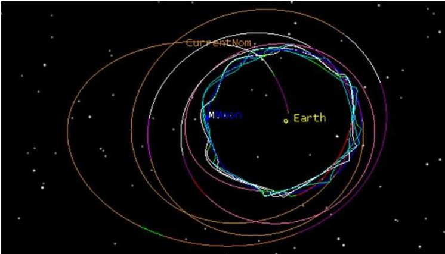

Figure 5: Previously Calculated Cislunar Trajectory

## Trajectory Development Lessons Learned

Due to the low thrust approach of Cislunar Explorers, the trajectory had to be extensively planned beforehand. When approaching the Moon from translunar injection, the spacecraft do not have the thrust capability to directly capture into lunar orbit. Instead, the satellites will complete a lunar flyby with the goal of keeping the satellites close to the ecliptic while also circularizing the orbit around the Earth-Moon system. After accomplishing this, the spacecraft can approach the Moon's orbiting radius to achieve lunar capture, however, limited thrust capability causes this to take a significant amount of time. Since slight perturbations in the flyby can cause appreciable inclination and eccentricity changes, much care needs to be taken to identify the correct positioning of the satellite for its lunar approach.

One mission planning concern was that NASA's announcement of new SLS launch dates would render old trajectories invalid and that new ones could not be reliably calculated until after the announcement of a new launch date. Any changes in the Moon's location and differences in launch positions were enough to cause old planned lunar flybys to fail and send the satellites cascading out into the solar system. These changes, coupled with the error in the optical navigation system, make planning these trajectories very time consuming, repetitive, and complex. As each new date is given, an updated trajectory following the same strategy must be created. In learning from this repetitive process, the trajectory team took advantage of Systems Tool Kit

(STK). An attempt was also made to take advantage of GMAT, but the inability to simply customize engine models limited its utility. STK uses a series of "targeters" to achieve desired outcomes using a differential corrector. The user sets the inputs that STK can vary and specifies the outcomes. Initially, trajectories were completed by hand by manually specifying the outcomes and running a "guess and check" method. The issue was that the differential corrector could run hundreds of iterations and might take hours to run, depending on the amount of inputs.

To combat concern of being unable to finalize a trajectory between the final announcement of and the actual date of SLS launch, a series of optimizers that interface with STK are close to completion. The first is a launch optimizer to identify exactly where near Bus Stop One Cislunar Explorers can use the least amount of fuel to attain the best result from the flyby. The optimizer will iterate across all the positions of the ICPS trajectory and change a series of burns, their directions, and the propagation times. A circularizing optimizer with the expressed goal of decreasing radius and circularizing the orbit after the lunar flyby is also under development. A Monte Carlo simulation was created to test the mission success rate of our trajectory given a series of failures, and more importantly, how much uncertainty will affect the trajectory. This information would allow the engineers to focus more on certain subsystems and define tolerances that cause more fuel waste. This simulation takes a fully completed trajectory and runs thousands of iterations with varying errors per segment (such as optical navigation tolerance) as well as initial parameter variations (such as dry mass).

The optimizer yielded some results, but due to the limitations of the differential corrector in STK and the processing power in a limited timeframe, the results were not as comprehensive as intended. Nevertheless, this process determined that the estimations used for the solar radiation pressure area were sufficiently accurate. Further precision in this area will not impact the fuel usage enough to warrant detailed analysis. Only 40 iterations were run out of the expected 1,000 at the time of publication. All these simulations run in STK used an approximate engine model. The current model for the system is a finite thrust model with significantly lower force than our system outputs. However, since it is modeled as a continuous thrust, the force over time produce similar values. A new model, which has the higher force impulsive maneuvers and a 3-hour waiting period between pulses is currently being created to operate with STK 11. This new model will not change the trajectory in any meaningful way, but rather determine the locations of each pulse in space to better characterize the mission from a control perspective.

<!-- PDF_PAGE: 5 -->

## COMMUNICATIONS

The spacecraft communicates on the 437 MHz, 70 cm UHF amateur radio band. As shown in Figure 6, each spacecraft sends ground stations its acquired data, such as health status, position, and attitude. The data is then sent to Cislunar Explorers Mission Control, located in

Rhodes Hall at Cornell University. There the data is processed, archived, and used to determine future spacecraft maneuvers and mission scheduling. The relevant actions are then sent to the ground station from Mission Control which sends the necessary commands to the Cislunar Explorers.

## Ground Communications

The primary ground station for the mission is located on Rhodes Hall at Cornell University. There is also a backup ground station on Barton Hall, which is run by the amateur radio club W2CXM. Both spacecraft are in view of both ground stations approximately 8-12 hours per day depending on the season. The primary station's setup includes the following equipment:

the spacecraft. The station will also have a simple UI for sending commands and viewing received telemetry, as well as the ability to have safe/unsafe commands for safety purposes. The advantage for this approach is that existing equipment normally used for LEO CubeSat missions can be repurposed for this new mission type.

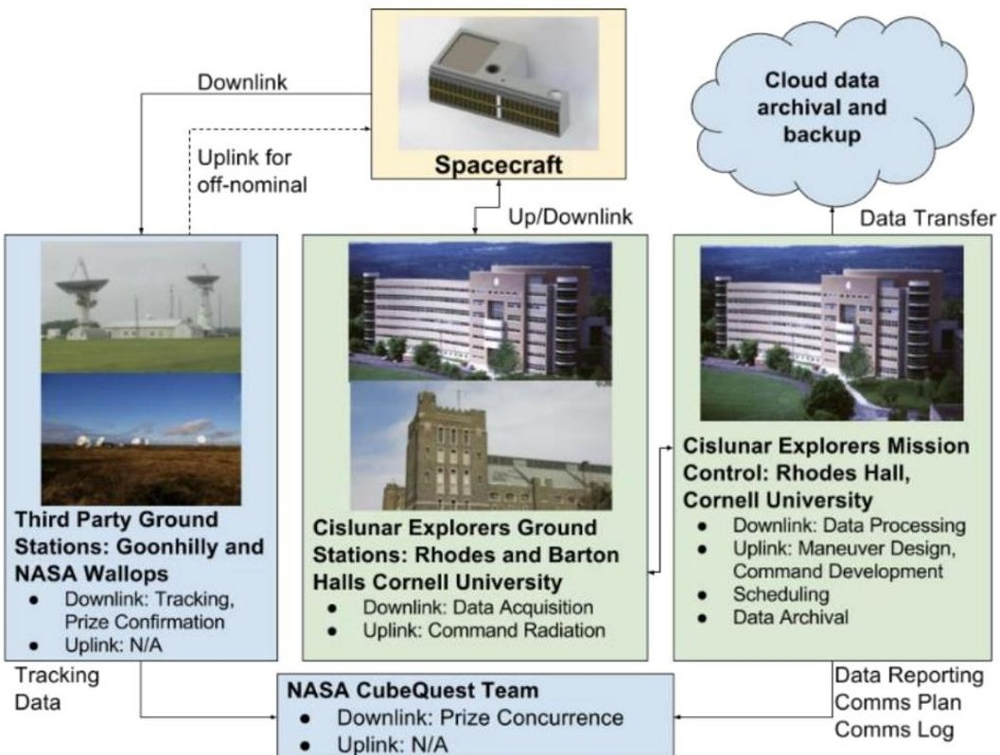

Figure 6: Communications Plan

- Yagi RHCP antenna (M2 436CP30) for 70cm band with 18.9dBi Gain

- HF/VHF/UHF transceiver (Kenwood TS-2000)

- Mast-mounted Pre-Amp (SSB SP-7000)

- 1400W High Power radio transmitter

- Rotator controller (Yaesu GS-232B)

Additionally, there are several computers with Ham Radio Deluxe software, capable of PSK250 signal demodulation, mission control software, and Az/EI Rotator control software. Because the spacecraft communications are entirely on an amateur radio band using open-source amateur radio encoding, any suitably equipped amateur radio operator could serve as a backup ground station if necessary. Since the spacecraft will continue to make regular downlinks at all times, any amateur radio operators can receive packets that they could forward to our team for assessment of spacecraft health even when the spacecraft is out of sight of our ground station. However, the mission plan does not assume or rely on the use of either downlink or uplink when the spacecraft is out of view. The primary ground station utilizes an Elasticsearch database to store all received telemetry as well as logs of commands sent to

All uplinks and downlinks are encoded via phase-shift keying. Specifically, PSK125/250, an open-source digital modulation scheme, is used. Spacecraft communications will be datagram-based. Spacecraft downlinks will include a preamble, sync word, time stamp, checksum, and telemetry data. For uplinks, we will send commands containing the specified flight mode, the function the flight mode should execute, and the parameters for the function. Telemetry includes the Earth-centered inertial coordinates and attitude quaternion as computed by the onboard optical navigation system, internal temperature measurements, power production and consumption, and propellant tank pressure. Because the spacecraft position data is computed by the onboard optical navigation system, mission operations avoid the need for a radio signal to track the spacecraft's position for most of the mission. Wallops Flight Facility's 18-meter, UHF capable 36 dish will provide Doppler tracking and act as a back-up ground station. Wallops will report the collected astrometric data directly to NASA for the purposes of verifying lunar orbit for the CubeQuest Challenge and allow for the verification of the Op-Nav System.

<!-- PDF_PAGE: 6 -->

While downlinked telemetry will be in the clear, security precautions are warranted on the uplink path to ensure exclusive control of the vehicle. Pending FCC approval, cryptographic authentication will be employed for commands sent to the spacecraft. Special attention needs to be paid to how cryptographic keys and counters will be stored in order to prevent loss of commanding in the event of radiation-induced data corruption; a suitable redundancy plan is currently being reviewed. Additionally, to minimize chances of unauthorized attempts at communication with the spacecraft (which could impair its ability to receive legitimate commands), detailed trajectory and position information will only be shared close to the date of downlink with organizations that have communicated their interest in receiving packets. The Cislunar Explorers Team will be soliciting and welcoming offers of alternate receiving ground stations until the day of launch.

Spacecraft Communications

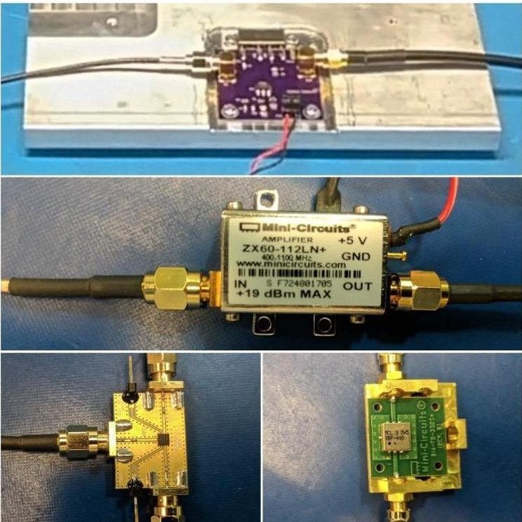

Figure 7: Comms Components

The spacecrafts' communication subsystem (comms) is centered on the AX5043 Transceiver chip from AXSEM/ON Semi. This is an UHF transceiver with fully integrated RF front-end, modem, and communication controller that enables register access through an SPI bus. It supports PSK modulation at data rates ranging from 0.1 to 125 kbps with reported receiver sensitivity (without FEC) of -138 to -108 dBm respectively, and a maximum output power of 13 dBm in single-ended configuration. The comms architecture comprises a set of components connected by RG-316 coax cables with SMA terminations.

A custom PCB was developed to interface the AX5043

with the Raspberry Pi and power amplifier (PA). The RF signal enters a first stage Amplifier (ZX60-P105LN+) that sets the RF power level to 18.5dBm. This is the required input power level to the PA to achieve an output power of 7W for communication at cislunar distances. The PA module was developed in house around a 2-stage RF MOSFET Amplifier Module (Mitsubishi RA07M4047MSA, a component with flight heritage with the ARTSAT 2 mission $ ^{7} $ ). The PA has an efficiency of 40% so to dissipate the generated heat (~11W), the ceramic substrate of the module is coated with thermally conductive epoxy (OMEGABOND 101) and fastened to the propellent tank. A high-power SPDT RF switch (SKY13299-321LF) is used to separate the RX and TX signal paths. The switch is controlled by two DC voltage lines, which are connected to the flight computer. The TX port is connected to the PA board, the RX port to an LNA (ZX60-112LN+) and the RF common port connects to the antenna element. The antenna is a halfwavelength dipole antenna (35 cm length) consisting of two equal lengths of steel spring tape with differential input/output and a beam width of approximately 90 degrees. Figure 8 shows the hybrid board the antennas are mounted to. The antenna is folded against the long side of each ~3U spacecraft and held down by the surface of the CSD before deployment. The tension in the antennas will force them to return to their optimal angle.

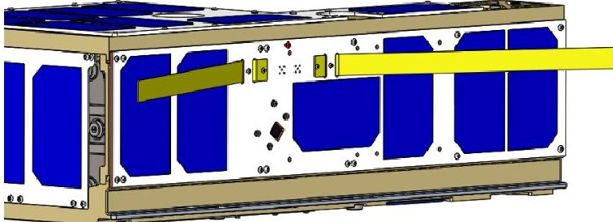

Figure 8: Hybrid Solar Panel, Antenna and Camera Board

## WATER ELECTROLYSIS PROPULSION

As shown in Figure 9, the spacecraft obtains its power from solar panels positioned on each face of the exterior. The EPS supplies power to two electrolyzers, located in a water propellant tank. The electrolyzed gaseous hydrogen-oxygen mixture is directed through the flame arrestor into the combustion chamber. When the system reaches its critical pressure, a glow plug is activated, which ignites the gaseous mixture. This is ejected through a nozzle, producing thrust. This process can repeat for as long as there is sufficient water for the electrolyzers to produce gas. One of the main advantages of this system is that it only utilizes passive pressure bearing components. The flame arrestor and check valve are pressure-driven, unactuated devices that inhibit the flow of hydrogen and oxygen from the combustion chamber before performing a burn. As shown in Figure

<!-- PDF_PAGE: 7 -->

10, the propulsion system consists of a series of COTS vacuum-sealed components to carry the gaseous products of the electrolysis process. The fittings and tube adapters were sourced from Swagelok, which specializes in fluid system components. $ ^{8} $

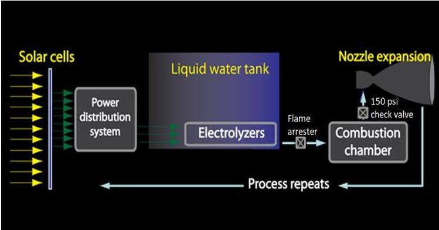

Figure 9:Water Propulsion System Diagram

Electrolysis takes place in a propellent tank, using two Horizon PEM Blue Electrolyzers that are epoxied to the tank lid on the side furthest from the spin axis of the spacecraft. Each electrolyzer has four ports, of which two are inlets and two are outlet ports. One inlet port of each electrolyzer has been blocked with a tube cap. Doing this creates a gradient over which water can slowly permeate the electrolyzing membrane. Performance testing demonstrated that this improved the rate of gas production. The two electrical terminals are supplied with 3V DC power through a PAVE electrical feedthrough. $ ^{10} $ This is a threaded plug with sealed wires passing through its center, which is screwed into an NPT port on the tank. This is sealed with Loctite Hysol 1C epoxy to further prevent any leaks. $ ^{11} $ In order to attach these wires to the electrolyzers, small 2mm threaded banana connectors were inserted into the electrolyzers, and a ring terminal was secured to the connector with a nut. A thin layer of epoxy is coated around the electrical terminals to limit exposure of these surfaces to moisture. This helps prevent the electrical interfaces from corroding.

Two additional components interface with the tank using NPT threading. One of these is the Cynergy IPSUGP300-6 pressure transducer. $ ^{12} $ The other component is a Swagelok tube fitting, which connects to the rest of the propulsion system. All three components have had OC Five Thread Paste added, which acts as a thread sealant. It is also utilized for further protection against corrosion-induced leakages. $ ^{13} $ Additionally, a coating of 1C was applied surrounding the threading.

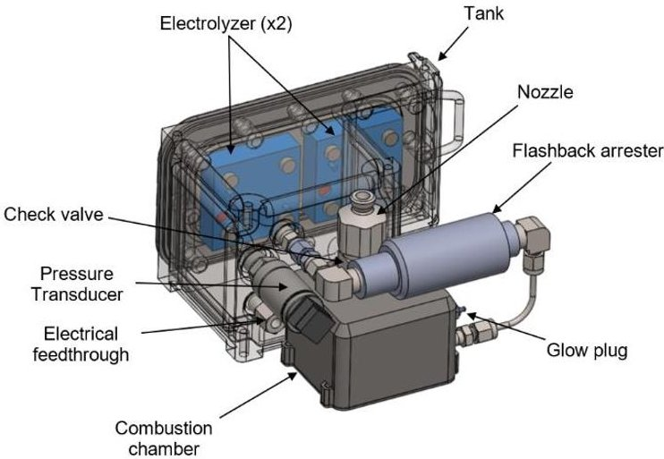

Figure 10: Propulsion System

Attached to the tube fitting is a standard 1/8" stainless steel tube. Each tube fitting has a built-in crush seal which effectively fuses the fitting to the tube. On the other end of the tube is a Swagelok elbow tube fitting. Beyond that is a WITT Flashback Arrester 85-10. $ ^{14} $ This component combines three functions in one it acts as a flame arrestor, a temperature sensitive cut-off valve, and a non-return valve to prevent gas from flowing in the reverse direction. On the other end of the flashback arrestor is another elbow tube fitting, which is attached to a steel tube bent at a 90° angle. This was due to space limitations of the system, so that the combustion chamber could sit flush against the tank. This tube is crush-sealed to another tube fitting, which is then attached to the combustion chamber via NPT threads. Again, epoxy has been applied to the outside of these threads to form a seal against gas leakage. The combustion chamber is produced from 3D-printed titanium. It was originally received as two separate components; the chamber itself and a back plate, which were welded together. A Bosch glow plug (#0250201032) is inserted into a port on the side of the combustion chamber. When this component receives a voltage, it immediately begins to heat up and ignites the gas mixture. This build-up of pressure due to combustion allows the gas to pass through a large Swagelok check valve (SS-8CPA2-50) at the outlet of the combustion chamber. Lastly, the gas is contracted and then expands as it exits a 3D-printed titanium nozzle on the other end of the check valve. This check valve and nozzle, though containing NPT threads, did not have any thread lock applied to them, because exposure to large changes in pressure in the combustion chamber could dislodge the material.

<!-- PDF_PAGE: 8 -->

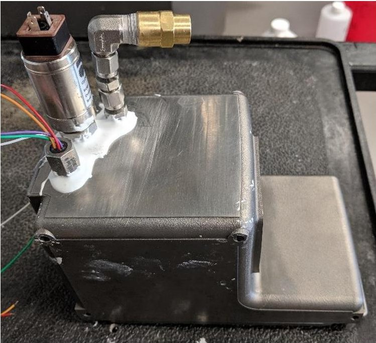

Figure 11: Testing model of propulsion tank

The main design oversights in the propulsion tank design were the uses of NPT threading and 3D printed titanium. Titanium was originally chosen due to its high strength-to-weight ratio and to demonstrate an innovative manufacturing technique; however, its implementation resulted in increased cost and labor required for development. More information on the titanium tanks can be found in the Structures section. Imperfections found in the NPT threads resulted in leakage during testing. To compensate for this, detailed inspections were performed on the parts selected for the flight unit, and both OC Five thread paste and Loctite Hysol 1C epoxy were used to seal the threads.

## OPTICAL NAVIGATION SYSTEM

The Op-Nav system is centered around three onboard camera modules which take photographs of the Sun, Earth, and Moon. The image-handling software analyzes these images to determine the unit vectors to each celestial body in the spacecraft body frame by locating the geometric centers of all three. These measurements, as well as the width measurements of the celestial bodies, are used to create a transformation from the spacecraft body frame to an Earth-Centered Inertial (ECI) frame. Position, velocity, and attitude determination are performed by a pair of Unscented Kalman Filters (UKFs).

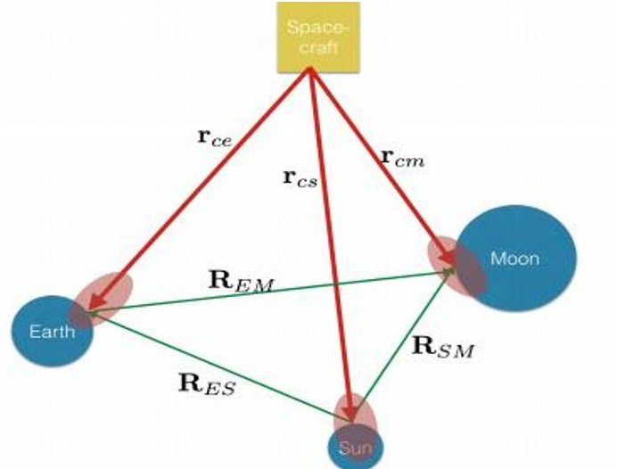

Figure 12: Triangulation for Position Data

## Hardware

Each spacecraft utilizes three Raspberry Pi (RPi) Camera Module V2 sensors to detect the bodies of interest. The three cameras each have a field of view of $ 6 2. 2^{\circ} \times4 8. 8^{\circ} $ They are positioned such that together they cover a $ 1 8 0^{\circ} $ $ 4 8. 8^{\circ} $ sector of space. The combined field of view and spin axis are such that the cameras sweep over a $ 4 \pi $ steradian field of view per rotation, captured in a short video. A three-axis gyroscope provides the current angular velocity required to compute the relative orientation of each frame. The flight computer can only receive video from one camera at a time, so a multiplexer is used to capture from each one in turn. Cameras are controlled using the open-source PiCamera Python module, while image processing uses the Python bindings for OpenCV.

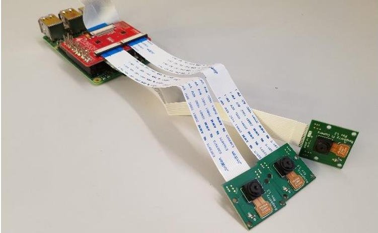

Figure 13: Op-Nav Hardware (V1)

Image Acquisition.

While the spacecraft's spin allows three cameras to achieve full-sky coverage, it also constrains exposure times due to the resulting motion of images across the frame. At the nominal spin rate, a light source could traverse the field-of-view of a single pixel in less than 50 us. Shutter speeds slower than this may result in motion

<!-- PDF_PAGE: 9 -->

blur that reduces the precision of measurements of a body's size and location (and thus the precision of the estimated spacecraft state). Fortunately, the target bodies are all relatively bright, enabling short exposures and making this system more suitable for a rapidly spinning craft than star trackers, which are a far more expensive alternative. Unfortunately, the dynamic range of these bodies is extremely large, spanning 22 stops between the Sun and a quarter Moon. Given the camera's 10-bit analog-to-digital converter, no single exposure can capture all the information in the scene.

The translation of radiance to signal in a camera is influenced by three variables: exposure time (a.k.a. shutter speed), aperture, and sensor gain. The RPi camera has a minimum shutter speed of 9 $ \mu s $ ,a fixed aperture of f/2.0, and an analog gain adjustable between 1-9.8. In terrestrial operation, an auto-exposure algorithm coupled with automatic gain control (run on a continuous stream of discarded frames) sets the shutter speed and gains to adapt to the scene. In space, however, the spin and high contrast interfere with these algorithms and cause unpredictable behavior. Flight software will therefore manually set these parameters (as well as those for white balance) based on known radiance values and Earth-based testing. Fortunately, the RPi userland software was recently updated to allow direct setting of gains (removing the AGC that still runs for a fixed ISO).

The measurements performed by the navigation algorithm require only high-contrast boundaries, so over-exposing bodies is not necessarily a problem. However, extreme over-exposure will result in lens flare, impairing detection of the object itself. Even when using the fastest shutter speed and minimum gain, the Sun will be overexposed to the RPi camera, but the flare is manageable. The Earth and Moon are invisible in such exposures, though, and increasing exposure to accommodate them leads to intense flare in the vicinity of the Sun. Taking multiple sequences of images at settings adapted to each body helps address the fundamental dynamic range issue. Note that the Moon's surface brightness varies considerably with observation direction (relative to the Sun), so separating Earth and Moon exposures helps cover this range with better signal-to-noise as well. By using the maximum analog gain, a quarter Moon can be satisfactorily exposed at shutter speeds fast enough to prevent significant motion blur, showing that the hardware is capable for this application.

To relate bodies in different frames (to infer position), as well as to perform attitude estimation, the timing of frames captured by the camera must be known very precisely. Triggering events at such precise times from flight software is unrealistic given its implementation in

Python and execution on non-real-time Linux. Fortunately, the camera module itself timestamps all frames with high precision, and the interval between frames is precisely controlled when capturing video. The camera's clock can also be queried at any time, allowing it to be correlated with the operating system's (necessary for timing attitude control pulses). In this case, the features of COTS hobbyist-grade hardware facilitated the use of high-level, general-purpose languages and operating systems on the flight computer, improving accessibility and productivity.

Once images are acquired, pre-processing is still required before measurements can be made. Employing an active-pixel CMOS sensor, the camera exhibits rolling shutter effects that are pronounced at the spacecraft's spin rate. Each row of pixels takes 18.904 $ \mu s $ to read out, totaling 47ms over a full-resolution image, during which time the spacecraft rotates 16 $ ^{\circ} $ . Correcting this effect requires accurately knowing the spin rate and axis, which will be sensed by the on-board gyroscope (with bias estimated as part of the attitude filter); pixels are then remapped to a location computed by rotating their position an amount proportional to their row number.

While correcting for rolling shutter removes most bias from the positions of the target bodies, their shapes will be distorted from circles due to their rectilinear projection onto a flat sensor plane. This could reduce measurement accuracy for bodies imaged near the edges of the frame. If the image were reprojected using a stereographic projection, then circular bodies would be rendered as circles. Converting pixel sizes to angular sizes, while not directly proportional, is straightforward: if pixel coordinates are normalized to fall between $ \pm 2 \tan^{-1} ( F o V / 4 ) $ (where FoV is the full field-of-view along that axis), then a pixel diameter D measured for a body a distance $ \rho $ from the origin corresponds to a true angular diameter of $ 2 \tan^{-1} \left( \frac{\rho+D / 2}{2} \right) + 2 \tan^{-1} \left( \frac{\rho-D / 2}{2} \right) \approx \frac{4 D}{4+\rho^{2}} $ (1) Reprojection and rolling shutter compensation can be performed as a single remapping operation. Both the inverse stereographic and the forward gnomonic projections have simple formulations in Cartesian coordinates, allowing the rotation to be naturally performed via matrix multiplication. Unfortunately, the rotation amount depends on the y-coordinate of the pixel after rotation and gnomonic projection, requiring a perpixel root solve. Performing per-pixel operations in a Python loop is prohibitively slow; a common approach is to only transform the corners of a mesh, then apply linear re-mappings on the mesh squares $ ^{26} $ . Alternately, the problem can be cast as a large contraction in NumPy, trading memory usage for orders-of-magnitude of

<!-- PDF_PAGE: 10 -->

speedup. These optimization trades are one of the downsides of using a dynamic language.

## Celestial Body Sensor

A goal was to design a robust algorithm that could detect desired bodies in all environments. One of the initial challenges was not knowing how the bodies would appear in the images from our COTS cameras. The solution was to design a system that would work in a wide variety of environments with differing sensor noise, changes in apparent brightness/contrast and motion blur. Several steps are required to detect the three bodies of interest and achieve robustness. The circle Hough Transform algorithm is used for body detection due its relatively low computation cost and speed. It estimates three quantities: the x and y coordinates and the radius of a circle. Based on edge detection methods, the transform attempts to fit circles on the image by voting for likely candidates and selecting the circle with the most votes in an accumulator matrix.

The OpenCV library implements this algorithm in a function that is easy to use. Before the algorithm can be run, the detector applies a-priori knowledge about each body to distinguish them from one another. If the circle Hough transform were run on the raw frame, we would not be able to tell which fitted circle belongs to which

body. The detector executes three masking procedures for extracting the likely pixels for each body. For the Sun, this will be all the white pixels, as it will be totally white in space. The Earth is the only body that will contain blue pixels, so the entire spectrum blue is masked for Earth detection. The Moon is composed of gray and white colors, so they are masked out and handled accordingly. We make use of the Hue-Saturation-Value (HSV) color space to facilitate selection of visible light boundaries for each body. The masked pixels are passed into the circle Hough transform along with fine-tuned parameters for the transform function. In total, there are seven parameters for body detection: HSV boundary for masking and accumulator ratio, minimum center distance, canny edge detector threshold, center detection threshold, and the minimum and maximum radii to be detected. The parameters were fine-tuned by running the algorithm on publicly available images of the Sun, Moon and Earth from prior missions such as Apollo, DISCOVR and Rosetta and picking those that yielded the best fit circles.

The Moon can be expected to have a diameter as small as 10 pixels. In-flight maneuvers will put us on a path towards the Moon, increasing its apparent diameter to hundreds of pixels across the camera's receptive field. The detector must be robust to this change.

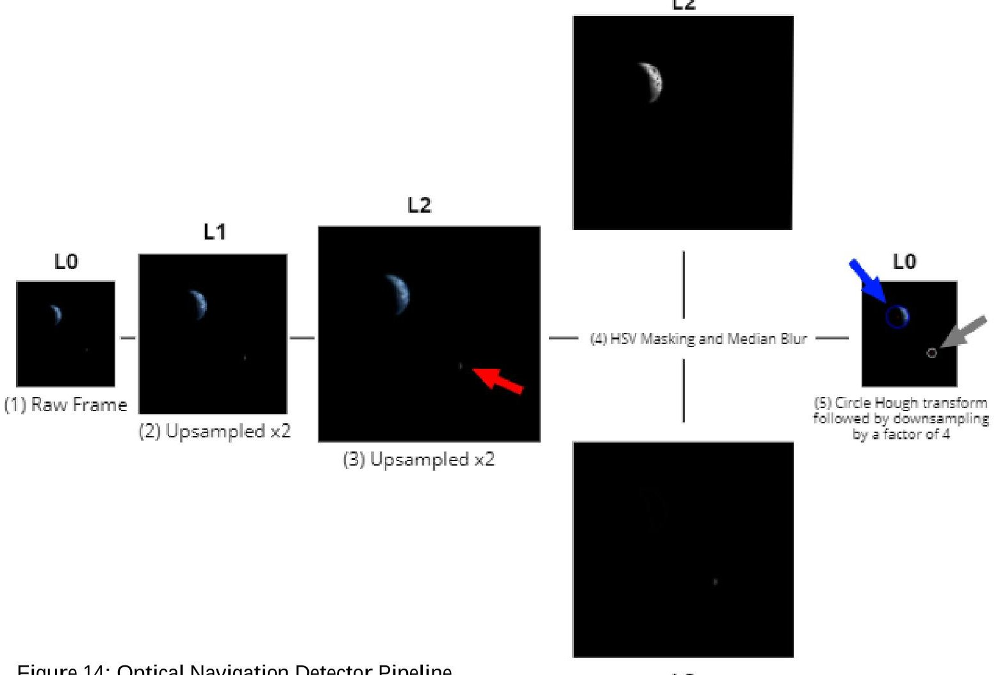

Figure 14: Optical Navigation Detector Pipeline

<!-- PDF_PAGE: 11 -->

Unfortunately, there does not exist one set of parameters that work on all sizes of the Moon and the Earth. Brute search for the optimal parameters proved to be too time-consuming. Instead, the parameters were fixed to work on medium-to-large size bodies and the image itself was scaled up. In computer vision, a Gaussian Pyramid $ ^{15} $ is a multi-scale representation of the image used to find objects at different scales. Looking at Figure 14, we upsample the input frame (L0) as the circle Hough transform parameters are easily fit to larger bodies. Each frame is upsampled twice, creating levels 1 and 2 (L1, L2). Each level doubles of the resolution of the previous level. L2 is scanned for the Sun, the Moon, and the Earth. To speed up computation, we skip processing L0 and L1, since the circle Hough transform with the selected parameters does not provide any advantages at relatively low-to-medium resolutions. The centers and radii of the Earth, Sun, and Moon circles are then scaled by 1/4 to the original frame coordinates in L0. To test the robustness of this scheme to uncertainties in exposure, variations of our reference images were created with a range of brightness and contrast adjustments. The detector performs reasonably well over a factor of 4 in contrast and a range of [-20, 30] % full scale in brightness.

## Filtering for Position and Attitude

Assuming that the uncertainty in our estimate is Gaussian, it can be represented as a covariance matrix. This is more efficient than particle filters since we do not have keep track of thousands of individual particles. Instead we can narrow the search for particles down to a few based on the underlying distributions of the uncertainty and process noise, yielding a UKF. The translational measurement and dynamics models are based on prior work done by students on the Cislunar Explorers team. $ ^{16} $

For attitude, the positions of the Sun, Moon and Earth are first represented in body coordinates by subtracting their positions in the onboard ephemeris tables from the satellite's estimated position. Each body produces 3-dimensional vectors that are normalized and concatenated into a 9-dimensional vector. The measurements are the same set of unit vectors, represented in a rotated frame. The relationship between these frames is given by a quaternion (the state of interest). The UKF for estimating this quaternion follows the guidance of Crassidis & Markley. $ ^{25} $ In addition to the current attitude state, our filter also estimates the bias in the gyroscope, which is necessary to provide accurate spin rates for rolling shutter correction and image alignment.

Lessons Learned

While the RPi camera meets exposure requirements, these parameters were not evaluated when the selection was made and were only verified latter. Performing brightness calculations up front would have reduced risk. For example, neutral density filters could have been considered for further reducing overexposure of the Sun, and motion blur limits could have influenced the target spin rate. Body identification based on color filtering may also not be necessary if multiple exposure sequences are made (brightness could be used instead). And the robustness tests used to tune algorithm parameters could have been more physically motivated.

A significant realization was that rolling shutter effects and the ability to correct for these effects has a large impact on the quality of measurements and therefore place additional requirements on spin determination. At the same time, the ability to do rapid, accurately timed acquisitions opens the possibility to determine spin from optical flow, possibly eliminating the need for a gyro (and its bias estimation) altogether.

## ATTITUDE CONTROL SYSTEM

The Cislunar Explorers' ACS uses passive and active methods to stabilize and control the orientation of each spacecraft including spin stabilization, nutation damping and reaction control system (RCS). These systems take advantage of the liquid water on each spacecraft.

## Spin-Stabilization and Propellant Separation

Spin-stabilization for satellites has been extensively used since the early days of space exploration and is well understood. The spin allows spacecraft to act similarly to a gyroscope by maintaining its attitude relatively well without requiring multiple thrusters for control. $ ^{17} $ This spin-stabilization allows the spacecraft to be equipped with only one RCS thruster in the form of a $ \mathrm{C O_{2}} $ cold gas thruster (CGT) for attitude control because there is no required active attitude control.

Cislunar Explorers demonstrates a new use for a spinning satellite architecture: the spacecraft uses the centripetal acceleration field generated by the spin to separate liquid and gaseous propellants. As water electrolysis is conducted within the propellent tank, the initial angular velocity of 6 rad/s centrifugally separates the liquid and gaseous elements. Figure 15 shows a simplified schematic of the fuel tank and thruster assembly of one of the spacecrafts. Water vapor created from liquid water using electrolyzers must be separated from the liquid before it can be burned in the combustion chamber (outlined in red on the right side of Figure 15). As the satellites spin around the z axis, which is approximately aligned with the thrust axis, the fuel

<!-- PDF_PAGE: 12 -->

mixture separates. The denser water shifts to the outboard side of the fuel tank, while the less-dense vapor moves in towards the spin axis. A solenoid valve between the combustion chamber and fuel tank ensures that only vapor is allowed into the chamber and is activated once the fuel tank reaches a sufficient pressure.

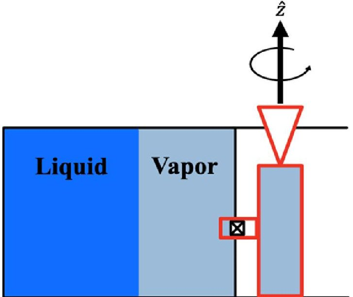

Figure 15: Propellant Separation

## Reaction Control System

Since the CGT is nearly at the tip of the arm of the spacecraft, each pulse can apply a large torque relative to the center of mass, resulting in sufficient attitude control. Pulses from the attitude thrusters are represented by infinitesimally small torques, reorienting the spacecraft to keep it properly aligned.

$$
d \theta_ {z} = \frac {\tau d t}{H}
$$

Each spacecraft has one CGT with 38g of $ \mathrm{C O_{2}} $ that fires parallel to the major spin and thrust axes. Spacecraft reorientation in any direction is enabled by firing the single thruster repeatedly for a finite time at a given position in the spacecraft's rotation. This works by having a torque T on the spacecraft produced by the force exerted on the satellite by the CGT pulse of time duration, t.

$$
T (t) = \boldsymbol {r} (t) \times \boldsymbol {F} (t)
$$

The torque produced is a function of the radius r from the CGT thrust vector to the spacecraft center of mass, and the force exerted by the CGT during a pulse, F. The center of mass shifts as propellant is expended, so the effective radius also changes over the course of the mission. The force on produced was characterized using a tested model of the RCS system. The portion of the spin during which to fire the CGT is determined based on the

detection of the sun by the optical navigation system. The angular momentum, H, during a reorientation is as follows.

$$
H \left(t _ {2}\right) = H \left(t _ {1}\right) + \int_ {t _ {1}} ^ {t _ {2}} T (t) d t
$$

The path traversed by the rotation axis during a reorientation maneuver is a rhumb-line precession. More information on the dynamics of the maneuver can be found here. $ ^{18} $ Figure 16 shows the impulse from the CGT needed to reorient the spacecraft dependent on a given angular velocity and moment of inertia, both of which will change over the course of the mission. $ ^{17} $

Angular Impulse Needed for $ \pi $ rad Spin Axis Change

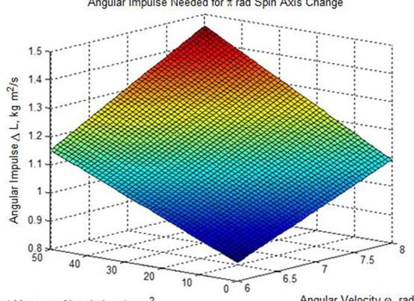

Principal Moment of Inertia lzz, kg $ m^{2} $

Figure 16: Calculated impulse needed for reorientation

Equation 4 also applies to reorientation torques generated by the main electrolysis thruster, except that the radius from the thrust vector to center of mass is intentionally minimized. With a shorter radial vector, the net change in angular momentum is smaller; firing the main thruster should not reorient the spacecraft. Due to the shifting center of mass and assembly imperfections, it is impossible to ensure that $ r ( t )=0 $ throughout the whole mission. Instead, to minimize the change of direction due to a burn, the magnitude of the angular momentum should be large compared to the torque exerted by the force of the thruster. This provides momentum stiffness during burns of the main thruster, so minimal deviation of the thrust axis away from the desired impulse direction occurs. The satellite rotation axis will move over the course of the mission as propellant is expended. To reduce net torque over the entire flight, the center of mass traverses a line to cross the thrust axis when 50% of the propellant is left. $ ^{19} $

The CGT propellant is housed in a Leland Gas cartridge with a matching puncture valve. Attached to the valve using a Swagelok pipe fitting is a 1/8" pipe made of 316 stainless steel, which leads to the solenoid via another Swagelok fitting. Once the CO2 cylinder is punctured

<!-- PDF_PAGE: 13 -->

inside the valve, the system is pressurized, and the solenoid controls the release of the gas. The solenoid outputs to the custom 3D printed thruster nozzle through an elbow pipe fitting. The threaded fittings connecting to the puncture valve and nozzle are sealed with OC Five Thread Paste. Figure 17 shows the computer model of the assembled system.

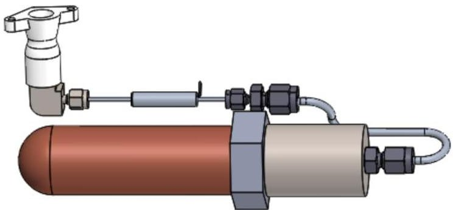

Figure 17: CGT

The 38g of CO2 can provide 2200° of reorientation, 6.1 times the orientation capability required to complete the mission. This value was calculated by pulsing a model of the CGT in a thermal vacuum chamber until the CO2 canister emptied. The reorientation capability was then calculated using the experimentally determined average specific impulse of 57 seconds, and the moment arm from the thruster to the spacecraft center of mass. The minimum reorientation requirement was defined based on trajectory and maneuver planning.

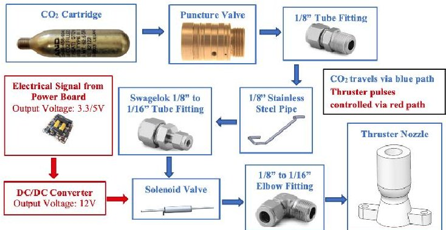

Figure 18: CGT Diagram

## Nutation Damping

A key stabilizing effect arises from the sloshing water within the propellent tank. As nutations occur from cold gas thrusters, these are severely mitigated by viscous effects from the water. This allows subsystems to work in synergy, because the sloshing water stabilizes the spacecraft rotation that in turn separates the water from the electrolysis products. A Simulink model was able to simulate the attitude dynamics of the satellite (Figure 19), with water sloshing being approximated as a Kane damper. The spacecraft was modeled as a rigid body by temporarily ignoring dissipated energy using moments

of inertia of the CubeSat with both empty and full propellant tanks. $ ^{19} $

This approximation of the water sloshing within the full fuel tank uses a mass of 1 kg, spherical radius of 5 cm, and a damper constant of 0.00085. This method eliminates the need for complex computational fluid dynamics software and corresponding test data to validate results. A Monte Carlo analysis simulates this approximation with uncertainty in spin rates and shows that a 3U CubeSat stabilizes quickly about its major axis. The nutation angles from attitude thrusts decay to zero due to the Kane damper, keeping the initial spin rate relatively constant to conserve momentum, shown in Figure 19.

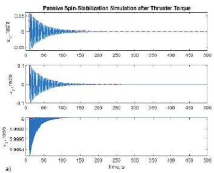

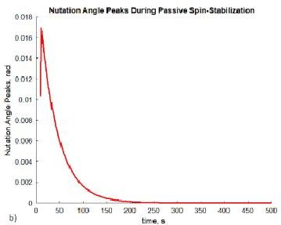

Figure 19: Exponential Decay of Nutation. Response due to torque impulse, assuming a full propellant tank. Shown are (a) exponential decay of the disturbed spin to a new equilibrium spinning about the principal axis and (b) the nutation angle. $ ^{19} $

## Propellant Consumption Considerations

As propellant is consumed by both the primary thruster and CGT, the center of mass of the CubeSat shifts, which creates a greater moment of inertia to resist spinning about the major axis. To diminish this effect, the initial center of mass has been designed to be located offset from the nozzle, so as propellant is used, the center of mass moves closer to the spin axis and eventually crosses it. This allows the center of mass to be located as close as it can to the axis of rotation because when half of the propellant is used, the center of mass is approximately aligned with the spin axis. Additionally, the moment of inertia is reduced by the gaseous water electrolysis products moving to the combustion chamber, located closer to the center of mass. Despite this effect, the angular momentum of each CubeSat remains unchanged because no external impulses have been applied. Consequently, the reduction in moment of inertia causes the angular velocity to increase from 6 rad/s to approximately 7.5 rad/s after propellant consumption. This phenomenon is known as jet damping. Viscous effects of the water, gross sloshing motion, surface tension behavior, and interactions between the water and the fuel tank create this damping effect. As fill fraction of propellent changes, slosh amplitude increases, and

<!-- PDF_PAGE: 14 -->

damping coefficients are affected as well. The most notable change comes from the time constant, which indicates the thruster delays required for reorientation maneuvers and thruster pulses. The water in the propellent tank also serves as a partial radiation shield, as water has favorable shielding properties for cosmic radiation. $ ^{20} $ As propellent is consumed, the electronics will lose shielding.

## CHIPSATS

A small self-contained femtosatellite, known as a ChipSat, will be secured to the outside surface of each Cislunar Explorer craft. At 5cm by 5cm and 2.5 grams, ChipSats represent the current state-of-the-art small spacecraft. Each ChipSat is simply a printed

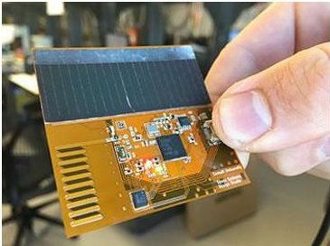

Figure 20: Monarch ChipSat

circuit board outfitted with a suite of surface-mounted sensors, a solar cell, and a low-power transceiver. The purpose of attaching these devices is to perform a technical demonstration of the ChipSats beyond low-Earth orbit (LEO). Though they have flown multiple times in LEO (on the KickSat I, KickSat II, and Venta I missions), they have never operated at altitudes above 400 km. By attaching these ChipSats to the Cislunar CubeSats, we will prove that the ChipSats can operate in the increased radiation environment of cislunar space and that they can communicate over the increased distance. This is a critical demonstration on the path to large-scale planetary science missions involving ChipSats. The iteration of ChipSat design that will be used is as known as the "Monarch". The ChipSats are a secondary payload on a secondary payload. They are secured to the surface of each ~3U unit by a single fastener and epoxy. Electrical connections to the C&DH will only be for radio activation and shut-off as well as

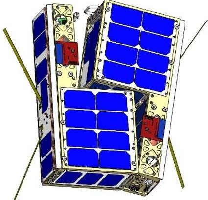

Figure 22: Cislunar with ChipSats Visible

providing status updates. Each ChipSat is a Kapton printed circuit board. Each carries a CC1310 processor and radio, ambient light sensors, temperature sensors, an inertial measurement unit, GPS receiver and GPS antenna (not to be used), solar cell,

and an embedded ISM-band antenna (915 MHz).

## SPACECRAFT BUS

To lower costs, the SSDS developed ways for the subsystems of the Cislunar Explorers to work together symbiotically, a key feature of the design and functionality of the satellites. Inexpensive hobbyist and terrestrial commercial off the shelf technology (COTS) are used on the Cislunar Explorers spacecraft to decrease the cost of the mission dramatically. Components were evaluated for their outgassing, flammability, and toxicity properties to ensure suitability aboard Artemis-I.

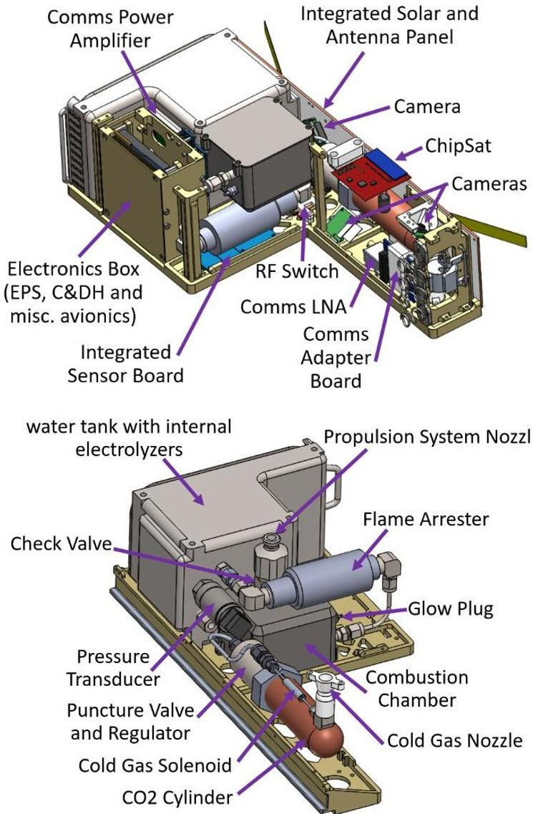

Figure 21: Bus Components Breakdown

## Deployment System

Cislunar Explorers utilizes a separation mechanism that leverages elementary mechanics and a burn wire to propel spacecraft away from each other. The separation mechanism is assembled so that the two spacecraft are held together using springs and a latch mechanism that are activated by a nichrome wire wrapped in a nylon line, shown in Figure 23. Prior to activating, four conical springs are held compressed between the two ~3U halves using the latch mechanism that is held in place by the nylon line. The rotating slotted drum attached to the end tab of Oxygen encloses a handle extending from the fuel

<!-- PDF_PAGE: 15 -->

tank of Hydrogen, which is then released following the line severing. The nichrome is mounted on a custom machined PEEK plastic part to avoid charging the spacecraft by shorting to the spacecraft structure. It also provides an elevated surface for the nylon line to be supported while holding it taught and maintaining a secure point of contact with the nichrome. The line is wrapped around the lever arms of the rotating drum and is secured using a bolt that acts as a post for the improved clinch knot to be tied around, which maintains nearly 100% of the line strength.

## Command and Data Handling (CDH)

The C&DH on each craft is centered on a Raspberry Pi Model A used as our flight computer. Its specifications indicate that it is qualified for temperatures ranging up to $ 70^{\circ} \mathrm{C} $ , and the SSDS has verified the thermal survivability in a thermal vacuum chamber up to $ 85^{\circ} \mathrm{C} $ . Various iterations of the Raspberry Pi (RPi) have flight heritage on CubeSats (although not beyond Earth orbit) and have been radiation tested. $ ^{21} $

## Electrical Power System

For electrical power control and storage each unit has a GOMspace P31u power board. Battery power is fed through two buck-converters that supply a 3.3V at 5A and 5V at 4A output bus. Both the battery and power board are from GOMspace and as such will not have any interface issues. Two 18650 Li cells are used in each ~3U spacecraft. Each 18650 cell is rated for 3.7V with a capacity of 2600 mAh. They are configured as a 7.4V, 2600 mAh stack, and have built in protection against over-temperature, over-current draw, and over-charge. The system is inhibited from activating during ground loading and flight by two separation switches as well as a pre-flight activation switch. All the switches are ZF Electronics DB1C-A1AA Switches. The controller is interfaced using I2C to the RPi. It provides onboard housekeeping measurements such as temperature, battery voltage, and current draw. Each spacecraft has two Pololu Adjustable 9-30V Step-Up Voltage Regulator U3V50AHV voltage regulator/booster to

boost 5V latch outputs on spacecraft power supply to 12V for the cold gas thruster solenoid and pressure transducer.

Each unit has 28 two-terminal advanced Triple-Junction (ZTJ) InGAP/InGaAs/Ge surface-mounted solar cells. The Solar panels are identical for each unit. Each unit has 6 solar panels, of which 4 have 3 cells on each and 2 have 8 cells on each. Each unit also has a hybrid solar panel, antenna and camera board that contains 6 cells. Cells are arranged with blocking and bypass diodes. In most spacecraft orientations, the solar cells provide between 6 and 8 W of power to the spacecraft.

## Structure and Materials

The main structure consists of aluminum 7075-T7 parts fastened together. Two sets of two identical L-shaped walls (-X and +X walls) were machined out of 7075-T7 aluminum for the two spacecraft. The two -X walls allow the satellites in their combined 6U form to interface with the CSD's rail system by including the required tabs. The components such as electronics boards are fastened to the structure with screws/bolts. All fasteners have a secondary locking mechanism in the form of locknuts or thread lock. The two walls and solar panels are supported by multiple aluminum structural beams, which fit between components to reinforce the wall connections. Both the propulsion tank and electronics box interface with both walls, providing additional structure. To save mass, there are multiple outgassing safe plastic parts onboard Cislunar. The camera supports, CGT nozzle and RF switch cases are 3D printed out of Ultem 9085, a lowoutgassing and highly heat resistant polymer. The parts' small, atypical hole shapes, angled faces, and edges, while making for a streamlined and low mass design, would have proven difficult to make using typical CNC machining techniques. The mounting bracket spacer, solenoid supports, separation connector mount, and burn wire mount are machined out of PEEK. Though 3D printing was the less massive option, as production of the flight components commenced, the prints proved to be more expensive and time consuming to procure. This

Hydrogen Cubesat

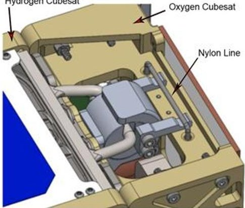

Fuel Tank Handle

Figure 23: Separation Mechanism

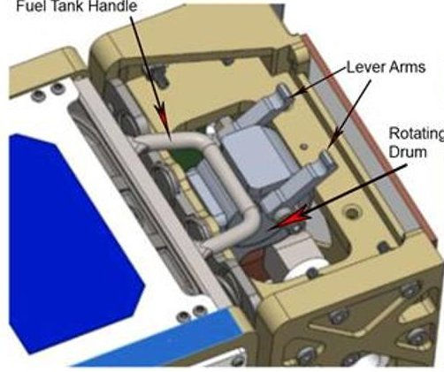

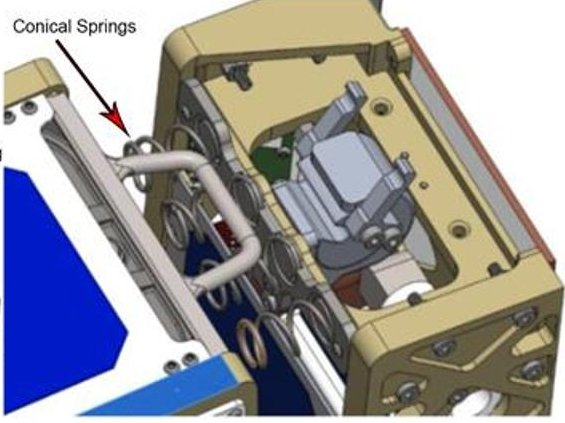

<!-- PDF_PAGE: 16 -->

was due to the prints being outsourced to Stratasys as the SSDS did not have access to printers with Ultem 9085 filament. Additionally, when it came to the CGT, the print resolution proved insufficient to reach the desired tolerances, requiring post machining. In the initial design, all polymer parts were going to be printed Ultem 9085. As cost, schedule, and resolution became issues, simpler designs were created and machined out of PEEK in-house.

The propellant/fuel tank and lid, as well as the combustion chambers, chamber lids, and nozzle were made from 3D printed Ti-6Al-4V. This was done to ease integration and save mass without compromising strength, accommodate complicated shapes to maximize the amount of water stored, accommodate the electrolyzers, include the separation latch, and require only two parts to be mated. The high strength to weight ratio of titanium proved effective for this flight critical system, which holds the satellites together during storage, launch, and deployment while containing 1 atm of water and ambient air before launch. The propellant tanks and lids were printed, and the initial postmachining was conducted by Incodema3D. The combustion chambers, chamber lids and nozzle were printed and provided as a gift to the SSDS from MOOG.

Using 3D printed titanium components proved to be the largest source of unexpected costs, schedule delays, and additional development effort of the program. The delays in receiving the tanks made it difficult to expedite tank testing and evaluation. Several flaws were not discovered during delivery inspections and subsequently only realized during testing and integration. Most of these flaws required expensive post machining to correct, as specialized tools are needed to machine and tap the titanium structure. The printed combustion chamber and lid were provided without any post processing. This included the requirement that the components be welded together. The team's inexperience with the material proved to be problematic as the fill material to be post machined during the next processing step melted away in the process unexpectedly. Because of this, it was difficult to determine if a perfect welded seal had been achieved, which is essential for the combustion chambers' function and required additional testing. Though the benefits of titanium's material properties were convincing during the design phase, the integration and cost of the material proved to be a constant problem. Future systems could utilize aluminum, steel, or a traditional titanium alloy instead. Most 3D printed metals and alloys have proved unable to form the smooth surface required for sufficient post machining tolerances. Utilizing a crush seal or a knife-edge seal in a later iteration of this design would

produce a better vacuum seal, though these methods are more challenging to implement with a titanium tank.

A more robust accounting of printing procurement costs and a better understanding of post processing requirements of 3D printing metals showed other production methods could have met many of the desired characteristics, including welding or fastening a multipart tank. Each face could have simply been machined as a separate part, and they could have all been welded and/or fastened together with bolts and vacuum seals to form the enclosures. Fairly complex geometries could have still been produced using this methodology, and it would have been lower cost to make modifications after they had been assembled.

Another propulsion system design that has been considered is the use of a flexible bladder to move liquid water through the tank. A related concept has been implemented in the propulsion system of the EQUULEUS CubeSat. $ ^{22} $ This system utilizes pressurized gas on one side of a flexible bladder to push water into a vaporization chamber. However, the bladder was determined to not be needed as the spin of the spacecraft provides a gradient that separates liquid water from the gaseous electrolysis products.

## Thermal Subsystem

The thermal subsystem of the Cislunar Explorers Cubesat faces several critical issues for the mission: maintaining liquid propellant for water electrolysis and vibrational and attitude dampening as well as keeping on-board electronics at an operable temperature. Environmental temperature ranges from 400K to 900K and 150K to 50K at the two lunar cycles. $ ^{23} $ The CubeSat will also face albedo from the Moon and Earth Infrared Radiation throughout the mission. $ ^{24} $ The operating temperature range of our electronics is 0 to $ 60^{\circ} \mathrm{C} $ . The maximum temperature was determined by the upper thermal bound of the heat-sensitive batteries, and the minimum by the freezing point of water. Water boils at temperatures far above what the spacecraft electronics can survive (at maximum pressure, over $ 180^{\circ} \mathrm{C} $ ), so the water boiling is not a concern. Preventing the water from freezing is mission critical, because this would disable propulsion, disrupt stable spin due to slosh, and subject the tank to fracture from expansion. If the water freezes due to a low-power anomaly, propulsion and reorientation maneuvers are temporarily impacted until the water thaws. The Cislunar Explorers CubeSat takes advantage of passive thermal balancing to keep the CubeSat within the operable temperature range. Passive thermal balancing utilizes heat generated by electronics to keep other components above their lower thermal bound. For Cislunar Explorers, the spacecraft warms the

<!-- PDF_PAGE: 17 -->

water propellant using the heat generated from the electronics. The electronics produce the least amount of heat when the spacecraft is in its minimum solar irradiance orientation. Analysis showed that in this minimum heat generation case, the electronics still dissipate enough heat to the spacecraft's propellant tank to keep water propellant at least 5 $ ^{\circ} \mathrm{C} $ above freezing. The heat absorbed by the propellant tank keeps the spacecraft's batteries at $ 13^{\circ} \mathrm{C} $ below maximum temperature in the worst case. Temperature values were derived from ANSYS simulations of the expected space environment. Passive thermal balancing is a key trade study that takes advantage of the water electrolysis propulsion system and simplifies the thermal subsystem of the spacecraft. It uses passive thermal balancing to maintain nominal temperature instead of using active heat pumps or deploying radiators. Heat is also rejected through radiation through the spacecraft's surfaces. Having no active or dedicated thermal system reduces mass and cost. The hottest components aboard the spacecraft, the Op-Amp of the radio system, is mounted on the tank for heat dissipation.

## Other Avionics

Both units contain an inertial measurement unit (IMU) and Real Time Clock (RTC) to provide additional telemetry for the Op-Nav system. Additionally, an Analog to Digital Converter (ADC) is incorporated to acquire data from the 2 propellant tank sensors: the pressure transducer and thermocouple. The IMU, RTC and ADC are all mounted again on a FR4 printed circuit board (PCB) "Sensor Board" to simplify installation on the spacecraft. All these are devices are considered "hobbyist" level components. They are called this as they are marketed as components that enable electronics projects by persons whose expertise may not reach the level of a professional electrical engineer. The components are essentially "breakout boards" that have all their parts and necessary electronic peripherals mounted on a PCB with terminals that can easily accept hook-up wires for distribution to another device. They are a common item in private electronic projects and enable easy, clean installation of electronic devices without significant development time. The SSDS's experience with these and similar device has shown the components to also be rugged as they are designed to allow the inexperienced to use them incorrectly and still function afterwards. The lab has also found anecdotally that they are relatively resilient to electrostatic discharge (ESD) allowing for testing and development outside a lab environment without damaging development parts.

The Adafruit NXP Precision 9-DOF Breakout board contains two sensors: the FXOS8700 3-Axis accelerometer and magnetometer, and the FXAS21002

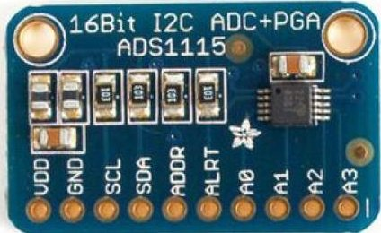

Figure 24: ADC

3-axis gyroscope. Cislunar only makes use of the FXAS21002's capability as part of the Op-Nav system. The gyroscope measures yaw, pitch, and roll angular rate

with 16bit ADC resolution with low power. The sensor is guaranteed to operate over the temperature range of 40 $ ^{\circ} \mathrm{C} $ to $ + 8 5 \, \mathrm{^ \circ C} $ . The FXAS21002C can measure angular rates up to $ \pm 2 0 0 0^{\circ} / \mathrm{s} $ , at 12.5 to 800 Hz. An Adafruit DS3231 Precision RTC Breakout Board is used to periodically correct the flight computer clock as it drifts over time. It is based around the Maxim Integrated DS3231 RTC, an extremely accurate I2C clock with an integrated temperature compensated crystal oscillator (TCXO) and crystal. Originally, plans called for including a small watch battery in the board's incorporated coin cell holder and using the DS3231's battery input to maintain accurate timekeeping in the event of a power disruption to the device. This would have enabled the RTC to be used to reset flight computer clock time and date accurately in the event of an unexpected shutdown and reboot of flight software. However, SLS safety certification requirements for batteries proved to be an insurmountable barrier to include any battery other than the authorized 18650 cells, so the clock will need to be reset by command after any power loss. The ADS1115 16-Bit ADC - 4 Channel with Programmable Gain Amplifier ADC is used to acquire data from propellant tank sensors: pressure transducer and thermocouple. The ADS1115 provides 16-bit precision at 860 samples/second with a programmable gain amplifier up to x16.

## FLIGHT SOFTWARE

Interplanetary space exploration brings some of the most complex engineering requirements for smallsats to date. Key among these that presented themselves during the development of the mission were:

1. Increasing complexity due to pushing functionality to be the autonomous real-time mission operations

2. Difficulty in designing easily testable flight software

3. Unneeded and complicating features brought on by COTS flight software frameworks

Cislunar Explorers evaluated numerous COTS flight software frameworks but concluded that the features they offered did not justify the complexity they added to the development process. Many such frameworks are based on C++, which has a steep learning curve and is not a core part of Cornell's Computer Science

<!-- PDF_PAGE: 18 -->

curriculum. They also tend to provide operating-systemlike features for running directly on microcontrollers or minimalistic real-time platforms. Running on a Raspberry Pi, however, gives developers direct access to all the multiprocessing and I/O facilities of Linux, as well as to more familiar languages and libraries. The team ultimately adopted a simplified flight software approach using a single-threaded Python application. Using Python enabled the use of easily available and well tested open source drivers for the avionics. These open source drivers made it incredibly easy to utilize low cost COTS products.

The application contains seven flight modes including boot up sequence, restart, normal, optical navigation, electrolysis, safety, and maneuver execution. Flight modes are run in a simple event loop. First, the flight software reads from all of its sensors and checks for incoming commands. Then, it attempts to execute any commands it has received, which could change the flight mode. Finally, it executes the task of the flight mode and downlinks the necessary telemetry data.

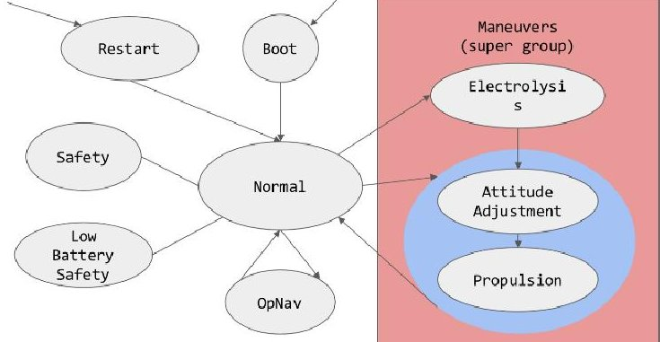

Figure 25: Mission Mode Architecture

The flight modes utilize a base class that implements each of these functions, so that it can be shared across all flight modes. This makes it possible for a new, simple flight mode to be implemented and define only its primary task, while reading from all the default sensors and downlinking a default telemetry data packet. For example, the electrolysis flight mode is simply responsible for turning on electrolysis and then monitoring the pressure in the fuel tank until it reaches the optimal level for a burn. Therefore, it does not need to implement any other specific functionality. On the other hand, more complex flight modes can override these functions to either queue incoming commands when executing a maneuver or downlinking a minimal telemetry data packet if the battery is low. This gives the flight mode implementer complete flexibility to handle complex behavior or simple tasks with minimal overhead.

Additionally, the limited capabilities of the satellite make it beneficial to greatly reduce the command set for the mission. The satellite has a very limited supply of

cold gas and an engine with a very low thrust capacity. As a result, the maneuvers are simply "aim in this direction" and accelerate or do not accelerate. There is no degree of acceleration at all; it is a simple binary condition. This makes it logical for the maneuver command set to contain only a single command, which sets a desired attitude, whether or not the spacecraft should accelerate, and a breakpoint. This simplification bounds the complexity of ground operations, which should streamline training.

These tasks make up the most important actions of the mission and they need to be executed sequentially. As a result, there is little value added by making the flight software multithreaded. In fact, in addition to having only a single CPU core, the Raspberry Pi flight computer communicates with almost every sensor over a single I2C bus, which could lead to unpredictable blocking of threads on top of normal scheduling jitter. The singlethreaded version offers more predictable behavior for sequences of commands and measurements. Therefore, the single-threaded approach sacrifices almost nothing and makes the flight software significantly easier to implement, reason about, and test in a comprehensive way.

## OTHER LESSONS LEARNED

Getting experience with real hardware earlier in the process would have reduced late-stage risk. There is also always a danger of hardware "quirks" requiring operational changes to work around. For example, the camera multiplexer requires a full flight computer reboot after setup whenever power is lost, introducing risk.

As it has been well observed with other academic CubeSat programs, student turnover over such a long development period led to unnecessary repeated work and periods of uncertainty over past design, requirements, and trade outcomes. As tempting as clean redesigns are, "second system" decisions that break continuity or complicate the onboarding process can have long-lasting negative effects on productivity.

## CONCLUSIONS

The primary objective of the Cislunar Explorers mission is a technology demonstration of water electrolysis propulsion as a means of providing high $ \Delta V $ while conforming to CubeSat specifications. CubeSats and other nanosatellites do not traditionally have significant propulsive capability, and a successful demonstration would greatly increase the reach and flexibility of CubeSat scale missions. Secondary objectives include other technical demonstrations, such as passive spinstabilization, optical navigation using imagery of the Sun, Earth, and Moon and testing the operation of femtosatellites called ChipSats beyond low earth orbit.

<!-- PDF_PAGE: 19 -->

Technical and Development problems presented themselves and were documented for the wider scientific and academic community to learn from.

## Acknowledgments

The detection algorithm is based off work produced by former SSDS students Michael Wang and Paul Salazar as part of student research efforts. Initial designs of the OpNav system were conceived by Kyle Doyle.

The position UKF is an extension of work done by Hunter Adams and Dr. Peck. It was tested by Paul Salazar as part of student research efforts. The attitude and position UKFs are based on lectures created by Hunter Adams for his graduate course titled Spacecraft Attitude Dynamics, Estimation, and Control.

Considering recent events as of the time of this writing, the authors would like to acknowledge the difficulty, sacrifice, and loss of those who were affected by COVID-19 but continued to contribute to the success of Cislunar Explorers.

## References

1. "Cube Quest Challenge Ground Tournaments, Deep Space Derby, and Lunar Derby Operations and Rules". NASA Centennial Challenges, Marshall Space Flight Center, Alabama.

2. Doyle, K.P. and Peck, M.A. "Water Electrolysis Propulsion as a Case Study in Resource-Based Spacecraft Architecture (February 2020)." IEEE Aerospace and Electronic Systems Magazine, vol. 34, no. 9, 6 September 2019, pp. 4-19.

3. Chin, Jamie. "CubeSat 101". California Polytechnic State University, CA. October 2017 https://www.nasa.gov/sites/default/files/atoms/files /nasa_csli_cubesat_101_508.pdf

4. Alon, O. "Monte Carlo Simulations for Trajectory Analysis Using Systems Toolkit". 13 December 2019, https://d7e6339e-c2c3-4748-9ae9- 301e138321bb.filesusr.com/ugd/c1a508_f7e3fb1e4 ebe4562beebcf4cd1310fe0.pdf

5. Foust, Jeff. "First SLS launch now expected for second half of 2021" Space News, 2 March 2020 https://spacenews.com/first-sls-launch-now expected-in-second-half-of-2021/

6. "Secondary Payloads Interface Definition & Requirements Document" SLS SPIE, Marshall Space Flight Center, Alabama October 2017

7. Sawada, K., Chin, M., Usami, N., Kimura, M., & Kubota, A. "Structural Design Of 3d Printed

Spacecraft-Artsat2:Despatch." Transactions Of The Japan Society For Aeronautical And Space Sciences, Aerospace Technology Japan, 14(Ists30), Pf_45-Pf_50.2016

8. Gaugeable Tube Fittings and Adapter Fittings Swagelok, www.swagelok.com/downloads/webcatalogs/en/M S-01-140.pdf.

9. PEM Electrolyzer Fuel Cell.Fuel Cell Store, www.fuelcellstore.com/manuals/horizon-mini-pem-electrolyzer-instructions-fcsu-010.pdf.

10. Hermetic Electrical and Fiber Optic PAVE-Seals. PAVE Technology Co., www.pavetechnologyco.com/wp content/uploads/PAVE-Catalog-2019-Summary- .pdf.

11. Hysol 1C Epoxy. Loctite, https://www.tedpella.com/technote_html/8 91-60%20TN.pdf

12. Industrial Pressure Transducer - Ceramic. Cynergy3, www.cynergy3.com/sites/default/files/IPSU%2020 18.pdf.

13. OC Five Thread Paste. MPT Industries, mptindustries.com/product/oc-five-paste/.

14. Flashback Arrestor 85-10. Witt, www.wittgas.com/us/products/gas-safety equipment/flashback-arrestors/for-pressure-regulators-outlet-points-inline/flashback-arrestor 85-10.html.

15. Cahoy, Kerri, Marinan, Anna, and Nguyen, Tam. "Attitude Determination for Small Satellites with Infrared Earth Horizon Sensors" Journal of Spacecraft and Rockets, vol. 26, no. 19, November 2018 https://arc.aiaa.org/doi/pdf/10.2514/1.A34010

16. Adams, V.H. and Peck, Mason, "Lost in Time and Space," AIAA Guidance, Navigation, and Control Conference, 2017.

17. Schrello, D.M., "Passive Aerodynamic Attitude Stabilization of Near Earth Satellites," Wadd Technical Report 61-133, vol. 1, July 1961.

18. Van der Ha, J. "Models for Rhumb-Line Attitude Maneuvers and Error Propagation Effects," Journal of Guidance, Control & Dynamics, vol. 29, No. 6, November 2016

<!-- PDF_PAGE: 20 -->

19. Doyle, K.P. "Water Electrolysis Propulsion: Systems Architecture and Technology Development," Cornell Theses and Dissertations. August 2019

20. Kodaira, S., et al. "Verification of Shielding Effect by the Water-Filled Materials for Space Radiation in the International Space Station Using Passive Dosimeters." Advances in Space Research, vol. 53 no.1, 2014, 18 October 2013, pp. 1-7.

21. Violette, D. "Arduino-raspberry Pi: Hobbyist hardware and radiation total dose degradation." 2014.

22. Asakawa, Jun, et al. "Development of the Water Resistojet Propulsion System for Deep Space Exploration by the CubeSat: EQUULEUS." 31st Annual AIAA/USU Conference on Small Satellites

23. Clark, Pamela. "Cubesats in Cislunar Space" 32nd Annual AIAA/USU Small Satellite Conference California Institute of Technology/Jet Propulsion Laboratory, 2018

24. Escobar, Emanuel, et al. "Evolutionary Design of a Satellite Thermal Control System: Real Experiments for a CubeSat Mission." Applied Thermal Engineering, vol. 105, 24 March 2016, pp. 490-500.

25. Crassidis, J.L. and F.L. Markley, "Unscented Filtering for Spacecraft Attitude Estimation," Journal of Guidance, Control, and Dynamics 2003 26:4, 536-542.

26. Karpenko, A., D. Jacobs, B. Jongmin, and M. Levoy, "Digital Video Stabilization and Rolling Shutter Correction using Gyroscopes," Stanford University Computer Science Tech Report CSTR 2011-03.