<!-- PDF_PAGE: 1 -->

# Closing the Power Budget Architecture for a 1U CubeSat Framework

Anirudh Tadanki $ ^{*} $ and E. Glenn Lightsey $ ^{\dagger} $ Georgia Institute of Technology, Atlanta, Georgia, 30332

A 1U CubeSat framework is designed as a baseline for future missions at Georgia Tech's Space Systems Design Laboratory. The goal of the initial CubeSat is primarily educational, and future iterations intend to demonstrate a low cost and repeatable life-cycle process that overcomes the high turnover of labor faced by most universities. The purpose of the initial CubeSat design is to return detailed ADCS data from the reaction wheel, magnetorquers, and GPS on board. Due to the volume constraints of a 1U form factor, the presented power budget features various power profiles aimed to maximize the lifetime of the CubeSat from a deployment in an orbit similar to the ISS. From this, pointing requirements for the ADCS system can be derived to maximize solar panel exposure to sunlight, and future 1U CubeSats have a better understanding of the tight margins present in the design.

## Nomenclature

<table border="1"><tr><td>ADC</td><td>=</td><td>Attitude Determination and Control</td></tr><tr><td>C&amp;DH</td><td>=</td><td>Command and Data Handling</td></tr><tr><td>EPS</td><td>=</td><td>Electrical and Power System</td></tr><tr><td>GPS</td><td>=</td><td>Global Positioning System</td></tr><tr><td>GLONASS</td><td>=</td><td>Global Navigation Satellite System</td></tr><tr><td>AFT</td><td>=</td><td>Allowable Flight Temperature</td></tr><tr><td>SOC</td><td>=</td><td>State of Charge</td></tr><tr><td>OAP</td><td>=</td><td>Orbit Average Power</td></tr><tr><td>MEL</td><td>=</td><td>Master Equipment List</td></tr></table>

## I. Introduction

The 1U CubeSat holds a unique place in spacecraft architechure, with its small form factor of 10cm x 10cm x 10cm volume constraint. At the cost of saving money, the 1U CubeSat has to strike a delicate balance between a mass constraint regulation of 1.33 kg., the aforementioned volume restriction, and finding something of substantial value to launch on a commercial rideshare provider, such as SpaceFlight Industries or NanoRacks. Given those limitations, the 1U to 6U form factors have largely been deployed by various universities usually with NASA or other government backing, although recently, more commercial players such as PlanetLabs have entered into their own ventures, likely seeing the usefulness in the ease of building and cost savings of having a constellation of CubeSats to achieve their imaging coverage goals relative to conventional spacecraft. Even companies not experienced in building CubeSats like Facebook's Aquila, Amazon's Project Kuiper, and SpaceX's Starlink are temped by the potential of CubeSat and/or SmallSat constellations to provide internet coverage to potentially billions of people.

The Space Systems Design Laboratory at Georgia Tech has sucessfully delivered a series of satellites into orbit. Launched in Dec.2018 on a Falcon 9, The Ranging and Nanosatellite Guidance Experiment (RANGE) consists of two 1.5U CubeSats with onboard GPS and LiDAR that communicate with each other in leader-follower formation to establish centimeter-level precise orbit positioning. The satellites control through differential drag to maintain their formation, and communicate with a UHF software-defined radio, and have synchronized atomic clocks to corroborate their relative positions. The 75 kg Prox-1 launched in Dec. 2017 with the intent to conduct rendezvous and proximity operations for the Air Force Research Lab. Prox-1, unlike RANGE, contains a propulsion system, and had a nominal mission duration of three months.

<!-- PDF_PAGE: 2 -->

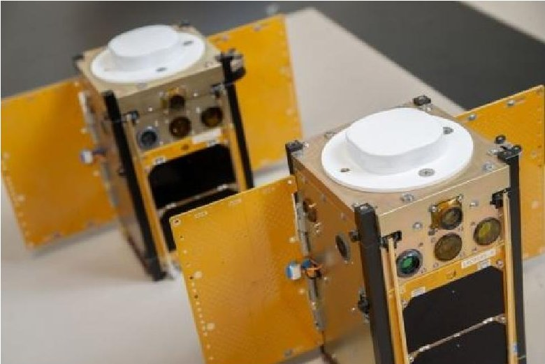

Fig.1 Leader and Follower CubeSats of RANGE Mission.

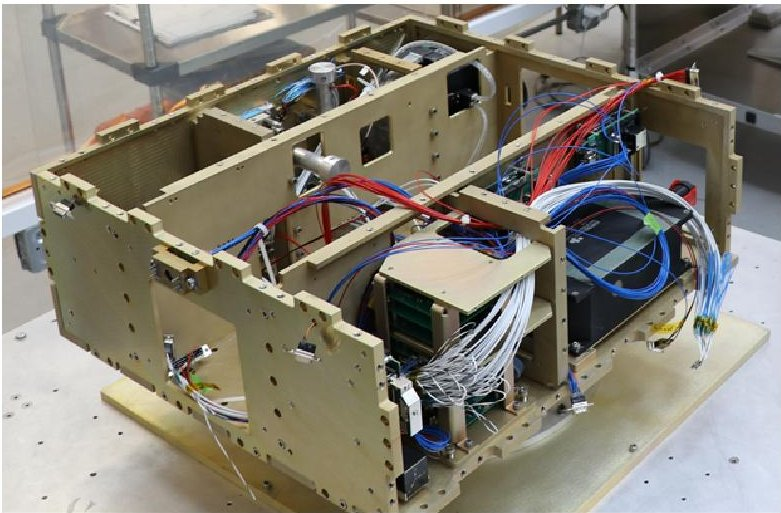

Fig. 2 Prox-1 During Assembly.

The Reconnaissance of Space Objects (RECONSO) is also funded through AFRL, and is slated to launch in the near future. A 6U spacecraft, RECONSO has an optical payload designed to detect and track space debris in LEO on the order of 1-10 cm in size. MicroNimbus is another CubeSat in development at SSDL, and has a 3U form factor. It uses a radiometer to measure vertical temperature profiles of the Earth's atmosphere, and is SSDL's first iteration of an in-house, reusable 3U platform. Micronumbus is currently past the Preliminary Design Review (PDR) stage, and is intended to be one of many cubesats in a constellation that can perform near real-time global temperature profiling.

The number of CubeSat launches has seen close to exponential growth this past decade; making efficient design and operation a valuable characteristic of any potential mission these satellites have.

## II. Subsystem Design for the 1U CubeSat Framework

SSDL in the past has published literature on a 3U and 6U CubeSat framework called TECHBus, described as a common hardware bus that requires limited mission customization capable of accomodating a wide range of mission profiles. TECHBus carries a service, ADCS, and Payload module, and it is designed to have a modular form factor, meaning the location of these various modules is flexible and dependant on the objectives of the CubeSat mission [1].

The larger volume available in TECHBus allowed it to carry redundant components; however, this is not a luxury available to the 1U framework. Similarly, the 1U framework only has space for a single reaction wheel and 3 magnetorquers. TECHBus does not have as restrictive a power budget, due to a greater solar panel area and larger battery capacity; therefore it can afford the more complex ADCS, payload, and redundant systems[1].

The 1U framework shown below has 5 main subsystems: the Command and Data Handling Subsystem, the Attitude Determination and Control System, the Communication System, the Electrical and Power Subsystem, and Structure.

<!-- PDF_PAGE: 3 -->

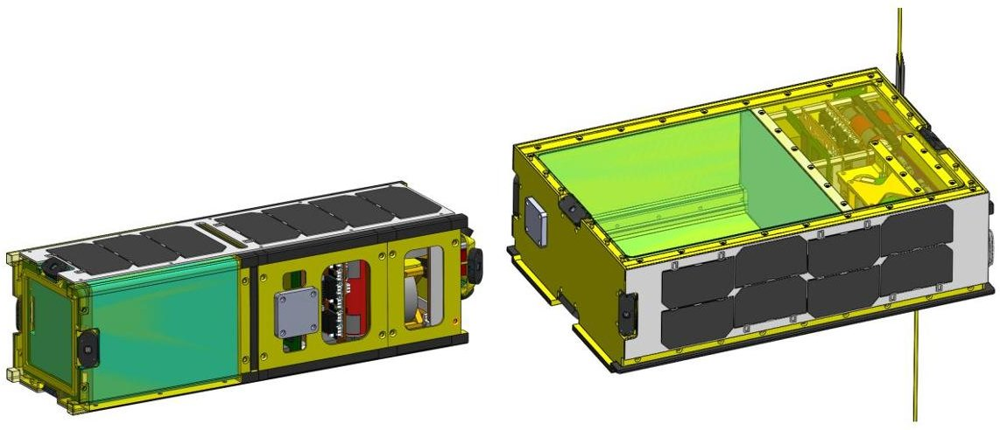

Fig. 3 3U TECHBus (left) and 6U TECHBus (right) Frameworks. $ ^{1} $

## A. Command and Data Handling (C&DH)

The C&DH subsystem is responsible for dictating on-board spacecraft operations and handling internal spacecraft communications between subsystems, either autonomously or from ground station inputs, as well as time keeping. The on-board software also prepares any gathered spacecraft data of interest for down-link to its target. Fault detection and management is another important function of the C&DH subsystem.

The C&DH subsystem on the 1U CubeSat framework consists of a single on-board computer (OBC) and a docking board to hold the OBC and connect it to the other subsystems. In particular, the interface between the OBC and the EPS system is of utmost importance. Continuous communication between the two subsystems on available power allows the OBC to decide to turn off non-critical components to prevent power failure in more critical parts of the 1U. The OBC also tells the EPS when to switch certain components into a higher power consumption state when necessary. The data transmitted between these two systems is frequent, but small; therefore, a only low speed data link between the two is required. The OBC also can send data regarding the state of the EPS to the ground station, referred to as housekeeping data. This gives the operators updates on the state of the spacecraft's health.

The C&DH architecture on the 1U CubeSat framework can use either a centralized or distributed architecture. A centralized architecture connects the OBC directly to various spacecraft components. A distributed architecture is connected to a unified communications protocol bus (e.g. MIL-STD-1553 bus), along with other components on the spacecraft, allowing for interactions between components and the bus, rather than the OBC directly. This standard can support data rates of up to 1MB/s, and protects the OBC from shorting in the event a power failure occurs in any subsystem.

In addition to risks from radiation damage, thermal and/or mechanical degradation, and assembly errors, the on-board software must be written in-house at SSDL and can be a single point source of mission failure if not written properly and tested thoroughly. Proper care must be taken to make sure the impact of these risks is minimized to future missions, as C&DH failure often result in loss of mission.

The OBC used in the 1U CubeSat framework is the BeagleBone Black (BBB), an incredibly low-cost, open-source development platform capable of booting Linux in 10 seconds. The microprocessor on the board is is a 1GHz AM3359 from Texas Instruments (TI), based off the ARM processor. The processor comes with 64KB of dedicated RAM, and 176KB of on-chip boot RAM. The BB board comes with 512MB DDR3 RAM, 2GB 8-bit on-board flash storage, and 2 PRU 32-bit microcontrollers. The specifications the BBB offers are sufficient for any future missions SSDL intends to perform[2].

The power consumption of the BBB varies based on the specific function being performed. The manufacturer measured the current draw of the board with the five configurations listed below [2]:

1. Idling @UBoot - HDMI Monitor connected

2. Kernel Booting (Peak) - USB HUB connected

3. Kernel Idling - 4GB Thumbdrive connected

4. Kernel Idling Display Blank - Serial debug cable connected

5. Loading a Webpage - Ethernet connected @100M

<!-- PDF_PAGE: 4 -->

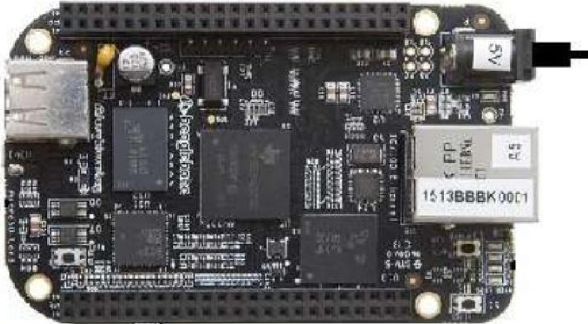

Fig. 4 Top View of the BeagleBone Black Board with TI Microprocessor. $ ^{2} $

<table border="1"><tr><td>MODE</td><td>USB</td><td>DC</td><td>DC+USB</td></tr><tr><td>Reset</td><td>TBD</td><td>TBD</td><td>TBD</td></tr><tr><td>Idling@UBoot</td><td>210</td><td>210</td><td>210</td></tr><tr><td>Kernel Booting(Peak)</td><td>460</td><td>460</td><td>460</td></tr><tr><td>Kernel Idling</td><td>350</td><td>350</td><td>350</td></tr><tr><td>Kernel IdlingDisplay Blank</td><td>280</td><td>280</td><td>280</td></tr><tr><td>LoadingaWebpage</td><td>430</td><td>430</td><td>430</td></tr></table>

Fig. 5 BeagleBone Black Current Draws for Various Scenarios. $ ^{2} $

The scenarios above show that the power draw of the BBB can range from a lower bound of 1W to an upper bound of 2.15 W. The OBC will be the the largest driver of the 1U CubeSat framework's power consumption, due to its 100% duty cycle.

## B. Attitude Determination and Control (ADC)

The attitude dermination and control subsystem is responsible for properly orienting the 1U Cubesat and accurately determining its location in the orbit. The ADC subsystem must resolve the 1U Cubesat's initial orientation from deployment from the launch vehicle provider. NanoRacks jettisons the CubeSat out of a pod, meaning the 1U will likely be tumbling at the start of its mission. The speed and effectiveness in stabilizing the body rates of the 1U Cubesat framework will determine the success of the mission. Evaluating the performance of the ADC subsystem is the primary objective of the initial 1U CubeSat SSDL plans to launch.

Most CubeSats are not allowed to carry on-board propellant, and in the case of the 1U framework, it is no different; there is not enough space to fit a propellant tank and thruster. This means the 1U CubeSat has no way of controlling its orbital elements, and is at the mercy of external forces affecting its trajectory. Active control on the 1U CubeSat is exclusive to its orientation; it intends to carry a single reaction wheel, giving it precise control about one axis of rotation, and three magnetorquers that give it coarse control over all three axes. The 1U CubeSat framework determines its orientation through the use of sun sensors.

The Sinclair 10 mN reaction wheel is the most expensive component of the CubeSat, running around $20k. It has flight heritage with 10 function wheels on 4 satellites, and is an update to their RW-0.03 wheel, which has >8 years

<!-- PDF_PAGE: 5 -->

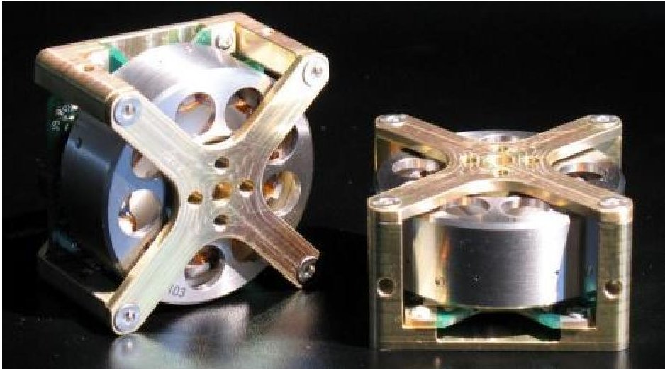

Fig. 6 Sinclair Interplanetary 10 mN Reaction Wheel. $ ^{3} $

on-orbit. According to the manufacturer, the component comes with diamond coated hybrid wall bearings, redundant motor windings, and has an optional upgrade to lot-screen the parts for radiation. The part has a wide operation temperature of $ - 4 0^{\circ} \mathrm{C} $ to $ + 7 0^{\circ} \mathrm{C} $ , vibration capability of over 12g, and is tested to reliably absory 20 krad of radiation[3].

The power profile of the Sinclair wheel is shown below in Fig. 7. The power compumption is directly proportional to momentum, and varies for different applied torques. The highest power consumption is 1W at +1mNm of applied torque, and has a minimum power consumption of 0.11W at a steady state.

Input Current at 5 V in Vacuum for Various Torques

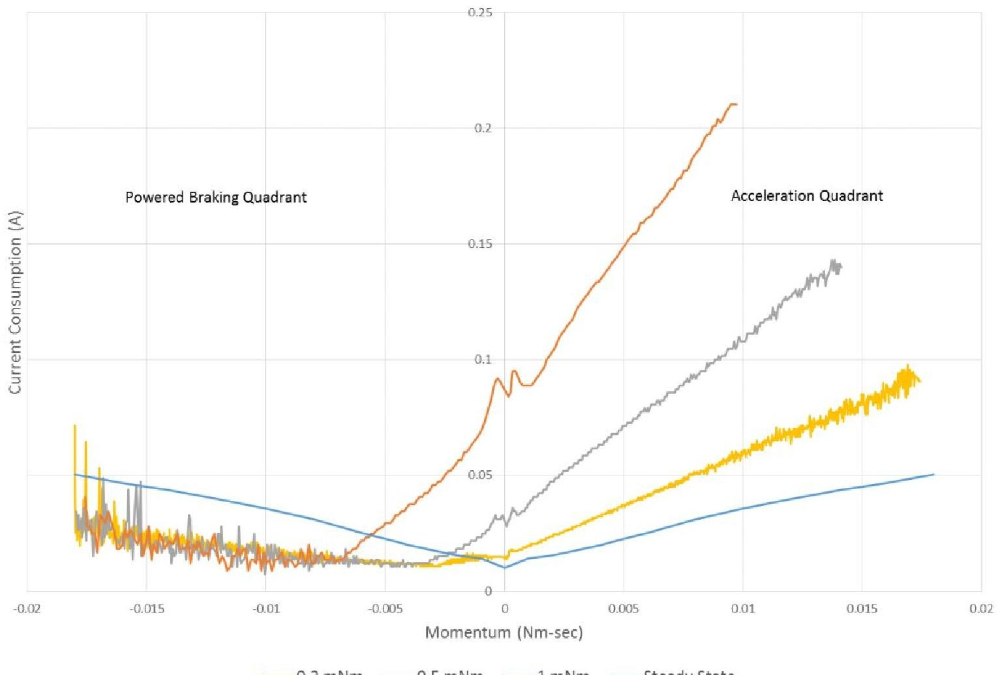

Fig. 7 Current Draw for Various Torques Through the Reaction Wheel. $ ^{3} $

<!-- PDF_PAGE: 6 -->

The Sinclair reaction wheel has an internal CPU to receive commands from the OBC and can provide precise control, but only about the axis upon which it is oriented. For control in the other two axes, magnetorquers must be used. These are intended to be built in-house at SSDL, and it should be feasible to do them at a low cost. A magnetorquer is a set of electromagnets that are laid out to yield a rotationally asymmetric magnetic field over time. The field is controlled by running a current through the coils, and since the magnetorquers are attached to the spacecraft, the resulting torque can rotate the orientation about the center of gravity.

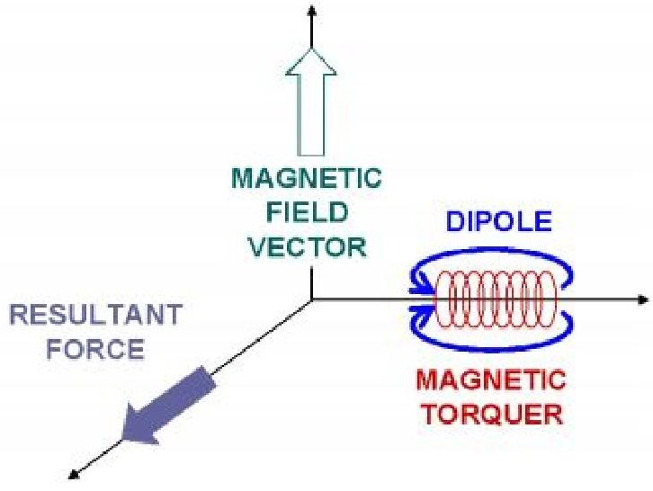

Fig. 8 Magnetorquer Schematic of Operation. $ ^{4} $

There are three forms of magnetorquers capable of being built, listed below:

- Embedded magnetorquer: Usually contained within the solar panel by creating a spiral trace inside the PCB. Usually has the smallest applied torque on the satellite due to restrictions on solar panel thickness.

- Air core magnetorquer: A conductive wire is wrapped around a non-conductive support anchored to the CubeSat, usually with no other material placed in the interior.

- Torque-rod magnetorquer: Similar principle to the air core, but the winding coils are in the form of a solenoid and is wrapped around a ferromagnetic core. When a current runs through the coil, the dipole generated is higher than the other two variants. The corresponding disadvantage to this variant is that a residual dipole remains even when there no current running through the coil due to a phenomenon known as hysteresis.

The magnetorquers are light-weight, low complexity, and energy efficient. Since the 1U CubeSat framework is applicable to LEO, the magnetorquers are a viable form of attitude control. At higher altitudes, they will not be as effective, and even in LEO, the net torque capable from these devices pales to a reaction wheel. Magnetorquers are not as precise in driving spacecraft pointing requirements, which makes them a poor choice for missions that have precise pointing requirements.

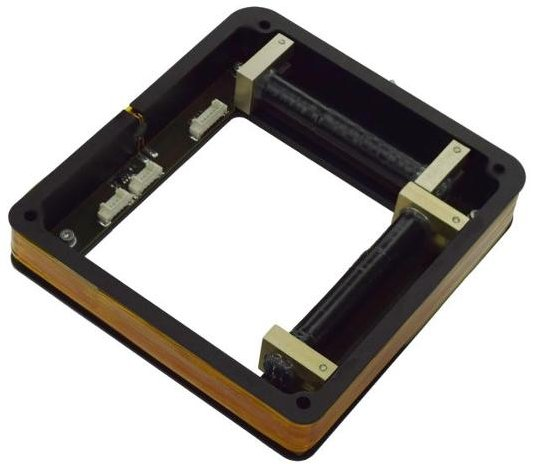

Fig. 9 Visual of Commercial Off-the-Shelf Magnetorquers. $ ^{4} $

<!-- PDF_PAGE: 7 -->

The power consumption of the magnetorquer is a function of a series of parameters: the resistivity of the wire used, $ \sigma_{w} $ , the length of the wire L, the cross sectional area of the wire $ a_{w} $ , and the current running through the wire I.

$$
R = \sigma_ {w} \frac {L}{a _ {w}}
$$

$$
P = R I ^ {2} = \sigma_ {w} \frac {n C}{a _ {w}} I ^ {2}
$$

For the purposes of the analysis presented in this paper, the peak power consumption of the SSDL magnetorquers was assumed to be 1W, with a idle power consumption of 0.2W. The margin allocated to this component in the power budget below accounts for the uncertainty in these assumptions.

Attitude determination on the 1U CubeSat framework is performed by a variety of off-the-shelf components: the VectorNav VN-100 IMU, the NovAtel OEM625S GPS, and a series of SolarMEMs Sun Sensors.

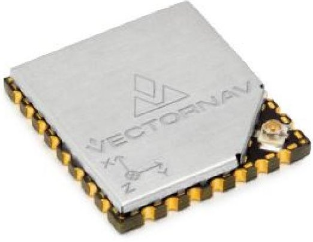

Fig.10 VectorNav VN-100 IMU. $ ^{5} $

The VectorNav VN-100 IMU has a three-axis gyroscope for attitude determination, an accelerometer to measure rotation rates, and a magnetometer to measure the magnetic field acting on the spacecraft. It is compact in size, and has a low peak power consumption of 0.185W. The angular resolution is $ < 0.05^{\circ} $ , and comes with an Extended Kalman Filter, saving in-house algorithm development time [5]. VectorNav sells a "Rugged" upgrade that also includes a GPS.

The GPS is a separate component from the IMU on the 1U CubeSat framework, and the OEM625S was selected for its centimeter-level position accuracy. This GPS has NovAtel's Real Time Kinematic (RTK) algorithm that offers a velocity measurement with 0.03 m/s accuracy, as well as an option to use along side the Selective Availability Anti Spoofing Module (SAASM) from L-3. This GPS uses a dual-frequency civil GNSS positioning engine that includes GLONASS, giving an operator an accurate position and velocity measurement in a compact component. The power consumption is relatively high, with a peak power draw of 2.2W and an average power draw of 1.2W, which means the duty cycle of the NovAtel OEM625S is a key trade space element of the power budget. The NovAtel has flight heritage on several small spacecraft missions, and the receiver uses on-board Kalman Filtering to filter noise in its data[6].

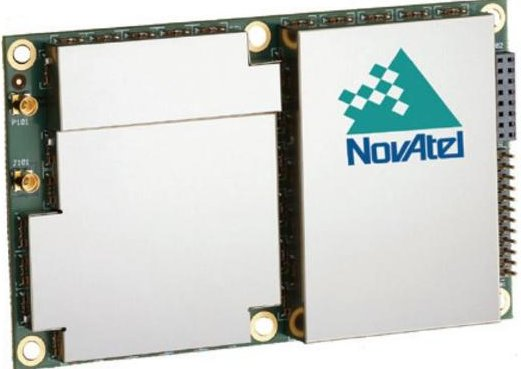

Fig.11 NovAtel OEM625S. $ ^{6} $

<!-- PDF_PAGE: 8 -->

The gyroscope gives the 1U CubeSat attitude information with respect to its body frame, but the SolarMEMs nanoSSOC give attitude information relative to an "inertial" frame. The Sun Sensor on a Chip (SSOC) is a two-axes, low cost sun sensor that measures the incident angle of a sun ray in two orthogonal axes. The 1U CubeSat framework carries six of these, due to their low mass, small volume, and low cost. The power consumption is also low, with a current of less than 2mA on 3.3V/5V. The component has a $ \pm 6 0^{\circ} $FOV, an operating temperature from $ -3 0^{\circ} $C to $ +8 5^{\circ} $C, and can absorb at least 100 krad. The component also has substantial flight heritage, making it a safe decision for attitude determination [7].

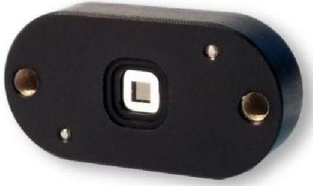

Fig. 12 SolarMEMs nanoSSOC. $ ^{7} $

There are several areas of risk present in the ADC subsystem. There is no redundancy carried, so any failure in a component results in a loss of data. The sun sensors can arguably compensate for a failure in the IMU, but the solution would have to be a software fix that is not guaranteed to be accurate, nor a trivial solution to code. The control present on the 1U CubeSat framework is only robust in 1 axis: the axis upon which the reaction wheel is mounted. Control in the other two axes is slow and not as precise as the wheel can output. The wheel, with its various moving parts, also stands out as a mechanical component with risk attached, and care must be taken to make sure the location of the wheel within the spacecraft does not interfere with other critical components. Writing the software takes experience and testing, which SSDL is equipped with, but must overcome the turnover of talent. This can be overcome with proper documentation of code and building upon the framework in this paper to ensure future iterations can modularly build about the first 1U CubeSat framework.

## C. Communication

The communication subsystem for the 1U CubeSat framework requires a radio and antenna to downlink the data it collects from the ADC subsystem and receive commands from the ground station operator. There are various regulations the FCC implements on the CubeSat radio tradespace, making this subsystem a tricky one to navigate.

The EyeStar-S3 Satellite Simplex Communication System is compliant with the FCC imposed requirements and uses the GlobalStar satellite constellation as an intermediary node to downlink and uplink data from the ground. This is particularly useful for the 1U CubeSat framework because it overcomes its lack of precise pointing. GlobalStar allows communication at any point in the CubeSat's orbit, and NearSpace Launch advertises that it can maintain a link at spin rates of at least 3 rpm. The communication system is at a TRL 8, and transfers continuously at a rate of 9 bytes/sec, though capped at 600 kBytes/day. This is sufficient for the mission objectives of the first iteration of the 1U CubeSat framework, but future missions that carry a payload might consider the data restriction too costly. The system includes a micro-controller with 10 I/O lines that can be user defined and configured for analog, digital, etc. The power consumption is reasonable, with a 1.66W power draw while transmitting, and an idle power consuption of 0.252W [8].

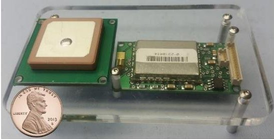

Fig. 13 NearSpace Launch Inc. EyeStar-S3 Satellite Simplex Communications System. $ ^{8} $

<!-- PDF_PAGE: 9 -->

The antenna on the EyeStar-S3 is a passive ceramic patch antenna, with a gain of 200 mW. It uses the Aerospace Modem GGlobalStar STX-3 Tx with a 1616.25 MHz downlink. The most restrictive thermal requirement is on the radio: $ -30^{\circ} \mathrm{C} $ to $ +70^{\circ} \mathrm{C} $ . The system comes with a passive heat sink/radiator to make sure these restrictions are not breached [8]. The EyeStar-S3 can also return positioning data, but the accuracy is not as reliable as the OEM625S. The radiation is advertised by Pumpkin as being tolerant of at least 9 months in LEO.

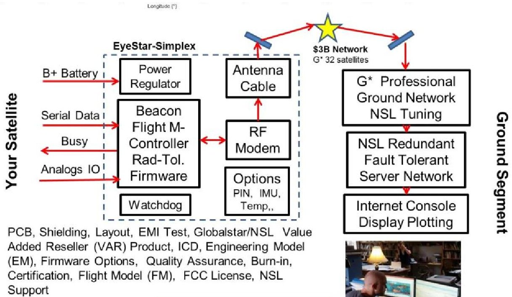

Fig.14 EyeStar-S3 ConOps. $ ^{8} $

## D. Electrical and Power System (EPS)

CubeSats use highly integrated Electrical Power System (EPS) electronics that ensure optimal power generation and distribution. From design to the hardware itself, the EPS must be efficient and flexible; capable of meeting power requirements for any specific mission, but reusable for different mission scenarios without requiring a complete redesign. The EPS consists of several fundamental components: the energy source, energy conversion, energy storage, power regulation, and power distribution.

The energy source for the 1U CubeSat framework is the Sun; the solar arrays convert this solar energy to chemical energy that is stored into the on-board batteries. The spacecraft contains high efficiency converters and electronic relays to distribute this power to the loads, primarily the CPU, the communication system, and the Attitude Determination and Control (ADC) system. Typically, the individual loads provide their own voltage regulation, and the EPS regulates its voltage for its internal components. This system is not perfect; the process of delivering power from the Sun via solar panels to the loads of the spacecraft incurs losses, discussed in Figures below.

The GomSpace P31u comes with a lithium-ion battery of 20 Watt-Hours, which is a recent but significant advancement over Nickel-Cadmium and Nickel-metal-Hydride batteries in terms of energy density and discharge cycles. These batteries do have a shorter lifetime than the older variants, but at 5 years, that is still longer than the 1U CubeSat framework's mission lifetime. The P31U has flight heritage and simplifies the design of the EPS to be usable in a 1U CubeSat form-factor. The operational temperature on the batteries is $ - 4 0 \, \mathrm{^o C} $ to $ + 8 5 \, \mathrm{^o C} $ , and the EPS has the option to come with a heater for the batteries. The P31u, like numerous other components in the framework, features a microcontroller that provides maximum power-point tracking (MPPT) capability, can measure voltages, currents, and temperatures of the system, and enables operator on/off/set control. The P31u also has an over current detector (OCD) that will turn off power to the system in the event of detecting a short circuit, and can be cycled on again to prevent complete loss of power to the spacecraft [10].

Converting solar energy to chemical energy stored in the batteries is not a perfect transfer; there are losses that occur that are dependant on the power drawn from the solar cells, as shown below:

In addition to losses from converting solar energy to chemical energy, there are losses that occur from converting the energy from the battery to the proper voltages required by the components through the Buck converter.

<!-- PDF_PAGE: 10 -->

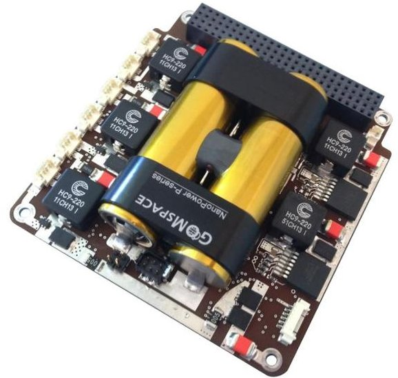

Fig. 15 GomSpace P31u with Attached Batteries. $ ^{10} $

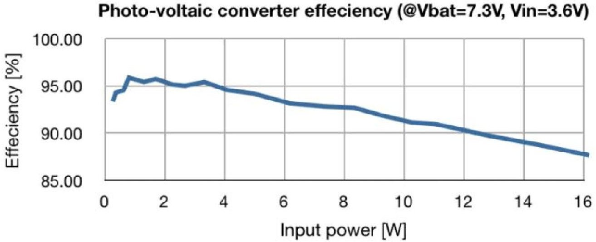

Fig. 16 Efficiency of P31u when Converting Solar Power to Battery Power. $ ^{10} $

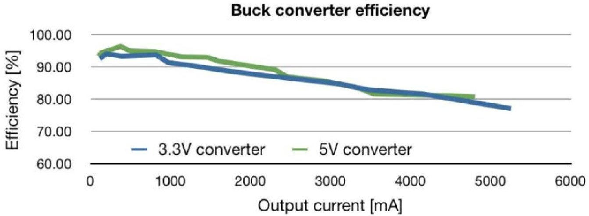

Fig. 17 Efficiency of the Buck Converter on P31u. $ ^{10} $

Energy is also lost to resistance in the wires that carry current from the battery to the components, known as line loss. These losses must be accounted for when developing a power budget, and can be treated as variables to see their impact on the overall system.

<!-- PDF_PAGE: 11 -->

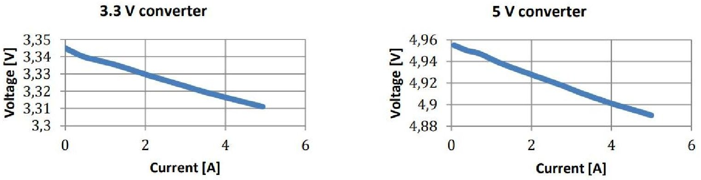

Fig. 18 Voltage Drop on the 3.3V Bus (left) and 5V Bus (Right). $ ^{10} $

Power generation is exclusively done through the deployable solar cells the 1U CubeSat framework carries. Like the magnetorquers, the solar panels will be built in-house at SSDL, lowering the cost and adding knowledge retention. The solar cells can be made of silicon, indium phosphide, or triple-junction gallium arsenide, with the latter being the most efficient. Triple junction GaAs is the standard used by most off-the-shelf commercial providers of solar panels, and for a 1U form-factor, these manufacturers advertise 2.3W per panel [9]. Many manufacturers, in an attempt to gain a market advantage, add other hardware in their panels, like sun sensors, temperature sensors, etc.

The intent for the 1U CubeSat framework is to have 4 deployable solar panels on each side, giving a total of 8 solar panels. Due to their orientation with respect to the Sun at any given time, only a fraction of the area will receive sunlight. Conservative assumptions are made about this area fraction, and the 1U CubeSat framework is sized to assume the low end of power generation from the panels.

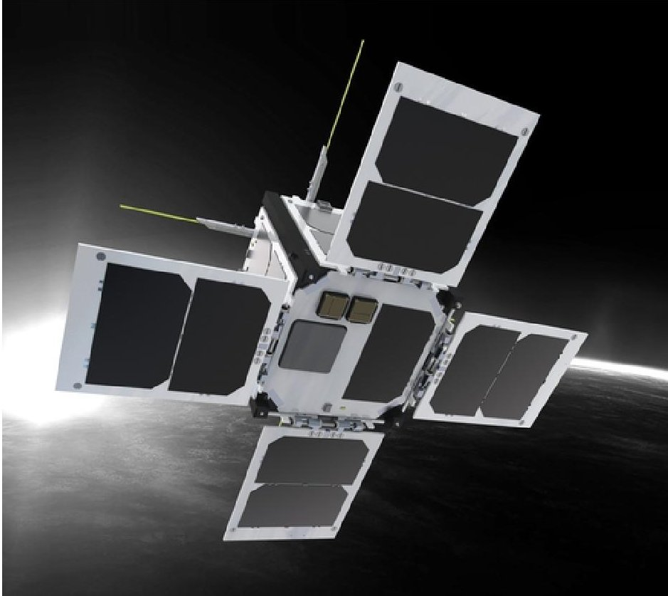

Fig. 19 Rendering of the first SSDL 1U CubeSat with Deployable Solar Panels.

The P31u mitigates a big risk that an EPS can face through its OCD. Since the 1U CubeSat is being built in-house, care must be taken around lithium-ion batteries, as well as the solar panels, which can be brittle. A biggest challenge the EPS will face is sufficient power generation. For an orbit similar to the ISS, the spacecraft will spend significant portions of its time in eclipse, meaning no power will be generated by the solar panels and the spacecraft must survive using then energy stored on the battery.

<!-- PDF_PAGE: 12 -->

<table border="1"><tr><td colspan="6">Command&amp;Data Handling</td></tr><tr><td>Beaglebone Black CPU</td><td>39.7</td><td>5%</td><td>41.685</td><td>86.36x53.34x4.76</td><td>-4085</td></tr><tr><td>GOMSpace NanoDock DMC-3</td><td>51</td><td>5%</td><td>53.55</td><td>91.9x88.7x8.6</td><td>-4085</td></tr><tr><td colspan="6">Attitude Determination and Control</td></tr><tr><td>SSDL Magnetorquers(x3)</td><td>156</td><td>10%</td><td>171.6</td><td>90x96.9x17.2</td><td>-4085</td></tr><tr><td>Sinclair 10mN Reaction Wheel</td><td>120</td><td>5%</td><td>126</td><td>50x50x30</td><td>-4070</td></tr><tr><td>NovAtel OEM625S GPS</td><td>56</td><td>5%</td><td>58.8</td><td>60x100x15.1</td><td>-4085</td></tr><tr><td>GOMSpace NanoDock ADCS-3</td><td>60</td><td>5%</td><td>63</td><td>96.6x92.5x11.2</td><td>-4085</td></tr><tr><td>VectorNav NV-100 IMU</td><td>3.5</td><td>5%</td><td>3.675</td><td>24x22x3</td><td>-4085</td></tr><tr><td>SolarMEMs Sun Sensors(x6)</td><td>24</td><td>5%</td><td>25.2</td><td>27.4x14x5.9</td><td>-3085</td></tr><tr><td colspan="6">Communication</td></tr><tr><td>EyeStar-S3 Comm. System</td><td>22</td><td>5%</td><td>23.1</td><td>55x26x15</td><td>-3070</td></tr><tr><td colspan="6">Electrical and Power</td></tr><tr><td>GOMSpace NanoPower P31u w/Battery</td><td>200</td><td>5%</td><td>210</td><td>89.3x92.9x25.6</td><td>-4085</td></tr><tr><td>SSDL Deployable Solar Panels(x4)</td><td>200</td><td>10%</td><td>220</td><td>100x100x3</td><td>-40125</td></tr><tr><td>SSDL Body Mounted Solar Panels(x4)</td><td>200</td><td>10%</td><td>220</td><td>100x100x3</td><td>-40125</td></tr><tr><td>ISIS 1U Frame(Reference)</td><td>107.7</td><td>5%</td><td>113.085</td><td>100x100x113.5</td><td>-</td></tr><tr><td>Total</td><td colspan="5">1239.91329.695</td></tr></table>

Fig. 20 1U CubeSat Framework MEL. $ ^{1} $

<!-- PDF_PAGE: 13 -->

The MEL shown above lists the Current Best Estimate (CBE) mass for each component, along with a 5% contingency added to all potential off the shelf components used. The magnetorquers and solar panels, planned to be manufactured in house at SSDL, have a 10% contingency. Accounting for these uncertainties, the 1U CubeSat framework is almost exactly at the 1.33kg mass limit imposed by launch providers.

The interior of the 1U CubeSat will be packed, as shown from the volume column in the MEL, and the EyeStar Comm. System is the has the most restrictive AFT's.

## IV. 1U CubeSat Framework Power Budget

The four potential power modes the 1U CubeSat framework can be in are shown below [11]. The Peak Power mode assumes all components are consuming their peak power. The ADC is actively controlling the 1U Cubesat's orientation while transmitting all data to the ground.

Power Mode: Peak Power

<table border="1"><tr><td>Component</td><td>Power Consumption(W)</td><td>w/5% Contingency</td><td>Margin</td><td>Total</td></tr><tr><td colspan="5">Command&amp;Data Handling</td></tr><tr><td>BeagleBone Black CPU</td><td>2.15</td><td>2.26</td><td>20%</td><td>2.71</td></tr><tr><td colspan="5">Attitude Determination and Control</td></tr><tr><td>Sinclair10mN Reaction Wheel</td><td>1.05</td><td>1.10</td><td>20%</td><td>1.32</td></tr><tr><td>NovAtelOEM625S GPS</td><td>2.2</td><td>2.31</td><td>10%</td><td>2.54</td></tr><tr><td>SSDL Magnetorquers</td><td>1</td><td>1.05</td><td>30%</td><td>1.37</td></tr><tr><td>VectorNavVN-100IMU</td><td>0.185</td><td>0.19</td><td>10%</td><td>0.21</td></tr><tr><td>SolarMEMsSunSensor(x6)</td><td>0.06</td><td>0.06</td><td>10%</td><td>0.07</td></tr><tr><td colspan="5">Communication</td></tr><tr><td>EyeStar-S3Comm.System</td><td>1.66</td><td>1.74</td><td>20%</td><td>2.09</td></tr><tr><td colspan="5">Electrical and Power</td></tr><tr><td>GOMSpaceNanoPowerP31uw/Battery</td><td>0.16</td><td>0.17</td><td>20%</td><td>0.20</td></tr><tr><td>TotalPowerConsumption</td><td>8.47</td><td>8.89</td><td></td><td>10.51</td></tr></table>

Fig. 21 Peak Power Mode for 1U CubeSat.

The Transmit mode assumes peak power on the CPU and communication system. The GPS, IMU, and Sun Sensors are also assumed to be at peak power to take real-time measurements, while assuming the rest of the ADC subsystem is passive i.e. not actively changing its orientation while transmitting data.

Power Mode: Transmit

<table border="1"><tr><td></td><td colspan="5">Power Mode: Transmit</td></tr><tr><td>Component</td><td>Power Consumption(W)</td><td>w/5% Contingency</td><td>Margin</td><td>Total</td><td></td></tr><tr><td colspan="6">Command&amp;Data Handling</td></tr><tr><td>BeagleBone Black CPU</td><td>2.15</td><td>2.26</td><td>20%</td><td>2.71</td><td></td></tr><tr><td colspan="6">Attitude Determination and Control</td></tr><tr><td>Sinclair10mN Reaction Wheel</td><td>0.25</td><td>0.26</td><td>20%</td><td>0.32</td><td></td></tr><tr><td>NovAtelOEM625S GPS</td><td>2.2</td><td>2.31</td><td>10%</td><td>2.54</td><td></td></tr><tr><td>SSDL Magnetorquers</td><td>0.2</td><td>0.21</td><td>30%</td><td>0.27</td><td></td></tr><tr><td>VectorNavVN-100IMU</td><td>0.185</td><td>0.19</td><td>10%</td><td>0.21</td><td></td></tr><tr><td>SolarMEMsSunSensor(x6)</td><td>0.06</td><td>0.06</td><td>10%</td><td>0.07</td><td></td></tr><tr><td colspan="6">Communication</td></tr><tr><td>EyeStar-S3Comm.System</td><td>1.66</td><td>1.74</td><td>20%</td><td>2.09</td><td></td></tr><tr><td colspan="6">Electrical and Power</td></tr><tr><td>GOMSpaceNanoPowerP31uw/Battery</td><td>0.16</td><td>0.17</td><td>20%</td><td>0.20</td><td></td></tr><tr><td>TotalPowerConsumption</td><td>6.87</td><td>7.21</td><td></td><td>8.41</td><td></td></tr></table>

Fig. 22 High Power Mode for 1U CubeSat.

<!-- PDF_PAGE: 14 -->

The Active Control Power mode assumes peak power on the reaction wheel and magnetorquers. The rest of the system is assumed to be in a passive mode, and the OBC's power consumption is assumed to be a conservatively high value.

Power Mode: Active Control

<table border="1"><tr><td>Component</td><td>Power Consumption</td><td>w/5% Contingency</td><td>Margin</td><td>Total</td></tr><tr><td colspan="5">Command&amp;Data Handling</td></tr><tr><td>BeagleBone Black CPU</td><td>1.75</td><td>1.84</td><td>20%</td><td>2.21</td></tr><tr><td colspan="5">Attitude Determination and Control</td></tr><tr><td>Sinclair10mN Reaction Wheel</td><td>1.05</td><td>1.10</td><td>20%</td><td>1.32</td></tr><tr><td>NovAtelOEM625SGPS</td><td>0</td><td>0.00</td><td>10%</td><td>0.00</td></tr><tr><td>SSDLMagnetorquers</td><td>1</td><td>1.05</td><td>30%</td><td>1.37</td></tr><tr><td>VectorNavVN-100IMU</td><td>0.1485</td><td>0.16</td><td>10%</td><td>0.17</td></tr><tr><td>SolarMEMsSunSensor(x6)</td><td>0.0396</td><td>0.04</td><td>10%</td><td>0.05</td></tr><tr><td colspan="5">Communication</td></tr><tr><td>EyeStar-S3Comm.System</td><td>0.252</td><td>0.26</td><td>20%</td><td>0.32</td></tr><tr><td colspan="5">Electrical and Power</td></tr><tr><td>GOMSpaceNanoPowerP31uw/Battery</td><td>0.16</td><td>0.17</td><td>20%</td><td>0.20</td></tr><tr><td>TotalPowerConsumption</td><td>4.40</td><td>4.62</td><td></td><td>5.63</td></tr></table>

Fig. 23 Medium Power Mode for 1U CubeSat.

The Low Power mode assumes all components are consume as little power as possible while still keeping the spacecraft functioning. This includes the heaters on various components ensuring they don't fall below their AFT.

Power Mode: Low Power

<table border="1"><tr><td>Component</td><td>Power Consumption</td><td>w/5% Contingency</td><td>Margin</td><td>Total</td></tr><tr><td colspan="5">Command&amp;Data Handling</td></tr><tr><td>BeagleBone Black CPU</td><td>1.05</td><td>1.10</td><td>20%</td><td>1.32</td></tr><tr><td colspan="5">Attitude Determination and Control</td></tr><tr><td>Sinclair10mN Reaction Wheel</td><td>0.25</td><td>0.26</td><td>20%</td><td>0.32</td></tr><tr><td>NovAtelOEM625S GPS</td><td>0</td><td>0.00</td><td>10%</td><td>0.00</td></tr><tr><td>SSDL Magnetorquers</td><td>0.2</td><td>0.21</td><td>30%</td><td>0.27</td></tr><tr><td>VectorNavVN-100IMU</td><td>0.1485</td><td>0.16</td><td>10%</td><td>0.17</td></tr><tr><td>SolarMEMsSunSensor(x6)</td><td>0.0396</td><td>0.04</td><td>10%</td><td>0.05</td></tr><tr><td colspan="5">Communication</td></tr><tr><td>EyeStar-S3Comm.System</td><td>0.252</td><td>0.26</td><td>20%</td><td>0.32</td></tr><tr><td colspan="5">Electrical and Power</td></tr><tr><td>GOMSpaceNanoPowerP31uw/Battery</td><td>0.16</td><td>0.17</td><td>20%</td><td>0.20</td></tr><tr><td>TotalPowerConsumption</td><td>2.10</td><td>2.21</td><td></td><td>2.65</td></tr></table>

Fig. 24 Low Power Mode for 1U CubeSat.

## V.1U CubeSat Orbital Characteristics

Most CubeSat launch providers deploy their CubeSat rideshares on a PPOD off the International Space Station. This analysis assumes an ISS-like orbit for the 1U CubeSat framework, which is a more restrictive power case than a sun-sync orbit where the CubeSat has continuous input power from the Sun. This is illustrated in Fig 25.

STK can output lighting and eclipse times for an orbit over a specified timeframe. This analysis was performed for the ISS-like orbit from July 2020 - July 2021, which is the likeliest launch date of the 1U CubeSat framework, as shown in Fig 26. The Sun-Sync orbit is in sunlight for its entire orbital period, and therefore is not shown on the graph.

<!-- PDF_PAGE: 15 -->

<table border="1"><tr><td>Parameter</td><td>Symbol</td><td>ISS Value</td><td>Sun-Sync Value</td></tr><tr><td>Perigee Height</td><td>$h_{p}$</td><td>406km</td><td>443km</td></tr><tr><td>Apogee Height</td><td>$h_{a}$</td><td>411km</td><td>443km</td></tr><tr><td>Inclination</td><td>i</td><td>51.6378°</td><td>97.1928°</td></tr><tr><td>Right Ascension of Ascending Node</td><td>$\Omega$</td><td>82.0545°</td><td>12.1624°</td></tr><tr><td>Argument of Perigee</td><td>w</td><td>122.84°</td><td>0°</td></tr><tr><td>Period</td><td>T</td><td>92.73min</td><td>93.44min</td></tr></table>

Table 1 Classical Orbital Elements of 1U CubeSat Orbit

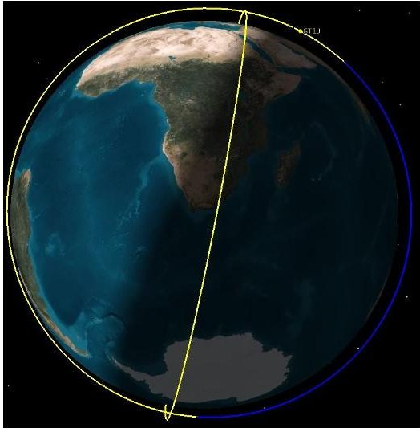

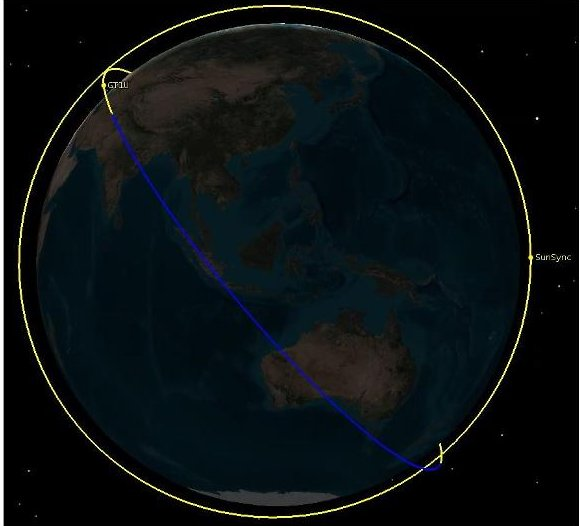

Fig. 25 Lighting Conditions on ISS Orbit (left) vs. Sun Sync Orbit (right) $ ^{1} $

Lighting and Eclipse Times for ISS-Like Orbit

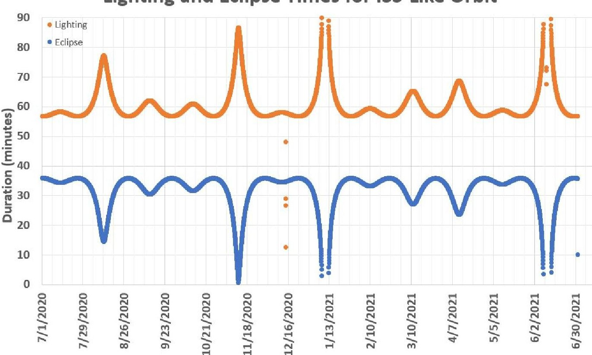

Fig. 26 Lighting vs. Eclipse Times for ISS-like Orbit.

<!-- PDF_PAGE: 16 -->

## VI. State of Charge Scenarios

From Fig. 26, the most restrictive lighting scenario occurs around the beginnig of the simulation, where the 1U CubeSat is in eclipse for 32.8 minutes and in lighting for 56.7 minutes. The following analysis looks at one orbit with these proportions and examines what is necessary to stay power neutral.

Determining how much energy the 1U CubeSat receives from its solar panels is a function of what fraction of the solar panels receive sunlight and how long they are in sunlight. For this analysis, the area covered is assumed constant over the course of the entire orbit, but in reality, this fraction varies depending on the CubeSat's orientation with the Sun.

$$
O A P = T o t a l S o l a r P o w e r * A r e a C o v e r e d * (1 - e f f i c i e n c y L o s s e s)
$$

$$
E n e r g y F r o m P a n e l s = O A P * T i m e i n S u n l i g h t
$$

Tables 2-5 show the duty cycles of four potential operational orbits. Intuitively, the Low Power Orbit consumes the least amount of energy. The Work During Sunlight, Sleep During Eclipse operational orbit can be used if battery consumption is intended to be minimized during eclipse. Test 1U Control and Data Transfer are for putting the ADC system through its paces and for effectively performing a data dump respectively. The duty cycle percentages can be adjusted as necessary; the four examples shown are intended to evaluate the power budget against benchmarks that a typical orbit could experience.

<table border="1"><tr><td>Power Mode</td><td>Power Consumption(W)</td><td>Lighting Duty Cycle</td><td>Eclipse Duty Cycle</td></tr><tr><td>Peak Power</td><td>10.51</td><td>0%</td><td>0%</td></tr><tr><td>Transmit</td><td>8.41</td><td>0%</td><td>0%</td></tr><tr><td>Active Control</td><td>5.63</td><td>0%</td><td>0%</td></tr><tr><td>Low Power</td><td>2.65</td><td>100%</td><td>100%</td></tr><tr><td>Energy Consumption(W*min)</td><td></td><td>150</td><td>94.8</td></tr></table>

Table 2 Low Power Orbit

For the Low Power Orbit to be power neutral, the 1U CubeSat framework must AT A MINIMUM have 28% of its solar panel area receiving sunlight, making this a baseline requirement for the ADC subsystem. The other modes consume a significant amount of energy in this mode, as shown in Fig 27 below, and it is not sustainable to run operational orbits unless the solar panels can output a higher OAP in future orbits. This requirement can decrease if the time in sunlight is greater than 56.7 minutes, but from Fig. 26, the 1U CubeSat spends at significant amounts of time having an eclipse similar to 32.8 minutes, so the power budget has to be balanced against this scenario.

<table border="1"><tr><td>Power Mode</td><td>Power Consumption(W)</td><td>Lighting Duty Cycle</td><td>Eclipse Duty Cycle</td></tr><tr><td>Peak Power</td><td>10.51</td><td>10%</td><td>0%</td></tr><tr><td>Transmit</td><td>8.41</td><td>40%</td><td>0%</td></tr><tr><td>Active Control</td><td>5.63</td><td>40%</td><td>0%</td></tr><tr><td>Low Power</td><td>2.65</td><td>10%</td><td>100%</td></tr><tr><td>Energy Consumption(W*min)</td><td></td><td>392.7</td><td>94.8</td></tr></table>

Table 3 Work During Sunlight, Sleep During Eclipse

The Work During Sunlight, Sleep During Eclipse assumes a 40% duty cycle of transmitting data, a 40% duty cycle of actively controlling the spacecraft, and a 10% duty cycle in peak power mode, where the spacecraft is actively changing its orientation and transmitting at the same time. This operational orbit uses the power from the solar panels to supply the energy to conduct power heavy operations, while turning off during eclipse to preserve battery SOC.

<!-- PDF_PAGE: 17 -->

<table border="1"><tr><td>Power Mode</td><td>Power Consumption(W)</td><td>Lighting Duty Cycle</td><td>Eclipse Duty Cycle</td></tr><tr><td>Peak Power</td><td>10.51</td><td>10%</td><td>5%</td></tr><tr><td>Transmit</td><td>8.41</td><td>0%</td><td>0%</td></tr><tr><td>Active Control</td><td>5.63</td><td>60%</td><td>45%</td></tr><tr><td>Low Power</td><td>2.65</td><td>30%</td><td>50%</td></tr><tr><td>Energy Consumption(W*min)</td><td></td><td>295.9</td><td>156.9</td></tr></table>

Table 4 Test 1U Control

The Test 1U Control operational orbit assigns a 60% duty cycle in daylight and 40% duty cycle in eclipse for the Active Control power mode. The only time the 1U CubeSat transmits data in this mode is during the 10% and 5% duty cycle assigned to Peak Power mode in daylight and eclipse respectively. The bulk of power consumptions is in testing the ADC subsystem on board the 1U CubeSat framework, and the data gathered on the performance can be stored until a Data Transfer orbit, as shown below.

<table border="1"><tr><td>Power Mode</td><td>Power Consumption(W)</td><td>Lighting Duty Cycle</td><td>Eclipse Duty Cycle</td></tr><tr><td>Peak Power</td><td>10.51</td><td>10%</td><td>5%</td></tr><tr><td>Transmit</td><td>8.41</td><td>40%</td><td>30%</td></tr><tr><td>Active Control</td><td>5.63</td><td>5%</td><td>5%</td></tr><tr><td>Low Power</td><td>2.65</td><td>45%</td><td>60%</td></tr><tr><td>Energy Consumption(W*min)</td><td></td><td>333.6</td><td>176.2</td></tr></table>

Table 5 Data Transfer

The Data Transfer orbit is a foil to the Test 1U Control orbit; in this scenario, the spacecraft is only controlled 5% of the time for minimal attitude readjustment that can optimize data transfer, as well as in peak power mode. The spacecraft is assigned significant time in the Transmit mode to ensure data is successfully downlinked to the ground. These orbits are necessary as the OBC only has a finite amount of storage, and must be performed periodically to protect against loss of data.

In a scenario where the OAP is only enough to balance the 1U CubeSat power budget in low power mode, the other modes deplete the battery at unsustainable rates. While it is acceptable to run these modes at 28% lighting, future passes in sunlight must receive more power from the solar panels, or the SOC will be too low to keep the 1U CubeSat on, as shown in Fig. 27.

If 58% of total solar panel area can be illuminated by sunlight, even the most power hungry orbit, the Data Transfer orbit, is balanced, and all other orbits are power positive. In this state, one Low Power orbit can recharge the battery on-board by around 30%, as shown in Fig. 28. Depending on depth of discharge requirements, the ADC can adjust how much area gets lighting in the event this is too high.

Fig. 29 shows the performance of the orbits at 43% of panel area lighting. Even at the midpoint, the power hungry budgets are still net negative, although the spacecraft can afford to perform multiple orbits losing power before a Low Power orbit is necessary to recharge the batteries.

<!-- PDF_PAGE: 18 -->

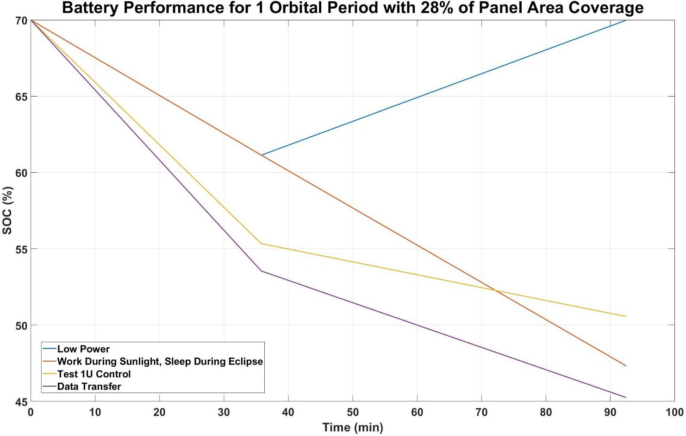

Fig. 27 SOC Behavior for 1 Orbit in July 2020 (28% Solar Panel Area Lighting)

Battery Performance of 1 Orbital Period with 58% of Panel Area Coverage

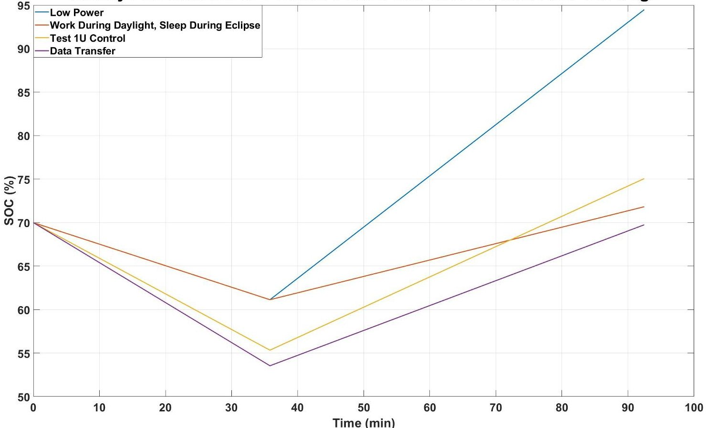

Fig. 28 SOC Behavior for 1 Orbit in July 2020 (58% Solar Panel Area Lighting)

<!-- PDF_PAGE: 19 -->

Battery Performance of 1 Orbital Period with 43% of Panel Area Coverage

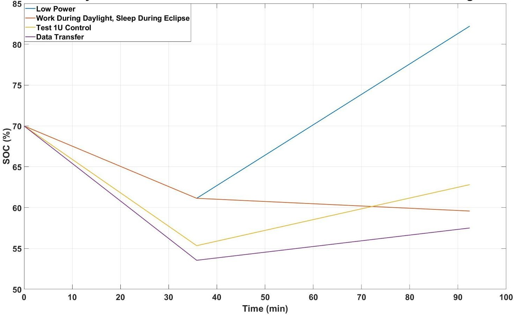

Fig. 29 SOC Behavior for 1 Orbit in July 2020 (43% Solar Panel Area Lighting)

<!-- PDF_PAGE: 20 -->

## VII. Conclusion

The 1U CubeSat framework is intended to be low cost, modular, and a baseline for future missions at SSDL. This paper explored a design derivative from previous SSDL 3U and 6U variants, and attempted to pack as much hardware as mass and monetary constraints allow. The goal of the 1U CubeSat framework is to establish a low cost and repeatable design that can be customized depending on mission objectives.

Balancing the power budget on the small volume requires some work-arounds, but it is still possible to get significant data return if the mission timeline is willing to dedicate certain orbits to recharge the on-board battery. Descoping the MEL is also an option, as is changing the amount of time per orbit the 1U CubeSat is willing to use its power hungry components.

Potential future work involves a more detailed power profile while the spacecraft is in sunlight. This requires correlating the sun-vector acting in the spacecraft body frame to how much surface area receives coverage. The data is collected in STK, but some work must be performed to account for the shadow the deployable solar panels cast on the rest of the satellite.

## References

[1] Francis, P., "Development of the Evolved Common Hardware Bus (TECHBUS)," 2016.

[2] Coley, G., "BeagleBone Black System Reference Manual," BeagleBoard.org, 2013. URL https://cdn-shop.adafruit. com/datasheets/BBB_SRM.pdf.

[3] “Picosatellite Reaction Wheels (RW-00.01),” Sinclair Interplanetary, 2017. URL http://www.sinclairinterplanetary. com/reactionwheels?tmpl=%2Fsystem%2Fapp%2Ftemplates%2Fprint%2F&showPrintDialog=1.

[4] KLK, "NanoTorque GST-600," GomSpace, 2018. URL https://gomspace.com/UserFiles/Subsystems/datasheet/gsds-nanotorque-gst-600-13.pdf.

[5] “VN-100 User Manual,” VectorNav Technologies, 2017. URL https://www.vectornav.com/docs/default-source documentation/vn-100-documentation/vn-100-user-manual-(um001).pdf?sfvrsn=b49fe6b9_32.

[6] "Precise Positioning for SAASM Applications," NovAtel Inc., 2014. URL https://www.novatel.com/assets/Documents/Papers/OEM625S-PS.pdf.

[7] "Sun Sensors for Nano-Satellites," Solar MEMS Technologies S.L., ??? URL http://www.solar-mems.com/wp content/uploads/2017/01/nanoSSOC-A60-Brochure.pdff.

[8] Dailey, J., "EyeStar-S3 Satellite Simplex Communications System," Near Space Launch Inc., 2014. URL http://www pumpkininc.com/space/datasheet/EyeStar-S3%20Satellite%20Simplex%20v3.2.pdf.

[9] "Single CubeSat Solar Panels," CubeSat Shop, 2013. URL https://www.cubesatshop.com/product/single-cubesat solar-panels/.

[10] KLK, "NanoPower P31u," GomSpace, 2019. URL https://gomspace.com/UserFiles/Subsystems/datasheet/gsds-nanopower-p31u-27.pdf.

[11] Clark, C., and Logan, R., "Power Budgets for Mission Success," Clyde Space, 2011. URL http://mstl.atl.calpoly.edu/~workshop/archive/2011/Spring/Day%203/1610%20-%20Clark%20-%20Power%20Budgets%20for%20CubeSat%20Mission%20Success.pdf.