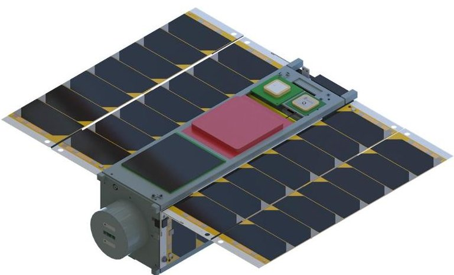
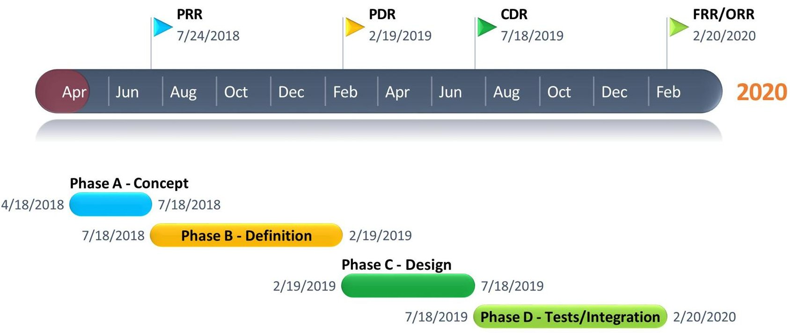
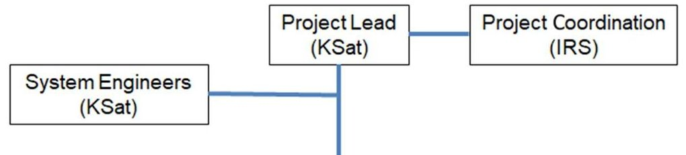
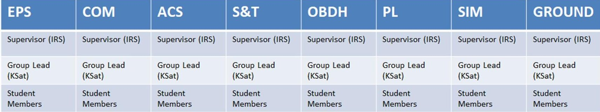
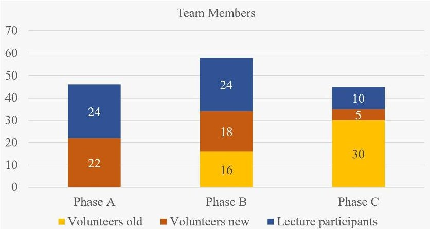

<!-- PDF_PAGE: 1 -->

# Combination of Interdisciplinary Training in Space Technology with Project-Related Work through the CubeSat SOURCE

Annika Stier, Robin Schweigert

KSat e.V.

University of Stuttgart

Stuttgart, Germany

<lastname>@ksat-stuttgart.de

Daniel Galla, Michael Lengowski, Sabine Klinkner Institute of Space System University of Stuttgart Stuttgart, Germany <lastname>@irs.uni-stuttgart.de

Abstract—In April 2018, student work on the first satellite mission primarily dedicated to education at the IRS, SOURCE (Stuttgart Operated University Research CubeSat for Evaluation and Education) began. The phase A study resulted in a three-unit CubeSat design and a cooperation with a variety of industrial partners. Besides its educational purpose, the mission features technological and scientific objectives, the latter of which concentrate on the field of re-entry research. With the current status of the project, a large number of students have been introduced to and trained in all aspects of a satellite mission, like management, project sequences, concurrent engineering, space industry standards, and the application of specialized technical knowledge. This paper gives an overview of the CubeSat SOURCE and its educational approaches.

Keywords—CubeSat; re-entry; student development

## I. INTRODUCTION

The everyday life of an aerospace student usually consists of theoretical lectures, supplemented by a few practical modules. However, these modules have a maximum duration of one semester and represent only a small phase of a project. Therefore, the need for a way of extending this theoretical knowledge with actual practical task arose and the SOURCE mission was started. This mission is a cooperation between the Small Satellite Student Society KSat e.V. and the Institute for space systems (IRS) at the University of Stuttgart for building a 3U+ CubeSat. In addition to those, multiple industry partners provide scientific payloads and technology demonstrators to fly on-board of SOURCE.

Within the project, the main work is done by students ranging from under graded bachelor students to almost finished master students. They are separated into eight different self-organized working groups. Each group is supervised by at least one PhD student of the IRS. This paper shall provide an overview of the student work within the SOURCE project. The current state of the structure can be seen in figure 1.

## II. MISSION OVERVIEW

The main objective of the SOURCE mission is the education of students from different fields of study in conceiving, designing building, and operating a satellite system. This

Figure 1: The current structure of SOURCE

objective is supplemented by different objectives regarding the mission itself, separated into primary, secondary, and additional objectives. The primary objectives consist of the development of a reproducible CubeSat-platform and the verification of new technology for Space 4.0, provided by industry partners. The technology demonstrations comprise new types of solar cells by STI and AzureSpace, SmartHeaters by Airbus, automotive electronics for space applications by Fraunhofer IPA, and a 3Dprinted sandwich structure with integrated electrical circuits by DLR.

The secondary objective is to investigate natural and man-made re-entry objects to understand the challenges of and gather data for a sustainable utilization of space. Observation of meteors during their burn out in the atmosphere and in-situ measurements during the re-entry of SOURCE itself shall provide data which can be used for the validation of meteor propagation and numerical re-entry simulations. It moreover points out the necessity of the ESA clean space initiative to the next generation of space engineers and scientists.

The additional objectives include the verification of another type of solar cells, the utilization of a star tracker build from a COTS camera and Earth observation in the visible spectrum of light.

SOURCE is planned to be launched to a 400-500 km Sun Synchronous Orbit or deployed from the International Space Station. The mission itself can be divided into two phases.

<!-- PDF_PAGE: 2 -->

The first phase starts after the deployment and commissioning of the satellite and lasts until 200 km, shortly before the reentry. During this time, SOURCE will be used for meteor and Earth observation and investigates the performance of the automotive electronics and solar cells. Especially the degradation of the parts over time is one of the analysed key factors. This also includes radiation measurements and voltage monitoring. Additionally, atomic and molecular oxygen is measured during the decent to monitor the atmospheric density and composition. The communication is done via S-Band and uses the ground station of the IRS. The second phase takes place between 200 km and the communication loss of SOURCE. During these last approximate 14 hours, the technology demonstrators are turned off and the behaviour of the satellite is monitored with the reentry sensors. They consist of pressure and heat flux sensors as well as photodiodes for the tumbling rate and plasma analysis.

The Oxygen sensors are used to correlate the behaviour with the atmospheric composition. To avoid data loss and the need for a ground station, the Iridium network is used as a secondary communications system additionally to the S-Band.

## A. Time Schedule

The time schedule of SOURCE is tightly coupled to the semester cycle at the University of Stuttgart. This is due to the accompanied lecture and the participating students. Therefore, reviews are hold in multiples of half years. The first two reviews, the preliminary requirements review, and the preliminary design review are already passed. A critical design review is planned for beginning of 2020 followed by the flight readiness review (FRR) and the operation readiness review (ORR) roughly half a year later mid-2020. A possible launch is then intended after the FRR and ORR for the end of 2021. An overview of the time schedule is given in figure 2.

Figure 2: Time schedule of the SOURCE project

Figure 3: Organizational structure of the SOURCE team

<!-- PDF_PAGE: 3 -->

## III. STUDENT INVOLVEMENT

The SOURCE project takes a new way in student involvement for space-related education at the University of Stuttgart. The main principle of this approach is that the students are in full charge of the complete project. Hence, they can participate in a space engineering and science project with no restraints. PhD students, staff members of the institute, and the endorsing Professor provide guidance and help to avoid critical issues during the development and operation of the satellite.

Moreover, the project is carried out by a tailored application of ECSS or PUS communication standards and by using industrial development, test and operation tools. Each project phase is accompanied by at least one review with national and international industrial and academic experts who assure the overall quality of the project work. For each review, a presentation and documentation is made for the complete project.

## A. Organisation

The project is led by two student project leaders, which ensures a reliable management with high availability. Both are supported and supervised by a PhD student and a full-time employee of the institute. Every critical decision concerning the project is discussed in this group, which meets once a week and is in constant exchange. The student system engineers are part of this weekly meeting to get a current overview of the project phase and give feedback about the budgets and system interfaces. The decisions and issues are later discussed with the subsystem group leaders in a weekly meeting, which is also used for subsystem group feedback and work package status. There are eight subsystem groups in total, consisting of Power (EPS), Communication (COM), Attitude Control System (ACS), Structure and Thermal Control (S&T), On-Board Data Handling (OBDH), Payload (PL), Simulation (SIM) and Ground Control and Operation (GROUND). Every subsystem group consists of at least three student members and one student group leader. The group leader is responsible for the work package creation and distribution in OpenProject as well as the organization of the subsystem group meeting. This meeting takes place every week and is used to discusses subsystem group tasks and evaluate current issues. In each subsystem group, at least one PhD student attends these meetings as a supervisor. A structure of the hierarchy is shown in figure 3. To ensure that every project member gets an overview of the current project status, a general meeting is held every two weeks. The main communication of the project is done via Mattermost, an open-source, self-hostable online chat service, in which private channel messages can be distributed.

Besides the voluntary participation, the project is offered to students of all technical and scientific fields in the form of a course, which includes lectures and practical work. Beyond science and engineering students of the University of Stuttgart, the SOURCE project seeks to involve students of the further

course of studies. An example of this is a recently achieved cooperation with the Hochschule der Medien Stuttgart, in which bachelor students of the study program Advertising and Marketing Communication elaborate a public outreach concept for the SOURCE project in the scope of a practical course.

## B. Documentation

The whole SOURCE project is carefully documented, including all made decisions with their respective histories and trade-offs. The documentation is split into multiple individual documents for better clearness. This includes the main documentation, separated into nine documents, one overview and eight subsystems, the requirements documentation, all risk analyses, all test protocols, and additional management documents like a product tree, the work breakdown structure, and documentation tree. All documents are organised through this documentation tree. Within this, each document is classified to a subcategory and the respective number coming from the work breakdown structure. These subcategories include all subsystems and additional categories like tests, quality assurance and management. Within these subcategories, each document is assigned with a unique number and title resulting in easy classifiability just by the name of the document.

All documents are written using LaTeX. One the one hand, this forces students to make themselves familiar with a new environment and on the other hand LaTeX simplifies the collaboration within a team of over 50 members. In addition to this, LaTeX can be versioned and synchronized using the GIT- software $ ^{1} $ . With this software, it is possible to revert to an earlier state of the documentation when a change damages a document. Since all documents are synchronised with a server, regular backups of the whole documentation are guaranteed.

This extensive documentation helps with the changing members of the SOURCE team so no knowledge is lost, and new members can easily look up the current state and it also provides good training in precise writing of technical documents already during the study.

## IV. CHALLENGES

The aim to source all technical and a large share of the organisational workforce from students brings certain challenges with it. Whereas on the one hand, it can be difficult to recruit the right cast for the more time-demanding leading positions, enticing committed students to neglect their study progress over the project can be a problem on the other hand. To weight the time expenditure the project demands from its participants with fast progress has been one of the major concerns so far. Another difficulty turned out to be posted on the project by balancing the technical staffing of the team. It was observed that participating students tend to choose those working groups whose contents coincide with theoretical knowledge acquired during their studies. This leads to a chronic lack of interested participants in certain important subject areas, such as high-frequency technology. This problem reveals gaps in theoretical lecture plans of aerospace engineering students as the main participating party. In these fields, the outreach to

<!-- PDF_PAGE: 4 -->

students who are willing to familiarise themselves with the subject matter is much more demanding than in fields covered by bachelor modules. Related to this issue, bringing new participants to a level on which they independently can collaborate and learn on the project becomes more difficult as the complexity of the satellite system grows. The task to get new interests acquainted with their unfinished object of work is assigned to the group leads, adding a demand for didactic skills to the already high requirements of this position. Thirdly, internal project communication should be mentioned here, as the growing number of both current and former participants poses a risk of information loss and diverging work statuses. The SOURCE project meets this problem by giving leading positions to those students who can reassure to accompany the project for the longest. This way, students holding those positions gain a long-term overview of their subsystem and can check design decisions for consistency. However, they can only supplement extensive documentation of every step the project takes.

## V. PROGRESS AND ACHIEVEMENTS

## A. Educational

Currently, the SOURCE team consists of 45 students where roughly 1/3 participates in the offered lecture. Overall, SOURCE supervised around 100 students so far. Of the 15 to 20 participants in the lecture every semester, around 1/3 again stays in the project after their final presentation and grading. This combined with only fewer leaving people from the project results in a slowly growing number of participants. Some students currently holding leading positions within the projects started during the lecture. The overall development of student members over the different phases can be seen in figure 4. Overall, the SOURCE team comprises many different courses of study. This includes a big portion of aerospace students, but also students from electrical engineering, computer science, renewable energies, and simulation technology. This contributes to having experts for all different challenges occurring during the project phases.

Figure 4: Team members over the different project phases

In addition to the participation in the lecture, SOURCE also offers final theses. Within these, the students are supervised by one of the PhD students, already working on SOURCE. So far, parts of the communication testbed, the sensor qualification, the solar panel arrangement and holding mechanisms, and the trade-off for the secondary communication system were conducted throughout bachelor and master theses. In the case of the solar panels, this also included a cooperation with one industry partner, where the student was able to develop his thesis on the partner's premise.

To guarantee for a constantly good and growing quality of the lecture, regular surveys are conducted with the students. This feedback is then integrated into the next round of the lecture.

## B. Mission

After the PRR was held in July 2018 and passed in October of the same year, SOURCE passed the PDR by the end of August 2019. However, work on the system entered the detailed design phase four months before the official PDR pass.

## VI. OUTLOOK

Over the next phases, more and more specialised experts are needed for the final integration, implementation, and operation of the project. This combined with the will to spread space knowledge and projects to other courses of study, it is planned to integrate the project with a couple of supporting lectures for satellite development into the curriculum for computer science at the University of Stuttgart for both bachelor and master students. As for the further development, testing, and launch of the satellite, an intermediate CDR is planned to take place at around half the time to the final CDR. Just like with full reviews, a review board will be invited to read the documentation and join a presentation of the project. Afterwards, they are asked to provide any critical points and challenges, which must be tackled until the final CDR. With the results from this intermediate CDR, it is planned to hand in an application to ESA's Fly Your Satellite program. This program assists students in developing and testing their satellite by providing access to experts and testing facilities. Finally, this program also provides launch opportunities to successfully integrated and tested satellites.