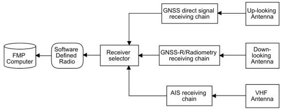
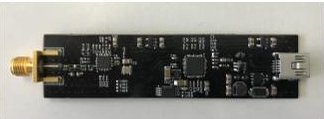
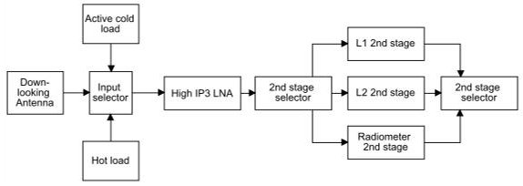
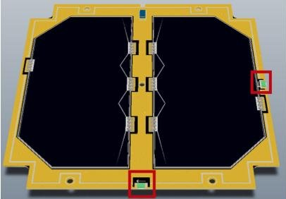
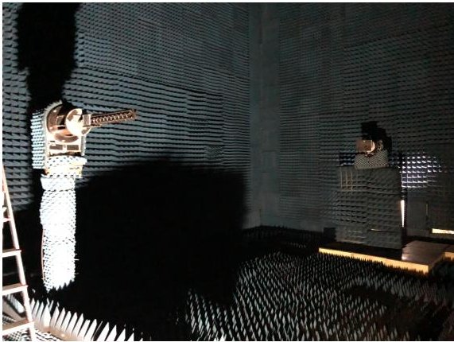

<!-- PDF_PAGE: 1 -->

# 3CAT-4: COMBINED GNSS-R, L-BAND RADIOMETER WITH RFI MITIGATION, AND AIS RECEIVER FOR A 1-UNIT CUBESAT BASED ON SOFTWARE DEFINED RADIO

J. F. Munoz-Martin, N. Miguelez, R. Castella, L. Fernandez, A. Solanellas, P. Via, and A. Camps

Universitat Politècnica de Catalunya - BarcelonaTech Remote Sensing Laboratory and IEEC/UPC. UPC Campus Nord, D3; 08034 Barcelona, Spain

## ABSTRACT

The $ ^{3} $Cat-4 mission aims to demonstrate the capabilities of nano-satellites plus the versatility of a Software Defined Radio for passive Earth Observation. Three different microwave payloads are integrated into a single unit CubeSat platform: a multi-constellation (GPS and Galileo) and a dual-band (L1 and L2) Global Navigation Satellite System -Reflectometer receiver, a total power radiometer including a novel Radio Frequency Interference (RFI) detection and mitigation technique, and an Automatic Identification System receiver for vessels tracking. Being able to validate these technologies in a CubeSat enables their fast adoption as hosted payloads or in more performing dedicated platforms in the future. This paper shows a novel approach for embedding multiple passive microwave payloads in a single platform.

Index Terms CubeSat, Nano-satellite, GNSS-R, Radiometry, RFI, AIS

## 1. INTRODUCTION

$ ^{3} $Cat-4 is a single unit CubeSat mission from Universitat Politècnica de Catalunya and the Institut d'Estudis Espacials de Catalunya, planned to launch between 2019 and 2020 as part of the 'Fly Your Satellite II!' programme from the Educational Office of the European Space Agency (ESA). This program gives the possibility to follow an educational experience for students to design, build, and verify a CubeSat. Moreover, the resulting spacecraft will be launched from the International Space Station (ISS) into a Low Earth Orbit (LEO). Aside from the educational point of view, one of the goals is to demonstrate the capabilities of nano-satellites, and in particular those based in the 1-unit CubeSat standard, for challenging Earth Observation.

The key point of the mission is not only to demonstrate the CubeSat capabilities, but to validate the use of low-cost Commercial of the Shelf (COTS) Software Defined Radio (SDR) for passive remote sensing. For that reason, three different experiments have been allocated on a the single SDR. Each experiment has different requirements, being very interesting

to be able to test the SDR from different perspectives, as the capability of demodulating signals from space (AIS receiver), measuring noise temperatures (radiometer), and being able to perform reflectometry (GNSS-R).

## 2. STATE OF THE ART

The presented nano-satellite is the evolution of a previous mission from the same University, $ ^{3} $Cat-2 [1]. This mission aimed to provide a proof of concept on GNSS-R receivers on nano-satellites, plus a dataset of multi-constellation, multiband, and dual-polarization GNSS-R all in a 6-unit CubeSat. $ ^{3} $Cat-4 is not only planning to proof the GNSS-R on a nanosatellite, but implementing two more experiments in order to validate not only GNSS-R, but also a COTS SDR platform for different applications.

## 3. HARDWARE ARCHITECTURE OVERVIEW

The Flexible Microwave Payload (FMP) is the platform that integrates these three experiments as part of the $ ^{3} $Cat-4 scientific payload. As detailed in Fig. 1, the FMP is composed of four different modules:

- Computer On-Module (COM): it is the microcontroller which executes the FMP control software and performs the different experiment algorithms.

- SDR platform: It is the digital unit of a RF receiver which performs RF amplification, filtering, demodulation, and analog-to-digital conversion.

- Radio Frequency (RF) Module: includes a low noise amplification chain for each experiment in order to clean and adapt the received signals.

- Payload Antennas: Different antennas are used depending on the experiment (i.e. frequency band, polarization...), therefore they are connected to the corresponding RF chain.

As the FMP is composed of three experiments, different antennas are used. AIS receiver uses a VHF antenna which is directly connected to the receiving chain. An up-looking

<!-- PDF_PAGE: 2 -->

Fig.1. Flexible Microwave Payload block diagram

Fig. 2. In-house developed RTL-SDR

antenna for the GNSS-R direct signal path (reference signal) and, the down-looking antenna which is connected to both GNSS-R and Radiometer RF chains. The down-looking antenna has been designed to receive from L2 (1227.60 MHz) to L1 (1575.42 MHz) bands for GNSS signals, including the radiometry band from 1400 to 1427 MHz. As a calibration requirement, the radiometer experiment needs an internal hot load and an active cold load to calibrate its amplification chain. The three different chains are connected back to the SDR by means of another high-isolation switch.

## 3.1. RF module

COM, the P/L computer, is based on a Gumstix Overo Ironstorm computer. In addition, the SDR used in the mission is an in-house development based on the well-known RTL-SDR (Fig 2). This used version contains a temperature controlled crystal oscillator and a Low-dropout Regulator (LDO). The SDR has been successfully tested in thermalvacuum stress conditions.

The main objective of the RF module is to give high performance capabilities to a COTS SDR to receive AIS signals, and to perform GNSS reflectometry, and to retrieve high-precision radiometric measurements at L-band.

## 3.1.1. GNSS-R/Radiometry receiving chain

The L-band receiving stage comprises both the GNSS-R and L-band radiometry signals. Note that for this case different signal sources are required:

- Hot/cold loads for the calibration of the microwave radiometer.

- Down-looking antenna signal is used for both GNSS-R and radiometry.

The three sources are combined in a single circuit (Fig. 3), where a controllable input switch selects between the downlooking signal or the different calibration loads for the radiometer.

Fig. 3. L-band receiving chain

The input signal is amplified by a high-IP3 Low Noise Amplifier (LNA) followed by a second stage amplification, which is split for each band, GPS-L2, GPS-L1, and radiometry, which allows the use of a very-narrow band pass filter at each band by using a Surface Acoustic Wave (SAW) filter. For each of the three bands, the SAW filter gives more than 30 dB of attenuation at 50 MHz from the central frequency of each band. Moreover, the calculated noise figure for the presented scheme, including all the switches, is lower than 0.9 dB for the whole band while the gain for the same bandwidth is larger than 30 dB.

At the end, a separate stage is connected to the up-looking antenna in order to collect the GNSS direct signal. This stage comprises a two-stage amplifier with a SAW filter, only at L1 band, at the middle of the two stages. Finally, the receiver is connected to each of the stages through the receiver switch.

## 3.1.2. AIS receiving chain

The AIS receiving architecture is based on two filtering and two amplifying stages. The very first stage is a low-losses low pass filter plus a high-IP3 low noise amplifier in order to avoid intermodulation products from undesired sources, which can be found at VHF. Then, a very narrow band-pass filter (with higher losses than the first one) filter again the signal and, a second amplifier raises once more the signal level to compensate previous components insertion losses. The presented architecture has a total gain of 30 dB with noise figure of 2 dB. Achieving enough SNR so that the AIS signals can be decoded from a LEO orbit. The receiver details to deal with the different Doppler shifts are provided later.

## 3.2. Antenna set

As already mentioned, three different antennas are used, the VHF AIS antenna, and the two L-band antennas. In case of the VHF antenna, is $ \frac{\lambda}{4} $ monopole is used. It has a very low directivity, as the antenna is almost isotropic. The uplooking GNSS antenna is a Right Hand Circularly Polarized (RHCP) antenna from the combination of two linear ceramic loop Surface Mount Device (SMD) antennas. Those antennas are mounted near the CubeSat solar panels thanks to their reduced dimension, taking profit of the PCB used by the solar panels as a ground plane (Fig. 4).

Finally, the down-looking antenna has to cover a wide range of frequencies from L2 to L1 bands, the protected mi-

<!-- PDF_PAGE: 3 -->

Fig. 4. Up-looking antennas (inside the red box) mounted at 3CAT-4 solar panels

Fig. 5. L-Band helix antenna prototype measured in the UPC CommSensLab anechoic chamber [http://www.tsc.upc.edu/es/instalaciones/camara-anecoica]

crowave radiometry band (1400-1427 MHz). Moreover, the antenna requires a high directivity, from 9 dB (L2) to 12 dB (L1). In order to provide such large bandwidth and directivity in a single antenna, an helix antenna has been selected. Those antennas configured in axial mode have a enough bandwidth and directivity to satisfy the system requirements. A prototype of the antenna (Fig. 5) has been built and measured giving more than 11 dB for the three bands and accomplishing the mission requirements. In the final set-up, the helix antenna is be compressed inside the satellite as a spring and, once in orbit, it is released.

## 4. SOFTWARE ARCHITECTURE OVERVIEW

The FMPL-1 logic runs in a dual-core ARM7 working at 1 GHz clock and 1 GB RAM carrying a Linux-based distribution as operative system (OS). The module is turned on by the spacecraft main computer when passing over an area of interest and is turned off again when the experiment execution is finished. Depending on the desired experiment, the computer selects which antennas and receiving chain is used. Once selected, it starts recording raw data for the In-phase and Quadrature (IQ) signals using the SDR. As soon as it has been recorded, both SDR and hardware receiving chain are turned off to save power. The raw data is passed to different processing blocks, depending on the desired experiment.

## 4.1. GNSS-R experiment

GNSS experiment generates Delay-Doppler Maps (DDM) pairs for each direct-reflected signals. Those maps show the direct and reflected signal code and Doppler shift suffered by the signals. In order to generate the DDMs, the signal acquisition is performed using parallel code-phase search (PCPS) [2], which uses Fast Fourier Transform (FFT) implemented through the FFTW3 library [4], which provides one of the fastest FFT implementations available [5].

The SDR gets a 40 millisecond capture for each GPS-L1, GPS-L2, and Galileo-E1 signals at 2.048 MHz, for both direct and reflected signals. Furthermore, the FFT size used matches the required coherent integration time for each GNSS signal, 2048 points for GPS-L1, 8192 for Galielo-EB1, and 20480 for GPS-L2. Finally, the output DDM has 21 frequency bins (500 Hz/bin) and 100 delay samples (0.5 chips/sample).

Once the data is captured, an orbit propagator is executed with all the available GPS and Galileo Two-line elements (TLE) and also with its own TLE. GNSS satellite visibility is estimated, as well as the Doppler shift suffered by the GNSS signals. Furthermore, all estimated satellites in view are feed into the DDM calculator, which takes all L1 direct signals, it applies the estimated Doppler shift and performs the DDM around $ \pm 1 0 $ kHz from the estimated value. PCPS [2] algorithm is used to acquire the exact code delay and Doppler shift of the GNSS signal. In case of the estimated satellite has been found, the search is repeated again for the reflected signals (L1/L2). By means of the orbit propagator, the specular point is estimated and hence, the reflected GNSS Doppler shift [3].

Thanks to the built-in orbit propagator, the Doppler range to cover by the PCPS algorithm is reduced from $ \pm 5 0 $ kHz down to $ \pm 1 0 $ kHz, reducing by a factor of 5 the amount of operations to be performed by the algorithm, and hence the overall computation time.

Despite that, a configuration file can be uploaded to the FMPL-1 computer in order to change the behaviour of the GNSS processor. There are two configurations available, to enable or not the Doppler estimation using an orbit propagator. In case of no propagation is performed, the GNSS-R experiments correlates for the full $ \pm 5 0 $ kHz Doppler range, incrementing the payload execution time, and hence the overall spacecraft power consumption.

## 4.2. Radiometer experiment

The radiometer on board $ ^{3} $Cat-4 is a Total Power Radiometer (TPR) with frequent internal calibration and includes a RFI mitigation technique. The SDR is required to acquire data in the whole 27 MHz radiometry band. Due to its hardware limitations, the whole band is divided into 27 bins of 1 MHz each. The SDR is tuned to acquire 1 second of data at a 1 MHz sampling rate for each bin. The experiment sequentially performs a hot and cold calibration by measuring, for each

<!-- PDF_PAGE: 4 -->

bin, the total noise power when connected to each of the loads. After calibration, the radiometer retrieves the down-looking signal and measure the antenna received power measurements two times for each bin of the whole band. Once measures are done, the calibration is performed again.

The processing algorithm integrates the measured power for each realization (1 second of raw data at 1 MHz sampling rate, a total of 27 realizations to cover the whole band) and applies a RFI mitigation technique based on a statistical Kurtosis normality test and performing a pulse blanking to the potential interfered samples [6]. As a final product, the radiometer experiment generates the power data corresponding to the signal before and after the RFI mitigation technique, as well as the statistical values from the Kurtosis estimation, and the calibration curves of the radiometer for every single execution.

## 4.3. AIS experiment

The third experiment combined in the FMPL-1 is a message demodulator and decoder that receives telemetry signals emitted by ships and vessel traffic services, AIS base stations, and other satellites. All those signals follow a specific protocol, following a Gaussian Minimum Shift Keying (GMSK) modulation and accessing the channel using Time Division Multiple Access (TDMA) with a pre-defined slots managed by a central AIS coordinator. However, as in the GNSS-R experiment, the satellite velocity produces a hard Doppler shift in the received signal. In case of VHF band the shift is around $ \pm 5 $ KHz. In order properly receive all the possible messages coming from any AIS source a filter bank plus a second order frequency locked loop (FLL) [7] is used.

The raw data is inserted into a filter bank that centers the signal in steps of 1 KHz for each of the AIS channel. Moreover, each re-centered signal is injected into a FLL, which compensates the potentially residual 1 kHz of Doppler shift. At the end, all the outputs are inserted into a set of GMSK demodulators that get the raw bits of the received signal. All the binary data is passed to a common interface that discards repeated messages that might be produced by the usage of the filter bank. Finally, the messages are stored as a final product of the experiment.

## 5. CONCLUSIONS

## 6. ACKNOWLEDGEMENTS

Three different experiments have been exposed and, both hardware and software architecture for its combination in a single platform has been revised. Each of the experiment meet a different requirement that needs to be addressed carefully and a different signal conditioning receiving circuitry is used. Even though, all three experiments can be combined in a single receiver, reducing costs and development time.

This work was supported by the Spanish Ministry of Economy and Competitiveness and FEDER EU under the project "AGORA: Tecnicas Avanzadas en Teledeteccion Aplicada Usando Senales GNSS y Otras Senales de Oportunidad" (MINECO/FEDER) ESP2015-70014-C2-1-R by the Agencia Estatal de Investigacion, Spain, and Unidad de Excelencia Maria de Maeztu MDM-2016-0600, an ICREA Academia award by the Generalitat de Catalunya, and ESA's Educational Office.

## 7. REFERENCES

[1] H. Carreno-Luengo, A. Camps, P. Via, J. F. Munoz, A. Cortiella, D. Vidal, J. Jané, N. Catarino, M. Hagenfeldt, P. Palomo, and S. Cornara, "3cat-2 an experimental nanosatellite for gnss-r earth observation: Mission concept and analysis," IEEE Journal of Selected Topics in Applied Earth Observations and Remote Sensing, vol. 9, no. 10, pp. 4540-4551, Oct 2016.

[2] Rafiullah Khan, Sarmad Ullah Khan, Rifaqat Zaheer, and Shahid Khan, "Acquisition strategies of gnss receiver," in Proceedings of 2011 International Conference on Computer Networks and Information Technology (ICCNIT). 2011, pp. 119-124, Institute of Electrical and Electronics Engineers Inc.

[3] J. F. Marchan-Hernandez, A. Camps, N. Rodriguez-Alvarez, E. Valencia, X. Bosch-Lluis, and I. Ramos-Perez, "An efficient algorithm to the simulation of delay doppler maps of reflected global navigation satellite system signals," IEEE Transactions on Geoscience and Remote Sensing, vol. 47, no. 8, pp. 2733-2740, Aug 2009.

[4] Matteo Frigo and Steven G. Johnson, "The design and implementation of FFTW3," Proceedings of the IEEE, vol. 93, no. 2, pp. 216-231, 2005, Special issue on "Program Generation, Optimization, and Platform Adaptation".

[5] Steven G. Johnson and Matteo Frigo, "A modified splitradix FFT with fewer arithmetic operations," IEEE Trans. Signal Processing, vol. 55, no. 1, pp. 111-119, 2007.

[6] J. Querol, R. Onrubia, A. Alonso-Arroyo, D. Pascual, H. Park, and A. Camps, "Performance assessment of time-frequency rfi mitigation techniques in microwave radiometry," IEEE Journal of Selected Topics in Applied Earth Observations and Remote Sensing, vol. 10, no. 7, pp. 3096-3106, July 2017.

[7] Fred Harris, Let's Assume the System Is Synchronized, pp. 311-325, Springer Netherlands, Dordrecht, 2011.