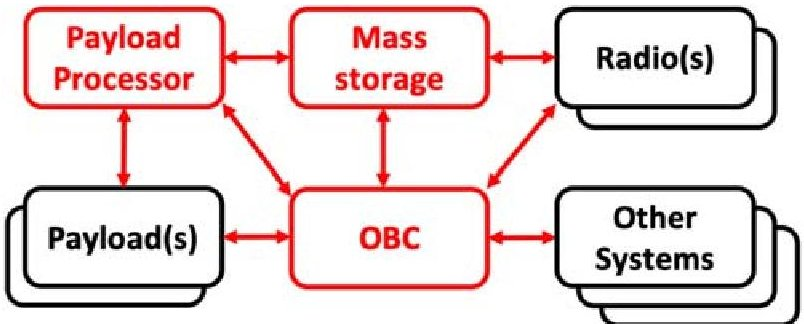
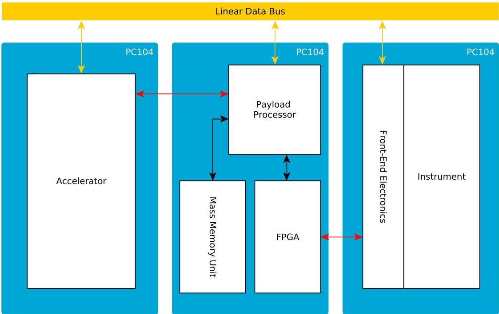
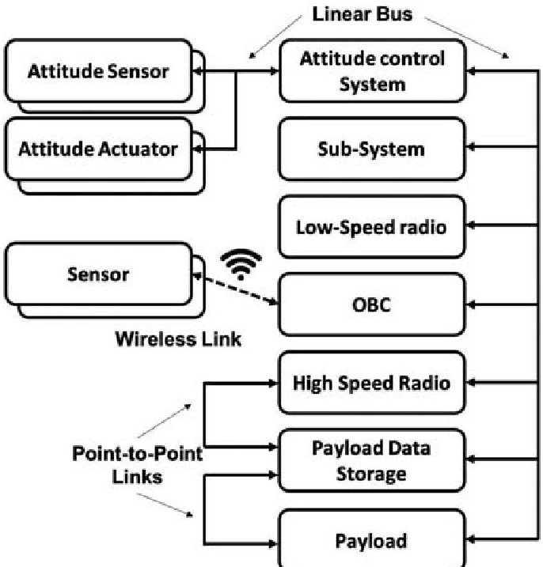
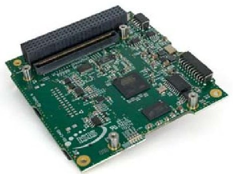
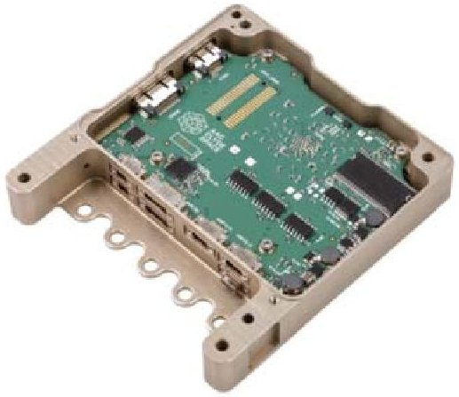
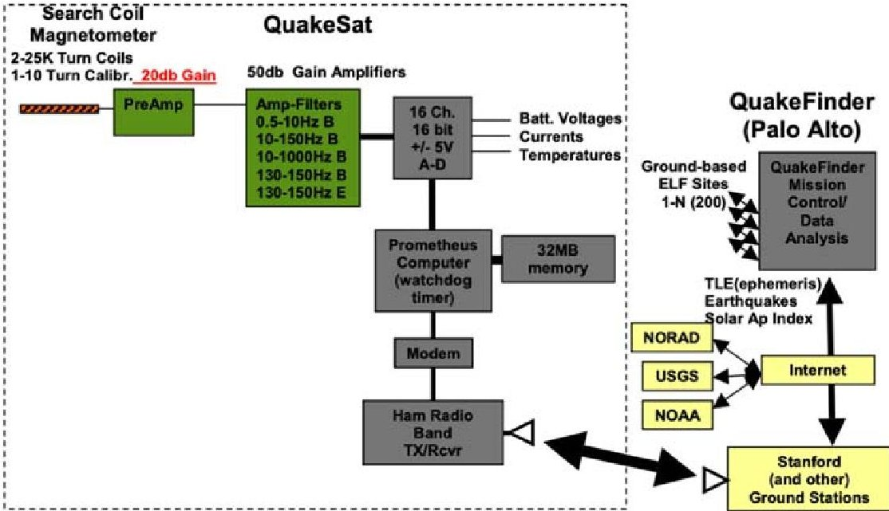
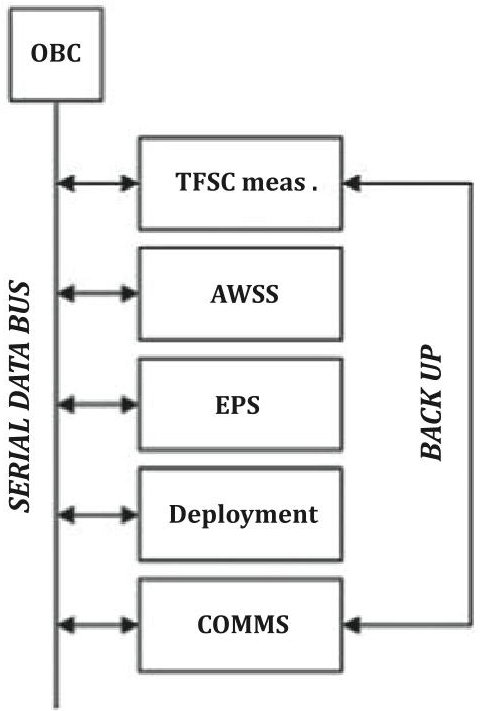
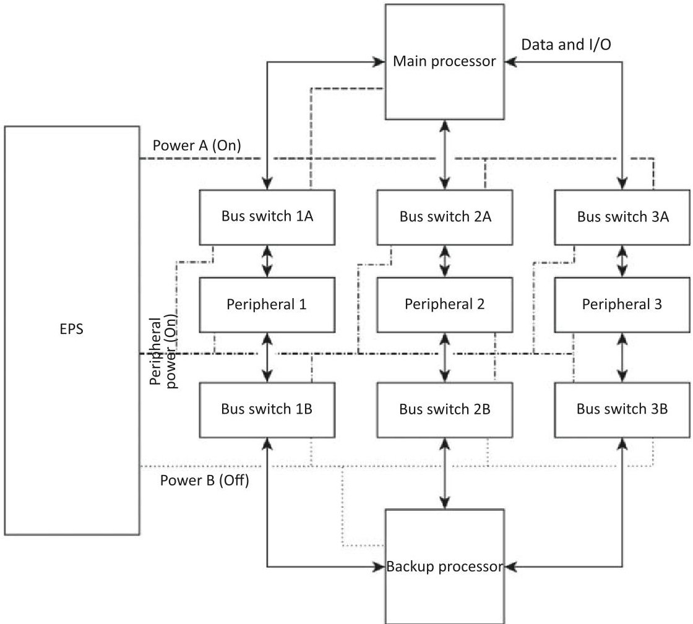
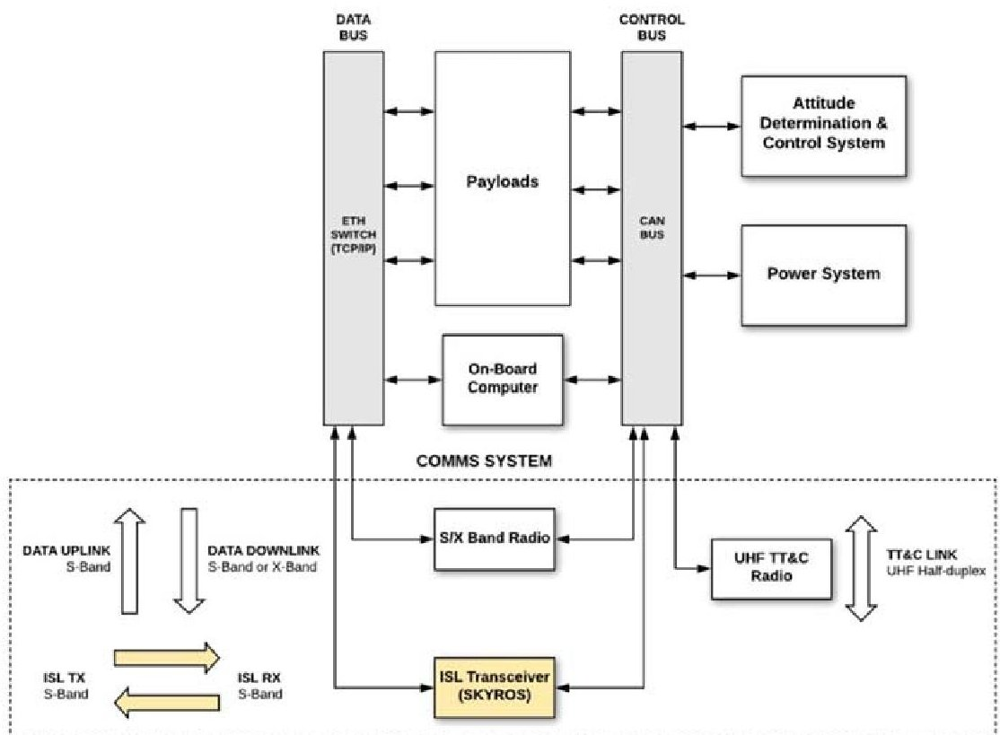

<!-- PDF_PAGE: 1 -->

Delft University of Technology

Document Version Final published version

## Citation (APA)

Speretta, S., Bouwmeester, J., Menicucci, A., Di Mascio, S., & Uludag, M. S. (2023). Command and data handling systems. In F. Branz, C. Cappelletti, A. J. Ricco, & J. Hines (Eds.), Next Generation CubeSats and SmallSats: Enabling Technologies, Missions, and Markets (pp. 369-399). Elsevier. https://doi.org/10.1016/B978-0-12-824541-5.00012-1

## Important note

To cite this publication, please use the final published version (if applicable). Please check the document version above.

## Copyright

In case the licence states "Dutch Copyright Act (Article 25fa)”，this publication was made available Green Open Access via the TU Delft Institutional Repository pursuant to Dutch Copyright Act (Article 25fa, the Taverne amendment). This provision does not affect copyright ownership. Unless copyright is transferred by contract or statute, it remains with the copyright holder.

## Sharing and reuse

Other than for strictly personal use, it is not permitted to download, forward or distribute the text or part of it, without the consent of the author(s) and/or copyright holder(s), unless the work is under an open content license such as Creative Commons.

## Takedown policy

Please contact us and provide details if you believe this document breaches copyrights. We will remove access to the work immediately and investigate your claim.

<!-- PDF_PAGE: 2 -->

# Green Open Access added to TU Delft Institutional Repository 'You share, we take care!' - Taverne project

https://www.openaccess.nl/en/you-share-we-take-care

Otherwise as indicated in the copyright section: the publisher is the copyright holder of this work and the author uses the Dutch legislation to make this work public.

<!-- PDF_PAGE: 3 -->

# Command and data handling systems

Stefano Speretta, Jasper Bouwmeester, Alessandra Menicucci, Stefano Di Mascio and Mehmet Sevket Uludağ

Delft University of Technology, Kluyverweg, HS Delft, The Netherlands

## 16.1 Introduction

The command and data handling system (CDHS) can be considered the nervous system of a satellite, providing the basic internal communication and control capabilities needed for a satellite to perform operations (either controlled by ground operators or autonomously). Such a system often interfaces directly with the satellite payload also providing basic data processing and archiving capabilities. Translating this into the typical satellite components, this means the CDHS system is composed of the following parts: (1) an on-board computer (OBC), used to control the satellite, (2) an on-board data communication bus, used to connect the different satellite components together, (3) a payload data processing system, used when the on-board generated data needs to be processed on board, and (4) a mass data storage system, to archive data for later usage or transmission.

Fig. 16.1 shows a generic satellite architecture listing the basic satellite components and highlighting the CDHS components. The figure also represents the architecture of traditional small satellites and CubeSats. These, which are dominating the so-called "New Space" era, are a class of small satellites that became increasingly popular starting from the year 2000 [1]. Moving from a demonstration to an operational service forced system designers to address several key aspects to cope with the harsh space environment while still meeting a very strict cost and development time target. Commercial components (not designed for space applications)

Figure 16.1 Generic satellite architecture detailing the components presented in this article (in red).

<!-- PDF_PAGE: 4 -->

helped speed up the development cycle while also keeping the overall mission cost low. New radiation tolerance assurance approaches had to be developed to allow such systems to obtain the reliability and performances level required for commercial and deep space applications: further details can be found in Section 16.2 where the main design and testing strategies are presented leading to an end-to-end approach to component selection to build reliable systems using commercial components.

The state-of-the-art for the different CDHS components will also be presented to provide an effective metric to compare the performances of the different architectures. This will help select the most suited system for the desired application. This overview, presented in Section 16.3, should not be considered fully exhaustive due to the high-pace evolution this sector is currently experiencing. Nevertheless, selected components are presented to provide a representative overview of the current market also showing how functionalities are split between the different components.

Design considerations to help the reader navigate through the different presented solutions are also presented in Section 16.4. This section focuses on selected topics that can be of critical importance in the CDHS architecture definition, such as radiation hardness choices, processor performance metrics, subdivision of tasks in between hardware and software components and data bus selection. Radiation shielding is presented as it can be considered as a valid approach to mitigate some of the radiation-induced effects which can allow components with reduced tolerance to be successfully used. Computing performances metrics are presented to allow the reader to distinguish between different types of computing systems [single-core vs multicore computers and field programmable gate array (FPGA)] and select the best compromise: this is particularly useful as computation are increasingly subdivided between hardware and software components, making a selection even more complex. With an ever increasing diversification in computing hardware, data transmission becomes also increasingly complex requiring proper choices for data busses.

Past and current missions are also presented Section 16.5 to provide a historical perspective on how the different components and architectures are used: this also allows us to derive trends with respect to architectures and applications for future missions. From the early small satellites in the 1960 and 1970 developed mostly for a demonstration to the current and future deep space CubeSats aiming at providing key contributions in science, this chapter aims at providing a synthetic overview of the evolution and the future trends for the CDHS components.

## 16.2 Radiation hardness assurance: a new approach for "new space"

Space is a hostile environment for any electronic device, due to the high flux of ionizing radiation continuously impinging on the satellite which hosts them. This is true for all satellite subsystems, heavily influencing their design, but it is of key importance for the CDHS as it is tasked to coordinate and control all satellite

<!-- PDF_PAGE: 5 -->

activities, also in case of fault. Radiation effects concerns influence the architecture of this subsystem and, due to this, is why a general section describing such concerns will be presented before diving into specific architectures and systems.

Small satellites have to fit into much smaller size, schedule, budget, mass and power envelope than traditional, institutional larger satellites. Many more trade-offs are necessary and these reflect (among others) in the component selection. Commercial off-the-ahelf (COTS) components which perform sufficiently well in terrestrial applications have been widely used in small satellites because their advantages are numerous and include smaller size/mass, lower power consumption, lower cost and higher performances for specific tasks when compared to their radiation-hardened counterparts, but they feature a higher risk of malfunctioning. Radiation risks have been often under-estimated in the early small satellite missions for two main reasons. Firstly, in order to perform a meaningful radiation analysis, specific knowledge and expertise are needed and these are often lacking in the typical small satellite development teams. Secondly, radiation testing is expensive and time-consuming, and access to facilities is limited, therefore an accelerator campaign needs to be justified by a detailed analysis. As a result, the radiation hardness assurance (RHA) of CubeSats has been largely neglected in the first years of their history. The approach of simply understating the system level impacts of radiation effects has been considered acceptable so far, also considering that nearly all CubeSats were launched in low Earth orbit (LEO), and favored by the fact that this happened during a remarkably weak solar cycle and targeting a short mission lifetime (e.g., 6-12 months). More recently, RHA is receiving increasing attention and it started to be taken into proper consideration for the design of future missions, mainly due to the shift of scope of CubeSat missions from purely educational projects to more commercial ones but also due to the opening of new opportunities for interplanetary CubeSats, designed to perform space exploration beyond the protection of the Earth's magnetosphere [2].

## 16.2.1 Testing and radiation hardness assurance

The type and occurrence frequency of radiation effects depends strongly on the environment encountered by the flying satellite, which is determined by its orbit. In space, there are three main sources of radiation: the Sun, the galactic cosmic rays (GCRs) and the trapped particles in magnetic fields (e.g., the Van Allen belts surrounding Earth or the Jupiter radiation belts). The flux of solar particles varies with the roughly 11-year solar cycle. The previous solar cycle (24) ended in December 2019 and the sun is expected to increase its activity until the solar maximum of cycle 25, which is predicted to be around 2025 [3]. Although the official prediction supported by the large majority of specialists forecasts another rather weak solar cycle, recent work has instead hypothesized that it could be one of the strongest ever recorded [3]. Solar activity has an influence also on the other two sources and this is taken into account when using analysis tools like SPENVIS. $ ^{1} $ Once the

<!-- PDF_PAGE: 6 -->

mission radiation environment has been modeled, the expected total ionizing dose (TID) and the single event effects (SEEs) rate received by a component behind a certain shielding, can be estimated. TID is the cumulative effect which determines degradation of the device performances over the time, while SEEs are determined by single particles striking a sensitive node.

For each space mission, the ultimate goal of the RHA plan is to ensure that the amount of radiation that a given component can tolerate without any parametric degradation is higher (by a certain margin) than the actual expected radiation level in space. In order to achieve this goal, component-level radiation tests are performed when necessary, following international standards such as European Cooperation for Space Standardization (ECSS). $ ^{2} $ Radiation testing can be very expensive and the risk of failure is generally high therefore careful prioritization must be made especially in small satellite projects.

Radiation threats for each component can be classified based on the system design and the likelihood of destructive and nondestructive events. The first priority for the radiation testing strategy should be to address destructive phenomena, in particular TID, single event latch-up (SEL) and nonrecoverable single event functional interrupt (SEFI) but also single event gate rupture, and single event burnout, since the latter are very relevant for power conversion components which could be single-point failure in OBC systems. Once parts have passed the destructive tests, for specific key components or reference designs nondestructive hazards shall be addressed, such as single event ppset (SEU) and recoverable SEFI.

For radiation-hardened components, the manufacturer specifies the amount of TID which can be tolerated by the devices before they fail. For COTS components, this information is in most cases simply not available. Using a component for which no information exists about its TID and SEE tolerance (preferably published together with the test data) means using it off-specification in uncharted territory.

## 16.2.2 An end-to-end approach to component selection for small missions

While a classic mission relies on lifetime and dependability-driven choices, thus forcing large-scale integrators to impose qualified flows for all the electronic parts to their unit manufacturers in order to guarantee well-known, predictable behavior (especially for radiation effects-related aspects) for the system, on the other end small satellites are "vertically" built, very often by a single company, that needs to have full control of the whole bill of materials (BoMs) and optimize it for costs and delivery of long lead items (LLIs).

This is a major change in standard space industry practices and maybe, together with cheap launch costs, one of the sources of the competitiveness of the "new space" missions. Good management of the design and BoM is an iterative process that requires, besides the standard electronic design steps, an early analysis of criticality for each component for feared radiation events (especially the destructive ones like SEL) and may require dedicated, breadboard level tests for standard, reference designs used

<!-- PDF_PAGE: 7 -->

throughout the whole satellite (e.g., a latch-up protection circuitry). The goal shall be to add selective resilience to the system, rather than achieving reliability with classical redundancy (some examples of robust engineering techniques, that show flexible and reliable starting point for designing nanosatellite missions for harsher environments are presented in [2]). Redundancy also comes with an increased cost and size and this can be not feasible for small satellites: single-string designs (where redundancy is applied only to critical systems) are thus very common, as it will be shown in Section 16.5.

To comply with the costs and timelines typical in CubeSats and small satellites, several mixed techniques are possible to increase confidence on design. With respect to TID, local tests with small radiation sources are possible, as discussed in [4] or system-level tests with neutrons [5] and mixed field sources [6] (as compared to a rigorous component-level testing campaign carried out for bigger missions). The principle behind this process (design followed by manufacturing) is building reliability into the system: this methodology focuses much more on process control, rather than on the single devices, allowing to reduce costs and timelines.

The final goal should be to have a very simplified BoM, with very few parts, where the critical survival system functions rely on validated reference designs. At the system level this is also made possible by the vertical integration model, allowing a much smaller number of suppliers (or even a single one) to have full control over the whole satellite hardware.

## 16.3 Current state-of-the-art systems

This section focuses on the current state-of-the-art for different components in the CDHS system. In particular, this has been split into:

1. OBCs,

2. Payload processors and accelerators,

3. Memories,

4. Data busses.

The next subsections will focus on the different components, providing further details on the available solutions. It should be noted that this field is experiencing an accelerated evolution so the presented overview is not a complete representation of the market (and a set of references has also been provided for further details). This section focuses on the important and popular families of solutions that clearly show the ongoing trends in the small satellites sector. More general trends and considerations are provided in Section 16.4 to guide the reader into selecting the proper technology for the desired application.

## 16.3.1 On-board computers

OBCs are used to execute tasks like attitude and orbit control, telecommands execution or dispatching, housekeeping telemetry gathering and formatting, onboard time

<!-- PDF_PAGE: 8 -->

synchronisation and distribution, failure detection, isolation and recovery. $ ^{3} $ Like computers for terrestrial applications, OBCs are mostly composed of the central processing unit, memories and interfaces.

One of the most impacting constraints for OBC for CubeSats is the available power. As reported in [7], a 1U CubeSat has a total of 1-2 W available, while a 3U has 5-6 W. 6U and bigger satellites reach around 20 W only considering bodymounted solar cells and they can more than double that figure including deployable solar cells (potentially reaching up to 100 W) but it should be noted that the CDHS power consumption is typically fixed to few Watts.

Given the constraints on power, OBC for small CubeSats (1-3U) are based on simple single-core processors. These types of micro-architectures achieve low performance, as shown in Table 16.1 (Microarch. Perf.), ranging from 1 to 2 CM/MHz (CoreMark score, for an explanation on how to measure processors performances, see Section 16.4.2). As a reference, multicore processors for mobiles reach around 16 CM/MHz $ ^{4} $ and multicore/multithread processors for Personal Computers around 40 CM/MHz. $ ^{5} $ The peak absolute performance can be estimated by multiplying the micro-architecture performance by the maximum achievable frequency, which depends on the technology (e.g., technology node) and type of integrated circuit (IC) employed, that is, application-specific integrated circuit (ASIC) or FPGA. Here the gap becomes even larger, as the frequency in space applications is typically lower (in the order of hundreds or tens of MHz instead of GHz).

Small satellites are moving from short demonstrator missions to longer, more critical missions. Although the cost of replacing a failed SmallSat in LEO is relatively low compared to a classical large satellite in GEO, the dependability of the single spacecraft is required to increase. Therefore, radiation tolerance becomes more

Table 16.1 Performance of some OBCs in the PC104 board format $ 9. 0 \mathrm{~cm} \times 9. 6 \mathrm{~cm} $ measured with CoreMark and/or Dhrystone (DMIPS), depending on the data available.

<table border="1"><tr><td>OBC</td><td>Processor</td><td>Microarch. Perf.</td><td>Perf.</td><td>Power [W]</td></tr><tr><td>NanoMind a3200</td><td>AT32UC3C</td><td>1.5 DMIPS/MHz</td><td>91 DMIPS</td><td>0.17(a)0.9(p)</td></tr><tr><td>iOBC</td><td>AT91SAM9G20</td><td>DMIPS/MHz1.5CM/MHz</td><td>440 DMIPS612.9CM</td><td>0.4(a)</td></tr><tr><td>Sirius</td><td>LEON3FT</td><td>1.4 DMIPS/MHz1.8CM/MHz</td><td>70 DMIPS90CM</td><td>1.3(a)0.8(m)-2(p)</td></tr></table>

Note: Values for power refer to peak (p), average (a) and minimum (m) consumption.

<!-- PDF_PAGE: 9 -->

important and the percentage of rad-tolerant or rad-hard parts used in CubeSats will increase over time. $ ^{6} $ For instance, there is a new trend of using fault-tolerant (FT) processors designed for space application. An example is the AAC Clyde Sirius OBC, $ ^{7} $ based on the LEON3-FT, one of the most popular FT processors in space applications [8]. Furthermore, the Sirius OBC is different from the other OBCs considered in Table 16.1, as it is implemented on an FPGA with triple-modular redundancy on all FPGA flip-flops and error detection and correction codes on memories. One of the aims of these features is to allow deep space exploration missions with CubeSats. Also, OBCs based on COTS processors are therefore tested for radiation effects, for example, the NanoMind has been tested up to 20 kRad according to ECSS standards. $ ^{8} $

However, the RHBD solutions employed in the ISIS iOBC $ ^{9} $ come with a cost in terms of power consumption. Also, the power consumption of the OBC is dependent on the technology and on the use of the peripherals (i.e., interfaces and external memories), for example, ranging from 0.8 to 2 W for the Sirius OBC. Although the minimum consumption is below the total power available for a 1U CubeSat, such a large part of the power available shows that it is difficult to employ RHBD processors in 1U CubeSats, while in a 3U could be employed instead (the maximum consumption is 33%-40% of the total power available).

To compare the examples given for SmallSats to OBCs for large, high-reliability spacecrafts, the OSCAR $ ^{10} $ from Airbus has a 5 kg mass and it is larger in size than many SmallSats $ (2 3 0 \times1 6 0 \times2 0 0 \mathrm{~ mm}) $ . Its peak power consumption is 15 W. On the other hand, it is expected to last 10 years LEO and in 15 years Geostationary Orbit (GEO), and it is designed to be SEU tolerant and SEL immune. However, it should be noted that the computational capabilities required for an OBC for a large spacecraft are on the same order of magnitude $ (1. 8 \mathrm{~ C M / M H z}, $ $ ^{11} $ 86.4 CM at 48 MHz). This shows that the gap between OBCs for SmallSat and OBCs for large spacecraft lies more in dependability than in performance.

## 16.3.2 Payload processors

Data generated onboard the satellite can be stored or processed by a dedicated processor before its transmission to the ground. The second approach allows to drastically reduce in the amount of data to be transmitted (via, e.g., compression, higher level data processing or simply discarding not interesting data such as images of clouds in case of Earth observation images). Payload processors are gaining increasing popularity in small satellites especially because they allow to use of higher performance instruments (collect typically more data) without drastically increasing

<!-- PDF_PAGE: 10 -->

the required downlink capabilities. Fig. 16.2 shows an example of a payload processor, using also an accelerator and an FPGA, as it was done in the Phisat-1 mission. $ ^{12} $ The mission, launched in 2020, is the first one to demonstrate the feasibility of onboard artificial intelligence with a Deep Neural Network (DNN) [9] on a 6U CubeSat using a hyper-spectral camera. A DNN is employed to classify images according to the percentage of cloud cover and downlink images with maximum information content [9]. In order to do this, a Myriad2 [10] accelerator is employed to run a 17-layer Convolutional Neural Network on the images coming from the instrument (total board consumption of 1.8 W during inference [9]). Based on this in-orbit demonstration mission, a CubeSat-compatible board is being developed targeting a power consumption of less than 25% of available power in a reference 6U CubeSat (less than 5 W). $ ^{13} $ Using parallel processors as accelerators to execute onboard compute-intensive workloads, which are common in Deep Neural Networks for Artificial Intelligence (e.g., GEMM [11]), is an important trend in space embedded systems [12].

The Myriad2 board contains 12 processing cores, each of them being capable of operating simultaneously on integer and floating operands of 128 bits each (potentially

Figure 16.2 Example of use of payload processor with accelerator and FPGA to interface the instrument, similar to what done in Phisat-1. In red, point-to-point data busses. In black, local busses on the PCB.

<!-- PDF_PAGE: 11 -->

from two elements of 64 bits each to 16 elements of 8 bits each $ ^{14} $ ). For less demanding applications, parallel processors with lower computational capabilities can be employed. In [13], GAP8 is employed to perform telemetry forecasting using a Recurrent Neural Network (RNN), predicting for the next orbit up to 661 signals per second. The GAP-8 processor contains 8 RI5CY processing cores for computations (and a simple processing core for control) [14], each of them capable of executing operations on integer operands of 32 bits each (from 1 element of 32 bits each to 4 elements of 8 bits each). The lack of support for floating point instructions, together with lower computational capabilities (from 345.6 to 20 GOP/s [14]), allow the GAP8 to have a maximum consumption of 75 mW [14], which is around an order of magnitude lower than the Myriad2 (800 mW [10]). These two examples show clearly the trend for ultra-low-power payload processors appearing in small satellites, as compared to much more powerful units used instead in bigger satellites.

## 16.3.3 Mass storage system

Computers require different types of memories in their memory subsystems, according to the required capacity, access time and volatility. When it comes to processors for space, also the vulnerability of the memory to SEUs and hard failures is to be kept into account. This section summarizes the different types of memories used on small satellites also details the different applications for the different types.

## 16.3.3.1 Main memory

Processors require a fast memory to store temporary data and instruction. However, the fastest type of memory available, static random-access memory (SRAM)s are typically not large enough for this, and their use is limited to on-chip caches and buffers (up to around 2 MiB [8]). synchronous dynamic random-access memories (SDRAMs) provide larger capacity at the cost of longer access time. The amount of SDRAM employed ranges from 32 to 64 MB for OBCs considered in Table 16.1. For reference, OBCs for large spacecrafts have 256/512 MB of SDRAM. As SRAMs, SDRAMs suffer from SEUs and multiple bit upsets (MBUs) [15]. However, in SDRAMs, most of the upsets happen in weakened cells [16]. SDRAM chips also suffer from stuck bits (cells stuck to a value) and SEFI which, in a SDRAM, can cause errors on a large part of the bits read every cycle and can be recovered only with a chip reset or sometimes only with a full power cycle [16].

## 16.3.3.2 Nonvolatile memories

As both SRAM and SDRAM are volatile (i.e., data is lost when power is turned off), a nonvolatile (NV) memory is required to store data and instructions to be read during boot and to be written in case of reset/power off to avoid loss of data. The most popular type of NV memory is flash memory. Flash memories achieve much larger capacity compared to SDRAM because they have at least four times

<!-- PDF_PAGE: 12 -->

higher storage density [17]. However, this comes at a cost: while reads are straightforward, writing a single location in this type of memory requires the erasing of a whole block and writing all its locations again. $ ^{15} $

Flash memory cells are typically employed in three types of memories:

1. SD cards: used as mass memories. For instance, in the ISIS iOBC $ 2 \times2 $ GB SD cards are available for mass data storage.

2. Flash chips (e.g., SPI flash): used as mass memory (2 GB) in the Sirius OBC.

3. Embedded flash memories, too small to be used as mass memories, typically employed for data and instructions requiring lower access time or to execute boot code.

To address these different types of applications, two main technologies are available: NOR and NAND [18]. The former typically achieves low capacity but with low access times, while the latter achieves higher capacities with longer access times. For these reasons, boot code is typically stored in NOR memories while large amounts of data in NAND memories [18].

Flash cells are typically robust against SEUs [19]. On the other hand, the peripheral circuits for erase/write are vulnerable to TID effects (as high voltages are involved), in case the memory has to be written during the mission. In [20], the rewriting of the embedded flash memory after exposition to $ ^{60} C o $ fails at 45 krad, while the microcontroller fails to boot because re-written instructions are corrupted already at lower doses (30 krad). The work in [21] shows that the controllers in the SD cards are susceptible to SEFIs and hard failures. However, this happens only for certain SD card models, and even considering a single model, with part-to-part variance [21]. However, the NV nature of flash memories makes it possible to switch them off without losing data when they are not needed or when the radiation environment is particularly hostile, reducing SEL/SEFI rate.

## 16.3.3.3 Other memories

Ferroelectric random access memory (FRAM)s combine nonvolatile cells with low access times (less than 50 ns). $ ^{16} $ However, FRAMs in state-of-the-art OBCs only have limited capacity (32 KB in NanoMind A3200 and 256 KB in ISIS iOBC), acting as a faster and less capable alternative to embedded Flash or as a nonvolatile alternative compared to SDRAMs. One of the advantages of the FRAMs over SDRAMs is their intrinsic resilience against SEUs in memory cells. As a matter of fact, most of the errors found during a heavy-ion test in [22] were transient and with similar features, pointing to errors in the read circuitry. In ISIS iOBC FRAMs are deemed fit for the storage of critical data. An advantage of FRAMs compared to Flash memories is that the peripheral circuitry does not employ high voltages during writing. Therefore, hard failures are not common [22].

<!-- PDF_PAGE: 13 -->

## 16.3.4 Data busses

Data busses in a spacecraft are used to connect the different subsystems for command and control and for data transfer. The most common bus types found in satellites are the linear and point-to-point ones: the former (presented in Section 16.3.4.1) is used to connect all systems together, providing a simple architecture with limited performances while the latter (presented in Section 16.3.4.2) allows to achieve much higher performances between two systems. Recently, the use of wireless data busses has also been presented (see Section 16.3.4.3 for further details) to tackle specific requirements. Fig. 16.3 presents an example architecture for a generic satellite employing different types of busses to provide a general overview of the different possibilities.

## 16.3.4.1 Linear data busses

Linear data busses are the most common solution for small satellites due to their simplicity, despite they present some limitations from the reliability point of view. The most common busses used on small satellites come from the commercial and automotive sectors, taking advantage of the wide availability of components and design resources. This includes inter-integrated circuit $ \mathrm{I}^{2} \mathrm{C} $ , controller area network (CAN) and RS-485 that cover the vast majority of the current systems. Solutions derived from the aeronautics and military sectors are still used, such as MIL-1553, but are becoming less common due to their increased complexity and cost. $ \mathrm{I}^{2} \mathrm{C} $ is the dominant linear data bus applied to CubeSats [23], while the CAN

Figure 16.3 Example of a data bus architecture.

<!-- PDF_PAGE: 14 -->

bus increases reliability and the RS-485 allows higher throughput for higher performance systems [24].

Table 16.2 provides an overview of the most common satellite linear busses, listing also the main distinctive features. The table also lists references to provide further insights in the different satellite busses and a reference mission to provide further details on how each bus is used: further details on such missions are also provided in Section 16.5. The table shows clearly the main reasons simple CubeSats select $ \mathrm{I}^{2} \mathrm{C} $ while more complicated missions select higher reliability solutions (like CAN). Solutions like RS-485 and MIL-1553B are less common and used in bigger platforms. In an attempt to further improve $ \mathrm{I}^{2} \mathrm{C} $ performances (in terms of speed and better slave handling), an improved version, improved inter-integrated circuit $ (\mathrm{I}^{3} \mathrm{C}) $ , was released in 2017 but has not yet been reported to be used on a satellite.

## 16.3.4.2 Point-to-point data busses

Point-to-point data busses are typically considered when high data rate is needed between only two nodes. Serial peripheral interface (SPI), universal serial bus (USB), Ethernet and RS-422 are choices with high commercial availability while SpaceWire, custom low voltage differential signaling (LVDS) and optical communication are selected for higher throughput links on small satellites and bigger platforms. Point-to-point data busses can also be considered as a simple alternative for CubeSats which comprise of only a few physical units. In this latter case, SPI and RS-232 are the most popular choice [23] as these are typically supported by all microcontrollers.

Table 16.2 Linear bus overview.

<table border="1"><tr><td>Bus</td><td>Data rates</td><td>Features</td><td>Reference</td></tr><tr><td>$\mathrm{I}^{2}\mathrm{C}$</td><td>0.1-0.4 Mbps</td><td>Very simple Single-ended Low-power &lt;1m maximum distance</td><td>[25]</td></tr><tr><td>$\mathrm{I}^{3}\mathrm{C}$</td><td>0.1-33 Mbps</td><td>Improved $\mathrm{I}^{2}\mathrm{C}$ Single-ended Low-power First draft in 2017</td><td>[26]</td></tr><tr><td>CAN(FD)</td><td>up to 5 Mbps</td><td>Fault-tolerant Single-ended Up to 40m distance</td><td>[27]</td></tr><tr><td>RS-485</td><td>up to 10 Mbps</td><td>Differential Up to 100m connection Custom data protocol</td><td>[28]</td></tr><tr><td>MIL-1553B</td><td>1 Mbps</td><td>High reliability Galvanic isolation Up to 6m connections</td><td>[29]</td></tr></table>

<!-- PDF_PAGE: 15 -->

The most common point-to-point busses are presented in Table 16.3: several of these busses are used not only as the main data handling bus but often to create dedicated data-transfer interfaces between subsystems. The table also lists references to provide further insights into the different satellite busses and a reference mission to provide further details on how each bus is used: further details on such missions are also provided in Section 16.5.

## 16.3.4.3 Wireless data bus options

Wireless data busses for intrasatellite purposes are still under development with a limited space heritage. As shown in the example architecture in Fig. 16.3, wireless data busses can be used in a complementary fashion to connect devices which are remote from the internal subsystem modules for which the wiring harness may be complicated or as a satellite-level communication bus. This is however most attractive when also the power is harvested locally, such as real-life examples of a selfpowered temperature sensor [34] and an autonomous wireless sun sensor [35]. Since developments of wireless data busses are still progressing rapidly, new protocols are released every few years with increasing data rates at lower power consumption which approaches or even surpasses the wired options. As the number of systems/sensors increase in satellite harnessing, the number of devices to connect becomes a major problem. Wireless data transmission can be used to connect different subsystems, to connect multiple sensors to a single subsystem, or a combination of both. Wireless data links have been developed using radio and optical free-space

Table 16.3 Point-to-point bus overview.

<table border="1"><tr><td>Bus</td><td>Data rates</td><td>Features</td><td>Reference</td></tr><tr><td>SPI</td><td>up to 20 Mbps</td><td>Very simple Single-ended Low-Power &lt;0.5m maximum distance</td><td>[30]</td></tr><tr><td>USB</td><td>up to 40 Gbps</td><td>Low-cost Single-Ended</td><td>[31]</td></tr><tr><td>RS-422</td><td>up to 10 Mbps</td><td>Differential Up to 100m connections Custom data protocol</td><td>[28]</td></tr><tr><td>Ethernet</td><td>100-1000 Mbps</td><td>Low-cost Galvanic isolation &gt;10m connections</td><td>[32]</td></tr><tr><td>SpaceWire</td><td>2-400 Mbps</td><td>High reliability Designed for space Galvanic isolation Up to 10m connections</td><td>[33]</td></tr><tr><td>SpaceFiber</td><td>up to 40 Gbps</td><td>High reliability Designed for space Optical fiber</td><td>[33]</td></tr></table>

<!-- PDF_PAGE: 16 -->

communications, with the former taking advantage of the developments in internet of things (IoT) devices. The desire to connect more components to each other is increasing the demand for more efficient low-power, low-range devices and protocols. Most of the radio links rely on unlicensed bands for ground usage mostly below 1 GHz (sub-1 GHz), around 2.4 GHz or at higher frequencies (3.6, 4.8, 60 GHz).

Options to replace completely the whole CDHS system using a wireless connection have been proposed, such as the SKITH bus [36] (radio frequency based) or optical solutions, such as [37]. These implementations did not reach their maturity yet and have been limited to demonstration missions.

Several solutions for wireless busses are presented in Table 16.4: many of them have been used as dedicated short-range links for sensor sets but few solutions have been designed to fully replace the complete onboard data handling bus [38]. The table also lists references to provide further insights into the different satellite busses and a reference mission to provide details on how each bus is used. More on such missions are also provided in Section 16.5.

Low-power and low-range wireless protocols can become an alternative to replace wired data connections all together in the future. Even though such wireless systems solve problems such as harnessing and connectivity of multiple devices; they might also cause interference problems inside the satellite and performance drops with the number of systems connected. Further investigation and testing are highly recommended in future studies.

## 16.4 Design considerations

After the description of the specific challenges due to radiation effects and the subsequent state-of-the-art of components for the CDHS system, this section provides the reader with more general design considerations to guide the reader in the selection of components and architectures. These considerations are mostly related to different design philosophies and, as such, span over components and architectures.

Table 16.4 Wireless bus overview.

<table border="1"><tr><td>Bus</td><td>Data rates</td><td>Features</td><td>Reference</td></tr><tr><td>Wi-Fi</td><td>up to 9.6 Gbps</td><td>2.4 and 4.8 GHzStar topology</td><td>[39]</td></tr><tr><td>Wi-Fi Halow</td><td>0.150-347 Mbps</td><td>Sub-1GHzStar topology</td><td>[40]</td></tr><tr><td>Bluetooth</td><td>up to 1 Mbps</td><td>2.4 GHzStar and point-to-point</td><td>[25]</td></tr><tr><td>SKITH</td><td>1 Mbps</td><td>2.4 GHzPoint-to-point</td><td>[36]</td></tr><tr><td>Optical</td><td>up to 100 kbps</td><td>OpticalLinear bus</td><td>[38]</td></tr></table>

<!-- PDF_PAGE: 17 -->

## 16.4.1 Shielding versus radiation hardness

It is often believed that shielding can replace any considerations at silicon-level. However, although shielding can help in reducing the absorbed TID, it is known that GCRs are insensible to shielding depths [41]. This causes a plateau of $ 8. 6 4 \times1 0^{-7} $ upsets/bit/day for the SRAM technology considered where adding more shielding does not improve the radiation tolerance of the part which must be addressed exclusively at semiconductor level. Furthermore, the maximum thickness of the shielding allowed by the mass budget is limited. For instance, the mass of a 1U CubeSat is 1.33 kg, while OBCs are usually kept in the $ 1 0 0-1 3 0 \mathrm{~ g} $ range (respectively the ISIS iOBC and AAC Clyde Space Sirius OBC). In electron dominated environments such as medium Earth orbit (MEO) and GEO, graded-shielding [42], where layers of different atomic number are alternated, shows promising results in terms of radiation dose reduction compared to the much heavier monolithic designs and it is expected to be applied more routinely in future space missions including small satellites [43].

## 16.4.2 Processor performances metrics

An important factor when selecting or designing a processor (for any application) is defining a proper set of metrics to quantify the required performances. Mechanical constraints (which can be size, shape, weight) are generally simple to quantify as interfaces (supporting SpaceWire or $ \mathrm{I}^{2} \mathrm{C} $ , for example). The picture becomes much more complicated when comparing the required processing power, since a number of metrics can be selected: the most common is the CPU clock frequency (e.g., MHz) that quantifies the operational frequency of the processor. This unfortunately does not take into account the internal execution logic inside the processor, which dictates how many instructions per Clock Cycle (IPC) are executed. Sometimes performances are expressed as number of instructions per second (e.g., $ \mathrm{MIPS}=\mathrm{IPC}\times\mathrm{MHz} $ ). Although this includes the number of IPC, two processors may need a different number of snructions (NI) to execute a given task. Furthermore, often MIPS are provided without defining the type of software used during the measure.

In principle, the correct parameter to select the best CPU should be the time required to run a representative portion of the flight software: $ T_{ex}=\mathrm{NI/MIPS} $ To have less-specific comparisons (and available before coding the flight SW) between processors, they are typically compared using benchmarks, intended to emulate the software workload for a given type of application. Benchmarks stress particular features of a processor in a repetitive way and comparing the number of iterations per second allows to quantify the system computational power. Different benchmarks produce different results. One of the most popular is CoreMark. The CoreMark score is the number of times CoreMark is executed per second. Often the CoreMark score is normalized to MHz (CM/MHz), to remove dependence on clock frequency (hence on technology).

<!-- PDF_PAGE: 18 -->

## 16.4.3 Hardware versus software

Computer boards have been traditionally built using ASICs implementing the processor unit(s) and the eventual interface and application-specific logic but starting from the 1990s FPGA are being used in space applications [44]. They bring the great advantage of being "field-programmable" meaning their functionality can be reconfigured after the complete system had been built: FPGAs distinguish themselves from ASICs, which are traditional integrated circuits developed to service a specific application and smaller one-time-programmable (OTP) devices that can implement hardware features and can be configured only once.

FPGAs can be classified according to the technology employed in the configuration memory. The most popular type in terrestrial applications are SRAM FPGAs. However, they have typically high power consumption (a design on one of the latest COTS FPGAs dissipates 4 W [45]) and the configuration memory is vulnerable to SEUs [46]. Typically hardware and information redundancy are required in the design for an SRAM FPGA, along with scrubbing of the configuration memory to avoid error accumulation, which comes at a great cost in terms of power (e.g., +265% in [47]). Although they can leverage a smaller user base compared to SRAM FPGAs, Flash-based FPGAs seem the most fit for space applications, because of their lower power consumption [48] and immunity to upsets in the configuration memory. $ ^{17} $ For instance, the power consumption of the RHBD Xilinx Virtex-5QV SRAM-based FPGA is in the range of 5-10 W, while the power consumption of the comparable rad-tol Microsemi RTG4 is in the range of 1-4 W [49]. Furthermore, in [48] it is shown that a design dissipating 23.70 mW on a COTS Flash-based Microsemi SmartFusion2 dissipates 245 mW (10x) on a COTS SRAM-based Xilinx Artix-7.

Sometimes the FPGA contains a "hard" implementation of a processor subsystem. In this case the term system-on-chip (SoC) is used. A typical way to employ this type of component is to implement a given algorithm in software and profile the various functions composing the software, implementing in hardware the function in which more processing time is spent [50]. In this way, the accelerator in Fig. 16.2 can be integrated into the SoC. Furthermore, a similar component can combine the positive aspect of a software design and the customizability of a hardware design (e.g., in terms of interfaces), collapsing the payload processor and FPGA in Fig. 16.2 in a single component. Therefore SoCs are very effective when miniaturization is needed, to reduce component/board count. An example of processor module based on this type of component (Zynq-7000) is the Linux-ready Nanomind Z7000, with a maximum power consumption of 2.3 W. $ ^{18} $

FPGAs became increasingly popular in "traditional" space applications during the last decade, making up 30%-50% of the Integrated Circuits in a spacecraft according to [51]. Part of this success is due to the fact that standards like ECSS for

<!-- PDF_PAGE: 19 -->

software development are much stricter for software development as compared to ECSS standards for hardware design. In the latter case, the only applicable one is the ECSS-Q-ST-60-02C $ ^{19} $ that is more process related, than quality related, and for example, allowing "black box" reuse of third party IPs [51]. On the other hand, in [52] it is deemed that around 17% the cost of a software department is spent on adhering to the ECSS standard for software development that do not add quality or confidence on the product. Furthermore, ECSS standards for software development allow for reusability, but the reused module has to be fully verified and validated in the new context sometimes generating more work than re-implementing everything [53]. These differences have historical reasons, as software was the only solution to address complex problems and FPGAs were small OTP antifuse devices used mainly as glue logic. $ ^{20} $ However, when hardware and software implementations of an algorithm are compared, they could be more complex: in specific cases [54], an implementation in Verilog could result in a reduction of code lines from $ 11.65\times $ to $ 45.2\times $ with respect to a C implementation. Another reason for the popularity of FPGAs in "traditional" space applications is that ad-hoc interface controllers for space applications can be implemented (e.g., SpaceWire). When employing COTS ASICs instead, only interfaces available on the component can be used without additional components. Therefore FPGAs can be used in the electronics interfacing instruments, for instance implementing a simple microcontroller with the required interface controllers. When the required interfaces are available on a ASIC, the FPGA can be replaced with an ASIC-based controller, like the GR716-based CubeSat Controller (based on the GR716 microcontroller [8]). This solution is more power-efficient than using an FPGA, as the board consumption is around 1 W.

Nevertheless, FPGAs are employed also in CubeSats when tailored hardware designs with high throughput are required. An example is the RainCube, a 6U CubeSat where a single commercial-grade flash-based FPGA performs all control, timing, and onboard processing (data filtering, range compression, power computation and along-track averaging) [55].

## 16.4.4 Data bus selection

The data bus selection is a key point in the satellite architecture definition, where many features are usually traded off. Bus topology and protocol play a big role in the overall system complexity, reliability and power consumption. The selection of a shared bus is typically done with simplicity and modularity in mind as this solution allows, with one single solution, to communicate with all satellite systems. And it comes as no surprise that this is the preferred solution for CubeSats and small satellites, where most of the systems can be COTS units. This brings through some limitations as speed and congestion that can be easily addressed by employing point-to-point links. The latter is the best choice when high speed is required but they often increase the overall CDHS complexity in terms of connections.

<!-- PDF_PAGE: 20 -->

Reliability plays a major role in the choice as well since failures in shared busses can often propagate to other parts of the system while point-to-point links have better fault isolation capabilities. Traditional satellites, where data throughput and reliability are key requirements, often rely on SpaceWire and on dedicated routers to create an internal network. This allows to connect all systems with a high-speed bus and to eventually tolerate failures in one or more links by changing the internal routing. Such networks would be prohibitive in small satellites due to their complexity and required power, providing a hint why most of the missions choose not to use a full SpaceWire network on-board. Shared busses and dedicated point-to-point links are the preferred solution for small satellites and CubeSats (as shown in Section 16.5) where the dedicated links typically come directly from the OBC or from an aggregator board, such as in [56] but this dramatically reduces the system modularity and requires custom-built components. Shared busses instead allow a fully modular approach with standard and reusable components. Considering modularity

Zooming further into shared busses, the main solutions used (as described in Section 16.3.4 are $ \mathrm{I}^{2} \mathrm{C} $ , CAN and RS-485). This section provides a further detailed description of these busses to help in the selection process, highlighting advantages and disadvantages.

The $ \mathrm{I}^{2} \mathrm{C} $ bus is a popular choice for CubeSats because many commercial integrated circuits have an $ \mathrm{I}^{3} \mathrm{C} $ . $ \mathrm{I}^{2} \mathrm{C} $ is a two-wire serial interface which connects two or more nodes in a master(s)-slave(s) configuration with typical baud rates of 100 kbit/s for the standard mode and 400 kbit/s for a fast mode [25]. In a practical implementation in CubeSats, the effective data throughput is approximately 60% of the baud rate and its power consumption is between 50 and 150 mW depending on the number of nodes and the real data throughput [24]. It is a synchronous data bus, which means that it has a dedicated clock line next to its data line. The protocol allows the slave to put data transmission on hold by pulling the clock line low, which is called clock stretching. Together with shift registers in the controller, this in principle allows for communication which is independent of the clock frequency of the controller. Practical experience has shown that a minimum clock frequency of 10 times the baud rate is needed for reliable operation within microcontrollers [25]. The maximum bus length depends on capacity, shielding and additional buffering, but the protocol is designed for short distances and in practical cases is limited to several tens of centimetres which is within the scope of CubeSats. However, many CubeSat developers experience in-orbit issues with $ \mathrm{I}^{2} \mathrm{C} $ , mainly bus lockups [23]. $ \mathrm{I}^{2} \mathrm{C} $ being a nondifferential bus makes it sensitive to bit-errors and requires error handling which is implemented identically on all controllers connected, which seems to be difficult in case many different controllers are used [25]. When $ \mathrm{I}^{2} \mathrm{C} $ is chosen it is therefore highly recommended to limit the number of different microcontrollers connected to the bus if possible and/or to start testing the full CDHS as soon as possible to have sufficient time for debugging. When nodes can be switched off from power, which is typically the case for some subsystems, it is necessary to add $ \mathrm{I}^{2} \mathrm{C} $ buffers as otherwise, the unpowered node may ground the data bus.

The CAN bus is developed for automotive applications and is designed to be able to operate in harsh environments [27], which is the main reason why some

<!-- PDF_PAGE: 21 -->

CubeSat developers have chosen this data bus [23]. It is an a-synchronous serial bus with differential signaling and has embedded failure handling in the controller. Baud rates are up to 1 Mbit/s [57] with options up to 5 Mbit/s using CAN FD, which features a higher payload size and higher throughput. CAN is aimed at short messages of up to 64 bits of content. In practical use in CubeSats, this will mean that some communication needs to be chopped. In combination with its large protocol overhead, the effective data rate in CubeSat is approximately 15% of the baud rate and its power consumption is between 150 and 300 mW depending on the number of nodes and the real data throughput [24]. Cable connections can span a distance up to 40 m [57], which is far beyond what is needed in CubeSats. There are some micro-controllers with internal CAN controllers, but also many without. For the latter, an external controller is needed, which can for example be connected to the Universal Asynchronous Receiver-Transmitter (UART) data bus which is typically implemented on all microcontrollers. Next to an internal or external CAN controller, an external transceiver for CAN is required.

RS-485 is an asynchronous differential data bus which uses the UART that can be found on almost every microcontroller [28]. A dedicated external differential driver is required to make a RS-485 bus. In terms of robustness, it is better than $ \mathrm{I}^{2} \mathrm{C} $ due to its differential signal but, as it does not have embedded failure handling and is not designed for harsh environments, it is less robust than CAN. In contrast to CAN and $ \mathrm{I}^{2} \mathrm{C} $ , this bus is only specified on the physical layer and its data protocol is up to the developer. This means that when used in CubeSats it is important to first have the data protocol fully specified and standardized. Its maximum baud rate is dependent on the driver and options of over 10 Mbit/s are available. However, the UART of the microcontroller is typically limited by the clock frequency and drivers for higher data rate consume more power and limits the number of allowable nodes on the bus due to capacity. In a typical CubeSat, with approximately 10 nodes, a baud rate of 1 Mbit/s is identified as optimal [24]. The effective data throughput in CubeSats is approximately 60% of the baud rate and the power consumption (using 1 Mbit/s driver) in this case is between 10 and 100 mW [24].

## 16.4.5 PC104 compatibility

Several CubeSats, starting from the very early ones being launched, relied on COTS to guarantee a fast development time, pushing to the adoption of standard industrial-grade modules. Such modules often followed the PC104 standard [23], an interconnection standard in between boards sized $ 9 0 \times9 6 $ mm, perfectly fitting the new-born CubeSat form factor. This standard relied on a 104 pins connector carrying several industrial and commercial grade interfaces such as $ \mathrm{I}^{2} \mathrm{C} $ , SPI and many other general-purpose interconnections. This interface was adopted as the general backbone for early CubeSats, facilitating the commercial development of new subsystems. But the evolution of such systems quickly led to the need to break free of such standard to fit more advanced functionalities and quickly led to the (partial) incompatibility of several commercial components that relied on the same pins (among the 104 available) for different functionalities (also sometimes leading to

<!-- PDF_PAGE: 22 -->

(A) ISIS iOCB (PC104 compatible).

(B) AAC Clyde Space Sirius-OBC.

Figure 16.4 PC104 compatibility comparison: (A) ISIS iOBC (PC104 compatible) and (B) AAC Clyde Space Sirius OBC (PC104 not compatible).

catastrophic failures if such incompatibility was not respected). With a robust market then being available and capable of sustaining multiple component suppliers, several companies decided to break away from the PC104 standard, freeing system developers from this compatibility issues (see Fig. 16.4 for a comparison). This also freed-up the possibility of selecting different power and data connections that could not fit on the PC104 connector and could allow a much higher data rate or power transfer capability: this allowed dedicated lines (optimized for the required application) to be used making modern CubeSats much more of an hybrid with respect to traditional satellites where the hardness is a fundamental component.

The PC104 connector (the black block on top of Fig. 16.4A provides added rigidity) (due to the high number of pins) and thermal connection but it also occupies a part of the available board space. The removal of the connector though requires the selection of several single connectors also occupying a significant part of the available space (see Fig. 16.4B) but bringing significantly more freedom in choosing the most optimized solution. This trade-off is very hard to generalize as it might overlap with many other aspects, like mechanical, electric grounding and electromagnetic compatibility standards.

## 16.5 Current and future mission scenarios

The first man-made satellite, SPUTNIK-1, in 1957 can be classified as a small satellite testifying that this class of satellites has been in use since the first launch to space [58]. The first satellites did not look very similar to the current ones, as they were extremely simple and focused on a single purpose: prove they can (shortly) operate in space. The first satellite launched as a secondary payload in a launch can be considered OSCAR-1, the first private satellite not launched by a major space

<!-- PDF_PAGE: 23 -->

agency but by a group or organized amateurs [58] in 1961. These first satellites were mostly a battery-powered radio transmitters but over time they evolved into full satellites: the Japanese EXOS satellites and the British UoSat series, are among the first small satellites to be launched in the 1970, 1980, and 1990 [58]. These latter satellites showed an internal modular architecture, with the internal functionalities being split between different systems [59], in a way similar to what can be seen in Fig. 16.1. But it was in 2003 that the most common type of small satellite, the CubeSat was launched [1], followed by many more in the following years. QuakeSat [60], one of the first CubeSats to be launched in 2003, used an industrial-grade computer as a CDHS system without a real internal data bus. It relied on dedicated point-to-point links to each of the subsystems, mostly because such components were never intended to be used on a satellite (see Fig. 16.5 for further details). This structure is very common among the satellites designed and launched around the year 2000 [61], which relied mostly on COTS components designed for industrial applications.

Based on the lessons learnt on these first systems [60], modularity started to be considered as a way to reduce development time and costs (as also demonstrated by the UoSat series [58]), and the different satellite functionalities started being assigned to different systems with a shared bus starting to emerge as one of those. This can be seen in some of the CubeSats developed in that period, such as DelfiC3 [62] (see Fig. 16.6 for further details). These missions also took advantage of the availability of COTS components for CubeSats and small satellites specifically designed for space.

Figure 16.5 QuakeSat internal structure.

Source: Reproduced from M. Long, A. Lorenz, G. Rodgers, E. Tapio, G. Tran, K. Jackson, et al., S. Solutions, A cubesat derived design for a unique academic research mission in earthquake signature detection, in: Proc. AIAA Small Satellite Conference, 2002.

<!-- PDF_PAGE: 24 -->

Figure 16.6 Delfi-C3 internal structure. For further details see [62].

The other important trend arising was the usage of dual-redundant architectures to help coping with the on-board faults being reported [23] and the limited lifetime: this solution was adopted by several missions, such as ESTCube-1 [63] or PiCPoT [64]. The duplication of the CDHS system (shown in Fig. 16.7, where the redundant OBC is shown together with a combiner logic) was considered a valid solution to ensure that, at least, one of the two redundant systems would survive. This approach fails to address the reliability of the combiner node (due to its increased complexity): this solution, in the end, was not widely adopted, also because it was often based on custom developments.

With the widespread diffusion of COTS components, the CDHS architecture converged to the structure shown in Fig. 16.1 where most of the components have been developed to service multiple missions. The increased testing on these components benefited the overall system reliability, making this solution very popular. The selection of COTS and commercial solutions allows to lower the system cost and still achieve a considerable lifetime such as, for example, 15 years in LEO [65] for the XI-IV mission. A clear explanation for these results is difficult to provide but it can be considered a combination of simplicity, good components selection, testing and the benign environment (thanks to the low emissions in the Solar cycle 24 [66]). It is important to note that similar choices would probably lead to completely different results in higher Earth orbits or deep space due to radiation effects, as noted in Section 16.2.

System reliability, as described in [23] can be used as a tool for justifying the choices for the CDHS at the satellite level. Several different solutions can be selected depending on the required "full system" reliability and environmental

<!-- PDF_PAGE: 25 -->

Figure 16.7 ESTCube-1 CDHS structure.

Source: Reproduced from K. Laizans, I. Sünter, K. Zalite, H. Kuuste, M. Valgur, K. Tarbe, et al., Design of the fault tolerant command and data handling subsystem for ESTCube-1, Proceedings of the Estonian Academy of Sciences 63 (2014).

constraints: several examples of this approach can be found in literature, such as [24,27], where different CDHS busses with different protocols are presented. Often such choice is also extended at the mission (or constellation) level: increased reliability is traded-off against total system cost, reaching the conclusion that, when big constellations are considered, the failure of one satellite could be an acceptable risk [67]. This approach is often followed when a pure vertical integration model, with one organization performing the full system development and integration: two main examples of this trend can be SPIRE with their Lemur constellation [68] and Planet with their Dove constellation [67]. Both companies produced and launched several hundreds satellites (as of 2021) reaching the point where the failure of a single satellite would simply slightly reduce the constellation performances, making more complicated (and expensive solutions) not needed. The possibility of achieving full control over all the satellite components allows also to quickly iterate over

<!-- PDF_PAGE: 26 -->

the satellite design and obtain a customized solution that perfectly suits the mission needs: the architecture of the SPIRE Lemur satellites, shown as an example in Fig. 16.8, presents a variation of the architecture presented in Fig. 16.1 where a data and commanding bus are split. This design has been selected as it allows to clearly split the low-rate control bus from a high-speed data bus used to exchange payload data.

On the contrary, interplanetary small satellites are the ones where reliability cannot be absolutely traded-off. This means that often the shared bus concept (as shown in Fig. 16.1) is considered too risky and a solution using many dedicated point-to-point links is preferred, such as for the NEA Scout mission [69] or the LunarCube mission [70] using a fully radiation hardened CDHS systems. The MarCO CubeSat used a very similar architecture [56] but, thanks to the much lower radiation tolerance requirements, could afford using COTS components. The LUMIO mission [71], for example, selected a shared bus configuration and, moreover, also selected to use a dedicated on-board processor for payload data: this solution was selected because of the very limited downlink capabilities. The use of COTS on certain deep space missions (based on the required lifetime and radiation

Figure 16.8 Lemur satellites CDHS architecture.

Source: Reproduced from [68] C. Brown, J. Cappaert, Y. Chia, E. Ebrahimi, E. Fuentetaja, C. Lilley, et al., Reducing data latency with intersatellite links, 2021 CubeSat Developers Workshop.

<!-- PDF_PAGE: 27 -->

tolerance levels) is a common trend [72], taking advantage of previous missions and studies as it happened for LEO missions before.

Several application-specific architectures have also been proposed to address particular niches: in the specific case of small CubeSats, where the satellite bus would need to be drastically miniaturized, fully integrated solutions have been also proposed: solutions like [73] show that, thanks to the major upgrades in electronic systems integration, a "satellite-on-a-board" can be manufactured, integrating all major systems in a single board. This brings a completely different architecture where a true OBC, attitude control system or CDHS bus do not really exist anymore as they all have been merged in a single (or small set) of integrated circuits.

Solutions also completely replacing the traditional CDHS bus concept with a shared "wireless" bus have also been proposed, such as [36-38]: in these cases a radio or optical link is used to interconnect all systems in various configurations (point-to-point and star topology mainly).

On-board data processing is rarely mentioned in CubeSats and it can be considered a recent trend: very few satellites incorporate such system as, often, payload data generation is not relatively high. New missions (such as LUMIO [71] or RainCube [55]) would see the transmission capabilities limiting the total mission throughput, given the extremely high amount of data generated. On-board processing would then be the only possibility to still meet the mission requirements. Onboard processing is a common approach in bigger satellites but, due to the severe power limitations in small satellites and CubeSats, this is a relatively new trend.

## 16.6 Conclusions

This chapter provided an analysis of the CDHS system for small satellites and CubeSats, providing both an overview of common solutions at subsystem and at mission level. An overview of available commercial systems and solutions is presented in Section 16.3 and noteworthy missions were also presented in Section 16.5 to show how the different architectures and components are used in past and future missions, providing a clear list of examples that could guide the reader in selecting the most relevant solution for the required application. Section 16.4 presented a set of design considerations that can help the reader in the system or architecture selection. Radiation effects (presented in Section 16.2) affecting CDHS architectures and relevant missions were also presented, focusing on the previous and current approaches to deal with the problem.

Overall, this chapter focused on the differences between traditional satellites and CubeSats and small satellites: this has implications with respect to components selection (radiation-hardened vs COTS components), radiation testing aspects (component vs system level testing) but also with respect to the CDHS architecture. Even if component selection and testing strategies are system-related aspects, they have a very strong influence on the CDHS system as this can be considered the satellite nervous system: a failure would render the whole spacecraft inoperable and

<!-- PDF_PAGE: 28 -->

lead to mission failure. The wide adoption of COTS on small satellites and CubeSats (mostly done to reduce system cost, shorten development time and increase performances using newer components) has been problematic from the reliability point of view but successful nevertheless, as demonstrated by missions lasting even 15 years in LEO. This greatly exceeded the required lifetime for missions targeting technology demonstration, where even a few months could be considered enough. But this clearly cannot be considered enough when commercial or deep space applications started being pursued: this can be considered the main rationale for the further development in the reliability enhancement in small satellites and CubeSats. Different missions, as presented, made a completely different trade-off to improve reliability and reduce cost ranging from better testing approaches, better technology selection and system- (and often constellation-) aware choices. Several solutions to achieve this increase in performance and reliability have been presented, from component selection, testing strategy and architecture point of view showing very active development and a clear growth outlook for the years to come.

## References

[1] H. Heidt, J. Puig-Suari, A. Moore, S. Nakasuka, R. Twiggs, Cubesat: A New Generation of Picosatellite for Education and Industry Low-Cost Space Experimentation, 2000.

[2] I.K. David Selčan, Gregor Kirbiš, Nanosatellites in leo and beyond: advanced radiation protection techniques for cots-based spacecraft, Acta Astronautica 131 (2017) 131-144.

[3] P. Chowdhury, R. Jain, R. Ray, et al., Prediction of amplitude and timing of solar cycle 25, Solar Physics 296 (69) (2021). Available from: https://doi.org/10.1007/s11207-021-01791-8.

[4] A. Menicucci, F. Malatesta, F. Di Capua, L. Campajola, P. Casolaro, G. Furano, et al., Simplified procedures for cots tid testing: a comparison between 90 sr and 60 co, in: Proceedings of the IEEE Radiation Effects Data Workshop (REDW), IEEE, 2018, pp. 1-6.

[5] F. Malatesta, M. Ottavi, G. Cardarilli, G. Furano, A. Menicucci, C. Cazzaniga, et al., Neutron irradiation of an arm cortex-m0 core, in: Proceedings of the Eighteenth European Conference on Radiation and Its Effects on Components and Systems (RADECS), IEEE, 2018, pp. 1-5.

[6] R. Secondo, R.G. Alia, P. Peronnard, M. Brugger, A. Masi, S. Danzeca, et al., System level radiation characterization of a 1u CubeSat based on cern radiation monitoring technology, IEEE Transactions on Nuclear Science 65 (8) (2018) 1694-1699.

[7] D. Selva, D. Krejci, A survey and assessment of the capabilities of CubeSats for earth observation, Acta Astronautica 74 (2012) 50-68. Available from: https://doi.org/10. 1016/j.actaastro.2011.12.014.

[8] J. Andersson, M. Hjorth, F. Johansson, S. Habinc, Leon processor devices for space missions: first 20 years of LEON in space, in: Proceedings of the Sixth International Conference on Space Mission Challenges for Information Technology (SMC-IT), 2017, pp. 136-141. Available from: https://doi.org/10.1109/SMC-IT.2017.31.

<!-- PDF_PAGE: 29 -->

[9] G. Giuffrida, L. Diana, F. de Gioia, G. Benelli, G. Meoni, M. Donati, et al., Cloudscout: a deep neural network for on-board cloud detection on hyperspectral images, Remote Sensing 12 (14) (2020). Available from: https://doi.org/10.3390/ rs12142205, https://www.mdpi.com/2072-4292/12/14/2205.

[10] B. Barry, C. Brick, F. Connor, D. Donohoe, D. Moloney, R. Richmond, et al., Alwayson vision processing unit for mobile applications, IEEE Micro 35 (2) (2015) 56-66. Available from: https://doi.org/10.1109/MM.2015.10.

[11] K. Abdelouahab, M. Pelcat, J. Sérot, F. Berry, Accelerating CNN inference on fpgas: a survey, CoRR abs/1806.01683 (2018). arXiv:1806.01683. Available from: http://arxiv.org/abs/1806.01683.

[12] S. Di Mascio, A. Menicucci, E. Gill, G. Furano, C. Monteleone, Leveraging the openness and modularity of risc-v in space, Journal of Aerospace Information Systems 16 (11) (2019) 454-472. Available from: https://doi.org/10.2514/1.I010735, https://doi.org/10.2514/1.I010735.

[13] D. Cappellone, S. Di Mascio, G. Furano, A. Menicucci, M. Ottavi, On-board satellite telemetry forecasting with rnn on risc-v based multicore processor, in: Proceedings of the IEEE International Symposium on Defect and Fault Tolerance in VLSI and Nanotechnology Systems (DFT), IEEE, 2020, pp. 1-6.

[14] E. Flamand, D. Rossi, F. Conti, I. Loi, A. Pullini, F. Rotenberg, et al., Gap-8: a risc-v soc for ai at the edge of the iot, in: Proceedings of the IEEE Twenty-Ninth International Conference on Application-specific Systems, Architectures and Processors (ASAP), 2018, pp. 1-4. Available from: https://doi.org/10.1109/ASAP.2018.8445101.

[15] S. Petit, J.P. David, D. Falguere, S. Duzellier, C. Inguimbert, T. Nuns, et al., Memories response to mbu and semi-empirical approach for see rate calculation, IEEE Transactions on Nuclear Science 53 (4) (2006) 1787-1793.

[16] A. Samaras, F. Bezerra, E. Lorfevre, R. Ecoffet, Carmen-2: in flight observation of non destructive single event phenomena on memories, in: Proceedings of the Twelfth European Conference on Radiation and Its Effects on Components and Systems, 2011, pp. 839-848.

[17] K. Grurmann, D. Walter, M. Herrmann, F. Gliem, H. Kettunen, V. Ferlet-Cavrois, Seu and mbu angular dependence of samsung and micron 8-gbit slc nand-flash memories under heavy-ion irradiation, in: Proceedings of the IEEE Radiation Effects Data Workshop, 2011, pp. 1-5. Available from: https://doi.org/10.1109/REDW.2010.6062521.

[18] C. Lee, S.H. Baek, K.H. Park, A hybrid flash file system based on nor and nand flash memories for embedded devices, IEEE Transactions on Computers 57 (7) (2008) 1002-1008. Available from: https://doi.org/10.1109/TC.2008.14.

[19] G. Furano, S. Di Mascio, T. Szewczyk, A. Menicucci, L. Campajola, F. Di Capua, et al., A novel method for see validation of complex socs using low-energy proton beams, in: Proceedings of the IEEE International Symposium on Defect and Fault Tolerance in VLSI and Nanotechnology Systems (DFT), 2016, pp. 131-134. Available from: https://doi.org/10.1109/DFT.2016.7684084.

[20] S. Di Mascio, A. Menicucci, G. Furano, T. Szewczyk, L. Campajola, F. Di Capua, et al., Towards defining a simplified procedure for cots system-on-chip tid testing, Nuclear Engineering and Technology 50 (8) (2018) 1298-1305.

[21] S. Kimura, Y. Kasuya, M. Terakura, Breakdown phenomena in sd cards exposed to proton irradiation, Transactions of the japan society for aeronautical and space sciences, aerospace technology japan 12 (2014) 31-35.

<!-- PDF_PAGE: 30 -->

[22] J.-N. Wei, H.-X. Guo, F.-Q. Zhang, G. Guo, C.-H. He, Analysis of see modes in ferroelectric random access memory using heavy ions, in: Proceedings of the IEEE Twenty-Sixth International Symposium on Physical and Failure Analysis of Integrated Circuits (IPFA), IEEE, 2019, pp. 1-5.

[23] J. Bouwmeester, M. Langer, E. Gill, Survey on the implementation and reliability of CubeSat electrical bus interfaces, CEAS Space Journal 9 (2) (2017). Available from: https://doi.org/10.1007/s12567-016-0138-0.

[24] J. Bouwmeester, S.P. van der Linden, A. Povalac, E.K. Gill, Towards an innovative electrical interface standard for PocketQubes and CubeSats, Advances in Space Research (2018). Available from: https://doi.org/10.1016/j.asr.2018.03.040.

[25] N. Cornejo, J. Bouwmeester, G. Gaydadjiev, Implementation of a reliable data bus for the delfi nanosatellite programme, in: Proceedings of the Seventh IAA Symposium on Small Satellites for Earth Observation, IAA, Berlin, 2009.

[26] K. Ingols, M. Zhivich, J. Brandon, E. Koziel, Cyber in a world of plenty: secure highperformance on-orbit processing, in: Proceedings of the AIAA Small Satellite Conference, 2017.

[27] A. Scholz, T.-H. Hsiao, J.-N. Juang, C. Cherciu, Open source implementation of ecss can bus protocol for cubesats, Advances in Space Research 62 (12) (2018) 3438-3448.

[28] S. van der Linden, J. Bouwmeester, A. Povalac, Design and Validation of an Innovative Data Bus Architecture for CubeSats, in: Proceedings of the Fourteenth Reinventing Space Conference, 2016.

[29] R. Killough, M. McLelland, Designing command and telemetry systems using MILSTD-1553 and CCSDS, 2000.

[30] F. Leens, An introduction to I2C and SPI protocols, IEEE Instrumentation and Measurement Magazine 12 (1) (2009) 8-13. Available from: https://doi.org/10.1109/MIM.2009.4762946.

[31] J. Willis, P. Walton, D. Wilde, D. Long, Miniaturized solutions for cubesat servicing and safety requirements, IEEE Journal on Miniaturization for Air and Space Systems 1 (1) (2019) 3-9.

[32] E. Webb, Ethernet for space flight applications, Proceedings, IEEE Aerospace Conference, 4, IEEE, 2002, pp. 4-4.

[33] S. Parkes, C. McClements, D. McLaren, B. Youssef, M.S. Ali, A.F. Florit, et al., Spacewire and spacefibre on the microsemi rtg4 fpga, in: Proceedings of the IEEE Aerospace Conference, IEEE, 2016, pp. 1-8.

[34] J. Llanos, J. Bouwmeester, Thermoelectric harvesting for an autonomous self-powered temperature sensor in small satellites, in: Proceedings of the 68th International Astronautical Congress, Adelaide, 2017.

[35] C.W. de Boom, N. van der Heiden, J. Sandhu, H.C. Hakkesteeg, J.L. Leijtens, L. Nicollet, et al., In-Orbit Experience of TNO Sun Sensors, in: Proceedings of the 8th International Conference on Guidance, Navigation and Control, ESA, Karlovy Vary, 2011.

[36] B. Grzesik, T. Baumann, T. Walter, F. Flederer, F. Sittner, E. Dilger, et al., Innocube a wireless satellite platform to demonstrate innovative technologies, Aerospace 8 (5) (2021) 127.

[37] S. Speretta, D. Roascio, L.M. Reyneri, C. Sansoé, M. Tranchero, C. Passerone, et al., Optical-based cots data communication bus for satellites, Acta Astronautica 66 (5) (2010) 674-681. Available from: https://doi.org/10.1016/j.actaastro.2009.08.009.

[38] I. Arruego, M. Guerrero, S. Rodriguez, J. Martinez-Oter, J.J. Jiménez, J.A. Dominguez et al., Owls: a ten-year history in optical wireless links for intra-satellite communications, IEEE Journal on Selected Areas in Communications 27 (9) (2009) 1599-1611.

<!-- PDF_PAGE: 31 -->

[39] T. Vladimirova, C.P. Bridges, G. Prassinos, X. Wu, K. Sidibeh, D.J. Barnhart, et al., Characterising wireless sensor motes for space applications, in: Proceedings of the Second NASA/ESA Conference on Adaptive Hardware and Systems (AHS 2007), IEEE, 2007, pp. 43-50.

[40] F. Muteba, K. Djouani, T. Olwal, A comparative survey study on LPWA IOT technologies: design, considerations, challenges and solutions, Procedia Computer Science 155 (2019) 636-641. Available from: https://doi.org/10.1016/j.procs.2019.08.090.

[41] J.A. Pellish, M.A. Xapsos, C.A. Stauffer, T.M. Jordan, A.B. Sanders, R.L. Ladbury, et al., Impact of spacecraft shielding on direct ionization soft error rates for sub-130 nm technologies, IEEE Transactions on Nuclear Science 57 (6) (2010) 3183-3189. Available from: https://doi.org/10.1109/TNS.2010.2084595.

[42] W.C. Fan, C.R. Drumm, S.B. Roeske, G.J. Scrivner, Shielding considerations for satellite microelectronics, IEEE Transactions on Nuclear Science 43 (6) (1996) 2790-2796.

[43] J.C. D. Thomsen, W. Kim, Shields-1, a smallsat radiation shielding technology demonstration, in: Proceedings of the 29th Annual AIAA/USU Conference on Small Satellites, Vol. SSC115-XII-9, 2015.

[44] W. Rasch, N.; Brown, NASA'S initial flight missions in the small explorer program, in: Proceedings of the Third Annual AIAA/USU Conference on Small Satellites, Logan, 1989.

[45] W. Simon, A.C. Yüzügüler, A. Ibrahim, F. Angiolini, M. Arditi, J. Thiran, et al., Single-fpga, scalable, low-power, and high-quality 3d ultrasound beamformer, in: Proceedings of the 26th International Conference on Field Programmable Logic and Applications (FPL), 2016, pp. 1-2. Available from: https://doi.org/10.1109/FPL.2016.7577391.

[46] D.S. Lee, G.R. Allen, G. Swift, M. Cannon, M. Wirthlin, J.S. George, et al., Single-event characterization of the 20 nm xilinx kintex ultrascale field-programmable gate array under heavy ion irradiation, in: Proceedings of theIEEE Radiation Effects Data Workshop (REDW), 2015, pp. 1-6. Available from: https://doi.org/10.1109/REDW. 2015.7336736.

[47] F.G. de Lima Kastensmidt, G. Neuberger, R.F. Hentschke, L. Carro, R. Reis, Designing fault-tolerant techniques for sram-based fpgas, IEEE Design Test of Computers 21 (6) (2004) 552-562. Available from: https://doi.org/10.1109/MDT.2004.85.

[48] E. Kyriakakis, K. Ngo, J. A-berg, Implementation of a fault-tolerant, globally-asynchronous-locally-synchronous, inter-chip noc communication bridge on fpgas, in: Proceedings of the IEEE Nordic Circuits and Systems Conference (NORCAS): NORCHIP and International Symposium of System-on-Chip (SoC), 2017, pp. 1-6. Available from: https://doi.org/10.1109/NORCHIP.2017.8124972.

[49] G. Lentaris, K. Maragos, I. Stratakos, L. Papadopoulos, O. Papanikolaou, D. Soudris et al., High-performance embedded computing in space: evaluation of platforms for vision-based navigation, Journal of Aerospace Information Systems 15 (4) (2018) 178-192. Available from: https://doi.org/10.2514/1.I010555.

[50] C. Wang, L. Gong, Q. Yu, X. Li, Y. Xie, X. Zhou, Dlau: a scalable deep learning accelerator unit on fpga, IEEE Transactions on Computer-Aided Design of Integrated Circuits and Systems 36 (3) (2017) 513-517. Available from: https://doi.org/10.1109/TCAD.2016.2587683.

[51] G. Furano, J. Ilstadt, R. Jansen, G. Magistrati, K. Marinis, D. Merodio, et al., In support of a fpga criticality defined validation, with particular focus on radiation effects, DASIA 2013-DAta Systems In Aerospace 720 (2013) 25.

<!-- PDF_PAGE: 32 -->

[52] R. Feldt, N. Torstensson, E. Hult, L.-G. Green, R.S. AB, Analyzing the cost of complying to the ecss standards for software development, in: European Space Agency, (Special Publication) ESA SP. Conference on DAta Systems in Aerospace, DASIA 2010; Budapest; 1-4 June 2010, Vol. 682, 2010, pp. 303-307.

[53] R. Feldt, R. Torkar, E. Ahmad, B. Raza, Challenges with software verification and validation activities in the space industry, in: Proceedings of the Third International Conference on Software Testing, Verification and Validation, 2010, pp. 225-234. Available from: https://doi.org/10.1109/ICST.2010.37.

[54] A. Leung, D. Bounov, S. Lerner, C-to-verilog translation validation, in: Proceedings of the ACM/IEEE International Conference on Formal Methods and Models for Codesign (MEMOCODE), 2015, pp. 42-47. Available from: https://doi.org/10.1109/MEMCOD. 2015.7340466.

[55] E. Peral, T. Imken, J. Sauder, S. Statham, S. Tanelli, D. Price, et al., RainCube, a Ka-band precipitation radar in a 6U CubeSat, 2017.

[56] A. Klesh, J. Krajewski, Marco: Cubesats to mars in 2016, in: Proceedings of the Small Satellite Conference, 2015.

[57] W. Lawrenz, CAN System Engineering, Springer-Verlag, London, 2013. Available from: https://doi.org/10.1007/978-1-4471-5613-0.

[58] H.J. Kramer, A.P. Cracknell, An overview of small satellites in remote sensing, International Journal of Remote Sensing 29 (15) (2008) 4285-4337. Available from: https://doi.org/10.1080/01431160801914952.

[59] N. Bean, A Modular Small Satellite Bus for Low Earth Orbit Missions, 1988.

[60] M. Long, A. Lorenz, G. Rodgers, E. Tapio, G. Tran, K. Jackson, et al., S. Solutions, A cubesat derived design for a unique academic research mission in earthquake signature detection, in: Proceedings of the AIAA Small Satellite Conference, 2002.

[61] J. Wells, L. Stras, T. Jeans, Canada's smallest satellite: the Canadian advanced nanospace experiment (canx-1), 2002.

[62] W. Ubbels, A. Bonnema, E. van Breukelen, J. Doorn, R. van den Eikhoff, E. Van der Linden, et al., Delfi-c3: a student nanosatellite as a test-bed for thin film solar cells and wireless onboard communication, in: Proceedings of Second International Conference on Recent Advances in Space Technologies, 2005. RAST 2005, 2005, pp. 167-172. Available from: https://doi.org/10.1109/RAST.2005.1512556.

[63] K. Laizans, I. Sünter, K. Zalite, H. Kuuste, M. Valgur, K. Tarbe, et al., Design of the fault tolerant command and data handling subsystem for estcube-1, Proceedings of the Estonian Academy of Sciences 63 (2014).

[64] C. Passerone, M. Tranchero, S. Speretta, L. Reyneri, C. Sansoe, D. Del Corso, Design solutions for a university nano-satellite, in: Proceedings of theIEEE Aerospace Conference, 2008, pp. 1-13. Available from: https://doi.org/10.1109/AERO.2008. 4526530.

[65] R. Funase, S. Ikari, R. Suzumoto, N. Sako, M. Sanada, S. Nakasuka, On-orbit operation results of the world's first CubeSat XI-IV-lessons learned from its successful 15-years space flight, 2019.

[66] W.D. Pesnell, Lessons learned from predictions of solar cycle 24, Journal of Space Weather and Space Climate 10 (2020) 60.

[67] K. Colton, J. Breu, B. Klofas, S. Marler, C. Norgan, M. Waldram, Merging diverse architectures for multi-mission support, in: Proceedings of the Small Satellite Conference, 2020.

[68] C. Brown, J. Cappaert, Y. Chia, E. Ebrahimi, E. Fuentetaja, C. Lilley, et al., Reducing data latency with intersatellite links, CubeSat Developers Workshop, 2021.

<!-- PDF_PAGE: 33 -->

[69] T. Imken, J. Castillo-Rogez, Y. He, J. Baker, A. Marinan, Cubesat flight system development for enabling deep space science, in: Proceedings of the IEEE Aerospace Conference, 2017, pp. 1-14. Available from: https://doi.org/10.1109/AERO.2017. 7943885.

[70] M. Tsay, J. Frongillo, K. Hohman, B.K. Malphrus, Lunarcube: a deep space 6u cubesat with mission enabling ion propulsion technology, in: Proceedings of the Small Satellite Conference, 2015.

[71] A. Cervone, F. Topputo, S. Speretta, A. Menicucci, E. Turan, P. Di Lizia, et al., LUMIO: a CubeSat for observing and characterizing micro-meteoroid impacts on the Lunar far side, Acta Astronautica 195 (2022) 309-317. Available from: https://doi.org/ 10.1016/j.actaastro.2022.03.032, https://www.sciencedirect.com/science/article/pii/S00 94576522001424.

[72] M.A. Viscio, N. Viola, S. Corpino, F. Stesina, C. Circi, S. Fineschi, et al., Interplanetary CubeSats mission to Earth-Sun libration point for space weather evaluations, in: Proceedings of the 64th International Astronautical Congress, Beijing, 2013.

[73] A. Williams, Highly-Integrated Design Approach for High-Performance Cubesats, CubeSat Developers Workshop, 2012.