<!-- PDF_PAGE: 1 -->


## COMMERCIAL-OFF-THE-SHELF INFRASTRUCTURE FOR A 1U CUBESAT

<table border="1"><tr><td>Item Type</td><td>text; Electronic Thesis</td></tr><tr><td>Authors</td><td>Williams, Kaitlyn Elizabeth; Bossler, Benjamin; Hubbell, Reed; Tsang, Alfie; Whitman, Dean; Wirth, Steven</td></tr><tr><td>Citation</td><td>Williams, Kaitlyn Elizabeth, Bossler, Benjamin, Hubbell, Reed, Tsang, Alfie, Whitman, Dean, &amp; Wirth, Steven. (2016). COMMERCIAL-OFF-THE-SHELF INFRASTRUCTURE FOR A 1U CUBESAT (Bachelor&#x27;s thesis, University of Arizona, Tucson, USA).</td></tr><tr><td>Publisher</td><td>The University of Arizona.</td></tr><tr><td>Rights</td><td>Copyright © is held by the author. Digital access to this material is made possible by the University Libraries, University of Arizona. Further transmission, reproduction or presentation (such as public display or performance) of protected items is prohibited except with permission of the author.</td></tr><tr><td>Download date</td><td>08/09/2026 06:50:59</td></tr><tr><td>Item License</td><td>http://rightsstatements.org/vocab/InC/1.0/</td></tr><tr><td>Link to Item</td><td>http://hdl.handle.net/10150/613784</td></tr></table>

<!-- PDF_PAGE: 2 -->

<div align="center">

# COMMERCIAL-OFF-THE-SHELF INFRASTRUCTURE FOR A 1U CUBESAT By KAITLYN ELIZABETH WILLIAMS

</div>

<div align="center">

# An engineering senior design capstone project completed in conjunction with Benjamin Bossler, Reed Hubbell, Alfie Tsang, Dean Whitman, and Steven Wirth.

</div>

## ROLES & RESPONSIBILITIES

Kaitlyn Williams (Team Lead)

Benjamin Bossler (Mechanical Design Engineer)

Reed Hubbell (Documentation Lead)

Alfie Tsang (Systems Engineer & Test Lead)

Dean Whitman (Mission Planning Engineer)

Steven Wirth (Software & Electrical Engineer)

<div align="center">

# A Thesis submitted to The Honors College In Partial Fulfillment of the Bachelor's Degree With Honors in Optical Sciences & Engineering

</div>

THE UNIVERSITY OF ARIZONA MAY 2016

Approved by:

Dr. Gerald Pine

Department of Aerospace and Mechanical Engineering (AME)

<!-- PDF_PAGE: 3 -->

## Abstract

CubeSat nanosatellites use a standardized chassis format to permit low-cost space missions through the use of standardized components and launch systems. However, many CubeSat missions still cost far too much due to the use of costly "space-rated" components. This project focused on the development of a sub-$5,000 CubeSat through the following techniques: 1. Use of consumer-off-the-shelf (COTS) components. Space-rated and custom microcontrollers, radios, and other components carry a very hefty price tag. COTS components are commercially available and therefore much less expensive. 2. Use and validation of a miniature HAM radio for communications. HAM radios are regularly used for the communications systems in CubeSats, but they are usually custom-made. 3. Use of 3-D printing for the internal structure, which has great potential for cost and mass savings. 3-D printing permits greater creativity in design than the standard stack format. The satellite will gather data, record temperature and orientation telemetry. It utilizes COTS components including a Yaesu VX-3R amateur HAM radio, a Teensy 3.2 microcontroller, and an Arduino MicroModem, in addition to a 3-D printed internal structure. This project is sponsored by Raytheon Missile Systems.

<!-- PDF_PAGE: 4 -->

<div align="center">

# Final Project Report

</div>

Commercial-Off-The-Shelf Infrastructure for a 1U CubeSat

Last Updated: May 04,2016 Associated with Design Day Performed: May 03,2016

University of Arizona Engineering Senior Design ENGR 498 Team 15065: Commercial-Off-The-Shelf Infrastructure for a 1U CubeSat Sponsor: Raytheon Missile Systems Mentor: Doug May

THE UNIVERSITY OF ARIZONA

Raytheon

Team Members:

Alfie C Tsang

Systems & Industrial Engineering

Benjamin Macleod Bossler Mechanical Engineering

Dean Michael Whitman Aerospace & Mechanical Engineering

Kaitlyn Elizabeth Williams

Team Lead, Optical Sciences & Engineering

Reed Matthew Hubbell

Mechanical Engineering

Steven Edward Wirth

Electrical & Computer Engineering

<!-- PDF_PAGE: 5 -->

## Table of Contents

# Table of Contents

## 1 Introduction

1.1 Document Summary

1.2 Changes Since CDR

1.3 Problem Statement

1.4 Background Information

    1.4.1 Satellite Basics

    1.4.2 Classical Satellite Design and Development

    1.4.3 Introduction of CubeSats

    1.4.4 COTS Components

    1.4.5 Additive Manufacturing

1.5 Scope of Project

1.6 Product Expectations

1.7 Customer Description

1.8 Terminology

## 2 System Requirements

## 3 PDR Results

3.1 Design 1: Purchasing Pumpkin Structure vs. 3D Printing

3.2 Concept 2: Battery Only vs. Solar Panels

3.3 Design 3: Microcontroller Selection

3.4 Changes since Preliminary Design Review

    3.4.1 Chassis Structure: Borrowing instead of Purchasing

    3.4.2 Radio: Changing from the Baofeng UV-5R to Yaesu VX-3R

    3.4.3 Microcontroller: Changing from Arduino Uno/Raspberry Pi to Teensy 3.2

## 4 Final Design Concept

4.1 Mechanical Design

4.2 Electrical Design

4.3 Software Design

4.4 Communication Arrangement

4.5 Top-Level Design Integration

## 5 Hardware Overview

5.1 CubeSat Structure

    5.1.1 1U Pumpkin Skeleton

    5.1.2 3-D Printed Component Mounting Structure

5.2 Microcontrollers

5.3 Modem

5.4 Radio

5.6 Solar Panels

5.7 Sensors

5.8 Antenna

<!-- PDF_PAGE: 6 -->

5.8.1 Antenna Deployment

6 Algorithm Description and Interface Document

6.1 Software Design Specifications

6.2 Software Plan for BNO055 Sensor

6.3 Software Plan for Statement of Health

6.4 Software Plan for Modem

6.5 Software Design Diagrams

6.6 Communication System Summary

6.6.1 Communication Orbit Information

6.6.2 Calibration Period for Communications

7 Analysis

7.1 Pin Budget

7.2 Storage Budget

7.3 Power Budget

7.4 Mass Analysis

7.5 Preliminary Thermal Analysis

7.6 Orbital Analysis

7.6 Expense Comparison

8 Development Plan and Implementation

8.1 Critical Design Implementation

8.2 Project Accomplishments & Milestones

8.3 Final Product Photographs

9 Requirement Review and System Performance

9.1 Acceptance Test Plan

10 Closure

10.1 Summary

10.2 Challenges

10.3 Room for Improvement with More Time & Funding

11 References

11.1 Datasheets

12 Appendices

12.1 Engineering Drawings

12.2 Budget and Suppliers

12.3 Project Management

12.4 Acceptance Testing Plan

12.5 Link Budget

<!-- PDF_PAGE: 7 -->

## 1 Introduction

## 1.1 Document Summary

The purpose of the Final Report is to completely document and report on the final development and performance of the Senior Design Project. This process focuses on three overall goals: reviewing the design and any updates, the implementation and development of the design, and the evaluation and results of tests to determine performance.

Specifically, the Final Report incorporates the following elements:

- Summary of Preliminary Design Review (PDR) and Critical Design Review (CDR)

- Presentation of a detailed design, including:

A top-level design describing the system in a broad scope

An in-depth design describing and analyzing components and aspects of the system in detail

- Complete part specifications, including detailed engineering drawings of hardware

Flow charts and descriptions detailing software architecture

Analyses or model results evaluating system feasibility

O A bill of materials including vendors, costs, and delivery schedules

- Development and implementation plan

- Description of the finished product and figures depicting the system

- A review of requirements and acceptance test results

- Closing statements and the future of the project

## 1.2 Changes Since CDR

A number of hardware changes were made - they are detailed in Section 5.

- Addition of an Unsigned.io micromodem for radio signal processing (5.3)

- The battery changed to a 4400 mAh, 3.7 V rechargeable battery pack from Adafruit (5.5)

- Solar panels changed to 5.5 V,100 mA solar cells sourced from MCP Technology Systems (5.6)

## 1.3 Problem Statement

The goal of the project was to develop a "CubeSat" microsatellite with three primary design requirements:

- Use of "consumer off the shelf" (COTS) components commonly available on the commercial market

<!-- PDF_PAGE: 8 -->

- Use of additive manufacturing methods (such as 3-D printing) in the manufacture of the satellite

- Inclusion of a sensor & software suite that gathers environmental data in a low Earth orbit (LEO) and transmits it to an Earth ground station.

## 1.4 Background Information

## 1.4.1 Satellite Basics

The design of satellites is a highly involved process that must account for many factors that could render the satellite inoperable once it reaches orbit. Excluding the most simple examples, a satellite must usually include space-capable systems for power, processing, communications, instruments, thermal control. In the vacuum of space, a satellite experiences constantly fluctuating temperatures and a barrage of radiation.

## 1.4.2 Classical Satellite Design and Development

For many years, the difficulties of LEO operation and function often meant that a large development team had to be assembled to custom-design and assemble most, if not all, components of a satellite. Commercial, military, and scientific satellites usually include redundant systems to compensate for component failure, creating larger, heavier satellites. Additionally, many satellites are expected to last for years. All of this meant that for a long time, satellites were very expensive and time-consuming to design, manufacture, and launch.

## 1.4.3 Introduction of CubeSats

In 1999, California Polytechnic State University and Stanford University developed a compact, modular, and standardized format for low-cost nanosatellites. These satellites came to be known as CubeSats, based on a 10 x 10 x 10 cm cube. CubeSats could be developed for tens of thousands of dollars instead of millions, and their light weight and compact size meant that they could be launched more economically. However, due to their size and weight limitations, many CubeSats dispensed with the redundant systems and safeguards of larger satellites. As a result of this factor and their relatively low cost, many CubeSats are treated as semi-disposable, launched into a low orbit that allows them to reenter the atmosphere and burn up within a few years.

## 1.4.4 COTS Components

In recent years, consumer off-the-shelf (COTS) components have become more and more common in use for CubeSats. These common, commercially available components significantly cut down on cost, and can include very high-quality, miniaturized microprocessors, sensors, and more. For instance, NASA's PhoneSat CubeSats utilize commercially-available smart phones as the control system. The ultimate project goal is to utilize COTS components in the CubeSat.

<!-- PDF_PAGE: 9 -->

## 1.4.5 Additive Manufacturing

Additive manufacturing methods, such as 3-D printing, have made significant progress in recent years. 3-D printing commonly utilizes ABS plastic, a resilient, lightweight, and inexpensive polymer. Similar polymers have been utilized and even printed in space, and have excellent potential for space applications. A goal of this project is to utilize additive manufacturing to create some of the CubeSat components.

## 1.5 Scope of Project

This project comprises a broad scope of electrical, mechanical, and computerized systems. The primary deliverables are a CubeSat prototype, a software package to run the device, and a package of technical documentation.

The CubeSat itself includes several primary subsystems, including:

- Communications: A COTS HAM radio and an antenna system

- Power: A rechargeable battery system, providing electrical power to the CubeSat

- Processing: A COTS microprocessor, serving as the "brain" of the device.

- Sensors: A sensor suite intended to gather environmental data.

- Structure: An external chassis structure containing and protecting the CubeSat components.

- Solar: Solar panels mounted on the exterior of the chassis, intended to charge the battery system.

## 1.6 Product Expectations

The CubeSat prototype designed by Team 15065 exists to change the way that space missions are accessed by the public by generating a low-cost data-acquiring 1U CubeSat. In its introduction, microsatellites were supposed to provide avenues for space research at a reduced cost while keeping mission scope simple. But, as the microsatellite market continues to evolve, their intentions have strayed from the original goals and these systems continue to dig into the pockets of space-curious scientists and engineers. Therefore, our CubeSat prototype serves the purpose of pushing the limits of what can be accomplished with low-cost items. If we can do the groundwork to prove that our prototype can have any amount of lifetime after launch and a harsh environment, we will have opened the doors to a new frontier of microsatellite missions.

With that in mind, our CubeSat prototype is expected to fulfill the same design concept of conventional microsatellite missions, yet with all components being replaced by commercial-off-the-shelf products. All software for our project will be provided online and the models for our mechanical supports will be available

<!-- PDF_PAGE: 10 -->

for download. This approach allows us to generate an open-source, reduced-cost system that can be purchased and designed by anyone. Now, with a hacker's approach to the prototype, it should be expected that the mission lifetime would be much shorter than conventional missions. But, by leaving it open-sourced and inexpensive, we mitigate the expectation of success from our potential "customers". Therefore, we are not expected to sell a COTS product; we can merely be proud of triggering the ideas that generate systems stemming from our idea.

## 1.7 Customer Description

The customer/sponsor for this project is Raytheon Missile Systems, a division of the Raytheon Company. Raytheon is a significant global defense contractor, producing products ranging from missiles and satellites to radios and radar for the United States and its allies.

Raytheon Missile Systems has established a growing "Small Space" division that focuses on the development of small spacecraft and satellites. Raytheon stands to gain a number of potential benefits from this project, including:

1. Environmental data gathered by the CubeSat in a LEO environment.

a. This could be useful in the development of future small spacecraft.

2. Further information on the process of designing and assembling a CubeSat.

a. This could be useful in establishing a continuous student-driven CubeSat project, or a number of other efforts.

3. Recruitment opportunities stemming from the student design team.

a. This project gives a good opportunity to evaluate members of the design team through several months of involved planning, design, and project development.

Raytheon has invested a fund for project materials to be used by the student design team, in addition to the significant time commitment of three experienced Raytheon engineers, and faculty, and professors from the University of Arizona.

## 1.8 Terminology

- 3-D Printing: Additive manufacturing method using a programmable printing arm. Allows manufacture of structures that would be otherwise infeasible using techniques such as machining, molding, etc.

- A thermoplastic polymer commonly used in 3-D printing.

- AMSAT: Radio Amateur Satellite Corporation. An amateur radio group that specializes in space-oriented radio communications.

- CDR: Critical Design Review. Phase III of the development process. An in-depth analysis and presentation of a finalized design.

<!-- PDF_PAGE: 11 -->

- COTS: consumer off the shelf. Refers to non-custom components commonly available on the commercial market.

- CubeSat: A microsatellite purposed for space research, fitting a size according to the U-class specification.

- Environmental Condition Data: Data representing the environment in which the CubeSat is recording data. Including but not limited to: temperature, attitude awareness, acceleration, etc.

- HAM: A radio band reserved for amateur, non-commercial use.

- Hardware Statement of Health: A collection of data that represents the health status of a particular hardware component in the CubeSat. Could include the current draw or voltage of a component, its temperature, etc.

- ISS Orbit Release Condition (based upon release from ISS): Keplerian elements of the ISS based on the J2000 Epoch.

<table border="1"><tr><td>Semi-Major Axis</td><td>Eccentricity</td><td>RAAN</td><td>Argument of Perigee</td><td>Inclination</td><td>True Anomaly</td></tr><tr><td>6758.033km</td><td>0.001199</td><td>275.426deg</td><td>43.86deg</td><td>51.99deg</td><td>282.021deg</td></tr></table>

- LEO: Low Earth Orbit - quantified by an altitude between 160 km and 2000 km.

- Link Budget: Budget for the power, gains and losses from the transmitter to the receiver in a communication system.

- Microcontroller: A small computer contained on one integrated circuit. Usually incorporates memory, a processor core, and programmable peripherals.

- PDR: Preliminary Design Review. Phase II of the development process. A comparison of various design options, culminating in the selection of a final design.

- Pumpkin: A commonly used U-Class CubeSat kit that includes a ready-for-launch CubeSat structure. For more information, see the CubeSat Design Specification Revision 13 reference document.

- SRR: System Requirements Review. Phase I of the development process. An analysis of the needs and nature of the project in preparation for design-focused development.

- U-class: 1U fits the dimensions of 1 liter in volume, L + W + H of 10 cm, and 1.33 kg in mass.

<!-- PDF_PAGE: 12 -->

## 2 System Requirements

The following requirements have been specified from information provided by the sponsor and the design team based on project research. They have been divided by subsystem, where the bolded requirements are Functional, parent to the Non-Functional Requirements below them.

<div align="center">

Table 2.1.1: System Requirements Table

</div>

<table border="1"><tr><td>#</td><td>Requirement</td><td>Parent</td><td>Source</td><td>Status</td><td>Priority</td><td>History</td></tr><tr><td>100</td><td colspan="6">Mechanical</td></tr><tr><td>101</td><td>The CubeSat shall meet requirements within the NanoRacks CubeSat Deployer(NRCSD) Interface Control Document.</td><td></td><td>Team</td><td>Proposed</td><td>Must</td><td>Created10/22/15</td></tr><tr><td>102</td><td>The CubeSat shall occupy a mass less than or equal to1.33kg.</td><td></td><td>Sponsor</td><td>Proposed</td><td>Must</td><td>Created9/15/15</td></tr><tr><td>200</td><td colspan="6">Electrical</td></tr><tr><td>210</td><td>The CubeSat shall operate under its own power source.</td><td></td><td>Sponsor</td><td>Proposed</td><td>Must</td><td>Created9/15/15</td></tr><tr><td>211</td><td>The CubeSat shall be able to power on and off.</td><td>210</td><td>Sponsor</td><td>Proposed</td><td>Must</td><td>Created9/15/15</td></tr><tr><td>212</td><td>The CubeSat shall be supplied by battery power to last without solar panels for a minimum of1 day.</td><td>210</td><td>Sponsor</td><td>Proposed</td><td>Must</td><td>Modified10/15/15</td></tr><tr><td>213</td><td>The CubeSat shall have solar panels on1-6of the faces of the CubeSat.</td><td>210</td><td>Team</td><td>Proposed</td><td>Must</td><td>Modified10/15/15</td></tr><tr><td>220</td><td>The CubeSat shall incorporate sensors to collectEnvironmentalConditionData.</td><td></td><td>Sponsor</td><td>Proposed</td><td>Must</td><td>Created9/15/15</td></tr><tr><td>221</td><td>The CubeSat shall have sensors that are manufactured to recordEnvironmentalConditionData to an accuracy of+/-5%(TBR)error.</td><td>220</td><td>Team</td><td>Proposed</td><td>Must</td><td>Modified10/29/15</td></tr><tr><td>300</td><td colspan="6">Software</td></tr><tr><td>301</td><td>The CubeSat shall have a data storage capacity of at least32KB.</td><td></td><td>Team</td><td>Proposed</td><td>Must</td><td>Modified10/15/15</td></tr><tr><td>310</td><td>The software shall recordHardwareStatementsofHealth.</td><td></td><td>Team</td><td>Proposed</td><td>Must</td><td>Created9/15/15</td></tr><tr><td>311</td><td>The software shall recordHardwareStatementsofHealthat a minimum rate of1data set per1hour.</td><td>310</td><td>Team</td><td>Proposed</td><td>Must</td><td>Modified10/15/15</td></tr><tr><td>320</td><td>The software shall recordEnvironmentalConditionData.</td><td></td><td>Team</td><td>Proposed</td><td>Must</td><td>Created9/15/15</td></tr><tr><td>321</td><td>The software shall recordEnvironmentalConditionDataat a minimum rate of1data set per15minutes(TBR).</td><td>320</td><td>Team</td><td>Proposed</td><td>Must</td><td>Modified10/15/15</td></tr></table>

<!-- PDF_PAGE: 13 -->

<table border="1"><tr><td>#</td><td>Requirement</td><td>Parent</td><td>Source</td><td>Status</td><td>Priority</td><td>History</td></tr><tr><td>400</td><td colspan="6">Communication</td></tr><tr><td>410</td><td>The CubeSat shall operate with direct communication to a ground station on earth.</td><td></td><td>Sponsor</td><td>Proposed</td><td>Must</td><td>Created 9/15/15</td></tr><tr><td>411</td><td>The CubeSat shall be able to send a communications signal for distance ranges of 400km to 1000km(400km*2*30percent margin of error)(TBR).</td><td>410</td><td>Team</td><td>Proposed</td><td>Must</td><td>Modified 10/13/15</td></tr><tr><td>420</td><td>The CubeSat shall transmit recorded data to the ground station through the downlink.</td><td></td><td>Sponsor</td><td>Proposed</td><td>Must</td><td>Created 9/15/15</td></tr><tr><td>421</td><td>The CubeSat shall operate with a link budget of 1kb/s.</td><td>420</td><td>Sponsor</td><td>Proposed</td><td>Must</td><td>Modified 10/13/15</td></tr><tr><td>500</td><td colspan="6">Environmental</td></tr><tr><td>501.1</td><td>The CubeSat shall meet requirements set forth by the Soyuz User&#x27;s Manual Issue 2 Revision 0 for 1st Stage Flight Random Vibration.</td><td></td><td>Sponsor</td><td>Proposed</td><td>Must</td><td>Created 9/15/15</td></tr><tr><td>501.2</td><td>The CubeSat shall meet requirements set forth by the Soyuz User&#x27;s Manual Issue 2 Revision 0 for Flight Event Shocks.</td><td></td><td>Sponsor</td><td>Proposed</td><td>Must</td><td>Created 9/15/15</td></tr><tr><td>510</td><td>The CubeSat shall operate while in an environment specified by the orbit determined from in the ISS Orbit Release Condition.</td><td></td><td>Sponsor</td><td>Proposed</td><td>Must</td><td>Modified 10/15/15</td></tr><tr><td>511</td><td>The CubeSat shall meet electrical, software, and communication requirements while experiencing an environment of 10^-5 torr.</td><td>511</td><td>Sponsor</td><td>Proposed</td><td>Must</td><td>Created 9/15/15</td></tr><tr><td>512</td><td>The CubeSat shall meet all electrical, software, and communication requirements within temperatures of -20℃ to 60℃(TBR).</td><td>512</td><td></td><td>Proposed</td><td>Must</td><td>Modified 10/22/15</td></tr><tr><td>600</td><td colspan="6">Constraints</td></tr><tr><td>601</td><td>The CubeSat electronics shall use a minimum of 75 percent COTS parts.</td><td></td><td>Sponsor</td><td>Proposed</td><td>Must</td><td>Modified 10/29/15</td></tr><tr><td>602</td><td>The CubeSat internal structure shall incorporate 3-D Printed materials(TBR).</td><td></td><td>Sponsor</td><td>Proposed</td><td>Must</td><td>Modified 10/29/15</td></tr><tr><td>603</td><td>The CubeSat shall not exceed a material budget of$3,500.</td><td></td><td>Mentor</td><td>Proposed</td><td>Must</td><td>Created 9/15/15</td></tr></table>

<!-- PDF_PAGE: 14 -->

## 3 PDR Results

## 3.1 Design 1: Purchasing Pumpkin Structure vs. 3D Printing

- Expense - 3D printing can save monetary resources for larger items

- Mechanical - Specific items such as the power switch on the CubeSat structure will take additional time and effort to recreate through 3D-printing.

- Thermal - Melting point of 3D printing materials raises concern for external components

- NanoRacks Interface - Rails for the external structure must have a hardness equal to or greater than hard anodized aluminum (Rockwell C 65-70), which causes concern if 3D printing is used.

<div align="center">

Table 3.1.1 Design 1 Trade-Offs

</div>

<table border="1"><tr><td>Design 1</td><td>Weight</td><td>Pumpkin</td><td>3D Printing</td></tr><tr><td>Cost</td><td>4</td><td>0</td><td>+3</td></tr><tr><td>Difficulty</td><td>3</td><td>0</td><td>-3</td></tr><tr><td>Mass</td><td>3</td><td>0</td><td>+2</td></tr><tr><td>Temperature</td><td>2</td><td>0</td><td>-2</td></tr><tr><td>Ability to Interface with NanoRacks</td><td>3</td><td>0</td><td>-2</td></tr><tr><td>Strength</td><td>3</td><td>0</td><td>-1</td></tr><tr><td colspan="2">WEIGHTED TOTAL</td><td>0</td><td>-4</td></tr></table>

## 3.2 Concept 2: Battery Only vs. Solar Panels

- Expense - Having solar panels will increase cost

- Lifetime - Longer operation time with solar panels

- Mass - Solar panels are light and installed on the outside of CubeSat, saving space and reducing weight compared to having extra batteries

- Complexity - Solar panels charging the battery would increase complexity, requiring extra components, and increasing chance of system failure.

<div align="center">

Table 3.2.1 Design 2 Trade-Offs

</div>

<table border="1"><tr><td>Design 2</td><td>Weight</td><td>Battery Only</td><td>Solar Panels</td></tr><tr><td>Cost</td><td>3</td><td>0</td><td>-2</td></tr><tr><td>Lifetime</td><td>5</td><td>0</td><td>+3</td></tr><tr><td>Mass</td><td>3</td><td>0</td><td>+2</td></tr><tr><td>Complexity</td><td>2</td><td>0</td><td>-1</td></tr><tr><td colspan="2">WEIGHTED TOTAL</td><td>0</td><td>+13</td></tr></table>

<!-- PDF_PAGE: 15 -->

## 3.3 Design 3: Microcontroller Selection

- Size - Size of the controller must fit within the 10x10x10cm CubeSat, and still have space for other essential components

- Complexity - Due to the amount of sensors and systems working together, overhead and complexity should stay low

- Interface - Must consists of enough I/O pins to accommodate all sensors and essential components

<div align="center">

Table 3.3.1 Design 3 Trade-Offs

</div>

<table border="1"><tr><td>Design 3</td><td>Weight</td><td>Arduino Mega</td><td>Arduino Uno Rev3</td><td>PIC 16-Bit 28-Pin Starter Board</td><td>Raspberry Pi B+</td></tr><tr><td>I/O Pins</td><td>5</td><td>3</td><td>0</td><td>1</td><td>2</td></tr><tr><td>Speed</td><td>2</td><td>0</td><td>0</td><td>-1</td><td>3</td></tr><tr><td>CPU Architecture</td><td>3</td><td>0</td><td>0</td><td>1</td><td>2</td></tr><tr><td>Current Draw</td><td>3</td><td>-1</td><td>0</td><td>0</td><td>-1</td></tr><tr><td>Voltage</td><td>2</td><td>0</td><td>0</td><td>0</td><td>0</td></tr><tr><td>Temperature Rating</td><td>4</td><td>0</td><td>0</td><td>1</td><td>-1</td></tr><tr><td>Dimensions</td><td>5</td><td>-3</td><td>0</td><td>-3</td><td>-2</td></tr><tr><td>Weight</td><td>4</td><td>-1</td><td>0</td><td>-3</td><td>-1</td></tr><tr><td>Cost</td><td>4</td><td>-2</td><td>0</td><td>-2</td><td>-1</td></tr><tr><td>RAM</td><td>1</td><td>1</td><td>0</td><td>1</td><td>2</td></tr><tr><td>Overall Memory</td><td>3</td><td>2</td><td>0</td><td>1</td><td>3</td></tr><tr><td colspan="2">WEIGHTED TOTAL</td><td>-14</td><td>0</td><td>-24</td><td>-1</td></tr></table>

Based on these previous analysis and considerations, an aluminum Pumpkin structure will be purchased. The internal shelving of the CubeSat shall be 3D printed using ABS white. Solar panels will be on 1-6 faces of the CubeSat, and an Arduino Uno and a Raspberry Pi will be purchased for further consideration. However, after further research and speaking with several professionals, several changes have been made.

<!-- PDF_PAGE: 16 -->

## 3.4 Changes since Preliminary Design Review

Since the PDR, many major changes have been applied to the proposed design. These alterations were influenced by a number of factors, such as cost, quality, and power budget considerations. These include changes to the chassis structure, the radio, the microcontroller, and more, as follows.

## 3.4.1 Chassis Structure: Borrowing instead of Purchasing

After consulting with sponsors from Raytheon, the requirement for a "Pumpkin" chassis structure was descoped and scrapped due to the high cost of purchasing the structure (cost exceeded $1000 with all of the necessary components). Instead, the project will focus on assembling the internal structure of the CubeSat for evaluation with the Pumpkin structure already owned by the sponsor.

## 3.4.2 Radio: Changing from the Baofeng UV-5R to Yaesu VX-3R

Upon consultation with an advisor from AMSAT (also known as the Radio Amateur Satellite Corporation), we were advised not to utilize a Baofeng radio due to long-term quality concerns associated with Baofeng. Instead, we selected the Yaesu VX-3R. Its small form factor, and good reputation were attractive. Additionally, its technical specifications allowed low-power transmission and an operating voltage similar to our other components.

3. 4.3 Microcontroller: Changing from Arduino Uno/Raspberry Pi to Teensy 3.2 After carefully evaluating a series of microcontrollers and selecting the Arduino Uno and Raspberry Pi microcontrollers for reevaluation, our group ended up changing microcontrollers to better suit the needs of the CubeSat. We selected the Teensy 3.2 for its numerous I/O pins, compact size, low power consumption, and compatibility with the Arduino development environment.

<!-- PDF_PAGE: 17 -->

## 4 Final Design Concept

The final system consists of a 1U CubeSat powered and charged by solar panels, using a lithium-ion battery, and transmitting signals with a HAM radio. The system will transmit telemetry based on information gathered by environmental sensors and receive pings from a ground station.

## 4.1 Mechanical Design

Figure 4.1.1 Final Design Concept


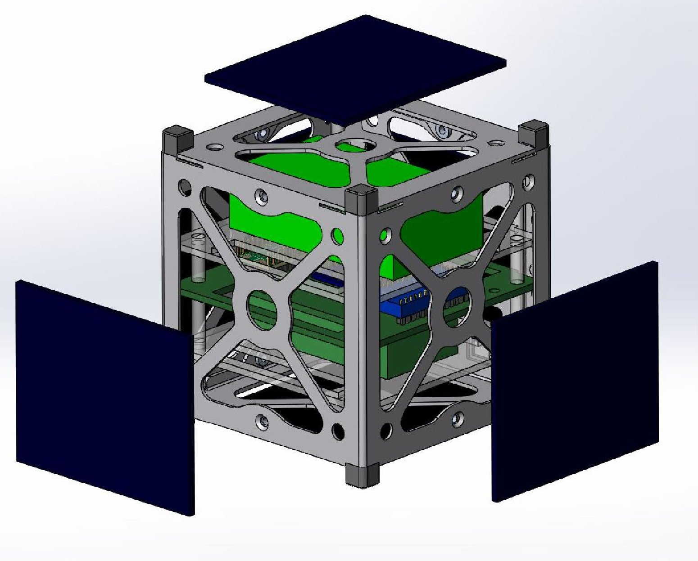


The Pumpkin Cubesat structure contains the required circuitry for interfacing with the NanoRacks CubeSat Deployer. In addition, the rails are designed to meet NanoRacks requirements. All external components, including solar panels and antennas, are designed to fit within the NanoRacks interior envelope, and not interfere with the rail interface.

<!-- PDF_PAGE: 18 -->

<div align="center">

Figure 4.1.2 NanoRacks Interface

</div>


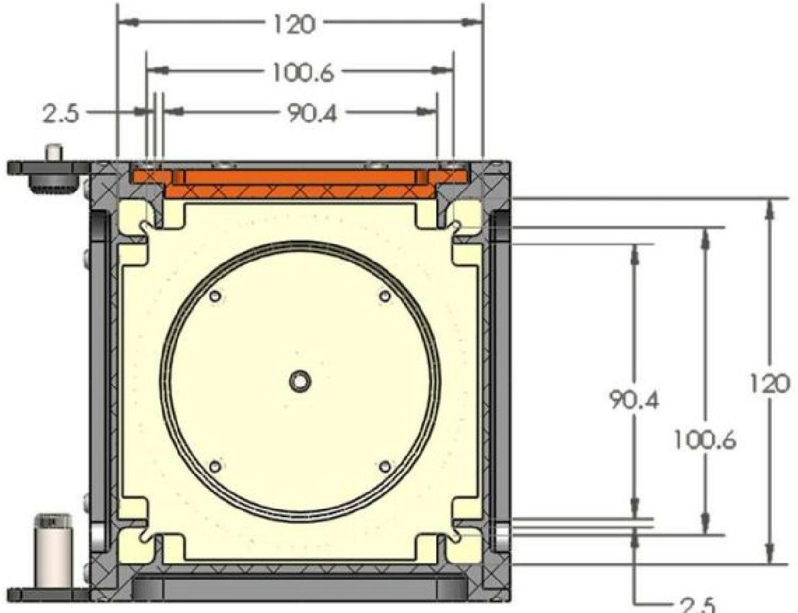


## 4.2 Electrical Design

The solar panels absorb solar radiation and generate electricity to power the microcontroller and charge the battery during sunlight. The temperature sensors and IMUs send measured data to the microcontroller to be stored for transmission. The radio receive a signal from the ground station and begin to downlink telemetry.

The electrical schematic below (Figure 4.2.1) shows how the main microcontroller (the Teensy 3.2) is connected to the rest of the peripherals. The microcontroller is powered from the batteries and solar cells. To get a continuous measurement of the voltage across the cells, an analog pin is assigned just for that purpose. All the sensors will be attached to their respective analog pins so that we can gather data from all the sensors at close to the same time.

The microcontroller is connected to the Bosch sensor (BNO055) which will be available to communicate with via the I2C protocol. This sensor supplies us with additional orientation data which is placed in storage to be transmitted during a pass.

<!-- PDF_PAGE: 19 -->

<div align="center">

Figure 4.2.1 Main Microcontroller, Power, and Sensor Hookups

</div>


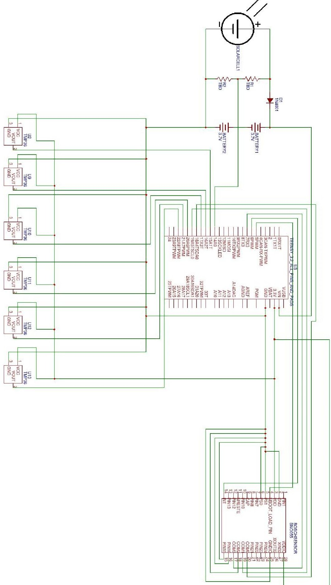


<!-- PDF_PAGE: 20 -->

The main microcontroller is also connected to a second smaller microcontroller (The Arduino Pro Mini) via its serial connectors. The second microcontroller will be the communication controller and will be in charge of modulating data and sending it to the radio to transmit (Shown in Figure 4.2.2).

<div align="center">

Figure 4.2.2 Modem Microcontroller, Modem Circuit, and Radio Hookups

</div>


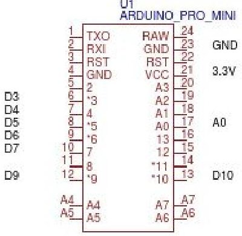


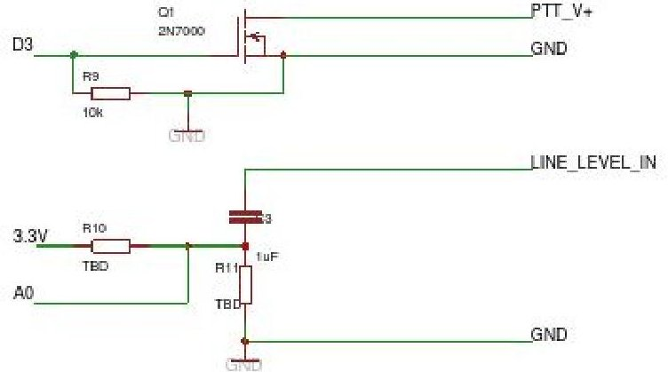


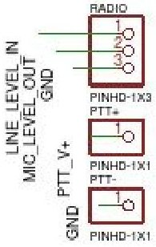


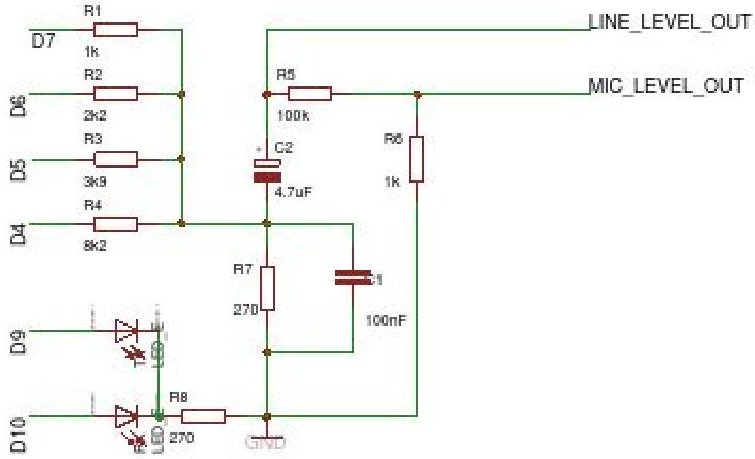


<!-- PDF_PAGE: 21 -->

This final circuit (Figure 4.2.3) was made to emphasize how the primary components of the cubesat will be powered. The solar cells will work in conjunction with the batteries to provide power directly to both microcontrollers (the primary controller and the modem) as well as directly to the radio. A substantial amount of current will need to be supplied to each of these components so supply power from the primary microcontroller wasn't an option. The reverse-flow diode pictured is important for a system with solar panels and batteries as it prevents current from flowing into the panels from the batteries. The transistor connected to the radio will give the microcontroller control over when the radio is powered even if it is directly connected to the main battery. This will help save power as the software we implement can choose when exactly to turn on the radio.

<div align="center">

Figure 4.2.3 Power Circuit

</div>


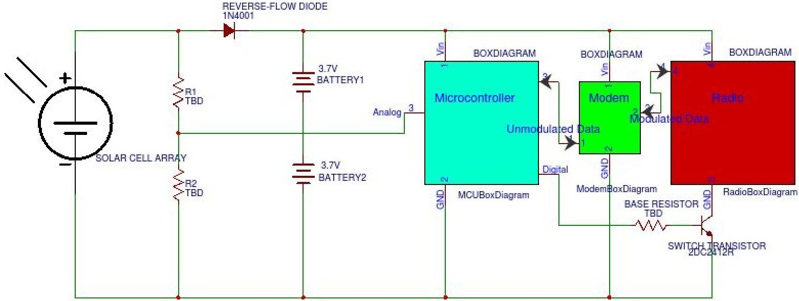


<!-- PDF_PAGE: 22 -->


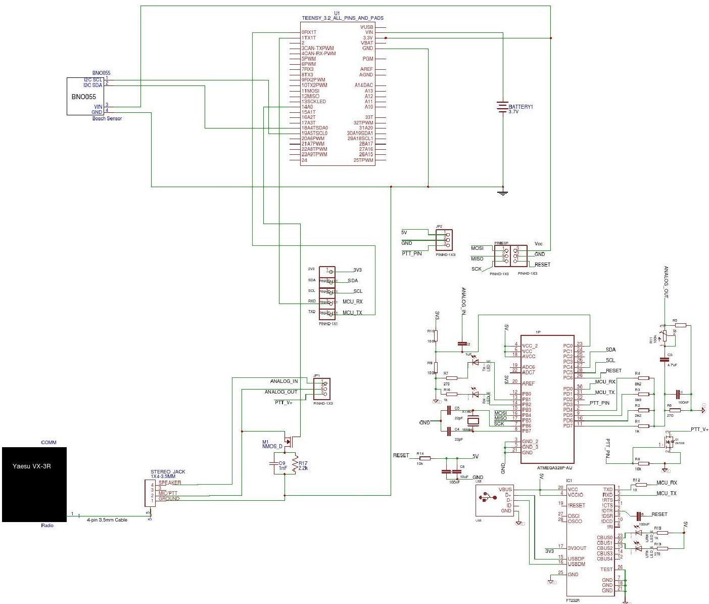


<div align="center">

Figure 4.2.5 Final System Architecture

</div>

<!-- PDF_PAGE: 23 -->

## 4.3 Software Design

Figure 4.3.1 Top-Level Software Flow Chart


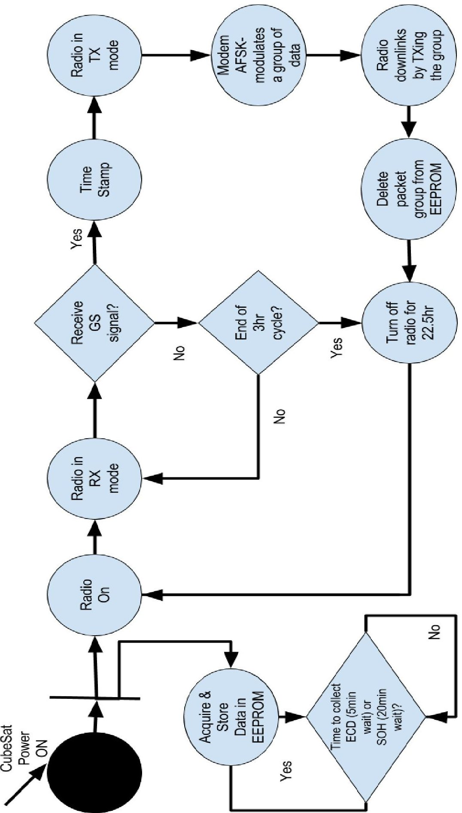


<div align="center">

Team 15065

</div>

<!-- PDF_PAGE: 24 -->

## 4.4 Communication Arrangement

1 TX attempt per day.

- Occurs every 24 hours, +/- 90 minutes.

- TX should only take ~1.75 minutes.

- GS pass is ~3 minutes, so this should be sufficient.

RX will be on for at least 3 hours surrounding each TX attempt.

- Radio powers on in RX mode 22.5 hours after last downlink.

- Software design discusses what happens if TX attempt fails.

## 4.5 Top-Level Design Integration

The Teensy 3.2, BN0055 breakout, and Arduino Pro Mini will be soldered to the PCB shelf. The PCB shelf has holes to allow wires to connect from the PCB to the battery, radio, sensors and solar panels. The battery and radio will have 3D printed enclosures which will be fixed to the 3D printed shelves. The antennas will be wrapped around the outside of the CubeSat and secured with a nylon wire.

<!-- PDF_PAGE: 25 -->

## 5 Hardware Overview

## 5.1 CubeSat Structure

## 5.1.11U Pumpkin Skeleton

Chassis Walls 703-00289

Base Plate Assembly 710-00294

Cover Plate Assembly 710-00296

The CubeSat structure is composed of the aluminium Pumpkin skeleton, which includes 1U chassis walls, base and cover plate, and internal fixtures for electrical components. It also includes a deployment-activated power switch that begins the power-on timer, and include mounting points for various hardware. It is compatible with the NanoRacks deployment system, meeting all relevant requirements.

<div align="center">

Figure 5.1.1: 1U Pumpkin Skeleton

</div>


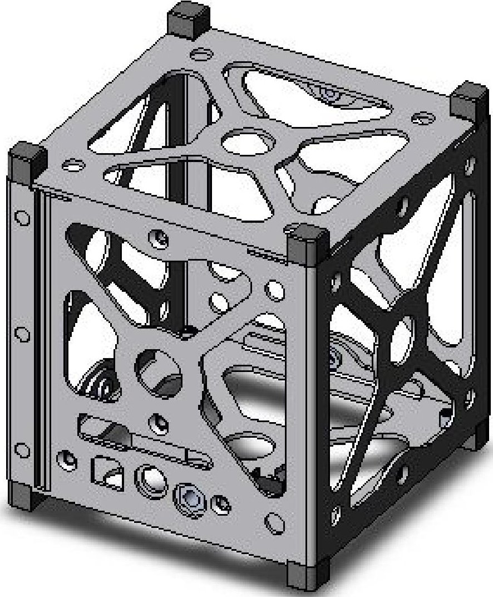


1U Skeleton CAD Model

RevD

<!-- PDF_PAGE: 26 -->

## 5.1.2 3-D Printed Component Mounting Structure

The use of 3-D printing has allowed for more flexibility in the design of the internal structure than a standard CubeSat. In our case, a unique support structure was devised by incorporating the shelf support into the antenna bracket. 3-D printed ABS polymer was used to manufacture the components of the structure, including:

- 3D Printed shelves for radio, battery, and electronics

- Box fixtures securing the radio and batteries to the shelves

- Combination Antenna bracket and shelf support structures

<div align="center">

Figure 5.1.2 3D Printed Internal Shelving and Structure

</div>


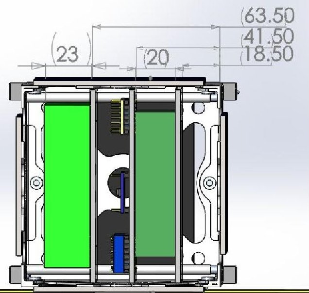


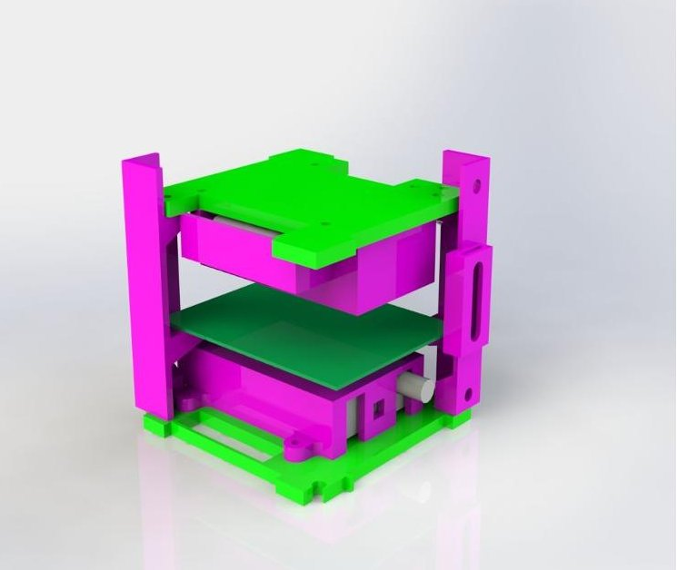


## 5.2 Microcontrollers

During PDR, an Arduino Uno (gray on the table) was specified, but this specification has since changed. This CubeSat will make use of two microcontrollers: a Teensy 3.2 and an Arduino Pro Mini. The Teensy will serve as the primary microcontroller of the system, directing most system functions. The Arduino Pro Mini will serve as the communications modem.

<div align="center">

Table 5.2.1 Microcontroller Trade-Off

</div>

<table border="1"><tr><td colspan="2">Arduino Uno</td><td colspan="2">Teensy 3.2</td><td colspan="2">Arduino Pro Mini</td></tr><tr><td>Op. Voltage</td><td>7-12V</td><td>Op. Voltage</td><td>3.3-5V</td><td>Op. Voltage:</td><td>3.3-12V</td></tr><tr><td>Digital I/O Pins</td><td>14</td><td>Digital I/O Pins</td><td>34</td><td>Digital I/O Pins:</td><td>14</td></tr><tr><td>ADC Pins</td><td>6</td><td>ADC Pins</td><td>21</td><td>ADC Pins</td><td>6</td></tr><tr><td>Standby Current</td><td>2mA</td><td>Standby Current</td><td>186μA</td><td>Standby Current</td><td>200μA</td></tr><tr><td>EEPROM Storage</td><td>1kB</td><td>EEPROM Storage</td><td>2kB</td><td>EEPROM Storage</td><td>1kB</td></tr></table>

<!-- PDF_PAGE: 27 -->

<div align="center">

Figure 5.2.1: Arduino UNO, Teensy 3.2, and Arduino Pro Mini

</div>


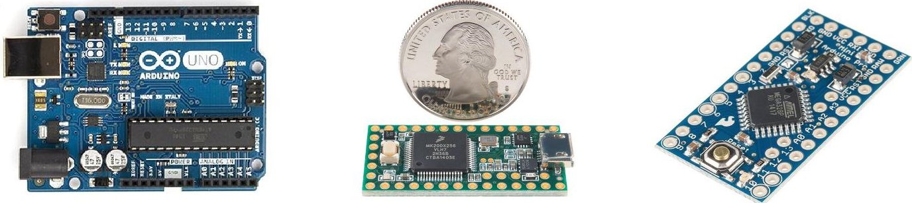


## 5.3 Modem

A pre-programmed modem that is designed to operate with conventional handheld Ham transceivers. It uses APRS data modulation.

<div align="center">

Figure 5.3.1: MicroModem Breakout Board

</div>


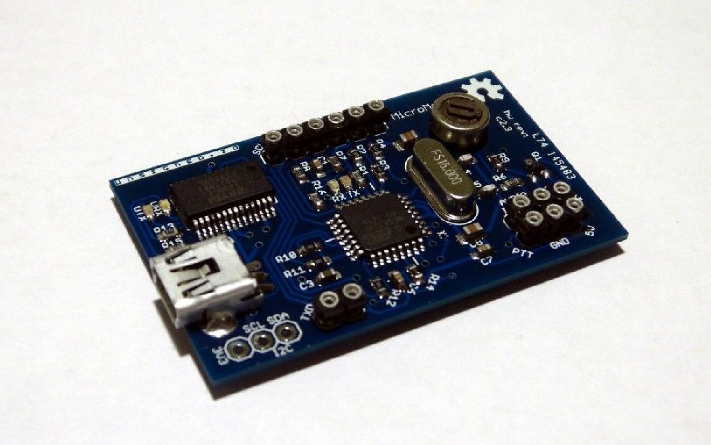


## 5.4 Radio

During PDR, the initial selection for the system radio was a Baofeng UV-5R (gray on the table), but an advisor recommended against using a Baofeng product due to quality concerns. The final selection was the Yaesu VX-3R, which offered lower power consumption, reduced size and mass, and improved reliability.

<!-- PDF_PAGE: 28 -->

<div align="center">

Table 5.4.1 Radio Trade-Offs

</div>

<table border="1"><tr><td colspan="2">Baofeng UV-5R</td><td colspan="2">Yaesu VX-3R</td></tr><tr><td>RX</td><td>380mA</td><td>RX</td><td>120mA,3.7V</td></tr><tr><td>TX</td><td>1Wfrom400-480MHz,unknowncurrentdraw</td><td>TX</td><td>1Wfrom430-450MHz,1.2A,3.7V</td></tr><tr><td>Size</td><td>110x58x32mm</td><td>Size</td><td>81x47x23mm</td></tr><tr><td>Mass</td><td>204.1g</td><td>Mass</td><td>130g</td></tr><tr><td>Quality</td><td>No quality control</td><td>Quality</td><td>More reliable</td></tr></table>

<div align="center">

Figure 5.4.1: Baofeng UV-5R and Yaesu VX-3R Radios

</div>


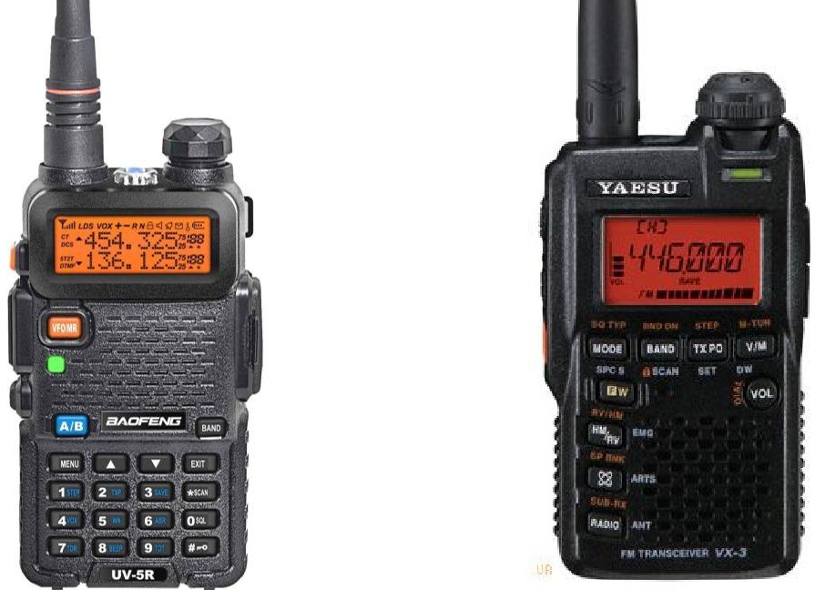


## 5.5 Battery

A 2600 mAh Lithium Ion battery pack was selected for its favorable dimensions, power capacity, discharge rate, and voltage. This matched the calculated power budget for the project.

<div align="center">

Table 5.5.1 Battery Specifications

</div>

<table border="1"><tr><td colspan="2">Li-Ion 18650 Battery</td></tr><tr><td>Voltage</td><td>3.7V</td></tr><tr><td>Mass</td><td>95g</td></tr><tr><td>Capacity</td><td>4400mAh</td></tr><tr><td>Max Discharge Rate</td><td>1.5A</td></tr><tr><td>Dimensions</td><td>69x37x18mm</td></tr></table>

<div align="center">

Figure 5.5.1 Li-Ion 18650 Battery

</div>


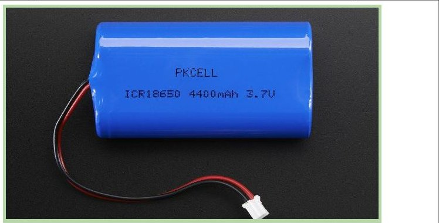


<!-- PDF_PAGE: 29 -->

## 5.6 Solar Panels

The CubeSat will utilize six 5.5 V, 100 mA solar cells sourced from MCP Technology Systems. The CubeSat will be fitted with one panel per side of the cubic chassis, providing sufficient charging capacity for the specified battery.

<div align="center">

Table 5.6.1 Solar Cell Specifications

</div>

<table border="1"><tr><td colspan="2">MCP 5.5V，100mA Solar Cell</td></tr><tr><td>Peak Voltage</td><td>5.5V</td></tr><tr><td>Power</td><td>0.6W</td></tr><tr><td>Current</td><td>100mA</td></tr><tr><td>Dimensions</td><td>65x65mm</td></tr></table>

<div align="center">

Figure 5.6.1 MCP 5.5V 100mA

</div>


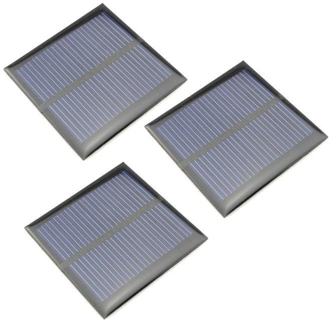


## 5.7 Sensors

In the PDR, the LM35 temperature sensor was initially specified (gray on the chart). This was later changed to the TMP36, which offers an operating voltage that is compatible with the overall system, in addition to a reduced current drain and reduced size. The BNO055 multi-function sensor will be mounted at the the CubeSat's center of gravity to ensure accurate readings of acceleration and orientation. The TMP36 sensors will be mounted on the CubeSat walls, giving readings of the surface temperature of the satellite.

<div align="center">

Table 5.7.1 Sensor Trade-Offs

</div>

<table border="1"><tr><td colspan="2">LM35</td><td colspan="2">TMP36</td><td colspan="2">BNO055</td></tr><tr><td>Op. Voltage</td><td>4-30V</td><td>Op. Voltage</td><td>2.7-5.5V</td><td>Op. Voltage</td><td>2.4-3.6V</td></tr><tr><td>Current Drain</td><td>&lt;60μA</td><td>Current Drain</td><td>&lt;50μA</td><td>Current Drain</td><td>12.3mA</td></tr><tr><td>Op. Temperature</td><td>-55℃ to 150℃</td><td>Op. Temperature</td><td>-40℃ to 150℃</td><td>Op. Temperature</td><td>-40℃ to 85℃</td></tr><tr><td>Dimensions</td><td>2.4cm long</td><td>Dimensions</td><td>1.8cm long</td><td>Dimensions</td><td>2.0x2.7x0.4cm</td></tr><tr><td>Sensors</td><td>Temperature</td><td>Sensors</td><td>Temperature</td><td>Sensors</td><td>Magnetometer Gyroscope Accelerometer Temperature</td></tr></table>

<!-- PDF_PAGE: 30 -->


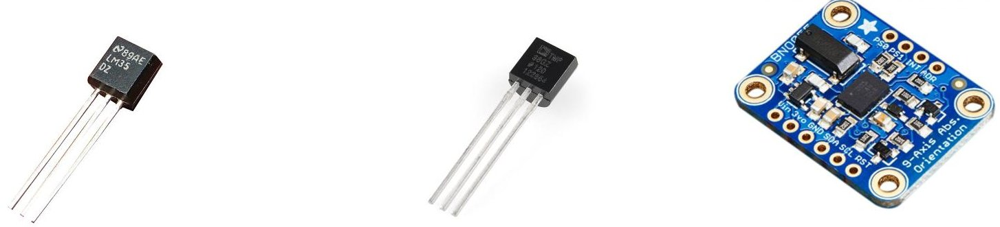


## 5.8 Antenna

The CubeSat will utilize a pair of linear dipole antennas, with each antenna consisting of two lengths of steel tape measure "tape". The system will uplink at a wavelength of 2.0 m, and downlink at a wavelength of 70 cm.

<div align="center">

Table 5.8.1 Antenna Specifications

</div>

<table border="1"><tr><td colspan="2">Linear Dipole Antennas</td></tr><tr><td>Uplink Wavelength</td><td>2.0m</td></tr><tr><td>Uplink Antenna Length(qty2)</td><td>50cm</td></tr><tr><td>Uplink Frequency</td><td>145MHz</td></tr><tr><td>Downlink Wavelength</td><td>70cm</td></tr><tr><td>Antenna2length(qty2)</td><td>17.5cm</td></tr><tr><td>Downlink Frequency</td><td>437MHz</td></tr></table>

<div align="center">

Figure 5.8.1 Antenna Model

</div>


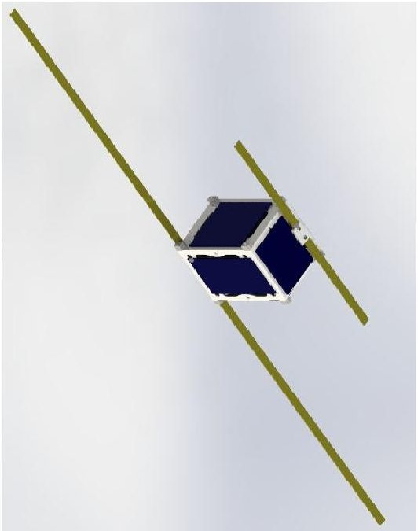


## 5.8.1 Antenna Deployment

Each antenna will be wrapped around the CubeSat while stowed, under its own spring tension. It will be retained by a nylon cable that is in turn crossed by a nichrome wire on each side of the nylon cable loop. When it is time for the CubeSat to deploy its antennas, the microprocessor will direct a current through the nichrome wires. The wires will heat up, melting through the nylon cable and allowing the antennas to deploy under their own spring tension.

<!-- PDF_PAGE: 31 -->

<div align="center">

Figure 5.8.2 CubeSat with Tape Measure and Deployment Sketch

</div>


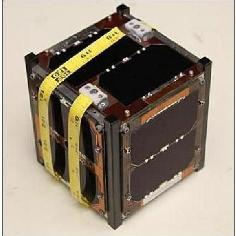


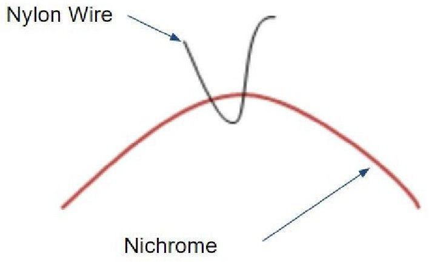


As a failsafe, if a sequence of several radio recalibrations is unsuccessfully attempted, the cable cutting protocol will be run again.

<!-- PDF_PAGE: 32 -->

## 6 Algorithm Description and Interface Document

The software design consists of a series of design considerations, interrupts, timers, and flow charts. will have a mechanism to check if the solar panels are charging. If they aren't, the unit is in a point-of-no return mode, and it will only be able to last off of what is remaining in the battery.

## 6.1 Software Design Specifications

CubeSat Modes:

Low Power Mode

O The CubeSat is in a mode of minimal functionality, in which all components are off except for the microcontroller, which is in sleep mode. The CubeSat shall be in Low Power Mode until the battery reaches a voltage capacity of 6.5V (1V higher than the 5.5V cutoff voltage).

RX Mode

The CubeSat is powering on its radio to be in receiving mode.

TX Mode

The CubeSat is preparing and sending data storage

Planned Interrupts:

- Battery voltage too low: enter Low-Power mode.

- Receipt of signal from Ground Station: enter TX mode.

Planned Timers:

RX Power Cycle Timer

- Environmental Condition Data Collection Timer

- Statement of Health Collection Timer

The software must be planned such that it benefits the power budget (Section 8.3). The power budget determines the storage budget (Section 8.2) because occupying storage requires components to be on, which utilizes power.

<!-- PDF_PAGE: 33 -->

## 6.2 Software Plan for BN0055 Sensor

BNO055 Data:

- With Teensy I/O, power on the BNO055

- The startup time for it is 400ms

- Teensy 3.2 shall allow the BN0055 to record data at at least one time instance, t

- For the purposes of the project, there are 45 Bytes of RAW (not fusion??) data required

6 Bytes for the Accelerometer Vector: 2 Bytes (MSB+LSB) for 3 Axes

6 Bytes for the Magnetometer Vector: 2 Bytes (MSB+LSB) for 3 Axes

6 Bytes for the Gyroscope Vector: 2 Bytes (MSB+LSB) for 3 Axes

6 Bytes for the Euler Angles Vector: 2 Bytes (MSB+LSB) for 3 Axes

8 Bytes for the Quaternion Vector: 2 Bytes (MSB+LSB) for 4 Axes

6 Bytes for Linear Acceleration Vector: 2 Bytes (MSB+LSB) for 3 Axes

6 Bytes for the Gravity Vector: 2 Bytes (MSB+LSB) for 3 Axes

1 Byte for Temperature

- The data that the BNO055 records goes to registers within the MCU on the BNO055 breakout board

- For the Teensy 3.2 microcontroller to acquire all of the data from that time instance, t, the Teensy moves the data one-by-one from each BN0055 MCU registers, to the Teensy I2C, then to a storage location in the CubeSat external storage device.

- Operation Overview: 16MHz

1 operation to move BN0055 register byte to the Teensy MCU

O ~2 operations to move byte to the external storage location

O (3 operations/byte) $ ^{*} $ (45bytes) / (16MHz) = 8.4375us

Negligible compared to startup time!

- Approximating this to take ~1 second per turn on, used in power budget

<!-- PDF_PAGE: 34 -->

<div align="center">

Table 6.2.1: Byte Allocation for BNO055

</div>

<table border="1"><tr><td>Data Set</td><td>Number of Bytes Required</td><td># of Axes</td><td>Multiple Bytes Required for Resolution?</td></tr><tr><td>Accelerometer</td><td>6</td><td>3(x,y,z)</td><td>Yes,2</td></tr><tr><td>Magnetometer</td><td>6</td><td>3(x,y,z)</td><td>Yes,2</td></tr><tr><td>Gyroscope</td><td>6</td><td>3(x,y,z)</td><td>Yes,2</td></tr><tr><td>Euler Angles</td><td>6</td><td>3(heading,roll,pitch)</td><td>Yes,2</td></tr><tr><td>Quaternion</td><td>8</td><td>4(w,x,y,z)</td><td>Yes,2</td></tr><tr><td>Linear Acceleration</td><td>6</td><td>3(x,y,z)</td><td>Yes,2</td></tr><tr><td>Gravity Vector</td><td>6</td><td>3(x,y,z)</td><td>Yes,2</td></tr><tr><td>Temperature</td><td>1</td><td>N/A</td><td>No</td></tr><tr><td>TOTAL</td><td>45</td><td colspan="2"></td></tr></table>

## 6.3 Software Plan for Statement of Health

One Statement of Health must be to record the current that the MCU observes for the RX current on the Radio. We should give this data to our ground station!

<div align="center">

Table 6.3.1: Statements of Health

</div>

<table border="1"><tr><td>Statement of Health Item</td><td>Number of Bytes Required</td><td>Why?</td></tr><tr><td>Solar Panels</td><td>12</td><td>6 ADC,16 bit resolution</td></tr><tr><td>Battery</td><td>4</td><td>2 ADC,16 bit resolution</td></tr><tr><td>Radio</td><td>2</td><td>1 ADC,16 bit resolution</td></tr><tr><td>TOTAL</td><td>18 Bytes</td><td></td></tr></table>

<!-- PDF_PAGE: 35 -->

## 6.4 Software Plan for Modem

To keep the communications system effective, simple, and open source it was decided that we would implement something similar to MicroModem (http://unsigned.io/micromodem/). Taken from the site: "MicroModem is an educational and open-source implementation of a 1200-baud AFSK modem on the popular ATmega328p microprocessor." The only assembly required other than a ATmega328p processor is 17 common electrical comments to build the modem. Once assembled this modem can be used for Automatic Packet Reporting System (APRS) as well as AX.25 for positioning and transmitting telemetry respectively.

The system will be programmed so that the modem and radio are turned on at certain time intervals. If a connection is made to the ground station, the radio and modem remain on and data transmission to the ground station begins. For a visual representation of our software layout please refer to the following sequence diagrams.

<!-- PDF_PAGE: 36 -->

## 6.5 Software Design Diagrams

Figure 6.5.1 Sequence Diagram for System Health Gathering


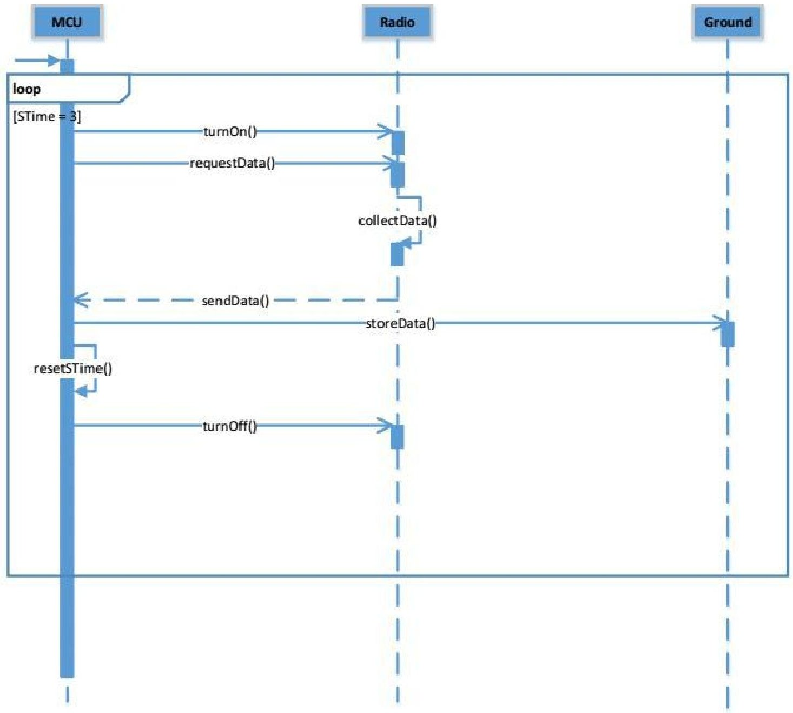


<!-- PDF_PAGE: 37 -->

<div align="center">

Figure 6.5.2 Sequence Diagram for Initial System Startup

</div>


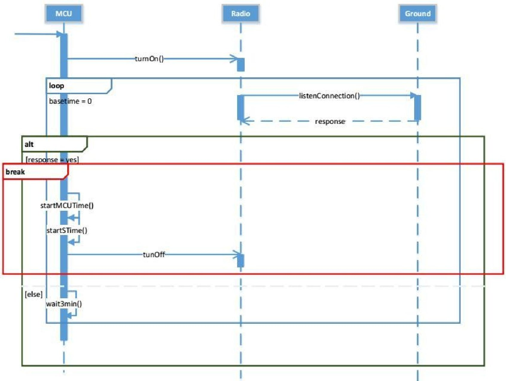


<!-- PDF_PAGE: 38 -->

<div align="center">

Figure 6.5.3 Sequence Diagram for Radio Connection

</div>


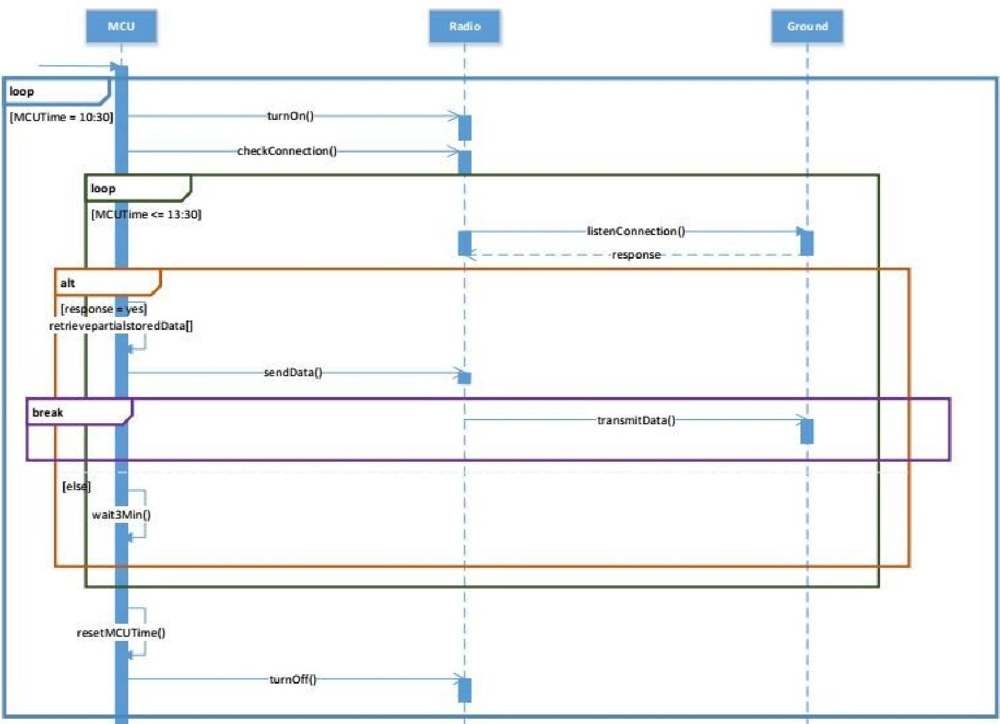


<!-- PDF_PAGE: 39 -->

<div align="center">

Figure 6.5.4 Sequence Diagram for Initial System Startup

</div>


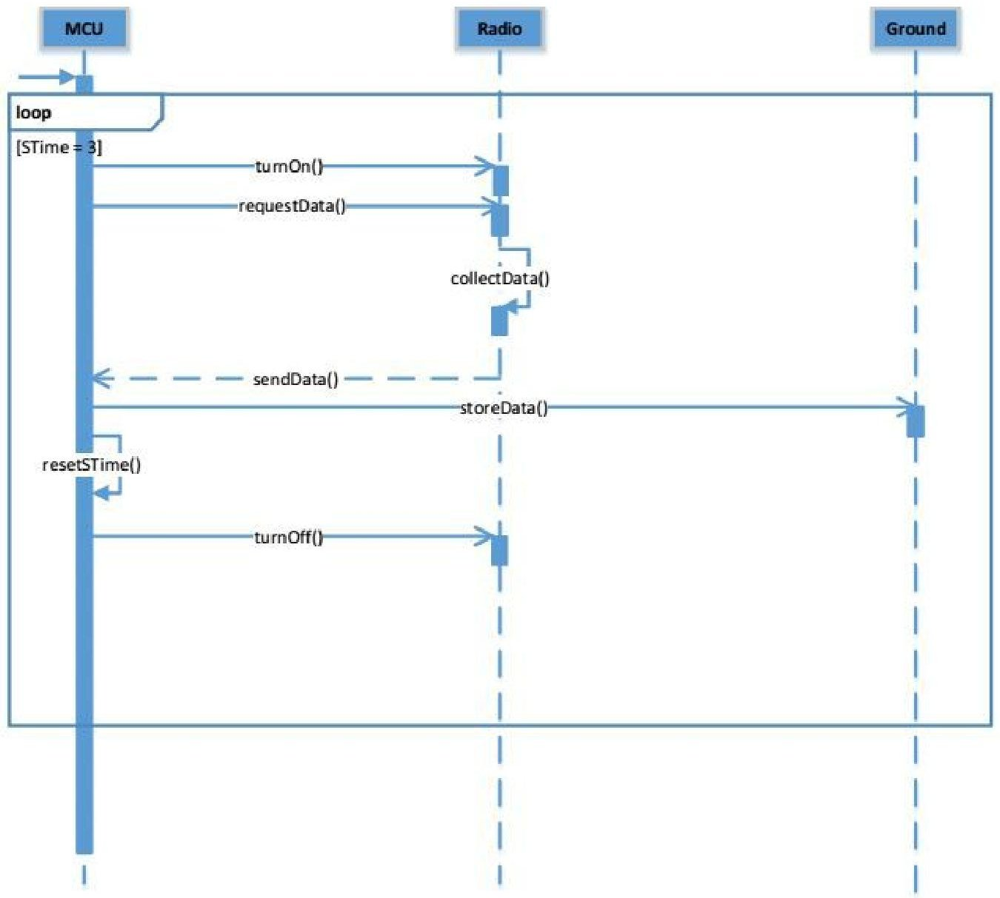


<!-- PDF_PAGE: 40 -->

## 6.6 Communication System Summary

## 6.6.1 Communication Orbit Information

According to the Power Budget, Link Budget, and Orbit Analysis:

- Every day, there is a guarantee of several ground station passes.

- Each orbit lasts about 90 minutes.

Each Ground Station pass lasts an average of 3 minutes.

## 6.6.2 Calibration Period for Communications

Upon the release from NanoRacks, the CubeSat must calibrate its system timers for when it will pass over the Ground Station. This period in which this occurs is called the Calibration Period. During the entire period, the Ground Station will be constantly sending signals to the CubeSat. This affords the CubeSat the opportunity to receive a "tag signal" to notify the CubeSat that it is within range of the Ground Station. During this entire period, the radio will remain in RX mode until it receives the "tag signal" from the Ground Station. The only instance in which the radio will turn off is if the battery capacity is too low, at which point the CubeSat enters "Low Power Mode". During this stage, the microcontroller will wait until the battery recharges to near full capacity, and the Calibration Period will begin again. See the following table for a comprehensive power study of the battery lifetime for leaving the radio on during this time:

<div align="center">

Table 7.1 Battery Calibration Mode Capabilities

</div>

<table border="1"><tr><td></td><td>Current Draw(mAh)</td><td>Solar Panel Charge(mAh)</td><td>Battery Status(mAh)</td></tr><tr><td>Orbit1:1.5hrs</td><td>330</td><td>50.489744</td><td>2320.5</td></tr><tr><td>Orbit2:3hrs</td><td>330</td><td>50.489744</td><td>2041.0</td></tr><tr><td>Orbit3:4.5hrs</td><td>330</td><td>50.489744</td><td>1761.5</td></tr><tr><td>Orbit4:6hrs</td><td>330</td><td>50.489744</td><td>1482.0</td></tr><tr><td>Orbit5:7.5hrs</td><td>330</td><td>50.489744</td><td>1202.4</td></tr><tr><td>Orbit6:9hrs</td><td>330</td><td>50.489744</td><td>922.9</td></tr><tr><td>Orbit7:10.5hrs</td><td>330</td><td>50.489744</td><td>643.4</td></tr><tr><td>Orbit8:12hrs</td><td>330</td><td>50.489744</td><td>363.9</td></tr><tr><td>Orbit9:13.5hrs</td><td>330</td><td>50.489744</td><td>84.4</td></tr></table>

<!-- PDF_PAGE: 41 -->

<table border="1"><tr><td>Orbit 10:15 hrs</td><td>330</td><td>50.489744</td><td>-195.1</td></tr></table>

Once the CubeSat has received a signal from the Ground Station, the microcontroller will time-stamp the signal, and utilize that time-stamp as a start moment for its internal clocks. Essentially, this time-stamp will be the start time for the 24-hour communication period. To elaborate:

To attempt to guarantee a connection with the Ground Station, the CubeSat must be attempting to receive its communication for as long of a time duration as possible. However, due to power constraints (detailed in Section 7.3: Analysis, Power Budget), the Radio RX and TX modes consume the most power in the system. Therefore, the power budget was extensively analyzed to give the best scenario for the CubeSat to reach the Ground Station.

According to prior analysis, in order to guarantee this connection with the Ground Station:

- Each orbit is about 90 minutes.

- Because of its period, the satellite's path on the surface of the Earth does not repeat itself each day.

Therefore, for absolute assurance, the transceiver should be left on for 2 entire orbits, which is 3 hours.

This the Communication Design has arrived at the following... There will be:

1 TX attempt per day.

This occurs every 24 hours, +/- 90 minutes.

TX should only take ~1.75 minutes.

GS pass is ~3 minutes, so this should be sufficient.

- RX will be on for at least 3 hours surrounding each TX attempt.

Radio powers on in RX mode 22.5 hours after last downlink.

Software design discusses what happens if TX attempt fails.

For information on the radio, antennas, and modem, see Sections 5.3, 5.7, and 6.2.

<!-- PDF_PAGE: 42 -->

## 7 Analysis

## 7.1 Pin Budget

<div align="center">

Table 7.1.1: Pin Budget Table

</div>

<table border="1"><tr><td>Device</td><td>Required I/O</td><td>Required ADC</td><td>Required I2C</td><td>Notes</td></tr><tr><td>MCU: Modem</td><td>4</td><td></td><td>yes</td><td>1 I/O for MCU power, the rest goes to the I2C</td></tr><tr><td>Radio: Yaesu VX-3R</td><td>1</td><td></td><td>yes</td><td>1 I/O for "switch power", all data goes through the I2C as a modem mimic</td></tr><tr><td>Sensor: BN0055</td><td>1</td><td></td><td>yes</td><td>1 I/O for power, all data will go through I2C</td></tr><tr><td>Sensor: Temperature</td><td>6</td><td>6</td><td></td><td>6 sensors: 6 ADC to collect temperature data, 1 I/O for a supplied voltage across them</td></tr><tr><td>SOH: Battery</td><td></td><td>2</td><td></td><td>2 ADC: battery voltage is higher than the allowed input voltage for the MCU</td></tr><tr><td>SOH: Radio RX Current</td><td></td><td>1</td><td></td><td>only one needed, depending on what current is received! a resistor can convert this current to a small voltage though, and this will trigger the TX</td></tr><tr><td>SOH: Solar Panels</td><td></td><td>6</td><td></td><td>6 solar panels: ADC to collect the data from each panel</td></tr><tr><td>Storage: External EEPROM</td><td></td><td></td><td>yes</td><td></td></tr><tr><td></td><td></td><td></td><td></td><td></td></tr><tr><td>TOTAL</td><td>12</td><td>15</td><td>4 devices</td><td></td></tr><tr><td>TOTAL AVAILABLE: TEENSY 3.2</td><td>34</td><td>21</td><td>2</td><td></td></tr></table>

<!-- PDF_PAGE: 43 -->

## 7.2 Storage Budget

<div align="center">

Table 7.2.1: Storage Budget

</div>

<table border="1"><tr><td>Data Recorded for Downlink</td><td>Number of Required Bytes</td><td>Data Sets Per Hour</td><td>Rate(Bytes/Hour)</td></tr><tr><td>Bosch(assuming1secondsworthofstoreddata)</td><td>45</td><td>12</td><td>540</td></tr><tr><td>ExtraTemperatureSensors(ADC=1byte,for6sensors)</td><td>6</td><td>12</td><td>72</td></tr><tr><td>HardwareSOH</td><td>19</td><td>3</td><td>57</td></tr><tr><td>ExperimentSOH(recordingat1Hzfrequency,fortimeduration,perhour)</td><td>12</td><td>15</td><td>180</td></tr><tr><td>TOTALSTORAGEREQUIRED(bytes/hour)notincludingexperiment</td><td colspan="3">669</td></tr></table>

<table border="1"><tr><td colspan="2">Parameter</td></tr><tr><td>Storage Required Per Day(kB/day)</td><td>16.056</td></tr><tr><td>Link Budget(kB/s)</td><td>0.15</td></tr><tr><td>Time Required for Daily Downlink(min)</td><td>1.784</td></tr></table>

<table border="1"><tr><td colspan="2">Backup Storage Parameters</td></tr><tr><td>Max # of Allowable Downlink Misses</td><td>4</td></tr><tr><td>Time Required for Full Downlink of Entire Storage (min)</td><td>7.33</td></tr></table>

<!-- PDF_PAGE: 44 -->

## 7.3 Power Budget

<div align="center">

Table 7.3.1 Power Budget Preliminary Values

</div>

<table border="1"><tr><td>Radio RX, Percentage of Cycling Time:</td><td>100.00%</td></tr><tr><td>Duration of Radio RX Cycling Time(hours):</td><td>3</td></tr><tr><td>RX Connectivity Attempts Per Day:</td><td>1</td></tr><tr><td>ECD Measurements/Hour:</td><td>12</td></tr><tr><td>SOH Measurements/Hour:</td><td>3</td></tr><tr><td>Time Duration for Recording ECD(sec):</td><td>1</td></tr><tr><td>Duration for Daily TX with 1.2kb/s Bit Rate(min):</td><td>1.7840</td></tr><tr><td>Transmissions Per Day:</td><td>1</td></tr><tr><td>Duration of Ground Station Pass(min):</td><td>3</td></tr><tr><td>Time Percentage for TX Occupying Average GS Pass:</td><td>59.47%</td></tr><tr><td>Amount of Allowable Ground Station TX Misses for Enough Storage:</td><td>4</td></tr></table>

<div align="center">

Table 7.3.2 Power Budget Summary

</div>

<table border="1"><tr><td>TOTAL POWER CONSUMPTION</td><td>728.30211</td></tr><tr><td>Delta with Solar Panel Charging</td><td>61.97214</td></tr><tr><td>TOTAL+Experiment</td><td>848.30211</td></tr><tr><td>Delta with Experiment</td><td>-58.02786</td></tr></table>

<!-- PDF_PAGE: 45 -->

<div align="center">

Table 7.3.3 Power Budget Analysis

</div>

<table border="1"><tr><td>Device</td><td>Current Draw(mA)</td><td>Input Voltage(V)</td><td># of Units</td><td>Duration Device is On(min)</td><td># of Times On Per Day</td><td>Daily Ops Time(min)</td><td>Usage per Day(mAh)</td><td>Notes</td></tr><tr><td>Microcontroller (running)</td><td>50</td><td>3.4</td><td>2</td><td></td><td></td><td>186.58</td><td>310.973</td><td>MCU needs to be on for all radio &amp; sensor activity.Modem MCU&amp; Computer MCU.</td></tr><tr><td>Microcontroller (sleep)</td><td>0.186</td><td>3.4</td><td>2</td><td></td><td></td><td>1253.42</td><td>7.771</td><td>Sleeping for all minutes of the day that it isn't running.</td></tr><tr><td>Radio(Transmitting)</td><td>1200</td><td>4.5</td><td>1</td><td>1.7840</td><td>1</td><td>1.78</td><td>35.680</td><td></td></tr><tr><td>Radio(Receiving)</td><td>120</td><td>4.5</td><td>1</td><td></td><td></td><td>180.00</td><td>360</td><td></td></tr><tr><td>Sensor:BN0055</td><td>12.3</td><td>3</td><td>1</td><td>0.0167</td><td>288</td><td>4.80</td><td>0.984</td><td>Power-up:400ms.Data Collection:~10-60us.Instant power-off.~1s total usage.</td></tr><tr><td>Sensor:Temperature</td><td>0.05</td><td>2.7</td><td>6</td><td>0.0167</td><td>288</td><td>1440</td><td>7.200</td><td></td></tr><tr><td>SOH:Battery</td><td>10</td><td>3.7</td><td>1</td><td>0.0167</td><td>72</td><td>1.20</td><td>0.200</td><td></td></tr><tr><td>SOH:Solar Panels</td><td>10</td><td>4.5</td><td>6</td><td>0.0167</td><td>72</td><td>1.20</td><td>1.200</td><td></td></tr><tr><td>Storage:32kB External EEPROM,Writing</td><td>3</td><td>5.5</td><td>2</td><td></td><td></td><td>42.00</td><td>4.200</td><td></td></tr><tr><td>Storage:32kB External EEPROM,Reading</td><td>0.4</td><td>5.5</td><td>2</td><td>1.7840</td><td>1</td><td>1.78</td><td>0.024</td><td></td></tr><tr><td>Storage:32kB External EEPROM,Standby</td><td>0.0015</td><td>5.5</td><td>2</td><td></td><td></td><td>1396.22</td><td>0.070</td><td></td></tr></table>

<!-- PDF_PAGE: 46 -->

## 7.4 Mass Analysis

The mass of the CubeSat was determined by summing the specified masses of each component. The mass of the 3D printing and antenna were estimated using SolidWorks. The mass of the 3D printing was determined by specifying the density of ABS plastic, and the mass of the antennas were determined by specifying the density of steel. The CubeSat is required to have a mass less than or equal to 1.33 kg. Analysis shows the estimated mass of the CubeSat to be 0.995 kg with a 30% margin of error, exceeding the requirement.

<div align="center">

Table 7.4.1: Mass Budget Analysis

</div>

<table border="1"><tr><td colspan="3">Mass Budget</td></tr><tr><td></td><td>Amount</td><td>Calculated Mass(g)</td></tr><tr><td>Antenna</td><td>1</td><td>138</td></tr><tr><td>Battery</td><td>1</td><td>130</td></tr><tr><td>External Data Storage</td><td>2</td><td>6</td></tr><tr><td>Microcontroller</td><td>2</td><td>17</td></tr><tr><td>Radio</td><td>1</td><td>130</td></tr><tr><td>Screws+Miscellaneous Hardware</td><td>1</td><td>30</td></tr><tr><td>Sensor:Bosch Gyroscope</td><td>1</td><td>8.5</td></tr><tr><td>Sensor:Temperature</td><td>6</td><td>18</td></tr><tr><td>Solar Panels</td><td>6</td><td>90</td></tr><tr><td>Thermal Control(Insulation)</td><td>1</td><td>20</td></tr><tr><td>Voltage Regulators</td><td>1</td><td>20</td></tr><tr><td>3-D Print</td><td>1</td><td>157.5</td></tr><tr><td colspan="2">TOTAL(kg)</td><td>0.765</td></tr><tr><td colspan="2">TOTAL+30%MOE(kg)</td><td>0.995</td></tr><tr><td colspan="2">Max(kg)</td><td>1.330</td></tr><tr><td colspan="2">Delta(g)</td><td>335.500</td></tr></table>

<!-- PDF_PAGE: 47 -->


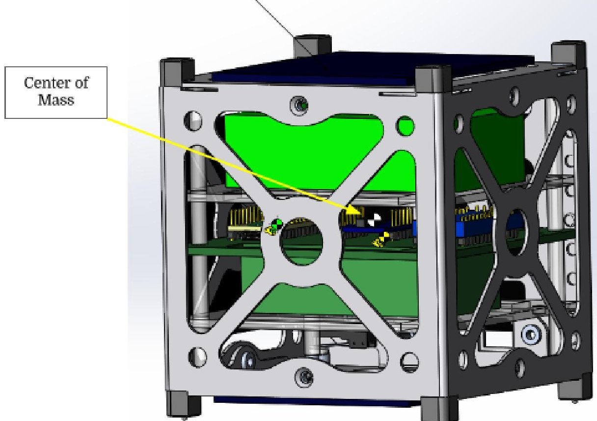


The center of mass was calculated using SolidWorks. Each SolidWorks part was set to its specified mass. The mass of the 3D printing and antennas were estimated using the densities of ABS plastic and steel, respectively. Each part was assumed to have a uniform density for the purpose of determining the mass center. SolidWorks was then used to calculate the center of mass of the full assembly.

<div align="center">

Table 7.4.3: Center of Mass Results

</div>

<table border="1"><tr><td colspan="2">Center of Mass</td></tr><tr><td>Direction</td><td>Distance from Geometric Center(mm)</td></tr><tr><td>X</td><td>-3.6</td></tr><tr><td>Y</td><td>2.1</td></tr><tr><td>Z</td><td>1.9</td></tr><tr><td>Radial</td><td>4.58</td></tr></table>

The NanoRacks CubeSat Deployer Interface Control Document specifies that the CubeSat's center of gravity must be within 2 cm of its geometric center. The

<!-- PDF_PAGE: 48 -->

SolidWorks analysis shows that the center of gravity is 4.58 mm away from the CubeSat's geometric center.

## 7.5 Preliminary Thermal Analysis

The following analysis was done to determine a reasonable range of temperatures the satellite will experience in orbit. Three important assumptions are made in this analysis:

- The satellite is considered a sphere of equal surface area.

- The satellite is a black body.

- The bottom surface is receiving IR emissions from the earth while the top surface receives the direct solar flux.

<div align="center">

Table 7.5.1: Thermal Analysis Specifications

</div>

<table border="1"><tr><td colspan="4">Thermal Analysis</td></tr><tr><td>No</td><td>Item</td><td>Value</td><td>Units</td></tr><tr><td>1</td><td>Spacecraft Surface Area</td><td>0.06</td><td>m2</td></tr><tr><td>2</td><td>Diameter of Sphere</td><td>0.1381976598</td><td>m</td></tr><tr><td>3</td><td>Max. Power Dissipation</td><td>1.5</td><td>W</td></tr><tr><td>4</td><td>Min. Power Dissipation</td><td>0.5</td><td>W</td></tr><tr><td>5</td><td>Altitude</td><td>416</td><td>km</td></tr><tr><td>6</td><td>Radius of Earth</td><td>6378</td><td>km</td></tr><tr><td>7</td><td>Radiation view factor</td><td>0.3277270907</td><td>-</td></tr><tr><td>8</td><td>Albedo Correction</td><td>0.9912030483</td><td>-</td></tr><tr><td>9</td><td>Max Earth IR emission</td><td>258</td><td>W/m2</td></tr><tr><td>10</td><td>Min Earth IR Emission</td><td>216</td><td>W/m2</td></tr><tr><td>11</td><td>Direct Solar Flux</td><td>1371</td><td>W/m2</td></tr><tr><td>12</td><td>Albedo</td><td>35</td><td>%</td></tr><tr><td>13</td><td>IR Emissivity</td><td>1</td><td>-</td></tr><tr><td>14</td><td>Solar Absorptivity</td><td>1</td><td>-</td></tr><tr><td>15</td><td>Worst case hot temperature</td><td>48.66943912</td><td>C</td></tr><tr><td>16</td><td>Worst case cold temperature</td><td>-79.87348881</td><td>C</td></tr><tr><td>17</td><td>Upper temperature limit</td><td>60</td><td>C</td></tr><tr><td>18</td><td>Lower temperature limit</td><td>-20</td><td>C</td></tr></table>

From this preliminary analysis, a range from -50C to -80C is calculated, far below the set temperature limits. This means that the spacecraft will require some form of thermal system, whether passive or active remains to be seen at

<!-- PDF_PAGE: 49 -->

this point. Additional thermal and finite element analysis is required to determine what system should be put in place.

## 7.6 Orbital Analysis

GMAT, General Mission Analysis Tool, was used to propagate and predict the orbit of the CubeSat, specified from the ISS Orbit Release Conditions. The following table and figures were calculated using GMAT, using a ground station located at Aurora, Colorado as the site on the surface of the Earth and following a release from the International Space Station.

<div align="center">

Table 7.6.1: ISS Orbit Release Conditions and Data

</div>

<table border="1"><tr><td colspan="2">Keplerian Elements</td><td colspan="2">Orbital Data</td></tr><tr><td>Semi-Major Axis</td><td>6758.033km</td><td>Period</td><td>92.199min</td></tr><tr><td>Eccentricity</td><td>.001199</td><td>Eclipse Period</td><td>36min/Orbit</td></tr><tr><td>Right Angle of Ascension</td><td>275.426deg</td><td>Orbits Per Day</td><td>15.6 Orbits/Day</td></tr><tr><td>Argument of Perigee</td><td>43.86deg</td><td>Sunlight Exposure Time</td><td>14.6hr/day</td></tr><tr><td>Inclination</td><td>51.99deg</td><td>Average Passes per Day</td><td>~4-5</td></tr><tr><td>True Anomaly</td><td>282.021deg</td><td>Average Pass Duration</td><td>~3-5min</td></tr></table>

<div align="center">

Figure 7.6.1: Satellite Ground Tracks (1 Day Duration from 03 May 2016)

</div>

<!-- PDF_PAGE: 50 -->


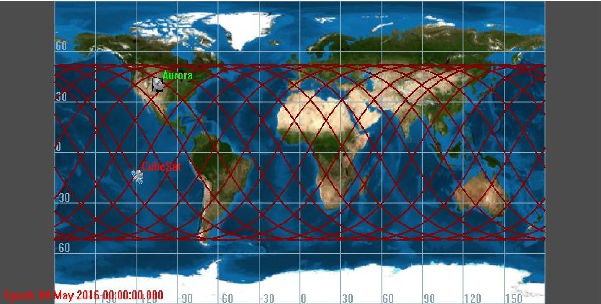


<div align="center">

Figure 7.6.2: Orbital View of Satellite (03 May 2016)

</div>


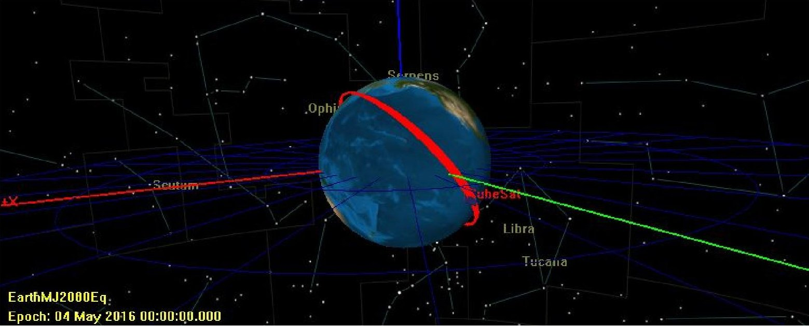


<div align="center">

7. 6 Expense Comparison

</div>

<table class="table table-bordered"><thead><tr><th>Component</th><th>Quantity</th><th>Machining 1 Material</th><th>Machining 1 Cost (firstcut.com)</th><th>Machining 1 Cost TOTAL</th><th>Machining 2 Material</th><th>Machining 2 Cost (firstcut.com)</th><th>Machining 2 Cost TOTAL</th><th>3-D Printing Material</th><th>3-D Printing Cost (shapeways)</th><th>3-D Printing Cost TOTAL</th></tr></thead><tbody><tr><td>Antenna Fixture</td><td>2</td><td>Aluminum 7075</td><td>$478.26</td><td>$956.52</td><td>Aluminum 6061</td><td>$437.32</td><td>$874.64</td><td></td><td>$12.20</td><td>$24.40</td></tr><tr><td>Battery Fixture</td><td>1</td><td>Aluminum 7075</td><td>$314.89</td><td>$314.89</td><td>Aluminum 6061</td><td>$294.89</td><td>$294.89</td><td>White</td><td>$27.06</td><td>$27.06</td></tr><tr><td>Bottom Shelf</td><td>1</td><td>Aluminum 7075</td><td>$148.11</td><td>$148.11</td><td>Aluminum 6061</td><td>$147.19</td><td>$147.19</td><td></td><td>$22.83</td><td>$22.83</td></tr><tr><td>Top Shelf</td><td>1</td><td>Aluminum 7075</td><td>$128.57</td><td>$128.57</td><td>Aluminum 6061</td><td>$127.25</td><td>$127.25</td><td></td><td>$21.13</td><td>$22.83</td></tr><tr><td>Yaesu Fixture</td><td>1</td><td>Aluminum 7075</td><td>$264.81</td><td>$264.81</td><td>Aluminum 6061</td><td>$243.81</td><td>$243.81</td><td></td><td>$22.79</td><td>$22.79</td></tr><tr><td colspan="12"></td></tr><tr><td>TOTAL</td><td></td><td></td><td></td><td>$1,812.90</td><td></td><td></td><td>$1,687.78</td><td></td><td></td><td>$119.91</td></tr><tr><td colspan="12"></td></tr><tr><td colspan="12">3-D vs. Machining</td></tr><tr><td colspan="12">7.10%</td></tr></tbody></table>

The estimated cost of machining the 3-D printed parts exceeded $1,600, while the 3-D printing cost only $119.91. This constitutes 7.1% of the estimated machining cost.

<!-- PDF_PAGE: 51 -->


<!-- PDF_PAGE: 52 -->

<div align="center">

# 8 Development Plan and Implementation

</div>

## 8.1 Critical Design Implementation

Our original development plan from the Critical Design Review included a process of design, implementation, and then testing in a number of fields, shown below. In order to analyze the accuracy of our development goals, the completion of each planned item will be ranked on a one-to-five scale in the following manner:

1=incomplete=,2=mostly incomplete,3=partly complete,4=mostly complete,and 5=complete.

Mechanical


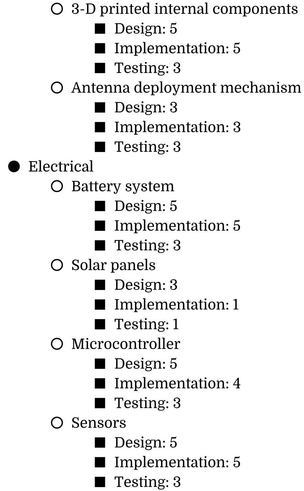


<!-- PDF_PAGE: 53 -->


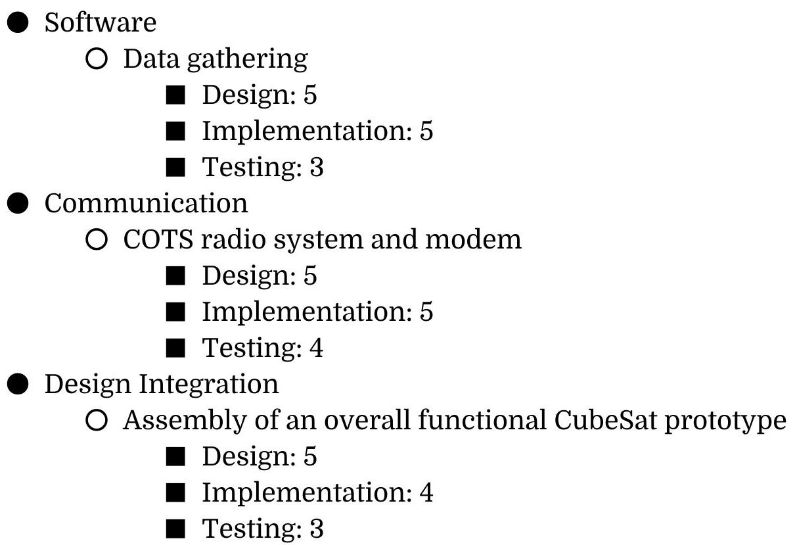


This variation from the overall development plan gradually developed over time, as various small difficulties (and a few larger ones, such as news that the solar panels we originally purchased were on indefinite backorder) caused tasks to take longer than predicted. This can be seen in the December 2015 and April 2016 Earned Value Management System labor sum plots, which are shown below:

<div align="center">

Figure 8.1: An EVMS Labor Sum Plot from December 2015

</div>


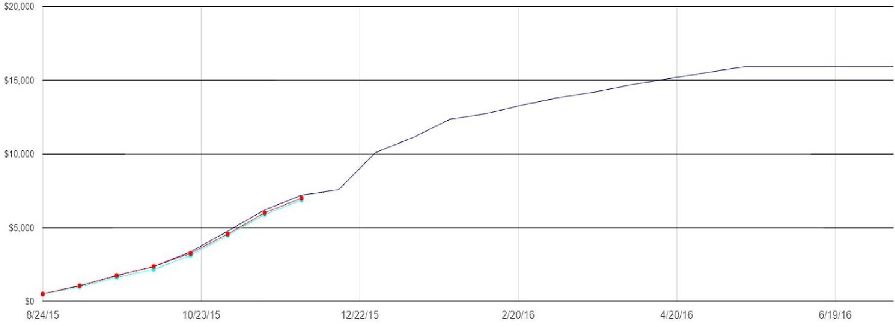


<!-- PDF_PAGE: 54 -->

<div align="center">

Figure 8.2: An EVMS Labor Sum Plot from April 2016. Note the divergence of the plots.

</div>


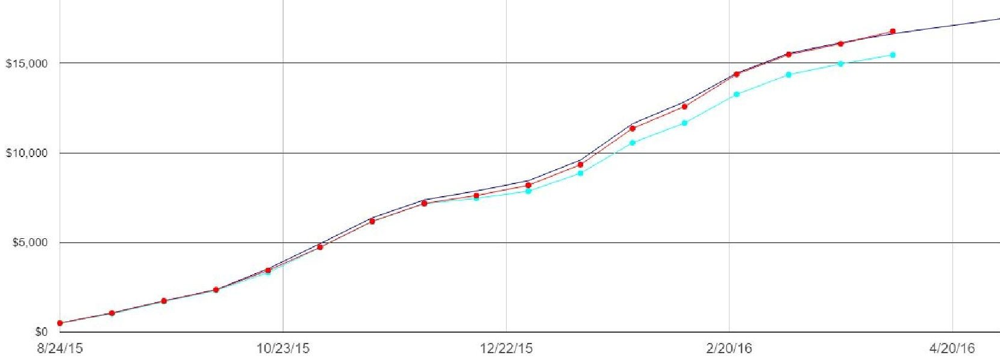


Issues encountered during the Spring 2016 design, implementation, and testing processes included:

- Poor communication from vendors who had inventory on backorder, not in stock

- Difficulty securing a thermal testing chamber for the CubeSat

- Development issues that could ruin a modem or microcontroller, necessitating a replacement

- Sub-optimal print quality with some 3-D printed items

- Reprints of printed items due to unforeseen dimensional conflicts

As a result, the team adapted to each challenge and regularly reassessed the primary goals of the project.

The project focus shifted away from the lofty goal of a space-worthy system within nine months, instead focusing on the design and validation of the core systems of a low cost CubeSat. As part of this effort, the following design goals were accomplished:

- Significant use of 3-D printed components

Battery tray

Radio casing

Microcontroller tray

- Significant use of COTS components

Arduino micromodem

COTS microcontroller

COTS sensors

Yaesu HAM radio

<!-- PDF_PAGE: 55 -->

Cost reduction of CubeSat system

Total cost of $2194.83, as opposed to $7,500 for a common CubeSat kit sold by Pumpkin

- Data gathering and recording by system hardware and software

- Communication and data transfer to ground station via HAM radio

- Antenna deployment

Heat a Nichrome wire to sever a nylon cable, releasing the wrapped antenna from a stowed configuration

Battery-powered operation

## 8.2 Project Accomplishments & Milestones

Not all milestones were met. But, a valid proof of concept was produced to make for an exciting first prototype, and the team foresees a clear path forward for the production of a cost-reducing open-source CubeSat.

For the software, the team could only implement a simplistic software solution that meets requirements, but it is not a solution that is practical for the system power budget or for a space mission. By the end of the integration work for Team 15065, the software did not achieve an implemented system that stores acquired data. Presently, all that occurs for the software is the constant transmission of accelerometer sensor data that goes to the modem, then to the transceiver to transmit to our ground station every 10 seconds, which is merely just a proof of concept software achievement. While this is an important step in integration, it's not practical for an actual space mission. To bring the software to the level of complexity required for the mission, it needs to cater to the planned communication implementation.

Another desired milestone for the Team 15065 CubeSat project was an analysis on whether or not 3-D printed plastic materials could withstand launch conditions. But, there was not enough time in the project to verify this. The analysis would have been a great tool to have when discussing the validity of the commercial-off-the shelf 3-D printed infrastructure CubeSat.

Finally, the project did not reach the milestone in which the system was tested to understand its performance in extreme temperature and pressure conditions. Due to the nature of commercial-off-the-shelf parts, they are not manufactured to operate in vacuum conditions, which would change their function in extreme temperatures. This would have been another great tool to have when assessing the system performance in an actual mission.

<!-- PDF_PAGE: 56 -->

## 8.3 Final Product Photographs

Figure 8.3.1: A SolidWorks CAD mockup of the CubeSat chassis and 3-D printed internal structures


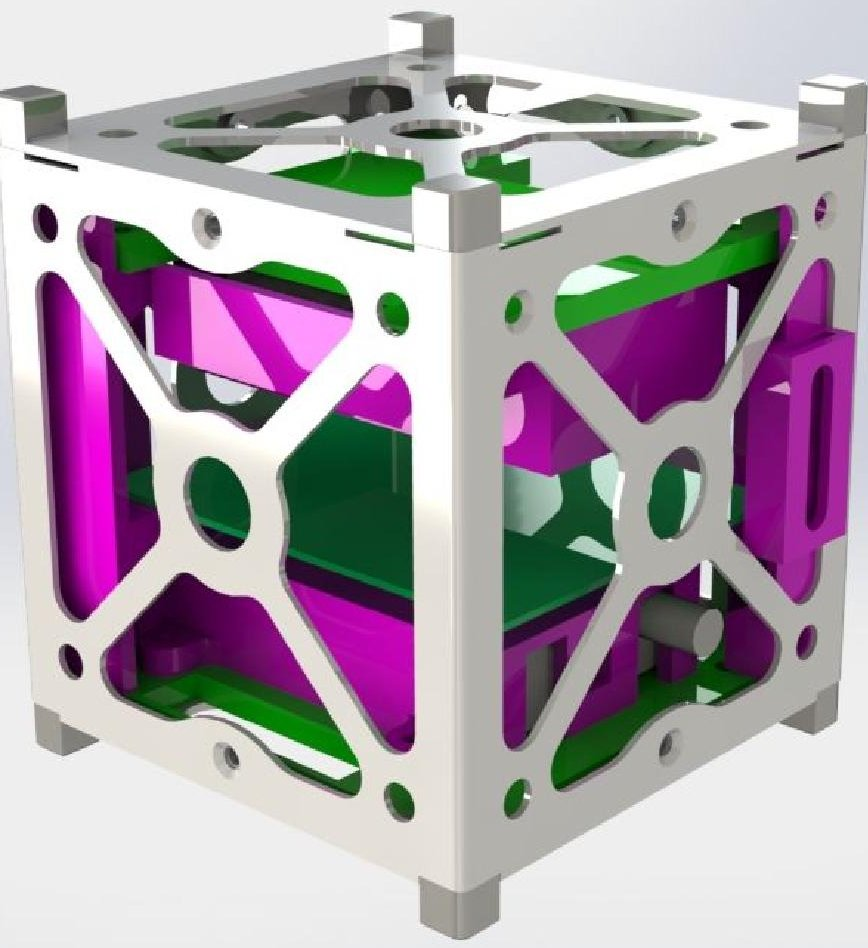


<!-- PDF_PAGE: 57 -->

<div align="center">

Figure 8.3.2: A SolidWorks CAD mockup of the assembled CubeSat (minus solar panels). Note the extended yellow antennas.

</div>


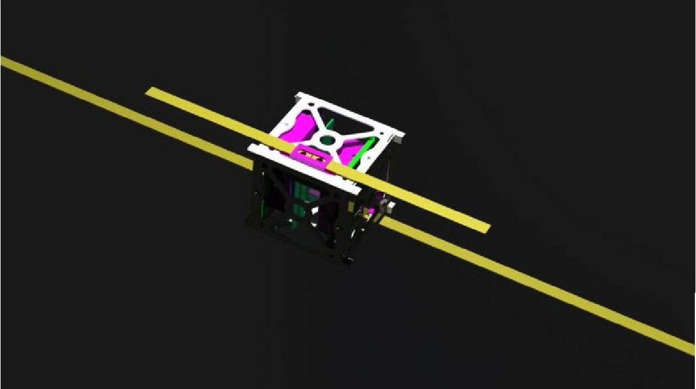


<div align="center">

Figure 8.3.3: An exploded view diagram of the CubeSat, with each component labeled.

</div>


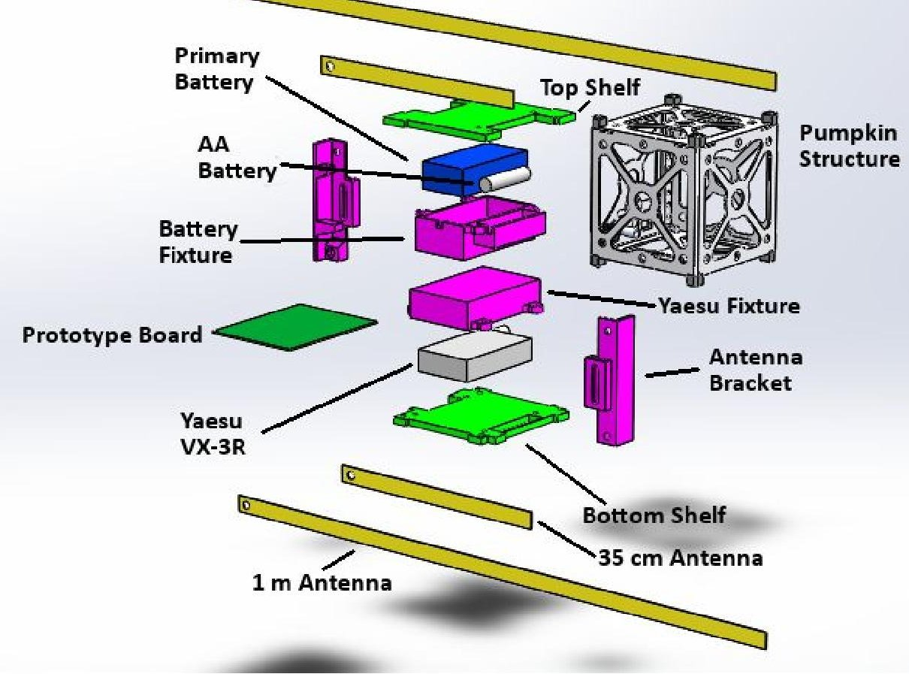


<!-- PDF_PAGE: 58 -->

<div align="center">

Figure 8.3.4: The 3-D printed battery casing. Note the AA battery - this is utilized for the antenna release mechanism. The bulk of the casing contains a rechargeable battery unit that powers the CubeSat's main functions.

</div>


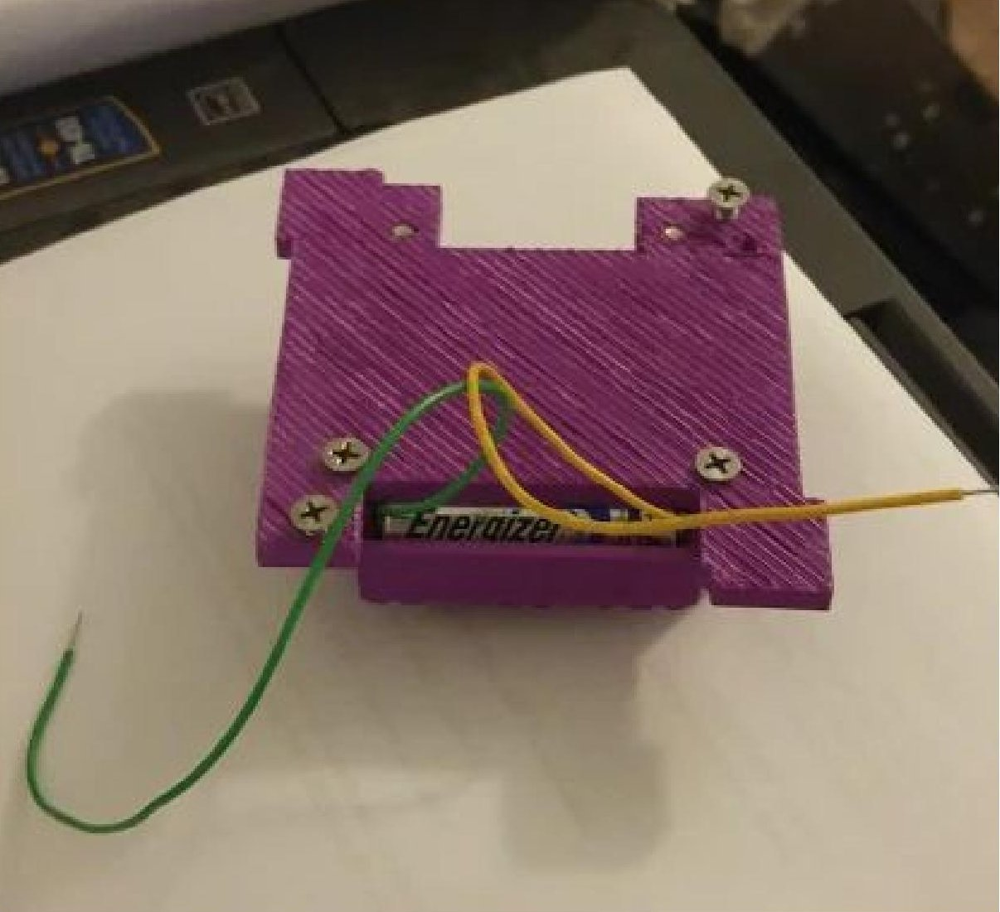


<div align="center">

Figure 8.3.5: A 3-D printed antenna bracket (purple) with antennae (yellow) attached.

</div>


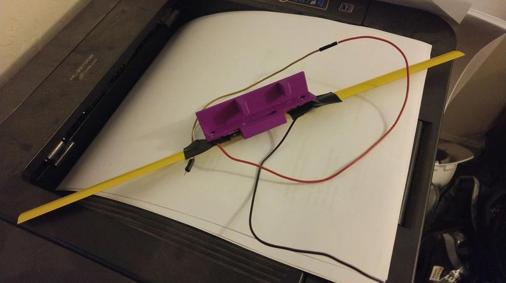


<!-- PDF_PAGE: 59 -->

<div align="center">

Figure 8.3.6: A development board for the CubeSat system. Note the various COTS components.

</div>


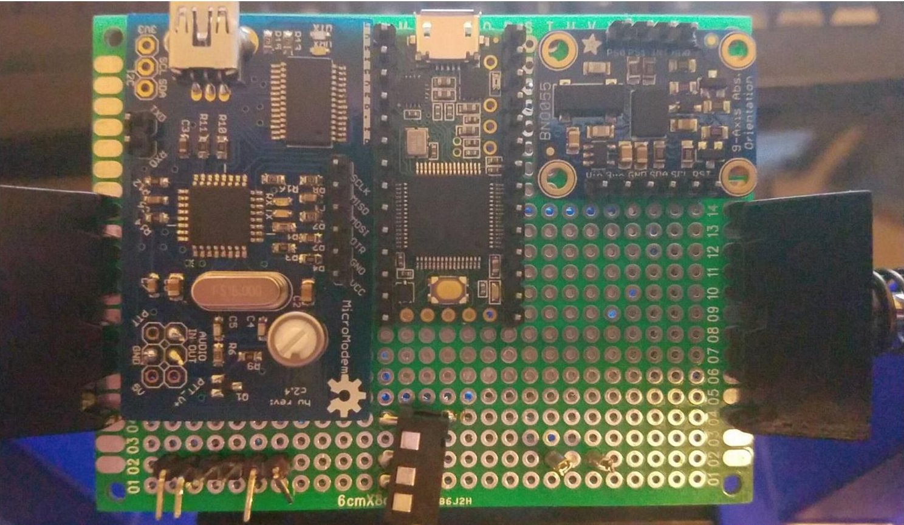


<div align="center">

Figure 8.3.7: The CubeSat under assembly. Note the SolidWorks diagram in the background, used as a reference.

</div>


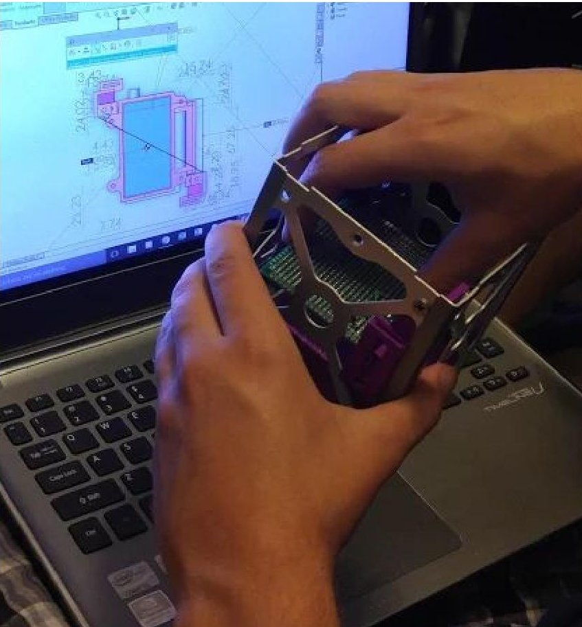


<!-- PDF_PAGE: 60 -->

<div align="center">

Figure 8.3.8: A prototype version of the assembled CubeSat, presented at the Final Status Presentation on April 7, 2016.

</div>


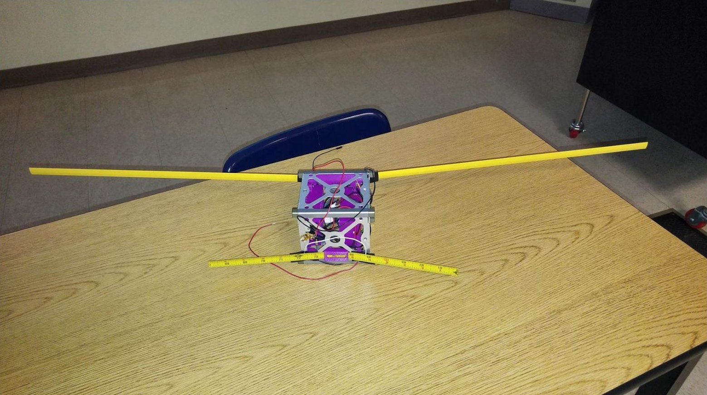


While some of the initial requirements and goals were not met, it became apparent that many of these were not realistic for a nine month CubeSat project. Our team shifted our focus to preliminary development and validation of a reduced-cost CubeSat system, and saw promising results in turn.

<!-- PDF_PAGE: 61 -->

## 9 Requirement Review and System Performance

The Cubesat design was evaluated for whether or not it met the requirements. It was determined whether each requirement was fulfilled by the design, or whether further testing would be required.

As for requirements, the finalized requirement set was partly met, as shown in the table below:

<div align="center">

Table 9.1: Requirements Review

</div>

<table border="1"><tr><td colspan="3">System Requirement Verification Matrix</td></tr><tr><td>#</td><td>Title</td><td>Verification</td></tr><tr><td></td><td colspan="2">Requirements</td></tr><tr><td>100</td><td colspan="2">MECHANICAL</td></tr><tr><td>101</td><td>NanoRack Interfacing</td><td>Future Development</td></tr><tr><td>102</td><td>Mass(&lt;1.33kg)</td><td>Meets</td></tr><tr><td>200</td><td colspan="2">ELECTRICAL</td></tr><tr><td>210</td><td>Self-Powered</td><td>Meets</td></tr><tr><td>211</td><td>Power On and Off</td><td>Future Development</td></tr><tr><td>212</td><td>Battery Lasting Without Solar Panels</td><td>Meets</td></tr><tr><td>213</td><td>Number of Solar Panels</td><td>Future Development</td></tr><tr><td>220</td><td>Sensors Collecting ECD</td><td>Meets</td></tr><tr><td>221</td><td>ECD Accuracy of+/-5% error</td><td>Meets</td></tr><tr><td>300</td><td colspan="2">SOFTWARE</td></tr><tr><td>301</td><td>Data Storage of32KB</td><td>Meets</td></tr><tr><td>310</td><td>RecordH-SOH</td><td>Future Development</td></tr><tr><td>311</td><td>RecordH-SOH at a Min Rate of1 Data Set per hour</td><td>Future Development</td></tr></table>

<!-- PDF_PAGE: 62 -->

<table border="1"><tr><td>320</td><td>Record ECD</td><td>Meets</td></tr><tr><td>321</td><td>Record ECD at a Min Rate of 1 Data Set per 15 min</td><td>Meets</td></tr><tr><td>400</td><td colspan="2">COMMUNICATION</td></tr><tr><td>410</td><td>Direct Comm to a Ground Station (GS)</td><td>Meets</td></tr><tr><td>411</td><td>Comm Distance Ranges of 400 km to 735 km</td><td>Designed to Meet, Not Verified</td></tr><tr><td>420</td><td>Transmit Data to the GS through Downlink</td><td>Meets</td></tr><tr><td>421</td><td>Link Budget (1KB/s)</td><td>Meets</td></tr><tr><td>500</td><td colspan="2">ENVIRONMENTAL</td></tr><tr><td>501.1</td><td>Vibe: Soyuz, 1st Stage Flight Random Vibration</td><td>De-Scoped by Sponsor</td></tr><tr><td>501.2</td><td>Vibe: Soyuz Flight Event Shocks</td><td>De-Scoped by Sponsor</td></tr><tr><td>510</td><td>Operate in the ISS Orbit Release Condition</td><td>Designed to Meet, Not Verified</td></tr><tr><td>511</td><td>Operate in 10^-5 torr</td><td>Designed to Meet, Not Verified</td></tr><tr><td>512</td><td>Operate in -20 C to 60 C</td><td>Designed to Meet, Not Verified</td></tr><tr><td>600</td><td colspan="2">CONSTRAINTS</td></tr><tr><td>601</td><td>Min. 75% COTS electronics</td><td>Meets</td></tr><tr><td>602</td><td>Min. 75% 3-D Printed Internal Structure</td><td>Meets</td></tr><tr><td>603</td><td>Budget of $3,500</td><td>Meets</td></tr></table>

## 9.1 Acceptance Test Plan

The Acceptance Test Plan (ATP) lays out a set of testing protocols used to approve the final, assembled CubeSat. Elements of this document will likely change as the project progresses, but the the ATP provides a framework for the objective performance that is expected of the final assembly. The ATP individual test template is shown below.

<!-- PDF_PAGE: 63 -->

<table><thead><tr><th colspan="6">Acceptance Testing - Case Specification Form<br>In support of the Acceptance Test Plan. Senior Design Team 1565, Fall 2015</th></tr></thead><tbody><tr><td>TEST CASE</td><td colspan="4"></td><td>FUNCTIONAL GROUP</td><td></td></tr><tr><td>REQUIREMENT</td><td colspan="4"></td><td>VERSION</td><td>1.0</td></tr><tr><td colspan="2">EXECUTED BY</td><td>DATE</td><td>WITNESSED BY</td><td>DATE</td><td></td><td></td></tr><tr><td colspan="2"></td><td></td><td></td><td></td><td></td><td></td></tr><tr><td colspan="2">TEST SCENARIO OBJECTIVE</td><td colspan="5"></td></tr><tr><td colspan="2">INSTRUCTIONS</td><td colspan="5"></td></tr><tr><td colspan="2">PRE-TEST CONDITIONS</td><td colspan="5"></td></tr><tr><td colspan="2">EQUIPMENT</td><td colspan="5"></td></tr><tr><td>STEP</td><td>FOCUS</td><td>ACTION</td><td colspan="2">EXPECTED RESULT</td><td>P/F</td><td>COMMENTS</td></tr><tr><td>1</td><td></td><td></td><td colspan="2"></td><td></td><td></td></tr><tr><td>2</td><td></td><td></td><td colspan="2"></td><td></td><td></td></tr><tr><td>3</td><td></td><td></td><td colspan="2"></td><td></td><td></td></tr><tr><td>4</td><td></td><td></td><td colspan="2"></td><td></td><td></td></tr><tr><td>5</td><td></td><td></td><td colspan="2"></td><td></td><td></td></tr></tbody></table>

Please see Appendix 12.1 for the complete Acceptance Test Plan document.

<!-- PDF_PAGE: 64 -->

## 10 Closure

## 10.1 Summary

CubeSats are cost effective satellites that can be used for academic, private, and government purposes. They are cheap to produce, compact enough for flight missions to send multiples at a time, and are capable of gathering large amount of data. For this project, our team was able to design and create a prototype CubeSat through the use of commercial off the shelf (COTS) parts.

Through careful analysis, our team procured COTS parts such as a Ham radio, microprocessor, sensors, battery, solar panels, and modem. These parts were chosen to be cost efficient, easy to buy, and small in size to fit into our chassis. We were successful in creating a CubeSat that costs around $1000. This is significantly lower than the price of $7,500 from a retailer selling CubeSat kits.

## 10.2 Challenges

The use of COTS part did not come without its problems however. Because all the parts were purchased seperately, we ran into problems with integrating each part together. Our biggest challenge was implementing our communication components. Since our team had limited knowledge of communication devices, a lot of research was put into this part of the project. To overcome our lack of experience, we contacted experts in this field through the University of Arizona, and through Ham radio enthusiasts. After compiling all our information and through careful consideration, we finally decided to use a Yeasu Ham radio integrated with a modem to transmit and receive through two tape measure antennas. From this challenge, we learned the importance of utilizing outside expertise in our decision making.

## 10.3 Room for Improvement with More Time & Funding

Had there been more time, the team would have implemented more temperature sensors around various parts of the CubeSat, the memory and data storage would have been integrated, and the solar panels would have been installed. More importantly, the team would have focused more energy on designing a system that met the NanoRacks deployment system requirements.

With more money, the team would have sealed the deal on a ticket to Earth's atmosphere and put money down on a launch opportunity. With the intention to do that, the team would have needed to carry the product through a comprehensive temperature and vibration testing plan in the appropriate testing facilities, which may have required spending a good deal of money. Also, with

<!-- PDF_PAGE: 65 -->

more money, the team desired to purchase the Pumpkin Structure chassis which totals $1700.

One of the huge things that the team missed an opportunity on with this CubeSat prototype was that the mission planning. This involves when the CubeSat will downlink data, the implementation and utilization of certain power modes, and a comprehensive power budget. With more time, the team would have had the chance to observe the effect that temperature had on the power budget.

<!-- PDF_PAGE: 66 -->

## 11 References

ACP, KDW, and MR. NanoRacks CubeSat Deployer (NRCSD) Interface Control Document. Rev 0.36 NanoRacks, 2013. PDF file.

Lan, W. "Poly Picosatellite Orbital Deployer Mk III ICD." The CubeSat Program. California Polytechnic State University, San Luis Obispo, CA. 8 Aug. 2007. . 29 Oct. 2007.

Markqvist. "MicroModem." Unsignedio. N.p., 13 May 2014. Web. 09 Dec. 2015.

Perez, Edouard. Soyuz User's Manual. Issue 2, Rev 0. N.p.: arianespace, 2012. Web. 9 Dec. 2015.

"Review of Yaesu VX-3R 2 M/70 Cm FM Transceiver." Review of Yaesu VX-3R. N.p., n.d. Web. 26 Nov. 2015.

Soyuz User's Manual, Issue 2 Revision 0, March 2012 Soyuz at the Guiana Space Centre, Arianespace

The CubeSat Program, California Polytechnic State University, San Luis Obispo, CA 93407

## 11.1 Datasheets

Temperature Sensor (TMP36) Circuitry http://cdn.sparkfun.com/datasheets/Sensors/Temp/TMP35_36_37.pdf

Yaesu VX-3R http://yaesu.com/indexVS.cfm?cmd=DisplayProducts&ProdCatID=111&encProdID=5CB596EBED9A3EE26635C7E1F02500D9

Bosch BNO055 https://www.adafruit.com/datasheets/BST_BNO055_DS000_12.pdf

Teensy 3.2 https://cdn.sparkfun.com/datasheets/Dev/Arduino/Boards/K20P64M72SF1.pdf

Arduino Pro Mini https://www.arduino.cc/en/Main/ArduinoBoardProMini http://www.atmel.com/images/Atmel-8271-8-bit-AVR-Microcontroller-ATmega48 A-48PA-88A-88PA-168A-168PA-328-328P_datasheet_Complete.pdf

<!-- PDF_PAGE: 67 -->


<!-- PDF_PAGE: 68 -->

## 12.1 Engineering Drawings


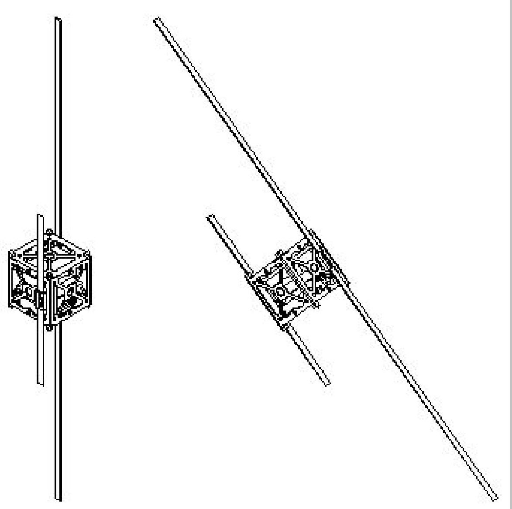


```markdown

```

<table><tr><td></td><td></td><td rowspan="5"></td><td></td><td></td><td></td><td rowspan="7"></td><td rowspan="7"></td></tr><tr><td></td><td></td><td></td><td></td><td></td></tr><tr><td></td><td></td><td></td><td></td><td></td></tr><tr><td></td><td></td><td></td><td></td><td></td></tr><tr><td></td><td></td><td></td><td></td><td></td></tr><tr><td></td><td></td><td rowspan="2"></td><td></td><td></td><td></td></tr><tr><td></td><td></td><td rowspan="3" colspan="3"></td></tr><tr><td></td><td></td><td rowspan="2"></td><td></td><td></td></tr><tr><td></td><td></td><td></td><td></td></tr><tr><td></td><td></td><td></td><td></td><td></td><td></td><td rowspan="2">newshelves</td><td rowspan="2"></td></tr><tr><td colspan="2"></td><td></td><td></td><td></td><td></td></tr></table>

<!-- PDF_PAGE: 69 -->


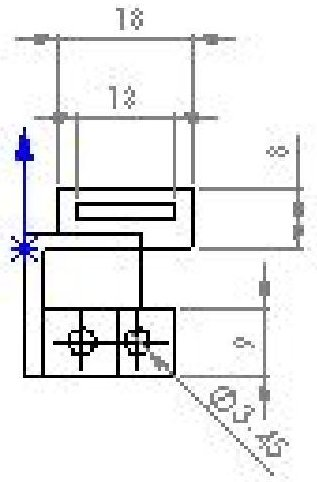


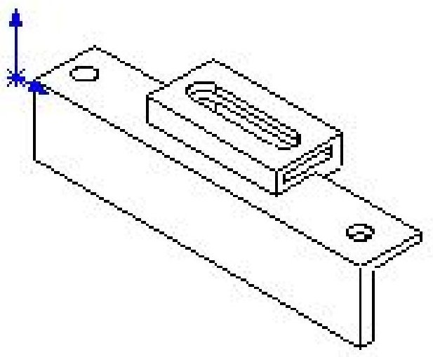


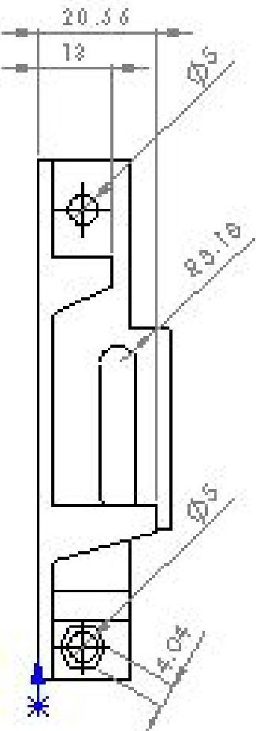


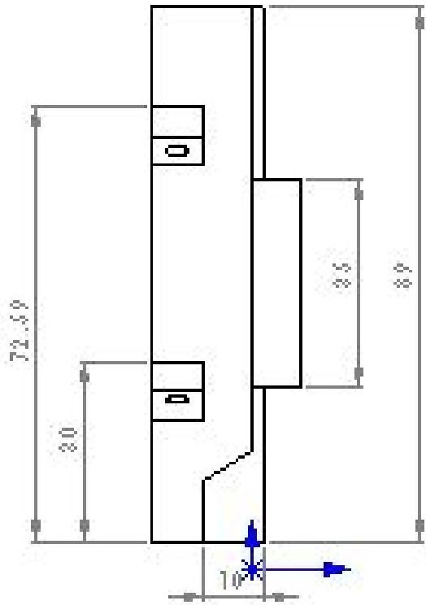


<table border="1"><tr><td rowspan="5"></td><td></td><td></td><td rowspan="5"></td><td></td><td></td><td></td><td rowspan="5"

<!-- PDF_PAGE: 70 -->


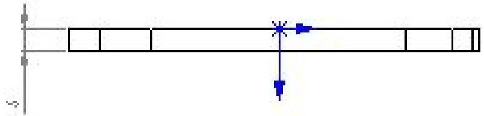


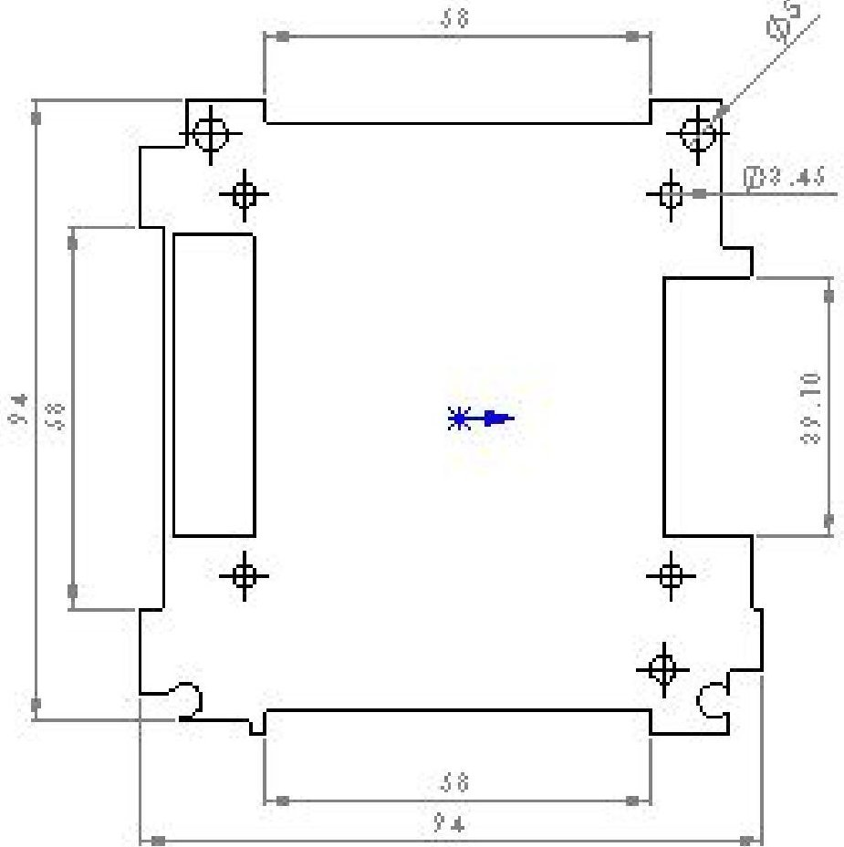


```markdown

```

<table><tr><td></td><td></td><td rowspan="5">HIGH HIGH 

<!-- PDF_PAGE: 71 -->


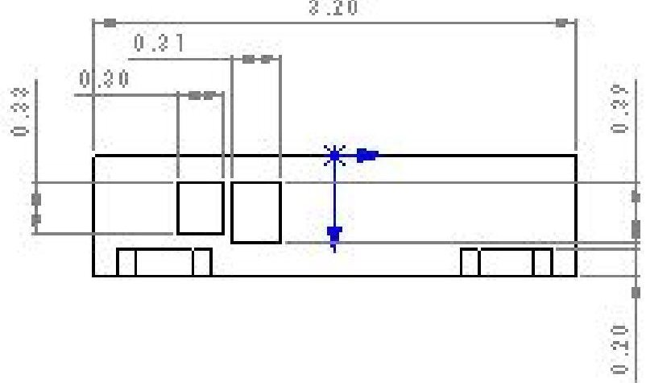


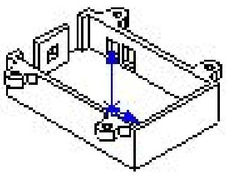


<table border="1"><tr><td rowspan="6"></td><td></td><td></td><td rowspan="6"></td><td></td><td></td><td></td><td rowspan="6"

<!-- PDF_PAGE: 72 -->


<table><tr><td rowspan="5"></td><td></td><td></td><td rowspan="5"></td><td></td><td></td><td></td><td rowspan="5"

<!-- PDF_PAGE: 73 -->


<table><tr><td rowspan="5"></td><td></td><td></td><td rowspan="5"></td><td></td><td></td><td></td><td rowspan="7"></td><td rowspan="7"></td></tr><tr><td></td><td></td><td></td><td></td><td></td></tr><tr><td></td><td></td><td></td><td></td><td></td></tr><tr><td></td><td></td><td></td><td></td><td></td></tr><tr><td></td><td></td><td></td><td></td><td></td></tr><tr><td rowspan="4"></td><td></td><td></td><td rowspan="2"></td><td></td><td></td><td></td></tr><tr><td></td><td></td><td rowspan="3" colspan="3"></td></tr><tr><td></td><td></td><td></td><td></td></tr><tr><td></td><td></td><td></td><td></td><td></td></tr></table>

<!-- PDF_PAGE: 74 -->

## 12.2 Budget and Suppliers

<div align="center">

Table 12.2.1: Bill of Materials of Prototype

</div>

<table border="1"><tr><td>Item Description</td><td>Supplier</td><td>Part No</td><td>Delivery Lead Time</td><td>Quantity</td><td>Unit Price ($)</td></tr><tr><td>Board</td><td>SparkFun</td><td>Teensy 3.2</td><td>~1 week</td><td>1</td><td>$19.95</td></tr><tr><td>Modem</td><td>Unsigned.io</td><td>MicroModem</td><td>~2 week</td><td>1</td><td>$67.54</td></tr><tr><td>Storage</td><td>Adafruit</td><td>SD Memory Card 8GB</td><td>1 week</td><td>1</td><td>$19.90</td></tr><tr><td>Radio</td><td>Universal Radio Inc.</td><td>Yaesu VX-3R</td><td>&lt;1 month</td><td>1</td><td>$53.00</td></tr><tr><td>Battery</td><td>Adafruit</td><td>Li-Ion Battery -3,7V 4400mAh</td><td>1 week</td><td>1</td><td>$19.95</td></tr><tr><td>Solar Panels</td><td></td><td>.6W 5.5V</td><td>1 week</td><td>6</td><td>$3.33</td></tr><tr><td>IMU</td><td>Adafruit</td><td>BN0055</td><td>1 week</td><td>1</td><td>$34.95</td></tr><tr><td>Temperature Sensor</td><td>SparkFun</td><td>TMP36</td><td>1 week</td><td>6</td><td>$3.49</td></tr><tr><td>Antenna</td><td>Amazon</td><td>Stanley 30-485 12-by-1/2-Inch Tape Measure</td><td>1 week</td><td>1</td><td>$6.49</td></tr><tr><td rowspan="2" colspan="3"></td><td colspan="2">TOTAL</td><td>$1,686.07</td></tr><tr><td colspan="2">TOTAL (30% MOE for shipping and tax)</td><td>$2,191.89</td></tr></table>

<div align="center">

Table 12.2.2: Full Project Expenses

</div>

<table border="1"><tr><td>Item/Part #</td><td>Description</td><td>Vendor</td><td>Purchased</td><td>Arrived</td><td>Quantity</td><td>Unit $</td><td>Amount</td></tr><tr><td>Yaesu VX-3R</td><td>Radio</td><td>Universal Radio, Inc.</td><td>12/23/15</td><td>1/19/16</td><td>3</td><td>$139.95</td><td>$419.85</td></tr><tr><td>MicroModem</td><td>Modem</td><td>Unsigned.io</td><td>1/15/16</td><td>1/27/16</td><td>2</td><td>$83.04</td><td>$166.08</td></tr><tr><td>Teensy 3.2</td><td>Microcontroller</td><td>SparkFun</td><td>1/15/16</td><td>1/28/16</td><td>5</td><td>$19.95</td><td>$99.75</td></tr><tr><td>TMP36</td><td>Temperature Sensor</td><td>SparkFun</td><td>1/15/16</td><td>1/28/16</td><td>30</td><td>$1.50</td><td>$42.90</td></tr><tr><td>BNO055 Absolute Sensor</td><td>9-DOF IMU</td><td>Adafruit Industries</td><td>1/15/16</td><td>1/26/16</td><td>5</td><td>$34.95</td><td>$174.75</td></tr></table>

<!-- PDF_PAGE: 75 -->

<table border="1"><tr><td>Breadboard-830p</td><td>Breadboard</td><td>Built-to-Spec</td><td>1/15/16</td><td>1/21/16</td><td>1</td><td>$6</td><td>$6</td></tr><tr><td>Li-Ion 18650 Battery 7.4V 2.6Ah</td><td>Main Battery</td><td>AA Portable Power</td><td>2/10/16</td><td>1/27/16</td><td>2</td><td>$35.95</td><td>$71.90</td></tr><tr><td>Smart Charger(1.2A)</td><td>Battery Charger</td><td>AA Portable Power</td><td>2/10/16</td><td>1/27/16</td><td>1</td><td>$27.95</td><td>$27.95</td></tr><tr><td>IRF820PBF-ND</td><td>Transistor</td><td>DigiKey</td><td>2/22/16</td><td>2/26/16</td><td>10</td><td>$0.85</td><td>$8.47</td></tr><tr><td>641-1312-1-ND</td><td>Diodes</td><td>DigiKey</td><td>2/22/16</td><td>2/26/16</td><td>10</td><td>$0.10</td><td>$0.99</td></tr><tr><td>MC7805BDTGOS-ND</td><td>Voltage Regulator</td><td>DigiKey</td><td>2/22/16</td><td>2/26/16</td><td>10</td><td>$0.54</td><td>$5.39</td></tr><tr><td>1/4W 86 Value 860 Piece Resistor</td><td>Resistors</td><td>Amazon</td><td>2/26/16</td><td>2/29/16</td><td>1</td><td>$17.99</td><td>$17.99</td></tr><tr><td>iXCC 3-Ft Male to Male 3.5mm Aux Cable</td><td>Auxiliary Cable</td><td>Amazon</td><td>2/26/16</td><td>2/29/16</td><td>4</td><td>$4.99</td><td>$19.96</td></tr><tr><td>PCB Mount Female 3.5mm Stero Jack Connector</td><td>Stereo Jack Connector</td><td>Amazon</td><td>2/26/16</td><td>2/29/16</td><td>1</td><td>$4.91</td><td>$4.91</td></tr><tr><td>Phantom YoYo 40P Dupont Cable 200mm M to F</td><td>Dupont Cables</td><td>Amazon</td><td>2/26/16</td><td>2/29/16</td><td>1</td><td>$3.96</td><td>$3.96</td></tr><tr><td>MicroSD card breakout board+</td><td>SD Breakout Board</td><td>Adafruit Industries</td><td>2/26/16</td><td>3/3/16</td><td>2</td><td>$7.50</td><td>$15.00</td></tr><tr><td>SD/MicroSD Memory Card(8GB SDHC)</td><td>SD Card</td><td>Adafruit Industries</td><td>2/26/16</td><td>3/3/16</td><td>2</td><td>$9.95</td><td>$19.90</td></tr><tr><td>Lithium Ion battery pack 3.7V 4.4Ah</td><td>Main Battery</td><td>Adafruit Industries</td><td>2/26/16</td><td>3/3/16</td><td>1</td><td>$19.95</td><td>$19.95</td></tr><tr><td>Yaesu VX-3R</td><td>Radio</td><td>Amazon</td><td>3/22/16</td><td>1/19/16</td><td>1</td><td>$139.95</td><td>$139.95</td></tr><tr><td>MicroModem</td><td>Modem</td><td>Unsigned.io</td><td>3/25/16</td><td>1/27/16</td><td>3</td><td>$83.04</td><td>$249.12</td></tr><tr><td>Lithium Ion battery 3.7V 4.4Ah</td><td>Main Battery</td><td>Adafruit Industries</td><td>3/29/16</td><td>4/7/16</td><td>2</td><td>$19.95</td><td>$39.90</td></tr><tr><td>USB LiIon Charger</td><td>Battery Charger</td><td>Adafruit Industries</td><td>3/29/16</td><td>4/7/16</td><td>1</td><td>$12.50</td><td>$12.50</td></tr><tr><td>Type 18-8 Steel Narrow Hex Nut</td><td>Fasteners</td><td>McMaster</td><td>3/31/16</td><td>4/4/16</td><td>1</td><td>$3.83</td><td>$3.83</td></tr></table>

<!-- PDF_PAGE: 76 -->

<table border="1"><tr><td>316 Stainless Steel Flat Head Machine Screw</td><td>Fasteners</td><td>McMaster</td><td>3/31/16</td><td>4/4/16</td><td>1</td><td>$6.31</td><td>$6.31</td></tr><tr><td colspan="2">Design Day Set-up</td><td>Amazon</td><td>4/6/16</td><td>4/12/16</td><td>1</td><td>$435.34</td><td>$435.34</td></tr></table>

<!-- PDF_PAGE: 77 -->

## 12.3 Project Management


<div align="center">

Figure 12.3.1: First Semester CubeSat Design Schedule

</div>

For the following charts, a yellow stripe represents a day in which we will have a sponsor meeting.


<div align="center">

Figure 12.3.1: Preliminary Schedule for Integration Phase (Before Spring Break)

</div>

<!-- PDF_PAGE: 78 -->


<div align="center">

Figure 12.3.3: Full Plan for Integration Phase

</div>

## 12.4 Acceptance Testing Plan

<div align="center">

Table 12.4.1: Acceptance Test Plan - Preliminary Test

</div>

<table border="1"><tr><td>Test #</td><td>Requirement/Description</td><td>Test Plan</td><td>Assembly State</td><td>Software State</td><td>Req.#</td></tr><tr><td colspan="3">Preliminary Testing</td><td></td><td></td><td></td></tr><tr><td>Pre.T.1</td><td></td><td>Check That Each Component Works</td><td>none</td><td>not required</td><td></td></tr><tr><td>Pre.T.1</td><td>Radio Functioning</td><td>Turn radio on and transmit to another receiver.</td><td>Radio Box</td><td>not required</td><td></td></tr><tr><td>Pre.T.1</td><td>Battery Works</td><td>Use battery to power Teensy.</td><td>Battery+Teensy+Sensors</td><td>Preliminary Software</td><td></td></tr><tr><td></td><td>Each rail shall have a minimum width of 6mm+0.1mm/-0.0mm tolerance.</td><td>Upon receipt of the Pumpkin Structure, measure it. Use calipers.</td><td>Pumpkin Structure</td><td>not required</td><td>746.2</td></tr><tr><td></td><td>The edges of the rails shall be rounded to a radius of at least 0.5mm+/-.1mm.</td><td>Upon receipt of the Pumpkin Structure, measure it. Take a picture of the top and bottom of the rail (must see curvature) and post-process the image.</td><td>Pumpkin Structure</td><td>not required</td><td>746.3</td></tr><tr><td></td><td>Each rail end face shall have a minimum surface area of 4mmx4mm for contact with the adjacent CubeSats.</td><td>Upon receipt of the Pumpkin Structure, measure it. Use calipers. Only measure the flat part (don&#x27;t include rounded edge).</td><td>Pumpkin Structure</td><td>not required</td><td>746.4</td></tr></table>

<!-- PDF_PAGE: 79 -->

<table border="1"><tr><td></td><td>The minimum extension of the CubeSat rail standoffs beyond the CubeSat+/-Z face shall be 6.5mm(see Figure7).</td><td>Upon receipt of the Pumpkin Structure, measure it. Use calipers.</td><td>Pumpkin Structure</td><td>not required</td><td>746.5</td></tr><tr><td></td><td>Rail length variance in the Z axis between rails shall not exceed±0.1mm.</td><td>Upon receipt of the Pumpkin Structure, measure it. Use calipers.Record separation at10evenly spaced locations along the length of the rails.</td><td>Pumpkin Structure</td><td>not required</td><td>746.6</td></tr><tr><td></td><td>CubeSat developers can verify mechanical compatibility by a fit check with a gauge built to the requirements in Figure8.</td><td>TBD.Should be okay since we&#x27;re getting the Pumpkin Structure?</td><td>Pumpkin Structure</td><td>not required</td><td>746.8</td></tr><tr><td></td><td>CubeSats that utilize on-board batteries shall comply with NASA requirements for battery safety.</td><td>Ensure that overcharge will not occur by analyzing capabilities of the solar panels(this could require test on the solar panels).Voltages provided to the battery cannot exceed the stated maximum battery voltage.</td><td>Battery In-Hand</td><td>not required</td><td>752</td></tr><tr><td>Pre.T.1</td><td>Solar Panels</td><td>Test the capabilities of the solar panels in direct radiation with the solar panel circuit.Verify that the circuit works as intended,and is ready for product integration.</td><td>Solar Panel Circuit</td><td>not required</td><td>link to213</td></tr><tr><td>Pre.T.1</td><td>Capabilities of Each Sensor</td><td>With bare configuration,assess the accuracy of the Environmental Condition Data and the Hardware Statement of Health.</td><td>Sensor+Teensy</td><td>Preliminary Software</td><td>none</td></tr><tr><td>Pre.T.1</td><td>Power Budget Preliminary Confirmation</td><td>Test current draw/voltage levels of each electronics device while in use.</td><td>Electronics Stack(minimal)</td><td>Preliminary Software</td><td>link to212</td></tr><tr><td>Pre.T.2</td><td>The CubeSat center of gravity shall be within2cm of its geometric center.</td><td>In order to perform the analysis,a test must be performed to measure the mass of each item in the CubeSat,and their exact placement.Approximations on location can be made,unless the calculated center of mass exceeds1.75cm.Then,more testing is required.</td><td>Pre-Full Assembly</td><td>not required</td><td>743</td></tr></table>

<!-- PDF_PAGE: 80 -->

<div align="center">

Table 12.4.2: Acceptance Test Plan - Integration Test

</div>

<table border="1"><tr><td>Test #</td><td>Requirement / Description</td><td>Test Plan</td><td>Assembly State</td><td>Software State</td><td>Req. #</td></tr><tr><td colspan="6">Integration Testing</td></tr><tr><td>I.T.1</td><td>The CubeSat shall be able to power on and off.</td><td>Press push button. Check that system functions as it should once the button is pressed(write up a list of what&#x27;s expected when the system powers on, can be TBR).</td><td>Electronics Stack(minimal)</td><td>Flight Software required</td><td>211</td></tr><tr><td>I.T.1</td><td>Antenna Deployment</td><td>Test using the heating of the nichrome wire to burn off the nylon string. Arrange the antenna and nylon and nichrome in such a configuration that would be used on the actual CubeSat.Test without any electronics(dangerous current level) then test again later with the full assembly.</td><td>Pumpkin Structure+Antenna+Nichrome+Nylon</td><td>not required</td><td></td></tr><tr><td>I.T.1</td><td>Memory Storage</td><td>Collect HSOH and ECD for 3 hours.Observe that the data from these collections are populating in memory.Can use a UART.</td><td>Electronics Stack(minimal)</td><td>Flight Software goal</td><td></td></tr><tr><td>I.T.1</td><td>Downlink Data Loss Statistics</td><td>Use a UART cable to view HSOH&amp;ECD data being recorded.Check that dowlinked data corresponds to data in memory.This ensures that data is downlinking and it gives an idea of what to expect when data is downlinked.</td><td>Electronics Stack w/Modem</td><td>Flight Software goal</td><td></td></tr><tr><td>I.T.1</td><td>CubeSats must have a timer(set to minimum of 30 min.)before operation or deployment of appendages.If deploy switches should be released causing timer to run,the timer must automatically reset when the Remove Before Flight(RBF) feature is replaced and/or deploy switches are returned to open state</td><td>Test the timer.Ensure that no current is flowing through the nichrome burn wire before 30 minutes is expired.Remove then re-install the(TBD)Remove Before Flight feature.Ensure that the 30-minute timer has restarted.</td><td>30-minute Timer Complete,and Electronics Stack OR Fully Assembled</td><td>Flight Software required</td><td></td></tr><tr><td>I.T.1</td><td>Validity of Radio Time SW Schedule</td><td>Test software for radio timing.Can be done in close range.Requires transmission from receiver&quot;ground station&quot;radio.Do a test of all radio test cases(cases TBD depending on how software is written).Test how long it takes for radio to consume battery power to ensure that the Ground Station Tag opening window duration of 16 hours(estimated from Power Budget) is valid.</td><td>Electronics Stack</td><td>Flight Software required</td><td></td></tr><tr><td>I.T.1</td><td>Power Budget Integration Confirmation</td><td>Test current draw/voltage levels of each electronics device while in use.</td><td>Electronics Stack(minimal)</td><td>Preliminary Software</td><td>733</td></tr></table>

Table 12.4.3: Acceptance Test Plan - Acceptance Tests

<!-- PDF_PAGE: 81 -->

<table border="1"><tr><td>Test #</td><td>Requirement/Description</td><td>Test Plan</td><td>Assembly State</td><td>Software State</td><td>Req.#</td></tr><tr><td colspan="6">Acceptance Testing</td></tr><tr><td>A.T.1.1</td><td>The CubeSat shall be supplied by battery to last without solar panels for a min. of 1 day.</td><td>Leave the CubeSat on for 24 hours in a dark storage area. Not transmitting with the radio (TBR). Check to make sure it is still functioning after 24 hours has expired.</td><td>Electronics Stack(minimal)</td><td>Flight Software required</td><td>212</td></tr><tr><td>A.T.1.2</td><td>The software shall record Hardware Statements of Health at a minimum rate of 1 data set per 1 hour.</td><td>Allow software to gather SOH for at least 3 hours. Ensure that the Teensy is connected by UART to a computer so the test observer can see data populating. Record the time at each point the software gathers an HSOH. Ensure that over the 3-hour course, there is not a variation in the time that would cause this requirement to not be met.</td><td>Electronics Stack(minimal)</td><td>Flight Software required</td><td>311</td></tr><tr><td>A.T.1.3</td><td>The software shall record Environmental Condition Data at a minimum rate of 1 data set per 15 minutes.</td><td>Allow the software to gather environmental condition data for at least 3 hours. Ensure that the Teensy is connected by UART to a computer so the test observer can see data populating. Record the time at each point that the software gathers an ECD. Ensure that over the course of the 3 hours, there is not a variation in the time that would cause this requirement to not be met.</td><td>Electronics Stack(minimal)</td><td>Flight Software required</td><td>321</td></tr><tr><td>A.T.2.1</td><td>The CubeSat shall be able to send a communications signal for distance ranges of 400km to 1000km.</td><td>Assemble the radio system in Flight configuration(PCB, tape measure antennas, connector, CubeSat battery). The software shall be in a configuration in which the radio will immediately stream data to the CubeSat(which is different than the Flight Software configuration!). First, perform a close-range test in which the TX radio is within 15m of the receiving radio(with low power TBD?), to prove functionality, and the receipt of data through a downlink. Then, the same radio system shall undergo a Line of Sight test at an appropriate distance(TBD) with the appropriate output power setting(TBD). Before the test, ensure a HAM certified individual is with the TX radio, and that appropriate attenuation is utilized.The output power must be chosen to prove that extrapolated analysis can be performed to meet the requirement.</td><td>Electronics Stack(minimal)</td><td>SW not required, modem is required</td><td>411</td></tr><tr><td>A.T.2.2</td><td>The CubeSat shall operate with a link budget of 1kb/s.</td><td>Assemble the radio system in Flight configuration(PCB, tape measure antennas, connector, CubeSat battery). The software shall be in a data-stream configuration.The radio will immediately stream data to the CubeSat(which is different than the Flight Software configuration!). First, perform a close-range test in which the transmitting radio is within 15m of the receiving radio(with low power TBD?), to prove functionality, and the receipt of data through a downlink. For a successful test, check in the ground station computer that 1000 or more bits of data has been populated in 1 second. Then, perform this test at a long-range distance(follow test for 411).</td><td>Electronics Stack(minimal)</td><td>Flight Software required</td><td>421</td></tr><tr><td>Test #</td><td>Requirement/Description</td><td>Test Plan</td><td>Assembly State</td><td>Software State</td><td>Req.#</td></tr></table>

<!-- PDF_PAGE: 82 -->

<table border="1"><tr><td></td><td>Deployment switches force exerted shall not exceed 3N.</td><td>Test the force by applying the actuation force to a load cell sensor. Ensure that the load is less than 3N.</td><td>Deployment Switch</td><td>not required</td><td>747.4</td></tr><tr><td></td><td>Each spring shall be captive. When compressed the spring shall be contained within the maximum rail length. Separation spring and the rail end face alignment are shown in Figure 11.</td><td>Compress the spring and measure the height. Observe that it is compliant with NRCSD.</td><td>Deployment Spring</td><td>not required</td><td>748.2</td></tr><tr><td></td><td>Individual separation spring force shall not exceed 3.34 N(0.75 lbs) with the total force for both springs not to exceed 6.67 N(1.5 lbs).</td><td>Test one spring at a time. Compress the spring, ensuring it is compressed as it would be in deployment. Allow the spring to release onto a load cell sensor. Then, test the other spring. Then, perform the test with both springs releasing at the same time. Ensure compliance.</td><td>Deployment Spring</td><td>not required</td><td>748.3</td></tr><tr><td></td><td>During deployment, the CubeSats must be compatible with deployment velocities between 0.5 m/s to 1.5 m/s and accelerations no greater than 2g&#x27;s in the +Z direction.</td><td>De-Scope? This would not prevent us from launching with NanoRacks. But, it is a risk to our mission. Test by placing the CubeSat atop a rolling platform such that the springs would apply a horizontal force to push it sideways. Release the springs such that the CubeSat rolls. Measure the distance and observe any abnormalities. Inspect the rails afterwards to ensure that harm was not done.</td><td>Fully Assembled</td><td>not required</td><td>749</td></tr><tr><td></td><td>The CubeSat electrical system design shall incorporate a minimum of three (3) inhibit switches actuated by physical deployment switches (see Deployment Switches section 4.7) as shown in Figure 12.</td><td>Ensure that the physical actuation provides power to the electrical system. Test the leads at each switch (TBR) or observe that everything that is expected to power on will power on (TBR). Perform the test 10 times.</td><td>Fully Assembled</td><td>Flight Software required</td><td>751.2</td></tr><tr><td>Test #</td><td>Requirement / Description</td><td>Test Plan</td><td>Assembly State</td><td>Software State</td><td>Req. #</td></tr></table>

<!-- PDF_PAGE: 83 -->

<table border="1"><tr><td>A.T.3</td><td>The CubeSat operations shall not begin until a minimum of 30 minutes after deployment from the ISS. Only an onboard timer system may be operable during this 30-minute post deploy time frame.</td><td>Activate the deployment switches, and observe that only the 30-minute timer is functioning. The Teensy, Modem, and Radio should be off.</td><td>Fully Assembled</td><td>Flight Software required</td><td>751.1</td></tr><tr><td>A.T.4.1</td><td>The RBF pin shall preclude any power from any source operating any satellite functions with the exception of pre-integration battery charging.</td><td>Test by removing the RBF pin, then power the system up. Ensure the observation of full system functionality. Then, power the system down. Install the RBF pin. Attempt to power the system up. Ensure that the satellite is not functioning in any capacity.</td><td>Electronics Stack OR Fully Assembled</td><td>Flight Software required</td><td>751.5</td></tr><tr><td>A.T.4.2</td><td>Antenna Deployment</td><td>Test using the heating of the nichrome wire to burn off the nylon string. Utilize the full assembly state.</td><td>Pumpkin Structure + Antenna + Nichrome + Nylon</td><td>not required</td><td>link to 411</td></tr><tr><td>A.T.5</td><td>The CubeSat shall meet all electrical, software, and communication requirements within temperatures of -20℃ to 60℃.</td><td>Utilize flight configuration for assembly and flight software. A testing chamber that can reach -20℃ and 60℃. And, prior approval for RF communication must be obtained. Before the test, record the battery voltage level (to observe change in battery capacity while in temperature, versus at room temperature). Perform 3 sets of the test: 1 with the full temp swing, 1 going cold then coming back to room temp, and one with hot then coming back to room temperature. For each set, observe all of the important measurements (battery, requirements meeting, etc.). Begin the test during a time in which the Flight Software is operating during its period of the radio attempting connectivity with the Ground Station, so radio communication can occur. Ensure that other requirements are being met, except 411 (observe how much power is received from the radio, vs. how much power should be received). Also, post-process the current draw data from the HSOH to ensure that power budget will be met, so that 212 will be met. After the test, inspect everything afterwards to ensure no damage! If time permits, re-perform AT 1-5.</td><td>Electronics Stack (minimal)</td><td>Flight Software required</td><td>512</td></tr><tr><td></td><td>CubeSats shall be designed to withstand overall temperature range of -40℃ to +65℃.</td><td>See Test for Req. 512.</td><td>Fully Assembled</td><td>Flight Software required</td><td>770</td></tr></table>

Table 12.4.4: Acceptance Test Plan - Final Test

<!-- PDF_PAGE: 84 -->

<table border="1"><tr><td>Test #</td><td>Requirement/Description</td><td>Test Plan</td><td>Assembly State</td><td>Software State</td><td>Req.#</td></tr><tr><td colspan="2">Final Testing</td><td></td><td></td><td></td><td></td></tr><tr><td>Fin.T.1</td><td>The CubeSat shall occupy a mass less than or equal to 1.33kg.</td><td>Place on a scale. Ensure mass is less than 1.33kg. Do mass measurements as components are added, and do an analysis to project mass and ensure that the requirement is met.</td><td>Fully Assembled</td><td>not required</td><td>102</td></tr><tr><td>Fin.T.1</td><td>CubeSats shall be passive and self-contained from the time they are loaded into the NRCSD for transport to the ISS and until after deployment from the NRCSD. No charging of batteries, support services, and or support from ISS crew is provided after final integration.</td><td>Test the "stowed configuration". Ensure that no current is flowing from the battery to the MCU or Modem or Radio. Ensure that solar panels are not charging battery (TBR?).</td><td>Electronics Stack OR Fully Assembled</td><td>Flight Software required</td><td>731</td></tr><tr><td>Fin.T.1</td><td>All electrical power shall be internal to CubeSats.</td><td>Place the CubeSat on an ESD protected table. Ensure that there are no external wires connected to the CubeSat. Ensure that it can power to full functionality.</td><td>Fully Assembled</td><td>Flight Software required</td><td>751</td></tr><tr><td>Fin.T.1</td><td>RBF pins must be capable of remaining in place during integration with NRCSD. It shall not be necessary to remove the RBF to facilitate loading into the NRCSD.</td><td>Ensure that the RBF pin cannot be removed without being fastened (a screw).</td><td>Fully Assembled</td><td>not required</td><td>751.6</td></tr><tr><td>Extra</td><td>The CubeSat shall meet requirements within the NanoRacks CubeSat Deployer (NRCSD) Interface Control Document.</td><td>See NanoRacks Compliance requirements...</td><td>Varies</td><td>Varies</td><td>101</td></tr><tr><td>Extra</td><td>A roller or slider shall be centered on the deployer guide rail, allowing for placement accuracy, the roller or slider shall maintain a minimum of 75% (ratio of roller/slider width-to-guide rail width) contact along the entire Z-axis (see Figure 9).</td><td>TBD.</td><td></td><td></td><td>747.3</td></tr></table>

## 12.5 Link Budget

CubeSat 15065 CDR AMSAT/IARU Link Budget

<!-- PDF_PAGE: 85 -->

http://uacubesat.com/wp-content/uploads/2016/05/CubeSat-15065-CDR-AMSAT-I ARU-Link-Budget.xlsx