<!-- PDF_PAGE: 1 -->

# Earth Through the Eyes of Napa-1: Commissioning Results and the Next Steps in CubeSat Earth Observation

H.S.B. Brouwer, H.Y. Oei, G.T. Aalbers, L. Garcia, M. Verdugo, D. Cavalli, L. Strobino

Motorenweg 23, 2623CR Delft, The Netherlands; +31152569018

h.brouwer@isispace.nl

T. Cronje SIMERA SENSE (PTY) LTD. End Old Paardevlei Rd, Somerset West, Cape Town, 7130, South Africa, +27 (0)21 852 6450 thys.cronje@simera.com

## ABSTRACT

Disruptive CubeSat technology has brought scientific missions within reach that were previously only achievable through larger spacecraft. Satellite Earth Observation is now the new frontier for governments, private industry, and academia. With the recent launch of the Napa-1 satellite the Royal Thai Airforce (RTAF) has joined the ranks by having its first ever Earth Observation CubeSat in space. Its design, launch, early operations (LEOPS), and commissioning have been carried out by ISISpace, supporting the market's need for imagery from space.

Napa-1, meaning firmament in Thai, is a 6U CubeSat with the Gecko Imager from SCS Space as its primary payload, capable of taking RGB snapshot images with a 39-meter ground sampling distance (GSD) from 500 km altitude. In addition, the TriScape camera from Simera Sense flies onboard as an in-orbit technology demonstrator and is capable of delivering high-quality images with a GSD of 5 meter in the RGB bands. With well over 200 images taken by the primary payload this paper will look back on this exciting first period of Napa-1's operational life and proudly present the very first images taken by the satellite and the lessons learnt throughout this turnkey mission.

With that many images taken and that much data generated, the implemented onboard- and on ground data handling systems have been put to the test. ISISpace has made use of KUBOS' Major Tom for command and control and having integrated a low-level processing tool, also for image data preview and delivery. Insight is provided into the systems and tools in place for image target planning, image acquisition, satellite command and control, and data delivery to the customer. How is it ensured targets are successfully captured? How is the usefulness of the image data efficiently validated? Subsequently, how is knowledge transfer to the customer accomplished to ensure successful routine operations? ISISpace will share the valuable lessons learnt from the mission planning, data handling, operations, and training points of view and show relevant in-orbit data on, for example, attitude behavior and temperature.

In parallel, ISISpace has taken the next step in CubeSat Earth observation by using Napa-1 as a baseline while accommodating larger data streams and leveraging a higher level of automation. Together with the companies Simera Sense and Pinkmatter Solutions, multispectral images with automated on ground data processing (L0 up to L3) are to be delivered by the follow-up mission, Napa-2, to be launched in the summer of 2021. Details on this mission, including a further outlook at how CubeSat imagery and on ground processing will be shaped in the next few years will be provided.

## AN EARTH OBSERVATION MISSION

The Royal Thai Airforce's need for remote sensing for the purpose of agriculture, environment, and disaster monitoring led to the design of a complete and integrated operational system. This system, composing of four different segments, is shown in Figure 1. It is

based on the customer's requirements identified during the early stage of the project.

The User Segment defines the targets and the required performance and satellite data. The following requirements were imposed by the RTAF:

<!-- PDF_PAGE: 2 -->

Resolution - Ground targets shall be captured by the satellite with a ground sampling distance of at least 40m at 500km orbital altitude.

Latency - All captured data (at least 8 raw images per day) shall be downlinked within 24 hours after they are captured.

Target and Planning - The satellite shall be able to capture images of Thailand with the actual target being defined at least 24 hours before hand.

Image data processing and transfer - In addition to the raw image data, ground-operators shall be able to download compressed image data and thumbnails. These data shall be accessible and visualized through the operating client.

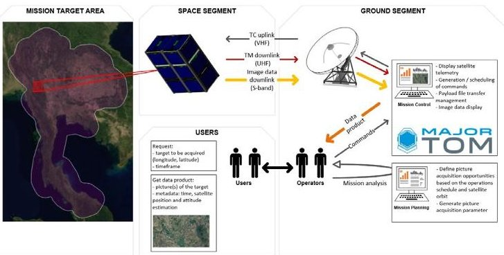

Figure 1: Napa-1 Complete system overview.

To support these user-requirements, the Space Segment put in place, comprises a single 6U satellite. Its design, shown in Figure 2 and Figure 3, includes the Earth observation camera, a secondary payload, and the required platform-avionics. The 6U makes use of ISISpace's standard bus-structure, electronic power system (EPS), VHF/UHF radio for TT&C, high-speed S-Band radio for payload downlink, two onboard computers for Command and Data Handling (CDHS) and payload data handling, and the CubeSpace ADCS 3-axis control suite. Napa-1's key satellite performance parameters are listed in Table 1.

Table 1: Key performance parameters of Napa-1.

<table border="1"><tr><td>Parameter</td><td>Value</td><td>Comment</td></tr><tr><td rowspan="2">Generated power</td><td>17.5W</td><td>Peak</td></tr><tr><td>6W</td><td>Orbit-Average</td></tr><tr><td>Consumed power</td><td>4W</td><td>Orbit Average</td></tr><tr><td>Data storage</td><td>2GB</td><td>Redundant</td></tr><tr><td>Data downlink</td><td>4.3Mbps</td><td>Throughput</td></tr><tr><td>TTC up-/downlink</td><td>9.6kbps</td><td></td></tr><tr><td>Mass</td><td>6.8kg</td><td></td></tr></table>

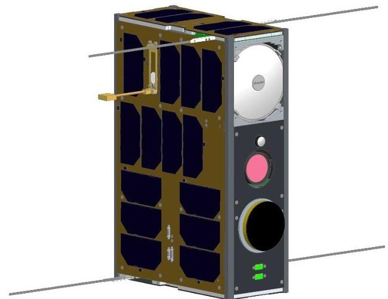

Figure 2: Napa-1 External system design with the optics and S-Band patch antenna shown on the right-side (nadir pointing panel).

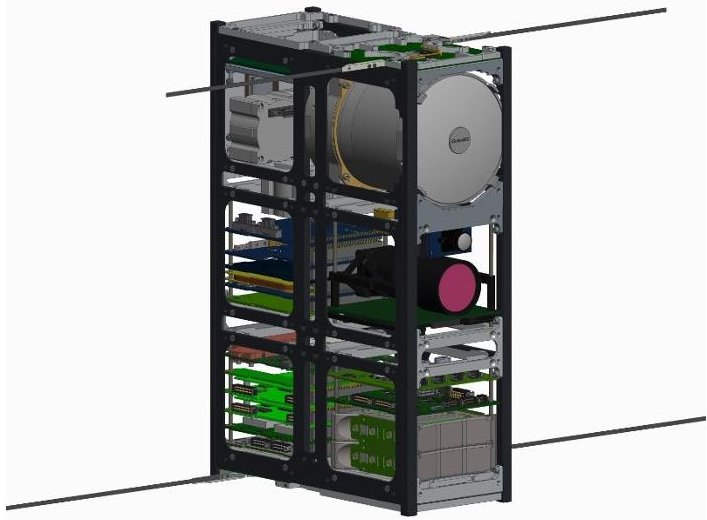

Figure 3: Napa-1 Internal system design.

## Payload(s)

The primary payload on Napa-1 is the Gecko camera from SCS Space (Figure 4). It is a snapshot imager capable of delivering images with a GSD of 40-meter at 500km altitude. This will allow the RTAF to monitor Thailand's surface for changes in landscape with respect to agriculture, environment, and disasters. The camera is operated during sunlit conditions and hence the Sun-synchronous orbit will allow the RTAF to monitor the Thailand's surface under similar lightning conditions.

The camera connects to the platform via a low- and a high-speed interface to the platform. The first is used for command and control, while the second is used to transfer the image-date at high speed. As a redundancy, the image data can be transferred via the low-speed interface to the platform too.

The camera requires a safe thermal operating range to guarantee optimal image quality. Therefore, during

<!-- PDF_PAGE: 3 -->

operations, special attention needs to be paid to the reported temperature whenever the camera is being used. For this reason, testing imaging in eclipse over areas with a high light-density was discarded.

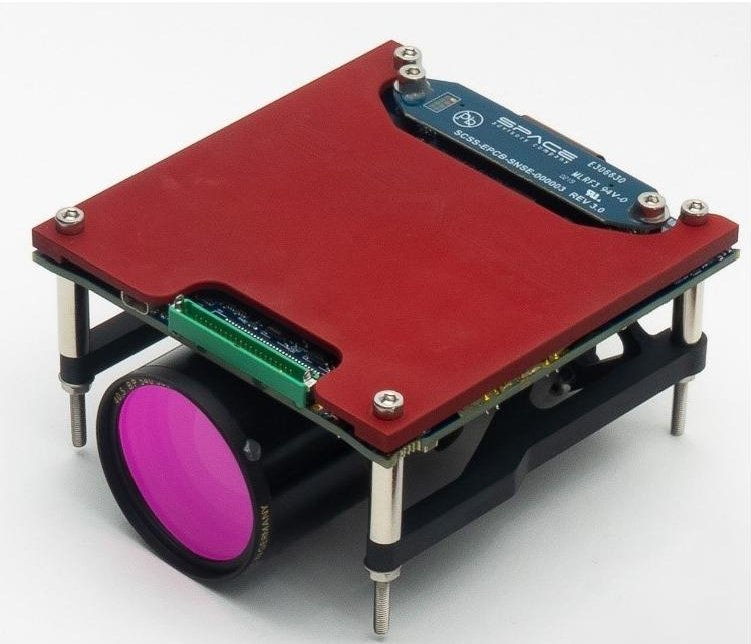

Figure 4: SCS Gecko snapshot imager providing 40m resolution at a 500km altitude.

Table 2 lists the key specifications of the Gecko imager from SCS Space.

Table 2: Key parameters of the Gecko imager from SCS Space.

<table border="1"><tr><td>Parameter</td><td>Value</td><td>Comment</td></tr><tr><td>GSD</td><td>40m</td><td>500km orbit</td></tr><tr><td>Spectral type</td><td>Bayer matrix RGB</td><td></td></tr><tr><td>Swath</td><td>80km</td><td></td></tr><tr><td>Compression</td><td>Thumbnail, JPEG2000</td><td></td></tr><tr><td>Storage</td><td>128 Gbit</td><td></td></tr></table>

As a secondary payload the Simera Sense TriScape100 was integrated into the satellite. This payload was added in agreement with the customer to the system during the design phase, both to provide an opportunity for the camera for an in-orbit demonstration (IOD) for de-risking future follow-up satellites; and to demonstrate the general capability of adding IOD payloads along the design phase. It has to be noted that the secondary payload had no contractual status regarding operations to be performed as it was an outof-contract-scope addition to the system.

The TriScape100 is designed with situational and change monitoring applications in mind. The combination of an advanced sensor, high performance optical front-end and onboard processing options unlock multiple opportunities for 3U and 6U CubeSats to reach GSD of <5m at 500km altitude. This imager

design is based on a 12.6-megapixel CMOS image sensor with integrated Red Green Blue (RGB) Bayer filter in the visible spectral range.

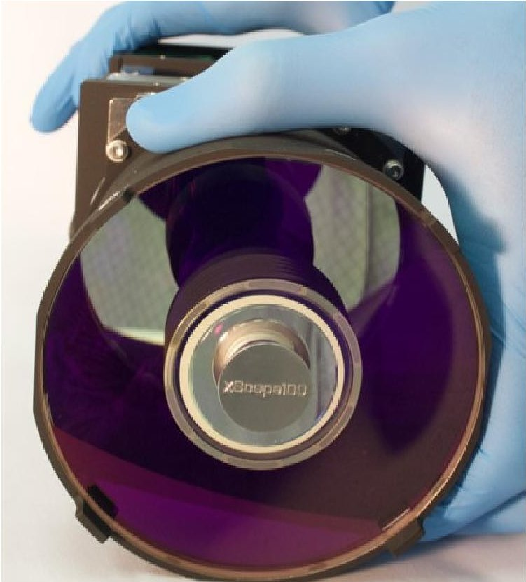

Figure 5: Simera Sense TriScape100 snapshot camera providing <5m resolution at 500km altitude. Table 3 lists the key specifications of the Gecko imager from SCS Space.

Table 3: Key parameters of the Simera Sense TriScape100 imager.

<table border="1"><tr><td>Parameter</td><td>Value</td><td>Comment</td></tr><tr><td>GSD</td><td>4.75m</td><td>500km orbit</td></tr><tr><td>Sensor Resolution</td><td>2048x2048</td><td>4MPixel Sensor</td></tr><tr><td>Spectral Resolution</td><td>RGB</td><td>Bayer Pattern</td></tr><tr><td>Operating Mode</td><td>Snapshot</td><td>Area sensor</td></tr><tr><td>Swath</td><td>19.4x14.5km</td><td>500km orbit</td></tr><tr><td>Pixel Size</td><td>5.5um</td><td>CMV4000 sensor</td></tr><tr><td>Focal Length</td><td>580mm</td><td>xScape100VIS OFE</td></tr><tr><td>Aperture</td><td>95mm</td><td>xScape100VIS OFE</td></tr><tr><td>Data format</td><td>8-bit</td><td></td></tr><tr><td>Image Size</td><td>32Mbit</td><td></td></tr><tr><td>Pixel Integration Time</td><td>671us</td><td>For1 pixel smear</td></tr></table>

## Attitude and Control System

The ADCS selected is the CubeADCS developed by CubeSpace (Figure 6). This system provides a complete

<!-- PDF_PAGE: 4 -->

solution for attitude determination and control. Medium-sized reaction wheels are used to allow for actively controlled the satellite's attitude. Included are a fine Sun sensor and an Earth infra-red sensor. The main attitude in which Napa-1 needs to reside in is a 3-axis controlled nadir-pointing attitude, both for the cameras as well as the S-Band patch. No star tracker is included as no imaging in eclipse is considered, hence loosening the required pointing accuracy in eclipse.

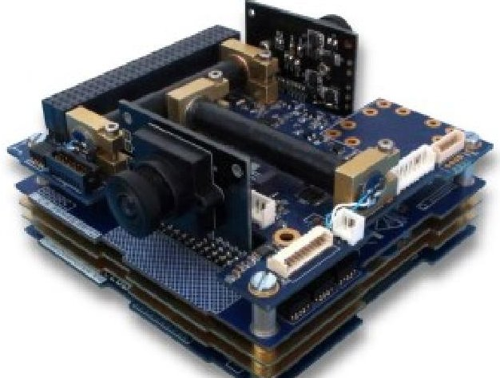

## Electronic Power System

Figure 6: CubeSpace 3-Axis control suite.

The ISIS Modular Electronic Power System (IMEPS) has been developed specifically to target 6U and larger platforms using modularity as its key feature. Napa-1 has two battery packs integrated, offering a total battery capacity of approximately 85Wh. With a low camera duty-cycle, the overall power consumption can be covered by this capacity as well as body-mounted solar cells only. These latter feed their power to the conditioning unit which output a regulated 16V onto the platform power bus. In addition, the distribution unit powers all subsystems and offers switchable channels at different voltage levels. The IMEPS used in Napa-1 is shown in Figure 7.

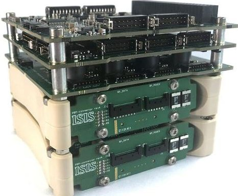

Figure 7: ISISpace modular electronic power system used on Napa-1.

## Communication and Data Downlink

The telemetry and tele-commanding functionalities are provided by the ISIS VHF/UHF radio (TRXVU). Along with dipole antenna systems, it provides a nearomnidirectional up- and downlink at 9k6 bps ensuring a robust link under any given circumstances.

The platform incorporates a dedicated highspeed downlink through the ISIS Highspeed S-Band transmitter (TXS). The TXS offers a downlink-rate (throughput) of up to 4.3 Mbps, is compliant to the CCSDS-standard [5] and allows in-orbit flexibility in setting the modulation, coding, and bitrate parameters. Shown in Figure 8, its main responsibility is to download the image data. Nevertheless, it can be used for downloading platform data too, making it a versatile system to the operators.

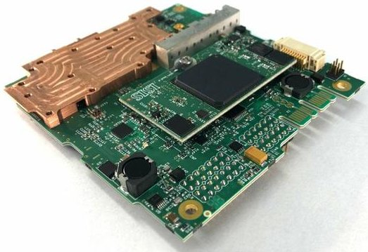

Figure 8: ISISpace high-speed S-Band transmitter. Command and Data Handling

The ISIS OBC (Figure 4) has been a cornerstone of ISIS-built missions for several years. For this mission, 2 units are used, one unit dedicated to CDHS tasks while the other unit takes care of payload data handling. The CDHS OBC runs the mission software while being the master on the internal databus. This entails command handling, telemetry collection, and operating and safeguarding the system. The Payload Data Handling Unit (PDHU) is solely focused on payload data reception, storage, and forwarding. A dedicated high-speed data interface was set up between the PDHU and payload to ensure that the payload data downlink throughput requirement was met.

## OPERATIONS

LEOPS and commissioning fell under the responsibility of ISISpace. While for the nominal mission the ground station installed by ISISpace in Bangkok, Thailand was to be used, initial communications were done from ISISpace's headquarters in Delft, The Netherlands. This meant having three to four passes available between

<!-- PDF_PAGE: 5 -->

approximately, 8:00 and 14:00 hours (UTC) and again between 18:00 and 00:00 hours.

To streamline operations a team was formed with each member having its own role and tasks assigned. The day-to-day activities were performed by the Satellite Operations Lead (Systems Engineer) and the Satellite Operators. Whenever required, support was provided by ground segment engineers and/or subsystem engineers. To limit distraction of the operators and engineers, the Operations Lead and Campaign Coordinator (Project Manager) took up the interfacing with project board, the customer, and any relevant liaison. Any (image) requests made were then translated and added to the day-to-day planning by the Operations Lead. The full team's organigram is shown in Figure 9.

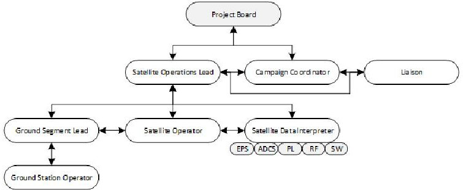

Figure 9: Operations team organigram.

## Major Tom

Operations were performed using the Mission Control Software Major Tom from KUBOS. This versatile tool exposes not only all available commands to the operators but also allows, via Grafana, real-time monitoring of the satellite through downloaded data. Commands can be queued in order to effectively use the time available during a pass.

For each pass, a plan was devised by the Operations Lead based on the prepared commissioning plan and subsequently discussed with the operators. These plans were translated into commands and queued, ready to be sent to the satellite during the pass. Back-up plans were always in place in case satellite telemetry was showing an off-nominal satellite scenario. This sometimes involved having to power cycle the platform, the ADCS, or putting the satellite into safe mode and download more telemetry to further investigate.

## Planning and Imaging

Successful target acquisition is achieved by following the process as shown in Figure 10. In essence this process consists of three distinct steps: Planning, flight plan creation and upload, and acquisition.

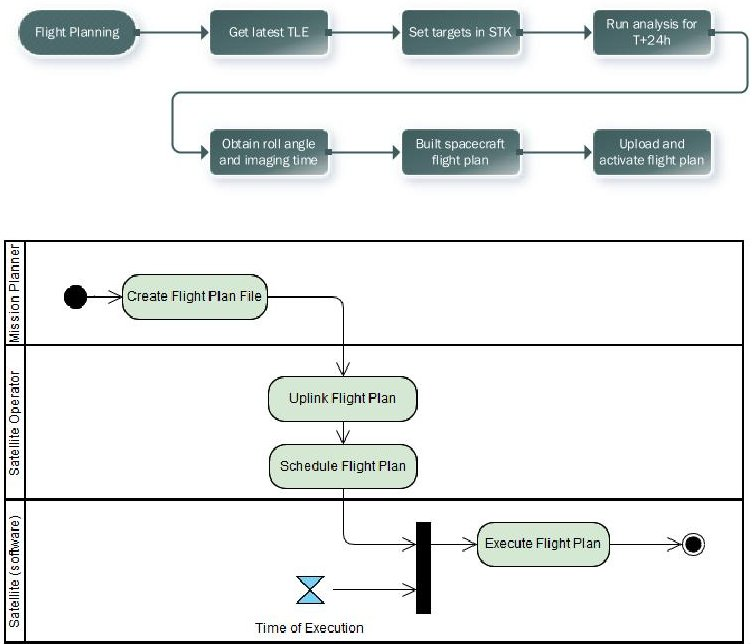

Figure 10: Figures showing the process and steps from target planning to execution

Image planning is achieved by making use of a mission analysis/planner tool. In this case, use has been made of the Systems Tool Kit (STK) from Analytical Graphics, Inc. The free version allows basic orbit propagation for any given Two-Line-Element (TLE). In addition, creation of a sensor and ground target is possible allowing a user to compute upcoming access time between the sensor and target. The output of the analysis consists of the time of access and sensor, or spacecraft, roll-angle. The tool can be used to compute access over a defined period as well as for multiple targets at once, with customer-defined constraints. The constraints involve, amongst others, the target needing to be cloud-free (upfront weather predictions need to be checked) and imaging only during Sunlit part of the orbit. As per the customer requirements, this process and tool allows image acquisition planning more than 24 hours before the target comes in view of the satellite. It must be noted, however, that TLE age will impact the accuracy of the computed image acquisition time. For this reason, flight plans are always created as shortly as possible before the target comes up and with the latest TLE.

<!-- PDF_PAGE: 6 -->

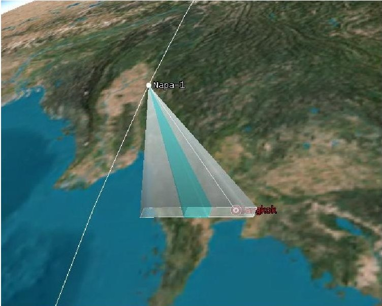

Figure 11: Visualization of access computed for Napa-1 to its target (Bangkok) set in STK.

With the time and roll-angle data extracted, the operators can create a flight plan to be executed onboard the satellite. This ensures that the satellite continues 'active' operations in the absence of ground station contact. ISISpace has built its own flight plan assembler tool which allows the operators to schedule any satellite command as a function of time. Each of these commands are added to a file, which in turn is uploaded to the satellite's command and data handling system. A typical flight plan to perform an image acquisition is shown in Figure 12.

<table class="table table-bordered"><thead><tr><th></th><th>Timestamp</th><th>Cmd Type</th><th>Co</th></tr></thead><tbody><tr><td>1</td><td>2</td><td>ADCS: set mode</td><td>0x0</td></tr><tr><td>2</td><td>5</td><td>ADCS: start telemetry high resolution sampling</td><td>0x0</td></tr><tr><td>3</td><td>9</td><td>GPS RX: switch power</td><td>0x0</td></tr><tr><td>4</td><td>10</td><td>Camera: switch power</td><td>0x0</td></tr><tr><td>5</td><td>15</td><td>Camera: take image</td><td>0x0</td></tr><tr><td>6</td><td>25</td><td>GECKO: transfers image to PDHU</td><td>0x0</td></tr><tr><td>7</td><td>30</td><td>Camera: switch power</td><td>0x0</td></tr><tr><td>8</td><td>31</td><td>GPS RX: switch power</td><td>0x0</td></tr><tr><td>9</td><td>32</td><td>ADCS: stop telemetry high resolution sampling</td><td>0x0</td></tr><tr><td>10</td><td>33</td><td>ADCS: set mode</td><td>0x0</td></tr></tbody></table>

Figure 12: Napa-1 flight plan example for a single image acquisition.

Such a flight plan is uploaded at the first upcoming ground station pass and activated. Through the satellite's telemetry the operators can see whether the upload and activation has been successful as well as the number of commands that are scheduled along with their time of execution.

Finally, after the target should have been acquired, the operators check the platform and payload telemetry and start the download of the images and corresponding metadata at the earliest convenience.

## Post Processing

Once captured, image data is available onboard the camera in a RAW, JPEG2000, or a binned (thumbnail) format. The flight software allows for selecting the desired format and sends the image(s) to the PDHU. While the image is taken, the CDHS collects the relevant (and required) data from the ADCS and GPS which will be added on ground as metadata to the image(s). Once both data are downlinked, the ground segment software handles both these: The images are made available for download to the operators (in the format downloaded) and the metadata files are being read and written to .csv files and matched with their corresponding images. In parallel a PNG format is created to allow for directly previewing the downloaded image within Major Tom. Any image downloaded in Major Tom (irrespective of its format) will have the associated metadata visible right away. An example of the displayed metadata is shown in Figure 13.

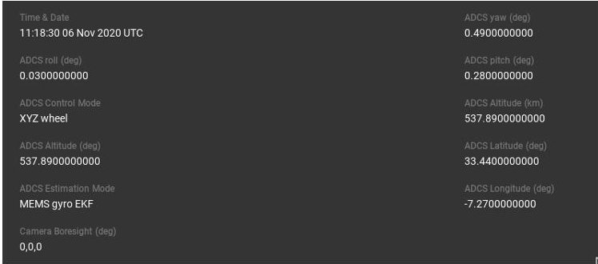

Figure 13: Example of collected metadata for each image acquired by Napa-1's command and data handling system.

The on-ground PNG conversion process also includes very basic image processing of the data. Although, the processing implemented does apply non-uniformity correction, white-balancing, and debayering it, the resulting product is primarily used to allow the operator to judge whether the target has been successful target acquired or not (by previewing or downloading the image through Major Tom).

## IN-ORBIT DATA

After launch and a successful and rapid LEOPS and commissioning of the platform, payload commissioning started. A prerequisite was a functioning S-Band downlink as well as the ADCS being able to keep the satellite into a controlled nadir-pointing attitude. Both were successfully achieved, although for the latter, random occasions of loss of communication with the

<!-- PDF_PAGE: 7 -->

ADCS forced the team to perform several flight software updates to counter this behavior. This has increased the ADCS' availability to the required level for nominal operations.

After the very first weeks it was noticed that the satellite resided at the colder end of the spectrum, although its systems still very much within operational limits. Temperatures of -30 $ ^{\circ} \mathrm{C} $ were reached on the panels forcing internal subsystems to go as low as $ -10^{\circ} \mathrm{C}. $ Figure 14 show panel temperatures measured inorbit over a full day while being initially in a 3-axis controlled attitude. After some time, control was lost which immediately becomes apparent by the fluctuating panel temperatures.

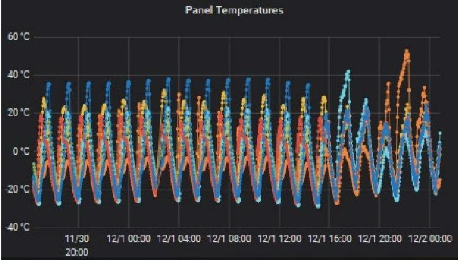

Figure 14: Panel temperatures measured on Napa-1 during an initial stable nadir-pointing attitude ending with slow tumble after losing ADCS control.

Figure 15 shows the measured temperatures for five orbits. The repetition of the data shows the impact of a neatly controlled attitude.

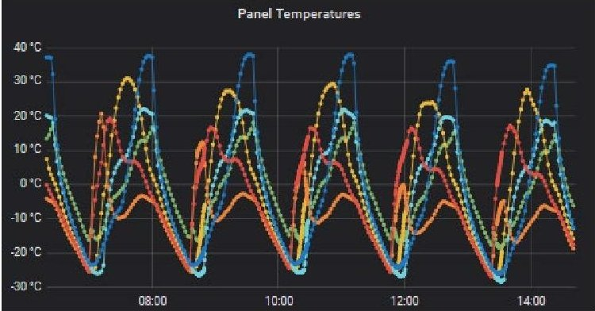

Figure 15: Panel temperatures measured on Napa-1 for five orbits.

As pointed out earlier, for camera operations this implied the necessity of 'heating up' the camera before taking an image. Image quality was assured in the range of 0 $ ^{\circ} \mathrm{C} $ to 40 $ ^{\circ} \mathrm{C} $ , for this reason the focus lay on identifying the camera's temperature when booted up and how long it would take for the camera to reach the acceptable temperature range. Figure 16 shows the

reported temperature by the Gecko camera from the moment of enabling power.

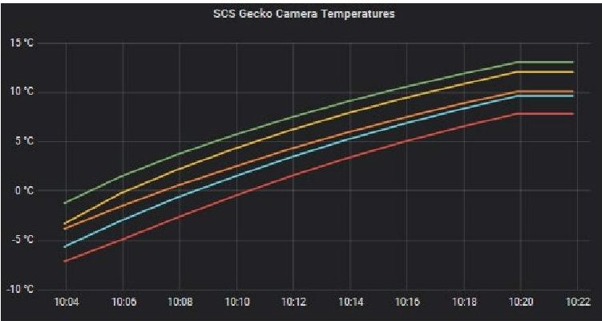

Figure 16: Gecko camera temperatures reported right after enabling power.

Clearly, for this instance the camera elements were below 0 $ ^{\circ} \mathrm{C} $ . However, it showed that when having the camera enabled for more than six minutes the temperature would be above this threshold. For this reason, any image acquisition planned would have the camera be switched on at least six minutes before the target came in view. The camera was also left on for several orbits (without taking images) to investigate the thermal behavior. The result is shown in Figure 17. Clearly, the camera is residing perfectly within the required thermal range for image acquisition. Obviously, the camera is powered on only when image acquisitions are planned to save power.

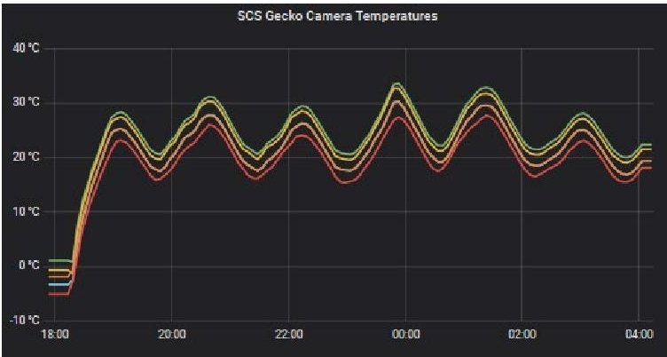

Figure 17: Gecko camera temperatures reported over several orbits.

Nadir-pointing is now the default attitude and controlled continuously. This is, amongst others, visible in the temperature plot (Figure 14) as well as the angular rates reported by the ADCS itself (Figure 18). What is noticeable though, that despite the presence of the Earth infra-red sensor, the ADCS has to realign its attitude upon acquiring a Sun vector after exiting eclipse. In Figure 18 one can see angular rate spikes due to the reaction wheels adjusting after receiving new attitude information. This causes the satellite to be unavailable for payload operations right after eclipse.

<!-- PDF_PAGE: 8 -->

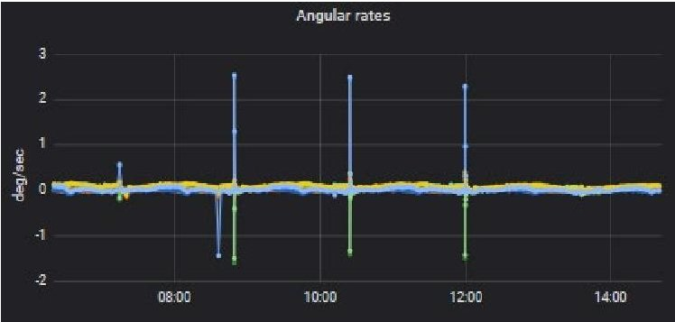

Figure 18: Angular rates measured on Napa-1 during steady nadir-pointing control. The spikes occur right after eclipse when the Sun sensor acquires a Sun vector again and the ADCS readjusts its attitude (drifted during eclipse).

The unavailability of payload operations due to this is confined to approximately 2 minutes per orbit only but does lead to target limitations in case areas of interest at very high latitudes are preferred. On top of that, however, the fine Sun sensor, has frequently shown not being able to obtain a Sun vector before being a couple of minutes in the Sunlit part of the orbit already. Hence, the period where no targets can be obtained is a somewhat longer than those two minutes.

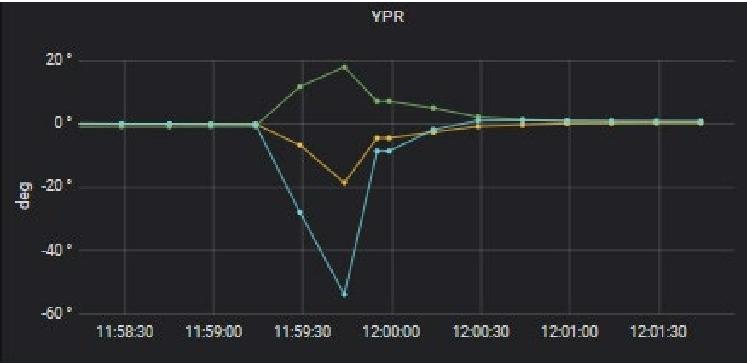

Figure 19: Roll, pitch, and yaw-attitude correction performed by the ADCS right after exiting eclipse, showing a 2-minute window at which, the satellite repoints itself.

## NAPA-1 IMAGES

The highlight of the mission is obviously the images taken and received on ground. During commissioning over 200 images have been taken for different purposes. Some specifically to validate customer requirements, like images of Thailand, other for the purpose of testing roll angles, different lighting/surface conditions, etc. A few of the highlights are shown here.

Note that for all images shown it holds that only manual (color) editing has been performed and no other enhancements.

The primary objective of the mission has been to image Thailand. In specific, the RTAF requested images of

Bangkok, including their headquarters. Unfortunately, Thailand is often covered by clouds for a large part of the year. Therefore, it has taken quite some tries to image Bangkok cloud-free. To improve chances, every opportunity of imaging Bangkok (and Thailand for that matter) has been taken. In addition, whenever the satellite would fly over the target additional acquisitions were scheduled before and after the actual target. In the end, imaging of Thailand cloud-free was managed a couple of times (Figure 20). Here, two overlapping images (taken sequentially) are manually stitched together.

Figure 20: Napa-1 manually stitched together two images of Bangkok, Thailand.

In addition to this target, several other targets were chosen to be imaged during the commissioning periods resulting in some beautiful images. Many of these were chosen for their potential high contrast and/or having clear (man-made) features in them. A few highlights are shown through Figure 21, Figure 22, Figure 23, Figure 24, Figure 25, and Figure 26. For each of the images the flight direction is from top to bottom.

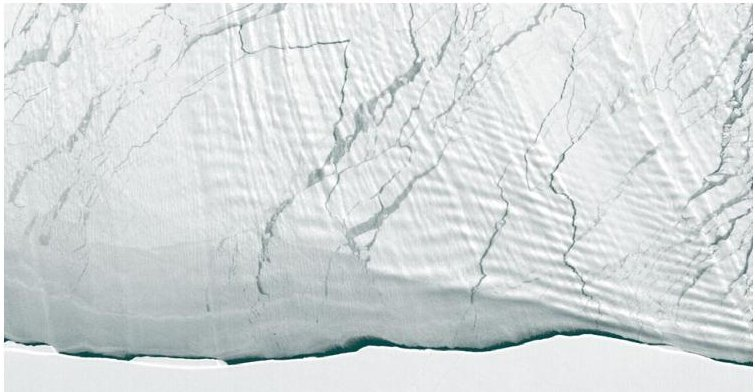

Figure 21: Napa-1 image of Antarctica's coastline.

<!-- PDF_PAGE: 9 -->

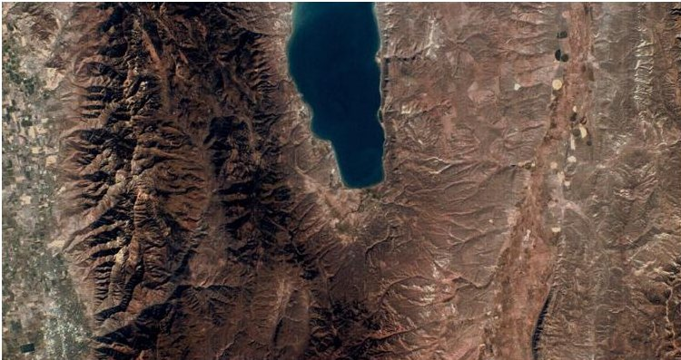

Figure 22: Napa-1 image of Bear Lake, Utah.

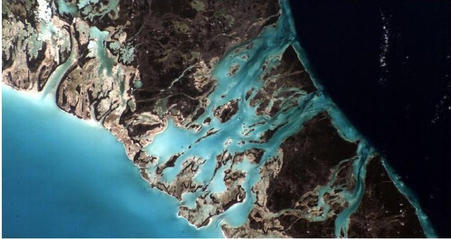

Figure 23: Napa-1 image of The Bahamas.

Since the Gecko camera operates in the visible wavelength, targets were prioritized that had high chances of being cloud-free. For this reason, desert or canyon areas were particularly useful and resulting in very clear images.

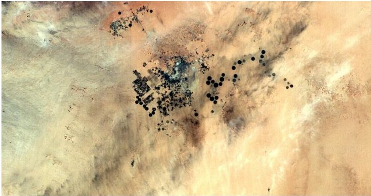

Figure 24: Napa-1 image of Al-Kufrah Oasis, Libya.

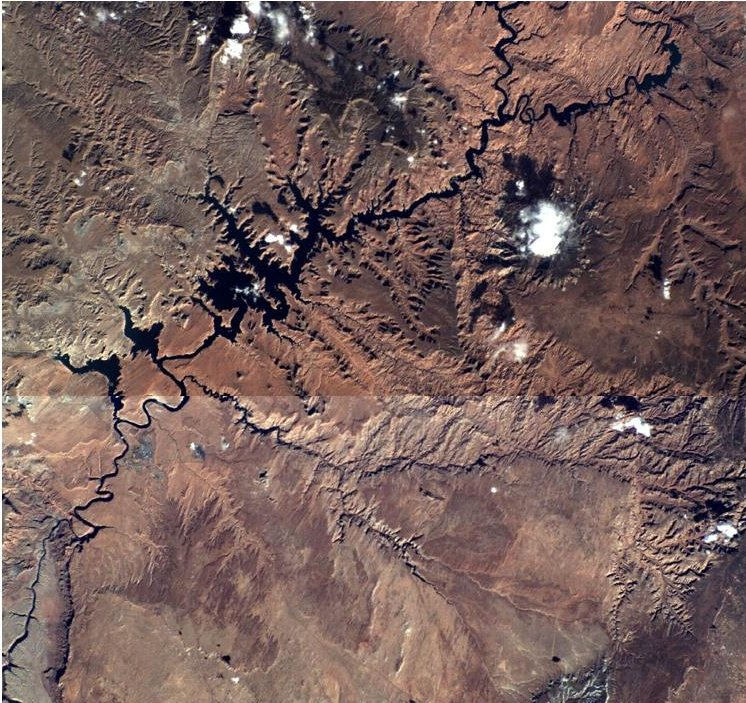

Figure 25: Napa-1 manually stitched images of the Antelope Canyon, Utah.

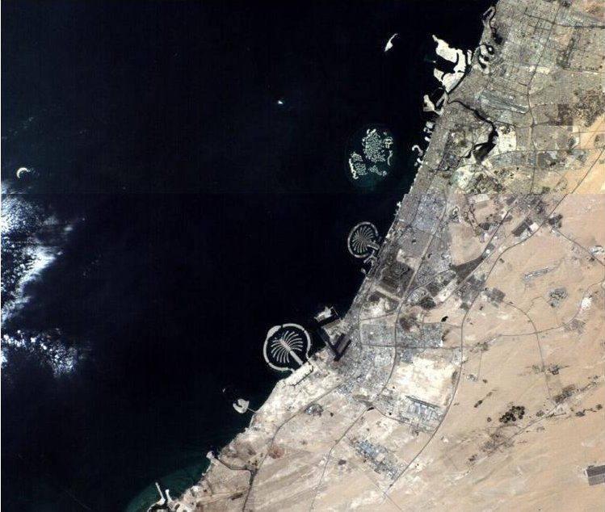

Figure 26: Napa-1 manually stitched images of the Palm and World Islands, Dubai.

## SECONDARY PAYLOAD SIMERA TRISCAPE100 DERISKING

After completing the contractual obligations of commissioning the platform and the primary payload there was limited time available to commission the Simera Triscape payload. In total 21 images were taken of various targets. The resolution of the imager makes it possible to identify up to the shapes of swimming pools.

One of the images, taken of the City of Mezraia, Tunisia and is presented in Figure 27. It becomes evident that for this type of GSD imaging in 'fly-over'

<!-- PDF_PAGE: 10 -->

mode is insufficient to utilize the camera's performance. The higher spatial resolution directly impacts the radiometric resolution due to the shorter integration time (less time to collect photons). Increasing the effective integration or exposure time requires either Time Delay Integration or Forward Motion Compensation (dwelling). However, both functions do have a direct impact on the ADCS system requirements.

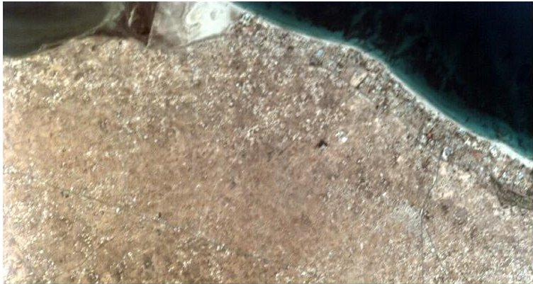

Figure 27: Napa-1 Simera TriScape image showing the city of Mezraia, Tunisia while in non-ground target tracking mode

Without any dwelling or target tracking, the along-track smear must be limit to one pixel to prevent modulation transfer function (MTF) loss. However, it should be noted that the motion MTF due to a one-pixel smear is 63.7% at the Nyquist frequency (91 lp/mm), resulting in a 36.3% MTF loss. The satellite ADCS must control the roll, pitch, and yaw to within 810 mdeg/sec to achieve this.

The second component that influences the spatial resolution is the satellite jitter. The rule of thumb is to limit the jitter to about 10% of a pixel during the pixel integration time. This limits the loss in MTF due to jitter to 4.8%. However, to limit the jitter to 10% of a pixel, the satellite stability must be 81 mdeg/sec.

In order to overcome these issues, it was proposed to commission the target tracking mode of the ADCS system. However, due to time limitations and the wish of the customer to handover the satellite to their operational department, the tracking mode commissioning had to be cancelled, and hence the imager's full performance could not be demonstrated. It is to be verified if there will be an opportunity in the near future to finish the commissioning of this ADCS mode and hence improve the Simera Camera images.

## CUSTOMER HAND-OVER AND TRAINING

The satellite hand-over to the customer was organized as a multi-step process to ensure the transfer of all the relevant knowledge of the system and the mission.

## Step 1: Satellite operations training

The first part of the training delivered to RTAF personnel started from the operator level using Kubos' Major Tom and ISISpace's ground station software to read telemetry data and command Napa-1.

After familiarizing with the software, it was possible for the RTAF operators to focus on Napa-1 maintenance and routine data collection tasks. These tasks are necessary to ensure the proper functioning of the satellite and were first demonstrated by ISISpace operators and later executed by RTAF personnel under ISISpace supervision. Both were done on-site at the RTAF premises in Thailand.

## Step 2: Mission control and planning training

The second step of the training focused on Mission Control and planning. Times of ground station contact and image acquisition opportunities were used to plan the operators' activities, such as housekeeping and image download operations, and to prepare the flight plans containing all the instructions necessary for the satellite to take the desired pictures. A typical flight plan, as shown before in Figure 12 includes attitude settings and camera activations, while ground operations activities are aimed at uploading flight plans, confirming their correct execution and the download of the images. Both Napa-1 onboard scheduler and Kubos' Major Tom facilitated ISISpace supervision, thanks to the possibility to easily access and modify the lists of queued commands, this allowed RTAF operators to start practicing immediately without the need of an in-depth theoretical training.

## Step 3: Off Nominal Situations

To conclude the training, RTAF personnel familiarized themselves with some off nominal situations. The operators were trained in recognizing off nominal behaviors by observing key telemetry values and to quickly react to them following the procedures developed by ISISpace. This part of the training was delivered in the form of simulations of critical scenarios deliberately triggered and resolved by RTAF operators under the supervision of ISISpace personnel. The training scenarios included the recovery of Napa-1 from a tumbling condition after an ADCS failure and from an unexpected platform reset due to unknown causes and the download of possible relevant telemetry. The satellite was never put in real danger but the time constraints and the perspective of losing image acquisition opportunities were sufficient to simulate the high-pressure situation that operators can face in case of anomalies.

<!-- PDF_PAGE: 11 -->

All the procedures to safely operate and maintain Napa1 and its ground station have been collected in the ground station manuals and the satellite operations manual. These manuals were intended as study material before the training and as reference for operations afterwards and they were combined with an on-site training delivered by ISISpace personnel. Having received the manual in advance, RTAF operators were ready for the training, and this allowed ISISpace personnel to limit the time spend in demonstrations and increase the direct involvement of RTAF operators. Increasing RTAF operators' involvement since the beginning of the training and having ISISpace operators present as supervisors proved to be a very efficient strategy to transmit the necessary know-how and ensure the well-being of the satellite.

## NEXT STEP AND FUTURE OUTLOOK

Satellite manufacturers are pushing the spatial resolution that Cubesats can achieve to the limits. For the follow-up satellite of the RTAF, a Multispectral VNIR 7-bands camera is implemented, the Simera XScape100. For this, the Napa-2 6U Satellite systems boast several upgrades compared to the Napa-1 satellite, paving the road to future high-resolution satellite EO Cubesat missions

1. High performance ISISpace ADCS bundle, comprising of the elements mentioned in Table 4, including target tracking mode.

2. Ground processing software, FarEarth of PinkMatter Solutions to correct the image data geometrically and radiometrically up to level 1B.

3. Improved payload data downlink capabilities by supporting parallel file downloading and very large files >> 100MB.

Table 4: ISISpace ADCS bundle elements

<table border="1"><tr><td>System</td><td>Supplier</td></tr><tr><td>ADCS Computer</td><td>ISISpace</td></tr><tr><td>SCG Gyro Module</td><td>ISISpace</td></tr><tr><td>iMTQ and MTM Boom</td><td>ISISpace</td></tr><tr><td>Photodiodes(6x)</td><td>ISISpace solar panels</td></tr><tr><td>3x Fine Sun sensor</td><td>Lens R&amp;D</td></tr><tr><td>OEM719 GNSS receiver</td><td>NovAtel</td></tr><tr><td>3x RW25 30mNms Reaction Wheels</td><td>Astrofein</td></tr><tr><td>Auriga Star tracker</td><td>Sodern</td></tr></table>

In the meanwhile, satellite missions are being studied for cameras with GSD of up to 1.5m at 500km altitude (E.g., Simera Multiscape200), fitting in 16U CubeSats.

This will require even higher ADCS stability performance and larger payload data downlinks using, for example, X band. The market is demanding ever more powerful and high resolution EO satellites, to be able to create and access high resolution (near) real time visual data of any part of the world.