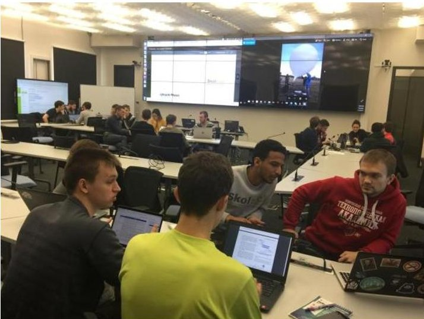
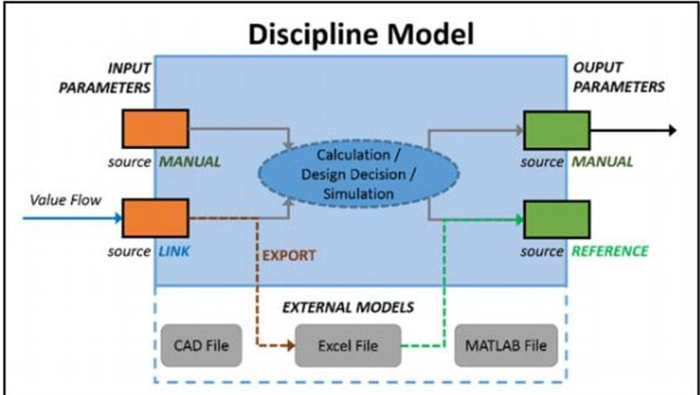
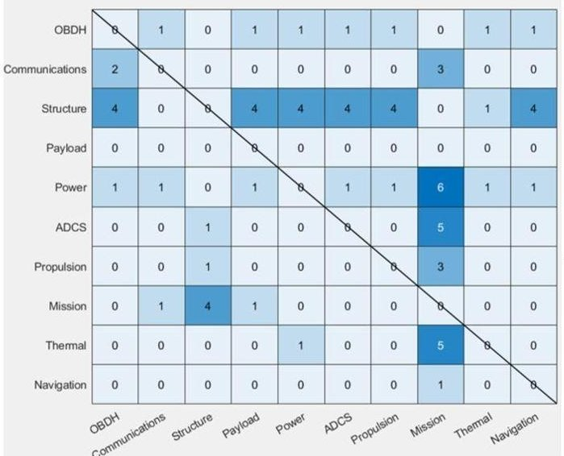
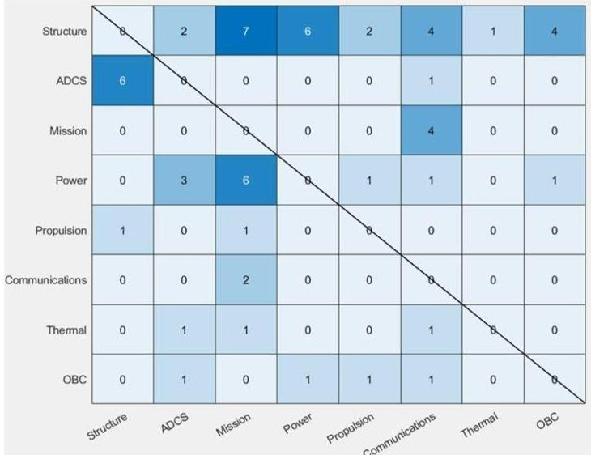
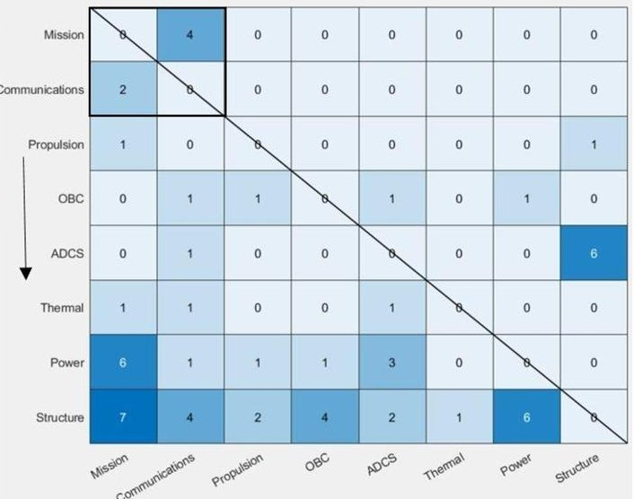

<!-- PDF_PAGE: 1 -->

# CONCURRENT CONCEPTUAL DESIGN SEQUENCING FOR MBSE OF COMPLEX SYSTEMS THROUGH DESIGN STRUCTURE MATRICES

S. K. Salas Cordero $ ^{1,2,\textcircled{x}} $ , C. Fortin $ ^{1} $ and R. Vingerhoeds $ ^{2} $

$ ^{1} $ Skolkovo Institute of Science and Technology, Russia, $ ^{2} $ ISAE-SUPAERO, University of Toulouse, France sophia.salas@skolkovotech.ru

## Abstract

Whilst Concurrent Conceptual Design (CCD) has been performed for many years at facilities such as: the Concurrent Design Facility at ESA and the Project Design Center at JPL-NASA, the sequencing know-how resides in their communities of practice. This paper strives to explain how a sequencing algorithm based on Design Structure Matrices can be used as an instrument to facilitate the interaction between disciplines during CCD studies for Model-Based systems exemplified with two case studies.

Keywords: complex systems, early design phase, conceptual design, concurrent engineering (CE), design structure matrix (DSM)

## 1. Introduction

All systems start with a conceptual design study; this process often involves an interdisciplinary team which works concurrently and co-located. This paper directs its application to complex systems, especially Space Systems, such as space missions. Many space agencies, that integrate Concurrent Engineering and Model-Based Systems Engineering (MBSE) at the system conceptual level, have developed facilities to bring experts together to carry out these studies, for instance: DLR with Concurrent Engineering Facility, ESA with Concurrent Design Facility and JPL-NASA with Team X at the Project Design Center. Through their communities of practice (Doumit et al., 2013) and their years of experience, organizations in charge of the development of space missions, have established some procedures of what the process for these studies should comprehend. A review of Concurrent Engineering Design practice in the space sector shows that 80% of the respondents have a process for the overall design study and 66% also defined processes for single design sessions (Knoll et al., 2018). In contrast with big companies, "New Space" (Martin, 2016) is not always supported by the government nor are prone to have established 'communities of practice' that could help them guide the design process. This means deviations due to a lack of expertise during the planning of the project life cycle of a mission. These deviations imply delays in the schedule, which leads to an unnecessary increase of costs. "New Space" consists mostly of start-ups, this sector is known as a rather new community of aerospace companies with the mind-set of making space accessible, develop space technologies and policy at a low-cost.

The complexity of a Conceptual Concurrent Design (CCD) study can easily increase if there are too many design assumptions made from the start. The work presented in this paper intends to provide guidance at the early stages of design to reduce unplanned iterations in a concurrent co-located conceptual design study specifically with the help of Design Structure Matrices (DSM).

<!-- PDF_PAGE: 2 -->

The paper is structured as follows. Section 2 reviews the importance of the conceptual design stage in the life-cycle and briefly presents the benefits of the usage of concurrent conceptual design in Space design facilities. Section 3 describes the methodology and the two space missions utilized as case studies. Section 4 presents a brief introduction to DSM, its types and uses and why it was chosen as the method to represent the process flow. Section 5 presents a discussion of the results obtained with the proposed algorithm. In section 6 the paper concludes with a recompilation of the achieved goals and a recommendation for further work on this topic.

## 2. Background

NASA states that systems engineering purpose is to design, build, and operate systems safely in the most cost-effective way possible considering performance, cost, schedule, and risk (NASA, 2017). Empirical investigations and literature studies show that 70-80% of total product cost is decided during early design stages, while 56% of changes occur after the initial phase (Ullah et al., 2015).

The motivation of this research is to improve the iterations progression during the early stages of design in order to minimize the amount of design assumptions being made when the exact values of parameters are still unknown at the beginning of a design iteration and to decrease the rises in the cost; up to 39% of changes in the late stages are estimated to be avoidable (Ullah et al., 2015). The concept and design stage are very important when it comes to extracting defects because while they only represent about the 15% (Walden et al., 2015) of the total mission cost, they commit 70-80% of the life-cycle cost.

Space agencies typically utilize the concepts of concurrency for conceptual design and the study of feasibilities. Concurrent conceptual design facilities apply model-based systems engineering with the help of the co-located work of a multidisciplinary team in order to reduce the cost of the conceptual and preliminary design studies. Thanks to this practice the duration of the studies has been reduced from 6-9 months to about only 3-6 weeks (Knoll and Golkar, 2017). Both NASA and ESA missions or projects life-cycles start with the conceptual design stage, for the first one is called pre-phase A and for the second one is phase 0 as explained on Table 1.

Table 1. Conceptual design stage project life cycle NASA vs ESA

<table border="1"><tr><td></td><td>NASA(2017)</td><td>ESA(2013)</td></tr><tr><td>Conceptual design phase</td><td>Pre-Phase A:produces a broad spectrum of ideas and alternatives for missions from which new programs can be selected.It also determines the feasibility of a desired system,develops mission concepts,draft system-level requirements,assesses performance,cost and schedule feasibility and identifies potential technology needs and scope.</td><td>Phase 0:mission analysis and identification.Where feasibilities studies are undertaken,new technology needs are identified,requirements are drafted.The majority of these studies are conducted internally at ESA&#x27;s Concurrent Design Facility(CDF)</td></tr></table>

The aim of this work is to determine how DSMs can be used to improve Model-Based Concurrent Conceptual Design sequencing of complex systems, in this case space systems, through the use of parametric discipline models during the design. The objectives of this research paper are:

- To present a sequencing instrument as a mechanism to facilitate the planning of iterations during the Concurrent Conceptual Design (CCD) studies for Model-Based systems.

- To display how the sequencing of an extended DSM is able to guide planned iterations in the conceptual design process

- To determine whether the sequencing of an extended DSM is able to provide suitably planned iterations of the design process.

For these purposes, the results of two case studies were gathered and analysed, the CCD of two different space missions in the Concurrent Engineering Design Laboratory (CEDL) at Skoltech.

To achieve a sequencing instrument as a mechanism to facilitate the planning of iterations during the Concurrent Conceptual Design (CCD) studies for Model-Based systems, proposing a sequencing algorithm of numeric DSMs was studied. An algorithm is presented as an instrument to minimize the number of elements above the main diagonal of the Design Structure Matrix (DSM). This algorithm is proposed as a

<!-- PDF_PAGE: 3 -->

tool to reduce unnecessary feedback cycles throughout the iterations of the conceptual design stage, and to attain a sequence for the CCD. The algorithm takes into account the number of interactions between the disciplines of the Space mission in the DSM combined with a weighting system.

Design structure matrices are known to be used in the brownfield product development as part of the analyses done during reverse engineering studies, in other words for the reengineering of existing products. Nevertheless, throughout this paper DSMs will be presented as a tool for greenfield development, as in the development of new projects for which innovative proposals for technical solutions are analysed and can be developed (Thumm and Goehlich, 2015).

## 3. Methodology

Case studies were chosen as research method to achieve the objectives of this work. Case studies are widely employed in engineering design research to investigate contemporary phenomena in uncontrolled environments to study complex topics and interactions between topics (Shankar et al., 2012). The case study research method applied on this work took place at the Concurrent Engineering Design Laboratory (CEDL, Figure, 1) at Skoltech during the Concurrent co-located Conceptual design stage of two different space missions for the course of "Spacecraft and Mission Design". The selected case studies were the concurrent conceptual design of the following space missions: radiation monitoring constellation and 5G communication constellation. Throughout the sessions of CCD, the design sessions were monitored and the data was gathered, compiled and analysed by the authors of the current paper. The proposed algorithm was applied a posteriori on the obtained data from the case studies and the results are shown in section 5.

Figure 1. CEDL

The followed modus operandi for the CCDs was the one presented in (Knoll and Golkar, 2017), which presents a method and a tool to conduct concurrent conceptual design studies for projects in the space industry. The peculiarity of the work described in (Knoll and Golkar, 2017) is that it presents publicly a generic concurrent conceptual design process.

There were two main options as to software for this study:

- Concurrent Engineering Data Exchange Skoltech (CEDESK, n.d.): a desktop tool that facilitates co-located collaborative work on parametric systems models and an instrument for research on complex systems design methodologies. That allows automatic data exchange from excel spreadsheets, but manually from other third-party tools.

- Valispace (n.d.): a data-driven engineering tool. It connects the data of the models for a certain project that might be available in different third party tools like STK (systems tool kit for space mission design), MATLAB, Altium Designer (PCB design software), Onshape (product development platform), Word, etc. This platform aims to integrate as many as possible thirdparty tools to automatically import the data. In addition, it performs calculations upon input changes to refresh the outputs automatically.

<!-- PDF_PAGE: 4 -->

CEDESK was selected for several reasons. First of all, CEDESK is a free open-source software, which gives less limitations to the user when referring to what types of projects could be developed on it. Also, at Skoltech, and specially CEDL, there is an existent know-how with this software plus access to the data-base of previous projects on CEDESK. Table 2 presents a more detailed comparison between CEDESK and VALISPACE on their capabilities of handling DSMs.

Table 2. Comparison of CEDESK and Valispace

<table border="1"><tr><td>Characteristics/Software</td><td>CEDESK</td><td>Valispace</td></tr><tr><td>Availability</td><td>Free open-source</td><td>Free educational version</td></tr><tr><td>Numeric DSM</td><td>+</td><td>-</td></tr><tr><td>Binary DSM</td><td>-</td><td>+</td></tr><tr><td>Binary clustering/sequencing of the DSM</td><td>+</td><td>-</td></tr><tr><td>Numeric clustering/sequencing of the DSM</td><td>-</td><td>-</td></tr><tr><td>Export DSM as an excel file</td><td>+</td><td>+</td></tr><tr><td>Export DSM to MATLAB</td><td>+</td><td>-</td></tr></table>

## 3.1. MBSE: parametric models

CEDESK has parametric oriented discipline models providing another advantage. The structure and information flow present in CEDESK (Figure 2). is similar to a black box model, used in many other engineering fields such as electrical engineering, control, etc.

Figure 2. Structure and information flow inside a parametric discipline model on CEDESK (Knoll and Golkar, 2017)

CEDESK does not compute outputs. However, if the models are built using Excel, parameters can be automatically updated by the program. If a model is built on any other third-party software, the data can only be updated manually. CEDESK offers the possibility of creating as many disciplines as are considered necessary by the systems engineer of the project. Within each discipline input and output parameters can be created to be linked as inputs of other disciplines.

Applying black boxes as parametric modelling, allows to look at the system from an abstract level. The discipline model in Figure 2 is a black box used as a unit for model-based systems engineering. It makes the system analysis easier since it does not confront with the complexities of how to calculate the outputs. This allows to work with the interactions of the parameters, to check if they are all connected, all required, to see how much certain parameters of a discipline can influence on another discipline and how risky the interaction within interfaces is. Furthermore, the model manages to represent the to-be-designed system by encompassing structure, configuration and design parameters, the goals of a model mentioned in (Knoll et al., 2018). Such type of parametric models was chosen to be used along this study.

<!-- PDF_PAGE: 5 -->

## 3.2. Case study description

For Case A: Radiation Monitoring Constellation mission, there was a group of 9 students from different backgrounds such as telecommunications, systems, aerospace, mechanics, etc., at different academic levels (pursuing master's and doctoral degrees). The disciplines were selected and rearranged among the participants, for a total of ten disciplines: mission, thermal, structure, navigation, propulsion, attitude determination and control system (ADCS), on-board data handling (OBDH), power, payload and communications.

For Case B: 5G Communication Constellation mission, there was a group of 7 students from different backgrounds such physics and mathematics, aerospace, mechanics, etc. and from different academic levels as well. The selected disciplines for this case were in total eight: Mission, Thermal, Structure, Propulsion, Attitude determination and control system (ADCS), Onboard data computer (OBC), Power and Communications that in this case is the payload of the mission.

Both case studies were fulfilled within the timeframe of 2 weeks at CEDL with a total of 6 monitored co-located concurrent conceptual design sessions.

## 4. Design structure matrix

DSM is an NxN matrix that maps the interactions among a set of N elements. It is a network modelling tool used to represent the elements comprising a system and their interactions. DSM is particularly well suited to applications in the development of complex engineered systems and is often used in the area of engineering management (Eppinger and Browning, 2012).

There are two main conventions used to convey the DSM information: inputs in rows (IR) or inputs in columns (IC) (the inputs of a discipline are either elements in a row or a column). For practical purposes on this work the convention IR is used, since it is considered more intuitive for sequencing determination.

Information-wise there are two main DSM types: static and time-based. Static can be architecture or organizational design structure matrices; whereas time-based can be activity or parameter based. Time-based DSMs can be applied for project scheduling, activity sequencing, cycle time reduction, risk reduction and low-level process sequencing and integration. For sequencing as an integration analysis a discipline-based DSM was chosen for the algorithm proposed in this work. This DSMs can be either binary or numerical.

- A binary DSM is a simple representation that indicates the presence or absence of an interaction between elements of the DSM. 0 for absence and 1 or an X for presence. In Figure 3 the dependencies $ d_{1}, $ $ d_{2} $ and $ d_{3} $ would be 1's or X's.

<table border="1"><tr><td></td><td>A</td><td>B</td><td>C</td><td>D</td><td>E</td></tr><tr><td>A</td><td></td><td></td><td></td><td></td><td>d2</td></tr><tr><td>B</td><td></td><td></td><td></td><td>d1</td><td></td></tr><tr><td>C</td><td></td><td></td><td></td><td></td><td></td></tr><tr><td>D</td><td>d3</td><td></td><td></td><td></td><td></td></tr><tr><td>E</td><td></td><td></td><td></td><td></td><td></td></tr></table>

Figure 3. DSM example

- A numerical DSM is considered to be an extended version of the binary DSM. It not only shows the presence of an interaction but it also includes further attributes of the interaction, like: number, importance, impact or strength. This can be represented utilizing one or more numerical values, symbols, shadings or colors. In Figure 4 the dependencies $ d_{1} $ $ d_{2} $ and $ d_{3} $ would be numbers that represent the quantity of dependencies as inputs to a certain discipline, for example $ d_{1}=2 $ $ d_{2}=3 $ and $ d_{3}=4 $ ; or numerical interdependence for example $ d_{1}=0.2 $ $ d_{2}=0.5 $ and $ d_{3}=0.7 $

<!-- PDF_PAGE: 6 -->

## 4.1. DSM versus other methods of representation of process flows

There are several ways to represent design activities. Directed graphs (digraphs) are a graphical mapping method with nodes and arcs linking them. Digraphs are useful only when there is a small number of nodes, otherwise it becomes hard to read. A rearrangement of the digraph representation along a time line results in a program evaluation and review technique (PERT). PERTs are in principle similar to Gantt diagrams since the nodes represent milestones in the process. However, it doesn't represent intuitively when processes are coupled, parallel or dependent. The most commonly used methods for the management of process flows are flow charts, Gantt charts, critical path method (CPM) and DSM. A known disadvantage of flow diagrams, PERT, Gantt charts and CPM is that they do not cope with iterations. On the other hand, DSMs cope with iterations and are able to show if the process is sequential, parallel, coupled or conditional (Eppinger and Browning, 2012).

Design projects are inherently iterative (de Weck, 2010), hence the importance to grasp this in its representation. An iteration is the repetition of tasks due to the availability of new information. There are three main reasons for new information to appear during the design process: changes in the input information, update of shared assumptions and the discovery of errors.

The quality of the design result is improved with iterations, and the understanding of the coupling of the processes is essential to carry out a satisfactory job. It is less costly to have planned iterations in a process when compared to fixing unanticipated drawbacks. Planned iterations should be facilitated by design methods, tools and coordination, and that can be achieved with the usage of DSM to map the design process. Referring to the DSM example in Figure 3, and taking the order of A to E as the sequence of the process represented by this DSM, several remarks can be made:

- $ \mathrm{d}_{3} $ , or for that matter any dependency under the diagonal, represent independent or dependent tasks that only need information from previous steps. In this case D needs information from A but A has already finished, so there are no feedback cycles. Under the diagonal lies the domain of what can be called the perfect project plan, because design assumptions are not essential for the project to develop.

- $ \mathrm{d}_{1} $ and $ \mathrm{d}_{2} $ are positioned in the domain of feedback tasks. The process flow is from A to E, so the processes go in the following order: A, B, C, D and last E. B needs information from D before D has it, and A requires information from E even before E calculated anything. This increases the probabilities of delays and errors while committing to design assumptions, without having access to all the information that is needed.

## 4.2. Proposed sequencing algorithm

At the beginning of a conceptual design study there are many parameters that might be unknown. Some of these parameters depend on the value of other parameters to be calculated. There can be two situations, either a parameter is known and in consequence the other parameter can be calculated without any problem, or a certain value is assumed for the parameter in order to calculate the other one and then they need to be tested for consistency. All the assumptions made at some point in the design process require feedback loops for corroboration, the longer the loops the longer the conceptual design study. The proposed sequencing algorithm aims to decrease the feedback loops by minimizing the quantity of dependencies located above the diagonal of the numeric discipline DSM. The less waiting time to corroborate certain parameters, the need for less iterations needed to set a valid value for the parameters. A numerical algorithm with the goal to minimize the sum of the above diagonal elements weighted by the distance from the diagonal, combined with partitioning was initially introduced as numerical partitioning algorithms (Gebala and Eppinger, 1991), and a similar approach was used to support product development planning (PDP) with Product Architecture drivers (PA-drivers) (Gohlich et al., 2018). The proposed sequencing approach will be compared with the previously used non-deterministic binary algorithms that currently work in the environment of CEDESK for the phase of Concurrent Conceptual Design of Space Missions.

The following Equations (1) and (2) take into account the change of circumstances from DSM sequencing to support PDP with PA-drivers to the sequencing of a numeric discipline DSM to support a concurrent conceptual design study.

<!-- PDF_PAGE: 7 -->

$$
s e q u e n c e \_ n u m = \sum_ {i, j} d i s t a n c e (i, j) \times D S M _ {i, j}
$$

$$
d i s t a n c e (i, j) = (j - i) / \sqrt {2}
$$

Where:

i - rows; j - columns; DSM $ _{i,j} $ - numeric value of the corresponding value of the DSM cell

The understanding of distance in this formula is not the one of a physical distance, but rather a coefficient to locate how far from the matrix diagonal a certain element is and whether the element is located under the diagonal (distance<0) or on the upper matrix triangle (distance>0). To some extent the distance coefficient could be called a weight in the equation, that is the most negative number when an element is located further left down the triangle below the diagonal and punishes the elements that are located to the further right in the triangle above the diagonal.

To obtain the minimal sequence_num a MATLAB code was developed in which all the possible n permutations of rows and columns of the DSM were generated in order to calculate which permutation produced the minimal sequence number. From the formula of permutations:

$$
P (n, r) = \frac {n !}{(n - r) !}
$$

Where:

$$
n - \mathrm {n u m b e r o f e l e m e n t s}; r - \mathrm {n u m b e r o f e l e m e n t s t a k e n f r o m n};
$$

A DSM size N with a total of N objects that need to be permuted, means the following:

$$
P (N, N) = \frac {N !}{(N - N) !} = \frac {N !}{0 !} = N!
$$

The total number of possible permutations is N! which means that for N=4 there are 4! =24 possible matrices from which to calculate the min value for the sequence number, for N=5 we have 5! =120 and for N=9 the result is 9! =362880. The number of plausible matrices from which to calculate a sequence number increases significantly, a MATLAB code was created to amend for the big period of time that would have taken to manually compute all the options.

The proposed sequence achieved by this algorithm on a numeric discipline DSM shall be read in the following direction within the DSM up to down and left to right. For different kind of numerical DSMs, the order in which the sequence should be read might change.

## 4.3. Sequencing verification

The verification is based on heuristics; it was proved for n by n matrix (n=2,3,4, ..., n- natural number). In this paper, an example of the algorithm is presented on 3 by 3 matrix due to space reasons. For this DSM there are a total of 3! permutations. For this example, two different numbers were placed as input elements of the DSM, in Table 3 you can see the total range of permutations and the sequence number for each of them. The input DSM to the algorithm is option six and the obtained permutation is option two, which is the option with the minimal sequence number.

Table 3. Permutations and sequence numbers for heuristic sequencing verification

<table border="1"><tr><td>Option</td><td>Permutation</td><td>Sequence number</td><td>Option</td><td>Permutation</td><td>Sequence number</td></tr><tr><td>1</td><td>[1 0 0]
2 1 0
1 0 1]</td><td>-2.8</td><td>4</td><td>[1 0 2]
0 1 1
0 0 1]</td><td>3.5</td></tr><tr><td>2</td><td>[1 0 0]
1 1 0
2 0 1]</td><td>-3.5</td><td>5</td><td>[1 1 0]
0 1 0
0 2 1]</td><td>-0.7</td></tr><tr><td>3</td><td>[1 2 0]
0 1 0
0 1 1]</td><td>0.7</td><td>6</td><td>[1 0 1]
0 1 2
0 0 1]</td><td>2.8</td></tr></table>

<!-- PDF_PAGE: 8 -->

Moreover, it can be noted that the element with the highest number was sent further down under the diagonal triangle, and the smaller element was sent as far as possible from the triangle above the diagonal, considering the remaining empty locations after the highest number was already allocated. This occurs because the position that could have resulted in the minimal sequence number for that entry is already taken by an entry that influences more in the system, since it represents two parameters and not only one.

## 5. Results and discussion

As a result of applying the proposed sequencing algorithm, a sequence for each design iteration was achieved. Even taking into account that the studies were completed by two separate and different teams, the algorithm was able to adjust the sequence of the CCD for each mission, depending on the chosen set of parameters and disciplines. Although the obtained sequences are intrinsic to the chosen design parameters of the study, a pattern on the sequences was observed.

The sequence obtained for case A is: Mission, Payload, Navigation, Propulsion, ADCS, OBDH, Communications, Thermal, Power and Structure. The sequenced DSM (Figure 4) is able to show the coupled disciplines, which are: OBDH/Communications and Thermal/Power. The inputs for mission are from Payload (measurement duration), Communication (antenna field of view), and Structure (total mass and total x, y and z size). These are values that are required to be checked for consistency during each iteration. As a design decision, mission is in charge of the mass budget for this CCD.

<table border="1"><tr><td>Mission</td><td>0</td><td>1</td><td>0</td><td>0</td><td>0</td><td>0</td><td>1</td><td>0</td><td>0</td><td>4</td></tr><tr><td>Payload</td><td>0</td><td>0</td><td>0</td><td>0</td><td>0</td><td>0</td><td>0</td><td>0</td><td>0</td><td>0</td></tr><tr><td>Navigation</td><td>1</td><td>0</td><td>0</td><td>0</td><td>0</td><td>0</td><td>0</td><td>0</td><td>0</td><td>0</td></tr><tr><td>Propulsion</td><td>3</td><td>0</td><td>0</td><td>0</td><td>0</td><td>0</td><td>0</td><td>0</td><td>0</td><td>1</td></tr><tr><td>ADCS</td><td>5</td><td>0</td><td>0</td><td>0</td><td>0</td><td>0</td><td>0</td><td>0</td><td>0</td><td>1</td></tr><tr><td>OBDH</td><td>0</td><td>1</td><td>1</td><td>1</td><td>1</td><td>0</td><td>1</td><td>1</td><td>1</td><td>0</td></tr><tr><td>Communications</td><td>3</td><td>0</td><td>0</td><td>0</td><td>0</td><td>2</td><td>0</td><td>0</td><td>0</td><td>0</td></tr><tr><td>Thermal</td><td>5</td><td>0</td><td>0</td><td>0</td><td>0</td><td>0</td><td>0</td><td>0</td><td>1</td><td>0</td></tr><tr><td>Power</td><td>6</td><td>1</td><td>1</td><td>1</td><td>1</td><td>1</td><td>1</td><td>1</td><td>0</td><td>0</td></tr><tr><td>Structure</td><td>0</td><td>4</td><td>4</td><td>4</td><td>4</td><td>4</td><td>0</td><td>1</td><td>4</td><td>0</td></tr></table>

Figure 4. Case A: input DSM (left) vs. sequenced DSM (right)

The obtained sequence for case B is: Mission, Communications (which for this mission is actually the payload), Propulsion, OBC, ADCS, Thermal, Power and Structure. The sequenced DSM (Figure 5) shows that in this case Mission and Communications are coupled designing disciplines.

Figure 5. Case B: input DSM (left) vs. sequenced DSM (right)

<!-- PDF_PAGE: 9 -->

When comparing the obtained sequences, a resemblance is noticeable. Two separate teams were in charge of the design process and they selected input/output parameters for the disciplines in different ways. One of the most visible differences are the ADCS inputs from Structure; in case A only the total mass (1 parameter) is required and in case B: the centre of mass coordinates (3 parameters) and the moments of inertia relative to each axis (3 parameters).

Both case studies start with Mission and the Payload. Case A has a scientific payload for radiation monitoring and case B has a communication payload. Also they end with the same exact sequence of Thermal, Power, Structure. In the middle of the sequence you have the disciplines in charge of calculations and reaction to those calculations, meaning ADCS, Propulsion, Navigation and OBDH. These are intrinsically heavy interconnected disciplines; consequently, what the proposed sequencing is managing to obtain is a sequence in which the iteration process could develop in the smoothest possible manner. That is why the sequence depends directly on how many and which parameters were chosen for the disciplines as design parameters. Having two different separate teams obviously increases the possibilities of these design parameters of being different. But that is precisely the advantage of this sequencing algorithm, no matter what system is undergoing the CCD stage, the algorithm will be able to provide with a tailored sequence for that specific case and the specific design variables that were chosen by the interdisciplinary team working on it.

CEDESK itself includes a binary non-deterministic DSM clustering algorithm. This algorithm provides many different sequences that are not unique for each case. The algorithm presented here, on the other hand, provides systematically a sequence intrinsic to the elected disciplines as to the number of dependencies between them.

As mentioned in section 4.1. the elements on the DSM above the diagonal belong to the feedback domain, these elements are the quantity of assumptions made following the proposed sequence. For case A, before the algorithm is applied, there are a total of 49 assumptions being made, whereas after the algorithm is applied, there are only 12 left. For case B, before the algorithm is applied, there were a total of 34 assumptions, while only 13 were left after sequencing. For both cases the number of assumptions was reduced more than twice. This shows how the proposed algorithm allows to have a CCD iteration sequence with less assumptions, which means less time spent on settling the correctness of assumed values that leads to a faster convergence on a resultant conceptual design; and arranges for more design iterations if the design time period stays a priori the same as in the beginning, since there are less assumptions being made. The method can therefore be used to improve team efficiency significantly.

## 6. Conclusions and future work

Not every company, research institute or university can afford to have a guiding community of practice to guide their CCD studies. Hence an algorithm that guides conceptual design iterations is important. The presented method is accessible and feasible to implement.

During the development of this work two case studies were selected to portray the real behaviour of co-located concurrent conceptual design projects in order to gather data. Several milestones were achieved while reviewing currently available CCD tools that do not provide a unique guide or sequence for the design iterations.

The algorithm presented in this paper allows to have a CCD iteration sequence for a faster convergence on a resultant conceptual design. This leads to the possibility of more design iterations if the design time period stays a priori the same, since there are less assumptions made which means less time spent on settling the feasibility of the assumed values. It was also determined that the use of a numeric DSM algorithm produces significant improvements in sequencing when compared with the non-deterministic binary algorithm currently available on CEDESK.

As a recommendation for further work, it is advised to employ this algorithm on more concurrent conceptual design studies to quantify and evaluate how much it optimizes the iteration process during a system further life cycle stages. Another recommendation would be to observe how the changes propagate after using this algorithm for the conceptual stage on the rest of the system development stages.

<!-- PDF_PAGE: 10 -->

## Acknowledgement

We express our most sincere gratitude to Anton Ivanov and Dominik Knoll of the Skoltech's Space Center for providing the opportunity to work on the case studies during the course of 'Spacecraft and Mission Design' in the CEDL.

## References

“CEDESK”. (n.d.). available at: https://cedesk.github.io/ (accessed 20 January 2019).

Doumit, N., Huet, G. and Fortin, C. (2013), The Role of Enterprise Social Media in the Development of Aerospace Industry Best Practices, Springer, Berlin, Heidelberg, pp. 356-364.

Eppinger, S.D. and Browning, T.R. (2012), Design Structure Matrix Methods and Applications, MIT Press.

ESA. (2013), Space Science: How a mission is chosen, available at: https://www.esa.int/Our_Activities/ Space_Science/How_a_mission_is_chosen (accessed 20 February 2019).

Gebala, D. and Eppinger, S. (1991), "Methods for Analyzing Design Procedures", Design Theory and Methodology, Vol. 31, pp. 227-233.

Gohlich, D., Hildebrand, S. and Schellert, D.D. (2018), Augmented DSM Sequencing to Support Product Development Planning, pp. 1139-1148.

Knoll, D., Fortin, C. and Golkar, A. (2018), "Review of Concurrent Engineering Design practice in the space sector: state of the art and future perspectives", 2018 IEEE International Systems Engineering Symposium (ISSE), IEEE, pp. 1-6.

Knoll, D. and Golkar, A. (2017), "A coordination method for concurrent design and a collaboration tool for parametric system models", Concurrent Engineering, SAGE PublicationsSage UK: London, England, Vol. 26 No.1, pp. 5-21.

Martin, G.L. (2016), NewSpace: The Emerging Commercial Space Industry, International Space University available at: https://ntrs.nasa.gov/search.jsp?R=20160001188

NASA (2017), NASA Systems Engineering Handbook, SP-2016-6105 Rev2., 12th Media Services, available at: https://www.nasa.gov/sites/default/files/atoms/files/nasa_systems_engineering_handbook_0.pdf.

Shankar, P., Morkos, B. and Summers, J.D. (2012), "Reasons for change propagation: a case study in an automotive OEM", Research in Engineering Design, Vol. 23 No. 4, pp. 291-303.

Thumm, B.R. and Goehlich, D. (2015), "Product architecture design methodology for developing standardized modules", DS 80-7 Proceedings of the 20th International Conference on Engineering Design (ICED 15) Vol 7: Product Modularisation, Product Architecture, Systems Engineering, Product Service Systems, 27-30 July 2015, Milan, Italy, pp. 175-184.

Ullah, I., Tang, D. and Yin, L. (2015), "Engineering Change Implications on Product Design: A Review of the Literature", Conference: International Conference on Education, Management and Computing Technology (ICEMCT-15), Atlantis Press, Tianjin, pp. 1679-1691.

"Valispace - Product" (n.d.), Simon Vanden Bussche, available at: https://www.valispace.com/product/ (accessed 29 January 2019).

Walden, D.D. et al. (2015), Systems Engineering Handbook: A Guide for System Life Cycle Processes and Activities 4th edition, available at: https://www.worldcat.org/title/systems-engineering-handbook-a-guide-for-system-life cycle-processes-and-activities-incose-tp-2003-002-04-2015/oclc/931708827 (accessed 22 May 2019).

de Weck, O. (2010), ESD.36 System Project Management: Managing Iterations with DSM, available at: https://ocw.mit.edu/courses/engineering-systems-division/esd-36-system-project-management-fall 2012/lecture-notes/MITESD_36F12_Lec05.pdf (accessed 23 May 2019).