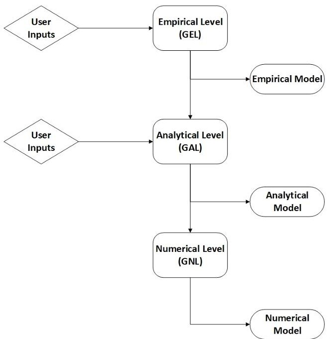
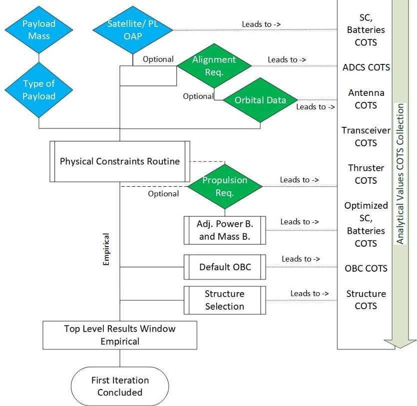
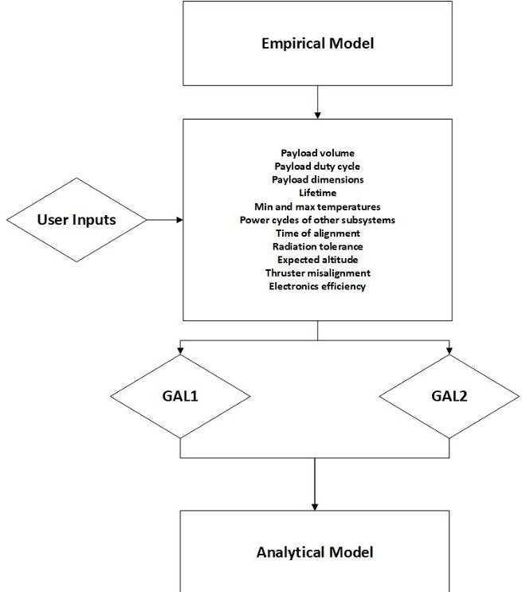
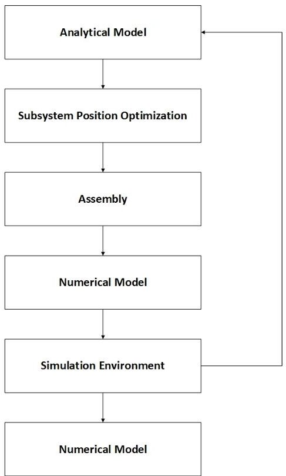
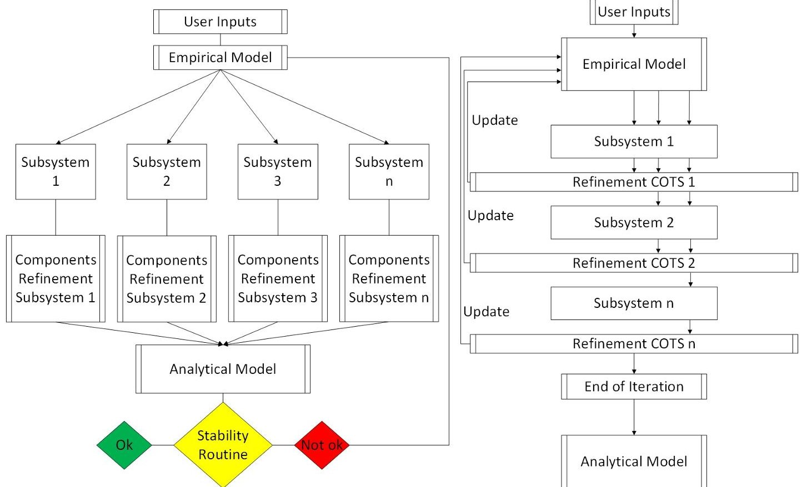
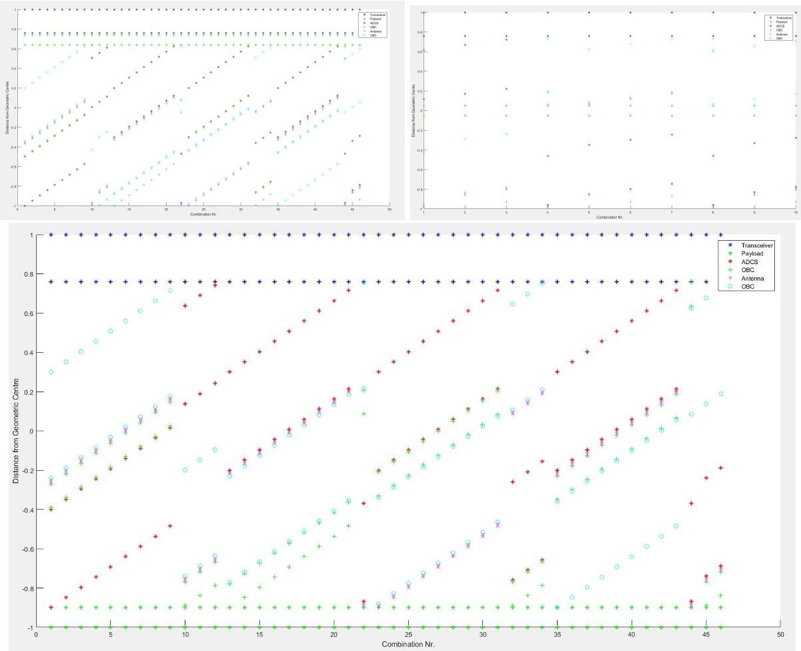

<!-- PDF_PAGE: 1 -->

# Concurrent Engineering Methodology for CubeSat Conceptual Design

Carlo Girardello $ ^{(1),(2)} $ , Carsten Scharlemann $ ^{(1)} $ , Martin Tajmar $ ^{(2)} $ , and Wolfgang Treberer-Treberspurg $ ^{(1)} $

$ ^{1} $ University of Applied Sciences Wiener Neustadt, 2700 Wiener Neustadt, Austria. $ ^{2} $ Institute of Aerospace Engineering, Technische Universität Dresden, 01062 Dresden, Germany. {carlo.girardello, carsten.scharlemann, wolfgang.treberspurg} @fhwn.ac.at {martin.tajmar} @tu-dresden.de

SECESA 2022: 7-9 October 2022

## Abstract

The success rate for CubeSat missions is still far from optimal. Many of them end up being space debris soon after launch due to malfunctions or fundamental design errors. In order to increase the survival possibilities of CubeSats, the University of Applied Sciences Wiener Neustadt and the Technical University of Dresden have initiated the development of a software to guide teams through the initial design process in the conceptual development phase.

Many similar tools have been presented in the past but GREATCUBE+ adds a universal approach, independently of the payload type, and it is meant to perform the conceptual design of CubeSats down to subsystem level. GREATCUBE+ is a software tool which will help both experienced and inexperienced teams in the conceptual development of a CubeSat mission. It is divided into three layers: an empirical layer (GEL), an analytical layer (GAL) and in the near future it will be finalized with a numerical level (GNL). GREATCUBE+ follows a concurrent engineering methodology with a top-down design approach which is widely used in both industry and academia when dealing with complex systems with many intercorrelations. The layers composing GREATCUBE+ have the intent of mimicking the working processes of a concurrent engineering facility and speeding up the conceptual design phase. A great advantage introduced in this software is the capability of operating it based on various payload types; e.g. with ADCS, propulsion, OBC, TT&C or standalone payloads. Additionally, the tool has a high degree of flexibility in the amount of information which can be introduced by the user.

In GEL, which is the initial layer, the user is required to provide some necessary information concerning the desired payload; e.g. payload mass and/or payload/satellite power requirement, alignment requirement, and the total amount of data. With those inputs, the tool is capable of retrieving information from past similar missions. These data are used to provide an initial estimation of system and subsystem level based on an empirical analysis, which is backed up by real satellite cases. The tool is capable of linking the system and subsystem outputs to COTS. This empirical model is used as a reference historical model in the following layer, GAL.

GAL takes the information obtained from GEL and refines them. It implies that by using well defined mathematical equations the tool optimizes the COTS suggested in the previous step. The structure of this level represents the conceptual design which is commonly implemented in CDF (Concurrent Design Facilities) with an in-depth focus on the parallel computation of the different subsystems to ensure the correct implementation of the concurrent engineering principles. The outcome of this layer is a redefined, optimized and objective design of the CubeSat down to the subsystem level.

The Numerical Level (GNL) will be the final layer of GREATCUBE+. The numerical level will include an in-depth orbital analysis, a structural analysis and a thermal analysis. The structural analysis for example utilizes the step files available for the COTS selected in GCAL and creates a 3D model of the system with the above-retrieved components. This model is then used for numerical confirmation of the functionality of the suggested design via the usage of different engineering analysis tools for thermal and orbital simulation. GREATCUBE+'s value is demonstrated by the accurate predictions it generates, as confirmed by the comparison with existing mission scenarios. In many cases, the deviation of this software, in terms of predicted mass, power consumption, configuration and satellite volume, does not exceed 10% when sufficient information are provided. Future developments will involve the aforementioned implementation, verification and deployment of the numerical level together with the enlargement of the database of available COTS., thus enabling a widespread application and facilitating and supporting CubeSats development to reduce possible failures and speed up the conceptual design phase.

<!-- PDF_PAGE: 2 -->

## 1 INTRODUCTION

CubeSats are an innovative way of launching satellites which is almost 30 years old. They were first designed by Professor Puig Suari and Bob Swiggs from CALTEC and Standford University in the late '90s. The idea, which survived to this day, was to provide the students attending the Aerospace Engineering courses with an "hands-on" experience with which the neo-engineers could practice what building a satellite is all about. The reasons behind the need for such a practical approach is easily found in the incredibly high price of larger size satellite, their developing time and the expertise which they require [3]. CubeSats answered these needs by being relatively small and cheap, when compared to the aforementioned spacecrafts. The official unit of CubeSats, which identifies the form factor, is the U. One U (1U) represents a cube of 10cm x 10cm x 10cm in width, length and depth. This is regulated by the CubeSat Standards, Rev. 13, which additionally points out that the maximum weight should be less than 1.33kg per single U [23], even if it is not always respected. It did not take long before other Universities and industries started venturing into this new type of satellites. Currently, thousands of CubeSats from all over the World are flying around Earth and some of them will soon be on their journey towards the Moon with the ARTEMIS mission [16]. The Cubesat universe has expanded exponentially since the '90s and the amount of industries which are solely focused around CubeSats worldwide reaches more than 500. CubeSats excel in being easier to develop, standardized and cheaper than a regular size spacecraft but one of the main downsides of CubeSat is the elevated failure rate. Based on the latest estimations, approximately 35% of educational CubeSats and 25% of industrially developed CubeSats do not survive launch day or the first few moments of operations [25], [24]. Even if the survivability ratio increased during the recent years, those numbers are still high. The main reasons for the failures are to be researched in the intensive use of non space-graded commercial off the shelf (COTS) components, low amount of testing or simple inconsistencies in design, with the EPS-related failures leading the list [24]. In order to increase positively the amount of successful CubeSats, the University of Applied Sciences Wiener Neustadt and the Technical University of Dresden have started the development of an assistance tool for CubeSat teams: GREATCUBE+. This tool, which is currently in its final stages, provides software assistance in the initial designing phases of CubeSat missions. It uses different methodologies, analyzed in this paper, to suggest the users a complete architectural design of their mission at system (total weight, estimated form factor and power production) and subsystem level by coupling each design choice with a list of ideal COTS. This paper structured as follows: GREATCUBE+'s structure is initially explained in Section 2, in Section 3 the methodology of the tool is introduced, analyzed and justified, in Section 4 a real case application of the tool is carried out on GOMSPACE3, and finally in Sections 5 the future work and a short summary of the available results are described.

## 2 GREATCUBE+STRUCTURE

GREATCUBE+, or GC+, stands for hiGh eneRgy dEnsity cubesAT Conceptual User Based Engineering +tool. The main feature which characterizes this software is its flexibility over the vast multitude of possible design options which are so typical in CubeSats. Since the primary use-case of GC+ resides in the conceptual development phase, it must be elastic towards the majority of payloads which the user could possibly implement. This multidisciplinary approach is necessary due to the universal target of customers which GREATCUBE+ aims at. In this section, the layered structure of the tool is described in detail. GC+ is divided in three separate and sequential sections: the empirical level (GEL), the analytical level (GAL) and the numerical level (GNL). A general overview of the software from a structural standpoint can be seen in Figure 1

## 2.1 GREATCUBE+ EMPIRICAL LEVEL: GEL

The software always starts from the empirical level. The first approach of the user with GC+ is the introduction of the inputs. They are divided in mandatory and not mandatory. The mandatory inputs are the ones which the software absolutely needs to operate and, following GC+ principles for flexibility, they are surely available during the early stages of the mision design. They are payload mass [kg] payload, or satellite, on orbit average power [W] (OAP) and payload type (ADCS, propulsion unit, TT&C unit, OBC, standalone payload). The software needs at least one of the mandatory inputs in order to be allowed to proceed. The non mandatory inputs are optional parameters the user may introduce in case they are available. They are the alignment requirement [deg], total amount of data per orbit [Kb] and the $ \Delta\mathrm{V} $ [m/s]. With those data, GEL is finally capable of operating autonomously. The final goal of this layer is to create an empirical model based on the user introduced inputs. The aforementioned model consists of a system (mass, form factor, power production) and subsystem (COTS suggestion) estimation. The working principle of GEL is shown in Figure 2. The diamonds represent the user introduced inputs while the squares represents internal routines and data collections. GEL implements empirical

<!-- PDF_PAGE: 3 -->

Figure 1: The architecture of the GREATCUBE+ software tool. Starting from top, GEL uses user inputs to create an Empirical Model (EM). The EM is used together with other information retrieved from the user to perform the analytical study of GAL to obtain the Analytical Model (AM). The AM is then fed to the numerical level GNL to perform a numerical assessment.

Figure 2: The architecture of the GREATCUBE+ Empirical Level (GEL). The diamonds represent the user inputs, blue are mandatory (payload mass, type of payload, satellite/payload OAP) while the green diamonds (alignment, data, $ \Delta\mathrm{V} $ ) are non mandatory. The boxes are the processes. The whole GEL is coupled with COTS selection.

equations retrieved from an in-house built database of successfully flown past missions in order to experimentally identify the possible trends based on the user inputs. The tool, once it receives all the necessary information, proceeds in feeding those data to the empirical laws. These equations attempt to link system parameters (mass, form factor, power production) to the mandatory and not mandatory data the user just provided. The results, once collected and weighted, go through a physical constraint routine. The physical constraint routine is a system level check for the just collected results. It measures if the current power production, which has been empirically retrieved, is capable of satisfying the power demand introduced by the user. If the power requirement has not been introduced by the user, the power is estimated based on the mass of the payload. Additionally, it analyzes the presence or not of an alignment requirement. If an alignment

<!-- PDF_PAGE: 4 -->

requirement is not present and the current power production forces the design towards a deployable solar panels approach, the user is warned by a popup so changes can be applied by running again the script with the necessary adding. If, instead, an alignment requirement is present, GEL proceeds in feeding this user introduced input into a specific set of empirical laws which, in return, will identify the trend for attitude dynamics control systems (ADCS) that have been implemented in similar scenarios of CubeSat mass and pointing requirements. Once this process has been concluded, the empirical results related to the ADCS are crosschecked with an internal database of COTS which will pick the one which is closest to the empirical value. GEL then proceeds forward opening another possible design feature for the user: the $ \Delta\mathrm{V} $ requirement. A propulsion system is still somehow an exotic feature in a CubeSat [17] [12], so it is required after the preliminary skeleton of the CubeSat has been already identified. This is the reason why this block is placed after the check routine. GEL then proceeds to modify the above cited model with the addition of a propulsion system. It uses the well known rocket equation to calculate the ideal propulsion system which can satisfy the $ \Delta\mathrm{V} $ requirement of the user without altering the overall design of the system too deeply (e.g. the lightest propulsion system which satisfies the $ \Delta\mathrm{V} $ requirement). The propulsion system is added to the system model used in the physical constraints routine and the whole process runs once more to ensure the appropriate form factor, power production and mass is representative of the empirical equations (adj. Power and Mass B. in the drawing in Fig. 2). Sequentially, the software links the current form factor with a structure COTS internally available. These results are then added all up together and the empirical model is created. Naturally, an internal check similar to the physical constraint routine is always vigilant, looking for inconsistencies in the design outcome. Doing so, the empirical model has two values. One is purely empirical, the other is obtained from matching the empirical values to COTS which are internally kept in a database. Further analysis of this layer is presented in Section 3.

## 2.2 GREATCUBE+ ANALYTICAL LEVEL: GAL

The next step of GC+ consists in the refinement of the results of the empirical level inside the analytical level, GAL. When in the empirical level COTS are selected based on empirical heritage, in GAL the COTS selection is refined and justified by additional user inputs and well established analytical equations, most of them coming from academical textbooks like [26] and [9]. A schematic of GAL is presented in Figure 3. The starting model used in GAL is the empirical model inherited by

Figure 3: The architecture of the GREATCUBE+ Analytical Level (GAL)

GEL. The final goal of this level is to provide an analytical model which is solely comprehensive of COTS suggested from an internal database. GC+ now requires from the user a certain amount of information in order to perform an optimization of the COTS suggested in the previous layer. The amount of data required is not fixed, it is dependant on the amount of details the user provided in GEL (e.g. if the user did not introduce any payload data in GEL, GAL does not require the payload peak and idle power values). Following GEL philosophy, the required inputs are easy to obtain even at early stages in the mission design. There is no differentiation in GAL between mandatory and non mandatory inputs, the user has to fill in all the necessary information required by the software. The maximum amount of data required are 11: payload

<!-- PDF_PAGE: 5 -->

dimensions [U], payload duty cycle [%], payload power consumption [W], expected lifetime [yrs], operating temperatures of the payload [deg], power cycles of the other subsystems [%], alignment time [s, %] if present, radiation tolerance [krad], expected altitude for a circular orbit [km], thruster misalignment [deg] if any, electronics efficiency of components [%]. As mentioned above, this list represents the maximum amount of data required, the number may vary depending on the data introduced by the user in GEL. Once these inputs have been introduced, the software performs an internal optimization in one of the selected analytical methods: GAL1 and GAL2. Further details concerning the methodology behind those techniques are introduced in Section 3 even if here it can be stated that they differ in the approach to subsystem refinement but the final result remains the same. The reasons why both methods have been designed resided in the fact that CE is based on the fact that subsystems experts should operate simulatenously on their design and constantly sharing information in an iterative manner. In one method, GAL1, the intent was to mimic the first step of the aforementioned process: the subsystems expert operate independently and, at the end, the designs are shared and a trade off between them is performed. In GAL2 instead, another CE concept has been implemented: design the most important subsystems first. Doing so, the design is somehow biased over which subsystem is more important. This mimics a CE design approach with an expert team lead as system engineer, which allows all the subsystems to perform their own design choices based on the results of the critical subsystem (e.g. payload mosst important, thermal somehow secondary to it). In both methods the focus is shifted down to subsystem from system level. The data introduced by the user are fed into analytical equations necessary to justify the choice of a specific COTS over another. Depending on the method chosen by the user, the subsystem stores all the new COTS in a separate variable and then creates at the very end a brand new CubeSat or it substitutes the new component in the empirical model. Once again, a constant routine is in action in order to ensure the consistency of the results at system level e.g. form factor is respected with reference to COTS volumes, power production respects power demand etc. The final outcome of both methods, independently by the user choice of which one to carry on, is the analytical model. This analytical model is a refined and optimized version of the empirical model. It comprises a full list of COTS which define the whole CubeSat down to subsystem level e.g. ADCS, OBC, EPS, Structure etc. The added value from the empirical model is the validation of the results backed up by a quality study of their appropriate and correct implementation in the overall architecture. The COTS are selected based on the optimal performance with reference to the user requirements and on the features of the other COTS so the proper trade off can be carried out.

## 2.3 GREATCUBE+ NUMERICAL LEVEL: GNL

The numerical level, GNL, is the third and final layer composing GREATCUBE+. In its framework, the model suggested in the analytical level is trasnformed in a 3D model with COTS components physical properties for numerical simulation purposes. The outcome of GNL will be a CAD file of the satellite together with the numerical results of the simulations carried out in order to fully justify the proposed design. A schematic of its working principle is presented in Figure 6 The starting point is the analytical model produced in GAL. From this important result which consists in a list of COTS with all their features listed, GNL starts creating a numerical model out of it. The first necessary step is to identify the ideal position of the subsystems inside the CubeSat mission. The main condition which needs to be satisfied consists in the requirement which is usually given by the launcher provider: the center of gravity must be in a 2cm radius within the geometric center [15]. With this condition, it is possible to identify the ideal position of the subsystems which could minimize this value. The position of the payload is a user introduced input. It can be placed either on top, just below the transceiver, on the middle or on the bottom, on top of the thruster (if any). The position of the thruster, transceiver and payload are fixed, the positions of OBC, ADCS, transceiver and antenna are variables. This, in an ideal case would lead to 4! possible combinations (nr. 24) but, since the space occupied by the subsystems is not exactly the space available inside the CubeSat structure, the combinations are potentially endless. To solve this issue, the minimum distance which must be kept between subsystems has been fixed to a constant value. Once the combination which achieves the minimum center of gravity is found, it is planned that GNL would proceed in assembling a preliminary model of the CubeSat with its subsystems in the above decided positions made of simple filled cubes. With this CAD model created, since the COTS properties are well known from the datasheets provided by the producers, it will also be possible to add all the physical properties of the subsystems to the boxes. This model will then be ready for a numerical simulation. The ideal testing ground would be a thermal simulation and an orbital simulation. In case the numerical environment would produce unsatisfying results, the user would then be re-directed to the analytical model where the second ideal center of gravity result would be picked for testing and the software could proceed in the same fashion described above, always with the 2cm sphere requirement. In case no solution is available, a future plan is to implement a window where the user could select a different COTS list which would still satisfy its requirements.

<!-- PDF_PAGE: 6 -->

Figure 4: The architecture of the GREATCUBE+ Numerical Level (GNL)

## 3 METHODOLOGY

In this section the methodology which supports GREATCUBE+ is introduced. This tool is not the first attempt to predict CubeSat architectures which has been developed during the years. Many other scientists and researchers investigated this field in the past and present times. Two of the most remarkable cases, SEDT by Chang Y. at al. [19] and SEM by Ridolfi G. et al. [5] are two examples of concrete methods which could predict satellite features by the appropriate usage of empirical and analytical laws. In any space mission design, system engineering methods must be implemented in order to succeed in developing a satellite or space system. System engineering, according to ECSS [6] is defined as "collaborative and multidisciplinary approach that derives, develops and verifies a system solution that is balanced over its life cycle to meet stakeholders needs". The method adapted for the development of GREATCUBE+ is Concurrent Engineering (CE). The definition of Concurrent Engineering, from ESA [7], is "a systematic approach to integrated product development that emphasises the response to customer expectations. It embodies team values of cooperation, trust and sharing in such a manner that decision-making is by consensus, involving all perspectives in parallel, from the beginning of the product lifecycle". With these principles in mind, it is natural that the choice of the methodology implemented in GC+ would fall under the CE regime. This specific methodology has been selected based on a comprehensive literature review of possible approaches utilized in different satellite projects for specific types of payloads. Naturally, a trade off has been carried out between different system engineering alternatives (sequential engineering, concurrent engineering, collaborative engineering, simultaneous engineering) together with comparable software tools from literature [8, 5, 19, 1, 11, 18]. The outcome of such analysis is the identification of the Concurrent Engineering methodology as the ideal option given the requirements of GC+. The main reason for the implementation of CE arises from the necessity of a method which could treat the simultaneous development of a large complex system with multiple internal interconnections quickly and efficiently. ESA, as an additional condition over the State of the Art of CE, organizes and plans regularly concurrent engineering challenges for the fast and efficient development of space missions at academical level. CubeSats are complex systems with many interconnections between subsystems and in the conceptual phase, developers usually need to perform multiple iterations to reach an optimized result. This process of back and forth is time intense - additionally to being under-performing - and may lead to hidden inconsistencies, which might cause the loss of the mission [24]. For these additional reasons, CE has been identified as the ideal methodology for shortening development time and increasing the quality of the final product. Additionally, CE has been established in the development of space systems by academia, industry and space agencies and it can be considered a valid and useful methodology. It includes the user as a customer, not as a designer, which is perfectly applicable in a Phases 0/A scenario where a limited amount of detailed technical information is available [4], [13], [14]. By using GREATCUBE+, CubeSat teams can benefit from a time reduction in

<!-- PDF_PAGE: 7 -->

the conceptual development phase and can focus more on testing. As introduced in Section 2.1, the first empirical level utilizes the inputs received from the user to empirically create a system and subsystem structure. GEL has implemented a Concurrent Engineering methodology for its calculations. Every input introduced by the user is used in a set of equations which are retrieved from an internal database. Each input has its own set of internal correlations which will lead to different results, when compared to the other inputs. Those decision trees have all the goal of obtaining system level outputs: CubeSat mass, satellite power production and form factor. All the different results are collected altogether at the end of the computation time, when they are weighted and filtered. The weights and the filters are necessary because at specific stages of the equations some conflicts between different equations may arise, as described previously. As an example, the user introduces as an input the payload mass and the payload OAP. The payload mass is used to empirically retrieve the CubeSat mass value. Likewise, the payload OAP is used to calculate parallelly and independently the same variable. Those two CubeSat masses may not share the same value, since they are the results of different equations. The solution to this problem comes in the form of a weight. The optimal weight has been selected to be the R2 value of the empirical equation of that specific decision tree. Once the outcomes have been weighted and a single variable (one CubeSat mass, one solar power production, one form factor) per system parameter is obtained, GEL proceeds trying to link those system level outcomes to COTS via empirical equations in the same fashion. In the end, the results are once again checked in terms of volumes (COTS volume VS empirical form factor) and power to define the appropriate solar panel architecture thus creating the Empirical Model (EM). GREATCUBE+ Analytical Level (GAL) utilizes the results of the EM to perform a refinement of the COTS suggested. It does that by utilizing equations and analytical relations which comes directly from educational textbooks commonly used everyday in universities like Wertz and Curtis [26, 9]. Looking at Figure 3 it is possible to see two different paths which could be taken after having introduced the mandatory inputs: GAL1 and GAL2. Both methods resemble the principles and the philosophy of Concurrent Engineering. The main difference, which has been shortly introduced in Section 2.2, is how they individually deal with the data which are obtained in their refinement process. In the case of GAL1, each subsystem utilizes the same EM to perform their own refinement. A visual representation of the logical workflow of GAL1 is shown in Figure 5.

Figure 5: Workflow of GAL1 (left), without subsystem prioritization, and GAL2 (right) with subsystem iterations.

If a new COTS is found to be optimal in a specific subsystem, the new variable is substituted in the EM at the end of GAL1. With this method, an unbiased choice of the subsystems is ensured since no priority-based routine is in place which rules over which subsystem should be early defined. The Analytical Model (AM) is then processed by an additional routine which checks if the COTS suggested in it can fit the current setup in terms of volumes and power consumption. If the result is successful, the analytical model is validated, if not, this unsuccessful model becomes substitutes the empirical model at

<!-- PDF_PAGE: 8 -->

the beginning of GAL1 and the whole procedure runs until convergence is reached. GAL2, instead, acts in a different way. It is presented on the right in Figure 5. Once the inputs of the user have been introduced, the software performs the same analysis performed in GAL1 with the important difference that every time a new COTS is recommended, it is immediately substituted in the model utilized for the next subsystem. Doing so, the routine, which checks that the results are consistent, must be constantly active looking for inconsistencies. This method introduces a priority of the subsystems which is not present in GAL1. Mirroring these process in a real life Concurrent Engineering facility it can be said that GAL1, with its non-prioritization of the subsystems, treats all the subsystems equally and without any bias, while GAL2 is polarized, since the user decides subjectively which subsystem is more important. Improved research showed that analytically there is no difference between the two methods in terms of quality of the Analytical Model. This is a great result since it shows that both methods implement correctly the principles of Concurrent Engineering which leads to the same results independently by the user bias or not. The numerical level, GNL, utilizes the analytical level as starting point. Since the AM comes with a COTS list, GNL, without requesting any user input apart from the position of the payload (Top - below the transceiver, Mid - in the geometric center (GC), Bottom - above the thruster, if any, or above the -Z panel) start computing the ideal position of the COTS suggested for achieving the best configuration taking into account depth, width and height of all of them continuously in order to avoid overlapping. The optimal case is where the geometric center and the center of gravity (COG) are in the same position. Naturally, this is quite hard to achieve with precision so a trade off has been established in order to determine what is the minimum tolerable range for a configuration to be accepted. This requirement comes from all the launchers datasheet and it states that the COG must reside in a sphere of radius 2cm from the GC [15]. An intensive literature review has been carried out over existing methodologies in the scientific world concerning similar problems on genetic algorithms and bin packing problem like in [28], [22], [27], [2], [20] and [10]. The results of this review was that although the bin packing problem looks promising, a direct implementation of it in GNL is difficult. The reason relies on the fact that the bin packing problem, being an NP-hard problem with exponential computational time, needs to have a packing strategy defined. Out of the strategies analyzed in the literature presented above, none was satisfying the constraint of having the subsystems position optimized around a point in space. The solution proposed in GNL consists in an heuristic method which calculates all the permutations available for a given minimum distance between subsystems and it isolates the optimal one with reference to the 2cm constraint.

## 4 CAN WE PREDICT THE FEATURES OF A CUBESAT? GOMSPACE 3U CASE

In this section, a test run with a platform from a CubeSat producer will be performed. All the input information are retrieved from the public website of GOMSPACE at www.gomspace.com and the NASA document on small satellite technology state of the art present in the bibliography [21]. The inputs used for the development of the following simulation in GEL are related to the payload mass (1.8kg), the payload power consumption (8W peak), alignment has been assumed of $ 1^{\circ} $ total amount of data of 35MB per orbit. For GAL, some of the values had to be assumed. They are related to payload peak and idle power consumption (8W given/3.5W, assumed), payload volume (1U, provided), minimum and maximum survival temperature for the payload （-/+ $ 10^{\circ} \mathrm{C} $ , assumed), duty cycles (35% payload, 10% ADCS, 25% TT&C, 100% OBC, assumed), lifetime (5 years, provided), altitude (400km circular, assumed). The final results are shown in Table 1 As it is possible to see, the differences are minimal between the system level values (mass, power, form factor) and the

Table 1: GOMSPACE 3U Test case with GC+

<table border="1"><tr><td>GOMSPACE 3U</td><td>Original</td><td>GEL</td><td>GAL</td></tr><tr><td>Mass</td><td>4.5kg</td><td>5.03kg</td><td>4.35kg</td></tr><tr><td>Form Factor</td><td>3U</td><td>3U</td><td>3U</td></tr><tr><td>Battery Capacity</td><td>38Wh</td><td>28</td><td>31Wh</td></tr><tr><td>Power Production</td><td>22.3W</td><td>17W</td><td>21.36W</td></tr><tr><td>Transceiver</td><td>Custom</td><td>VHF Gomspace</td><td>VHF Gomspace</td></tr><tr><td>ADCS</td><td>Custom</td><td>CubeSpace ADCS Y Mom.</td><td>CubeSpace ADCS Y Mom.</td></tr><tr><td>Solar Panels</td><td>Custom</td><td>3</td><td>3</td></tr></table>

real ones are minimal with the predictions performed by GREATCUBE+. The data prediction is often limited by the availability of information relative to COTS on the market and additionally by the lack of literature regarding the setup of launched satellites. The benefits of using GC+ for the conceptual phase of any mission can be understood by the

<!-- PDF_PAGE: 9 -->

previous table. With this tool, it could be possible to design to a certain accuracy the features of a CubeSat keeping as an unknown variable only the state of the art of the database. Naturally, this represents a downside but the database has been structured in an user friendly Excel format which it is not time consuming to fill in once new COTS are going to be added. Additionally, the numerical level analysis can be seen in Figure 6, where all the possible combination of the subsystems are depicted. GNL is capable of calculating the ideal subsystem placement for three major payload cases: the payload is on top, below the transceiver, the payload is in the middle, on the geometric center, the payload is on the bottom, above the thruster, if any. From this set of combination then, GC+ extrapolate the minimum distance from the geometric center which satisfies the universal launcher requirement relative to the center of gravity locking, in this fashion, the position of the subsystems which could satisfy it.

Figure 6: Numcerical results for subsystem placements. On the top left figure, the alternatives for subsystems placement is shown in the case of a payload placed on top, below the transceiver. On the right, the same applies in the case of the payload placed on the bottom. On the last figure on the bottom part, the payload is placed on the bottom part of the CubeSat.

## 5 CONCLUSIONS AND FUTURE WORK

Based on some very basic satellite and mission requirements, provided by the user, the GC+ suggests the formfactor of the satellite, its estimated mass, as well as design features such as the size of solar arrays (if needed) and/or the number of body mounted solar cells. Furthermore, GC+ is providing a potential developer team with suggestions for the type of COTS subsystems which are needed and where they are phisically located in the CubeSat. Those suggestions are based on a very limited amount of mission and/or subsystem requirements, provided by the user. This alone amounts already to a significant saving in development time and, since all the suggestions are based on empirical data, to an increase in safety. The software has been validated on multiple scenarios with satisfying results. When comparing the outputs of GAL with the real satellite taken as dummy, the error barely exceeds 10% and when it does, most of the times it is due to assumptions or to lack of similar COTS as the ones used in the original CubeSat. Recent improvements have also demonstrated how the subsystem priority is not influencing the quality of the results in GAL, depicting the righteousness of the correct implementation of the Concurrent Engineering principles in GC+. The future work will focus mainly on the development of the numerical level, in automatizing the assembly of a primitive step file model and the implementation of the latter in a thermal environment.

<!-- PDF_PAGE: 10 -->

## References

[1] JM Alvarez and E Roibas-Millan. "Agile methodologies applied to Integrated Concurrent Engineering for spacecraft design". In: Research in Engineering Design 32.4 (2021), pp. 431-450.

[2] Q.S. Shen C.S Chen S.M. Lee. "An Analytical Model For The Container Problem, Elsevier, European Journal of Operational Research". In: (1993).

[3] Cal Poly's Game-Changing CubeSats Inducted into the Space Technology Hall of Fame. https://www.calpoly.edu/news/calpolys-game-changing-cubesats-inducted-space-technology-hall-fame. Accessed: 2022-06-04.

[4] "Collaborative Engineering: An Airbus Case Study, DOI: 10.1016/j.proeng.2013.08.180". In: () .

[5] Ridolfi G. & Corpino S. & Mooij E. "A System Engineering Tool for the Design Of Satellite Subsystems". In: AIAA AIAA-09-6037 (2009).

[6] ECSS-E-ST-10C Rev.1 - System engineering general requirements (15 February 2017). https://ecss.nl/standard/ecss-e-st-10c-rev-1-system-engineering-general-requirements-15-february-2017/. Accessed: 2022-11-07.

[7] ESA: What is Concurrent Engineering? https://www.esa.int/Enabling_Support/Space_Engineering Technology/CDF/What_is_concurrent_engineering. Accessed: 2022-11-07.

[8] Sharan A. Asundi & Norman G. Fitz-Coy. "CubeSat Mission Design Based on a Systems Engineering Approach". In: IEEEAC Paper nr 2180 (2013).

[9] Curtis PhD Howard. Orbital Mechanics for Aerospace Engineering Students. ISBN-100080977472: Elsevier, 2013.

[10] Wang H. Kang K. Moon I. "An Hybrid Genetic Algorithm with a New Packing Strategy For The Three Dimensional Bin Packing Problem, Elsevier, Applied Mathematics and Computation". In: (2020).

[11] Dominik Knoll, Clement Fortin, and Alessandro Golkar. "A process model for concurrent conceptual design of space systems". In: Systems Engineering (2021).

[12] David Krejci and Paulo C. Lozano. "Space Propulsion Technology for Small Spacecraft". In: Proceedings of the IEEE 106 (2018), pp. 362-378.

[13] Brian Lewis, Jeff Lang, and Richa Jolly. "Modular concurrent engineering models: enabling alternative models in conceptual satellite design". In: 2007 IEEE Aerospace Conference. IEEE. 2007, pp. 1-8.

[14] Allan McInnes et al. "A systems engineering tool for small satellite design". In: (2001).

[15] "NanoRacks CubeSat Deployer (NRCSD) Interface Control Document". In: ().

[16] NANOSAT Database. https://www.nanosats.eu/. Accessed: 2022-06-04.

[17] José Páscoa, Odelma Teixeira, and Gustavo Ribeiro. "A Review of Propulsion Systems for CubeSats". In: July 2018. DOI: 10.1115/IMECE2018-88174.

[18] Goran D Putnik and Zlata Putnik. "Defining sequential engineering (SeqE), simultaneous engineering (SE), concurrent engineering (CE) and collaborative engineering (ColE): on similarities and differences". In: Procedia CIRP 84 (2019), pp. 68-75.

[19] Chang Y. & Hwang K. & Kang S. "SEDT (System Engineering Design Tool) development and its application to small satellite conceptual design". In: Acta Astronautica 61 (2007) 676-690 (2007).

[20] Everton F. de Silva. "Algorithms for solving 3D cutting and packing problems with real-world constraints, PhD Thesis, KU Leuven". In: (2020).

[21] Small Spacecraft Technology State of The Art - NASA/TP-2020-5008734. https://www.nasa.gov/sites/default/files/atoms/files/soa2020_final7.pdf. Accessed: 2022-12-07.

[22] Yong Wu & Wenkai Li & Mark Goh & Robert Souza. "3D Bin Packing Problem with a Variable Bin Height, Elsevier, European Journal of Operational Research". In: (2010).

[23] California Polytechnic State University. "CubeSat Design Specification (CDS) REV. 13". In: CALTEC 13 (2019), pp. 00-42.

[24] Catherine Venturini et al. "Improving mission success of CubeSats". In: (2018).

[25] Thyrso Villela et al. "Towards the thousandth CubeSat: A statistical overview". In: International Journal of Aerospace Engineering 2019 (2019).

[26] Wiley J. Wertz James R. & Larson. Space Mission Analysis And Design (SMAD). New York: Springer, 1999.

[27] Yi Feng Yan. "3D Bin Packing in Mixed Case Palletization, Master Thesis". In: (2015).

[28] Xiaozhou Zhao. "The 3D dimensional Container Loading Problem, PhD Thesis, University of Southampton". In: (2017).