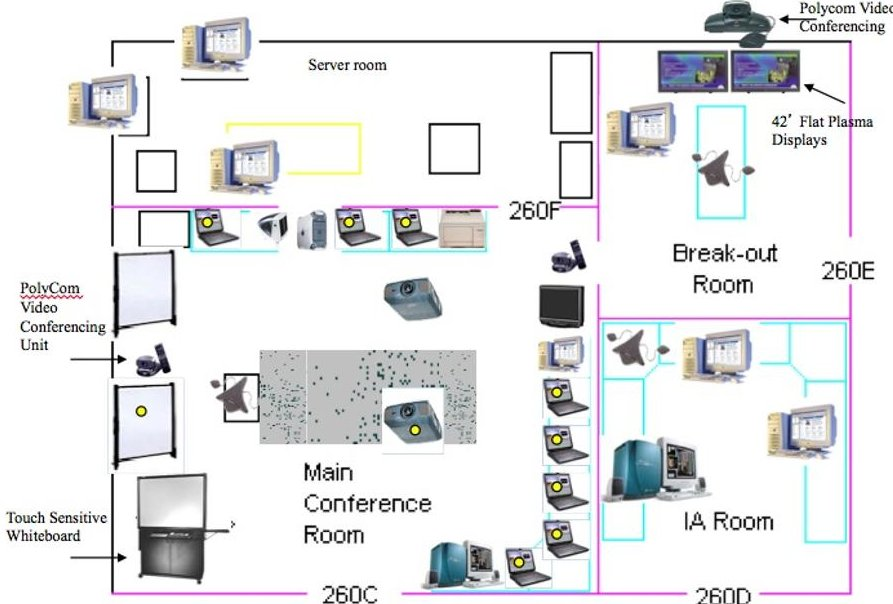
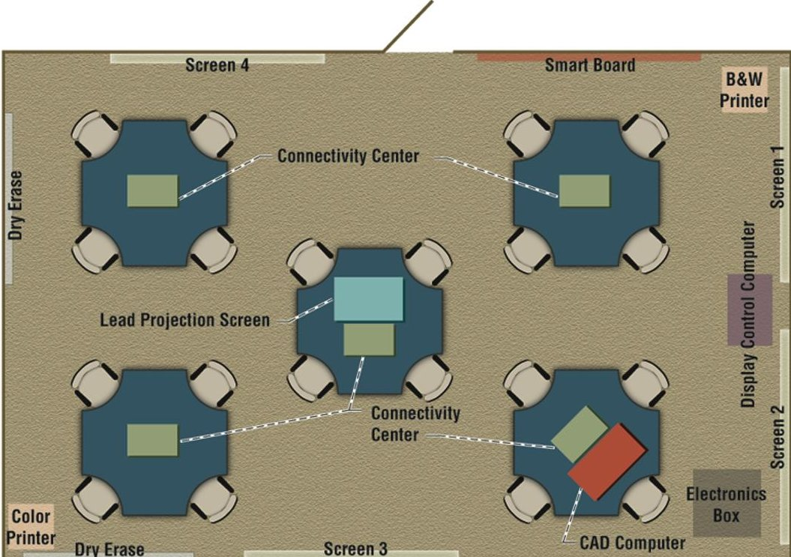
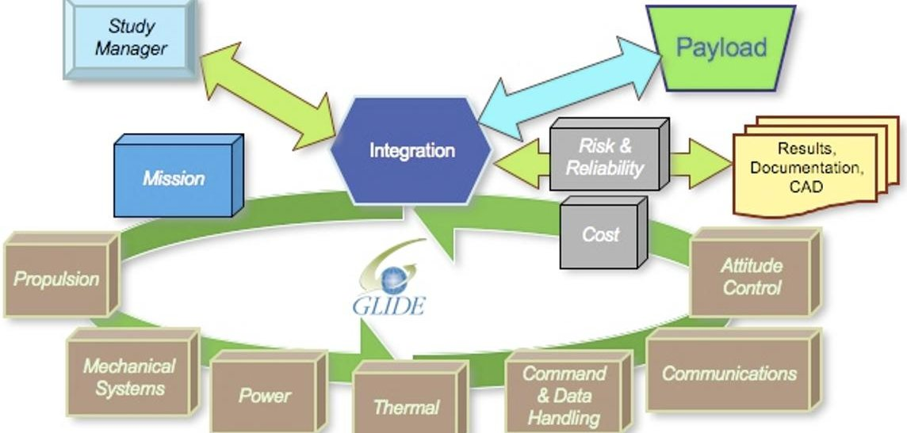
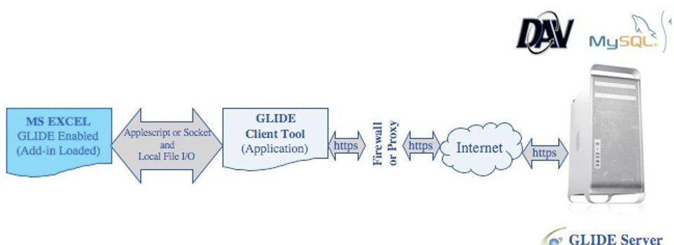
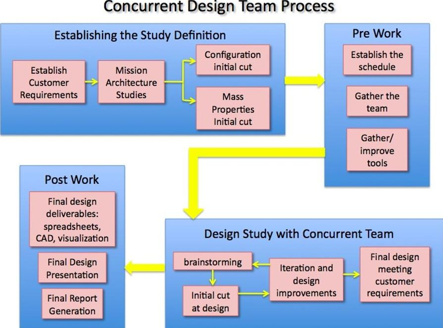
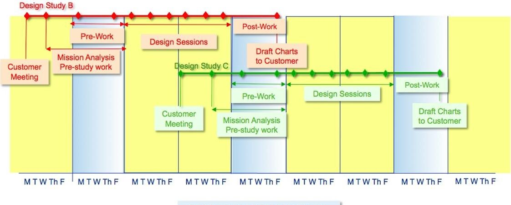

<!-- PDF_PAGE: 1 -->

# Concurrent Mission and Systems Design at NASA Glenn Research Center: The origins of the COMPASS Team

Melissa L. McGuire $ ^{1} $ , Steven R. Oleson, $ ^{2} $ and Timothy Sarver-Verhey $ ^{3} $

NASA Glenn Research Center, Cleveland, Ohio, 44135

Established at NASA Glenn Research Center (GRC) in 2006 to meet the need for rapid mission analysis and multi-disciplinary systems design for in-space and human missions, the Collaborative Modeling for Parametric Assessment of Space Systems (COMPASS) team is a multidisciplinary, concurrent engineering group whose primary purpose is to perform integrated systems analysis, but it is also capable of designing any system that involves one or more of the disciplines present in the team. The authors were involved in the development of the COMPASS team and its design process, and are continuously making refinements and enhancements. The team was unofficially started in the early 2000's as part of the distributed team known as Team JIMO (Jupiter Icy Moons Orbiter) in support of the multi-center collaborative JIMO spacecraft design during Project Prometheus. This paper documents the origins of a concurrent mission and systems design team at GRC and how it evolved into the COMPASS team, including defining the process, gathering the team and tools, building the facility, and performing studies.

## Nomenclature

COMPASS = Collaborative Modeling for the Paran

GLIDE = GGlobal Integrated Design Environment

GRC = Glenn Research Center

JIMO = Jupiter Icy Moons Orbiter

JPL = Jet Propulsion Laboratory

JSC = Johnson Spaceflight Center

IDAC = Integrated Design and Analysis Center

IDC = Integrated Design Center

IT = Information Technology

ORNL = Oak Ridge National Laboratory

PI = Principle Investigator

COTS = Commercial Off the Shelf

PEL = Power Equipment List

MEL = Master Equipment List

## I. Introduction

THE COMPASS design team is a multidisciplinary, concurrent engineering team that was established to assess spacecraft & space systems concepts. The team represents a logical extension of GRC's long history of design & analyses of space systems concepts and missions.

Working in real time with inputs from the various disciplines, a vehicle concept can come together rapidly. It can subsequently be evolved in a very efficient manner to produce a design that achieves the customer's goals. The engineering discipline leads collaborate as designers, where they can influence one another and affect the outcome of the design. In this environment, the leads/designers can better understand how the choices they've made about their subsystem will interact with other subsystems, both directly and indirectly.

<!-- PDF_PAGE: 2 -->

## II. The Origin and History of the COMPASS team

The COMPASS Team is similar to the NASA Jet Propulsion Laboratory's (JPL) Team X group and the NASA Goddard Spaceflight Center (GSFC) Integrated Design Center (IDC) Team. It came into existence during the Team Jupiter Icy Moons Orbiter (JIMO) multicenter design studies performed circa 2003 for Project Prometheus. The internal development of the Global Integrated Design Environment (GLIDE) computer program developed in parallel to the concurrent capability. The team became the COMPASS team in early 2006 in answer to a multicenter Lunar Lander Concept Design study lead by NASA Johnson Space Center (JSC). Since the Lunar Lander studies, the COMPASS team has continued to be an asset for NASA Glenn Research Center (GRC) in the analysis of technology demonstration and applications.

The process of assembling what has become the COMPASS team took multiple years and went through various starts and stops. The convergence of four factors gave birth to the COMPASS team:

1. The right people

2. The appropriate tools

3. A supportive meeting space

4. A design project of sufficient magnitude around which to coalesce the multi-discipline capabilities of the team

Described in chronological order to set the stage of the historical story of the establishment of the team, the background for each of these factors will be provided in the remainder of this section. Note that the factors as numbered above, did not happen in order from 1 to 4 and the recounting of the events will address the factors out of order.

## A. Factor 1: The Right People: Motivation for a Concurrent and Collaborative Engineering Team

Subsystem designs and technologies need to be integrated into a full vehicle or architecture so their impacts on each other, the entire vehicle, and the mission as a whole can be assessed. These assessments require many different skills from multiple disciplines. Forming a team and defining the interactions needed to perform these studies has typically required significant time and effort.

While GRC has a long and established history of spacecraft & space systems concept analyses and assessments, the formation of COMPASS provided an efficient, integrated design capability to rapidly assess these concepts with a consistent set of processes and tools. As has been observed during the COMPASS team studies, the real-time interaction between experts allows the collaborative engineering process to produce capable designs quickly without the rework needed on a design assembled by isolated teams or individuals.

Integrated design using experts in interlinked subsystems is a focus of systems engineering, and the creation of the COMPASS team started with a foundation laid by the GRC Systems Engineering Division. Historically, NASA Glenn set up concurrent design teams on an ad hoc basis as programs or projects required the detailed engineering and analysis that a group of discipline experts could provide. These teams took time to start up and faced challenges in obtaining experts in the varying engineering fields (for example, thermal, power, propulsion) needed for any particular design. The decision was made to create a standing collaboration team, so that GRC could better utilize its experience and expertise in research and technology to perform integrated systems analysis.

In the early 2000s, what was then known as the Systems Engineering Division (now Systems Engineering and Analysis Division) initiated plans for a concurrent engineering design facility and a design capability. Since it was posited that Systems Analysis was used to guide NASA technology investments, GRC technologies needed to be integrated into a full system design in order to better assess the impact of technology investment in enabling future NASA missions. Developing an integrated design capability with a consistent set of processes, tools and personnel would enable technology assessments to be conducted in a rapid and consistent manner.

Out of these efforts were created the Integrated Design and Analysis Center (IDAC), that would become the space now known as the COMPASS lab, and the Concept Design Capability that would become what is now known as the COMPASS team.

## B. Factor 3: A supportive meeting space - The COMPASS lab - setting up the facility

In planning for the integrated design capability, the following four aspects were recognized as the core elements for the composition of a successful concurrent engineering design team: process, productivity, tools, and a way to provide a focus for people to do what they are good at. In setting up the initial capability, the work was concentrated

<!-- PDF_PAGE: 3 -->

on getting the facility and the tools together to allow for the face-to-face and electronic exchange of data between team members, generation of reports, and establishment of design databases.

In order to build a space that would facilitate the uniquely interactive approach that a concurrent engineering design team would need to perform technology trades, GRC enlisted the help of The Aerospace Corporation. Members of the Systems Engineering Division traveled to the Aerospace Corporation' headquarters in California and studied their physical design center. The facility for the concurrent design study is defined by both the organized space as well as the physical components such as computers, projectors, etc. that make up the design center.

Influenced by the visit to Aerospace Corporation's Concept Design Center, the original design of the GRC IDAC shown in Figure 1 circa 2001 consisted of the following: a main room where the organized design study would take place, a secured server room, and two smaller breakout rooms with interactive tele- and videoconferencing capabilities. The main conference room had a single large conference table in the center with tables and monitors around the perimeter for engineers in the various disciplines to use as their workstations. Two projectors with two screens mounted on the front wall of the main room were used for video conferencing and internal display of data concurrently. The two breakout rooms each had video conferencing capabilities, and computer workstations for WebEx and connectivity.

Figure 1. Original IDAC lab layout. The original space in which the current COMPASS lab is housed was known as the IDAC and focused on video and teleconference capabilities.

Under contract to GRC, the Aerospace Corporation offered guidance in initial tool and facility development and participated in some early internal GRC design sessions assessing a Nuclear Electric Propulsion vehicle.

Today, the COMPASS lab retains only the main room having given the two breakout rooms to a communications systems analysis design team. The layout of the main room has evolved considerably. The room contains five tables, each serving as a hub for related subsystems (four to a table), with the center table hosting the COMPASS team lead and the visiting customer and/or mission principle investigator (PI). Four projectors display on three walls, so that from any point in the room, designs, master equipment listings (MEL), CAD layouts, etc. can be seen with equal ease. While the room still contains video conferencing equipment, it is rarely used. The secured server room now contains a backup database server while the primary server is located off-site to meet GRC Information Technology (IT) security requirements. As in the original facility, the current facility uses shared laptops and external monitors rather than fixed workstations, which are typically reserved for the system leads.

<!-- PDF_PAGE: 4 -->

Figure 2. Current COMPASS lab layout. The Current COMPASS lab layout allows for better integration and interaction between the subsystem leads.

## C. Factor 4: A design project - Providing a design project focus for the team

In order to create the concurrent engineering design team, the members of the Systems Engineering Division (SED) needed to find customers and design study subjects. Much of the initial planning involved gaining buy-in from the various projects and technologists around the lab to support the efforts of a concurrent design study group. This support was primarily in the form of personnel as well as funding.

The first study customer for the conceptual design team was an intercenter design activity known as the Jupiter Icy Moon Orbiter (JIMO). GRC was a member of the multicenter design team for the JIMO spacecraft, which included MSFC, JPL, and members from the Department of Energy (DOE)'s Oak Ridge National Laboratory (ORNL). This intercenter team, known as Team JIMO, used JPL's Team X as a model for its organization and relied heavily on teleconferences, videoconferences, and WebEx to host simultaneous design sessions.

There were multiple technical hurdles to overcome during the Team JIMO design studies. First, the phone system with multiple lines used at the time often had issues handling the operations across centers. The work-around approach was to provide both common lines and break out lines so that individuals could have private teleconferences that did not involve the entire team; similar to the way that mission control takes conversations off the public loop. The computer that controlled the routing of these calls had technical issues both with connections and signal. Second, the computational infrastructure of the various centers were vastly different, and each had differently configured firewalls separating their IT infrastructure from the outside world. GRC's infrastructure proved to be the most difficult to cross. While this was a good feature of the security of GRCs IT, it made automated electronic data sharing quite challenging.

The database tool that JPL used at the time in Team X was unable to handle these firewall issues between the centers. As is happened, another engineering team in the Systems Engineering Division was simultaneously developing a firewall crossing database tool called GLIDE for another program. The members of GRC on Team JIMO were aware of GLIDE and brought it to the multicenter team for use in publishing the data. GLIDE successfully bridged the IT gap between the NASA and DOE teams and automated the electronic exchange of data. It is this database tool that the COMPASS team still uses today. GLIDE will be discussed in more detail later in this paper.

Once the JIMO program ended in 2005, the supporting GRC concurrent team was dissolved. Having lost its design focus and main customer, the need to keep the team engaged also ended and members were quickly redirected to other tasks.

While the systems engineering concurrent team had a space in which to perform the design studies, the culmination that eventually resulted in the COMPASS team required a focus. It was in the first quarter of the 2006

<!-- PDF_PAGE: 5 -->

calendar year that the JSC led Lunar Lander Study gathered together what would become the initial members of the COMPASS team.

## D. Factor 1: The Right People -Assembling the Design Team

To achieve an effective and productive concurrent design team requires the right mix of people. Assembling a team of discipline experts is key to developing and validating successful technical designs. In addition, a team of disparate individuals needs the ability to integrate their data together, as well as monitor requirements and assumptions to insure consistency throughout the system being studied. The individual responsible for this integration needs to work with team members to provide training on data sharing processes, monitor data sharing from the subsystems, work with the disciplines to insure that the correct information is being exchanged, as well as assemble the resulting reports that document the study outcome. Because of the short turn around time of design sessions, it is important that these subsystem team experts be able to work together in real time with multiple inputs and in an environment with a rapid pace. While there are many engineers who are experts in their field, there are a subset of those engineers who thrive under the unique demands of a concurrent design team experience.

Another responsibility unique to this position, which was key to getting the COMPASS team functioning, was that of a system integration engineer. Defining the work of the system integration engineer is difficult since for most of the life of the COMPASS team, the role of the system integration lead has been evolving. Responsible for integrating the inputs from all of the subsystem leads into one cohesive design, often captured in the framework of a master equipment list, the system integration lead manages requirements, assumptions and matches them with subsystem input. The system integration engineer must have an understanding of the individual subsystems and knowledge of their integration into an overall spacecraft design. In addition, the system integration lead is responsible for defining closure of the design study, and wrapping up all loose ends both in the final charts and in the creation of the final report (when required). The current system integration lead has held this position since the inception of the COMPASS team and has worked to refine and document the COMPASS design process and train additional systems integration engineers to run studies in her absence.

Just as with the subsystem technical lead team members, a successful concurrent engineering team requires an individual in the position of team/design lead with a suitably dynamic personality. This person must provide the guidance and focus for the team toward one goal with a clear path in order to reach conclusion and closure on successful spacecraft designs. This position requires an individual with the ability to think on his/her feet and see the big picture. Leading a team of individuals of different backgrounds, personalities and expertise requires a unique personality different than that usually found in NASA programs. A concurrent team lead position is similar to that of a football coach who brings together individuals with different skills in different positions and leads them to work together as one cohesive unit toward a common goal. The COMPASS team was fortunate enough to find such an individual in the current team lead during the 2006 Lunar Lander Study, a position he continues to hold to this day.

Figure 3. COMPASS team integration. The COMPASS team is made up of experts in a wide variety of disciplines.

## E. Factor 2: Appropriate tools - Choosing the Engineering and Collaboration Design tools

Return to the early 2000s when the GRC concurrent team was working as a part of the agency concurrent team known as Team JIMO. Now that the team had this first substantial project to undertake, they needed the tools to

<!-- PDF_PAGE: 6 -->

perform the designs. In parallel with the initial multicenter JIMO work that was being performed at JPL and GRC, a member of the Systems Engineering Division, was creating a data transfer tool known as the Glenn Integrated Design Environment (GLIDE) to meet the needs of a project he was supporting. In order to perform mission assessments of technologies vs. destinations and performance for the in-space propulsion program, there existed a need to transfer data in an organized fashion between multiple engineers at different locations back and forth through the GRC firewall. In order to make this possible, he wrote a software tool in three parts: Excel Add-in, back-end database and a front-end communications tunnel to pass through the firewall while maintaining data security. The Team JIMO group decided to utilize GLIDE's ability to securely cross firewalls and manage large amounts of data. The ease of data transfer combined with it's interface to Microsoft's Excel, a tool already included in every NASA engineer's standard computer load, made GLIDE invaluable to the Team JIMO data transfer success.

While there were commercial tools that could provide some form of data exchange over networked systems, limited resources and unique IT requirements within the, then, Systems Engineering Division were driving factors in the GLIDE development. Rapid concept design studies rarely had the financial resources to procure and support a new computing capability, which contributed to the difficulty in maintaining a standing concept assessment team.

Since the COMPASS team also grew out of the Systems Engineering Division (now Systems Engineering and Analysis Division), it adopted the GLIDE capability to maintain organized data transfer, and continued to use and evolve it after the JIMO study was concluded. In addition to GLIDE for data exchange, each subsystem lead brought with them his/her own tool(s) to model their subsystem. These tools ranged from simple excel spreadsheets to larger, more complicated in-house developed or commercial off-the-shelf COTS programs. These tools provided the level of detail needed by COMPASS in what is largely considered to be Pre-phase a concept studies. COMPASS also had to cope with very limited infrastructure support funding from customers or the Center, which it has addressed in its continued GLIDE development as well as pursuing analytical tool reuse as much as possible.

## F. Factor 2: Appropriate tools - Passing and Tracking Data

Later retitled the GGlobal Integrated Design Environment, GLIDE is a program that enables the secure transfer of independent data between a virtually unlimited number of sites from anywhere in the world. All that is required to participate is the GLIDE Client software, Internet access and a GLIDE account, which can be obtained from the GLIDE website (https://glide.grc.nasa.gov/).

To address the issues highlighted during the Team JIMO testing, a prototype for GLIDE was developed and used to share data directly from within Excel workbooks across disciplines. GLIDE is a client-server software application purpose- built to mitigate issues associated with real time data sharing in concurrent engineering environments and to facilitate discipline-to-discipline interaction between multiple engineers and researchers. GLIDE is implemented in multiple programming languages utilizing standardized web protocols to enable secure parameter data sharing between engineers and researchers across the Internet in closed and/or widely distributed working environments. A well-defined HyperText Transfer Protocol (HTTP) based Application Programming Interface (API) to the GLIDE client/server environment enables users to interact with GLIDE, and each other, within common and familiar tools. One such common tool, Microsoft Excel (Microsoft Corporation), paired with its add-in API for GLIDE, is discussed in this paper. Figure 5 shows the notional path of data transfer from the GLIDE enabled Excel workbook back and forth to the GLIDE database server.

Since its inception, an internal GRC development team has continued to refine and advance the program. As of September 2011, the latest GLIDE application in internal use is version 2.0. Although GLIDE 2.0 has almost completed beta usage, it has not been approved for dissemination outside of GRC. GLIDE 2.0 has higher data-transfer speeds than the previous GLIDE v1.4. Currently the GLIDE developer team is working on GLIDE 3.0 with the hopes of creating a standardized GLIDE server installation so the GLIDE server can be set up and supported at other locations.

<!-- PDF_PAGE: 7 -->

Figure 5. GLIDE data passing. GLIDE facilitates the passing of data in matching pairs of variable name and value.

## III. The COMPASS Design Process

## G. Defining the Design Process

In order to provide some order to the COMPASS design process, the systems integration engineering lead wrote an internal COMPASS operations manual for the team. In this manual, details of running the COMPASS studies were documented. Referenced in this paper, this manual captures the design guidelines for COMPASS studies (margin, contingency) as well as the process for the various types of studies that the COMPASS team performs. Studies range from the concept design (1 design point) to the multiple design trade space analysis. Subsequently, studies can last anywhere from two weeks to six months depending on the amount of details and trajectory trades to be studied.

Initially, the process for the COMPASS team would have allowed for generous pre and post session analysis activities. A concurrent design process was first assumed to consist of 1 to 4 weeks of pre design session activities, several days of a design session, and then 1 to 4 weeks of post session activities. As time has progressed, and as COMPASS has become more in demand, design sessions often overlap the pre and post design session activities. The team typically is working three sessions at a time: the active session in the room, the documentation of the previous design study, and the setup of the next design study. In an ideal world, the process would follow the graphic depicted in Figure 6.

During the pre design session time, the customer meets with the team/design lead to outline the assumptions and requirements by filling out a standardized questionnaire for the design study. The customer and the team lead, along with a small subset of the COMPASS team core members, work together to determine the basic mission and vehicle design for the upcoming design study. Typically, the trajectory analysis will be performed during this time as well, prior to the full team kickoff of the design study, so that the $ \Delta\mathrm{V} $ , launch vehicle, trip time and launch date requirements are already established when the team is gathered and the formal design begins. All of these activities are carried out for each study, no matter the duration of the session. The purpose of this phase is to develop mission goals with the customer and to prepare all the team members and their equipment to complete the task at hand.

The total design session time frame allotted depends on the goals of the design study. COMPASS typically performs three types of design studies: Feasibility study (two weeks), Design and Exploration of Trades (one month), Conceptual Design Study (6 months). The products, length of design study, number of technology trades, etc. is all established during the pre-session discussions between the customer and the team lead.

During the design session, all COMPASS team members participate, either by being physically present in the lab or by communicating virtually via the Internet. This is the real-time, collaborative portion of the design process. The vehicle Master Equipment List (MEL), Power Equipment List (PEL), vehicle configuration and payload packaging, CAD modeling and trajectory visualization are all completed in real time with the discipline experts present. The sessions run until the team has reached a baseline design, which answers the customer's questions and fits within the requirements and assumptions. The baseline will be the standard design that fulfills the customer's requirements and which any trades will be compared to. The number of trades in technology carried out is limited only by time in the schedule. At the end of the design, the baseline is described by four main components: Mass, Power, Cost and Volume. The MEL, PEL and CAD layout, which illustrate the hardware outlined in the MEL, are all finalized.

During the post design session time, each subsystem provides a report that details the reasoning and specifics behind its portion of the design. Depending on time in the schedule and funding allocations as well as the requirements of the customer, the COMPASS team produces, at a minimum, a final set of charts documenting all the design assumptions, requirements, results and observations. If time and funding are allocated, a final report is

<!-- PDF_PAGE: 8 -->

created from this chart package in order to capture, to a higher level of detail, the complete design, trades, calculations, etc.

Figure 6. COMPASS design process. The COMPASS design process is iterative and includes the customer in the design formulation loop.

## H. Defining the Design Schedule

After the first three years of COMPASS design studies, the team conducted an internal team behaviors assessment of our processes and scheduling and overwhelmingly the members cited the need for more time to set up for approaching studies and finish up the documentation (reports and PowerPoint slides) of the just completed studies. The schedule shown in Figure 7 is the result of these discussions. Note, that while the COMPASS team is only one team, we often have two or more engineers capable of running the areas of mission and systems analysis respectively in order to allow for a more rapid schedule of studies. A post/pre week is established in between each design study to allow for time to finish the previous study and start the next study.

After the team lead meets with the customer to establish the ground rules and assumptions for the design, the mission analyst begins trajectory design ahead of the study. Additionally, the configuration engineer and the systems analysis engineer begin both the mapping out of subsystems and preliminary configuration designs.

A COMPASS session runs three afternoons a week (typically Monday, Wednesday, Friday) for two weeks. The days in between the sessions allow for breakout design sessions where only a few of the subsystem leads are required to work out issues or explore additional design options. Also, since most of the subsystem experts are matrixed into the COMPASS team, they only work half time with the team. The other half of their time is spent working other projects in their area of expertise in order to keep their knowledge current.

Figure 7. COMPASS notional design schedule. The COMPASS design schedule is built to allow time for the experts to prepare the necessary analysis for upcoming studies, and time to document the previous study.

<!-- PDF_PAGE: 9 -->

## III. Constant Improvements and Future Plans

Throughout the last five years, the COMPASS team has continually worked to improve its process. The improvement has been driven by the need to do more in less time. As the team achieved design successes and customer satisfaction, increasing numbers of customers have approached the team for designs. In order to provide the same level of design excellence as well as the same thorough products (reports and presentation), the team has continually looked at how studies are performed and where improvements can be made. In 2010, the team held a one-day retreat, out of which came a redefined design session schedule. The benefits of this new schedule are:

1. Ability to start a study with ground rules, assumptions, and background trajectory analysis completed

2. Full team able to engage from the kickoff start with inputs to their subsystems

3. Time to document the study results

In order to continue to function and excel in an ever-changing environment, the COMPASS team has remained open to new tools, new processes and new ideas. There has been the suggestion to create a duplicate COMPASS team, which would be able to run simultaneously with the first team. Besides the chronic resource limitations faced by the standing COMPASS team, a lack of available experts in the discipline areas, as well as a lack of a secondary team lead has stalled this idea. A new developer has come on board to bring GLIDE into the next version. Dubbed GLIDE 3.0, the goal is to produce a product that can be offered to other NASA concurrent teams, with easier sever setup and less dependence on Microsoft Office and the ever changing functions within Excel. The only thing the COMPASS team cannot create is more time. For now, the team relies on management to juggle priorities and schedules in order to accommodate all of the various customers.

## IV. Conclusion

The COMPASS team as it stands now was built up from multiple attempts at the creation of a concurrent concept design team at NASA Glenn Research Center. The convergence of four key elements was necessary to establishing the COMPASS team: people, tools, focus, and facility. Despite a long history at GRC of assembling teams for specific design activities, these groups were never maintained beyond the scope of these tasks. It wasn't until the catalyst study of the Lunar Lander Preparatory Study, combined with the unique personality of the current team lead and the dedication of the integration lead, utilizing existing facilities and tools, that the COMPASS team itself was born. With the team and tools established, it has become possible to engage and attract the customers necessary to sustain the COMPASS team. Establishing a track record of successful design studies, the COMPASS team has been increasingly recognized as a productive capability for the Center. Additionally, the team has begun to work with other concurrent design groups across the Agency.

## Acknowledgments

First and foremost, the authors wish to thank each and every member of the COMPASS team, past and present, for their tireless work at making the team the best it can be. The authors would like to thank Glen Horvat, Dan Gauntner, and Leon Gefert for their work in gaining support for and building the IDAC and the initial concurrent design team. Special thanks to Dr. Les Balkanyi for his tireless technical editing of every published COMPASS document. The authors wish to thank Doug Fiehler, Kurt Hack and Leon Gefert, former members of Team JIMO and COMPASS for agreeing to be interviewed for this paper about the early years of the COMPASS team. Special thanks to the current management of the Engineering Directorate, Director Olga Gonzalez-Sanabria and Deputy Director Harry Cikanek, and the Director of the Space Flight Systems Directorate, Bryan Smith, for their continued support of and championing of the COMPASS concurrent engineering team. Lastly, the historical summary documented here evolved independently of the NASA Systems Engineering Handbook section on concurrent engineering referenced below. Since one of the primary authors of this paper was a contributor to the section on concurrent engineering of that SE handbook, there will be similarities to the conclusions of this paper and the CE chapter in the handbook.

## References

COMPASS: Concurrent Engineering Team Design Study Requirements and Operations Manual,

COMPASS Lead: Steven R. Oleson, Concept Design Integration Lead: Melissa L. McGuire, internal team document number CM-2008-01, March 2011.

<!-- PDF_PAGE: 10 -->

McGuire, Melissa L., Matthew R. Kunkel and David A. Smith, Global Integrated Design Environment (GLIDE): A Concurrent Engineering Application. NASA/TM-2010-216909

AIAA Standard Mass Properties Control for Space Systems, AIAA S-120-2006, Nov. 2010.

Benzel, Edward C., M.D.: Defining Collective Experience: When Does Wisdom Take Precedence? Clinical Neurosurgery, Vol. 56, 2009, pp. 49-53.

Design, Verification/Validation and Ops Principles for Flight Systems (Design Principles), Rev. 3, JPL/Caltech Library, JPL Rules! DocID 43913, Rev. 3.

Gough, Kerry, M. D. Danette Allen, and Ruth M. Amundsen, Collaborative Mission Design at Langley Research Center, GT-DDEC.A.3

NASA Systems Engineering Handbook, NASA/SP—2007-6105 Rev. 1, December 2007.

http://ntrs.nasa.gov/archive/nasa/casi.ntrs.nasa.gov/20080008301_2008008500.pdf, accessed February 17, 2011.

NASA Systems Engineering Processes and Requirements, NPR 7123.1A, Chapter 5—Systems Engineering Technical Reviews. Effective Date: March 26, 2007: Expiration Date: March 26, 2012. Accessed February 17, 2011.

J. A. Aguilar and A. B. Dawdy, "Scope vs. Detail: The Teams of the Concept Design Center," 2000 IEEE Aerospace Conference Proceedings (March 18-25, 2000).

J. A. Aguilar, A. B. Dawdy, and G. W. Law, "The Aerospace Corporation's Concept Design Center," 8th Annual International Symposium of the International Council on Systems Engineering (July 26-30, 1998).

## Biography

Melissa L. McGuire is currently serving a detail as the Branch Chief of the Mission Design and Analysis Branch at NASA GRC, in which the COMPASS team resides. When not serving as branch chief, Ms. McGuire is the lead systems integration engineer for and a founding member of the concurrent design team at the NASA Glenn Research Center known as COMPASS. As the lead system engineer, Ms. McGuire is responsible for creating the outline concepts for a design, directing the subsystem design team engineers in the technical aspects of a session, and documenting all final study results. She is also responsible for the development and integration of GLIDE. Prior to taking on the roll in COMPASS, Ms. McGuire has spent her almost 20 year career as mission analyst and has performed mission design and trajectory optimization for low thrust and high thrust advanced propulsion missions including those for HEDS (Human Exploration and Development of Space, circa 1997), JIMO (Jupiter Icy Moon Orbiter) under Project Prometheus, and many studies through the years for the In Space Propulsion Technologies Program. Ms. McGuire holds a MS in Aerospace Engineering from the University of Cincinnati and a BS in Engineering Physics from John Carroll University. She lives in a suburb of Cleveland, OH, with her husband and two children.

Steven R. Oleson is the lead of the COMPASS concurrent design team at NASA Glenn Research Center, a position he has held since the inception of the COMPASS team itself in 2006. Mr. Oleson has twenty-five experience conceptual engineering of space systems, technology development and testing, mission analysis. He is responsible as a technical expert and the team leader as well as managing COMPASS design study costs, milestones, deliverables and schedules. Mr. Oleson was lead for Propulsion for Project Prometheus' Jupiter Icy Moon Orbiter Project and responsible for all aspects of the JIMO propulsion system for Phase A and technology development through delivery of flight hardware. Serving as both as a technical expert and the team leader as well as managing project costs, milestones, deliverables and schedules. As an advanced Mission/Propulsion Engineer he was responsible for developing new applications for propulsion and power technologies. Mr. Oleson developed innovative mission designs and enabling uses of advanced technologies. As an advanced propulsion engineer, Mr. Oleson has been involved in the evaluation and testing of such thruster system options as Hall, NSTAR and has authored or co-authored over 40 technical papers dealing with advanced on-board spacecraft propulsion systems and missions. He holds a Masters in Astronautical Engineering from the U.S. Air Force Institute of Technology, and a Bachelors in Mechanical Engineering from Ohio Northern University.

<!-- PDF_PAGE: 11 -->

Timothy Sarver-Verhey is an Aerospace Scientist currently supporting the Propulsion and Controls Systems Engineering Branch at NASA GRC. He holds a Masters in Physics from Colorado State University. Beginning as a support service contractor supporting the Electrostatic Ion Propulsion Research group in 1988, he worked on Ion Propulsion and Plasma Contractor Technology Development for 12 years. Starting as a civil servant in 2000, he has worked as a Systems Analyst for a large variety of space power and propulsion systems concept evaluations. He participated in the inception of the COMPASS team in 2006 as the Propulsion Subsystem discipline lead. He has served on the team over the course of several concept studies, including the early Lunar Lander and Orion Service Module studies. Since 2008, he served a Propulsion Subsystem co-lead for the Ares V Earth Departure Stage vehicle assessment activities. This work has evolved into the current activities assessing concepts for a Cryogenic Propulsion Stage for future NASA missions. Additionally, he supports the Solar Electric Propulsion development activities led out of the Office of the Chief Technologist in the role of Propulsion Subsystem Systems Engineering Lead. In addition to his primary responsibilities, he is an active member of the AIAA Space Systems Technical Committee and the Conceptual Engineering Working Group.