<!-- PDF_PAGE: 1 -->

# Connecting SysML Models with Engineering Analyses to Support Multidisciplinary System Development

Hongman Kim $ ^{*} $ , David Fried $ ^{\dagger} $ , and Peter Menegay $ ^{+} $

Phoenix Integration, Inc., Blacksburg, VA, 24060 USA

In the development of complex systems, a large gap exists between systems engineering activities and domain-level engineering analysis. This gap limits the use of accurate disciplinary and multidisciplinary engineering analysis, resulting in failures to meet system requirements and cost overruns. An integrated toolset was developed that bridges the gap through the integration of a SysML tool and a process integration and design optimization framework. The integrated capability enables engineers to quickly evaluate system configurations using realistic analysis models. This ability was combined with requirements conformance analysis techniques, which automatically highlighted unsatisfied requirements. It allows the design team to rapidly respond to inevitable changes in requirements and gives them the ability to perform continuous analysis, simulation, and trade-studies throughout the design process.

## I. Introduction

In the development of large and complex systems, systems engineering approaches are used to manage system complexity and to ensure that the delivered system will meet all requirements. Traditionally, document-based approaches have been used for systems engineering. The document-based approach has limitations because information is spread across several documents. This makes it difficult to assess completeness, consistency, relationship between requirements, design, engineering analysis, and test information. Model-based systems engineering (MBSE) is an approach to improve the traditional document-based systems engineering approach through the use of a system model $ ^{1} $ . System Modeling Language (SysML) $ ^{2,3} $ is a graphical modeling language that was created as an international standard to supports MBSE.

To achieve the full benefit of MBSE, there is a critical need to create links between systems engineering and disciplinary/domain engineering. Systems engineering models defined in SysML are descriptive in nature and do not directly produce analytical results. Because systems engineers and engineering analysts are using different models, tools, approaches, and terminology, they have to rely on ad-hoc communications and manual translation of design specifications and data. The gap between systems engineering and engineering analysis results in inefficiencies and quality issues that can be very expensive. Hence, there is a critical need to connect SysML models with analytical models.

Currently, system level analysis from within the SysML modeling tools is generally limited to the evaluation of simple parametric equations. This means that while SysML models are capable of describing a given system configuration with a high degree of detail, it is difficult to properly evaluate how well the design meets the requirements or to perform important trade-offs between performance, cost, and risk. The lack of an easily accessible analytical capability makes it difficult for systems engineers to quickly understand consequences of inevitable changes in requirements and system configuration and take necessary actions. If this gap can be closed, systems engineers would be able to easily access results of more accurate engineering analyses beyond simple analytical equations or spreadsheet models.

<!-- PDF_PAGE: 2 -->

On the other hand, domain/disciplinary experts (structural, thermal, electrical, software, cost, etc.) routinely use a wide variety of sophisticated analysis tools to analyze and design the system. Because these tools are not connected to the system model, it is difficult to use the system model to setup an analysis problem or to update the system model using analysis results. If this gap can be bridged, domain experts would be able to use the MBSE data repository to obtain the design information needed to create their models and simulations, and conduct analyses in the support of system development $ ^{4} $ . Using this capability, domain experts can reduce common errors and rework in their disciplinary modeling and analysis activities that are incurred due to manual data translation and use of outdated information.

This work presents an integrated modeling and analysis capability that bridges the gap. The technical approach is based on integrating SysML modeling tools with process integration and design optimization (PIDO) framework such as ModelCenter $ ^{5} $ . This approach has the advantage of using the common interface provided by the PIDO framework to connect SysML with various engineering analysis tools such as CAD/CAE, legacy codes, mathematical solvers, and spreadsheets. The integrated modeling and analysis capability was developed to support both of the two distinct perspectives of systems engineers and domain experts. In the following sections, the technical approaches and the developed toolset will be discussed along with examples.

## II. Related Work

The needs of connecting systems engineering models (such as SysML models) with analytical/executable simulation were recognized early on the development of MBSE approaches. The creation of the parametric diagram for the SysML standard was motivated by such needs. SysML parametric diagrams are used to define parametric relationships among system attributes. Some of the SysML modeling tools such as Rhapsody $ ^{\circledR} $ and MagicDraw $ ^{\circledR} $ provide analytical capabilities that solve the parametric diagram $ ^{6,7} $ . Since the parametric relationships are solved as a system of equations, the analytical model is limited to simple equations. To be able to use more sophisticated engineering analyses, external analysis tools need to be connected to SysML models. An on-going effort is developing a standard on the integration between SysML and the Modelica modeling language $ ^{8} $ . This allows simulating dynamic behavior of the SysML model through the Modelica simulation environment.

In another work $ ^{9}, $ $ ^{10} $ , SysML parametric diagrams were solved using external mathematical solvers, and functionalities were developed to use CAD/CAE models as analysis blocks in parametric diagrams. Although it is useful to be able to execute individual analysis tools from SysML, this approach requires creating new conversion functionality for each analysis tool. To overcome this challenge, an approach was suggested that integrates SysML with PIDO frameworks $ ^{11} $ , where it was demonstrated converting SysML parametric diagrams to a format that ModelCenter can understand and performing design space exploration. Since a PIDO framework can interface with diverse engineering analysis tools, this approach greatly simplifies the development of the conversion functionality from SysML to analytical models.

Authors took a similar approach of integrating a SysML modeling tool with ModelCenter framework to connect SysML models and analytical capabilities $ ^{12} $ . The work aimed at developing integrated modeling and analysis capabilities that will support distinct perspectives of systems engineers and domain experts. Systems engineers are mainly concerned with system architecture and system level trade-offs, and are not necessarily interested in the details of engineering analyses. On the other hand, domain experts are responsible for creating engineering analysis models that accurately represent the current design but do not necessarily understand details of the SysML model. The integrated toolset used a common graphical user interface that could be launched either from a SysML tool (for systems engineers) or from ModelCenter (for engineering analysts), allowing engineers to work with tools and environment that are familiar to them.

## III. Technical Approach

Extending from the authors' previous work $ ^{12} $ , this work discusses how systems engineering models and analysis models can be connected in most effective ways. The integrated modeling and analysis capability is based on a few general requirements. First, the capability needs to support models of different levels of abstraction. SysML provides a number of modeling constructs to support model abstraction, but model abstraction needs to encompass analysis models, as well. Second, a right balance needs to be sought between generic systems engineering models and domain specific models, because they have their own strengths and weaknesses. While SysML is very useful in defining system architecture and relationships, there are many specialized modeling and analysis tools for specific

<!-- PDF_PAGE: 3 -->

domains. Compared to generic SysML models, domain specific models can be more effective to accurately describe particular aspects of a system. Third, engineering analyses need to be better related to the context of overall system development. It is easy to lose track of the big picture when performing analyses in the development of a complex system. Fourth, both top-down and bottom-up approaches are needed in the creation of models. SysML models are typically created using a top-down approach, evolving from high level abstractions to more details. But SysML models may need to be updated based on inputs from domain experts who are responsible for creating analysis models.

In this section, the technical approach will be discussed in detail. So far, Rhapsody and MagicDraw SysML tools have been integrated with ModelCenter. A common graphical user interface was created that is shared by the Rhapsody and MagicDraw integrations. The technical approach is explained using the MagicDraw integration in this section, but the approach is applicable to the Rhapsody integration, as well.

## A. SysML Customization to Connect Engineering Analyses

SysML is a generic systems modeling language that was designed to support extensions for specialized domains. One of the extension mechanisms is known as stereotypes, which are used to customize the SysML language. If a stereotype is applied to a model element, for instance, it will add the special meaning of that stereotype. Related stereotypes can be grouped into special packages called profiles that are reusable for other models.

In this work, SysML was extended to accurately model analysis components that will be run in the ModelCenter framework. Several new stereotypes were defined and they were packaged into a profile named MBSEAnalyzer. Figure 1 shows the stereotypes defined in the profile. MC_Component stereotype was defined to specify the location of an executable analysis model for a constraint block (e.g., analysis block). MC_Variable stereotype was defined to create mapping between SysML ports (e.g., parameters) and variables in analysis models. InOut enumeration is used to specify causality (input or output) of parameters that are stereotyped by MC_Variable. In this work, engineering analyses are used to automatically check requirements conformance. RequirementVerification stereotype can be applied to requirement blocks for that purpose. The stereotypes and their usage will be discussed in more detail in following sections.

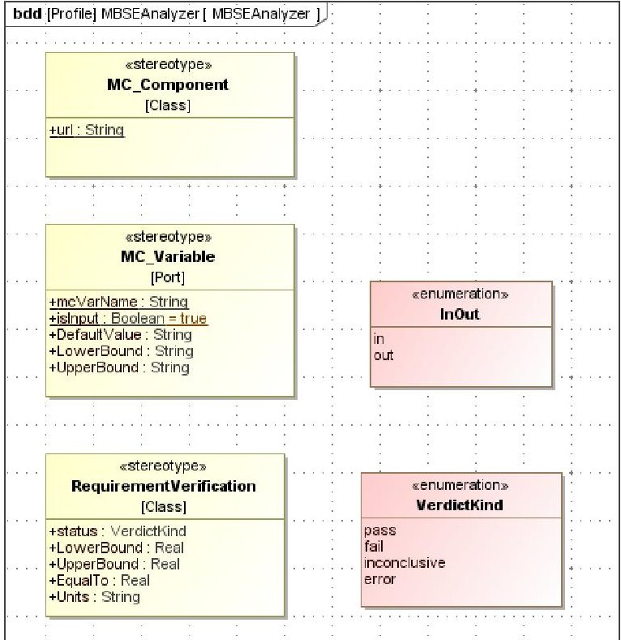

Figure 1: SysML stereotypes were defined to connect SysML models with engineering analysis.

## B. Automobile Brake Pad Design Example

The technical approach is described using an automobile brake pad design as an example. The goal is to design a brake pad that satisfies a few performance requirements such as stopping distance, projected life, and heat generated

<!-- PDF_PAGE: 4 -->

during braking. Figure 2 is a SysML block definition diagram that shows the system breakdown. Physical entities in the system are represented by SysML blocks, each of which may have value properties. Arrows in the diagram represent whole-part relationships. For example, Brake has a rotor, a caliper, and a pad as parts. For this example, C++ programs and an Excel spreadsheet were used to compute performance and cost of the break pad. In the next sub-sections, it is discussed how the engineering analysis models were connected to the SysML model.

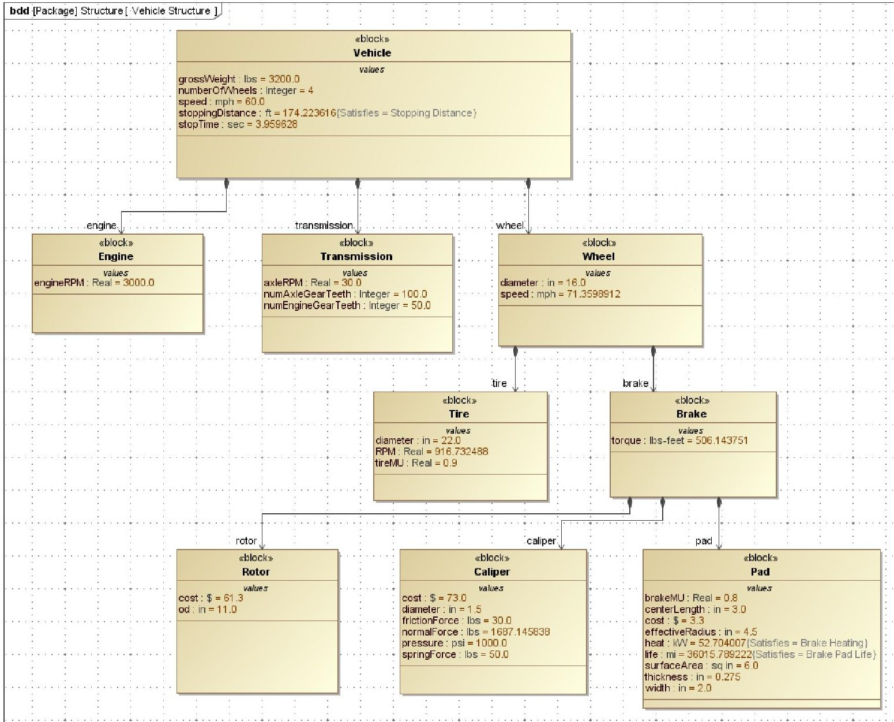

Figure 2: System breakdown of the brake pad design example (SysML block definition diagram).

## C. Definition of Engineering Analysis in SysML

SysML parametric diagrams are used to specify quantitative relationships among system attributes. A parametric diagram uses analysis blocks (called constraint blocks) that represent physical or logical relationships between system attributes in the model. However, the out-of-the-box capability of the constraint block is limited to algebraic equations. To overcome this limitation, SysML constraint blocks are extended so that they point to black box analyses that can be scripts, spreadsheets, CAD/CAE tools, or legacy analysis codes. In this work, analysis models are hosted by Analysis Server $ ^{\circledR} $ , a companion product of ModelCenter, which is capable of sharing engineering analyses and running them remotely. Each black box analysis hosted by Analysis Server is identified by a URL (Uniform Resource Locator). The MC_Component stereotype was used to associate the URL with constraint blocks.

Figure 3 shows a constraint block that was defined for cost analysis of the brake pad. The cost analysis is based on an Excel spreadsheet, which was wrapped by Analysis Server. The url tag of the MC_Component stereotype specifies the location of the wrapped analysis.

<!-- PDF_PAGE: 5 -->

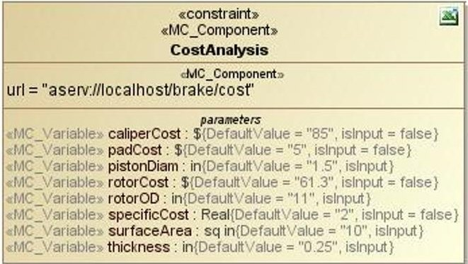

Figure 3: SysML stereotype is used to define the URL location of a black box analysis.

Each constraint block has parameters as shown in the parameters compartment in Figure 3. Algebraic equations are typically used to define constraints among the parameters. In this work, constraint blocks are based on black box analyses instead of equations. Each of the black box analyses had a set of input and output parameters. Except for simple analytical relationships, it is not easy to change causality (input/output) of parameters for black box analyses. Therefore, causality is explicitly defined for each parameter according to the definition in the corresponding black box analysis. As seen in Figure 3, MC_Variable stereotype was used to define causality of parameter as well as default values.

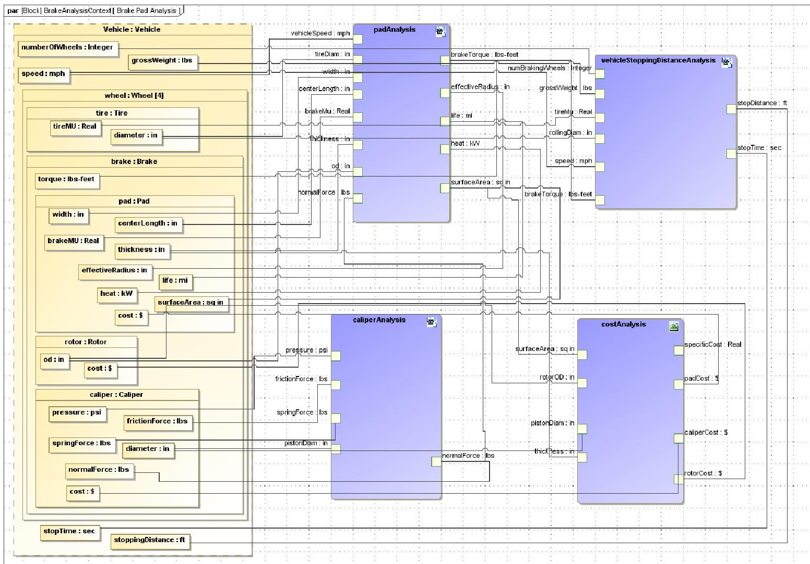

Figure 4: Parametric diagram was customized to reference black box analyses.

Constraint blocks are reusable analysis modules in SysML. Parametric diagrams may use multiple constraint blocks to define more sophisticated analytical relationships. Figure 4 is a parametric diagram created for the brake pad example. The diagram contains four constraint blocks including the aforementioned pad cost analysis and analyses for pad, caliper, and stop distance that were based on C++ programs. Each constraint block was specialized by the MC_Component stereotype and was marked with an icon (e.g., Excel $ ^{\circledR} $) that indicates the type of the analysis model

<!-- PDF_PAGE: 6 -->

behind the constraint block. Note that constraint parameters are represented as rectangular ports on the edges of a constraint block.

Binding connectors in parametric diagrams represent equality relationships between system attributes. Binding connectors can be created between a system property and a parameter, or between parameters. In principle, the equality relationships are non-causal and binding connectors do not make distinction between input and output parameters. To solve a parametric diagram with non-causal relationships, a system of equations needs to be solved. However, this approach is limited to the use of simple equations and is not easily applicable when black box engineering analyses are used. Back-solving for inputs from outputs is not a trivial task for many engineering analyses. In this work, therefore, each parameter of a constraint block is explicitly defined as an input or an output according to how the parameter is used in the black box analysis. Constraint blocks in Figure 4 use a convention of arranging input and output parameters on the left and the right edges of constraint blocks, respectively.

## D. Automatic Generation of Analysis Models

The parametric diagram defined in Figure 4 has necessary information to create an analysis model that can be executed through the PIDO framework. Constraint blocks are translated to analysis components in ModelCenter and binding connectors are translated to links among variables of analysis components. A capability was developed that automatically creates an analysis model from a parametric diagram. The capability was developed as a SysML plug-in to the PIDO framework. The translation is performed using APIs of SysML tools and ModelCenter without relying on a formal model transformation. The SysML plug-in allows selecting a parametric diagram and automatically generates an analysis model. Figure 5 shows the analysis model generated from the parametric diagram. When a corresponding analysis model is created, the plug-in lists system attributes used in the parametric diagram (Figure 6). Users can change input values and run the analysis to compute performance and cost metrics for different system configurations.

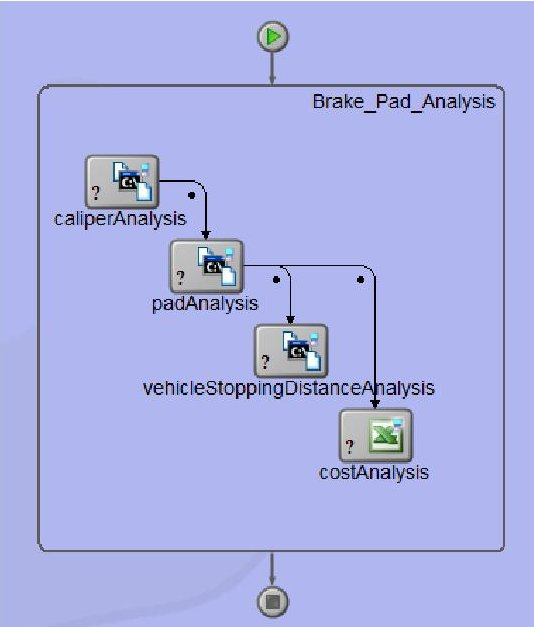

Figure 5: Analysis model was automatically created in ModelCenter from the SysML parametric diagram.

It should be noted that the automatically generated model is connected to the SysML model. This approach allows using the SysML model as an authoritative source of design information for engineering analyses. Input parameter values are initialized from the values defined in the SysML model. This allows domain experts to set up their analysis models quickly, avoiding potential errors in manual data translation. This approach also makes it easy to use the results of the engineering analyses to update the SysML model. The SysML plug-in provides a capability to update the SysML model using new values computed from the analysis model. Another advantage of this approach is that trade study tools available in the PIDO tool can be used to evaluate many design alternatives. When an optimal design is found, the design can be used to update the current design in the SysML model.

<!-- PDF_PAGE: 7 -->

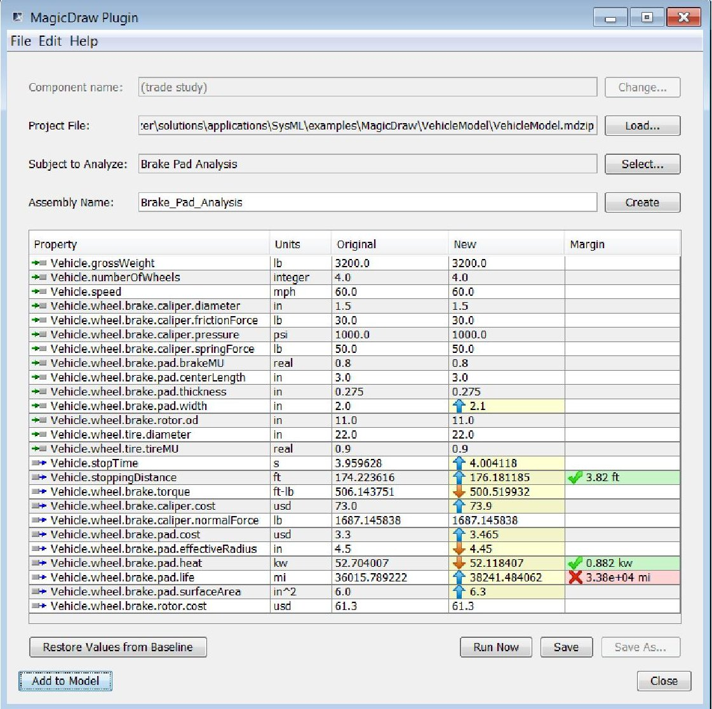

Figure 6: SysML plug-in executes the analysis model that was automatically generated from a parametric diagram.

## E. Requirements Modeling

One objective of this work was to develop techniques to use engineering analyses to check requirements conformance. A challenge is that requirements are normally defined in textual formats that require human interpretation before they can be verified in an automated fashion. This work took an approach of manually interpreting requirements and attaching lower/upper bounds to each requirement. Consider a textual requirement: "The brake pad shall have a projected life of at least 72,000 miles under normal driving conditions." When it is interpreted, a lower bound of 72,000 miles can be attached to the requirement. Then, the requirement can be verified by comparing the lower bound with the pad life computed by an engineering analysis.

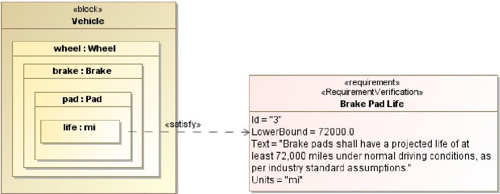

Figure 7: Satisfy relationships are used to relate system attributes to requirements.

<!-- PDF_PAGE: 8 -->

SysML tags were used to attach lower/upper bounds to requirements. Figure 7 shows the example of the brake pad life requirement, for which a LowerBound tag was created. The requirement is related to the life attribute of the pad through a satisfy relationship. Since the value of the life attribute is smaller than the lower bound, the requirement is not satisfied. A capability was created that automatically checks conformance status of requirements. If a requirement is not satisfied, it is automatically highlighted with a red "X" icon as seen in Figure 6.

## F. Evaluating Designs Defined in SysML Models

The SysML plug-in is suited to the needs of engineering analysts, who may prefer accessing SysML models from the PIDO environment. On the other hand, systems engineers may want to work within SysML tools. To support the latter, a custom tool called MBSE Analyzer was created for SysML tools to execute parametric diagrams directly from the SysML environment. Using the tool that is launched from Rhapsody or MagicDraw, users can browse and select a parametric diagram for evaluation. When the selected parametric diagram is evaluated, the tool will create a ModelCenter model behind scene, execute it, and report analysis results. The analysis results can be used to update the SysML model when desired.

MBSE Analyzer also has a capability to evaluate a set of related parametric diagrams, according to an object oriented modeling approach called composable objects $ ^{9} $ . A parametric diagram defines analytical relationships among the properties of a block. In this work, parametric diagrams are considered as a part of the definition of a block. SysML blocks become reusable objects that contain not only properties, but also analytical relationships. When the block is used as a part of another block, the analytical relationships (or the parametric diagram) automatically apply to the part. This provides a natural way of relating analysis models to a physical entity.

Revisiting the brake pad example, the parametric diagram in Figure 4 had four constraint blocks. In fact, the diagram can be broken into smaller pieces by associating constraint blocks with blocks. For example, the padAnalysis and stopDistanceAnalysis constraint blocks can be associated with the Vehicle block. The costAnalysis constraint block belongs to the Brake block, and the caliperAnalysis belongs to the Caliper block. Figure 8 shows three parametric diagrams that were defined for Vehicle, Brake, and Caliper blocks, respectively. Compared to the original version in Figure 4, this is a modular approach resulting in smaller parametric diagrams, which are easier to understand. It is possible to solve parametric diagrams individually instead of solving the entire analytical relationships.

By associating each parametric diagram with a block, the block carries the analytical relationships of the parametric diagram wherever the block is used in the model. In the brake example, since the Vehicle block has a brake part and the Brake block has a caliper part, all of the three parametric diagrams are applicable to the Vehicle block. By the same token, the Brake block has two applicable parametric diagrams, while the Caliper block has only one. This gives an opportunity to automatically compose an analysis model using relevant parametric diagrams.

A capability was created to evaluate a set of parametric diagrams simultaneously for a block. Figure 9 shows MBSE Analyzer created for MagicDraw. In the upper left tree, Vehicle block was selected for analysis. Applicable parametric diagrams for the selected block are shown in the lower left tree. Parametric diagrams are organized according to the part hierarchy of the selected block. Parametric diagrams that will be included for analysis can be selected in the tree view. System properties used in the selected parametric diagrams are list in a tabular format. Note that names of the system properties are automatically constructed using a dot-notation according to its part hierarchy. If some of the parametric diagrams are unselected, the properties table will be updated accordingly. The selected parametric diagrams are evaluated through ModelCenter. Each parametric diagram will be translated to an assembly of analysis components. Links between variables in assemblies are automatically created by combining the binding connectors in the selected parametric diagrams. The automatically created model is executed in ModelCenter and results are collected in the "New" column in the tool.

The approach of solving multiple parametric diagrams applies to instance specifications in the same way. In SysML/UML, instance specification is a concrete realization of a block. It is the same concept of the object oriented programming, where a class can be instantiated to create an object. Since an instance specification is based on a block, parametric diagrams defined for the block apply to the instance specification as well. In MBSE Analyzer, when an instance specification is selected, applicable parametric diagrams will be automatically identified according to its block-part relationships. Multiple parametric diagrams can be evaluated together. More than one instance can be created for a block and instance specifications are useful in defining different baseline designs and keep track of their evolution.

<!-- PDF_PAGE: 9 -->

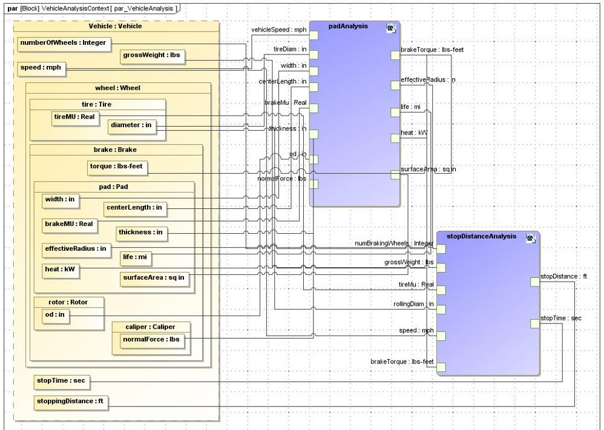

(a) Analysis for vehicle block

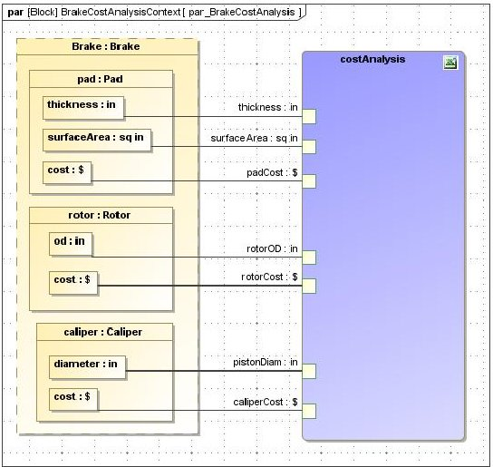

(b) Analysis for brake block

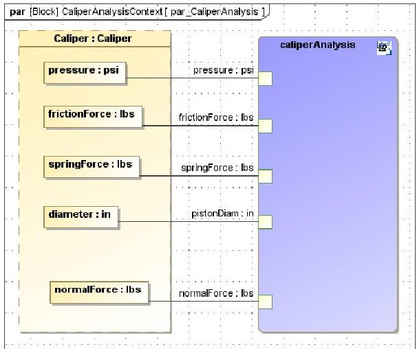

(c) Analysis for caliper block

Figure 8: The parametric diagram of Figure 4 was broken into smaller pieces. Each parametric diagram is defined for a block, associating analytical relationships with the corresponding block.

## G. Importing Analysis Models into SysML Models

The discussion so far was focused on converting SysML models to engineering analysis models. But conversion in the reverse direction is often desired. For instance, if engineering analysis models already exist, it is beneficial to reuse them. To this end, a capability was created for the SysML tool to import analysis models into a SysML model. First, a capability was created to import individual black box analyses as SysML constraint blocks. This capability allows browsing available analyses on the network, and creating constraint blocks in a selected package in the SysML model. Second, a capability was created to import an integrated analysis model as a parametric diagram. This capability first creates constraint blocks for black box analyses in the analysis model and then uses them to create a parametric diagram. Once a parametric diagram is created, it can be updated to connect system attributes. The parametric diagram can be executed using the capability described in the previous sections.

<!-- PDF_PAGE: 10 -->

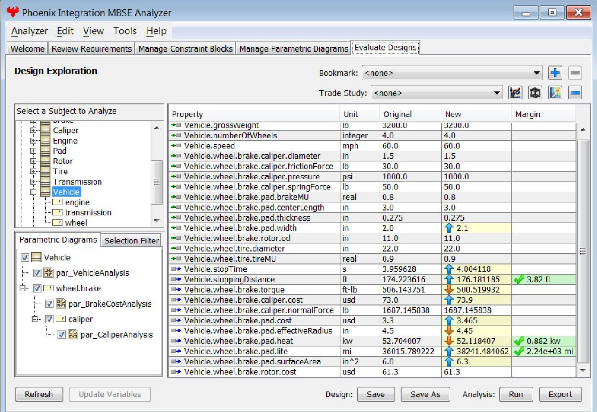

Figure 9: Three parametric diagrams selected for the vehicle block were evaluated together.

## IV. A Plant System Design Example: Reusing Analysis Models

The integrated modeling and analysis capability was applied to the design of a manufacturing plant with a pressurized air supply. This is a multidisciplinary example that consists of several subsystems including compressor, heat exchanger, pressure vessel, air distribution, and floor. For this example, analysis models for major subsystems already existed in the form of ModelCenter models. A bottom up approach was used to connect the analysis models to a SysML model by importing them. In this example, IBM Rhapsody was used to create the SysML model. Figure 10 shows structural breakdown of the plant system along with the corresponding analysis models for subsystems. As seen in the figure, each analysis model is fairly sophisticated with a number of analysis components.

First, the analysis models were imported into the SysML model. It was assumed that the analytical models were created and maintained by domain experts. Although a ModelCenter model can be imported as a SysML parametric diagram with individual analysis components, there was no advantage of the approach for this example, because it was desirable to use the analytical models externally as they are. Therefore, each analysis model was treated as a black box as a whole and imported as a constraint block. This approach helps hide complexity of the analytical models. Each of the imported constraint blocks was used to define a parametric diagram for each subsystem. Figure 11 is an example for the compressor, where a single constraint block is used to represent the external analysis model.

The example was used to demonstrate a resource allocation problem that is common in system design problems that involve multiple domains. In a resource allocation problem, systems engineers consider overall system cost and performance, and allocate system resources to each subsystem. Domain experts are responsible for subsystem design and they develop each subsystem under the constraint of the allocated resources. When subsystem design is completed by domain experts, the results will be combined at the system level to ensure that the allocated budget numbers are satisfied. If some of the subsystems cannot meet the allocated budget, systems engineers may need to adjust the resource allocation. The resource allocation may need to be adjusted a few times before finding the right balance among subsystems. For the plant design example, it is assumed that the total floor area is fixed, within which the three subsystems (compressor, heat exchanger, and pressure vessel) must be installed. A system level parametric diagram was created to allocate floor areas to subsystems. Each subsystem was analyzed and optimized under the given floor area as a design constraint.

<!-- PDF_PAGE: 11 -->

Figure 12 is a screen shot of MBSE Analyzer for the plant example. The Plant block was selected for analysis in the upper left tree. The lower left tree shows applicable parametric diagrams for the selected block according to the part hierarchy. Out of the five available parametric diagrams, only the floor area analysis was selected for analysis. The parametric diagram was defined for the Plant block itself, allocating floor areas to subsystems. The properties list table shows that the allocated floor areas were violated for the heat exchanger and the pressure vessel. This tool provides a dashboard view for systems engineers to better understand status of resource allocations. Systems engineers may reallocate resources using the tool and initiate redesign of affected subsystems.

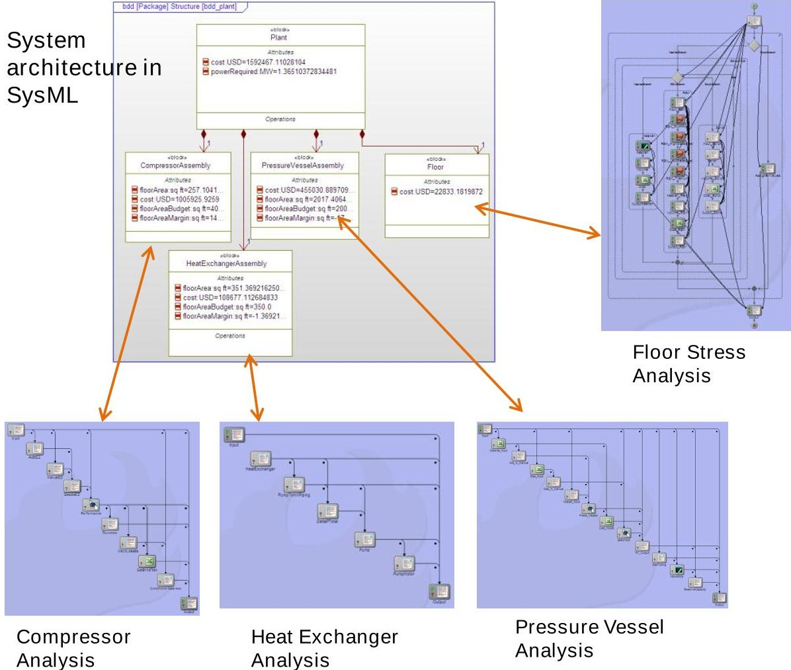

Figure 10: A SysML model was created for a plant system and it was connected to subsystem analysis models.

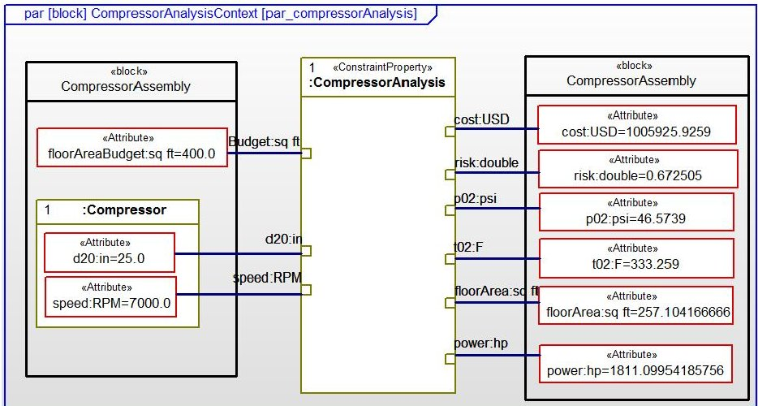

Figure 11: Parametric diagram for compressor, where a ModelCenter model is represented by a single constraint block.

<!-- PDF_PAGE: 12 -->

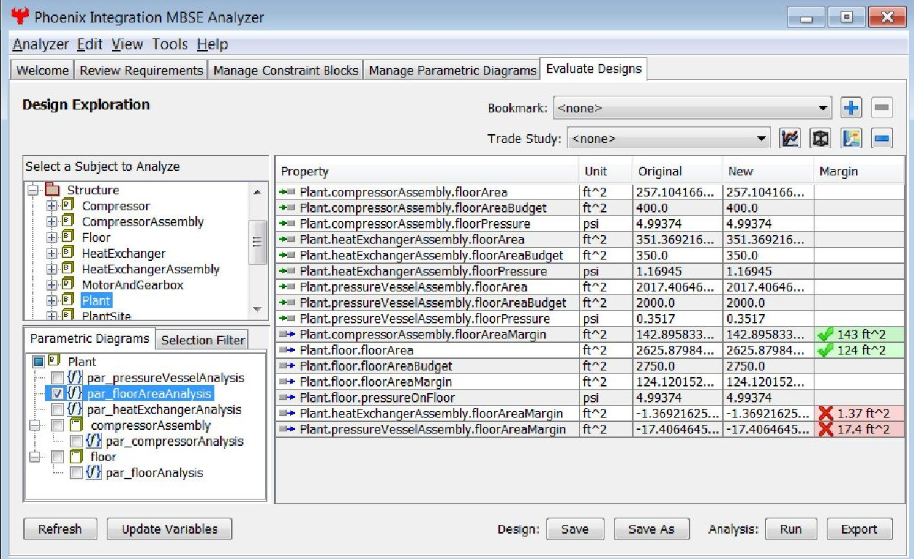

Figure 12: A system level parametric diagram was selected to evaluate resource allocations.

## V. Concluding Remarks

Tools and techniques were developed that bridge the gap between systems engineering models and engineering analysis. This was accomplished by connecting descriptive SysML models with engineering analysis models that can be executed through a PIDO framework. The key element of the technology was automatically generating analysis models from SysML parametric diagrams. A SysML modeling technique was used that associated parametric diagrams with blocks. This allowed quickly identifying applicable analyses for a selected subject in a SysML model and selectively solving one or more parametric diagrams at the same time. The integrated toolset enables engineers to quickly evaluate system configurations using realistic and accurate analysis models. By specifying engineering analyses in a SysML model along with their traceability to system attributes, the SysML model provides a complete picture of the relationship between the system model and engineering analyses.

This integrated approach was used to check system requirements using engineering analysis models. SysML modeling techniques were developed that automatically verified requirements conformance status. Unsatisfied requirements were automatically highlighted, so that engineers can take necessary actions. This capability gives an opportunity to check potential problems before committing design changes. The integrated capability allows design teams to rapidly respond to inevitable changes in requirements or design configurations. Coupled with trade study tools available in PIDO tools, the capability gives the ability to perform continuous analysis, simulation, and trade studies throughout the design process.

The integrated toolset was designed to supports distinct perspectives of systems engineers and domain experts. Systems engineers can quickly evaluate system architectures within the SysML tool environment. Domain experts can use SysML models as a source of design information to quickly set up analytical models. Results of engineering analysis can be used to update the SysML model in a transparent way. It is important to recognize that connecting system models and analysis models requires both top-down and bottom-up approaches. The technology was demonstrated for a plant system design problem, for which existing analysis models were imported as SysML constraint blocks. It was discussed how the toolset can be used to support resource allocation problem, where systems engineers and domain experts are responsible for different aspects of system analysis.

## Acknowledgments

This work was funded by DARPA SBIR contracts (W31P4Q-11-C-0008 and W31P4Q-12-C-0049).

<!-- PDF_PAGE: 13 -->

## References

1. Fisher, J., "Model-Based Systems Engineering: A New Paradigm," INCOSE Insight, Vol. 1 (3), pp. 3-4, 1998.

2. OMG System Modeling Language, See http://www.omgsysml.org.

3. Friedenthal, S., Moore, A., and Steiner, R., A Practical Guide to SysML - The System Modeling Language, Elsevier Inc., 2009, ISBN 978-0-12-378607-4.

4. Mosier, G., "Parametric Design and Analysis to Support Model-Based Systems Engineering Using SysML," NASA Tech Briefs, October, 2010, p. 80.

5. Phoenix Integration, Inc., "Improving the Engineering Process with Software Integration," a white paper, 2002, See also http://www.phoenix-int.com.

6. IBM Rational, Rhapsody UML/SysML, See also http://www-01.ibm.com/software/awdtools/rhapsody

7. NoMagic, MagicDraw UML/SysML, See also http://www.magicdraw.com

8. Paredis, C. J., Bernard, Y., Burkhart, R. M., Koning, H. D., Friedenthal, S., Fritzson, P., Rouquette, N. F., Schamai, W., "An Overview of the SysML-Modelica Transformation Specification," INCOSE International Symposium, Chicago, IL, July, 2010.

9. Peak, R. S., Burkhart, R. M., Friedenthal, S. A., Wilson, M. W., Bajaj, M., and Kim, I., "Simulation-Based Design Using SysML - Part 1: A Parametrics Primer," INCOSE International Symposium, San Diego, CA, 2007.

10. Peak, R. S., Burkhart, R. M., Friedenthal, S. A., Wilson, M. W., Bajaj, M., and Kim, I., "Simulation-Based Design Using SysML - Part 2: Celebrating Diversity by Example," INCOSE International Symposium, San Diego, CA, 2007.

11. Min, B. I., Kerzhner, A. A., Paredis, C. J., "Process Integration and Design Optimization for Model-Based Systems Engineering with SysML," Proceedings of the ASME 2011 International Design Engineering Technical Conferences & Computers and Information in Engineering Conference, DETC2011-48453, Washington DC, Aug., 2011.

12. Kim, H., Fried, D., Menegay, P. and Soremekun, G., "Integrated Modeling and Analysis to Support ModelBased Systems Engineering," Proceedings of the ASME 2012 11th Biennial Conference on Engineering Systems Design and Analysis, ESDA2012-83017, Nantes, France, July 2-4, 2012.