<!-- PDF_PAGE: 1 -->

# STARFRONT: Cooperatively Constructing Pervasive and Low-Latency CDNs Upon Emerging LEO Satellites and Clouds

Zeqi Lai $ ^{1D} $ , Member, IEEE, Hewu Li $ ^{1D} $ , Qi Zhang $ ^{1D} $ , Qian Wu $ ^{1D} $ , and Jianping Wu, Fellow, IEEE

Abstract—Internet content providers (ICPs) typically exploit content distribution networks (CDNs) to provide wide-area data access with high availability and low latency. However, our analysis on a large-scale trace collected from seven major CDN operators has revealed that: from a global perspective, there are still a large portion of users suffering from high user-perceived latency due to the insufficient deployment of terrestrial cloud infrastructures, especially in remote or rural areas where even the closest available cache server is too far away. This paper presents STARFRONT, a cost-effective content distribution framework to optimize global CDNs and enable low content access latency anywhere. STARFRONT collaboratively builds CDNs upon emerging low earth orbit (LEO) constellations and existing cloud platforms to satisfy the low latency requirements while minimizing the operational cost. Specifically, STARFRONT exploits a key insight that emerging mega-constellations will consist of thousands of LEO satellites which can be equipped with high-speed data links and storage, and thus can potentially work as "cache in space" to enable pervasive and low-latency data access. STARFRONT judiciously places replicas on either LEO satellite caches or terrestrial cloud caches, and dynamically assigns user requests to proper cache servers based on different constellation parameters, cloud/user distributions and pricing policies. We have implemented a STARFRONT prototype in our testbed, and extensive trace-driven evaluations covering multiple geodistributed vantage points have demonstrated that STARFRONT can effectively reduce the global content access latency with acceptable operational cost under representative CDN traffic.

Index Terms—Geo-distributed content distribution, low earth orbit constellations, integrated space and terrestrial networks.

## I. INTRODUCTION

CONTENT distribution (or delivery) networks (CDNs), which consist of a considerable number of geo-distributed cloud-based cache servers, aim at providing high network availability and low content access latency globally. The global CDN delivers a large fraction of total Internet traffic today [6].

Therefore, optimizing the network performance of CDNs can significantly improve the quality of experience (QoE) of a variety of applications built upon CDNs (e.g., Web services and Video-on-Demand (VoD)).

Content access latency, which is typically defined as the time consumption of delivering requested objects to end users, is one of the most important performance metrics in CDNs. In practice, the content access latency can refer to the page load time of a website, or the video initialization time for VoD, depending on the concrete application types. Critical to the low-latency story of CDNs is that users can access content replicas cached on geo-distributed servers close to end users. However, although CDNs hold great promise, our analysis on a large-scale CDN trace collected from seven major CDN operators across 183 countries reveals that: from a global perspective, even though today's CDNs have been deployed for many years with a considerable amount of cache servers around the world, there are still a large portion of CDN users suffering from high round-trip time (RTT) even to their closest cache server, which can probably result in long content access latency. Our further analysis in $ \mathrm{S I I} $ identifies that such high access latency is more prevalent in remote or rural areas, due to two important reasons: (i) the insufficient deployment of cloud infrastructures, and (ii) meandering terrestrial routes from clients to cloud servers (e.g., prolonged Internet paths caused by remote peering [26]).

However, none of the above root causes is easy to address in existing terrestrial networks. First, the deployment of today's Internet is essentially an uneven network, where network resources are aggregated in many developed regions (e.g., "hot areas"). In remote and other under-developed areas, Internet access is limited. Provisioning and maintaining cloud servers in such areas to improve network performance are technically and economically challenging. Second, terrestrial Internet is divided into many autonomous systems (ASes). Due to the concrete routing policies of different independent ASes, inter-AS routes might be tortuous, resulting in meandering routes between users and assigned cloud servers, which further increase the client-to-cache latency.

Emerging mega-constellations with thousands of satellites flying in low earth orbit (LEO) raise a new opportunity to optimize the network performance of CDNs globally. As today's space-crafts have evolved rapidly in recent years, modern satellites will be equipped with high-throughput communication components [32], [36] and high-capacity storage [37], [38]. Such satellites have the potential to act as "cache in space". Intuitively, caching content replicas on emerging LEO constellations close to users is a promising approach to enable low latency pervasively [22]. However, fully exploiting the potential of mega-constellations still needs to address several

<!-- PDF_PAGE: 2 -->

fundamental challenges. First, satellites are fundamentally mobile, and moving at a high velocity in their orbits. How should we properly select LEO satellites to cache content replicas and avoid the impact of intermittent connectivity? Second, it is more expensive to carry CDN traffic over satellites than that over terrestrial networks. How should we judiciously assign user requests to a satellite or a cloud cache server in a cost-effective manner?

We propose STARFRONT, a content distribution framework that cooperatively leverages cache servers in both LEO satellites and terrestrial clouds to optimize the content access latency in a cost-effective manner. In particular, STARFRONT adopts multiple techniques to accomplish the goal of cost-effective wide-area content distribution. First, STARFRONT constructs a dynamic satellite-cloud model which captures the time-varying accessibility and network performance of the satellite-cloud integrated architecture. The model is built based on the information of cloud distribution, predictable satellite trajectory together with their estimated performance and pricing policies specified by satellite or cloud operators.

Second, based on the integrated satellite-cloud architecture, the STARFRONT framework enables three forms of request assignments for users in different regions. Specifically, a user request can be: (i) directly assigned to a cloud server (i.e., a terrestrial cache) via terrestrial networks like that in existing cloud-based CDNs; (ii) assigned to a cloud server through low-latency space paths constructed by a sequence of satellites; or (iii) assigned to a satellite cache if the nearest cloud is still too far away. The above approaches of request assignment involve different latency performance and corresponding storage and traffic costs in practice.

Third, STARFRONT incorporates a collection of content placement and request assignment algorithms to achieve costeffective content distribution. Specifically, STARFRONT judiciously pushes contents and places replicas on available cloud or satellite servers, and assigns user requests to proper cache servers to meet the latency requirement of different applications, while minimizing the total cost of content distribution via satellite-cloud cooperation.

We build a testbed to simulate a large number of cloud caches and dynamic LEO satellite caches to evaluate the proposed framework. We also implement a STARFRONT prototype based on Apache Traffic Server (ATS) [4] running upon the testbed. Further, we conduct trace-driven evaluations based on three state-of-the-art constellations covering a collection of geo-distributed vantage points to evaluate the effectiveness of STARFRONT. Our evaluation results reveal that by integrating satellites and clouds for content distribution globally, STARFRONT can satisfy various latency requirements of applications, and outperform existing cloud-only approaches in terms of content access latency with acceptable operational cost and resilience to intermittent connectivity. Moreover, we find that the constellation structure can significantly affect the achievable performance of STARFRONT. In particular, constellations with lower altitude and equipped with intersatellite links (ISLs) can further reduce more content access latency for terrestrial users, since lower altitude indicates lower propagation delay, and high-speed ISLs enable near-optimal space paths for users to fetch contents from cloud servers over LEO satellites.

Taken together, this paper makes three key contributions:

- (i) We identify and analyze the high access latency problem in existing CDNs through a measurement study

TABLE I

MEASUREMENT DETAILS AMONG DIFFERENT CONTINENTS

<table border="1"><tr><td>Continent</td><td>EU</td><td>AS</td><td>NA</td><td>AF</td><td>SA</td><td>OC</td><td>ALL</td></tr><tr><td># of Pings</td><td>4888</td><td>2782</td><td>920</td><td>999</td><td>1064</td><td>349</td><td>11002</td></tr><tr><td># of Probes</td><td>2194</td><td>520</td><td>456</td><td>145</td><td>154</td><td>106</td><td>3575</td></tr></table>

on seven commercial CDN operators, and expose the feasibility as well as the challenges of exploiting emerging LEO mega-constellations to assist pervasive and lowlatency content distribution globally ( $ \mathrm{\Sigma I I} $ ).

- (ii) We formulate the cost-effective content distribution (CECD) problem in the satellite-cloud integrated environment, and present STARFRONT, a content distribution framework that cooperatively leverages the storage and network capabilities in both clouds and LEO satellites to judiciously optimize the content access latency on a global scale and in a cost-effective manner ( $ \mathrm{S I I I}, \mathrm{S I V}, \mathrm{S V} $ ).

- (iii) We implement a prototype of STARFRONT, and evaluate the effectiveness of STARFRONT on satisfying various latency requirements for geo-distributed users via extensive trace-driven simulations upon the prototype ( $ \mathrm{\Sigma V I} $ ). The CDN trace data used in our evaluation is now available at: https://github. com/SpaceNetLab/StarFront.

## II. BACKGROUND AND MOTIVATION

Quick primer for wide-area content distribution. In particular, a CDN usually consists of a source server which generates the original content, together with a number of distributed cache servers that are transparent to users. Content providers can leverage public cloud platforms (e.g., Amazon AWS, Microsoft Azure) to build a CDN and deploy their contents upon cache servers close to end users. In general, the content distribution process includes three key steps: (i) pushing the original contents from the source server to a collection of geo-distributed cache servers (e.g., through building a distribution tree [27]); (ii) configuring the region $ \leftrightarrow $ server map which at runtime determines how user requests from different regions should be assigned to a proper cache server (e.g., the server closest to the user); and (iii) updating data on each cache server, if there are new contents available from the source server. The above operations are charged primarily based on the storage and bandwidth resources they consumed, following the concrete pricing policies specified by different cloud providers (e.g., [1], [3]). Ideally, by moving contents close to users, wide-area CDNs are expected to pervasively enable low content access latency, which is defined as the time consumption of delivering one or a batch of required object(s) to end users.

Content with high access latency observed from a global perspective. To quantitatively understand the achievable performance of state-of-the-art commercial CDNs, we collect a dataset containing RTT measurements across 183 countries to their nearest cloud sites provisioned by seven of the most popular CDN platforms. The measurements were conducted during the period between March-7 and April-1 2019, using the RIPE Atlas measurement platform [12], which employs a global network of probe nodes to measure Internet connectivity and reachability. In each probe node, we execute multiple pings to measure the RTT between the node and different CDN servers, and use the lowest RTT to refrain the impact of temporary network congestion or link failure on

<!-- PDF_PAGE: 3 -->

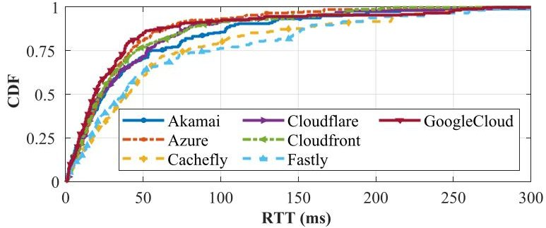

Fig. 1. Latency distribution in existing CDN operators.

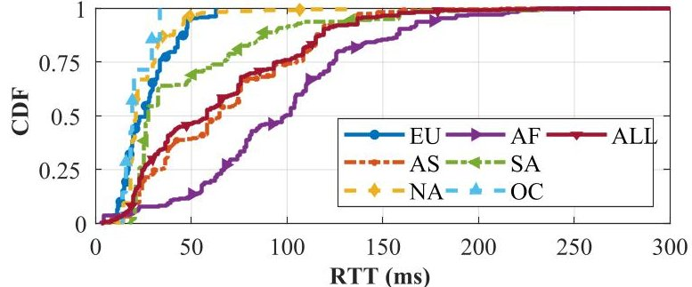

Fig. 2. Latency distribution grouped by different continents.

the measurement results. Table I illustrates the measurement details in different continents in our experiment.

Figure 1 plots the CDF of the RTT results from different geo-distributed users to their nearest cloud server of a certain CDN operator. As shown in Figure 1, we observed that despite the advantages of global CDNs, there are still a large fraction of CDN users suffering from RTT higher than 50ms, with a long tail of up to about 300ms, even if the closest cloud server is selected. High network RTTs can significantly impair the user-perceived quality of experience (QoE), especially for time-sensitive applications which typically issue a sequence of requests in batch. For example, as shown in [25], even tens of milliseconds of additional RTT might substantially deteriorate Web browsing page load times and degrade user experience.

To further understand the high RTT observations, we group the measurement result of each user by their original continents, as illustrated in Figure 2. We find that while the latency in many populated and developed areas could be low, there are still many users suffering from high access RTT, even if the nearest cloud server is selected, especially for those users in remote or under-developed areas. More specifically, there are about 53.58%/23.93% users suffering from RTT higher than 50ms/100ms in total. Even in developed regions like EU and NA, we still observe 3.4% and 4.5% users associated with RTT higher than 50ms respectively. The latency problem is more stringent in AF, where more than 86.6%/49.8% users suffer from RTT higher than 50ms/100ms.

For cases suffering from high RTTs, we further leverage traceroute to track and analyze the route from the end user to the assigned cache server. The traceroute results capture the per-hop information from the client to corresponding cache server. Our analysis identifies two root causes for the high latency observation: (i) the underserved network and cloud infrastructures; and (ii) meandering terrestrial routes from users to the assigned cache server. Figure 3 shows two representative examples that explain the high latency. As shown in Figure 3a, due to the insufficient cloud deployments in remote regions, for users in Chelyabinsk (a city in middle Russia), the closest available cache server is the Azure service in Warsaw (Poland). Since the fiber distance is approximately 3200km, the minimal RTT has already reached

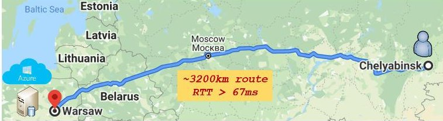

(a) High latency observed in remote regions.

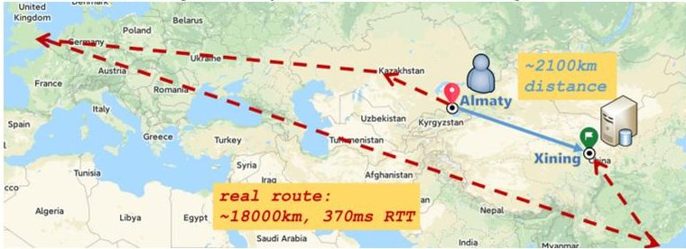

(b) High latency caused by meandering fiber route.

Fig. 3. Case analysis on high latency in existing CDNs.

about 67ms which is physically constrained by the speed of the light in fibers.

In addition, meandering routes may further enlarge the propagation delay over the terrestrial network. Today's Internet consists of a large number of independent autonomous systems (AS). Routes between users and their assigned cache servers may travel multiple ASes, and how packets are forwarded among ASes depends on policy-based interAS routing protocols (e.g., BGP). Due to many practical considerations beyond latency performance, routes crossing multiple ASes might not be latency-optimal. In particular, as depicted in Figure 3b, CloudFront servers located in Xining (China) are the closest cache server ( $ \sim 2 1 0 0 $ km distance) for users in Almaty (Kazakhstan). However, logs captured by traceroute reveal that packets are forwarded via a meandering and prolonged route, through London and Hong Kong, resulting in a significantly enlarged RTT ( $ \sim 3 7 0 $ ms).

Low-latency content access enabled by futuristic LEO mega-constellations. Low earth orbit (LEO) satellites are regaining popularity in recent years [22], [23], [31], [33], [34], [35], [36], [37], [41], [45], [51]. As compared with the first generation of satellite network that uses geostationary satellite for communication, emerging mega-constellations (e.g., Starlink [17], OneWeb [10], Kuiper [2], Boeing [8]), which plan to consist of thousands of mass-produced low-flying satellites, will be empowered with evolved network and storage capability, and thus can (likely) enable new opportunities for constructing low-latency CDNs globally.

- (i) Evolved on-board communication capability. Many planned constellations suggest the use of RF or laser inter-satellite links (ISLs) through which LEO satellite can connect to visible neighbor satellites and construct a network in space. Due to the low-flying property (i.e., 500-1200km altitude), LEO constellations also promise low-latency Internet connectivity. In addition, the speed of light in terrestrial fiber is about 33% slower than that in air or vacuum [33]. Recent studies also have outlined the vision of low-latency routing in space [34], [35], [36], [45].

- (ii) Big data stores in space. Another evolution of onboard capacity is the storage in space. Recent works [37], [38] have envisioned the satellite-based big data storage. Cloud Constellation Corporation (CCC) built by Space-Belt [16] is a data storage service using LEO satellites. The CCC system contains a ring of 10 LEO satellites

<!-- PDF_PAGE: 4 -->

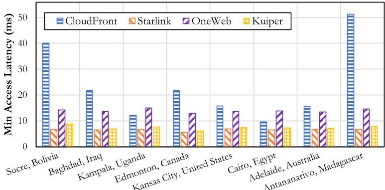

Fig. 4. Potential latency reduction by LEO satellites in eight geo-distributed vantage points under various constellations.

in a 650-kilometer equatorial orbit, and three of them are data stores, offering about 5PB storage capacity since December 2018 [15].

To quantify the potential of reducing access latency by LEO satellites, we estimate the propagation latency from several terrestrial vantage points to their closest LEO satellite, and compare the "client-to-satellite" latency with the "client-to-cloud" latency for each vantage point. Latencies to the closest cloud data center are obtained from the trace we collected in $ \mathrm{S I I} $ . Specifically, we follow the recent characterizing methods [34], [41], [45] to estimate the latency from terrestrial users to LEO satellites, and we use the orbital information of the first shell of the phase I (1584 satellites) of Starlink [17] as the constellation configuration in our experiment. Figure 4 plots the latency comparison in eight geo-distributed vantage points, which are populated cities in different continents. Theoretically LEO constellations promise to reduce up to 86% latency in remote areas (e.g., in Antananarivo, Madagascar) where terrestrial cloud infrastructures are limited.

The above evolution from the space industry thus plots a promising picture which outlines a satellite-cloud cooperative architecture that can (potentially) improve the accessibility and network performance of existing CDNs. Intuitively, LEO satellites can assist current cloud-based CDNs via: (i) constructing low-latency, close-to-optimal space paths connecting terrestrial clouds and end users to avoid meandering fiber routes which might prolong the access latency; and (ii) enabling a new paradigm "LEO satellite cache" that provides direct content access for regions where even the nearest cloud site is still too far away. While in practice the demand and supply of cache services evolve hand in hand, and caches are likely to appear where demand for content grows [24], we argue that integrating satellite caches and terrestrial cloud-based caches is meaningful for content providers due to two reasons. First, as shown previously, there are still a large number of terrestrial users suffering from high access latency issue in existing terrestrial CDNs. Second, the global Internet penetration rate is about 63% as of April 2022. Exploiting the integration of satellite and cloud caches not only can improve the network performance for existing CDNs, but also can expand the service coverage and market size for content providers.

However, while promising, we argue that constructing such a cooperative CDN upon cloud data centers and megaconstellations still faces several unsolved challenges.

- (i) Scarce and costly space resources. While evolved, network and storage resources are still relatively limited and costly in space, as compared with the well-optimized terrestrial cloud platforms. As content providers typically have a cost budget for distributing their data over CDN, contents should be judiciously distributed to satellites and

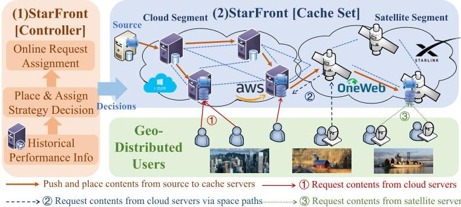

Fig. 5. The overview of STARFRONT architecture.

clouds in a cost-effective manner, i.e., the constructed cooperative CDN is expected to satisfy various latency requirements, while involving acceptable operating cost.

- (ii) High mobility of LEO satellites. LEO satellites are moving at a very high velocity with the respect to the earth, resulting in unstable ground communication. Endhosts or cloud sites on the ground can only communicate to a LEO satellite if only the satellite moves into the line of sight (LoS) of the ground unit. Therefore, application-level sessions might be interrupted if the request is assigned to a satellite leaving the LoS. User requests should be properly assigned to avoid performance degradation caused by intermittent connectivity and session disruptions.

## III. STARFRONT OVERVIEW

To tackle the above challenges, we present STARFRONT, a cooperative content distribution framework that leverages a number of cache servers hosted upon LEO satellites and globally distributed cloud data centers to construct pervasive low-latency CDNs in a cost-effective manner.

## A. STARFRONT Architecture

Figure 5 plots the overview of STARFRONT, which consists of two core components: a STARFRONT cache set and a STARFRONT controller. Specifically, the STARFRONT cache set incorporates a cloud segment which is built upon geo-distributed cloud cache servers offered by public cloud providers (e.g., Amazon AWS, MS Azure), together with a satellite segment built upon emerging mega-constellations managed by satellite operators like SpaceX or OneWeb. Cloud cache servers communicate with each other via terrestrial networks. Satellites equipped with inter-satellite links (ISLs) can forward data to other satellites through space paths constructed by space routing algorithms (e.g., [34], [48]). Moreover, leading cloud providers are also actively deploying ground-station as-a-service (GSaaS) [5], [20] which can enable pay-as-you-go ground communications to inter-connect clouds and satellites. Through GSaaS infrastructures, terrestrial clouds are able to communicate with a satellite on-demand if the satellite moves into their LoS.

In particular, the STARFRONT framework performs two basic operations: (i) content delivery and placement operation, by which contents are pushed from the source server to a collection of selected cache servers via inter-cloud or intersatellite paths; and (ii) request assignment operation, which at runtime redirects user requests from geo-distributed regions to a proper cache server to obtain low access latency. Both operations involve fees according to the dedicated pricing policy of cloud and satellite operators, as distributing source contents to cache servers and serve user requests may consume

<!-- PDF_PAGE: 5 -->

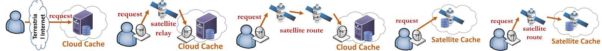

(a) Issue requests to cloud(b) Issue requests to cloud(c) Issue requests to cloud cache via(d) Issue requests to(e) Issue requests to satellite cache via Internet. cache via satellite relay. multi-hop satellite route. satellite cache. cache over ISLs.

Fig. 6. The design-space of request assignment in the STARFRONT framework.

storage and bandwidth resources in corresponding cloud or satellite platforms. If a cache server is full, there are two viable approaches to prepare room for new contents. In particular, a content provider can either purchase more storage from the cache service provider (e.g., [3]), or run specific cache update algorithms such as Least Recently Used (LRU) to make room for new contents.

STARFRONT enables several forms of request assignment with different network performance and corresponding costs. First, like traditional cloud-based CDNs, STARFRONT allows users to request contents directly from a nearby cloud cache server (e.g., $ \textcircled{1} $ in Figure 5), if the cloud performance can satisfy the application requirement. Second, if the access latency from a user to the closest cloud cache server is high (e.g., due to the insufficient deployment of cloud sites, very-long communication distance or meandering terrestrial route), STARFRONT allows users to accelerate the content access via free-space satellite paths (e.g., $ \textcircled{2} $ in Figure 5). Satellites forward traffic between users and the corresponding cloud cache servers, and do not need to cache replicas on the satellite. Third, requests can also be directly assigned to a satellite cache (e.g., $ \textcircled{3} $ in Figure 5) when the closest available cloud is still too far away. The above three forms of assignment strategies lead to different storage and bandwidth cost in practice, since space resources are likely to be more scarce than that in terrestrial cloud servers. In particular, the first form only consumes terrestrial storage and bandwidth, the second form uses terrestrial storage and satellite bandwidth, while the last form consumes more expensive storage and bandwidth in space.

## B. STARFRONT Workflow

To utilize the low-latency potential of emerging megaconstellations while not incurring high operating overhead for content providers, the STARFRONT controller judiciously calculates the placement and assignment decision in a cost-effective manner, i.e., deciding (1) how to select a set of cache servers from all available clouds and satellites to build the content distribution network? and (2) how to assign requests from different geo-distributed regions to a proper cache server while not exceeding the cost budget of content providers? To deal with the high dynamicity of satellite constellation, the STARFRONT controller exploits the periodicity and predictability of satellite movements to perform the following operations to accomplish the goal of cost-effective distribution.

- (1) STARFRONT divides time into a sequence of successive operation periods. At the beginning of each period, STARFRONT constructs a dynamic satellite-cloud topology to model the time-varying cache availability, network performance, and cost of distributing contents to cloud and satellite caches. The model is built based on cloud and user distributions, constellation architecture and pricing policies from cloud and satellite providers.

- (2) Once the satellite-cloud topology is obtained, STAR-FRONT invokes the judicious replica placement and

request assignment algorithm. Following the decision, STARFRONT pushes and places contents on all selected cache servers, and then configures the region $ \leftrightarrow $ server assignment.

- (3) During each period, STARFRONT redirects user requests to a proper cache server, based on the region $ \leftrightarrow $ server assignment. Intuitively, Figure 6 summarizes the design space of request assignment in the STARFRONT framework. STARFRONT may: (a) assign requests to a nearby cloud cache server via terrestrial networks (e.g., Figure 6a) for users in developed areas (e.g., metropolis) where low-latency cloud platforms are well-provisioned; (b) issue requests to a cloud server via a single-hop satellite relay or a multi-hop satellite route (e.g., Figure 6b and Figure 6c); or (c) directly issue requests to an available satellite cache server (e.g., Figure 6d and 6e), especially for those users in remote or rural areas where terrestrial networks and clouds are quite limited.

## IV. MODELING THE TIME-VARYING INTEGRATED SATELLITE AND CLOUD TOPOLOGY

## A. Dynamic Satellite-Cloud-Integrated Topology

Vertex set. In terrestrial cloud-based CDNs, content providers place the replica of contents on geo-distributed cloud data centers owned by cloud operators. Let Src denote the source server of the content provider, which generates original contents. Let $ C=\{C_{1}, C_{2}, \dots, C_{m}, \dots\} $ denote the set of all available cloud caches provided by terrestrial cloud storage services. In addition, contents can also be cached on LEO satellite caches. Let $ S=\{S_{1}, S_{2}, \dots, S_{n}, \dots\} $ denote the set of all satellite caches. Further, to describe the periodicity and dynamicity of LEO satellites, we assume T is the synodic period of the constellation, which refers to the repeated cycles for the satellites as observed from the earth surface. Assume a period T is split into multiple time slots, i.e., $ T=\{t_{1}, t_{2}, t_{3}, \dots, t_{|T|}\} $ . We thus extend the satellite set S in temporal dimension, and define $ S^{t}=\{S_{1t}, S_{2t}, \dots, S_{nt}, \dots\}, t\in T $ , as the snapshot set of all satellites in slot t. $ S_{it} $ denotes the snapshot of the i-th satellite in time slot t. Furthermore, let $ S=S^{t_{1}}\cup S^{t_{2}}\dots \cup S^{t_{|T|}} $ denote the set of all satellite snapshots in different time slots.

Each cloud cache can be accessed not only by terrestrial networks, but also by time-varying space paths constructed by LEO satellites. Because terrestrial and space paths differ in their performance and cost, to distinguish these two approaches for accessing cloud caches, we create a logic snapshot for each cloud cache in C in different slots to represent a cloud cache that can be accessed by space path in corresponding slot. Specifically, let $ C S^{t}=\{C S_{1 t},C S_{2 t},\dots,C S_{m t},\dots\} $ denote the set of all logic snapshots of all cloud caches in slot t, and $ C S_{m t} $ refers to the m-th cloud cache that can be accessed via satellites in slot t. Further, we extend C, and denote $ \mathcal{C}^{t}=C\cup C S^{t} $ as the set of all available cloud caches in slot t, and $ \mathcal{C}=\mathcal{C}^{t_{1}}\cup \mathcal{C}^{t_{2}}\dots \cup \mathcal{C}^{t|T|}. $

<!-- PDF_PAGE: 6 -->

CDNs receive and dispatch geographical user requests. In practice, the request dispatching is implemented via DNS-based or anycast-based client-server mappings [18], [54]. To model the user distribution, we assume the earth surface is discretized into J non-overlapping grid-like regions in total. Note that these non-overlapping regions here refer to user regions, which indicate where a certain user request comes from. They are not cache coverage regions, which characterize the area covered by a certain cache server, and could be overlapped in practice. We use $ \mathcal{R}=\{r_{1}, r_{2}, \dots, r_{J}\} $ to describe the set of all regions. Assume user requests are generated from geo-distributed regions. Let $ \mathrm{req}_{rt} $ denote a user request from region r in slot t. We assume $ \mathcal{RQ}^{t} $ is the set of all user requests in slot t, and user requests are dispatched based on their regions. We denote $ \mathcal{RQ}^{t}=\{\mathcal{RQ}_{r_{1}}^{t}, \mathcal{RQ}_{r_{2}}^{t}, \dots, \mathcal{RQ}_{r_{J}}^{t}\} $ where $ \mathcal{RQ}_{r}^{t} $ consists of all user requests from region r in slot t, i.e., $ \mathrm{req}_{rt}\in \mathcal{RQ}_{r}^{t} $ . Similarly we denote $ \mathcal{RQ}_{r} $ as the set of all requests from region r. Let $ \mathcal{RQ}=\mathcal{RQ}^{t_{1}}\cup \mathcal{RQ}^{t_{2}}\dots \cup \mathcal{RQ}^{t_{|T|}} $ represent all user requests.

Assume Src is the source server of the content provider. Thus, with all definitions above, the vertex set of the satellite-cloud topology graph in slot $ t $ can be formulated as: $ V_{t}=\{\mathrm{Src}\} \cup \mathcal{S}^{t} \cup \mathcal{C}^{t} \cup \mathcal{RQ}^{t}. $ Further, the vertex set in a period $ T $ is accordingly denoted as: $ V_{T}=V_{t_{1}} \cup V_{t_{2}} \cup \dots \cup V_{t_{|T|}} $ $ \forall t \in T. $

Edge set. For every two different nodes i and j in the vertex set $ V_{T} $ , there might be an undirected edge between them, i.e. (i,j). We denote the edge set in a period T as $ E_{T} $ . Note that a node in $ V_{T} $ can be the source server, a cloud/satellite cache, or a user request. An edge has different meanings, according to its two ends. Specifically, an edge connecting two cloud/satellite nodes indicates that there is a valid path for data transmission between them, over either the terrestrial or the satellite network. An edge between a cloud/satellite node and a user request from a certain region indicates that user requests from this region can be assigned to the cloud/satellite node. There are no edges between two different user requests as they are issued by end users. The source server is similar to a cloud cache.

Each edge is associated with a $ \mathrm{c o s t}_{\mathrm{t r a f f i c}}(i,j) $ property, which indicates the cost of transferring one data unit between i and j. In addition, if i or j is a user request, the edge (i,j) is further associated with a latency(i,j) property, which refers to the access delay (e.g., RTT) between the user and the corresponding cache server (e.g., a cloud or a satellite). We assume users in the same region have the same client-to-cache latency since they are geo-graphically nearby. The concrete value of $ \mathrm{c o s t}_{\mathrm{t r a f f i c}}(i,j) $ and latency(i,j) depends on the related vertex type, described as follows.

- (i) For cloud $ i,j\in \mathcal{C} $ in arbitrary time slots, the data traffic between them is transferred over the terrestrial Internet. We have $ \mathrm{cost}_{\mathrm{traffic}}(i,j)=0 $ , if i and j are physically equal, e.g., $ i=C_{k} $ and $ j=CS_{kt} $ . Otherwise, $ \mathrm{cost}_{\mathrm{traffic}}(i,j)=c $ , i.e., transferring one data unit between i and j costs $ c $ . In practice, the concrete value of c depends on the pricing policy of cache service providers.

- (ii) For cloud $ i\in\mathcal{C} $ and satellite $ j\in\mathcal{S} $ in arbitrary time slots, there is an edge $ (i,j) $ between i and j, if only there is a valid path between i and j. Consider that data transmission over space path may consume more precious inter-satellite and ground communication

resources, we denote $ \mathrm{c o s t}_{\mathrm{t r a f f i c}}(i,j)=\alpha \cdot c $ $ i \in \mathcal{C} $ and $ j \in \mathcal{S} $ , where $ \alpha $ is an amplification factor, and $ \alpha >1. $

- (iii) For two satellite nodes $ i,j\in S $ $ (i\neq j) $ in arbitrary time slot, there is an edge $ (i,j) $ if only there is a valid path between them for data exchange. In this case, we set $ \operatorname{c o s t}_{\mathrm{t r a f f i c}}(i,j)=\beta\cdot c $ . Similar to $ \alpha, \beta $ is an amplification factor as data transmission between two satellites might be more costly than that in terrestrial Internet.

- (iv) A user request can be served by a cloud cache over the terrestrial network, or over the satellite network. For user request $ i\in\mathcal{RQ} $ and cloud $ j\in\mathcal{C} $ $ \mathrm{cost}_{\mathrm{traffic}}(i,j)=c $ if $ j\in C $ , and $ \mathrm{cost}_{\mathrm{traffic}}(i,j)=\alpha\cdot c $ if $ j\in CS $ . This is because leveraging space paths to provide content access for a cloud cache is more costly. In addition, assume users in the same region perceive similar latencies to the same cache server. Let latency $ (i,j) $ denote the client-to-cache access latency between users in region i and cache server j. This value indicates how fast the cache server j can response to user requests.

- (v) For user request $ i\in\mathcal{RQ} $ and satellite $ j\in\mathcal{S} $ , the edge $ (i,j) $ indicates that request $ i $ can be assigned to the satellite cache server $ j $ . We set $ \mathrm{cost}_{\mathrm{traffic}}(i,j)=\alpha\cdot c $ Specifically, if $ j=S_{kt}\in\mathcal{S} $ , latency(i,j) refers to the access latency between request $ i $ and satellite $ k $ in slot $ t $ . Note that as LEO satellites move during their orbits, the latency between a regional request and a satellite may accordingly change in different time slots.

With definitions related to vertexes and edges above, we formulate the dynamic satellite-cloud-integrated topology as a connectivity graph in a period $ T $ as $ G_{T}=\left(V_{T},E_{T}\right). $

## B. Cost-Effective Content Distribution Problem in the Satellite-Cloud Integrated Architecture

Next we formulate the cost-effective content distribution problem based on the satellite-cloud topology. Formally, the problem can be described as finding an available distribution graph (DG) upon the satellite-cloud topology $ G_{T} $ . Assume $ \lambda(i,j) $ is a binary value and $ \lambda(i,j)=1 $ indicates that edge $ (i,j) $ is selected in DG. Similarly, assume $ x(i) $ is a server selection indicator and $ x(i)=1 $ if vertex i is selected in DG, and $ x(\mathrm{Src})=1 $ . Then a DG can be presented as DG $ =(V_{\mathrm{DG}},E_{\mathrm{DG}}) $ , a sub-graph of $ G_{T} $ , where $ x(i)= x(j)=1, \forall i,j\in V_{\mathrm{DG}}, \lambda(i,j)=1, \forall(i,j)\in E_{\mathrm{DG}} $ , and $ V_{\mathrm{DG}}\subset V_{T}, E_{\mathrm{DG}}\subset E_{T}. $

A DG reveals: (1) how to select a subset of cache servers from available clouds and LEO satellites to cache contents; (2) how to push contents from the source server to selected geo-distributed caches; and (3) how to assign requests from a certain region to a cache server. First, all nodes in $ V_{\mathrm{DG}} $ are selected as cache servers, and store the content replicas. Second, assume r is a user request, j is a cache server. Then an edge $ (r,j)\in E_{\mathrm{DG}},j\in(C\cup CS^{t}\cup S^{t}) $ connecting r and j indicates that content replicas have to be pushed from the source server to j, and then the request r is assigned to j.

Cost-effective content distribution (CECD) problem. Typically, content providers may have their own budget when exploiting cloud/satellite infrastructures to distribute contents. The cost-effective content distribution problem in our STAR FRONT framework is to find a distribution graph DG from $ G_{T} $ that minimizes the total cost denoted as CT(DG), while satisfying a series of constraints as follows.

<!-- PDF_PAGE: 7 -->

Inputs: (1) the time-varying satellite-cloud topology $ G_{T} $; (2) regions $ \mathcal{R} $ and user requests $ \mathcal{RQ} $; (3) latency requirements $ \mathrm{Thd}_{latency}^{r} $; (4) pricing policy $ \mathcal{F} $

Outputs: an available distribution graph (DG) presented by variables x(i) and $ \lambda(i,j). $

Objective: min CT(DG).

Subject to:

$$
\sum_ {\in \{\mathrm {S r c} \} \cup \mathcal {S} \cup \mathcal {C}} \lambda (r, j) = 1, \forall r \in \mathcal {R Q},
$$

$ \forall j \in \{\mathrm{S r c}\} \cup \mathcal{S} \cup \mathcal{C} $

$$
\lambda (\mathrm {r e q}, j) \leq x (j), \forall \mathrm {r e q} \in \mathcal {R Q}, \forall j \in \{\mathrm {S r c} \} \cup \mathcal {S} \cup \mathcal {C},
$$

$$
\sum_ {\forall i, x (i) = 1} d p _ {i, \tau} ^ {k} - \sum_ {\forall j, x (j) = 1} d p _ {\tau , j} ^ {k} = \left\{ \begin{array}{c c} - 1, & \tau = \mathrm {S r c} \\ 1, & \tau = k \\ 0, & \mathrm {o t h e r w i s e} \end{array} \right.
$$

$$
d p _ {i j} ^ {k} \leq \lambda (i, j) \leq 1, \forall k, i, j \in \{\mathrm {S r c} \} \cup \mathcal {S} \cup \mathcal {C},
$$

$$
\sum_ {\mathrm {r e q} _ {r} \in \mathcal {R} \mathcal {Q} _ {r}} \frac {\mathrm {l a t e n c y} \left(\mathrm {r e q} _ {r} , a \left(\mathrm {r e q} _ {r}\right)\right)}{\left| \mathcal {R} \mathcal {Q} _ {r} \right|} \leq \mathrm {T h d} _ {\mathrm {l a t e n c y}} ^ {r}, \forall r \in \mathcal {R}.
$$

Next we illustrate the above formulas in details.

Cost analysis $ \left( \mathrm{C T}_{\mathrm{D G}} \right) $ . Both the content placement and request assignment operations may involve additional costs for content providers, including three major parts:

- (i) Distribution cost. During the placement process, the source server distributes contents to the cache servers selected in DG, and this process consumes bandwidth resources in terrestrial and satellite networks. Let $ \mathcal{W}=\{W_{1},W_{2},\ldots,W_{k},\ldots,W_{|\mathcal{W}|}\} $ denote the set of all source contents that need to be distributed to cache servers. Then the distribution cost is defined and calculated as:

$$
\mathrm {C T} _ {\mathrm {d i s t}} = \sum_ {W _ {k} \in \mathcal {W}} \sum_ {(i, j)} \operatorname {c o s t} _ {\mathrm {t r a f f i c}} (i, j) \cdot \lambda (i, j) \cdot W _ {k},
$$

- (ii) Storage cost. Caching contents on clouds or satellites also involves additional storage cost, and we denote $ \mathrm{c o s t}_{\mathrm{c a c h e}}(i) $ as the cost of storing one data unit on cache server i. Typically, there are two kinds of pricing model in existing cloud-based storage services: (1) piecewise linear model, in which the cost function contains multiple linear sub-functions as the cache size increases. For example, in Amazon S3 services, the storage cost is about $ 0.023 $ per GB for the first 50TB, and is about $ 0.022 $ per GB for the next 450TB [3]; (2) concave model [49], where the storage cost is a concave function of the cache size. We thus define the storage cost for caching contents in cache server i as:

$$
\operatorname {c o s t} _ {\mathrm {c a c h e}} (i, \mathrm {s i z e}) = \left\{ \begin{array}{c c c} \mathcal {F} (\mathrm {s i z e}) & i f & i \in \mathcal {C} \\ \gamma \cdot \mathcal {F} (\mathrm {s i z e}) & i f & i \in \mathcal {S} \end{array} \right.
$$

where $ \mathcal{F} $ is the cost function, and can either be a linear function (i.e., $ \mathcal{F}(\mathrm{size})=d\cdot\mathrm{size} $ ), or a concave function (i.e., $ \mathcal{F}(\mathrm{size})=d\cdot\mathrm{size}^{z}, $ $ z $ is the degree of the concave function and $ 0<z<1 $ ). Here size is the cache size used by the cache server i. We will evaluate different pricing models in $ \mathrm{S V I} $ . Note that $ \gamma\geq1 $ indicates that the storage resource in space is more expensive as compared

with that in terrestrial cloud platforms. Hence the storage cost is calculated as:

$$
\mathrm {C T} _ {\mathrm {s t o r a g e}} = \sum_ {i} \operatorname {c o s t} _ {\mathrm {c a c h e}} \left(i, \sum_ {k} W _ {k}\right) \cdot x (i), \forall i \in \mathcal {C} \cup \mathcal {S}.
$$

- (iii) Content access cost. When serving users, requests from geo-distributed regions are dynamically assigned to proper cache servers to achieve low-latency content access. Let $ \mathrm{sz}(\mathrm{req}_{r}) $ denote the required content size of $ \mathrm{req}_{r}. $ Thus the cost of content access is involved by consuming bandwidth between users and assigned cache servers, which can be calculated as:

$$
\begin{array}{l} \mathrm {C T} _ {\mathrm {a c c e s s}} = \sum_ {\mathrm {r e q} _ {r} \in \mathcal {R} \mathcal {Q}} \sum_ {j \in \mathcal {C} \cup \mathcal {S}} \mathrm {c o s t} _ {\mathrm {t r a f f i c}} \left(\mathrm {r e q} _ {r}, j\right) \\ \cdot \mathrm {s z} \left(\mathrm {r e q} _ {r}\right) \cdot \lambda \left(\mathrm {r e q} _ {r}, j\right). \\ \end{array}
$$

Collectively, the total cost CT under an available DG can be formulated as:

$$
\mathrm {C T} (\mathrm {D G}) = \mathrm {C T} _ {\mathrm {d i s t}} + \mathrm {C T} _ {\mathrm {s t o r a g e}} + \mathrm {C T} _ {\mathrm {a c c e s s}},
$$

where $ \mathrm{C T}_{\mathrm{d i s t}} $ is the bandwidth cost of distributing source contents to each selected cache server, $ \mathrm{C T}_{\mathrm{s t o r a g e}} $ refers to the total storage cost, and $ \mathrm{C T}_{\mathrm{a c c e s s}} $ indicates the bandwidth cost of serving user requests at runtime. CT is a function of DG, since the concrete values of $ \mathrm{C T}_{\mathrm{d i s t}} $ , $ \mathrm{C T}_{\mathrm{s t o r a g e}} $ , and $ \mathrm{C T}_{\mathrm{a c c e s s}} $ depend on the decisions of x(i) and $ \lambda(i,j). $

Optimizing CT(DG) should satisfy multiple constraints as detailed below.

Constraint (1): Each user request has to be assigned to a cache server. The distribution graph DG should guarantee that user requests from each region should be assigned to a cache server during the operating period T, i.e., Eq (1).

Constraint (2): User requests should be assigned to servers selected in DG, which have cached the content replicas. Specifically, if $ j $ denotes the cache server assigned for user request req, we have $ \lambda(\mathrm{req}, j)=1 $ and $ x(j)=1 $ This constraint can be formulated as Eq (2).

Constraint (3): For each selected cache server, there should be at least one path from the source server to the cache server. Originally, contents are generated on the source server, and have to be pushed to each selected cache server before serving users. Therefore, in DG there should be a distribution path from the source server to every cache node. Let $ dp_{ij}^{k} $ denote a binary variable, and $ dp_{ij}^{k}=1 $ indicates that the distribution path from Src to the selected cache server k includes the edge $ (i,j) $ . Formally, Eq (3) and Eq (4) guarantee flow conservation at any intermediate nodes in the distribution path from Src to each cache server k, where $ x(k)=1 $ . All edges in content distribution paths should be included in DG.

Constraint (4): The request assignment for each user request should satisfy a latency requirement. Latency is critical to user-perceived experience. A recent study [25] has shown that tens of milliseconds of additional latency can significantly increase web page load times and impair user experience. Similarly, Akamai has reported that a 100ms latency in website load time can hurt conversion rates by 7% [19]. Therefore, content providers who build their applications upon CDNs may have a latency requirement to sustain good user experience. This latency requirement may vary in different regions, and important regions (e.g., populated metropolis with a large number of users) may have more

<!-- PDF_PAGE: 8 -->

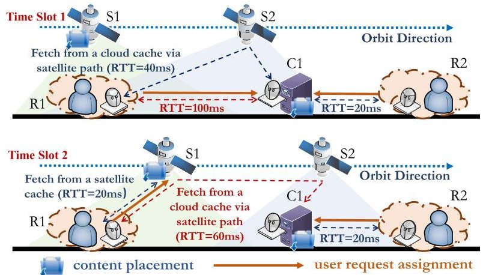

Fig. 7. An example of distributing contents in the satellite-cloud integrated architecture, including the decision of content placement and corresponding request assignment.

stringent latency requirements. To meet the latency requirements, the average user-perceived latency between a request $ \mathrm{req}_{r} $ from region r and its assigned cache server $ a(\mathrm{req}_{r}) $ is expected to be lower than a threshold $ \mathrm{Thd}_{\mathrm{latency}}^{r} $ . Specifically, assume the user-perceived latency for user request $ \mathrm{req}_{r} $ is: latency $ (\mathrm{req}_{r}, a(\mathrm{req}_{r})) $ , and thus the latency constraint can be formulated as Eq (5).

Figure 7 plots an example illustrating a concrete case of content placement and request assignment. Assume there are two regions (R1, R2), one cloud cache (C1), and two LEO satellite caches (S1, S2), in two time slots. Each region has a 50ms latency requirement. In each time slot, the RTT from R2 to cloud C1 is about 20ms, which is below the latency requirement 50ms. In slot 1, the RTT between R1 and C1 is 100ms via the terrestrial network, and is about 40ms via satellite path in two hops $ \mathrm{R 1}\rightarrow\mathrm{S 2}\rightarrow\mathrm{C 1} $ . In slot 2, as S2 moves out of the transmission range of R1, the satellite path from R1 to C1 updates from $ \mathrm{R 1}\rightarrow\mathrm{S 2}\rightarrow\mathrm{C 1} $ to $ \mathrm{R 1}\rightarrow\mathrm{S 1}\rightarrow\mathrm{S 2}\rightarrow\mathrm{C 1} $ , and the RTT between R1 and C1 over satellites increases from 40ms (in two hops) to about 60ms (in three hops). Based on predictable satellite trajectory, a viable solution to guarantee the latency requirement is to push and place replica on S1 and C1, and then: (i) assign user requests from R2 to C1 in each slot; (ii) assign user requests from R1 to C1 via satellite paths in slot 1 (with about 40ms RTT), and (iii) assign user requests from R1 to S1 in slot 2 (with about 20ms RTT).

Problem analysis. However, it is yet non-trivial to design algorithms to solve the CECD problem above, due to multiple challenges. First, the CECD problem is essentially an instance of the Integer Linear Programming (ILP) problem. We implement the ILP formulation and solve it with Python MIP [11]. The typical processing time of the implementation takes minutes to hours as the number of satellites and user requests increases, which is too long to be practical. Second, LEO satellites orbit in high velocity, and such dynamics lead to topology fluctuation and frequent visibility change. Therefore, in particular, the connectivity between satellites and ground facilities, and the latency over satellite paths may update frequently. For example the update interval is about several minutes for the first shell of Starlink Phase-I constellation with 1584 LEO satellites. Thus it requires the CECD problem to be efficiently solved in each short interval during which the network maintains a short-term static snapshot. Finally, although the trajectory of LEO satellites in the satellite-cloud topology is predictable, in practice, there exists uncertainty in the user arrival pattern (e.g., the concrete arrival time of

Algorithm 1 Offline Placement and Assignment (OffPA)

1: Input: Connectivity graph $ G_{T} = (V_{T}, E_{T}) $ Latency requirement $ \mathrm{Thd}_{latency}^{r}, \forall r \in \mathcal{R}. $

2: Output: Distribution graph DG, represented by $ x(k), k \in \mathcal{C} \cup \mathcal{S} $ and $ \lambda(i,j), i,j \in V_{T}. $

3: $ \mathcal{RQ}_{\mathrm{remain}} \leftarrow \mathcal{RQ} $ /* Denote $ \mathcal{RQ}_{\mathrm{remain}} $ as the set of user requests that have not been assigned. */

4: /* Make placement and assignment decisions. */

5: $ x(k) \leftarrow 0, \lambda(i,j) \leftarrow 0, \forall k \in \mathcal{C} \cup \mathcal{S}, i,j \in V_{T}. $

6: while $ \mathcal{RQ}_{\mathrm{remain}} \neq \varnothing $ do:

7: for each $ j \in (\mathcal{C} \cup \mathcal{S}) $ and $ x(j) = 0 $ do:

8: /* Stage-I: calculate Candidate $ j $ for each $ j. $

9: for each $ \mathrm{req}_{r} \in \mathcal{RQ}_{\mathrm{remain}} $ do:

10: if $ (\mathrm{req}_{r}, j) \in E_{T}, $ latency $ (\mathrm{req}_{r}, j) \leq \mathrm{Thd}_{latency}^{r} $

11: $ \mathrm{Candidate}_{j}. \mathrm{add}(\mathrm{req}_{r}) $

12: end if

13: end for

14: /* Stage-II: calculate content size can be served by $ j. $

15: $ \mathrm{Size}_{j} \leftarrow \sum_{\mathrm{req} \in \mathrm{Candidate}_{j}} \mathrm{sz}(\mathrm{req}) $

16: end for

17: /* Stage-III: select the cache server with max utility. */

18: $ \bar{j} \leftarrow \mathbf{argmax}_{j \in \mathcal{C} \cup \mathcal{S}} \frac{\mathrm{Size}_{j}}{\mathrm{CT}(\mathrm{DG}. \mathrm{extend}(j)) - \mathrm{CT}(\mathrm{DG})} $

19: /* Place replicas and assign user requests. */

20: $ x(\bar{j}) = 1, \lambda(\mathrm{req}, \bar{j}) = 1, \forall \mathrm{req} \in \mathrm{Candidate}_{\bar{j}} $

21: $ \mathcal{RQ}_{\mathrm{remain}} \leftarrow \mathcal{RQ}_{\mathrm{remain}} - \mathrm{Candidate}_{\bar{j}} $

22: end while

23: return all $ x(k) $ and $ \lambda(i,j). $

users is hard to accurately predict), and it is difficult to predetermine the content placement and request assign decisions. The above challenges motivate us to design and implement a more efficient and applicable solution.

## V. JUDICIOUS REPLICA PLACEMENT AND REQUEST ASSIGNMENT ON LEO SATELLITES AND CLOUDS

We propose a series of heuristic algorithms to solve the content distribution problem efficiently. The key idea behind our algorithms is to judiciously make proper cache server assignments that satisfy the application-level latency requirement, while incurring minimal bandwidth and storage cost.

## A. Offline Replica Placement and Request Assignment

We first design an offline algorithm to solve the above CECD problem, with the assumption that the arrival time of all user requests are known in advance. The details of our offline replica placement and request assignment algorithm (OffPA) are illustrated in Algorithm 1. The basic idea of the OffPA algorithm is to iteratively add cache servers, distribution paths and request assignments to DG. In each iteration, OffPA makes the content placement and request assignment decisions with the highest utility, which is defined as the ratio of the total content size a new cache server can support, to the cost of adding this cache server to DG. In particular, initially DG is set to empty (line 5). Iteratively, OffPA adds cache servers and assignments to DG until all requests have

<!-- PDF_PAGE: 9 -->

Algorithm 2 Online Placement and Assignment (OnPA)

1: Input: Connectivity graph $ G_{T} = (V_{T}, E_{T}) $ , Latency requirement $ \mathrm{Thd}_{latency}^{r}, \forall r \in \mathcal{R}. $

2: Output: Distribution graph DG, represented by $ x(k), k \in \mathcal{C} \cup \mathcal{S} $ and $ \lambda(i,j), i,j \in V_{T}. $

3: /* Denote Candidate $ _{req} $ as the set of available cache servers that user request req can be assigned to. */

4: for each request $ req_{r} $ in increasing arrival time $ t $ do:

5: $ \mathrm{Candidate}_{req_{r}} \leftarrow \emptyset $

6: for each $ j \in (\mathcal{C} \cup \mathcal{S}) $ and $ x(j) = 1 $ do:

7: if $ (\mathrm{req}_{r}, j) \in E_{t}, \mathrm{latency}(\mathrm{req}_{r}, j) \leq \mathrm{Thd}_{latency}^{r} $ do:

8: $ \mathrm{Candidate}_{req_{r}}.add(j) $

9: end if

10: end for

11: /* The request can be assigned to a cache server that has already stored the contents. */

12: if $ \mathrm{Candidate}_{req_{r}} \neq \emptyset $ do: /* Compute cost by Eq 11. */

13: $ \bar{j} \leftarrow \mathbf{argmin}_{j \in \mathrm{Candidate}_{req_{r}}} \mathrm{CT}_{assign}^{opened}(\mathrm{req}_{r}, j) $

14: $ \lambda(\mathrm{req}_{r}, \bar{j}) \leftarrow 1 $ /* Update DG. */

15: else /* Compute cost by Eq 12. */

16: /* Open a new cache server in DG with minimum $ \mathrm{CT}_{assign}^{new}(\mathrm{req}_{r}, j) $ to serve user request $ req_{r} $ and satisfy its latency requirement. */

17: $ \bar{i}, \bar{j} \leftarrow \mathbf{argmin}_{i \in \mathcal{C} \cup \mathcal{S}, x(i)=1; j \in \mathcal{C} \cup \mathcal{S}} \mathrm{CT}_{assign}^{new}(\mathrm{req}_{r}, j) $

18: $ \lambda(\bar{i}, \bar{j}) \leftarrow 1, x(\bar{j}) \leftarrow 1, \lambda(\mathrm{req}_{r}, \bar{j}) \leftarrow 1 $

19: end if

20: end for

21: return all $ x(k) $ and $ \lambda(i,j). $

been assigned (line 6). Let $ Candidate_{j} $ denote the set of all unassigned user requests that can be assigned to a cache server $ j \in \mathcal{C} \cup \mathcal{S} $ . OffPA first calculates $ Candidate_{j} $ for each cloud or satellite cache which can satisfy the latency requirement of corresponding requests (line 9-13). Then for each cache server j that has not been added to DG, OffPA calculates the total content size that can be served by j (i.e., $ \mathrm{Size}_{j} $ , line 15). Further, we define the utility of adding a cache server j to DG as the benefit-cost ratio of placing contents in j and assigning all candidate requests to it. OffPA selects the cache server that achieves the highest utility in each iteration (line 18). $ \mathrm{CT(DG.extend(j))}-\mathrm{CT(DG)} $ is the incremental cost of incorporating j for content placement and request assignment. Finally, for the selected cache server $ \bar{j} $ , OffPA places replicas on it, and assigns user requests.

## B. Online Replica Placement and Request Assignment

In practice, the concrete arrival time of user requests might be hard to predict accurately. Next we present an online replica placement and request assignment algorithm (OnPA) which does not require the arrival time of user requests for decision, as described in Algorithm 2. User requests from geodistributed regions arrive over time (line 4). Let $ \mathrm{Candidate}_{req} $ denote the set of available cache servers that have cached the required contents, and can serve request req with the content access latency below the specific threshold $ \mathrm{Thd}_{latency}^{r} $ . OnPA calculates $ \mathrm{Candidate}_{req}_{r} $ for each request arrived (line 5-10).

If $ \mathrm{Candidate}_{\mathrm{req}_{r}} \neq \varnothing $ , i.e., there is at least one opened cache server that can meet the latency requirement, the online algorithm selects the cache server from $ \mathrm{Candidate}_{\mathrm{req}_{r}} $ that involves the minimum assignment cost (line 12-14). Specifically, the cost of assigning req to an opened server j is calculated as the bandwidth cost of delivering contents from j to req if the contents have already been placed on j. Formally, we denote $ \mathrm{CT}_{\mathrm{assign}}^{\mathrm{opened}}(\mathrm{req}_{r}, j) $ as the cost of assigning request $ \mathrm{req}_{r} $ to an opened cache server j, where $ x(j)=1 $ , i.e., :

$$
\mathrm {C T} _ {\mathrm {a s s i g n}} ^ {\mathrm {o p e n e d}} \left(\mathrm {r e q} _ {r}, j\right) = \operatorname {c o s t} _ {\mathrm {t r a f f i c}} \left(\mathrm {r e q} _ {r}, j\right) \cdot \mathrm {s z} \left(\mathrm {r e q} _ {r}\right).
$$

If no available cache servers can meet the latency requirement, then OnPA has to open a new cache server j, deliver contents to this server and serve user requests (line 16-17). In particular, we denote $ \mathrm{CT}_{\mathrm{assign}}^{\mathrm{new}}(\mathrm{req}_{r}, j) $ as the cost of assigning request $ \mathrm{req}_{r} $ to a new cache server j. Thus, $ \mathrm{CT}_{\mathrm{assign}}^{\mathrm{new}}(\mathrm{req}_{r}, j) $ includes three parts: (i) bandwidth cost of pushing replicas from a nearby available cache server i which has the required contents, to the new cache server j, i.e., $ \mathrm{cost}_{\mathrm{traffic}}(i,j)\cdot\mathrm{sz}(\mathrm{req}_{r}) $ Note that there might be multiple available cache servers, and OnPA chooses the one with the minimum bandwidth cost; (ii) storage cost of storing the contents on the new cache server, i.e., $ \mathrm{cost}_{\mathrm{cache}}(j,\mathrm{sz}(\mathrm{req}_{r})) $ ; and (iii) bandwidth cost of delivering contents from the new cache server to serve user request, i.e., $ \mathrm{cost}_{\mathrm{traffic}}(\mathrm{req}_{r}, j)\cdot\mathrm{sz}(\mathrm{req}_{r}) $ . Formally, if $ x(j)=0 $ $ \mathrm{CT}_{\mathrm{assign}}^{\mathrm{new}}(\mathrm{req}_{r}, j) $ is calculated as: $ \mathrm{CT}_{\mathrm{assign}}^{\mathrm{new}}(\mathrm{req}_{r}, j)=\mathrm{cost}_{\mathrm{traffic}}(\mathrm{req}_{r}, j)\cdot\mathrm{sz}(\mathrm{req}_{r}) $

$ \mathrm{CT}_{\mathrm{assign}}^{\mathrm{new}}(\mathrm{req}_{r}, j) = \mathrm{cost}_{\mathrm{traffic}}(\mathrm{req}_{r}, j) \cdot \mathrm{sz}(\mathrm{req}_{r}) $ $ + \mathrm{cost}_{\mathrm{cache}}(j, \mathrm{sz}(\mathrm{req}_{r})) $ $ + \mathbf{min}(\mathrm{cost}_{\mathrm{traffic}}(i, j) \cdot \mathrm{sz}(\mathrm{req}_{r})), \forall i \in \mathcal{C} \cup \mathcal{S}, x(i) = 1. $

Once the assignment for request $ \mathrm{req}_{r} $ has been decided, OnPA updates DG (variables x and $ \lambda $ ) accordingly.

## C. Exploiting Replica Pre-Allocation to Optimize Online Replica Placement and Region Assignment

One key benefit of Algorithm 2 is that it does not require prior knowledge of the arrival time of user requests. However, because the placement and assignment operations are conducted purely online, user requests might suffer from high latency if a cache miss occurs. Although it is difficult to predict the arrival time of each user request from the historical information of a content provider, it is feasible to estimate what content might be of interest to users in different regions. For example, while it is hard for a content provider to predict the accurate arriving time of a certain request $ r e q_{r} $ for a certain object, it should be doable to estimate that there will be user requests from region $ r $ . We thus exploit this insight and design a pre-allocation and online assignment algorithm (PAOA) as illustrated in Algorithm 3 to optimize the CDN access latency.

The key idea behind Algorithm 3 is to perform replica placement and request assignment in two stages. In the first pre-allocation stage, leveraging regional prior knowledge, the algorithm assigns cache servers for each region (line 4-17), from which users may issue requests to fetch content at runtime. Specifically, for each region in different time slots, from all cache servers satisfying the latency requirement, we select the cache server j that involves the minimal assignment cost

<!-- PDF_PAGE: 10 -->

1: **Input:** Connectivity graph $G_T = (V_T, E_T)$, Latency requirement $\text{Thd}_{\text{lat}(\text{ency})}^r, \forall r \in \mathcal{R}$.

2: **Output:** Distribution graph DG, represented by $x(k), k \in \mathcal{C} \cup \mathcal{S}$ and $\lambda(i, j), i, j \in V_T$.

3: /* Stage-I: assigning and pre-allocating cache servers for each region based on historical request information. */

4: **for each** region $r \in \mathcal{R}$ **do:**

5: /* Find all available servers satisfying $\text{Thd}_{\text{lat}(\text{ency})}^r$ for user requests issued from region $r$. */

6: **for each** $t \in \mathcal{T}$ **do:**

7: $\text{Candidate}_r \leftarrow \emptyset$

8: **for each** $j \in (\mathcal{C}^t \cup \mathcal{S}^t)$ **do:**

9: **if max}(\text{latency}(\text{req}_r, j)) \leq \text{Thd}_{\text{lat}}^r, \forall \text{req}_r \in \mathcal{RQ}_r^t$

10: $\text{Candidate}_r.\text{add}(j)$

11: **end if**

12: **end for** /* loop for $j$. */

13: $\bar{j} \leftarrow \text{argmin}_{j \in \text{Candidate}_r} \sum_{rq \in \mathcal{RQ}_r^t} \text{CT}_{\text{assign}}(rq, j)$

14: $x(\bar{j}) \leftarrow 1$ /* Pre-allocate replicas on $\bar{j}$. */

15: $\text{Assign}(r, t) \leftarrow \bar{j}$ /* Region assignment. */

16: **end for** /* loop for $t$. */

17: **end for** /* loop for $r$. */

18: /* Stage-II: online assignment for user requests. */

19: **for each** request $\text{req}_r$ in increasing arrival time $t$ **do:**

20: **if** $\text{Assign}(r, t) \neq \emptyset$ **do:**

21: /* Redirect req to Assign($r, t$). */

22: $\lambda(\text{req}, \text{Assign}(r, t)) = 1$

23: **else** /* No pre-allocated cache. */

24: $\text{Candidate} \leftarrow \emptyset$

25: **for each** $j \in (\mathcal{C}^t \cup \mathcal{S}^t)$ **do:**

26: **if** $\text{latency}(\text{req}_r, j)) \leq \text{Thd}_{\text{lat}}^r$: $\text{Candidate}.\text{add}(j)$

27: **end if**

28: **end for** /* loop for $j$. */

29: **if** $\text{Candidate} \neq \emptyset$ **do:**

30: $\bar{j} \leftarrow \text{argmin}_{j \in \text{Candidate}} \text{CT}_{\text{assign}}(\text{req}_t, j)$

31: **else** $\bar{j} \leftarrow \text{argmin}_{j \in \mathcal{C}^t \cup \mathcal{S}^t} \text{latency}(\text{req}_t, j)$

32: $x(\bar{j}) \leftarrow 1$, $\text{Assign}(r, t) \leftarrow \bar{j}$

33: **end if**

34: **end for** /* loop for $\text{req}_t$. */

35: **return** all $x(k)$ and $\lambda(i, j)$.

CT $ _{assign} $ (line 13), which is defined as follows.

$$
\mathrm {C T} _ {\mathrm {a s s i g n}} \left(\mathrm {r e q} _ {r}, j\right) = \left\{ \begin{array}{l l} \mathrm {C T} _ {\mathrm {a s s i g n}} ^ {\mathrm {o p e n e d}} \left(\mathrm {r e q} _ {r}, j\right), & i f x (j) = 1 \\ \mathrm {C T} _ {\mathrm {a s s i g n}} ^ {\mathrm {n e w}} \left(\mathrm {r e q} _ {r}, j\right), & i f x (j) = 0. \end{array} \right.
$$

Further, the assignment cost of assigning $ \mathrm{req}_{r} $ to cache j is either $ \mathrm{CT}_{\mathrm{assign}}^{\mathrm{opened}}(\mathrm{req}_{r}, j) $ if j is opened, or $ \mathrm{CT}_{\mathrm{assign}}^{\mathrm{new}}(\mathrm{req}_{r}, j) $ otherwise. After the pre-allocation stage, replicas are then delivered to these selected cache servers, and the cache $ \leftrightarrow $ region map is established. In particular, $ \mathrm{Assign}(r,t) $ refers to the pre-allocated cache server for requests from region r in slot t. In the second online assignment stage, the algorithm redirects a user request to a pre-allocated cache server (line 20-22). At runtime, if there are no pre-allocated cache servers for a request $ \mathrm{req}_{r} $ from region r, the algorithm assigns

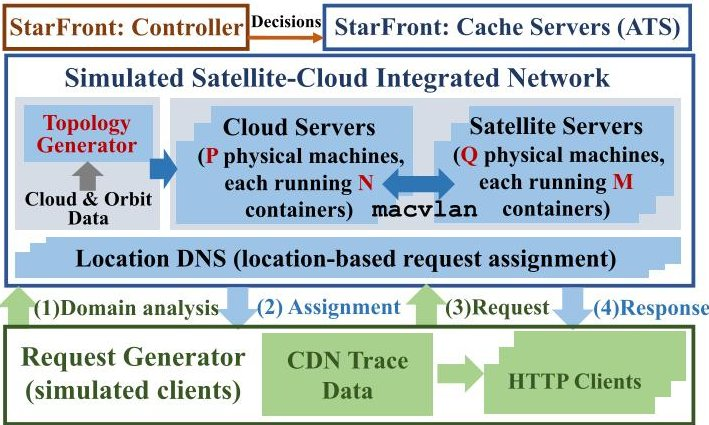

Fig. 8. Testbed and STARFRONT prototype implementation.

the request to the cache server which satisfies the latency requirement and involves the minimum cost (line 25-30). Note that in a practical system there might be no cache servers that can satisfy the latency requirement (e.g., due to poor link condition, satellite outage) in certain slots. To improve the resilience of our framework, in such situations the algorithm assigns user requests to the cache server with minimal access latency (line 31) among all available satellites.

## VI. EVALUATION

In this section, we conduct experiments to evaluate multiple aspects of STARFRONT, including its performance under various configurations and corresponding cost. As most emerging mega-constellations are still in their early stage, it is difficult to conduct experiments on live satellite networks. While there are many prior efforts for network simulation or emulation, existing works either fail to simulate/emulate the high dynamics of LEO satellite (e.g., NS3, Mininet) or they can not support evaluation of content distribution as in real deployments (e.g., [41], [45]). To address such limitations of previous evaluation methodology, we build a testbed to simulate geo-distributed cloud data centers and constellations based on the public orbital data, and implement a prototype of STARFRONT. We further conduct trace-driven simulations to verify the effectiveness of STARFRONT.

## A. Simulated Satellite-Cloud Integrated Network

We first build a testbed to simulate the satellite-cloud network which supports repeatable experiments driven by realistic cloud and satellite traces. At a high-level, as shown in Figure 8, our testbed incorporates a topology generator which loads the information of cloud distributions as well as time-varying satellite trajectories to generate the satellite-cloud network topology. Further, the testbed exploits a number of containers running on top of physical machines to simulate the software behaviors of content distribution (e.g., receiving user requests, querying the cache for required data and sending responses back to users).

Topology generator. The topology generator guides the simulation of the satellite-cloud integrated architecture as follows. First, it uses the distribution of Amazon AWS cloud sites as the available cloud data centers [21]. We configure the cloud distribution based on Amazon AWS as it has deployed a large number of world-wide cloud sites and recently is deploying ground station services to interconnect clouds and satellites. Second, the topology generator calculates the time-varying satellite trajectory, which includes the LLA positions (i.e., latitude, longitude and altitude) of each satellite in every

<!-- PDF_PAGE: 11 -->

TABLE II

PRIMARY ORBITAL PARAMETERS USED IN THE EVALUATION

<table border="1"><tr><td>Primary Parameters</td><td>Satrlink (Shell 1)</td><td>OneWeb (In-Plan)</td><td>Kuiper (In-Plan)</td></tr><tr><td>Inclination</td><td>53°</td><td>87.9°+55°</td><td>51.9°</td></tr><tr><td>Altitude</td><td>550km</td><td>1200km</td><td>630km</td></tr><tr><td># of orbit</td><td>22</td><td>12+8</td><td>17</td></tr><tr><td># of satellite</td><td>1584</td><td>588+128</td><td>578</td></tr></table>

time slot. Specifically, the trajectory information is calculated based on third-party orbit computation tool using the two line element (TLE) data generated by [14], and is used to estimate the distance and visibility of each satellite from the view of other nodes (e.g., neighbor satellites, ground stations, or terrestrial users).

In our experiment, we evaluate STARFRONT under three state-of-the-art constellations: SpaceX's Starlink [17], OneWeb [10], and Amazon Kuiper [2]. All these constellations plan to deploy hundreds to thousands of LEO satellites to provide wide-area coverage and Internet service. In particular, we evaluate STARFRONT under the configuration of: (i) the first shell of Starlink Phase-I, which has deployed 1584 LEO satellites in 72 orbital planes with an altitude of about 550km; (ii) OneWeb, which is a planned initial 648-satellite constellation at approximately 1200km altitude; (iii) the first shell of Project Kuiper, which plans to deploy a large broadband satellite Internet constellation to provide broadband Internet connectivity. Table II summarizes the primary parameters of each constellation in details. The synodic period of Starlink, OneWeb and Kuiper are configured as 5731s, 6557s and 5831s respectively, based on their public constellation information. Finally, we set the connectivity of each node in the topology based on their related visibility, i.e., a satellite is connectable for a ground station if the satellite moves into the transmission range.

Clouds and satellites simulation. As shown in Figure 8, we use Docker containers [7] running on physical machines to support the simulation of cloud/satellite-based cache servers. Specifically, we run a number of Docker containers on each physical machine, and use each container which has installed realistic network stack and CDN software to simulate available cloud or satellite cache servers. Containers are connected to the physical NIC using macvlan [9], which virtualizes a physical NIC into multiple virtual NICs. We use tc to control the time-varying RTT, inter-satellite/ground-satellite connectivity and bandwidth of each link. Inter-cloud network conditions are configured based on the measured values from realistic AWS cloud sites. The inter-satellite and ground-satellite connectivity and network performance are configured based on the results characterized based on a recent constellation simulator [45]. In particular, each satellite connects to two adjacent satellites in the same orbit, and to other two in adjacent orbits. A satellite can be connected to a ground station if only it moves into the transmission range of the ground station.

Dataset and request generator. We use a real-world CDN trace collected from a commercial cloud CDN operator on February 22-28, 2015, containing 3.9 million flow records in total to drive the evaluation. Table III describes the details of the selected trace. We have published the CDN trace at: https://github.com/SpaceNetLab/StarFront, and hope it can stimulate more studies focusing on efficient content distribution in futuristic space-terrestrial integrated networks. We implement a request generator to simulate the behavior

TABLE III

SUMMARY OF THE CDN TRACE USED IN THE EVALUATION

<table border="1"><tr><td>Parameter Description</td><td>Value</td></tr><tr><td># of Total Requests</td><td>3,998,185</td></tr><tr><td># of Total Bytes Requested</td><td>4137 TB</td></tr><tr><td>50th/90th Obj Size</td><td>256KB/1.3GB</td></tr><tr><td>Duration</td><td>7 days(February 22-28,2015)</td></tr></table>

of user clients. It extracts information from the CDN trace and generates HTTP requests to fetch object data. Each HTTP request issued by end users is processed as follows. First, the user issues a DNS query to the location DNS server. Second, the DNS server returns the IP address of the assigned cache server (one of the Docker container) to the user. Finally the client sends a request to the assigned cache server to fetch the concrete content data.

## B. STARFRONT Prototype

STARFRONT controller. The controller of STARFRONT is implemented in around 1100 lines of Python codes. Periodically, the controller reads the satellite location information and the historical network performance information, and calculates the decisions for content placement and request assignment. The time-varying satellite location information are predicted based on third-party orbit computation tool (e.g., STK [13]). Content replicas are then pushed to the cache servers via HTTP connections, following the calculated decision. Further, we configure the pricing model in our experiment following the two representative models, i.e., linear and concave models, as described in $ \mathrm{S I V - B} $ . Specifically, the pricing policy of cloud caches is configured based on existing cloud providers (e.g., CloudFront [1]). Because satellite cache service is still under development and currently there are no practical commercial pricing models, we define the per-unit storage cost on satellite cache $ \gamma\times $ of that in cloud cache, where $ \gamma\geq1 $ indicates space resource is more precious than that in terrestrial clouds as illustrated in Eq (7).

STARFRONT cache servers. We have implemented the STARFRONT cache servers based on Apache Traffic Server (ATS) [4]. ATS is a multi-threaded, event-based, modular, high-performance cache and forward proxy server, written in C++. ATS is distributed as a commercial product and has been used in many production-level systems. We extended ATS and connect each ATS-based cache server to the STARFRONT controller and execute the placement decision.

Next, evaluations in this section aim at answering the following two questions: (i) can STARFRONT satisfy various latency requirements of geo-distributed users as compared to other state-of-the-art content distribution approaches under representative CDN traces and constellation patterns? and (ii) what is the corresponding cost of using STARFRONT?

## C. Verifying STARFRONT's Ability of Satisfying Various Latency Requirements

First, we verify STARFRONT's ability of satisfying various latency requirements. We start our evaluation by examining the effectiveness of different algorithms incorporated in STARFRONT: OffPA (Algorithm 1), OnPA (Algorithm 2) and PAOA (Algorithm 3). For comparison, we also build an offline algorithm based on the greedy maximization of submodular functions [44], denoted as GMSF. In particular, GMSF greedily exploits a utility function which calculates

<!-- PDF_PAGE: 12 -->

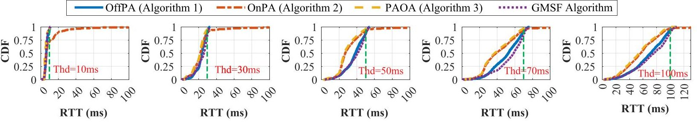

Fig. 9. Comparison of achieved RTTs among different variants of STARFRONT and GMSF.

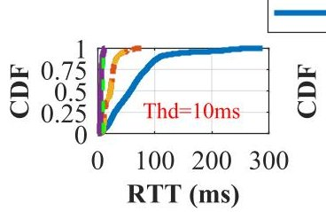

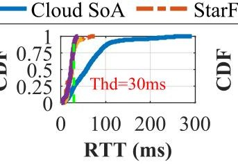

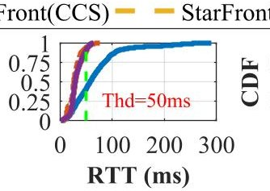

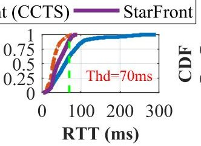

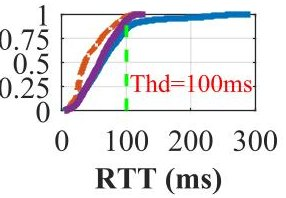

Fig. 10. CDF of RTTs achieved by different strategies under various latency requirements (10/30/50/70/100ms).

the ratio of the amount of requests a cache server can serve, to the corresponding assignment cost generated by Eq. (13). GMSF greedily selects the cache server to place contents and make request assignment until all requests have been assigned. Figure 9 plots the latency statistic of different algorithms under various RTT requirements in the Starlink constellation. Since OffPA and GMSF know the arrival time of all user requests and distribute contents on proper cloud or satellite cache servers in advance, they satisfy various RTT requirements for geo-distributed user requests. OffPA accomplishes slightly lower latency as compared with GMSF when the latency requirement increases. Although accurately obtaining the request arrival pattern is difficult in practice, our OffPA demonstrates the effectiveness of STARFRONT in the (theoretically) ideal case. Because OnPA makes content placement and request assignment decisions in real-time, it may suffer from cache miss, i.e., user requests are assigned to a nearby server that has not cached the desired contents. A cache miss occurs if all currently selected cache servers can not satisfy the RTT requirement. OnPA has to open a new server close to the user and push contents to it. Therefore, OnPA results in a very long tail as shown in Figure 9. In particular, about 28.41%/11.09%/7.67%/6.20%/3.32% of the total user requests can not meet the RTT requirements of 10ms/30ms/50ms/70ms/100ms respectively, as pushing contents to a new cache server involves additional delay. PAOA exploits the historical information of user requests, and pre-allocates contents close to these regions that used to issue requests to fetch contents. By pre-allocating contents on cache servers, it significantly reduces cache misses, and about 3.18%/3.87%/3.74%/3.00%/0.76% of the total user requests can not meet the RTT requirements of 10ms/30ms/50ms/70ms/100ms respectively.

Next we compare the latency reduction on global content distribution by different strategies: (i) the state-of-the-art lowlatency content placement and assignment scheme in existing cloud-based CDNs (denoted as Cloud-based SoA) (e.g., TailCutter [28], GRP [27], CosTLO [53]); (ii) STARFRONT, our proposed framework that judiciously exploits cloud and satellite servers to place contents and assign user requests to proper cache servers to satisfy the latency requirements of various applications, while minimizing the operational cost. For comparison, here we evaluate STARFRONT with PAOA because other comparison approaches are online practical strategies. In addition, to comprehensively understand the incremental effectiveness of integrating LEO satellites to existing cloud-based CDNs, we evaluate STARFRONT under two specific configurations: (iii) replicas are cached on cloud servers, and users can only access clouds via satellite paths (i.e., C = $ \varnothing $ , S = $ \varnothing $ but CS $ \neq $ $ \varnothing $ in Section IV); and (iv) replicas are cached on cloud servers, and can be fetched by user through terrestrial or satellite paths (i.e., S = $ \varnothing $ , but $ C \neq \varnothing $ and CS $ \neq \varnothing $ in Section IV). Strategy (iii) and (iv) refer to the methodology that only exploits satellite networks to extend the connectivity of terrestrial clouds, without using the storage capability of satellites to cache contents in space. We denote (iii) as cloud cache accessed by satellite paths (i.e., CCS) and denote (iv) as cloud cache accessed by terrestrial and satellite paths (i.e., CCTS).

Figure 10 plots the CDF of user-perceived RTTs of different content distribution strategies under various latency requirements. The results of STARFRONT are obtained under the configuration of Starlink constellation. Results with OneWeb and Kuiper are similar and omitted due to the page limit. Since STARFRONT integrates clouds and satellites to store and distribute content globally, it outperforms the state-of-the-art cloud-based strategy by 90.51%/66.63%/52.82%/35.62%/15.45% on average, under the RTT requirements 10ms/30ms/50ms/70ms/100ms respectively. More specifically, we make several observations. First, for stringent RTT requirements (e.g., $ \leq 1 0 \mathrm{m s} $ ), exploiting the satellite network to accelerate cloud access and even directly provide cache in space can significantly improve the ability to satisfy the latency requirement for wide-area user requests. This is because incorporating LEO satellites complements terrestrial CDNs and enables low-latency access to cloud and satellite servers from a global perspective. Second, as the required RTT increases (e.g., 10ms $ \rightarrow $ 100ms), the latency performance of STARFRONT is getting closer to the cloud-based-only approach. This result indicates that under a loose latency constraint STARFRONT preferably uses more cloud-based resources to save operational costs involved by satellites. Third, caching on satellites can further help reduce the latency, but should inevitably involve much more operational costs. On our further analysis, we find that LEO satellites are more suitable to cache contents that will be requested by international users. This is because LEO satellites inherently have high dynamics, and satellite cache with regional contents

<!-- PDF_PAGE: 13 -->

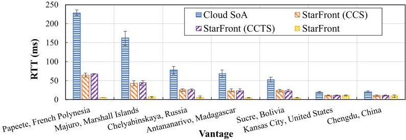

Fig. 11. RTT statistic from geo-distributed vantage points.

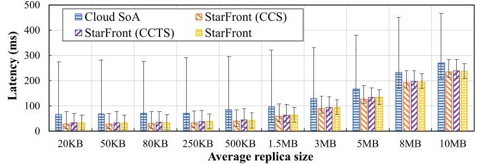

Fig. 12. Latency results under different replica sizes.

may suffer from low cache utilization as it orbits the earth in high velocity.

Further, we turn our focus to the RTTs on a set of geodistributed regions. Figure 11 shows the latency comparison under different content distribution strategies calculated from a collection of vantage points, which are populated cities or areas around the world. We observe that the latency gain achieved by STARFRONT differs in different regions. For users in remote or under-developed areas, STARFRONT can achieve much more latency improvement since the cloud deployment and terrestrial network infrastructure in these regions might be underserved, and LEO satellites extend the availability and performance of terrestrial cloud platforms. Specifically, STARFRONT reduces more than 90% RTT for users in remote regions such as Papeete and Majuro, as compared to the cloudonly strategy. For users in populated areas like Kansas City and Chengdu, all strategies achieve comparable latency results due to the sufficient deployment of nearby cloud infrastructures.

## D. Latency Reduction Under Various Replica Sizes

Replicas from the content providers may have different object sizes (i.e., $ W_{k} $ defined in $ \mathrm{S I V - B} $ ) in practice, according to the concrete application type (e.g., static texts, files or video clips). We assess the content access latency which indicates how fast the requested object can be delivered to users under various replica sizes. Figure 12 depicts the user-perceived latency achieved by different content distribution strategies, with various configurations of the average replica size. As shown in Figure 12, we observe that smaller requests with smaller object size prone to achieve more latency reduction, as compared with other larger requests. The major benefit of STARFRONT is that STARFRONT exploits emerging LEO satellites to push contents more close to users and realize lower client-to-content RTT. On our deeper analysis, we find that for small requests the total content access latency is dominated by the RTT. Since the content access latency is jointly affected by the achievable throughput and RTT, small requests are responded faster under low RTT situations.

Further, to understand how different distribution strategies affect high-level QoE metrics, we evaluate the page load time for representative web traffic under the four strategies. In particular, Figure 13 shows the page load time of visiting different websites when leveraging clouds or satellites to

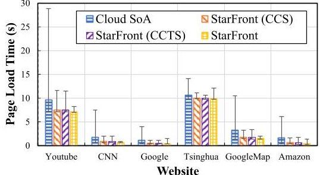

Fig. 13. Web page load time under different content distribution strategies.

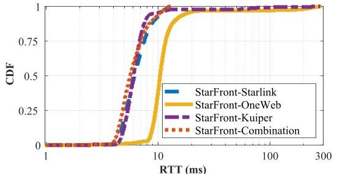

Fig. 14. Latency results under different constellation configurations.

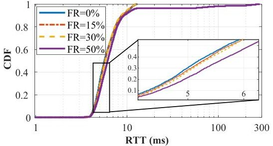

Fig. 15. Latency results under different failure rates. (FR = failure rate).

distribute their web contents. In each workload, the user's browser issues a bunch of requests to fetch web contents, including images, texts, CSS files and other related objects constructing the web page. Here we calculate the page load time as the time of completely loading all required elements in the web page. STARFRONT reduces the page load time as compared with the cloud-based CDN by up to 88.93% , and by 78.99% on average. Moreover, we observe that STARFRONT achieves higher latency gain for web pages that contain smaller elements, since their page load time are dominated by client-to-server RTTs.

## E. Latency Reduction Under Different Constellations

Next we examine the latency reduction under different constellation patterns. Specifically, in our experiment we compare the latency under three state-of-the-art constellations and their combination as illustrated in Table II. Figure 14 shows the latency results under different constellation patterns. We find that STARFRONT associated with Starlink can achieve lower latency as compared with OneWeb and Kuiper. The reason is threefold. First, OneWeb and Kuiper satellite constellations are working on a higher altitude as compared with Starlink, and thus they suffer from higher propagation delay when working as a cache server or providing network connectivity to a terrestrial cloud. Second, OneWeb satellites do not have inter-satellite data links, hence it limits the latency improvement when using satellite to construct space routes to extend the accessibility of cloud servers. Third, the Starlink constellation consists of more LEO satellites than OneWeb and Kuiper. If those satellites in mega-constellations have adequate storage capability to cache contents, STARFRONT associated with Starlink can obtain higher latency gain since

<!-- PDF_PAGE: 14 -->

TABLE IV

CONTENT DISTRIBUTION COST UNDER DIFFERENT PRICING POLICIES $ (\alpha, \beta) $ AND LATENCY REQUIREMENTS $ (Thd) $

<table border="1"><tr><td rowspan="2" colspan="2">Cost($/GB)Strategy&lt;α,β,Thd&gt;</td><td>Cloud SoA</td><td>SF-PAOA(CCS)</td><td colspan="3">SF-PAOA(CCTS)</td><td colspan="3">SF-PAOA</td><td colspan="3">SF-OffPA(off-line)</td><td colspan="3">GMSF(off-line)</td></tr><tr><td>Ground(Total)</td><td>Space(Total)</td><td>Ground</td><td>Space</td><td>Total</td><td>Ground</td><td>Space</td><td>Total</td><td>Ground</td><td>Space</td><td>Total</td><td>Ground</td><td>Space</td><td>Total</td></tr><tr><td rowspan="7">LinearStorageCostModel</td><td>&lt;2,2,10ms&gt;</td><td>0.108</td><td>0.208</td><td>0.005</td><td>0.197</td><td>0.203</td><td>0.005</td><td>0.248</td><td>0.252</td><td>0.007</td><td>0.234</td><td>0.240</td><td>0.005</td><td>0.259</td><td>0.265</td></tr><tr><td>&lt;2,2,50ms&gt;</td><td>0.106</td><td>0.203</td><td>0.028</td><td>0.146</td><td>0.162</td><td>0.029</td><td>0.144</td><td>0.163</td><td>0.055</td><td>0.098</td><td>0.153</td><td>0.054</td><td>0.111</td><td>0.165</td></tr><tr><td>&lt;2,2,70ms&gt;</td><td>0.105</td><td>0.201</td><td>0.044</td><td>0.113</td><td>0.142</td><td>0.044</td><td>0.113</td><td>0.142</td><td>0.075</td><td>0.057</td><td>0.132</td><td>0.074</td><td>0.064</td><td>0.139</td></tr><tr><td>&lt;2,5,10ms&gt;</td><td>0.107</td><td>0.206</td><td>0.005</td><td>0.197</td><td>0.202</td><td>0.005</td><td>0.248</td><td>0.252</td><td>0.007</td><td>0.234</td><td>0.240</td><td>0.005</td><td>0.259</td><td>0.265</td></tr><tr><td>&lt;5,5,10ms&gt;</td><td>0.108</td><td>0.507</td><td>0.007</td><td>0.477</td><td>0.485</td><td>0.006</td><td>0.605</td><td>0.611</td><td>0.007</td><td>0.578</td><td>0.585</td><td>0.007</td><td>0.633</td><td>0.640</td></tr><tr><td>&lt;5,5,50ms&gt;</td><td>0.104</td><td>0.503</td><td>0.055</td><td>0.243</td><td>0.299</td><td>0.055</td><td>0.245</td><td>0.301</td><td>0.056</td><td>0.244</td><td>0.299</td><td>0.057</td><td>0.267</td><td>0.324</td></tr><tr><td>&lt;5,5,70ms&gt;</td><td>0.104</td><td>0.501</td><td>0.075</td><td>0.142</td><td>0.218</td><td>0.075</td><td>0.142</td><td>0.217</td><td>0.075</td><td>0.142</td><td>0.217</td><td>0.076</td><td>0.154</td><td>0.230</td></tr><tr><td rowspan="7">ConcaveStorageCostModel(z=0.7)</td><td>&lt;2,2,10ms&gt;</td><td>0.107</td><td>0.206</td><td>0.005</td><td>0.197</td><td>0.202</td><td>0.005</td><td>0.250</td><td>0.255</td><td>0.007</td><td>0.232</td><td>0.239</td><td>0.005</td><td>0.258</td><td>0.264</td></tr><tr><td>&lt;2,2,50ms&gt;</td><td>0.105</td><td>0.202</td><td>0.032</td><td>0.139</td><td>0.171</td><td>0.033</td><td>0.137</td><td>0.170</td><td>0.055</td><td>0.098</td><td>0.153</td><td>0.054</td><td>0.111</td><td>0.165</td></tr><tr><td>&lt;2,2,70ms&gt;</td><td>0.104</td><td>0.201</td><td>0.042</td><td>0.117</td><td>0.159</td><td>0.042</td><td>0.117</td><td>0.159</td><td>0.075</td><td>0.057</td><td>0.132</td><td>0.074</td><td>0.065</td><td>0.139</td></tr><tr><td>&lt;2,5,10ms&gt;</td><td>0.107</td><td>0.206</td><td>0.005</td><td>0.197</td><td>0.202</td><td>0.005</td><td>0.250</td><td>0.255</td><td>0.007</td><td>0.232</td><td>0.239</td><td>0.005</td><td>0.258</td><td>0.263</td></tr><tr><td>&lt;5,5,10ms&gt;</td><td>0.107</td><td>0.505</td><td>0.007</td><td>0.477</td><td>0.483</td><td>0.006</td><td>0.613</td><td>0.619</td><td>0.007</td><td>0.577</td><td>0.584</td><td>0.007</td><td>0.633</td><td>0.640</td></tr><tr><td>&lt;5,5,50ms&gt;</td><td>0.105</td><td>0.500</td><td>0.055</td><td>0.243</td><td>0.298</td><td>0.055</td><td>0.246</td><td>0.301</td><td>0.055</td><td>0.244</td><td>0.299</td><td>0.057</td><td>0.267</td><td>0.323</td></tr><tr><td>&lt;5,5,70ms&gt;</td><td>0.104</td><td>0.499</td><td>0.075</td><td>0.142</td><td>0.217</td><td>0.075</td><td>0.142</td><td>0.217</td><td>0.075</td><td>0.142</td><td>0.217</td><td>0.076</td><td>0.154</td><td>0.230</td></tr></table>

a denser constellation enables more cache servers and diverse low-latency space routes for fetching contents from a cloud. In addition, we denote the situation in which STARFRONT can combine and leverage all satellite caches in all three constellations as "STARFRONT-Combination". Results in Figure 14 demonstrate that if all constellations collaborate to construct a large cache network in space, more latency reduction can be achieved as compared with a single constellation, since more available LEO satellites in different constellations extend the availability of low-latency caches.

## F. Resilience Analysis

LEO satellites are operated in an intermittent, errorprone outer space environment. Network links, including both ground-satellite and inter-satellite links, are likely to be interrupted due to a series of complex factors, such as various interference caused by space radiation, debris hazards, poor weather conditions, etc. We conduct an experiment to evaluate the resilience of STARFRONT under various failures. In particular, we randomly create link failures in the mega-constellation, and define failure rate as the ratio of the amount of disrupted links to the amount of total links. Figure 15 plots the latency results under various failure ratios. On one hand, when an unexpected failure occurs, our online algorithm immediately performs local re-calculation, and reassigns user requests to another available cache node with the minimal access latency. On the other hand, the integration of mega-constellation and geo-distributed terrestrial clouds enables a number of backup cache servers to cope with disruptions. Specifically, when the failure rate increases to 15%/30%/50% the average content access latency increases by 0.24%/0.06%/81.91% (note the log scale in x-axis and long tail). The latency does not increase much when the failure rate is low, because there are many redundant satellite paths and available cache servers in the large-scale mega-constellation.

## G. Cost Analysis

Finally, we evaluate the operational cost under different content distribution strategies, and with different pricing models as defined in $ \mathrm{S I V - B} $ . Table IV summarizes the cost breakdown, i.e., the storage and bandwidth cost consumed by satellite and cloud cache servers. We have made several observations. First, the linear and concave storage pricing model present similar

cost results. We find that this is because during the content distribution process, the bandwidth consumption consumes a large fraction of the entire operational cost. Second, the cost increases, as we enlarge the cost coefficient $ \alpha $ and $ \beta $ As compared to cloud-only strategies, STARFRONT achieves lower latency at the cost of more content distribution fees. While incorporating satellites to distribute contents globally could be more expensive, the cost might not be unacceptable, and should be worth especially for high-priority regions or tasks with very stringent latency requirements.

## VII. RELATED WORK

We briefly discuss the related works in this section.

Replica placement and request assignment in CDNs. A considerable number of previous research has studied the replica placement or request assignment problem in cloudbased CDNs [27], [40], [50], [53], [54]. GRP [27] is a replica placement scheme in Cloud CDNs that minimizes the cost incurred on the CDN providers, while satisfying the QoS requirements. CostTLO [53] exploits the use of issuing redundant requests to fetch contents from different cloud storage nodes. Similarly, TailCutter [28] explores the idea of sending multiple requests in parallel to optimize the content access latency while meeting the cost constraint. NetSession [57] is a peer-assisted CDN system that leverages both dedicated, centrally managed infrastructures and clients to distribute contents. NetSession can deliver several of the key benefits of both infrastructure-based and peer-to-peer CDNs. More recently, authors of [50] proposed algorithms that provision CDN traffic to cache servers and minimize the midgress which is the cache miss traffic between the CDN's server and the content provider origins. Authors in [39] and [55] proposed mechanisms to leverage on-satellite caches to place contents and serve terrestrial users globally. All these existing efforts use either cloud caches or satellite caches alone for content distribution.

The fundamental difference between STARFRONT and the above existing works is that: to our best knowledge, STARFRONT is the first content distribution framework cooperatively exploiting network and storage resources on clouds (static) and LEO satellites (dynamic) to optimize the content access latency globally. Different from prior efforts (e.g., NetSession), STARFRONT characterizes the high mobility of LEO satellites, and leverages their predicted trajectory to assist

<!-- PDF_PAGE: 15 -->

the calculation of content placement and request assignment decisions. As shown in the evaluation ( $ \mathrm{\Sigma VI} $ ) , through exploiting LEO satellites equipped with storage and high-datarate ISLs, STARFRONT can improve the content access latency of global CDNs in a cost-effective manner, especially for the large population in remote areas.

Exploring "NewSpace" satellite networks. Our work is inspired by a number of recent studies on characterizing and understanding the network performance of "NewSpace" constellations [22], [29], [30], [33], [34], [35], [36], [41], [42], [45], [46], [52]. Multiple works have studied the routing algorithm in satellite networks. For example, to understand the latency properties of LEO satellite networks, the author in [34] builds a simulator to evaluate how to use the laser links to enable low-latency communication over satellites. Similarly, a ground-relay based routing strategy is proposed in [35]. Motifs [23] is proposed to dynamically build network connectivities in space, tackling the high dynamism in LEO satellites. Authors in [56] studied the impact of space-ground topology design on the attainable network performance (e.g., latency and jitter) of integrated satellite and terrestrial networks. These efforts complement our work.

In-orbit computing. Recent works also have explored the feasibility of leveraging the improved computation capability in emerging nanosatellite constellations to build new computer systems [22], [31], [43] in space. Authors in [22] qualitatively examine the opportunities and challenges of in-orbit computing. An orbital edge computing (OEC) [31] architecture is proposed to address the limitation of existing "bent-pipe" architecture and optimize the edge processing latency. Instead of focusing on nanosatellites only, our work proposes a cooperatively architecture that jointly exploits the resource on both terrestrial cloud data centers and LEO satellites to judiciously improve the performance of content distribution on a global scale.

Emerging satellite applications. OrbitCast [48] is a hybrid and low-latency data delivery architecture for various earth observation (EO) tasks. SpaceRTC [47] extends existing realtime communication (RTC) applications, which are conventionally built upon cloud platforms, to mega-constellation to achieve low-latency wide-area communication. Different from these existing efforts above, STARFRONT targets at a different application scenario with new problem formulations. We believe all these works can jointly facilitate the development of futuristic satellite Internet ecosystem.

## VIII. CONCLUSION

This paper presents STARFRONT, a pervasive and low-latency framework cooperatively and judiciously exploiting LEO and terrestrial caches for Internet content distribution on a global scale. We implement a testbed to mimic the satellite-cloud integrated architecture and build a STARFRONT prototype upon it. Trace-driven evaluations show that by cooperatively and properly placing replicas on satellites and clouds, STARFRONT can satisfy various latency requirements from applications with acceptable cost, as compared to other state-of-the-art cloud-based approaches.

## REFERENCES

[1] Amazon Cloudfront Pricing. Accessed: Mar. 1, 2023. [Online]. Available: https://aws.amazon.com/cloudfront/pricing/

[2] Amazon Kuiper. Accessed: Mar. 1, 2023. [Online]. Available: https:// www.aboutamazon.com/news/tag/project-kuiper

[3] Amazon S3 Pricing Policy. Accessed: Mar. 31, 2023. [Online]. Available: https://aws.amazon.com/s3/pricing/

[4] Apache Traffic Server. Accessed: Mar. 1, 2023. [Online]. Available: https://trafficserver.apache.org/

[5] Azure Orbital. Accessed: Mar. 1, 2023. [Online]. Available: https:// azure.microsoft.com/en-us/services/orbital/

[6] Cisco Visual Networking Index, Complete Forecast Update. Accessed: Mar. 1, 2023. [Online]. Available: https://www.cisco.com/c/dam/m/en_us/network-intelligence/service-provider/digital transformation/knowledge-network-webinars/pdfs/1213-business services-ckn.pdf

[7] Docker Container. Accessed: Mar. 1, 2023. [Online]. Available: https://www.docker.com/

[8] FCC Authorizes Boeing Broadband Satellite Constellation. Accessed: Mar. 31, 2023. [Online]. Available: https://www.fcc.gov/document/fcc-authorizes-boeing-broadband-satellite-constellation

[9] Macvlan Network Driver. Accessed: Mar. 1, 2023. [Online]. Available: https://docs.docker.com/network/macvlan/

[10] Oneweb. Accessed: Mar. 1, 2023. [Online]. Available: https://www. oneweb.world/

[11] Python MIP (Mixed-Integer Linear Programming) Tools. Accessed: Mar. 1, 2023. [Online]. Available: https://pypi.org/project/mip/

[12] Ripe Atlas Measurement Platform. Accessed: Mar. 1, 2023. [Online]. Available: https://atlas.ripe.net/

[13] Satellite Toolkit AGI. Accessed: Mar. 1, 2023. [Online]. Available: https://www.agi.com/products

[14] Space-Track.org. Accessed: Mar. 1, 2023. [Online]. Available: https:// www.space-track.org/

[15] Spacebelt Aims to Store Data in Satellites. Accessed: Mar. 1, 2023. [Online]. Available: https://blocksandfiles.com/2020/04/21/spacebelt-store-data-in-satellites-analysis/

[16] Spacebelt Cloud Constellation Corporation. Accessed: Mar. 1, 2023. [Online]. Available: http://spacebelt.com/

[17] Starlink. Accessed: Mar. 1, 2023. [Online]. Available: https://www. starlink.com/

[18] Use DNS Policy for Geo-Location Based Traffic Management With Primary Servers. Accessed: Mar. 1, 2023. [Online]. Available: https://docs.microsoft.com/en-us/windows-server/networking/dns/deploy/primary-geo-location

[19] (2017). Akamai Online Retail Performance Report: Milliseconds Are Critical. Accessed: Mar. 1, 2023. [Online]. Available: https://www. akamai.com/newsroom/press-release/akamai-releases-spring-2017-state-of-online-retail-performance-report

[20] (2021). Amazon AWS Ground Station. Accessed: Mar. 1, 2023. [Online]. Available: https://aws.amazon.com/ground-station/

[21] (2021). Amazon Global Infrastructure. [Online]. Accessed: Mar. 1, 2023. Available: https://aws.amazon.com/about-aws/global-infrastructure/

[22] D. Bhattacherjee, S. Kassing, M. Licciardello, and A. Singla, "In-orbit computing: An outlandish thought experiment?" in Proc. 19th ACM Workshop Hot Topics Netw., Nov. 2020, pp. 197-204.

[23] D. Bhattacherjee and A. Singla, "Network topology design at 27,000 km/hour," in Proc. 15th Int. Conf. Emerg. Netw. Exp. Technol., Dec. 2019, pp. 341-354.

[24] T. Bottger, F. Cuadrado, G. Tyson, I. Castro, and S. Uhlig, "Open connect everywhere: A glimpse at the internet ecosystem through the lens of the Netflix CDN," ACM SIGCOMM Comput. Commun. Rev., vol. 48, no. 1, pp. 28-34, 2018.

[25] I. N. Bozkurt et al., "Why is the internet so slow?!" in Proc. Int. Conf. Passive Act. Netw. Meas. Cham, Switzerland: Springer, 2017, pp. 173-187.

[26] I. Castro, J. C. Cardona, S. Gorinsky, and P. Francois, "Remote peering: More peering without internet flattening," in Proc. 10th ACM Int. Conf. Emerg. Netw. Experiments Technol., Dec. 2014, pp. 185-198.

[27] F. Chen, K. Guo, J. Lin, and T. La Porta, "Intra-cloud lightning: Building CDNs in the cloud," in Proc. IEEE INFOCOM, Mar. 2012, pp. 433-441.

[28] Y. Cui et al., "TailCutter: Wisely cutting tail latency in cloud CDNs under cost constraints," IEEE/ACM Trans. Netw., vol. 27, no. 4, pp. 1612-1628, Aug. 2019.

[29] I. del Portillo, B. Cameron, and E. Crawley, "Ground segment architectures for large LEO constellations with feeder links in EHF-bands," in Proc. IEEE Aerosp. Conf., Mar. 2018, pp. 1-14.

[30] I. del Portillo, B. G. Cameron, and E. F. Crawley, "A technical comparison of three low earth orbit satellite constellation systems to provide global broadband," Acta Astronautica, vol. 159, pp. 123-135, Jun. 2019.

<!-- PDF_PAGE: 16 -->

[31] B. Denby and B. Lucia, "Orbital edge computing: Nanosatellite constellations as a new class of computer system," in Proc. 25th Int. Conf. Architectural Support Program. Lang. Operating Syst., Mar. 2020, pp. 939-954.

[32] H. Fenech, S. Amos, A. Tomatis, and V. Soumpholphakdy, "High throughput satellite systems: An analytical approach," IEEE Trans. Aerosp. Electron. Syst., vol. 51, no. 1, pp. 192-202, Jan. 2015.

[33] G. Giuliari, T. Klenze, M. Legner, D. Basin, A. Perrig, and A. Singla, "Internet backbones in space," ACM SIGCOMM Comput. Commun. Rev., vol. 50, no. 1, pp. 25-37, Mar. 2020.

[34] M. Handley, "Delay is not an option: Low latency routing in space," in Proc. 17th ACM Workshop Hot Topics Netw., Nov. 2018, pp. 85-91.

[35] M. Handley, "Using ground relays for low-latency wide-area routing in megaconstellations," in Proc. 18th ACM Workshop Hot Topics Netw., Nov. 2019, pp. 125-132.

[36] Y. Hauri, D. Bhattacherjee, M. Grossmann, and A. Singla, "Internet from space' without inter-satellite links," in Proc. 19th ACM Workshop Hot Topics Netw., Nov. 2020, pp. 205-211.

[37] H. Huang, S. Guo, and K. Wang, "Envisioned wireless big data storage for low-earth-orbit satellite-based cloud," IEEE Wireless Commun., vol. 25, no. 1, pp. 26-31, Feb. 2018.

[38] X. Jia, T. Lv, F. He, and H. Huang, "Collaborative data downloading by using inter-satellite links in LEO satellite networks," IEEE Trans. Wireless Commun., vol. 16, no. 3, pp. 1523-1532, Mar. 2017.

[39] D. Jiang et al., "QoE-aware efficient content distribution scheme for satellite-terrestrial networks," IEEE Trans. Mobile Comput., vol. 22, no. 1, pp. 443-458, Jan. 2023.

[40] G. Joshi, Y. Liu, and E. Soljanin, "On the delay-storage trade-off in content download from coded distributed storage systems," IEEE J. Sel. Areas Commun., vol. 32, no. 5, pp. 989-997, May 2014.

[41] S. Kassing, D. Bhattacherjee, A. B. Aguas, J. E. Saethre, and A. Singla, "Exploring the 'internet from space' with Hypatia," in Proc. ACM Internet Meas. Conf., Oct. 2020, pp. 214-229.

[42] T. Klenze, G. Giuliari, C. Pappas, A. Perrig, and D. Basin, "Networking in heaven as on earth," in Proc. 17th ACM Workshop Hot Topics Netw., Nov. 2018, pp. 22-28.

[43] V. Kothari, E. Liberis, and N. D. Lane, "The final frontier: Deep learning in space," in Proc. 21st Int. Workshop Mobile Comput. Syst. Appl., Mar. 2020, pp. 45-49.

[44] A. Krause and D. Golovin, "Submodular function maximization," Tractability, Pract. Approaches Hard Problems, vol. 3, no. 19, pp. 71-104, 2012.

[45] Z. Lai, H. Li, and J. Li, "StarPerf: Characterizing network performance for emerging mega-constellations," in Proc. IEEE 28th Int. Conf. Netw. Protocols (ICNP), Oct. 2020, pp. 1-11.

[46] Z. Lai, H. Li, Q. Zhang, Q. Wu, and J. Wu, "Cooperatively constructing cost-effective content distribution networks upon emerging low earth orbit satellites and clouds," in Proc. IEEE 29th Int. Conf. Netw. Protocols (ICNP), Nov. 2021, pp. 1-12.

[47] Z. Lai, W. Liu, Q. Wu, H. Li, J. Xu, and J. Wu, "SpaceRTC: Unleashing the low-latency potential of mega-constellations for real-time communications," in Proc. IEEE Conf. Comput. Commun., May 2022, pp. 1339-1348.

[48] Z. Lai, Q. Wu, H. Li, M. Lv, and J. Wu, "OrbitCast: Exploiting megaconstellations for low-latency earth observation," in Proc. IEEE 29th Int. Conf. Netw. Protocols (ICNP), Nov. 2021, pp. 1-12.

[49] S. Shukla, O. Bhardwaj, A. A. Abouzeid, T. Salonidis, and T. He, "Proactive retention-aware caching with multi-path routing for wireless edge networks," IEEE J. Sel. Areas Commun., vol. 36, no. 6, pp. 1286-1299, Jun. 2018.

[50] J. Hei, H. Zhan, P. Zhang, and H. Tan, "Latency-aware traffic provisioning for content delivery networks," in Proc. 8th Int. Conf. Big Data Comput. Commun. (BigCom), Aug. 2022, pp. 543-557.

[51] D. Vasisht and R. Chandra, "A distributed and hybrid ground station network for low earth orbit satellites," in Proc. 19th ACM Workshop Hot Topics Netw., Nov. 2020, pp. 190-196.

[52] F. Vidal, H. Legay, G. Goussetis, M. Garcia Vigueras, S. Tubau, and J. Gayrard, "A methodology to benchmark flexible payload architectures in a megaconstellation use case," Int. J. Satell. Commun. Netw., vol. 39, no. 1, pp. 29-46, Jan. 2021.

[53] Z. Wu, C. Yu, H. V. Madhyastha, and U. Riverside, "CosTLO: Cost-effective redundancy for lower latency variance on cloud storage services," in Proc. 12th USENIX Symp. Networked Syst. Design Implement. (NSDI), 2015, pp. 543-557.

[54] J. Xue, D. Choffnes, and J. Wang, "CDNs meet CN an empirical study of CDN deployments in China," IEEE Access, vol. 5, pp. 5292-5305, 2017.

[55] S. Yang, H. Li, Z. Lai, and J. Liu, "A synergic architecture for content distribution in integrated satellite and terrestrial networks," in Proc. IEEE/CIC Int. Conf. Commun. China (ICCC), Aug. 2020, pp. 96-101.

[56] Y. Zhang, Q. Wu, Z. Lai, and H. Li, "Enabling low-latency-capable satellite-ground topology for emerging LEO satellite networks," in Proc. IEEE Conf. Comput. Commun., May 2022, pp. 1329-1338.

[57] M. Zhao et al., "Peer-assisted content distribution in Akamai NetSession," in Proc. Conf. Internet Meas. Conf., Oct. 2013, pp. 31-42.

Zeqi Lai (Member, IEEE) received the Ph.D. degree in computer science from Tsinghua University in 2018. He was a Senior Researcher with the Tencent Media Laboratory from 2018 to 2019 and developed the network protocols and congestion control algorithms for VooV, a large-scale commercial videoconferencing application. He is currently an Assistant Professor with the Institute for Network Sciences and Cyberspace, Tsinghua University. His research interests include next-generation internet architecture and protocols, integrated space and terrestrial networks (ISTN), wireless and mobile computing, and video streaming.

Hewu Li received the M.S. and Ph.D. degrees in computer science from Tsinghua University in 2001 and 2004, respectively. He is currently an Associate Professor and an Assistant to the Dean of the Institute for Network Sciences and Cyberspace, Tsinghua University. He is also the Director of the Wireless and Mobile Network Technology Research Laboratory and the Network Application Support Research Center, the wireless Chairperson of the Mobile Working Group, 2009 Asia FI (Asia Future Internet), and the Deputy Director of the Executive Office of the Joint Laboratory of Tsinghua University and China Telecom. His research interests include mobile wireless network architecture, hybrid satellite-terrestrial networks, testbed, broadband wireless access technology, and mobility architecture in next-generation networks.

Qi Zhang received the B.S. degree in computer science from Beijing Jiaotong University, China, in 2019, and the M.S. degree in cyberspace security from Tsinghua University, China, in 2022. He is currently an Assistant Engineer with the Zhongguancun Laboratory, China. His main research interests include integrated space-terrestrial network (ISTN) and content delivery networks (CDN).

Qian Wu received the M.S. and Ph.D. degrees in computer science from Tsinghua University in 2002 and 2006, respectively. She is currently an Associate Professor with the Institute for Network Sciences and Cyberspace, Tsinghua University. Her research interests include the next-generation internet architecture and protocols, integrated space-terrestrial networks (ISTN), mobile and wireless networks, multipath transfer, and mobile multicast.

Jianping Wu (Fellow, IEEE) is currently a Professor with the Department of Computer Science and Technology, Tsinghua University, Beijing, China, where he is also the Dean of the Institute for Network Sciences and Cyberspace. He has authored or coauthored more than 300 academic papers, edited and co-edited eight books, supervised more than 100 undergraduates, and invented or co-invented 20 patents. His research interests include computer network, including technology research, network engineering, and cultivating talents. From 2007 to 2011, he was the Chairman of the Asia-Pacific Advanced Network. He is an Academician of the Chinese Academy of Engineering and an International Fellow of the Royal Academy of Engineering. As the first author, he developed four IETF RFCs in IETF. He was the recipient of the Jonathan B. Postel Service Award of ISOC in 2010 and was inducted into the Internet Hall of Fame in 2017.