<!-- PDF_PAGE: 1 -->

# Costing Commonality: Evaluating the Impact of Platform Divergence on Internal Investment Returns

by

## Bruce G. Cameron

B.A.Sc. Engineering Science, University of Toronto, 2005 S.M. Aeronautics and Astronautics, Massachusetts Institute of Technology 2007 S.M. Technology and Policy, Massachusetts Institute of Technology 2007

Submitted to the Engineering Systems Division in Partial Fulfillment of the Requirements for the Degree of

Doctor of Philosophy

ARCHIVES

in Engineering Systems at the Massachusetts Institute of Technology

August 2011 [September 2011]

$ \textcircled{c} $2011 Bruce Cameron . All rights reserved.

The author hereby grants to MIT permission to reproduce and to distribute publicly paper and electronic copies of this thesis document in whole or in part in any medium now known or hereafter created.

Certified by...

Edward F. Crawley Professor of Aeronautics and Astronautics and Engineering Systems Thesis Supervisor

Professor of Operations Management and Engineering Systems Thesis Committee Member

Dr. Ernst Fricke

General Manager in Total Vehicle Architecture and Integration Division BMW

Thesis Committee Member

Proessur Aeronautics and Astronautics and Engineering Systems Chair, ESD Education Committee

<!-- PDF_PAGE: 2 -->

<!-- PDF_PAGE: 3 -->

Costing Commonality: Evaluating the Impact of Platform Divergence on Internal Investment Returns by Bruce G. Cameron

Submitted to the Engineering Systems Division on August 30th, 2011 in Partial Fulfillment of the Requirements for the Degree of Doctor of Philosophy in Engineering Systems

## ABSTRACT

Platforming has become an important means of cost-sharing among industrial products. However, recent research has shown that many firms face systemic downward pressure on commonality, with the result that many platforms realize less commonality than intended. This research was chartered to evaluate the costing of commonality benefits, the associated returns from commonality investments, and the potential impact of divergence on commonality benefits.

This dissertation used a tiered approach to the research questions. A statistical study of commonality returns was conducted, finding evidence for a potential link between divergence and cost growth. Broad practice surveys of 16 firms revealed cost allocation practices and internal funding strategies as potential determinants of the commonality-cost relationships. Three detailed case studies were conducted to trace benefit trajectories through platformed products in the presence of commonality changes.

We find support for the hypothesis that divergence has cost consequences, notably reducing inventory benefits, creating higher quality expenses and requiring additional manufacturing coordination. Additionally, we show that lead variants bearing platform costs achieved weaker investment returns and re-captured few benefits from later variants. We find also find evidence to refute the notion that representation at design reviews ensures downstream benefits are represented.

Several management practices for making commonality decisions are identified. We propose a framework for commonality cost decisions, which explicitly captures the impact of individual variant decisions on the platform's cost structure. We identify a commonality cycle, a progression of commonality strategies seen by firms, driven by growing benefit analogies among platforms enabling larger investments, premature investment evaluation, and unrealized returns on commonality investments.

Dissertation Supervisor : Edward F. Crawley Professor of Aeronautics and Astronautics and Engineering Systems

<!-- PDF_PAGE: 4 -->

## Acknowledgments

First and foremost I would like to my mentor Ed Crawley for the opportunity to complete this work. Whether it be in the office, in a cab, or on a ski hill, he provided the sage guidance to shape and ground this work.

My committee member Charlie Fine and Ernst Fricke were exceptional, and contributed their experience on two continents.

Fellow students made significant contributions to this work through presentation commentary, seminar discussions, and document reviews. I'd like to single out Prof. Zoe Szajnfarber for her targeted advice, Jesse Sowell for his conceptual framing, Anthony Wicht for his collaboration and Jonathan Battat for his detailed review. Although no longer a student, Dr. Ryan Boas contributed his experience and judgment to this work.

I was fortunate to find wise guides in many of the firms we studied - while they must remain anonymous, I was deeply appreciative of their help and contributions.

My partner, Tess, was a luminescent source of support and encouragement through the entire degree. This work would literally not have been possible without her.

Lastly I'd like to thank my parents. My mother taught me resilience in the face of challenges and encouraged me to think big.. My father deserves the lion's share of the credit for the initiation of this degree - his support was direct and unequivocal.

<!-- PDF_PAGE: 5 -->

## Table of Contents

Chapter 1 Introduction...11

Chapter 2 Commonality Costing Framework...13

Commonality Challenges...14

Framework Elements...15

Framework Use...16

Chapter 3 Literature Review...17

Background on Commonality...17

Commonality as a Cost Strategy...18

Commonality Investments...26

Platform Cost Structure...31

Costing for Program Control...33

Product Launch Divergence...36

Dynamic Evolution of Commonality...37

Cost Growth...38

Chapter 4 Costing Commonality: State of the Practice in Government ...42

Overview of Chapter 4...42

Commonality Costing at NASA...42

Commonality Costing in Department of Defense...45

Chapter 5 Statistical Study of Cost Implications ...47

Relevant Other Studies...47

Data Source...48

Data Cleaning and Coding...48

Results - Two Sample Test...50

Results - Bootstrapping...54

Conclusion...61

Chapter 6 Field Research Design and Methods...62

Questions to Guide Commonality Costing Methodology Discovery...67

What are the threats to internal validity?...68

What are the threats to external validity?...69

Case Selection and Generalization...69

Chapter 7 Case 1: Heavy Equipment ...71

Executive Summary...71

Company Overview...74

Background on Commonality: Previous Initiatives and Commonality Tensions...75

Commonality Benefits Considered...75

Existing Commonality Practices...78

Commonality Practices: Location 6 Div1Fam3Product2 Mini-Case...79

Commonality Impact – Commonality Metrics and Parts Growth...81

Financial Incentives for Commonality...83

Division of Platforming Costs...83

Cost Allocation...84

Case Study – Platform 1...85

History...85

Initial Commonality Plan & Benefits...85

<!-- PDF_PAGE: 6 -->

Execution on Original Commonality Plan...86

Manufacturing and Launch...87

New Variant Additions...88

Variant Impact on Commonality...90

Variant Impact on Commonality Benefits...92

Conclusions and Recommendations...100

Chapter 8 Case 2: Rail Equipment...102

Executive Summary...102

Company Overview...105

Background on Commonality: Previous Initiatives and Commonality Tensions...105

Commonality Benefits Considered...106

Concept of the Platform 1 Rail product...108

Initial Commonality Plan, Benefits, and Investment...110

Execution on Original Commonality Plan...112

Commonality Management, Commonality Metrics and Parts Growth...115

Manufacturing and Contract for the First Variant...116

Validation, Testing, Certification...120

Procurement, Supply Chain, and Site Manufacturing Initiative...122

Financial Incentives for Commonality...125

Commonality Benefits Realized and Projected...128

Results to Date and Current State of the Program...130

Conclusions and Recommendations...132

Chapter 9 Case 3: Vehicle Manufacturer...134

Executive Summary...134

Company Overview...137

Commonality Benefits Considered...137

Commonality Impact – Parts Growth...139

Existing Commonality Practices...140

Vehicle Design Group...140

Components Group...140

Transmissions Business Unit...141

Radiators and Mufflers Consolidation...142

Emissions Control...143

Financial Incentives for Commonality...145

Cost Allocation...146

Case Study – Platform 1...146

History...147

Initial Commonality Plan & Benefits...147

Execution on Original Commonality Plan...150

Chassis...150

Transmission...151

Electrical...151

Operator Station...152

Axles...154

Exterior...156

Hydraulic & Suspension, Body, Engine Installation...157

Manufacturing, Test, and Launch...158

Generational Change Impact on Commonality and Program Financials...159

Summary of Platform 1 Program...165

<!-- PDF_PAGE: 7 -->

Conclusions and Recommendations...165

Chapter 10 Cross Case Analysis and Recommendations...168

Analysis Overview...168

Sizing the Benefits of Commonality...169

Estimating the Producer’s Benefits of Commonality...172

Estimating the Purchaser’s Benefits of Commonality...173

What benefits should be costed?...175

Commonality Metrics...176

Sizing Commonality Premiums...178

Funding Commonality...180

Evaluating Investments...182

Primary Hypothesis – Divergence Has Cost Consequences...184

Secondary Hypothesis – Near-Term Costing vs. Lifecycle Costing...185

How do Divergence Costs Arise?...191

Commonality Investment Payoff...194

Lower Platform Investment Returns...195

Weaker Lead Variant IRR Under Lead-Pays Development Cost Allocation...196

Common Development Costs Allocated Among Variants...199

Related Investment Policies...202

Framework Comparison of Development Cost Allocation...203

Production Cost Allocation...205

Platform Cost Structure – Incentives...205

Taxing non-common parts...207

New Part Introduction Costs...209

Transfer pricing for common parts among variants...211

Pooling common parts investments at the platform level...213

Organizational Factors...215

Functional Participation in Design Reviews...215

What Functions Are Impacted By Commonality?...216

Organizational Control of Common Parts...218

Commonality Cycle...220

What Not to Do...225

When Is Platforming Likely To Produce Benefits?...226

Financially Beneficial...227

Organizationally Possible...229

Control vs. Incentives - Platforming Strategies...229

How To Structure A Commonality Initiative...231

Commonality Strategies in Project-Based Organizations...232

Targeting Specific Benefits...233

List of Factors to Consider...236

Do Benefits Inform The Platform Extent?...236

Platform End of Life Criteria...237

Generalizability of Findings...238

Generalizability to Government Procurement...239

Chapter 11 Conclusion...242

Results in the Context of Commonality Framework...243

Future Work...247

References...248

<!-- PDF_PAGE: 8 -->

## Table of Figures

Figure 1 Tree diagram defining commonality benefits for cost saving...13

Figure 2 Commonality cost framework...15

Figure 3 Tree diagram showing divide between intentional and unintentional commonality...18

Figure 4 List of all commonality benefits...23

Figure 5 Comparison of analogies to operations benefits...24

Figure 6 Commonality drawbacks and costs...25

Figure 7 Park (2005) Production cost estimation for platforms...30

Figure 8 Placing commonality cost in the context of other research on commonality ...38

Figure 9 Cost Growth Across Industries, Reproduced from Biery (1992)...40

Figure 10 Other sources of cost growth...40

Figure 11 Cost growth for common and not common programs...50

Figure 12 Plotting data against the gaussian distribution...51

Figure 13 Plotting data against the gaussian distribution...52

Figure 14 Statistical test for significance, but in context of normality violations...52

Figure 15 Means difference test...55

Figure 16 Bootstrapping explanatory diagram...55

Figure 17 Examining hypothesis of correlation between program cost and cost growth...57

Figure 18 Examining hypothesis of correlation between program cost and cost growth...57

Figure 19 Testing time since completion (in lieu of completion percentage) correlation against cost growth...58

Figure 20 Cost growth statistics across military groups...60

Figure 21 Comparison of "Reason Cited" field from military self-reported data...61

Figure 22 Possible research methods...62

Figure 23 Learning at different stages of the research effort...64

Figure 24 Spectrum of industries covered in cases...66

Figure 25 Commonality falling by 50% over the 10 year lifetime of the program ...72

Figure 26 Sample part commonality metric tracked...81

Figure 27 A detailed new part introduction study was available but not disseminated...82

Figure 28 Model addition rationale...89

Figure 29 Commonality fell by 50% over the lifetime of the program...91

Figure 30 Model production volumes...92

Figure 31 Heavy Equipment commonality benefit impact...93

Figure 32 The program saw rising inventory, but primarily due to falling volumes not commonality changes...95

Figure 33 Overhead is largely correlated with volume...95

Figure 34 Manufacturing productivity rose significantly over time, due to labor investments...96

Figure 35 Finished goods inventory decreased exogenously (policy), but Raw Inventory did not...98

<!-- PDF_PAGE: 9 -->

Figure 36 Comparison of counter-factual changes to Raw Inventory ... 99

Figure 37 Estimated commonality among future variants by subsystem ... 113

Figure 38 Estimated commonality premiums incurred by subsystem ... 114

Figure 39 Rail Equipment supplier relationship partitioning ... 123

Figure 40 Rail Equipment commonality benefit impact ... 129

Figure 41 Vehicle Manufacture consideration of commonality benefits by subsystem ... 135

Figure 42 Monthly New Parts Creation at Vehicle Manufacturer, conservatively 120,000 parts / year ... 139

Figure 43 Tracked metrics of commonality change on an emissions program ... 144

Figure 44 Schedule of punitive penalties for commonality changes ... 144

Figure 45 Schedule of punitive variable cost charges for commonality changes ... 145

Figure 46 Previous Generation Platform to Platform 1 Strategy. Projected Volume Shared Shown as a Percentage ... 148

Figure 47 Commonality plan for Vehicle Manufacturer and estimates of commonality premium and overperformance. Legend - Colors match High, Medium, Low for easier reading ... 150

Figure 48 Estimates from Vehicle Manufacturer of changes to variable cost. Note t that these projections do not incorporate all relevant costs ... 160

Figure 49 R&D cost distribution by subsystem ... 160

Figure 50 Comparison of existing and possible R&D cost allocation for the program ... 161

Figure 51 Vehicle Manufacturer consideration of commonality by subsystem ... 162

Figure 52 Breakdown of plant overhead charges ... 164

Figure 53 Case summary matrix. Note that a different benefit dominates in each of the cases ... 168

Figure 54 High-level comparison of case variables ... 169

Figure 55 Lifecycle offsets have implications for investment return ... 170

Figure 56 Which benefit is the largest? ... 172

Figure 57 Possible methods for estimating commonality benefits ... 173

Figure 58 Commonality metrics do not ensure retention of benefits ... 176

Figure 59 Commonality premiums are large, and vary significantly by subsystem 179

Figure 60 Impact of falling commonality on benefits. Color legend (right)- Red showed a direct impact of commonality on the benefit, yellow showed a plausible but indirect impact, and green showed no impact ... 184

Figure 61 Case partitioning for decision-horizon hypothesis ... 187

Figure 62 Decision horizon findings indicate near-term costing is more likely to showcase unintended costs from divergence ... 189

Figure 63 Framework for understanding scope of costing in platforms ... 191

Figure 64 Unforeseen costs in Heavy Equipment case plotted on commonality cost scope framework ... 192

Figure 65 Mechanisms by which divergence creates cost implications ... 193

Figure 66 Mechanisms are not necessarily independent - example from Rail Equipment ... 194

Figure 67 Predictions of commonality cost outcomes ... 194

<!-- PDF_PAGE: 10 -->

Figure 68 Divergence cost impacts cannot be found to universally cause poor platform level investment returns...195

Figure 69 Lead Pays cost allocation had a noticeable impact on lead profitability 197

Figure 70 Framework for understanding expected outcomes from cost allocation ...200

Figure 71 Cost allocation by platform and case...201

Figure 72 Cost allocation does not uniquely determine outcomes...204

Figure 73 Evaluation framework for commonality incentives...207

Figure 74 Competing influences of lost revenue and prohibitive costs from commonality premiums in tax incentives...207

Figure 75 Schedule of punitive charges for commonality changes from Vehicle Manufacturer...209

Figure 76 Comparison of new part introduction charges...210

Figure 77 Heavy Equipment had a detailed study of new part introduction cost, but the information was not disseminated...211

Figure 78 Sample commonality investment and payback, where lead variant does not benefit from commonality, but platform retains positive NPV, across a notional time x-axis...212

Figure 79 Organizational control over new part creation varied from low to executive levels...218

Figure 80 Commonality control setups must balance differentiation against the costs of variety...219

Figure 81 Sample commonality control setup from Automotive...220

Figure 82 Many firms observed oscillating commonality salience on roughly a decadal period...220

Figure 83 Proposed commonality cycle...221

Figure 84 Cases plotted on commonality cycle...223

Figure 85 Three criteria for commonality...226

Figure 86 Market variables help determine suitability of a firm for a commonality strategy...227

Figure 87 Platforming strategies arranged from low forward planning (top) to high forward planning (bottom)...230

Figure 88 Comparison of control and incentive strategies for managing commonality. Measures in gray are not novel in their application to commonality challenges...231

Figure 89 Summary of commonality cost factors to consider...236

Figure 90 Comparison of industry vs. government context along attributes relevant to commonality...240

Figure 91 Commonality cost framework...243

<!-- PDF_PAGE: 11 -->

## Chapter 1 Introduction

Platforming, the sharing of products or processes across products, has become an important means of cost-sharing across industrial products. Example include Volkswagen's A platform (including VW Jetta, Audi TT, and Seat Toledo) (Bremner 1999), the Joint Strike Fighter program (variants for the Air Force, Marines, and Navy), and Black and Decker's electric hand tools (Meyer & Lehnerd 1997). This platforming strategy has been used to enable firms to deliver more product variety to the marketplace on a smaller cost base.

Recent work by Boas (2008) has shown that products built sequentially often exhibit divergence from the platform. That is to say, commonality decreases during the design phase of the product or as a result of variant addition, resulting in lower commonality than originally intended. This divergence is driven by an imbalance of current over future interests in the platform. Boas identifies both beneficial and detrimental effects of this behavior. We are interested in one potential detrimental effect-cost growth.

Cost growth is a significant problem in a number of industries. Example abound, from the Apollo Moon program's 64% growth (CBO 2004) to Boston's Big Dig's 420% (Glen 2006). This phenomena is present in many industries involving large projects, in addition to construction and aerospace mentioned above, transportation (Flyvbjerg 2004) software development (Conrow 1997), energy (Merrow 1981), and defense (Jarvaise 1996). Cost growth has been multiply attributed to technical difficulties, scope growth (CBO 2004), poor initial cost estimation (GAO 2006), cost-plus contract incentives, rework (GAO 2005), and schedule delays. Many of these problems are linked by feedback - for example, schedule delays on projects with high labor-fractions imply cost growth, as the project is unable to unload its fixed labor costs while waiting for the offending subsystem or group to complete its work. Traditional systems engineering wisdom suggests that the "iron triangle" of cost-schedule-performance cannot be fully controlled - guidance is given that one of the three variables can be defined, one can be actively managed, and one will float freely despite the manager's best efforts.

Boas (2008) determined that only 3 of 7 organizations studied had a measure of commonality - among them the JSF program. The JSF program provides the only data available as a starting point for studying the possibility of a connection between divergence and cost. Namely, one of the variants suffered airframe commonality decreases from 40% to 19% from 2002 to 2005, and increased its budget for development by $10.4 billion over that same period, on $44.8 billion total cost at 2005 (GAO 2005).

<!-- PDF_PAGE: 12 -->

Divergence is intimately intertwined with these feedback loops. Plans for commonality contain assumptions that are critically affected by divergence. Directly, increased unique parts and processes leads to cost growth via increased development costs, decreasing economies of scale, and reduction of learning effects. Indirectly, the performance shortfalls surfaced at common interfaces require redesigns, rework, and schedule extensions. To date, the impact of divergence on cost growth has not been studied.

The general objective of this dissertation is to discuss the potential cost implications of commonality changes, with a view to improving commonality decision making.

This general objective requires that we measure commonality, we investigate possible causes of divergence, and we test traceability from divergence to costs. Measuring the state of commonality is potentially complex - we could measure shared parts, shared production facilities, or shared operational processes. The literature review includes a detailed discussion of potential commonality metrics, but we advance the following important principle now: we are interested in commonality that drives cost savings, therefore we should examine benefits individually for the resulting impact of changes in commonality levels.

Boas (2008) advanced a number of recommendations for managing commonality, stressing the importance of lifecycle offsets (gaps between development effort for products participating in the common platform). We take this at the starting point for studying the causes of divergence, with a view to improving commonality decision making.

Therefore, the objectives of this dissertation are to investigate the hypothesis that divergence has cost implications, and to develop a framework for commonality costing decision making.

This dissertation is organized as follows. A framework for conceptualizing commonality cost is provided in Chapter 2. A review of existing work on commonality and cost growth is provided in Chapter 3, to place the research question in context. Chapter 4 provides a report on the state of the practice in government, and Chapter 5 provides a statistical study on the research question. Chapter 6 details the proposed case study research design, Chapters 7-9 contain individual case studies, while Chapter 10 provides the cross-case analysis.

<!-- PDF_PAGE: 13 -->

## Chapter 2 Commonality Costing Framework

A framework is presented in this chapter, so that the literature review can be structured using the framework. In order to do so, we first define commonality, and then illustrate a subset of the challenges involved in costing commonality, with a view to motivating the introduction of a framework.

## Commonality Benefits and Investments

For the purpose of this dissertation, commonality is very broadly defined using Robertson's [1998] definition, as the sharing of components or processes across systems. This very broad definition enables a recognition that there are both financial and non-financial benefits to be obtained from commonality. While this dissertation is scoped to include only the cost savings benefits from commonality, the literature review will also discuss benefits associated with flexibility to enter new markets, and the associated lead time reduction effect, operational benefits of commonality, and reliability benefits.

Achieving commonality benefits requires upfront investment. The types of benefit afforded are shown in the diagram below, ranging from shared development cost to reduced inventory.

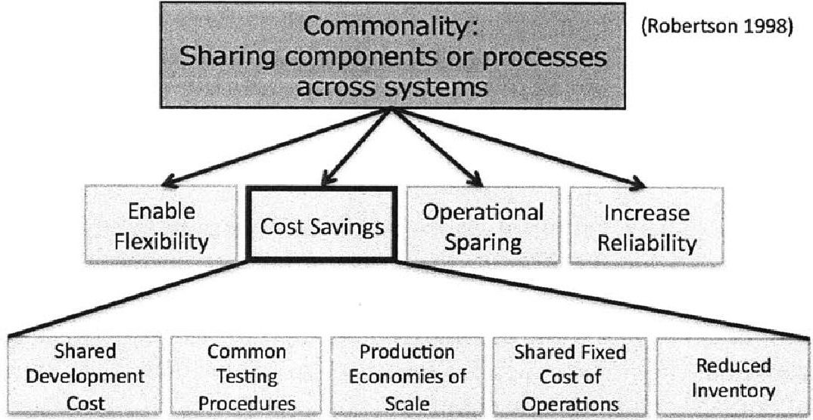

Figure 1 Tree diagram defining commonality benefits for cost saving

Achieving these commonality benefits requires investment. The primary investment often takes place before or concurrently with the lead variant, where additional development time and cost is required to design systems that meet the union of the constituent requirements. Subsequent investment is required in each lifecycle phase

<!-- PDF_PAGE: 14 -->

- building shared test facilities, shared manufacturing tooling, shared inventory systems, share operations facilities, etc. The final investment category is in integration of common systems, where later variants incur costs to match interfaces and calibrate system behavior with common systems they inherit from earlier versions.

This dissertation is scoped to cover all of these phases of investment or cost, and to include only the benefits which pertain to financial savings as a result of commonality.

## Commonality Challenges

The chances of successfully implementing a commonality strategy can be significantly increased by developing accurate commonality cost projections early on in the project lifecycle. However, there are many challenges involved in implementing commonality, all of which have cost implications.

Chief among these challenges is divergence, or decreases in commonality. Divergence has been shown to occur in a number of industries, include aerospace. It has both beneficial and detrimental aspects, as documented in Boas (2008). From a cost perspective, divergence should reduce the savings expected from commonality, and may also reduce the investment required.

Commonality also faces challenges from lifecycle offsets. As mentioned previously, many commonality strategies develop variants sequentially, rather than concurrently, in order to flatten the budget profile required. However, this sequencing makes it more difficult spread commonality investment and other costs across all variants. Lifecycle offsets also make it difficult to maintain consistent commonality 'ownership' - a individual centrally responsible for publishing a current specification, weighing change proposals, and retaining system knowledge.

At a basic level, costing requires aggregating information from many different departments. Cost estimators often request cost data from individual variants. Even with Program-level investment in commonality, lead variants have incentives to over-state their costs to pad their estimates or correct perceived Program optimism. Efficiently coordinating information exchange up and down the hierarchy is a constant challenge to commonality costing.

Finally, large platforms often span decades, and associated with long timelines, face significant uncertainties. These include external drivers, such as demand uncertainties, competitive response, and changing customer requirements, but also internal sources, such as in the extent of learning effects, technology development timelines, technology fit, and others. These uncertainties amplify the impact of other challenges - for example, changing commonality levels, whether by adding or subtracting, faces significant organizational resistance in these large programs.

<!-- PDF_PAGE: 15 -->

Arguments for commonality benefits in large, generational projects are bound to be weaker, as the comparison of commonality benefits is hindered by generational differences.

## Framework Elements

The framework presented below is intended to cover the full scope of commonality decisions that depend on financial information or have implications for cost.

At the highest level, the phases of product development that connect to questions of commonality cost can be grouped into Cost Estimating (before the program), Setting Incentives (at the beginning of the program) and Decision Making and Control (during the program). Therefore, there is an up front process of estimating the benefits and costs of commonality - this is the most traditional concept associated with the topic of costing commonality. The key recognition for the framework is that this up front process is not the only relevant aspect of product development. Early decisions in the program create strong incentives, which will measurably impact what costs arise. Additionally, commonality costs are continually being estimated and monitored during development (and after), and must be examined separately from the up-front question of cost estimating.

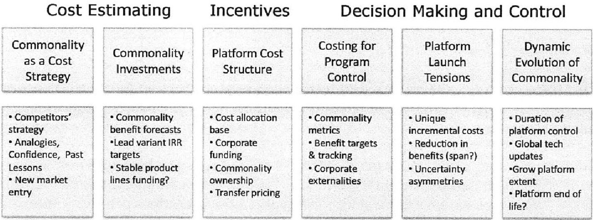

Figure 2 Commonality cost framework

We then sub-divide several of these categories.

Cost estimating is sub-divided into Commonality as a Cost Strategy and Commonality Investments, to explicitly recognize that many firms in this study noted they initiated commonality planning or discussions on the basis executive experience or strategy positions. This is a fundamentally separate decision-making process from Commonality Investments, which provides a rational calculation of cost and benefits. Commonality as a Cost Strategy is intended to represent the political and cultural aspects of the decision-making, incorporating past intangible experience.

<!-- PDF_PAGE: 16 -->

Incentives is represented singularly by the Platform Cost Structure. We will examine the impact of cost allocation, funding source, and other ancillary costs that compose the cost structure to determine how financial incentives impact the program.

Decision making and Control is sub-divided into three categories. The first is Costing for Program Control, which asks the question "What commonality information related to program control is being tracked, and generally, how is that information incorporated into decisions?". Subsequently, we have Platform Launch Tensions, which captures specifically how opportunities for divergence are treated during the initial platform development. The intent is to examine which costs of divergence are included, whether changes to benefits are projected when commonality changes, and analyze how these downside effects are compared against the beneficial aspects of divergence.

Finally, Dynamic Evolution of Commonality captures decisions around platform extent, divergence through variant addition, and divergence through product updates, all of which occur after the initial platform development. This category captures questions around "What complexity will be added to the platform if we create a new variant?", "How should technology or product updates be pursued across the platform - individually by variants, or globally?", and "What criteria should be used to determine when the platform has been exhausted?".

## Framework Use

This framework is explicitly used to frame the literature review, in order to ensure that the full scope of commonality cost implications under the research question are highlighted.

Additionally, the observations and the results of the thesis can be sequenced in time by placing them within the framework. This is done in the graphical representation of the framework above, where select observations and questions are given in boxes below the 6 framework elements.

The cases and the cross-case analysis are not explicitly structured according to the framework, because their purpose is to examine specific research questions and behaviors, and these were more consistently presented in a logical order (as opposed to a chronological order).

We will return to the framework in the conclusion of this dissertation, in order to frame the most important observations and results.

<!-- PDF_PAGE: 17 -->

## Chapter 3 Literature Review

The function of this chapter is to place the dissertation in context of the work performed directly on the topic in the field previously, as well as provide a summary of the input streams of knowledge that are newly brought to bear on the topic in this dissertation.

## Background on Commonality

Commonality has been variously defined through the literature with definitions ranging from narrow parts-based definitions to broad process-based definitions. The diagram below uses one of these broad definitions - commonality is the sharing of components or processes across products (Robertson 1998). In this thesis, we will use broad definitions, as we are interested in the direct and indirect benefits associated with commonality. More detail on other commonality definitions is provided under Measuring Commonality, to illustrate how the choice of definition has important implications for the scope of benefits considered.

Among many benefits, commonality enables cost savings -utilizing a platform enables firms to spread fixed cost investments in manufacturing equipment, and boost unit volumes, enabling learning curve benefits and variable cost savings. The diagram below is intended to illustrate that cost savings is but one of the benefits possible under commonality.

<!-- PDF_PAGE: 18 -->

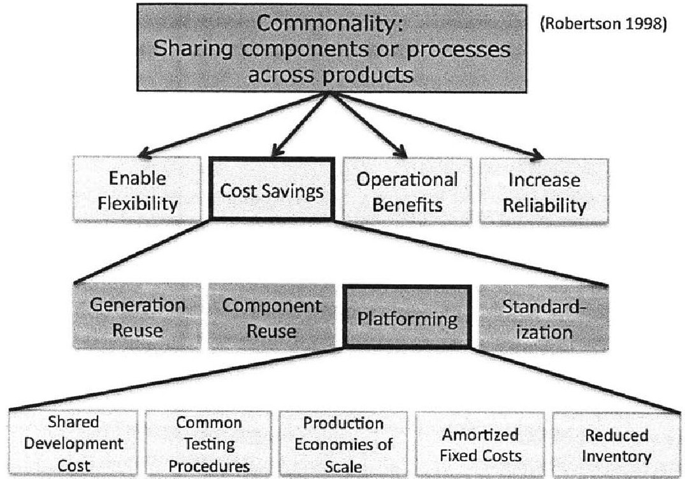

Figure 3 Tree diagram showing divide between intentional and unintentional commonality

The literature on commonality and platforming can be subdivided into 3 categories (Boas 2008):

- General Management Literature on Product Families

- Quantitative Management Models of Commonality

- Engineering Literature on Design and Optimization of Platforms

Boas (2008) is describes on how benefits and penalties of commonality are expressed in each of these categories of the literature, with a focus on what benefits are included. We focus the following literature review instead on how the benefits of commonality are used, projected, and evaluated. To these ends, we examine both the commonality literature and other relevant disciplines in each of the categories of the framework.

## Commonality as a Cost Strategy

The discussion of platforming and commonality as a strategy is perhaps best illustrated in the context of tradeoffs posed by this choice of strategy, as revealed in the literature. These tradeoff arise from conserved parameters and shared efforts examining them provides a starting point for examining cost dynamics.

In platform development, there are a number of high-level tradeoffs posed at the beginning of the platform development. The tradeoffs key off of the main architectural parameters, such as number of variants, range of performance, sequencing of variants, and degree of commonality. In turn, these decision about these parameters are made about the expected markets for the variants, whose

<!-- PDF_PAGE: 19 -->

relevant characteristics here are performance requirements, willingness to pay availability / timeliness. The market 'causes' the first set of tradeoffs we explore.

## Tradeoffs Caused By The Market

Firms create multiple variants for market reasons. Customers grouped by similar pricing and performance expectations can represent sub-markets, which if served individually can represent greater overall profit than producing a product with serves their average expectation. Meyer and Lehnerd (1997) describe a process for segmenting a market using a grid tool, illustrating a number of different strategies for spreading commonality investment across a range of product prices and market segments. This in turn creates the threat of cannibalization (Sanderson 1995, Kim 2000), where customers with higher willingness-to-pay can meet their performance requirements by buying the lower-performance product. Sanderson (1995) describes a case in the DRAM market, illustrating how sales trajectories can show both within-platform cannibalization and generation to generation platform cannibalization. Absent detailed customer data allowing the manufacturer to bucket variant sales by segment, cannibalization can be weakly inferred from sales trajectories and product introduction timing, but the quality of the inference varies. Variants that are closely spaced are easier to platform, but are at greater risk of cannibalization. Viewed from the other perspective, Nelson (2001) describes how overdesigning lower level variants can place acquisition and maintenance costs above the reach of some customers, thus decreasing expected platform volume and profitability.

In addition to the threats to sub-markets created by platforming, there is an overall brand threat. Cook (1997) notes "ironically GM's market share relative to Ford only began to recede in the mid 1980s as GM's brands - Chevrolet, Pontiac, Oldsmobile, Buick, and Cadillac became less distinctive through the use of common platforms and exterior stampings that reduced product differentiation." (reproduced from de Weck(2006)). The concept of a tradeoff between perceived product differentiation (and its effect on sales) and the benefits of platforming is a difficult one to measure, in that brand is influenced by many factors, and the signal from product differentiation is spread among the timings of the individual variant introductions.

The idea of flexibility of platforms is related, in that platforms can create opportunities for future variants, opportunities which are only revealed over time. The existence of a relevant platform can speed time-to-market, and also reduces development cost for the variant. While flexibility might be outside the scope of the question (intent to develop future product vs. intent to enable future product), I'll quickly highlight that there are existing tools for comparing flexibility's benefits against costs. Namely, Triantis (2000), Otto (2003), Jiao (2006), and Rhodes (2010) and have framed commonality as a real option.

<!-- PDF_PAGE: 20 -->

## Internal Tradeoffs

Thus far, we have described the tradeoffs with external influences. There are also a number of tradeoffs that emerge through the development cycle. For example, firms often desire flat development budget profiles. If the concurrent development of the platform and all of its variants doesn't fit under this flat budget, a common technique is to phase variant development. Boas (2008) describes the tradeoff created between phasing development and divergence from the platform exacerbated by the offset. Cusumano (1998) describes a set of strategies for phasing development (ranging from parallel to sequential), highlighting how an overlapping development phases, which he titles 'rapid design transfer strategy', can strike a balance in this tradeoff. Additionally, Cusumano (1998) highlights how development headcount time series represent a possible measurement of the phasing of development effort.

In so far as platforms are large product developments, they embody a whole host of constraints (not specific to platforms). Personnel constraints create constraints for platforms, in that faster ramp up and ramp down times come at the expense of challenging training and quality. Existing manufacturing facilities constrain total capacity and inventory. Past capital equipment constrains current production methods as well as future capital availability. These factors apply broadly to product development, so we do not explore in depth here - where appropriate, they are raised in conjunction with specific platforming issues.

## Benefits and Penalties

Boas (2008) framed these tradeoffs as a comparison of the benefits and penalties of platforming. His review of the general management literature on benefits and penalties is summarized below.

Meyer (1997) cites several potential benefits, including enabling future rapid product introduction, increase model introduction rate, decreased development cost, economies of scale in manufacturing, and faster introduction of new technology into existing product lines. Meyer notes possible penalties, including commonality risk (a failed common component has a broader footprint) and capability penalty (unwanted cost of higher capability common components in lower-priced variants).

Meyer and Utterback (1993) are "more focused on the dynamic nature of an underlying product platform and on the broader picture of a firm's evolving capabilities" (Boas 2008). Benefits listed include eliminating redundant technical and marketing effort and introducing multiple products simultaneously.

Robertson and Ulrich (1998) frame platform development in the context of two primary activities: similarity analysis and distinctiveness analysis. They assert that these are mutually exclusive through their impact on revenue and cost. In addition

<!-- PDF_PAGE: 21 -->

to the benefits and penalties listed in Meyer (1997), they include shared investment in equipment, and reduced complexity costs associated with materials and logistics. This model of complexity cost implicitly asserts that the overhead of owning and managing common parts is less than the complexity cost of many parts. Robertson and Ulrich explicitly recognize increased complexity cost of platform development. Boas (2008) notes that Robertson and Ulrich omit consideration of platform risk - the increased cost of initial platform development relative to unique.

Boas (2008) discusses the literature treatment of lifecycle offsets in depth, noting papers by Fricke and Shulz (2005) and Rothwell and Gardiner (1988) as examples of design strategies for future market uncertainty. Overall, Boas (2008) notes that management literature has a net positive bias towards platforming and its benefits. Additionally, he notes a focus on concrete benefits that can be tied directly to parts commonality, although the referenced literature includes references to shared processes.

Embedded in the notion of benefits and penalties in the management literature is the idea that managers weigh these factors when making rational decisions. As compared to the more quantitative literature on commonality, the diversity of benefits in the management literature is broad by comparison, and is most likely to discuss commonality decision making as grounded in organizational structure. As a potential frame of reference, van Maanen's organizational decision-making separates decisions into rational strategic, political, and cultural. The rational strategic frame is dominant in the management literature. However, political decisions (the embodiment of organizational power or position) are also referenced, such as in Cusumano's (1998) discussion of heavy-weight program managers. Cultural decision-making is referenced in passing, such as creating a culture of reuse, but has not been the subject of much descriptive work. In this dissertation, decisions are dominantly framed under investments, as discussed in the following section.

Boas (2008) also reviews the Quantitative Management literature from the management science community. Fisher, Ramdas and Ulrich (1999) explicitly trade between costs and benefits of commonality using a mathematical model, finding broader performance spreads and larger production volumes both lead to larger numbers of component types. Boas (2008) notes their model does not include economies of scale, and considers a fixed architecture with no offsets.

Ulrich and Ellison (1999) provide an empirical examination of reuse vs new design strategies. They find a cost of commonality as poorer holistic performance relative to optimal design using product satisfaction surveys.

Krishnan (1999) and Krishnan and Gupta (2001) construct profitability models of commonality penalties and benefits. They explicitly capture "the trade between economies of scale and increased costs associated with excess capability". Although

<!-- PDF_PAGE: 22 -->

their models allow families to grow in numbers of variants, no evolution of the platform is allowed.

Based on the above sources, a list of the benefits of commonality was built from the literature provided.

## Builder benefits

- Reduced development cost on later variants

- Shared testing equipment investment

- Learning effects in testing - fewer labor hours / unit

- Shared manufacturing equipment and tooling investment, or the ability to move to higher volume production methods

- Learning effects in manufacturing - fewer labor hours/unit

- Fewer internal quality control rejections

- Reduced external testing / validation (ex. aircraft type certification)

- Reduced sales and logistics effort against fewer configurable options

## Builder or Purchaser benefits

- Reduced purchasing cost (bulk discount from suppliers)

- Lower inventory for production and sparing (fixed storage cost and variable acquisition and maintenance costs)

- Lower training expense (fixed capital cost and variable hours)

- Shared fixed cost of operations / support

- Learning effects in operations / support (lower service time / cost)

- Slower replacement rate for spares from higher quality / better design (overlaps with inventory saving, includes reliability)

The list above conforms with the scope of this dissertation - benefits which relate directly to cost savings intent. A broader review of benefits is included below.

<!-- PDF_PAGE: 23 -->

<table border="1"><tr><td>Phase</td><td>Benefit</td><td>Reason</td></tr><tr><td>Strategy</td><td>Enable faster variant time to market</td><td>The common portion of the design has already been built, so only the unique portion has to be designed</td></tr><tr><td>Design</td><td>Shared development cost(Intended Commonality)Reuse of already designed components and systems(Unintended Commonality)Reuse of proven technologies</td><td>Reduced engineering effort required for later variantsDesign effort does not need to be repeatedReduces technology risk and mitigation cost</td></tr><tr><td>Manufacture</td><td>Shared toolingLearning curve benefitsEconomies of scale in manufacturingBulk purchasingReduced inventoryReduced quality expenseFlexibility in variant volumes(for a fixed platform extent)</td><td>Tooling cost can be spread over more productsFewer hours/unit requiredEnables movement to higher volume methodsDiscounts from suppliers for larger orders of same partLower safety stock levels due to demand aggregationFixed quality expenses spread over larger volumeEnables the firm to adjust to variant demand changes</td></tr><tr><td>Testing and Commissioning</td><td>Reduced testing and commissioning timeShared testing equipmentReduced external testing/ certification</td><td>Learning in test procedures for later variantsTesting equipment can be spread over more productsReuse of type certificates or regulatory approval</td></tr><tr><td>Operation</td><td>Reduced sustaining engineeringDecreased fixed costs from shared facilitiesDecreased operator trainingEconomies of scale in operationsBulk purchasing of consumablesDecreased variable costs due to more efficient logistics and sparingSlower replacement rate for spares(higher quality)Flexibility in operationsShared inspections/ recurring regulatory compliance</td><td>Number of parts to be sustained is reducedSharing of facility cost across more productsOperator learning on common parts reduces trainingMove to higher volume operating proceduresDiscounts from suppliers for larger order of same partsReduced inventory for operationsFewer spares must be purchasedAbility to switch operating staff between productLower cost and less time required for regulatory compliance.</td></tr></table>

Figure 4 List of all commonality benefits

Note that the benefits in operations are analogous to the benefits in the prior 4 phases. The chart below shows a 1-1 mapping of operations benefits to previous benefits, with the type indicated as a general categorization of the benefit.

<!-- PDF_PAGE: 24 -->

<table border="1"><tr><td>Phase</td><td>Type</td><td>Benefit</td><td>Operations Analogy</td></tr><tr><td rowspan="3">Design</td><td>Non-Recurring Labor</td><td>Shared development cost
(Intended Commonality)</td><td rowspan="3">Reduced sustaining engineering</td></tr><tr><td>Non-Recurring Labor</td><td>Reuse of already designed components and systems(Unintended Commonality)</td></tr><tr><td>Technology Reuse</td><td>Reuse of proven technologies</td></tr><tr><td rowspan="7">Manufacture</td><td>Capital</td><td>Shared tooling</td><td>Decreased fixed costs from shared facilities</td></tr><tr><td>Capital</td><td>Economies of scale in manufacturing</td><td>Economies of scale in operations</td></tr><tr><td>Volume</td><td>Learning curve benefits</td><td></td></tr><tr><td>Volume</td><td>Bulk purchasing</td><td>Bulk purchasing of consumables</td></tr><tr><td>Volume</td><td>Reduced inventory</td><td>Decreased variable costs due to more efficient logistics and sparing</td></tr><tr><td>Quality</td><td>Reduced quality expense</td><td>Slower replacement rate for spares(higher quality)</td></tr><tr><td>Flexibility</td><td>Flexibility in variant volumes
(for a fixed platform extent)</td><td>Flexibility in operations</td></tr><tr><td rowspan="3">Testing and Commissioning</td><td>Non-Recurring Labor</td><td>Reduced testing and commissioning time</td><td>Decreased operator training</td></tr><tr><td>Non-Recurring Labor</td><td>Reduced external testing/ certification</td><td>Shared inspections/ recurring regulatory</td></tr><tr><td>Capital</td><td>Shared testing equipment</td><td></td></tr></table>

Figure 5 Comparison of analogies to operations benefits

Although the costs of commonality are less frequently the focus in the general management and quantitative management literature, the overall headings have been identified. Boas (2008) and Rhodes (2010) built a list of the costs of commonality as follows:

- Development Penalties

Development coordination costs

Design complexity premium

Integration penalty

- Production Penalties

Capability penalty to producer

Labor complexity penalty

- Operations Penalties

Capability penalty to operator

Decreased performance penalty resulting from design compromises

A slightly more nuanced version of this list was created for this thesis from the literature sources listed above.

<!-- PDF_PAGE: 25 -->

<table border="1"><tr><td>Phase</td><td>Drawbacks and Costs</td><td>Non-Reccuring or Recurring</td></tr><tr><td rowspan="5">Strategy</td><td>Constraining future investment to platform extent</td><td>NR</td></tr><tr><td>Development plan risk from shared components</td><td>R</td></tr><tr><td>Brand risk from lack of differentiation</td><td>R</td></tr><tr><td>Risk of cannibalization</td><td>R</td></tr><tr><td>Risk of monopoly by common system provider</td><td>R</td></tr><tr><td rowspan="4">Design</td><td>Investigating technical and economic feasibility</td><td>NR</td></tr><tr><td>Design premium for satisfying multiple needs</td><td>NR</td></tr><tr><td>Costs of integration</td><td>R</td></tr><tr><td>Commonality management overhead</td><td>R</td></tr><tr><td rowspan="4">Manufacture</td><td>Increased cost of common items due to capability penalty (materials cost and labor cost)</td><td>R</td></tr><tr><td>Increased complexity of configuration management on the manufacturing line</td><td>R</td></tr><tr><td>Carrying costs of production assets with higher than necessary initial capacity (offset development)</td><td>NR</td></tr><tr><td>Commonality management overhead</td><td>R</td></tr><tr><td>Testing and Commissioning</td><td>Cost of creating more capable test environments</td><td>NR</td></tr><tr><td rowspan="3">Operation</td><td>Increased complexity of operating a multi-purpose item</td><td>R</td></tr><tr><td>Carrying costs of operating assets with higher than necessary initial capacity (offset development)</td><td>NR</td></tr><tr><td>Commonality management overhead</td><td>R</td></tr></table>

Figure 6 Commonality drawbacks and costs

Not all of these costs are expected in all commonality projects - for example, commonality may reduce the labor content in assembly, rather than increase it. None of these penalties are new. For example, the notion of capability penalties in common developments is not new - Nobelius (2002) identifies capability penalties in sequenced development programs, noting the "trade off between reduced complexity in assembly and the increased purchase cost for a robust cable web design". Thoneman and Brandeau (2000) discuss the potential impact of commonality on production complexity. The challenge in making commonality strategy decisions is that many of these costs are indirect, rather than direct labor hours. The next section describes the available knowledge in the literature around assigning values to these concepts.

There are several completeness checks that can be run on the benefits listed. The work above listed the union of previous literature and academic work on commonality. Further, the benefits identified in the research cases were all contained in the list. Additionally, we worked through the functional organizations in the cases to examine no benefit was left out, and also through the line items in a project's finances. Finally, one could imagine tracing a product through the production system, an exercise which was conducted.

<!-- PDF_PAGE: 26 -->

## Commonality Investments

The focus of this dissertation is not to develop a detailed cost model. There is a clear tradeoff between the depth of modeling and the applicable breadth - producing a very detailed model would not be conducive to extracting broad trends concerning the realities of commonality execution. The focus herein is to describe the realized costs of commonality changes and to begin to identify the mechanisms that link commonality decisions to their cost implications.

To these ends, the literature is examined for costing methods, practices, and tools, in so far as this body of work captures relevant knowledge for commonality cost. However, a detailed survey of cost modeling practice is not provided where the practice is highly industry, technology, or process-specific.

As discussed in Commonality as a Cost Strategy, Boas' [2008] review is focused on listing which benefits and penalties are included or not included in each section of the literature. Several other directions are available for comparing these benefits and penalties:

1. Statistical examination of balance of benefits and penalties

2. Explicitly costing both benefits and penalties on a project

3. Investments: Under what conditions is commonality an investment? What are the risks and returns?

4. Decision making factors: Do managers make rational comparisons of costs and benefits? What other factors influence decision making, such as analogies? How do the relative certainty of benefits and costs influence behavior, such as risk aversion or gambling and agency?

5. Organizational factors: How is team structure and divergence likely to impact cost and benefit realization?

6. Corporate Externalities: Expand scope to include costs and benefits to the corporation at some burden rates

7. Discrete decision points over time for variant development - consider future variant development as a real option

Boas (2008) makes advances in #2, #3, #4, #5 through the dissertation, but focuses the literature review on #2. All 7 have relevance for commonality investment decisions, but only #1-3 are directly of concern for this section.

Relatively little statistical research is available on the performance of commonality as a cost saving strategy. While the management science literature described includes several profitability models (Krishnan and Gupta 2001, Fisher, Ramdas and Ulrich 1999), and in select cases, the models are populated with accurate cost data, these models are not designed to generalize about the profitability of platforms. Rather, they are normative tools, intended to facilitate decision making on a given platform. A number of individual data points are available from one-off cases, in terms of savings or benefits, but these are rarely compared with the unique cost

<!-- PDF_PAGE: 27 -->

given the challenges of the counter-factual. For example, Boas (2008) notes that development costs were for subsequent variants were reduced (15% of lead variant cost for Company E, 50% of lead variant cost for Company F). The challenge in comparing these individual data points is that cost savings is not the sole benefit provided by commonality strategies, and thus a sample might include nonhomogenous data - for example, some projects will have foregone cost savings in lieu of revenue gains, whereas others will have pursued only cost savings.

Tatikonda (1999) conducts one of the few statistical studies on platforms. He aims to understand the difference between lead variant development and derivative variant development, which he titles "platform projects" and "derivative projects". This premise implicitly assumes some degree of lifecycle offset, and assumes that common elements are developed in the context of a lead variant, not independently or in parallel with several variants. Tatikonda rejects the hypothesis that lead variants are less successful than derivative variants, based on a survey of 108 variants. The measure of success is 'achieving project objectives' and 'customer satisfaction', not return on investment specifically. Additionally, Tatikonda's scale for identification of lead and derivative variants conflates the ideas of commonality with the ideas of project scale - in effect assuming that derivative variants are small projects. As the unit of analysis is variants, Tatikonda does not render results on platforms as a whole. The study does not engage in a discussion of benefits and penalties, other than to note that "contingency planning" is correlated with success for both lead and derivative variants.

The only study identified which made mention of potential negative consequences of platforming was Hauser [2001], where profitability was found to be negatively correlated with platform reuse for n=16 products within an office-supply firm. The product variety literature contains empirical studies of product families - Ulrich, Randall, Fisher, and Reibstein [1998] find "for low-quality segments, brand price premium is significantly positively correlated with the quality of the lowest quality model in the product line" (Ramdas 2003) - but these families are not necessarily examples of commonality strategies, as it is possible to produce a family with escalating performance and price without employing commonality. Broader examination of past work on cost growth for the potential inclusion of divergence as a factor is discussed later in the literature review.

## Finding

Existing data on the profitability of platforming strategies is sparse and conflicted.

Comparisons of strategy effectiveness in the component standardization literature are more common, perhaps because the cost effects can more linearly be separated from the revenue effects of platforming. Labro (2004) describes three broad research streams on component commonality cost:

<!-- PDF_PAGE: 28 -->

1. Effect of component commonality on inventory levels. Baker (1986) initially identified the potential benefit, driven by risk pooling, resulting in reduced safety stock levels.

2. Other internal firm costs influenced by component commonality.

3. Influence of market effects - relaxation of the assumption that component commonality is independent of revenue. (Kim and Chhajed 2000, Desai et al 2001, Jans 2007).

While statistical studies across firms were not evidenced in the literature search, individual data points at the strategy effectiveness are plentiful. For example, Pollack (1992) states "Nissan expected to save 3% of its cost by reducing the number of parts is uses by 30% in the next 3 years" (Kim and Chhajed 2000).

Although it is widely recognized in the commonality literature that commonality benefits come at the cost of commonality penalties, commonality is not universally framed as an investment. Specifically, the term investment implies time-value of money and the expectation of a return exceeding a hurdle rate (NPV>0, IRR>12% etc). As discussed below, it is not uncommon in the Engineering Literature on Design and Optimization of Platforms to compare benefits against costs, but the assumption of parallel development is often made. Commonality investments is an important concept when benefits are skewed to later lifecycle phases. Further, the prevalence of lifecycle offsets (Boas 2008) implies greater separation between investment and returns.

Early work by Meyer & Lehnerd (1997) discussed the potential benefits and penalties of commonality, but as Boas (2008) notes, trades among benefits and penalties are not provided. Robertson & Ulrich (1998) suggest economic analysis for evaluating commonality strategies, but only provide a simple model separating development cost, tooling cost, and manufacturing cost without a methodology for estimation. The general management literature on commonality is not centrally focused on producing a cost model.

Jans (2007) frames a component commonality decision in terms of a NPV investment problem involving both revenue and cost, but develops a model dominantly focused on revenue gains as 'return', rather than downstream cost savings. Lifecycle offsets are not considered. Desai (2001) notes that commonality can save later development costs, as well as downstream manufacturing costs, but then states too broadly "manufacturing costs always decline with the use of commonality", and fails to incorporate the time value of money in the model they produce. Boas (2008) uses the term commonality investment frequently, but given a focus on holistic decision-making, does not compute returns on commonality investments.

Ward (2010) takes a sophisticated operations research approach to the complexity vs. variety trade in product families at HP. They propose an ROI hurdle for new variant introduction, defined as the incremental margin less the variable platform

<!-- PDF_PAGE: 29 -->

costs over the fixed platform costs. This measure does not discount costs over time, and does not apply to a family as a whole, but does conceptually use the term investment.

A number of normative cost models are available within the Engineering Design literature on commonality. Simpson (2003) reviews 32 papers in the Engineering Design literature, of which 14/32 considered cost as a factor. These models often include a subset of benefits convenient for analytic tractability. For example, Fujita (2002) compares development cost against production cost using the simplifying assumption that more commonality implies lower development cost. Nidamarthi and Karandikar (2006) notes that ideally an Activity Based Costing model would be used for commonality optimization, but given its level of detail, a simplified fixed variable cost model is constructed. Some of these models are coupled to design parameters for simultaneous costing and design optimization. Simpson (2004) covers numerous efforts to optimize platforms relative to market demand, design criteria, and production cost. As Boas (2008) notes, "insights are often couched in the context of a specific application [...] making the extraction of generalized insights [...] somewhat challenging". The function of cost models in the Engineering Design literature is to provide an optimization objective function, not to process and evaluate a corporate investment.

Kogut (1999) offers the closest match to the commonality investment concept, but is truly on the perimeter of the commonality literature, on the border with much broader management topics of "core competencies". A very holistic discussion is offered - the paper is not data focused. The term platform is used very loosely, covering physical assets from which derivate variants can be constructed as well as firm capabilities in design and management. The detailed trades of commonality (performance against unit cost, capability penalty, etc) are not covered at all. The paper emphasizes platforms as real options on future market needs, and suggests that valuation of near term benefits of commonality to the exception of long term benefits will lead to under investment in commonality. Kogut (1999) also discusses devaluation of investment returns as a result of competitor actions (a key link between revenue and cost sides of commonality that is infrequently discussed), but focuses discussion on the lost revenue rather than on the write down of unamortized platform costs.

## Finding

The concept of commonality as an investment has been not been explored in light of lifecycle offsets, with respect to the division of investment and the division of returns among variants

None of the papers reviewed in the broader commonality literature identified issues around allocation of commonality investment to variants or differential return

<!-- PDF_PAGE: 30 -->

targets for lead variants. The word 'investment' is frequently used to describe the R&D costs associated with common development programs, but the use of discount rates was sporadic and judged unimportant, while the use of payback period comparison, risk - return analysis and other traditional investment evaluation methods was nonexistent.

Before concluding commonality investments, a brief note on the discipline of cost modeling, as it pertains to commonality. The cost modeling literature is built on large databases of historical costs. Two broad methods exist - reasoning by similarity (Valerdi 2010) and costing by activity (Park & Simpson 2005).

Cost modeling by similarity involves sampling similar projects, then scaling those costs according to known relationships (such as weight to cost for aircraft). These methods are heavily dependent on appropriate historical data, i.e. similar technology risk, constant productivity, etc. Little data exists on commonality as an independent variable. Literature in this discipline is often of poor quality, as firms derive market power from large fixed cost investments in databases, and thus see few benefits to publishing.

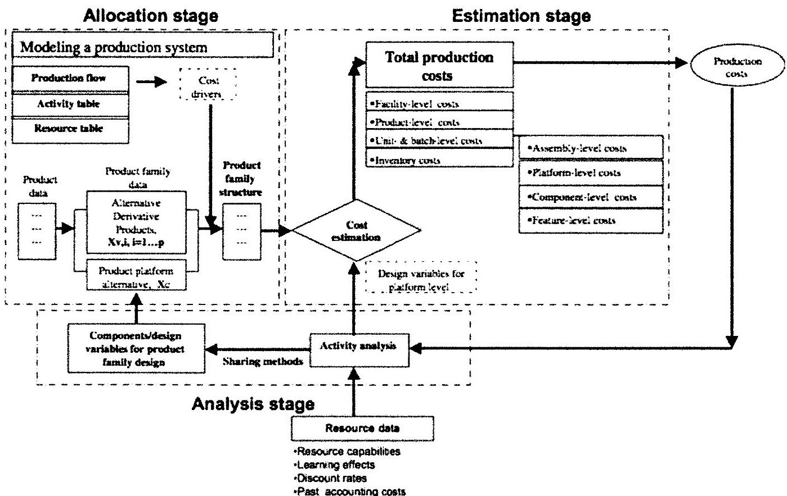

Figure 7 Park (2005) Production cost estimation for platforms

Cost modeling by activity is a very industry- (and firm-) specific task. It involves decomposing platform development and / or manufacturing into discrete tasks, estimating the rate of consumption of resources (5 FTEs / drawing, 10 machine hours / part), then multiplying by known costs (1 FTE = $100K/ year, 1 machine hour = $10K). The weakness of this approach, as with all bottom up estimates, is

<!-- PDF_PAGE: 31 -->

that the cost is presumed to scale linearly with a set discrete tasks, thus ignoring complexities of the development and production processes like cascading schedule delays. For this reason, costing by activity estimates are frequently adjusted after the fact at the top level by judgment. Park & Simpson (2005) discusses an activity based costing approach for production commonality - we discuss this under Platform Cost Structure, as the approaches to activity based costing tend to focus more on program control than on up front cost estimation.

Boas (2008) produced a preliminary cost model of commonality based on sharing fixed costs associated with common components, but did not place any historical costs in the framework, or suggest how the model could be used to estimate future costs.

Further detail on cost modeling can be found under Niazi (2006), who describes several options for estimating and classifying production costs, but without specific reference to platforming. These approaches include reasoning from similar known cost cases, process-step based costing, parametric analysis of past program costs, allocated operation cost of machinery, and activity-based costing.

The review of commonality literature covered which benefits and penalties were included in cost estimates. As noted above, forward projection of these benefits and penalties is often a closed process, highly industry-specific, or both. The relevant detail to this dissertation is therefore the broad parameters which influence how investments are allocated against benefits, not how these benefits are calculated. The separate topic of how the sharing inherent in commonality is allocated to costs is relevant to cost estimation, but is more relevant to program control, and is therefore discussed under Costing for Program Control.

## Platform Cost Structure

As described in Chapter 2, the cost structure of the platform organization determines the incentives and dis-incentives for commonality. The previous section noted that commonality has not been framed in investment terms in the literature. In addition to the concept of investment, we now ask what work in the literature addresses platform cost structure - how are the full lifecycle costs (not just the premiums paid for common systems over unique systems) divided among variants, how does the choice of allocation influence behavior, how does ownership impact behavior, etc.

No references have yet been found to describe how platform development costs have historically been allocated among products, therefore there is an opportunity to describe the different allocation bases used.

Work in the commonality literature has focused on cost allocation for the purpose of production cost estimation, rather than for program structuring or control. Park &

<!-- PDF_PAGE: 32 -->

Simpson (2005) used activity-based costing to develop a production cost estimation framework. They create a hierarchy of costs ranging from unit costs to facilities costs, into which common costs and unique costs can be slotted. Park and Simpson (2005) provide a detailed breakdown of production costs as a mechanism for measuring the benefit from commonality, and also list 6 different levels of 'sharing' across platforms in production, ranging from partial feature sharing to facility sharing. By structuring costs in a hierarchy, they recognize that the size of the pool determines how broadly a cost is shared. However, Park and Simpson don't take the next step to argue how the firm's cost structure influences platform incentives, or how the choice of platform cost allocation may influence behavior.

Fixson (2006) notes that a number of supporting costs reductions are also achieved under commonality, through lower inventory numbers and lower product support activities, highlighting that commonality can have positive externalities on corporate overhead. Fixson (2006) does not discuss the counter-case, where platforms use centralized resources below cost, imposing negative externalities. Regardless, Fixson (2006) points out that any platform cost accounting system must span enough firm functions to include the hypothesized mechanisms by which platforming reduces costs. Notably, if a platforms enable economies of scale by boosting production number of non-platform components, thus enabling fixed costs to be spread more broadly, these advantages should be captured in the platform cost structure.

The concept of corporate externalities is related to literature on complexity and product variety. While the product variety focuses almost exclusively on the revenue side of variety and does include the challenges that arise with commonality, the complexity literature focuses on cost. Ramdas (2003) notes "Increased variety typically increases operational complexity, which in turn raises costs (MacDuffie, Sethuraman, and Fisher 1996). Conceptually, the actual degree to which variety impacts costs is a function of a firm's inherent flexibility (see Suarez, Cusumano, and Fine 1991 for a review of flexibility)."

Investigation into complexity costs can arguably be said to originate with Cooper and Kaplan [1988], which is aptly titled How Cost Accounting Distorts Product Costs. They refer to complexity cost as diseconomies of scope, argue against the use of direct labor as an allocation base (particularly in industries with increasing automation) and against production volume as an allocation based (mixes of high and low volume product lines cause high volumes products to subsidize low volume products). This work generated much of the initial momentum around activitybased costing. Additionally, Cooper and Kaplan suggest unique part numbers as an allocation base for materials overhead, to recognize the overhead activities associated with the creation and maintenance of part numbers.

Labro (2004) provides an excellent overview of the work done on complexity since 1988. Her focus is on component commonality, as opposed to higher levels of commonality in the platform architecture, and her disciplinary lens is management

<!-- PDF_PAGE: 33 -->

accounting. The primary contribution of her paper is a comparison of the directional effect of commonality - i.e. does increasing the number of common components increase the cost per component? She finds that "while for some cost categories even the sign of the relationship between component commonality and cost is unclear, the slope of the relationships between component commonality and both cost [ex. cost / supplier] and driver [ex. number of suppliers] use is definitely unknown", citing conflicting evidence provided from different papers.

While Labro's work indicates that the generalized complexity cost of commonality cannot be discerned from correlations of costs and drivers, her hierarchy may provide a starting point for classifying complexity costs. For example, complexity costs associated with the pricing of units, as compared with complexity costs of suppliers. The failure mode of this hierarchy is its assumed linear nature - phenomenological effects and non-linearities such as delays will not appear. Wilson and Perumal (2010) provide a contrasting, practitioner's view of complexity as relates to commonality, describing feedback among organizational complexity, process complexity, and product complexity. Their methods for evaluating complexity cost relies on adjusting fixed costs using different allocation bases (which are implied but not specified). While intriguing, their process is neither sufficiently detailed or sufficiently rigorous to bear testing.

One of the more interesting connections noted in Labro (2004) is the work on engineering changes by Ho and Li (1997), who find that increasing commonality also results in higher probabilities of engineering changes. This is noted, as the platform cost structure determines some of the organizational control related to engineering changes - i.e. what breadth of costs are tagged to engineering changes. This suggests that the research design should capture change costs of as a potential variable within platform cost structure.

A related topic to cost allocation and cost structure is transfer pricing. There is a vast literature on transfer pricing, ranging from supply chains transfer prices for transporting goods across borders (Vidal 2001), minimizing taxation (Grubert 1991), economic theory with the goal of producing efficient trades (Holmstrom 1991). As none of these resources offer insight into platforms or product component sharing, we will work from the basics of transfer pricing (Zimmerman 1995) to identify and categorize transfer pricing schemes identified in cases.

## Costing for Program Control

In this section, we review the existing literature on the variety of metrics currently proposed for measuring commonality and commonality benefits. In tandem, an effort is made to highlight how individual measures of commonality link to benefits, with a view to setting up a later discussion of the incentives created.

<!-- PDF_PAGE: 34 -->

## Measuring Commonality

Within the broader literature on commonality, we are interested in measuring commonality. Thevenot & Simpson (2006) review a number of different commonality indices based on common parts counts. These parts differ based on whether they explicit consider a hierarchy of parts (as in a Bill of Materials), whether they assume there is an 'ideal' level of commonality, and whether the index is weighted by parts count or cost of parts. Siddique et al. (1998) take this a step further, proposing a commonality metric that explicitly incorporates common connections as part of a Percent Commonality Index (PCI).

Measuring the state of commonality is not a simple proposition - different views of the system suggest a variety of definitions for commonality.

An inventory view suggests commonality should be defined by the number of parts shared. However, when common parts are modified to become unique parts, the extent of the modifications varies from minor to significant. This suggests that an inventory view would give a lower bound on commonality. As previously noted, Thevenot & Simpson (2006) review a number of different commonality indices based on common parts counts. These parts differ based on whether they explicit consider a hierarchy of parts (as in a Bill of Materials), whether they assume there is an 'ideal' level of commonality, and whether the index is weighted by parts count or cost of parts.

From a manufacturing cost perspective, similar parts (intended common parts with small modifications for different products) do not necessarily forecast significant cost growth. If similar parts require minor manufacturing changes, are built from the same raw materials and sourced from the same supply chains. Analysis of the manufacturing process, capital equipment use, and sourcing could yield a more accurate assessment of the state of commonality and its impact on manufacturing cost. Park and Simpson [2005] provide a detailed breakdown of production costs, and also list 6 different levels of 'sharing' across platforms in production, ranging from partial feature sharing to facility sharing.

Fixson [2006] notes that reducing the number of parts can act both ways on cost, due to a trade between manufacturing cost and assembly time.

Empirical evidence exists that supports both claims individually. In case of automobile rear lamp production, for instance, it has been found that complex products requiring complex manufacturing processes result in higher costs compared to simpler parts producible with simpler processes(Banker, et al., 1990). On the other hand, in an analysis of the costs of electromechanical assemblies it has been found that the assembly cost savings through part count reductions can be significant (Boer and Logendran, 1999). Part count reduction is generally seen as a cost reduction tool (Schonberger, 1986; Galsworth, 1994). (Fixson 2006)

<!-- PDF_PAGE: 35 -->

Enlarging the field of view still further, we might have the following lenses interface control field, integration and test, and lifecycle views.

Counting stable interfaces can yield an important view of the state of commonality. If the similar part continues to share the same interfaces as the intended common part, the impact on the system will be lower. Parts which interface with the external environment may survive changes with their internal interfaces intact - however parts with only internal interfaces are unlikely to change without any modification of their interfaces (why would they be changed if there was no impact on the rest of the system?). The greater the change at the interface, the greater the change propagation through the system. For example, if a chassis and suspension are intended common, but then the suspension is modified to support heavier vehicle weight, there is a chance that the chassis will need to be modified to accommodate greater loads at the chassis-suspension interface.

Integration and test procedures reveal important knowledge about the state of commonality. Classically, integration reveals unknown rework - mating supposedly common parts reveals uncommunicated design changes. In this fashion, integration represents an important step towards determining final system costs, in that it reveals more about the state of commonality. However, integration is not a cause of divergence, nor does the design of integration procedures offer information about state of commonality. This perspective suggests that it is important to consider the timing of the measurements made, rather than offering a strong candidate measurement.

Building on the views expressed so far, a lifecycle perspective adds the operations phase of product life. Plans for commonality could include common support infrastructure, shared replacement repositories for common parts, etc. While it may be tempting to exclude operations given that costs are largely locked-in, operations often represent a dominant fraction of product revenues and costs, as such, small shifts in the commonality plan could reveal significant costs.

Additionally, we have the organizational and process views, grounded in the people that actually execute the program. It is important to capture this dimension, because duplicated staff assignments will drive costs despite common systems. While this situation may seem illogical in a parallel development process, it is has been shown to arise frequently in sequential platform development. Human processes have more opportunities to specialize around products rather than across the platform, whereas parts and manufacturing have much tighter change controls. Whether or not this specialization is beneficial depends on the transition time and costs. Common parts / systems owners compared to relevant headcounts at the product level could yield insight into the state of commonality. Many cost models capture projections of engineering effort, but none have been found to describe organizational aspects such as "fraction design hours shared". Johnson (2010)

<!-- PDF_PAGE: 36 -->

provides a hybrid strategy by first calibrating a cost model including development cost, then assessing correlations of commonality metrics against savings projected.

Finally, accounting figures on shared costs could yield a perspective on commonality. While costs are an advantageous measure, in that they are often the most important project metric and translate readily towards our goal of measuring cost growth, they also pose several challenges. Namely, common parts / systems are not necessarily tracked in separate cost centers, as opposed to being absorbed by the first product, and costs can be subjectively allocated to suit missed targets.

## Product Launch Divergence

While the majority of the work on changes in commonality levels and divergence was covered under Commonality as a Cost Strategy, this section reviews the measurement of divergence, and existing instance of divergence in the literature.

The Measuring Commonality discussion is based on the idea that measuring the state of commonality is equivalent to measuring divergence. Clearly divergence is only evidenced in time-series of commonality. However, there is one other important difference. While commonality is comparable across different platforms, divergence measured as the change from the original commonality goal is predicated on the level of detail invested in the setting of the commonality goal. In the following quote from Muffato (1996), we can begin to see issues of timing and reference in goal setting.

"Muffatto [1996] highlights the engineering culture at Honda as one of the first problems to face when trying to reach the desired carry-over degree of 50% [previous degree 12%] for the Honda Accord 1993 model. The carry-over degree is to be seen in the context of targets as decreasing the costs by 30%, and by keeping the same weight for the model. The mental attitudes of the engineers at Honda were based upon the pride of always developing unique technical solutions for every model." (Nobelius 2002)

Divergence of 10% on one program could be very difference from 50% on another, if one commonality goal was set 2 years into the program while the other was set at the first executive briefing where the idea was brainstormed. While the Honda goal is clearly placed in the context of cost reduction targets, the reuse goal shows no indication of varying with other factors such as performance improvements or architectural innovation. Therefore, caution needs to be exercised when comparing divergence measures on different programs, and renormalizations used as appropriate.

Muffato's work also contains early signals of what Boas (2008) described as "intentional pursuit of uniqueness" as a cause of divergence. The drivers of this supposedly irrational behavior have not yet been examined.

<!-- PDF_PAGE: 37 -->

Nobelius (2002) offers one of the few examples in the literature of causation of divergence. "The responsible engineer was probably not aware of the downstream consequences of introducing new dimensions. Moreover, later another design approach, based on using shorter screws instead of manipulating the distance, solved the crashworthiness problem, but at that time the tooling investments were already made". Nobelius emphasizes lack of attention (which he titles strategic intent) as the central problem of this divergence - a failure to request necessary information. This is different from the questions of information availability discussed under Costing for Program Control. Nobelius ties this lack of attention to both organizational structure (the extent to which the parts sharing strategy is communicated across functional groups) and design process linearity ("by the time the design assignment reaches them, too many constraints are already set, making parts sharing difficult"). While the theory built from this single case is small relative to the magnitude of existing research streams on commonality, it is sufficient to suggest that organizational structure is a potential consideration in examining the cost implications of divergence.

## Dynamic Evolution of Commonality

The dynamic evolution of commonality has not been directly addressed in the literature. However, as it re-opens the market strategy behind commonality and raises questions of end of lifecycle and multi-generation planning, the topic begins to bleed back into existing questions of platform extent, portfolio optimization, and cannibalization

Where this dynamic evolution of commonality results from the addition of variants to the platform, we can look to the platform extent literature. Platform extent is defined as the difference in performance between the highest performing variant and the lowest performing variant. This literature primarily focuses on the up front determination of extent, and is grounded in the engineering literature on commonality. For example Seepersad (2000) describe a method for comparing platform extent across multiple platform architectures, based on a weighted comparison of performance figures along relevant dimensions. While this method extends the idea of extent from a single variable to multiple performance variables, they do not showcase how the weighting is determined - ideally, this would be based on customer preference functions/data. This work could be extended to illustrate either weightings / customer preferences changing over time as a motivator of variant addition, or Bayesian updating of the assumed performance and sharing potential of the design as parameterized by Seepersad (2000).

<!-- PDF_PAGE: 38 -->

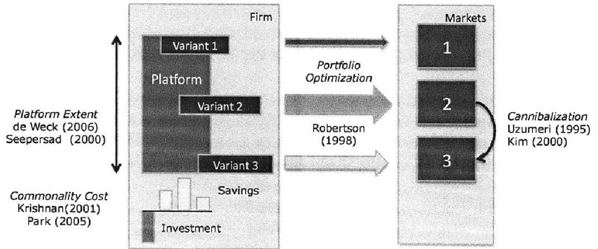

Figure 8 Placing commonality cost in the context of other research on commonality

Similarly, questions of portfolio optimization arise with the addition of unforeseen variants or yearly design changes. Some of these concerns are outside the scope of this work, in that we focus on intentional commonality, thus limiting us to the payback period on the original commonality investment. However, this is a illdefined boundary, as the existing literature on commonality investments has not produced an understanding of average payback period, let alone duration of program control.

Meyer and Lehnerd (1997) provide an important motivation to study both investments in commonality, as well as issues around the definition of end of life, noting that after Black and Decker's heavily publicized and studied power tool platforming exercise, the company began to de-emphasize platforming as a source of cost reduction.

## Cost Growth

The previous sections discussed the effort in the literature aimed at measuring the independent variable, commonality, and connecting it cost implications. In this section, we provide a brief overview of the work conducted on cost growth not directly linked to commonality.

Cost growth is a significant problem. Example abound, from the Apollo Moon program's 64% growth (CBO 2004) to Boston's Big Dig's 420% (Glen 2006). This phenomena is present in many industries involving large projects, in addition to construction and aerospace mentioned above, transportation (Flyvbjerg 2004) software development (Conrow 1997), energy (Merrow 1981), and defense (Jarvaise 1996). Cost growth has been multiply attributed to technical difficulties, scope growth (CBO 2004), poor initial cost estimation (GAO 1996), cost-plus contract incentives, rework (GAO 2005), and schedule delays. Many of these problems are linked by feedback - for example, schedule delay on projects with high labor-fractions imply cost growth, as the project is unable to unload its fixed labor

<!-- PDF_PAGE: 39 -->

costs while waiting for the offending subsystem or group to complete its work. Traditional systems engineering wisdom suggests that the "iron triangle" of cost schedule-performance cannot be fully controlled - guidance is given that one of the three variables can be defined, one can be actively managed, and one will float freely despite the manager's best efforts.

Cost growth is a broad resultant of many programs. We first highlight the breadth of the phenomena, and then we review some of the attributed causes. We are not looking to show that all cost growth results from divergence, but rather, we want to understand what causes may interplay with divergence.

The defense industry has historically received a lot of attention for its cost overruns. GAO (2006) lists four modern programs with cost growth >30%, including the development of an unmanned aircraft with 166% growth to date. This phenomenon is not new - GAO (1971) highlight "increased cost overruns" as a significant challenge in the development of weapons systems. GAO (2006) notes that average cost growth in defense in accelerating, from 30% in the 1970s to 40% in the 1990s.

GAO (2006) lists several causes - failure to gate immature designs at design reviews, immature technologies, and large capability jumps (i.e. system integration challenges). GAO (1971) aggregated formally reported causes from contractual reporting, finding initial cost estimation, performance changes, and price of inputs to be the most significant drivers. This is not particularly incisive, given that these dominantly point to exogenous factors. The best discussion given in (GAO 1971) is on active trade-offs between performance and cost, where it is widely acknowledged that many programs have simply prioritized performance over schedule and cost.

Biery (1992) aims to place defense cost growth in the context of other industries. While by no means comprehensive, his chosen data set brackets cost growth on weapons systems (average 40%) between 10% for commercial satellites to 593% for the Trans Alaska Pipeline. While this dataset has clear statistical issues (comparing many projects for one industry against single projects in another industry), and does not provide transparency on data sources, its span accomplishes the author's intent of showcasing a larger phenomenon. Although public projects often have more accessible data, private projects incur cost growth as well. However, Biery's data source on pharmaceuticals, mining, chemicals, oil refineries are not disclosed.

<!-- PDF_PAGE: 40 -->

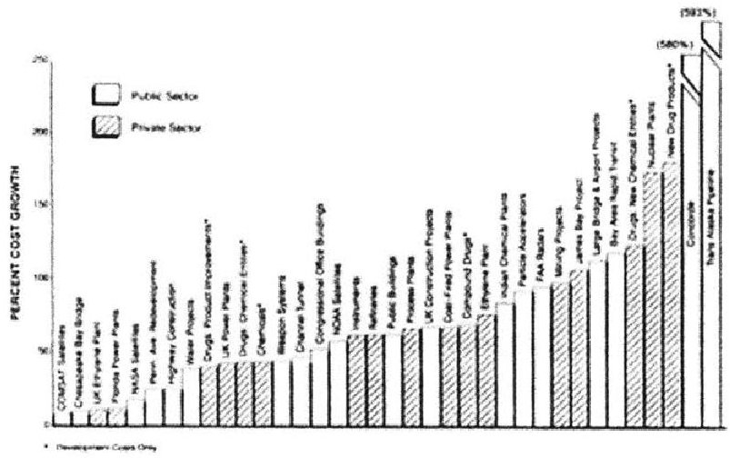

Figure 9 Cost Growth Across Industries, Reproduced from Biery (1992)

More transparent examples of cost growth are produced by the GAO for other government programs. Air Traffic Control Systems acquired by the FAA showed significant cost growth (>5%) in 7 of 16 systems studied (GAO 2005), citing rework due to insufficient stakeholder involvement, budget changes during the acquisition process, and underestimating the cost of software development. A sampling of major highway and bridge projects overseen by the Federal Highway Administration revealed cost growth >25% on 12 of 30 projects (GAO 2003). Poor initial cost estimation and an difficulty closing projects with substantial cost growth. Repeated cost growth on robotic missions executed by NASA led the Congressional Budget Office (CBO) to apply a blanket cost growth factor on all NASA cost estimates - of 45% (CBO 2004)! This same reports also lists technical challenges encountered during integration and test, scope growth, and schedule delays as causes of cost growth.

Approaches to a taxonomy of cost growth causes are few and far between. Dominantly, the academic discussion focuses on improved cost models. Quirk (1986) notes that cost forecasts are dominantly biased low, arguing from theory that this is the result of sample selection on 'attractive' projects - i.e. projects with low cost estimates are more likely to be selected than similar projects with higher estimates. Augustine (1984) also highlights the common practice of underbidding on cost-plus contracts, recovering margin on the contract extensions above the bid price.

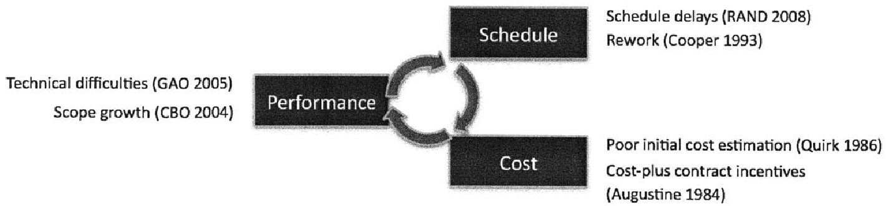

Figure 10 Other sources of cost growth

<!-- PDF_PAGE: 41 -->

A sampling of these sources of cost growth are illustrated in the diagram above, showing the three corners of the 'iron-triangle' of systems engineering: Cost, Schedule, and Performance. The function of this dissertation is not to explain this 'iron-triangle' using the proposed hypothesis of divergence, but rather to determine with divergence of commonality merits inclusion on the list of factors, and more broadly, to describe the mechanisms by which degradation of commonality has benefits and cost implications.

<!-- PDF_PAGE: 42 -->

## Chapter 4 Costing Commonality: State of the Practice in Government

## Overview of Chapter 4

This chapter provides an overview of the state-of-the-practice in commonality costing at NASA. The intent is to set is to motivate further inquiring into best practices for costing commonality by demonstrating existing challenges. This chapter is not intended as a research case, as it does not focus on a particular platform. Interviews were conducted with personnel spanning 4 NASA centers. Past practice suggested a heavy focus on a single investment model, where the lead variant bears all of the shared commonality costs. Further, the Constellation Program required commonality to be a net benefit to all variants. Interviews uncovered a limited willingness to invest in commonality, and no set method for analyzing commonality investments. An overview of commonality benefits and challenges is also provided, in addition to limited comparison of NASA commonality costing to DoD costing.

## Commonality Costing at NASA

We spoke with a range of people to discuss what methods were available for costing commonality. Within NASA, our 7 interviewees covered HQ+3 NASA Centers, and spanned detailed knowledge of development, manufacturing, test, supply chain, and operations knowledge.

By and large, no fixed tools or fixed methodology are used, in the sense that there does not currently existing a 'Commonality Costing Framework'. There is consensus on the principle for costing commonality, which is "determine the highest level of aggregation at which sharing of identical or similar components / systems are used, then apply the benefits of commonality to those components / systems".

Costing was often described as a mix of art and science, where custom estimates are often built based on project specifics, rather than turned out from a model. Previous commonality costing examples varied widely, from costing common avionics between Ares1 Upper Stage and Orion, to costing Orbital Replacement Units for the Space Station, to operations cost of mission control facilities shared between Shuttle and Station.

<!-- PDF_PAGE: 43 -->

While costing scope varies on the application, lifecycle costing represents only a fraction of the estimates requested and conducted in NASA. For example, project costing exercises include development, testing and production, but not necessarily operations. Long-lead development times and organizational boundaries between development and operations are likely drivers of this possible failure to cost the operational benefits of commonality.

Throughout this chapter, the following hierarchy is used to discuss commonality levels:

Program

Project

System

## Subsystem

## Component / Part

## Commonality in Constellation

The Constellation program made some use of commonality, and their effort is useful context for discussing the state-of-the-practice in commonality costing. Specifically, commonality was identified as a "program wide objective and design policy".

Commonality in the Program proceeded in two phases. First, elements of the architecture were deemed common from pre-Program studies - a common Upper Stage Engine (J2-X) for Ares1 and AresV, common solid rocket boosters for Ares1 and AresV, and a common in-space docking system for Orion and Altair (LIDS). Second, a 'Commonality Plan' was created by the Program in February 2008 (several years into the Program), defining commonality benefits, organizational roles for commonality monitoring, a sketch of a commonality analysis tool. Further, a Commonality Office was established and assigned the responsibility of promoting commonality.

Constellation's commonality plan was based on the idea that commonality would emerge where appropriate. Commonality was not mandated or set as a design requirement, other than as described above. Thus, the bar for workable commonality was set quite high - two or more systems had to perceive commonality as beneficial to them individually.

The structure of the Program did not enable commonality investment. Costing groups reported that commonality was always costed as a single payer investment there were no available examples of multiple NASA projects pooling resources to invest in commonality. When combined with the idea that commonality had to be beneficial to each contributing system, it is easy to see that few self-interested parties would invest in commonality, if the majority of the benefits would accrue to later variants.

<!-- PDF_PAGE: 44 -->

The small remainder of commonality strategies which fit the above criteria are those where enabling future reuse has a negligible cost today. For example, Orion inserted fittings and conduits into the construction of a $150M test stand to be later used by Altair. The commonality analysis tool proposed in the Commonality Plan follows directly from this idea, where users could search parts list for potential reuse. While this strategy is not without merits, it constrained Constellation's potential benefits from commonality.

The strategy of defining high-level commonality, then weakly enabling commonality, suggests that commonality was initially of interest, but then declined in relative importance as design proceeded. We cannot infer whether the architectural-level common elements (J2-X, boosters, docking) would have withstood the pressures of divergence and lifecycle offsets, as the design of AresV and Altair has not yet begun. However, this setup, together with the commonality plan published 2 years into the program, suggests commonality beyond those 3 architectural elements was not a central concern of Constellation's management. This largely explains several of the commonality failures in Constellation. For example, the Common Avionics Assessment (for Ares1 Upper Stage and Orion) arrived well after the architecture and contracts were already in place, such that both projects had evolved individual requirements and potential designs. No commonality investment funds were available from the Program in order to bridge the requirements gap. Within the constraints of this system, it is logical that both projects rejected commonality.

## Commonality Costing Methods

Based on the above description of commonality in the Constellation program, we've already identified some variables of interest:

1. Single payer or multiple payer?

2. Concurrent projects or sequential projects?

3. Program-level commonality investment?

4. Commonality planned before or after architecture and contracts?

Given the guidance that commonality costing is as much an art as a science, what other practices and methods were identified?

Developing an initial cost estimate for a common system involves determining the highest level of aggregation at which commonality occurs. Interviewees cited learning curves in manufacturing, and spreading fixed costs as the dominant benefits applied to commonality. The other expected benefits - shared development, shared testing, and shared inventory - were not highlighted, perhaps owing to the difficulty of tracking their differential effects.

Learning curves were discussed in detail, as to whether learning can occur on similar systems and how complexity can undermine learning effects (learning effects are not applied to subsystems or systems as complexity is thought to

<!-- PDF_PAGE: 45 -->

undermine learning]. This suggests that learning curves in manufacturing are frequently used in cost estimates, but the omission of operations learning curves highlights that learning curves in operations are less well understood.

Fixed vs. variable costs are tracked within the NASA cost community as a necessary part of costing commonality. Fixed costs are tracked to the subsystem level. However, several interviewees expressed challenges tracking fixed recurring costs, particularly in operations and supply chain. No guidelines for dividing fixed recurring costs among variants were discovered, other than the idea that the first variant pays all the costs.

There is significant capability in NASA for probabilistic costing, which is used both in initial cost estimation and cost control. Traditionally, probabilities are assigned to 'risks', or events / learning which would increase cost, together with consequential cost increases and mitigation costs. The final level of commonality has been treated probabilistically (ex. low, medium, high commonality) within NASA, but no work exists on the risk of divergence.

No work was available on costing commonality as a real option. Valuation of future commonality opportunities is necessary for commonality investment decisions in sequential product families, particularly when common systems are similar, not identical. Work in the literature and at MIT offers a starting point for creating this valuation - Rhodes (2010), Otto (2003) and Jiao (2005) have framed commonality as a real option. No set regimes or rules were expressed for allocating fixed and fixed recurring costs. The literature suggests that broad strategies include charging "fully allocated cost", i.e. an allocated fraction of the indirect costs + direct costs, "marginal cost" where only the direct costs are assessed without regard for the fixed cost investment, and "market based pricing", where comparable prices for outsourced services are charged.

## Commonality Costing in Department of Defense

A broader survey of commonality costing in government was conducted within the Department of Defense (DoD) and some associated think tanks. This survey was less methodology oriented than the internal NASA interviews, focused instead on common practice.

Broadly, the DoD interviews echoed the ideas that costing is composed of set rules, and the primary costed commonality benefit is learning curve effects.

While commonality is common in the DoD, many systems employing commonality were in fact generational reuse cases. In generational reuse, one variant is used to demonstrate performance, and bears all of the development cost. Subsequent variants are adapted from the lead variant. In generational reuse, there is less emphasis on commonality investment and fewer actions taken to enable future commonality. Interviewees in the DoD highlighted that logic of generational reuse

<!-- PDF_PAGE: 46 -->

tends to win out over concurrent commonality or platforming strategies, as the development cost invested is smaller and the technological risk confined to a single variant.

The DoD interviews did not yield any set rules for splitting cost among multiple stakeholders in a platform-interviewees argued that the split is always negotiated. As with NASA, operations cost often dominates total cost. In the DoD, operations cost is sometimes. determined by the depot strategy (shared or unique).

## Conclusion

These interviews reveal that NASA practices a very stable, very conservative approach to commonality, where commonality can only exist when it is both a local (Project) and global (Program) optimum. Significant costing capability exists in NASA, but it is not formularized to the same extent that systems engineering practice, for example. Divergence was highlighted as a significant challenge to commonality, but further work remains to demonstrate and understand the cost implications of divergence.

<!-- PDF_PAGE: 47 -->

## Chapter 5 Statistical Study of Cost Implications

The objective of this chapter is to explore the relationship between platform divergence and cost growth using statistical analysis. We focus on the detrimental effects of divergence, with a view to creating a conservative assessment of the impacts of divergence. The existing theory on divergence would suggest a number of cost consequences - decreased personnel sharing resulting in greater total development hours, rework resulting from required redesign of common parts to unique specifications, decreased tool sharing in manufacturing, higher inventory levels. These consequences are spread throughout the product lifecycle (the time span between conception of product and final use and disposal of the last product). In this study, we focus entirely on development cost impacts, to constrain the scope of analysis, and because lifecycle cost data is not available. Therefore, results must be interpreted with the knowledge that development cost incurred can result in production savings - that is to say, cost impacts are not necessarily a negative behavior.

Our hypothesis is that programs that employ significant commonality may be at risk of development cost growth. Based on existing theory, this risk is not present for programs which do not employ a commonality strategy. An identification of a notable difference would enable stronger acquisition decisions and could have broad implications for technical program management. The intended audience for this study spans from individuals and firms which estimate cost, who want to understand the development risks and uncertainty caused by divergence, to program managers whose yearly budgets will be pressured by cost growth from divergence, to executives who must weigh program strategies in their development portfolios.

## Relevant Other Studies

There are many studies on cost growth, across many industries - for example in transportation (Flyvbjerg 2004), energy (Merrow 1981), defense (Jarvaise 1996), and software development (Conrow 1997). Further, a number of potential causes for cost growth have been identified, ranging from scope growth to poor initial cost estimation to schedule delays. In light of the multiplicity of reasons, our intent is not to identify divergence as the primary driver of cost growth, but rather to determine whether it merits inclusion as one of the drivers to monitor.

Our study focuses on one of the industries where cost growth has been previously cited: US defense acquisitions. Defense has arguably one of the greatest cost growth

<!-- PDF_PAGE: 48 -->

challenges of all industries, and has made significant use of commonality strategies historically. Results from the defense industry require careful study for their generalizability to other industries - contractual incentives, government purchasing procedures, performance vs. cost sensitivity, and unit volumes must be examined for their ease of comparison against other industries.

Within the defense industry, a number of reports have examined historical programs for the causation of cost growth. A RAND report, Sources of Weapons Systems Cost Growth (Drezner 1993), identified cost estimation errors and requirements changes (scope growth) as the leading factors.

There is relatively little work linking commonality strategies to cost implications. The only study we identified with mention of potential negative consequences was Hauser [2001], where profitability was found to be negatively correlated with platform reuse for n=16 products within an office-supply firm.

## Data Source

Data for this analysis is drawn from the Selected Acquisition Reports (SAR) gathered by the Pentagon for all defense acquisitions. This is a publicly accessible source with a 30 year history, and is the data source for a number of past RAND analyses. These SAR reports list total project cost estimates and realized cost for all major acquisition programs.

Specifically, SAR reports of September 2008 and September 2001 were used downloaded directly from the Pentagon website. This maximizes the start date range of programs available for analysis, subject to the constraint that the reports are digital (records previous to 2001 were scanned, making translation to a database laborious).

## Data Cleaning and Coding

The fundamental treatment applied to the data was a coding into commonality strategies used by the program. To these ends, descriptions of each program were examined, from websites ranging from contractors homepages, to Wikipedia, to defense-industry sites (such as Federation of American Scientists www.fas.org and Global Security, www.globalsecurity.org).

## Programs were classed as follows:

Concurrent Commonality: Several variants (products) produced with some degree of overlap between development timelines. Variants must display significant differences - such as missiles with different payloads requiring different guidance systems and structural differences. Variants with no architectural differences or

<!-- PDF_PAGE: 49 -->

minor component-level differences (such as different tires on a vehicle for sand vs mud, but same chassis, suspension, etc) were excluded.

Generational Reuse: Several variants currently in service, but no two variants overlap in development or production time. The key attribute is that the original system did not make decisions about the platform requiring compromises among variants.

Commercial Reuse: Commercial systems customized for military use.Military development budget does not include the cost of developing the platform.

Standalone Development: No commonality evidenced.

The divergence theory previously developed is only applicable to the first category listed, as the Reuse strategies do not capture the intent to develop several variants, they merely inherit previous designs. Therefore, the latter three strategies are grouped under the heading Not Common in the remainder of the document.

In order to bring the data in house, significant work was required to translate PDFs into Excel - aligning columns, correcting problematic characters incorrectly translated by the OCR software, etc.

To produce the sample for coding, all programs identified as 'Development' were captured. This excludes programs in Product, Pre-Development Planning, and in transition between Development and Production. The sample captured includes programs at various stages within the Development Phase, ranging from initiation in 1979 to 2008. Note therefore that we are not comparing completed development cost growth, but rather cost growth to date. This assumption will be checked in the analysis for possible bias.

For each program, the cost growth is calculated as the current estimate over the original estimate. Therefore, we are comparing estimates of development cost, not realized development cost or cost incurred to date. The current estimates are adjusted for changes in quantity ordered, as quantity changes have little bearing on the commonality strategy as a potential cost driver, and they could skew the results if left in. This adjustment is performed by subtracting the quantity cost growth entry from the current estimate.

All costs are normalized to the Base Year of their respective programs, using the DoD's inflation rates. Cost growth per program is calculated from these base year numbers. Using percentage cost growth avoids the challenge of transforming individual base years to a common base year, as the data do not present a common base year.

Many issues have been listed with the existing SAR data in previous reports. While most of these concerns emanate from how the cost growth is self-attributed to

<!-- PDF_PAGE: 50 -->

causes, some concerns remain for the top-level data. Most importantly, some programs which have been 'rebaselined', that is to say, have had their cost growth reset to zero. In support of this procedure, rebaselines often involve significant scope changes, making comparison to previously scoped cost estimates misleading. However, of concern here, the vast majority of re-baselines are triggered by hitting cost growth limits, such that we could be under representing the average cost growth. A preliminary analysis of rebaselining is conducted later, finding these data appear to include original data, not affected by rebaselining.

## Results - Two Sample Test

Prior to performing statistical tests on the samples, it is useful to visualize the data.

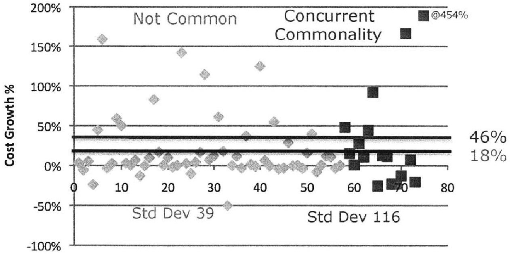

Figure 11 Cost growth for common and not common programs

At first glance, there are difference between Common and Not Common. The mean of the Common group is more than double that of the Not Common group, but it is also immediately apparent that there is significant variability overall in the dataset. There are many observations below 25% cost growth, fewer above, suggesting that projects which run into cost control issues suffer positive feedback effects leading to further cost growth. It is also worth noting that Common group has a standard deviation, again more than double its counterpart. This could be suggestive of the added uncertainty platforming creates, and could constitute a program impact separate from mean cost growth.

The question begged by this data is whether these differences are significant, given the variability in the data. Given the normality plots, we can see that the data are not distributed normally. The histogram below have been bucketed in increments of 0.5 $ \sigma $ , showing that both groups display clustering near the mean with long tails,

<!-- PDF_PAGE: 51 -->

possibly even displaying bi-modality. The failed normality is clear from the normal plot shown below, which demonstrates slight deviation from normal on the negative cost growth region,

Comparison to Gaussian (Not Common)

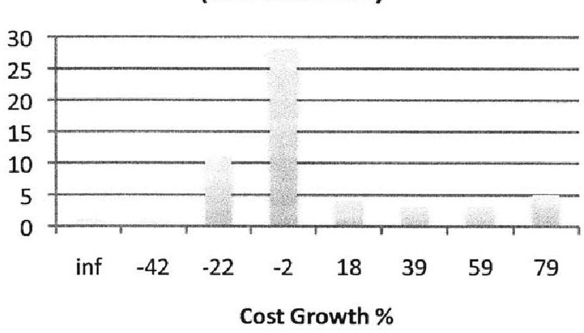

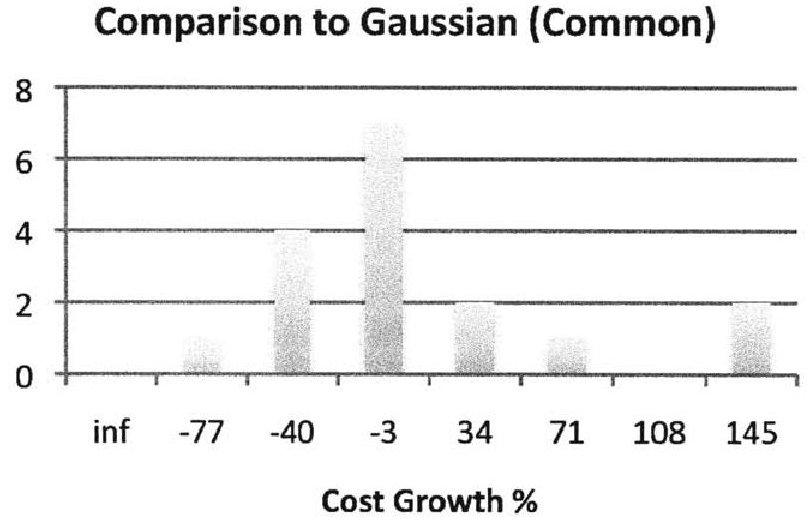

Figure 12 Plotting data against the gaussian distribution

<!-- PDF_PAGE: 52 -->

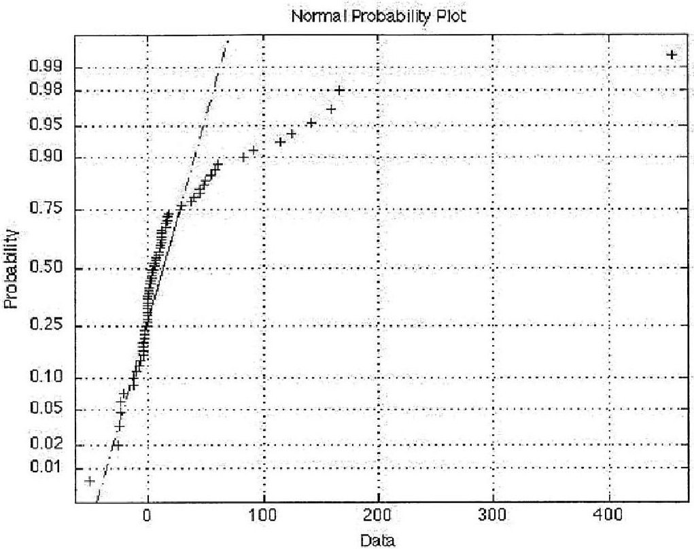

Figure 13 Plotting data against the gaussian distribution

strong deviation from normal in the high cost-growth region [note that both Not Common and Common are plotted together].

Given the violation of the normality assumption, it is inappropriate to rely on a two sample test. However, one was conducted to roughly benchmark more detailed tests in the bootstrapping sections. Formally, a one-sided test was conducted on the null hypothesis of no difference between the sample means. As seen below, the test is significant at the 95% level, but this should not be taken as a confirmation of the research hypothesis, given the normality violations.

<table border="1"><tr><td></td><td>Mean</td><td>StDev</td><td>N</td></tr><tr><td>Common</td><td>0.46</td><td>1.16</td><td>17</td></tr><tr><td>Not</td><td>0.18</td><td>0.39</td><td>57</td></tr><tr><td>Null</td><td>Mu1=Mu2</td><td></td><td></td></tr><tr><td>Hypothesis</td><td>Mu1&gt;Mu2</td><td></td><td></td></tr><tr><td>Weighted SD</td><td>0.568</td><td></td><td></td></tr><tr><td>Z</td><td>1.786</td><td></td><td></td></tr><tr><td>P-value</td><td>0.037</td><td></td><td></td></tr></table>

Figure 14 Statistical test for significance, but in context of normality violations

Transformations offer the possibility of improving the normality of the underlying data. Several were attempted, focused on the deviations at high cost growth numbers, none of which were satisfactory. The best fitting transformation (evaluated from a comparison of normal plots) was the log transformation. As can be seen on the plot below, a log transformation overcorrects the data, while a

<!-- PDF_PAGE: 53 -->

square root transformation comes the closest that a transformation will obtain. However, even for the square root transformation, normality concerns are evidenced in both tails. Testing the hypothesis on the square transformation produces a non-significant result, failure to reject the null hypothesis that the groups are different (p=0.20). As with before, this should be taken a ballpark figure for grounding the bootstrapping tests.

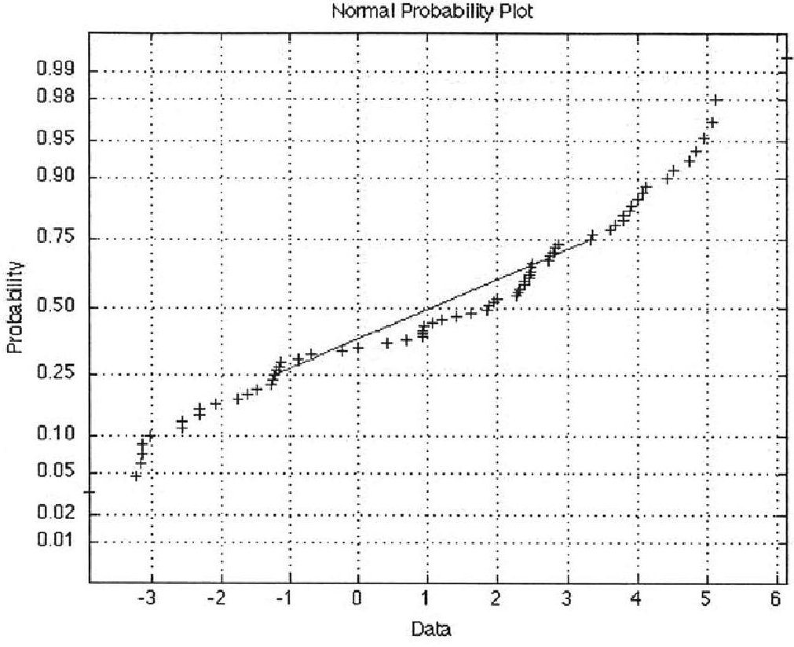

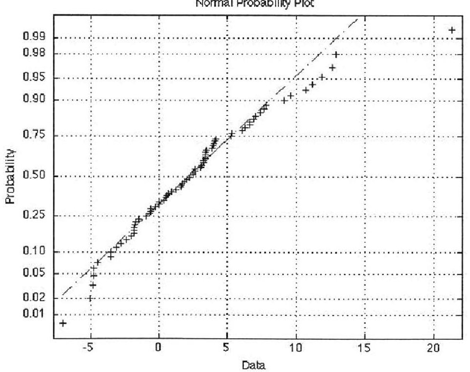

Log Transformation (Top) and Sqrt Transformation (Bottom)

<!-- PDF_PAGE: 54 -->

## Results - Bootstrapping

In order to address the normality caveats, we turn to bootstrapping methods. These methods were developed for situations were the underlying distribution for the population is either unknown or poorly-fitted by existing distributions.

Two bootstrapping methods are implemented here. First, bootstrap shuffling, also know as a permutation test, where the full data (Common + Not Common) are randomly divided into 2 groups (sampling with replacement), and for each random division, the means of the groups compared (Moore 2005). This produces a distribution of the difference in the means. A significant result falls above $ \alpha\% $ of the samples (for a one-sided hypothesis), where $ (1-\alpha) $ is the confidence level. Second, bootstrap sampling, where each group is sampled with replacement n times, where n is the size of the group. For each sample-pair drawn, the difference in the mean is recorded. This produces empirical sampling distributions for both groups, as well as a distribution of the mean differences. A one-sided confidence interval is created for the mean difference distribution, to test whether 0 is included in the confidence interval (corresponding to the null hypothesis of no difference). This confidence interval is enabled by the assumption that the sampling distribution of the difference of the bootstrapped means is roughly normal due to the CLT, which is another way of saying bootstrapped sampling is more sensitive to small sample sizes (Moore 2005).

The shuffling method is more applicable here, as the bootstrap sampling typically performs better with larger n (n>30 for reference), whereas the shuffling is more robust at smaller n. Further, shuffling is conceptual closer to the problem at hand, given the tight banding at low cost growth rates and sporadic high cost growth incidence. However, shuffling does require that the distributions for the two samples are the same when the null hypothesis is true, i.e. there are no other presumed differences aside from the hypothesis in question - this is clearly challenging in practice, as there are many factors at work in cost growth. Given that both were drawn from the same organization and time periods, we will allow this assumption to stand.

<!-- PDF_PAGE: 55 -->

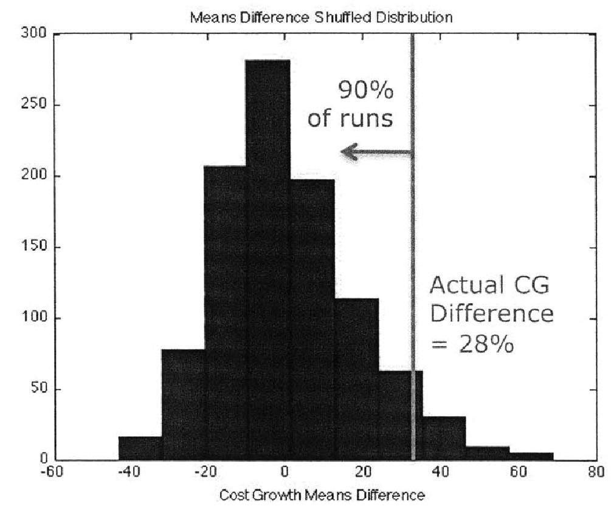

Figure 15 Means difference test

The bootstrap shuffling distribution is shown above, created from a run of 1000 simulations. The actual cost growth difference falls above 90.2% of the empirically generated cases, which leads to rejection of the null hypothesis at 90%, but failure to reject at the 95% confidence level.

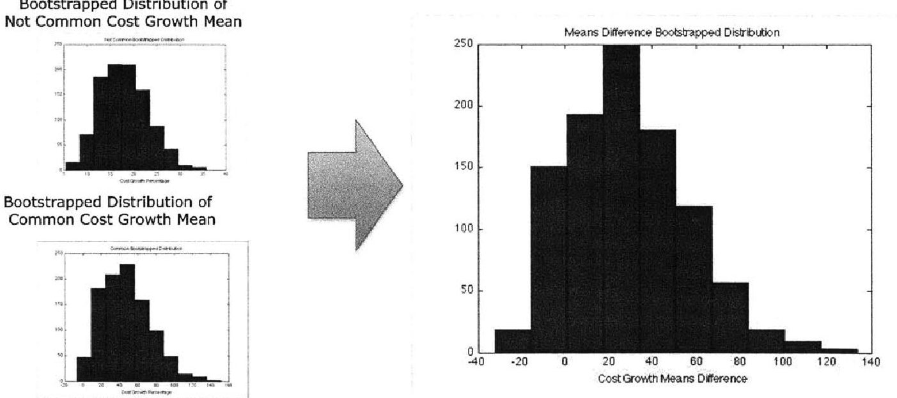

Figure 16 Bootstrapping explanatory diagram

The bootstrap sampling distributions for Common and Not Common produce a onesided test significant at the 85% level, with a p-value of 0.144. As noted above, we place less emphasis on the bootstrap sampling method, given the low sample size.

<!-- PDF_PAGE: 56 -->

These results are consistent with the flawed normal two sample test conducted earlier. Although they do not provide an unequivocal support of the research hypothesis, they illustrate that commonality can be considered a relevant parameter. Given the myriad of causes which can create cost growth, we have not argued for a baseline cost growth created by commonality, as this would run blatantly in the face of the interconnected and heavily coupled nature of large industrial development projects. Further, we have deliberately applied a high bar in this test - that commonality strategies result in greater cost growth than average as opposed to lower bars that would argue for a non-zero contribution of commonality to cost growth. The presence of many other drivers of cost growth, such as schedule delays and integration challenges, enforce a relatively high average cost growth within this sample.

These data support a catalyst view of cost growth, where commonality can sometimes trigger and contribute to other feedback loops causing overall cost growth. Given the variability seen in the data, this 'trigger effect' is not always evidenced - several data points showing cost reductions on common programs might support the traditional benefits of platforming - risk pooling, fixed cost spreading, etc. However, in the presence of challenges in development, we can argue that commonality could exacerbate challenges, given coordination across variants, difficulties enacting common designs and testing procedures, and coupling bottlenecks across variants. It is tempting to argue for a variant-level cost growth at 1/m of the platform cost growth (for m variants), and therefore common system should naturally reflect larger cost growth, as they aggregate variant costs. However, the data were normalized for program size, thus eliminating this hypothesis.

Finally, we have not argued that commonality strategies results in lifecycle cost growth - it is entirely feasible that cost growth during the development phase was used to buy down risks in the manufacturing and operations phases.

## Checking Assumptions

Several assumptions were noted in the Overview, which we can check against the data.

First, cost growth percentage was used to normalize for the effects of program size. As can be seen in the plot below, using absolute cost growth dollars results in a strong relationship with program size. However, program cost against cost growth percentage does not show any significant correlation. Therefore, cost growth percentage is an acceptable first order normalization for program size effects.

<!-- PDF_PAGE: 57 -->

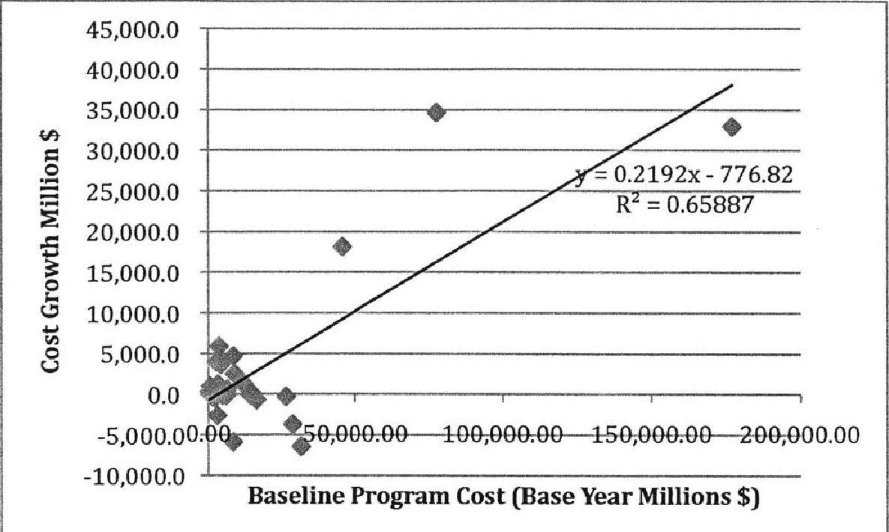

Figure 17 Examining hypothesis of correlation between program cost and cost growth

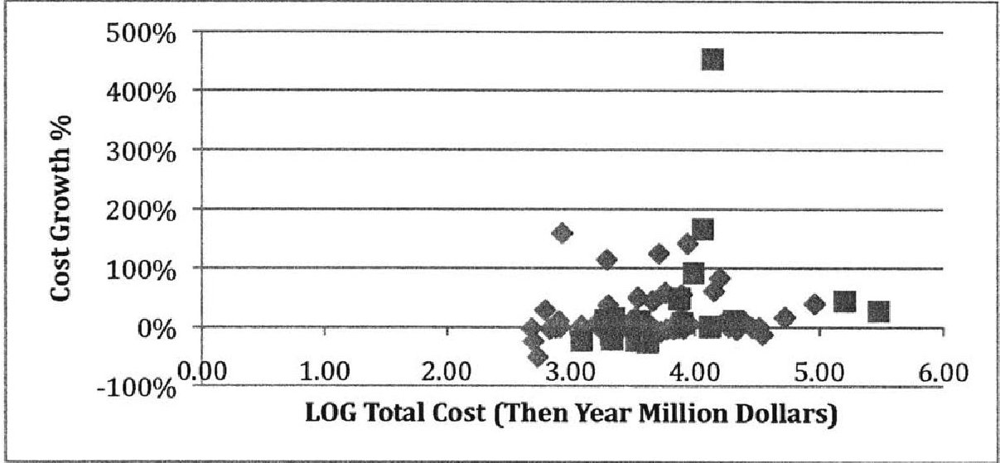

Figure 18 Examining hypothesis of correlation between program cost and cost growth

Second, we made the assumption that we could take data of varying program completion fractions. The chart below shows a weak overall relationship between time since baseline (as completion fraction is not available while some programs are still in development) and cost growth. That said, we would certainly expect that the error bounds on estimates narrow as the development completion nears, but no measure of forecast error is provided with the SAR estimates.

<!-- PDF_PAGE: 58 -->

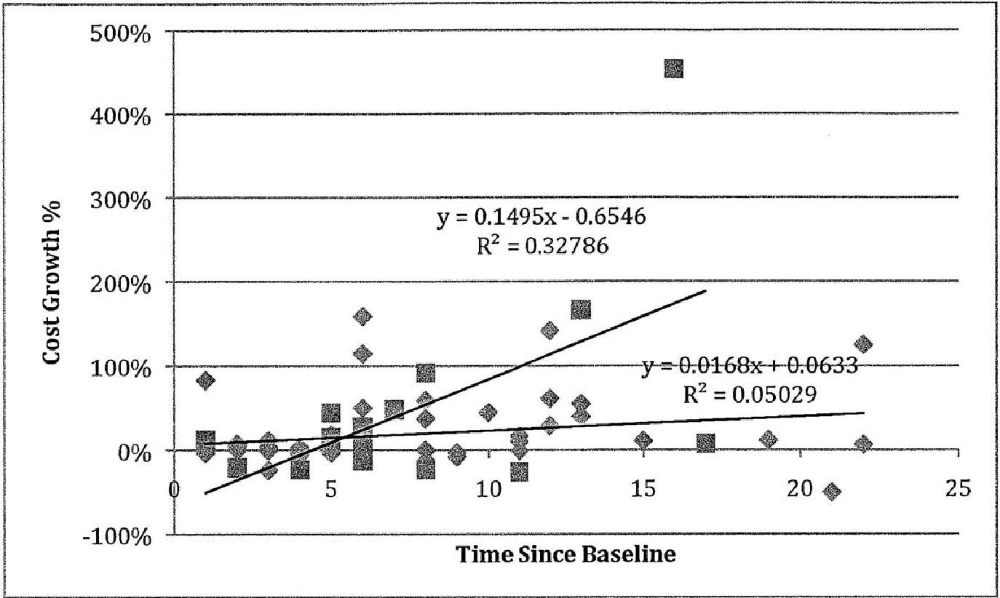

Figure 19 Testing time since completion (in lieu of completion percentage) correlation against cost growth

Lastly, we can conduct a preliminary evaluation of the frequency of rebaselines, the practice of re-setting original cost estimates to produce zero cost growth. As previously noted, rebaselining is a known concern in the DoD community, but few statistics on the process are published. One external assessment identified that 58% of programs received a rebaseline at some point during development or production in a sample of 43 completed programs (GAO 2008).

These rebaselines have a variety of purposes. Some are known to be triggered by cost growth exceeding certain values, others by significant changes in program scope, and others to enable changes in contract funding.

The concern here is that the 'base year' and 'baseline estimate' in the data may reflect a rebaseline, rather than the original baseline (which in turn is set a progress milestone). We know that some rebaselines do not appear in the data, as the Joint Strike Fighter (JSF) program went through a rebaseline in 2004, but our data shows a 2002 base year.

We can examine this issue as an incomplete inference problem. Going back into older SAR reports (say 2005), if we find the same base year, we can conclude the baseline did not change between 2005 and 2008, but we cannot conclude that it did not change prior to 2005. As with before, it is impractical to search for the SAR in which a program was first listed, given that the data are not easily indexed or imported, and further, are subject to name changes. However, we can grab a historical SAR for comparison.

<!-- PDF_PAGE: 59 -->

24 historical SAR comparisons were executed, 8 between 2008 and 2003, 16 between 2003 and 2001. We are restricted to 2001 as a minimum given that prior data are not digitized. Viewed from another perspective, of the 37 programs listed in 2008 sample, 8 were present under the same name in 2003. The difference between the 2003 and 2001 representation is clearly due to the reduced time gap.

None of the 24 historical SAR comparison demonstrated a changing base year. This suggests that many rebaseline activities did not affect these data. A possible confounding variable would be name changes coordinated with rebaselines, but to the author's knowledge, this is not commonplace.

## Alternative Causes

While numerous other reports have explored other sources and categorizations of cost growth, we provide two primary cuts, in order to put the above results in context.

First, division by service reveals that each of the services employs commonality as a strategy, although not all necessarily for cost purposes. The services display a range of cost growth, roughly on par with the range between Common and Not Common programs [33% vs. 28%]. Defying the non-normality of the data again, comparing the services against each other produces no significant differences at the 95% level (highest p-value of 0.123]. However, we can see another version of the division between the low band of cost growth and the high diffuse range, by plotting the standard deviations for the services against their cost growth. This trend would seem to emphasize the "runaway" effect of cost growth - the greater the growth, the greater the potential for more growth.

Use of Commonality Strategy

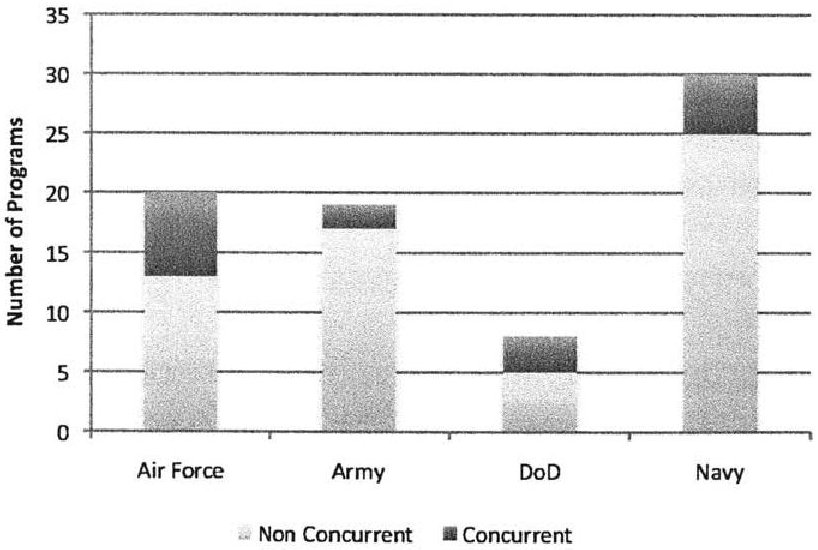

<!-- PDF_PAGE: 60 -->

Cost Growth Across Services

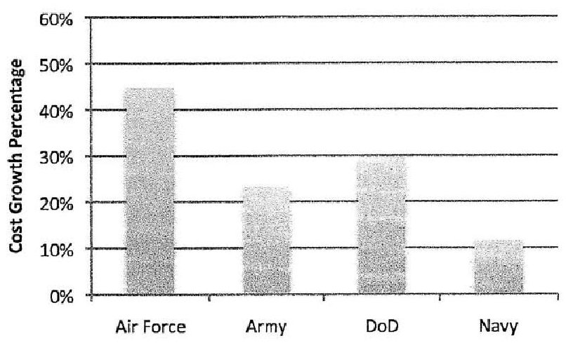

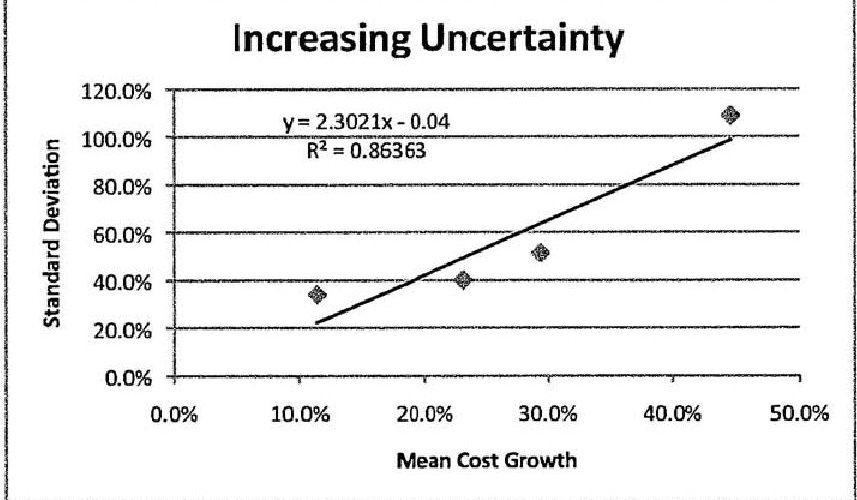

Figure 20 Cost growth statistics across military groups

Second, we can compare our sample to the reasons cited in the SAR for cost growth. As noted before, these categorizations are self-reported, and subject to significant bias. For example, some categories are seen as less injurious or severe than others. To briefly review the categorization:

Schedule: Schedule extensions driven by delays, requirements negotiation, etc.

Engineering: Refers to engineering changes including performance upgrades and downgrades.

Estimating: Changes in response to program learning, caused by errors in the original cost estimation.

Other: A catch-all for program challenges not otherwise covered

Support: Changes to program overhead and forward costs for later lifecycle phases

<!-- PDF_PAGE: 61 -->

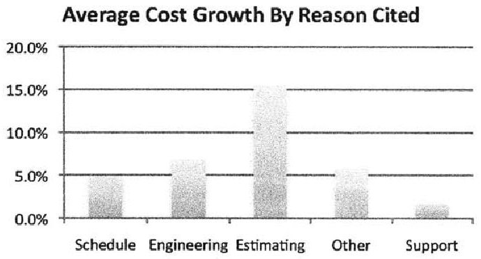

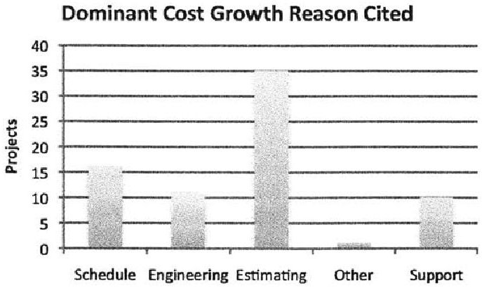

Figure 21 Comparison of "Reason Cited" field from military self-reported data

As seen above, Estimating is cited heavily, both in terms of attributable cost growth, and in terms of dominant effect per program. This is consistent with previous RAND reports (which were drawn from the same data!). Although desirable, it is not possible to allocate divergence effects into the SAR cost categories - one could make arguments for partial inclusion in each.

## Conclusion

Platforming has become an important strategy for cost saving. However, decreases in commonality through the development phase have potential cost growth implications. We have explored a sample of 74 defense projects, with a view to establishing whether commonality strategies can lead to cost growth. The hypothesis was supported at the 90% confidence level by the sample data. A catalytic view of commonality was advanced, whereby divergence in common development programs could catalyze or reinforce other sources of cost growth. These results do not necessarily augur poorly for commonality strategies, as only the development phase is studied here. Executing on a commonality strategy requires trading development effort against future manufacturing and operational benefit. These results suggest that variability in the development effort should be expected and managed.

<!-- PDF_PAGE: 62 -->

## Chapter 6 Field Research Design and Methods

The overall research question for this dissertation is "Does divergence have cost implications?". Pursuant to this question, a number of broader contextual questions were raised in the introduction, with regards to the development of a framework for evaluating the costs and benefits of commonality. This research can be broadly framed as a descriptive effort aiming to identify and describe the cost implications of divergence, and to identify the important conditions and mechanisms that link the concepts of divergence and platform cost.

The potential methods available for constructing a research design are shown in the figure below. The Large-N study, given in Chapter 5, was selected to provide an initial examination of the potential link between divergence and cost. Several options were available to investigate the connection and underlying mechanisms. Hypothesized mechanisms could have been built into a static cost model, and tested against outcomes. A dynamic cost model could have been built, to attempt to trace the trajectories of cost and commonality. The advantages of these models is that they provide explicit traceability to hypothesized mechanisms and dynamics. The disadvantages of these models is that they cannot raise new mechanisms which were not hypothesized, and they are reliant on a wealth of data. For these reasons, the model-based investigation was deemed inappropriate given the descriptive, early-stage of this research.

Method Selection

Figure 22 Possible research methods

Social science methods can enable emergent dynamics and mechanisms. Two were selected for initial evaluation - surveying platform managers for their experience with the hypothesis and their judgment on the existence of hypothesized mechanisms, and case studies constructed to examine past trajectories of commonality and cost through this space. Cusumano [1998] very successfully used surveys to capture engineering hours and lead times. However, surveys by their nature focus on known concepts and mechanisms, and trade larger-n responses for programmatic detail. It was not expected that consensus had already been constructed within the organization relating to these hypothesis, therefore, survey methods aimed at demonstrating a majority view are not of interest. Case studies

<!-- PDF_PAGE: 63 -->

were chosen for their ability to capture rich descriptions of the problem. Yin's (1981) concept that case studies are appropriate when "the boundary between phenomenon and context is not clear" suited this examination, given the multitude of other sources of cost growth, and the complexity of platform development programs.

The research design for the case studies followed a mixed methods approach (Greene 1989, Burgess 2005, Jack 2006), where both qualitative data from interviews and quantitative raw data was collected from projects studied. Interviews were used to capture the operational complexity and prioritize the benefits of commonality, as well as to evaluate the "unique design counter-factual", necessary for sizing commonality benefits. Given the complex causal relationships which were highlighted in the literature search, as well as the known multi-period feedback, the case study approach was believed to best enable the exploratory and descriptive nature of the research problem.

A series of scoping interviews and mini-cases were conducted to test research concepts, interview questions, and to focus the research program. These scoping interviews were conducted with 16 firms and 8 government organizations. The firms selected for the 16 cases were all focused on examples of intentional commonality (excluding passive reuse), and where the primary purpose of commonality was cost-saving. These 16 cases were drawn from a wide range of industries, in order to capture as broad a spread of conditions for commonality (such as development cost as a fraction of lifecycle cost), with a view to gaining detail on the full spectrum of benefits. Each benefit cannot appear in every platform, therefore this approach enabled a broader conceptual footprint.

The graphic below illustrates the targeted objectives and outcomes from the broad practice surveys. Notably, the broad practice surveys revealed the importance of covering multiple functional areas (purchasing, marketing, etc.) of the organization, as the key stakeholders of some of the benefits of commonality being studied. The distinction between government and industry interviews quickly revealed the importance of separating benefits that accrue to the purchaser from benefits which accrue to the builder, as noted in Chapter 3.

Broad practice surveys were 1-3 hours in duration, with 1-12 participants (some simultaneously). Detailed discussions were 3-8 hours for the 2 firms and 2 government organizations not built into the 3 full cases. Full cases were composed of 28-44 participants, the vast majority of which were 1-on-1 interviews lasting 1 hour.

<!-- PDF_PAGE: 64 -->

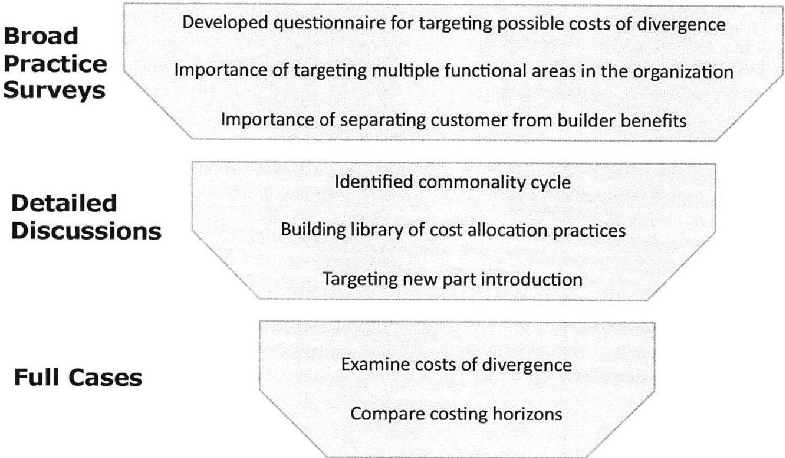

Figure 23 Learning at different stages of the research effort

Based on the broad practice surveys, we down-selected to 5 firms and 2 government organizations (NASA and the DoD], in order to identify possible cases, and to further refine research concepts. It was at this stage that we identified new parts creation processes as an important concept used by industry, which would provide tracked data for a concept from the literature search, namely unique part creation.

The following concepts guided the case selection. A first case demonstrating possible divergence through variant addition was chosen. The advantage of variant addition divergence is that it enables stronger comparisons of the possible outcomes. As the design had already proceeded into manufacturing with several variants, a baseline could be established on the existence of manufacturing cost structure, against which the resulting post-commonality-change state could be compared. It is worth nothing that this is not without validity challenges, which are discussed subsequently. This setup is preferable to studying only programs which saw divergence in product development, as those studies would be entirely dependent on the qualitative data from interviews to construct the unique design counterfactual. Within this first case, an examination of the level of commonality change during development would be made, in order to optimistically examine the possible commonality changes during design, as well as to provide a comparison for the context of variant addition.

In this manner, the function of the first case was to identify evidence for a link between divergence and cost implications, and to elicit possible mechanisms for further study in the second and third cases.

<!-- PDF_PAGE: 65 -->

Second and third cases were chosen to focus on development decisions taken at divergence opportunities. In this manner, the second and third cases would trade higher detail in development decisions for reduced data on the outcomes of benefit realization. The second and third cases were chosen for adherence to a secondary research hypothesis surrounding conditional causation of divergence.

Namely, we hypothesized that cases which demonstrated "near-term costing" would see greater cost effects as a result of divergence, than would cases which demonstrated "lifecycle costing".

This hypothesis was inductively built on two coupled mechanisms. The first is that costs would appear to rise with divergence because the full impact of divergence was not forecast. For example, a commonality decision which does not project the impact on inventory holding cost should expect to see inventory charges 'unexpectedly' rise. The second hypothesized mechanism was that more divergence would occur under near-term costing, as decisions would undervalue the future benefits of retaining commonality, which in turn would feedback into more cost implications.

On this basis, we selected one case for potential for "lifecycle costing", and a second for the potential for "near term costing". A detailed breakdown of criteria used to determine what constituted the costing horizon is provided with the cross-case analysis. The first case was split into the development phase and the variant addition phase, and was similarly evaluated for its costing horizon.

In total, three full case studies were used to study this problem. A small number of full cases is used, in order to enable detailed analysis of the case data. The full set of cases is illustrated on the diagram below. As noted previously, the Broad Practice Surveys spanned a number of industries, with the intent of capturing projects with a variety of dominant benefits (and thus stronger methodology around that benefit).

The three full cases were selected from similar industries and contexts, in order to facilitate controls and comparisons across the cases. The three cases were all relatively capital-intensive manufacturing, long lifecycle, slow clockspeed industries. The details of the case parameters and industry contexts is discussed in more detail in Chapter 10: Cross Case Analysis.

<!-- PDF_PAGE: 66 -->

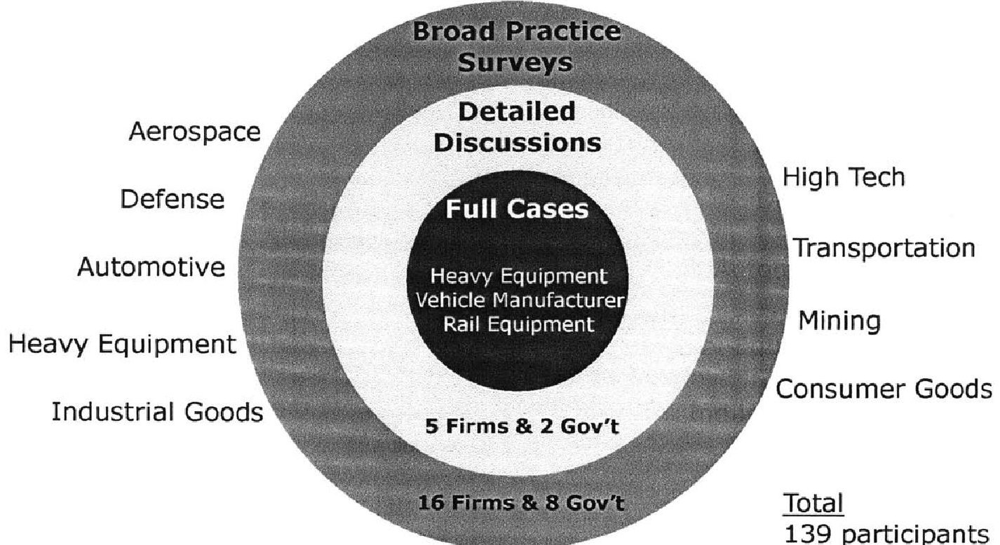

Figure 24 Spectrum of industries covered in cases

The focus of this study is on triangulating explanatory variables in the organization. Interviews were used to collect qualitative data, guide quantitative data collection, and support conclusions. As such, structured questions were be inserted to pose the hypothesis, but documents and data also form a strong source of evidence. Given the sensitive nature of cost data and management performance, interviews were not be taped or coded, but detailed interview notes were taken (>1500 words / hour in most cases). Interview lists were be constructed with the company sponsor, based on achieving exposure to the relevant systems and functions pertaining to the platform in question and divergence hypothesis. Snowball sampling was certainly be in effect as the only feasible mechanism in a corporate environment, but it is reasonably expected that this method enabled full coverage of the relevant people (as opposed to the dangers of snowball sampling in larger populations). Each of the full cases captured both a specific project, as well as some broader corporate initiatives relevant to commonality practices.

An overview of the process for gathering data is presented below.

1. Semi-structured interviews with employees to develop a commonality narrative, determine a measure of commonality, and record time of discovery of divergence

2. Collect commonality data

3. Gather data on benefit projections and benefit realization

4. Semi-structured interviews with employees to gather hypotheses links between commonality decisions and benefits

5. Correlate benefit reduction and cost growth with divergence.

<!-- PDF_PAGE: 67 -->

6. Attempt to reject other cost growth and benefit reduction hypotheses by gathering time series as appropriate.

## Questions to Guide Commonality Costing Methodology Discovery

This list is divided into 3 sections:

- Representative Project

- Investments and Project Phases

- Modeling Commonality

Questions are listed to provide guidance and structure to interviews, but all questions are not asked of all interviewees.

## Representative Project

- Overview - duration, timeline / lifecycle, variants, units, cost, major challenges, success?

- Commonality plan for the project - what was the original concept? What need did it serve? What was common?

- Which of the commonality benefits (below) were included? Rank benefits?

- What was the commonality investment?

- How were the costs and benefits of commonality compared?

- What was the commonality ownership structure?

- How did commonality evolve during the project? Number the decisions / events at which commonality took a major change.

o For each decision / event, what were the factors / benefits / costs considered? Which dominated this decision / event?

o For each decision / event, did near or long term considerations dominate / What was the decision horizon?

o For each decision / event, who were the stakeholders? (Lifecycle phases and variants)

o When were the cost impacts of the decision / event realized?

- Was a commonality metric tracked during the project?

- What indicators of commonality benefits (if any) were tracked during the project?

- Were forecasts of the benefits of commonality updated during the project?

- What was the fixed / variable cost division?

- What is the labor / materials fraction?

- Which of the commonality benefits were realized? Were any unexpected? Did the commonality investment merit the benefits achieved? Rank benefits!

- What were the primary and secondary "lessons" learned from commonality in this project?

<!-- PDF_PAGE: 68 -->

## Investments and Project Phases

- Does the firm consider commonality an investment?

- How are investments in common systems spread across projects?

- What lifecycle phases are included in the scope of commonality?

- To whom do the benefits of commonality accrue? Purchaser awareness?

- How are recurring / fixed / overhead costs apportioned (manufacturing shared facilities, shared services, operations costs)?

o Ex. by volume, by use, by total cost, by profit, marginal cost, full cost?

o Are different types of costs assigned different sharing fractions?

o Does apportioning couple multiple variants / projects / divisions?

O Are small projects sheltered?

- Are fixed costs of commonality split into recurring and non-recurring?

- Are there any costs related to the reuse of previous systems?

- Are subsequent users of common systems charged a commonality cost? Even if after development cost has been spent? Are transfer prices used elsewhere in the firm?

- Are the investment criteria for a lead variant different from subsequent variants (ROI, payback period, capitalized)?

- Are commonality investments capitalized or expensed? If capitalized, what's the depreciation schedule relative to lead variant and platform life?

- Has the firm been forced to write off commonality investment in the past?

- Does criteria for the capital planning / budgeting affect the incentives for commonality?

- How is inventory valued (FIFO, LIFO,etc)? Does this have an impact on commonality?

- What other financial incentives have an impact on commonality?

## Modeling Commonality Cost

- Are learning curve effects incorporated? How?

- Are economies of scale incorporated? How?

- Is historical data used to benchmark commonality benefits? How?

- How close are analogies to other product lines,vis benefits?

- What 'evidence' is used to justify commonality assumptions and benefits?

- Is discounting applied to commonality benefits and costs?

- Is the cost of commonality modeled probabilistically? Is commonality with future systems certain? Are any probabilities assigned to the likelihood of future use of commonality? Is commonality cost carried as a real option?

- Is divergence included?

## What are the threats to internal validity?

As with all case studies, there is no control in this research design, which means we will be primarily reliant on the context and data analysis for establishing causation

<!-- PDF_PAGE: 69 -->

and the rejection of alternative hypotheses. We will be using temporal order to establish whether causation was plausible. Further, we will use interviews in order to establish what the mechanisms of action were that potentially cause the hypothesis. Given the complexity of the problem, it is infeasible to properly control the cases - even similar platforms within the same firm will exhibit very different behaviors.

A review of the salient internal validity concerns follows. A detailed view is provided in each of the 3 full cases.

History - Any of the possible alternative explanations for cost growth could serve as historical events influencing the dependent variable.

Testing - Testing is not presumed to be a problem in the hypothesis, as both cost data and divergence are so-called "hard measures". Given that data is being collected retroactively, the classic "repeated testing = learning" effect is not at play here. Therefore, it will be important to conduct interviews to minimize suggestion of the hypothesis.

Instrumentation - Changing accounting practices can often lead to difficulty tracing cost through a program, which would cause instrumentation problems. Further, changing divergence measures, as evidenced in Boas' work, could certainly force approximations or make comparison difficult.

## What are the threats to external validity?

The biggest threat, as cited before, is alternative explanations of cost growth. This can be framed as a multiple inference problem, leading to a threat of external validity. To these ends, we have conducted a literature survey of previously identified sources of cost growth, so as to be aware of them when conducting these cases. Further, we have built in elicitation of alternative explanations of cost growth (and their supporting data) into the case study process.

## Case Selection and Generalization

The target community for generalization will be similar programs in other companies in other industries, where 'similar' is defined as executing plans for product platforms that contain lifecycle offsets motivated partially by cost-saving benefits, with long lifecycle products in capital-intensive manufacturing industries. The sponsors of the program are government agencies who will be looking to extrapolate this work to large public projects. However, studying large public projects yields a small sample size, and creates many more possible explanations for

<!-- PDF_PAGE: 70 -->

cost growth. We have designed this study to be generalizable within the private sector, and to serve as possible motivation for extrapolation to public projects, but we make no claims about its generalizability to public projects.

As the cases were selected for studying the effectiveness of platforming as a cost saving measure, any discovered implications relating divergence to cost growth do not apply to product platforms which don't have a cost-saving component. Platforming often serves multiple purposes, such as creating a broader market offering and increasing system maturity (through reuse of old components), and any set of case studies chosen could likely be built on several motivations for platforming. Preliminary case selection was based on indications that the firm had cost-targets as a result of platforming, and corroborating information from first interviews suggesting the priority of platform goals.

The size of the effects is presumed to vary across different case studies, owing to the extent of divergence, and how cost-conscious the project is - there is sure to be a distribution around the effects of divergence, depending on how great a priority cost is, what effort is allocated to the platform vs. products, etc. As such, the conduct of multiple case studies is not to develop an 'average' dependence of cost growth on divergence. Rather, it is to display a range of outcomes, and demonstrate that the behavior is displayed across multiple industries. Further, we are not looking to prove that cost growth always happens after divergence. Selecting a case that likely shows divergence but no cost growth would be useful in expanding the range of outcomes possible, and in evidencing practices / contexts in which divergence's effect on cost is contained or irrelevant. However, in these case studies, while explanatory, we are not expecting causality to be direct and simple, therefore, the counterfactual 'no divergence leads to cost growth' is of limited interest. Further, Boas (2008) documented cases of beneficial divergence, either for performance increases, schedule savings and cost savings, so we are not asserting divergence must lead to cost growth. Rather, we are attempting to study whether divergence can lead to cost growth.

<!-- PDF_PAGE: 71 -->

## Chapter 7 Case 1: Heavy Equipment

## Executive Summary

Heavy Equipment is a heavy equipment manufacturer, producing a range of products under two large divisions. The firm has traditionally pursued a quality product pricing strategy, supported by a large dealer network and a strong warranty program. This report sought to capture how commonality benefits (such as shared development cost and reduced inventory levels) are projected based on commonality targets, how investments and costs are allocated based on commonality benefits, and how commonality benefits are accounted for when commonality changes.

Heavy Equipment has a wealth of previous commonality experience, spread across its product base. Commonality as a strategy for achieving cost savings has been successfully applied on a number of product lines. However, commonality is not a broad organizational focus. Heavy Equipment's strong product lines and focus on incremental improvement sit in tension with the centralization and change management required for successful commonality.

Within product lines at Heavy Equipment, commonality occurs through design reuse from other line models. Few ground-up redesigns were discussed in interviews. Platform 1 was the only full-product ground up redesign discussed, but several subsystem (operator station and engines) redesign programs were discussed. When commonality was undertaken, the existence of stable product lines helped fund development - product lines had available budgets, as opposed to the case of new product line introduction without precursor which must be funded from central budgets.

Commonality across product lines is less common at Heavy Equipment. The history of commonality noted a operator station commonization program between Div1Family1 and Div1Family2. Where commonality did arise, interviewees noted three factors - proximity, analogies, and cost pressure.

By and large, interviewees were cognizant of the concept of commonality benefits. Many were able to name 3-5 benefits when asked. A broad swath of benefits were covered in aggregate, with the most frequent being inventory benefits from reduced parts count.

<!-- PDF_PAGE: 72 -->

However, none of the documents or interviews contained benefit projections for the purpose of project approval or investment. Interviewees cited discussions of commonality benefits during the approval process, but it would appear that benefits are not costed prior to the required Investment Authorization (IA) at the end of Phase 3, and that early program commonality decisions are made on the basis of competitive strategy and experience. However, once the cost profile for the program is established, and once the engineering design has progressed to a parts breakdown (bill of materials), benefit calculations were made more concretely.

A detailed case study of Platform 1 was conducted. This product line was created from a ground-up design with an explicit commonality target across 4 base variants. The original entry into the mass market for Platform 1 was clearly successful, as was the strategy of employing commonality to increase volumes and decrease costs. Pressures to add variants arose from a combination of competitor price points and retailer price points, resulting in the creation of 5 additional variants. The result of variant additions has been a 50% decrease in commonality.

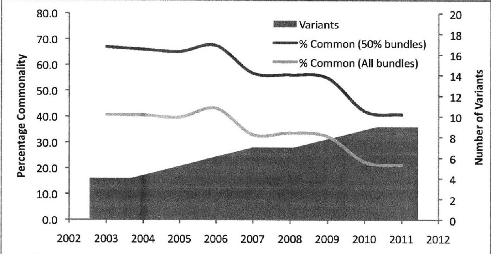

Figure 25 Commonality falling by 50% over the 10 year lifetime of the program

The level of effort applied to manufacturing learning and to programmatic challenges suggests that the team was certainly cognizant of lifecycle costs when creating new variants. However, it is clear that reductions in the benefits of commonality were not explicitly costed in decision making. As a result of new variant introduction, the production line has been significantly strained. Specifically, the team has not seen the expected reduction in design effort associated with commonality, quality benefits have decreased markedly, requiring the quality team be grown from 1 to 4 employees, and raw inventory has foregone economies of scale on the order of 75%, or $7M.

<!-- PDF_PAGE: 73 -->

These results suggest that where commonality strategies were pursued, Heavy Equipment projects did not have a clear template of commonality benefits. Investments were made at a variant level, and did not evaluate the impact to other variants within the platform. While managing to commonality goals was seen to be a very effective motivator in the initial platform development, later variant addition does not appear to have set similar goals for the retention of commonality.

## Disclosure

This report was conducted under a Project Agreement between Heavy Equipment and MIT, which governs the scope of the report as well as the treatment of confidential information. This report represents the work of the authors. Any inaccuracies contained are the authors' fault.

Heavy Equipment's participation in the report, and all of the interviews contained within, was voluntary. Heavy Equipment did not fund the creation of the report.

This copy is a Public Report, but the Authors' explicit written permission is required for distribution.

## Thanks

This case would not have been possible without Heavy Equipment's consistent support for the project. The authors would like to thank Employee 1 for his sponsorship of the project, as well as Employee 2 for his tireless work in support of its recommendations.

## Heavy Equipment Table of Contents

Company Overview ... 74

Background on Commonality: Previous Initiatives and Commonality Tensions

... 75

Commonality Benefits Considered ... 75

Existing Commonality Practices ... 78

Commonality Practices: Location 6 Div1Fam3Product2 Mini-Case ... 79

Commonality Impact – Commonality Metrics and Parts Growth ... 81

Financial Incentives for Commonality ... 83

Case Study – Platform 1 ... 85

Conclusions and Recommendations ... 100

<!-- PDF_PAGE: 74 -->

## Company Overview

Heavy Equipment is a heavy equipment manufacturer, producing a range of products. The firm has traditionally pursued a quality product pricing strategy, supported by a large dealer network and a strong warranty program.

Heavy Equipment maintains 2 large divisions, Division 1 and Division 2, containing strongly independent product lines. With overall sales of $XX Billion, it is a large player in all markets in which it chooses to compete. It occupies the position of market leader in the Division 1, with larger sales and margins than existing competitors. By contrast, Heavy Equipment faces strong competition for sales in Division 2, where pricing and market position vary by product line.

The firm has recently introduced an asset productivity metric widely across the firm, intended to focus operations on realizing returns against the firm's large asset base - $ XX Billion in non-financial assets.

## Terminology

Unless otherwise indicated, the following terminology is used in the report.

- Product Family = A series of similar product lines grouped by similar function.

- Product Line = A series of similar models performing the same function, often scaled by performance and price.

- Model = Variant = An individual model, likely contained within a product line.

- Platform = A Product Line displaying intentional commonality

- Commonality = The sharing of parts or processes across several models or product lines.

The names of Divisions, Families, Products and Variants have been masked in this report to protect the identity of Heavy Equipment. A numbered hierarchy is used to reference products, ex. Div2Fam1Product1 indicating a product line within a product family. For example, 'bolts' might represent a product family, 'large bolts' might represent a product line, and '3/8in bolt' might represent a variant.

One product line is referenced differently in the document, the subject of a detailed case study. "Platform 1" is a product line within Division 1. Other product lines within the same product family are listed as Div1Fam5.

Additional sensitive information has been masked in the document. Locations are numbered and sensitive costs, volumes and margins are denoted by order of magnitude [ $ XX ~= $ 100] or normalized.

<!-- PDF_PAGE: 75 -->

## Background on Commonality: Previous Initiatives and Commonality Tensions

Heavy Equipment has had several past commonality initiatives at the platform level. For example, these include Operator Station Commonality (common operators station on Div1Family1 and Div1Product2), a shared operator station between Div1Fam1Product3 and Div1Fam1Product4, and Coordination Technology (centralized effort to rationalize parts with similar functionality). These initiatives demonstrate that commonality has been around as a potential strategy for at least 15 years, but has not necessarily become a central focus.

The firm has strong tradition of incremental product changes in support of high product quality. Product lines are very stable over time (some stretching back more than 50 years), and major redesigns are infrequent (ranging from 5-20 years). The Continuous Improvement Program, also known as Value Improvement, is a formalization of the firm's strong focus on customer needs, where yearly cost reduction targets are set for each model, on the order of 2%. These updates are introduced formally as Model Year Updates, or informally on the manufacturing line. This effort is staffed by a current engineering group, as separate from new product engineering, which composes 20-25% of the total engineering effort (n=2 programs).

Together, these forces of quality and cost reduction sit in tension with the concept of platforming. Incremental cost improvement targets offer yearly opportunities to exchange common parts for divergence. Where these costs are measured at the part level, they do not capture either the increase in cost from additional overhead or the reduction in commonality benefit. A rough proxy for these opposing forces is the ratio of current to future engineering effort per product line. Two product lines surveyed (one in each division) showed current engineering occupied a quarter of the total engineering effort, while future product engineering occupied three quarters of the total.

The firm has recently implemented a "Reorganization Plan" which attempts to centralize more of the model control under broad Product Families.

## Commonality Benefits Considered

By and large, the employees interviewed were cognizant of the concept of commonality benefits. Many were able to name 3-5 benefits when asked to name the benefits, recognizing that the purpose of interviews was to discuss experience with benefits, not to survey interviews as to benefit categories. A broad swath of benefits were covered in aggregate, with the most frequent being inventory benefits from reduced parts count. A list of commonality benefits which impact cost is provided below, with indications of product lines who had previously experienced the benefit (maximum two lines noted). Those benefits shown in bold were not

<!-- PDF_PAGE: 76 -->

mentioned by any interviewees. Interviewees were not explicitly asked to list as many benefits as possible, but rather they were asked to identify important benefits.

The benefits shown below are separated into builder and producer benefits, to recognize that not all benefits accrue to the builder. They are roughly ordered according to lifecycle phase.

## Builder benefits

- Reduced development cost on later variants (Div2Fam1, Finance)

- Shared testing equipment investment [Div2Fam2, Div2Fam3]

- Learning effects in testing - fewer labor hours / unit [Div2Fam2, Div1Fam2]

- Shared manufacturing equipment and tooling investment, or the ability to move to higher volume production methods (Div1Fam1, Div1Platform1)

- Learning effects in manufacturing - fewer labor hours / unit (Div2Fam2, Div1Platform1)

- Fewer internal quality control rejections (Div1Platform1)

- Reduced external testing / validation (ex. aircraft type certification) (none)

- Reduced sales and logistics effort against fewer configurable options (Div2Fam2, Div1Fam4)

## Builder or Purchaser benefits

- Reduced purchasing cost (bulk discount from suppliers) (Div1Platform1, Parts)

- Lower inventory for production and sparing (fixed storage cost and variable acquisition and maintenance costs) (Div1Fam2, Parts)

- Lower training expense (fixed capital cost and variable hours) (none)

- Shared fixed cost of operations / support (none)

- Learning effects in operations / support (lower service time / cost) (none)

- Slower replacement rate for spares from higher quality / better design (overlaps with inventory saving, includes reliability) (Div1Platform1, Div2Fam4)

Note: [bold items were not listed by any interviewees]

External testing benefits are of low relevance as few of Heavy Equipment's lines of business require extensive external testing or type certification. Similarly, as Heavy Equipment does not operate its own equipment, training benefits were not noted. While support activities (Dealers offering repair and warranty services, Parts supplying replacement parts) are an important component of the business model, interviewees did not link either the fixed cost or learning effects of these activities to commonality benefits.

<!-- PDF_PAGE: 77 -->

In the list, benefits are not necessarily the same order of magnitude. Employees listed several benefits as being the 'most valuable'. A finance employee listed 'leveraging R&D' (i.e. shared development cost) as the largest benefit by dollars, even the majority of other interviewees did not explicitly note it. Several corporate employees listed 'complexity reduction' (i.e. reduced inventory, reduced sales & logistics effort), but awareness of this benefit was markedly lower among product lines. While the most valuable benefit varies by platform, we can conclude that there isn't an organizational wisdom about this at Heavy Equipment.

Of the archival documents reviewed relevant to commonality, many listed benefits of commonality, such as "reduced part numbers" and "late point model differentiation". Benefits were not exclusively listed in cost terms (ex. "minimize stamping cost" vs. "seamless model change-overs") but the vast majority related at least indirectly to cost. Some benefits listed could be interpreted as relevant to platforming objectives outside cost - "increased manufacturing flexibility" could be interpreted as reducing time to market, which is a revenue benefit. The dominant focus of the benefits listed was cost reduction.

None of the documents or interviews contained benefit projections for the purpose of project approval or investment. It would appear that benefits are not costed prior to the required Investment Authorization (IA) at the end of Phase 3, and that early program commonality decisions are made on the basis of strategy and experience (including judgment on engineering feasibility). No instances of costing by commonality 'analogies' (benefits achieved in other product lines) were uncovered. Analogies and previous commonality experience were certainly strong drivers of goal setting (ex. setting high commonality targets on Platform 1, common operator station goals on Division 1 and Division 2 products, wheel and tire proliferation on Div1Fam2), but these experiences were formalized into costs at the program definition stages.

Divergence opportunities within individual programs did explicitly trade on a subset of benefits. Once the cost profile for the program is established, and once the engineering design has progressed to a parts breakdown (bill of materials), benefit calculations can be made more concretely. For example, the Div1Fam1 common operator station explicitly costed making lump-sum tooling investments against allowing variants to build their own tooling as required, concluding that lump-sum would retain more commonality and costs less. Further examples are also discussed in the Platform1 section.

In sum, programs were comfortable conducting benefit calculations once the maturity of the program enabled detailed analysis. Prior to maturity, programs did not conduct explicit calculations on benefits, but set commonality goals based on experience and strategy.

<!-- PDF_PAGE: 78 -->

## Existing Commonality Practices

Two levels of commonality are seen within Heavy Equipment - within a product line and across product lines.

Heavy Equipment has a clear strategy of scaled product offerings. This is particularly apparent in Div2, where a linear scale is used almost universally. For example, Div2Fam2 scale between a low end model (performance parameter = 10) and a high performance model (performance parameter = 17). Within this range, there are 10 models, but scaling of features is linear (as opposed a full factorial combination of options). In Division 1, there is clearly a range of performance offered per product, but less 'packaging' or linearization of model lines is seen less often.

Within these product lines, commonality occurs through design reuse from other line models. Few ground-up redesigns were discussed in interviews. Platform 1 was the only full-product ground up redesign discussed, but several subsystem (operator station and engines) redesign programs were discussed. When commonality was undertaken, the existence of stable product lines helped fund development - variants had available budgets, as opposed to the case of new variant introduction without precursor which must be funded from central budgets.

Commonality across product lines is less common at Heavy Equipment. The history of commonality section noted a operator station commonization program between Div1Fam1 and Div1Fam2. Where commonality did arise, interviewees noted three factors - proximity, analogies, and cost pressure. For example, a significant Div2Fam4 redesign borrowed a number of parts from an existing Div2Fam1 line. The engineering groups were co-located, the products shared features and functionality (such as component voltage levels), and the Div2Fam4 business was losing $ XX M / year.

Historically, Heavy Equipment has had strong brand identification, driven by a common appearance. Several instances of 'common look' programs were noted, in one case driven by an external design firm, which resulted in 'similarity' without a reduction in parts count. In Division 2, the common cab program resulted in some identical interfaces which was subsequently reinforced by positive customer feedback. To date, customer preferences around identical interfaces or parts is perceived internally as "nice-to-have" rather than "must-have", and was generally separated from internal commonality benefits in interviews.

To the extent that commonality projects are funded across product lines, it appeared that the lines were able to negotiate terms (such as labor division and requirements). These terms were easier to negotiate where one variant accounted for the majority of the volume. However, maintaining employee continuity was cited as a challenge. For example, on the Div1Fam1 common cab, during a three year

<!-- PDF_PAGE: 79 -->

development period, every original employee had moved on, save the lead engineer. Interviewees were cognizant of the concept of commonality ownership, but without functional ownership or enforced continuity, they described it as a challenge.

Several employees raised commonity risks. Notably, problems with common parts are more broadly leveraged - for example, a cap screw used 50 times per unit across 4 Platform 1 variants suffered hydrogen embrittlement, requiring inventoried units to be reworked. Cannibalization within a product line to lower margin units was also cited as a risk, but was frequently mitigated in demand forecasts. Supply management noted that spares demand for common parts can be more difficult to forecast across several models (especially when new products come out in parallel). Further, common parts that are made to be interchangeable with legacy parts can cannibalize sales of old high margin unique parts. These risks were not expressed as widespread concern at Heavy Equipment, but they are noted to the extent that commonality programs have to withstand examination and concerns raised.

The strong product lines are rooted in strong factories. In some cases, all products in the family are co-located (as in Location 1 with Division 2), while in others, product families are divided among several locations (Location 1 manufactures Platform 1, while Location 3 manufactures higher performance variants in the same Family as Platform 1). Cooperation between factories was noted in several cases. Location 1 used Location 2 engineering content for 40% of the design effort when producing a new variant. Location 4 manufactures Div1Fam2Product1 and Div1Fam2Product2, but the engineering group for Div1Fam2 is centralized in Location 5. Until a year ago, Div1Fam2Product1 and Div1Fam2Product2 were in separate divisions, maintained physically separate buildings on the same site, and the Div1Fam2Product1 was designed on site. A recent reorganization has grouped these two lines closer together with a view to realizing more commonality.

## Commonality Practices: Location 6 Div1Fam3Product2 Mini-Case

To illustrate decision-making on commonality with strong factories, we discuss the development of a new Div1Fam3Product2 for the European market. The majority of the Div1Fam3 business is located in the United States, with production for the domestic market located in Location 7. Div1Fam3Product1 and Div1Fam3Product2 are built in Location 7. In 2006, Heavy Equipment determined that there was a market for Div1Fam3Product2 in Europe. An existing factory in Location 6 (Europe) served the European market with Div1Fam3Product1. This facility was a relatively recent acquisition (8 years previous) - marketing, manufacturing, and distribution were run out of Europe, but engineering was centralized in Location 7.

The team discussed several options for the commonality strategy. Div1Fam3Product2 could be designed and built in Location 7, then shipped to Europe. They could copy the existing US design, and replicate it in the European

<!-- PDF_PAGE: 80 -->

factory. They could maximize commonality between the existing Div1Fam3Product1 design built in Europe. Or they could do a ground-up design.

Volumes for Location 6 were estimated at XXX units / year, compared with 5 times more Div1Fam3Product1 units built in Europe (XXXX units), and 10 times (XXXX units) Div1Fam3Product1 built in the US. Initial European customer surveys were perceive to reject the existing US design.

Notably, US Div1Fam3 are have a characteristic dimension of 3.5, while European Div1Fam3 have a characteristic dimension of 3-3.5 machines can be used in Europe, but they have to used more slowly. European customers also requested New Feature, not currently available on US models. Additionally, Heavy Equipment management had a different styling plan for Europe - operator stations and hoods were to be sourced from a Heavy Equipment factory in Location 8 (Europe) which built exclusively European styled models.

Cost to re-design a US Div1Fam3Product2 was (post-hoc) estimated at $2-4M, while the ground-up design cost was originally estimated at $10M, with a further $4M for tooling in either case. In light of strong customer requirements, Heavy Equipment management elected to build unique for Europe. The ground-up design was chartered to reuse where possible, and efforts were taken to scale the traditional design process to the volume produced - new designs were historically 2x-3x the estimated cost for the European Div1Fam3Product2.

The original projections estimated 20-30% parts commonality, while the design realized ~10% commonality. The project overran the design budget but underran the tooling budget, and overall achieved ROI hurdle rates in the early years. Manufacturing was coordinated by a 50/50 split of manufacturing engineers in the US and in Europe (Locations 6 and 7).

Since the product launch in 2008, volumes have declined from 95% of the original volume estimate to 63% of the original volume estimate. Shared fixed costs spread over a thinner volume base in addition to warranty redesigns have put upward pressure on cost. Further, the long time cycle for warranty issues (4-6 years) has raised questions about the product line's sustainability.

Heavy Equipment management is currently considering significantly more common offering, and has shipped dimension 3.5 products to Europe for customer evaluation. In retrospect, interviewees felt that the majority of the early discussion centered on whether the market should be entered, with relatively little time spent on commonality. The concept of 'scaling' the design investment was not consistent with Heavy Equipment's warranty program. Had the scaling argument borne more scrutiny, interviewees felt the team would have been forced to consider commonality more carefully.

<!-- PDF_PAGE: 81 -->

## Commonality Impact - Commonality Metrics and Parts Growth

Commonality metrics were found to be regularly used in Division 2, and occasionally used in Division 1. The metrics tracked were:

- Division 2: common parts present in at least 2,3,...n variants (flat parts hierarchy)

- Division 1: common parts numbers present in all variants (flat parts hierarchy)

In Division 2, commonality metrics are available for each product family on a quarterly basis (shown for the Div2Fam3Product1 in the figure below). Three product families provided explicit confirmation that the metrics are discussion in design reviews (the author did not have time to ask each product family).

Percentage Parts Common To At Least 2 Variants for 850 BullDozer

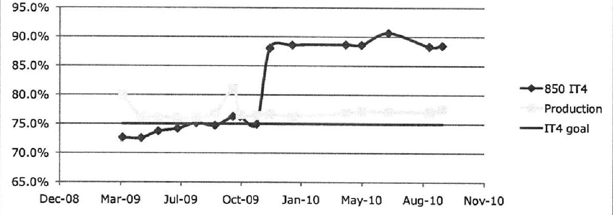

Figure 26 Sample part commonality metric tracked

In both cases, commonality metrics were explicitly chosen for their simplicity. Division 2 is aware that a weighting by span (number of variants with common part an aggregation of the separate 2,3,...n metrics), volume or cost could provide more information, but weighed simplicity of operationalization and transparency above these complexities.

The Division 2 commonality metric arose out of a Div2Fam3 Common Operator Station project. The metric took 3 years to 'catch-on'. The Program Manager met resistance from his design team in the first year, then tied it to the performance pay of his engineers in the second year, and saw significant growth in commonality levels through the third year. The challenge was primarily organizational - the actual database construction was estimated at 2-3 weeks effort. The metric was automated in a database for Div2Fam1 subsequently, then extended to all product lines in Division 2.

<!-- PDF_PAGE: 82 -->

Heavy Equipment is beginning to recognize the costs associated with parts proliferation. Over the last 6 years, non-complex parts (nuts and bolts) have grown at a steady 6%, and service parts have grown at 5%. While this growth rate matches closely with the growth in net sales (a rough proxy for units sold), there are few new products being introduced - existing product lines in both major divisions have been very stable over time. Therefore, this growth has arisen from model year updates (small technology updates and warranty fixes) and major redesigns (conducted every 4-20 years). A detailed analysis of total parts growth (complex + non-complex) was not available.

Several interviewees hypothesized that low allocations for inventory carrying cost (cited at 12% of unit cost) did not provide sufficient incentive to reduce parts counts. When asked to substantiate what lifecycle costs were recognized for new parts, interviewees (n=7) cited a broad range of numbers, from $500 to $25000. Several studies were conducted by Parts to determine the yearly and lifetime cost of new parts introduction, but these studies found poor penetration in the organization. These studies built costs from the bottom up, defining the activities related to parts, rather than from the top down (dividing fixed costs of supply management and inventory by outstanding parts). For reference, the distribution of new part lifecycle costs are shown below (1971 study forecast forward for inflation). Further, while the format for engineering change orders is standardized, there isn't a standard new part introduction cost attached. The decision is left to the judgment of the engineer.

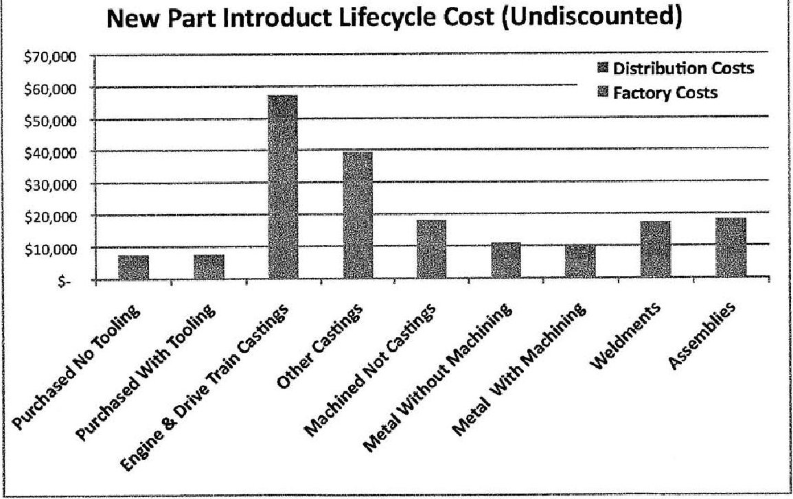

Figure 27 A detailed new part introduction study was available but not disseminated

<!-- PDF_PAGE: 83 -->

## Financial Incentives for Commonality

A number of financial practices relevant to commonality were catalogued at Heavy Equipment.

Investments of all types are processed through an Investment Authorization (IA). Approval of the IA varies with the size of the investment - factories may approve up to $0.75M, divisions may approve up to $4M, a firm wide appropriations committee up to $25M, and the board of directors is required for investments over $25M. When compared against commonality projects seen in the firm, it is apparent that small commonality projects would require divisional approval, and large commonality projects will carry a firm-wide approval perspective. The barriers are high, but so is the potential for executive support.

IAs are processed at the end of Phase 3 of Heavy Equipment's Product Development Process (PDP), therefore substantial design work has already been completed. Design work prior to the IA is funded out of individual product lines, whose total R&D per year cannot exceed $50M. Therefore, commonality requires up front initiative and investment on the part of the product line.

Although IAs are frequently evaluated for individual models, they have also been conducted at a product line level - a recent example cited was the Div1Fam1 Products 1,2,3. The intent behind IA scoping is to include all costs necessary for the execution of the project - receiving undeveloped or unfunded systems from a sister project would constitute a risk. From a commonality perspective, it is necessary to evaluate investments at the platform level. This in turn implies that platform IAs would be substantially larger, but also potentially more accurate, to the extent that they appropriately valued sharing between series. Interviewees were unaware of any IAs written across product lines.

IAs are evaluated primarily on ROI. Payback period is also calculated, but it in infrequently cited as the active constraint. From the perspective of the finance employees interviewed, spreading development costs is always the dominant commonality benefit.

## Division of Platforming Costs

Two allocations methods for platforming expense were evidenced at Heavy Equipment. The first is the lead variant pays all investment (seen on Div1Fam2 Common Operator Station, tooling for Div1Fam1 Common Operator Station, Div2Fam3 Common Operator Station, and Regulatory Opportunity Development programs). The second allocation method used is allocation by projected normal

<!-- PDF_PAGE: 84 -->

sales volumes, a 7-year average to correct from seasonality and cyclicality (seen on Platform 1 and R&D for Div1Fam1 Common Operator Station).

Two rationales were given for lead variants investment - timelines and volume dominance. In the case of the Regulatory Opportunity variants, the lead was chosen by scheduling constraints - the generational update program for the lead variant matched the engine development timeframe. In the case of the Div1Fam1 Common Operator Station, which is intended to be shared across 5 variants, the lead variant was projected to need 80% of the total volume, and therefore would have the greatest power over the design and was most capable of bearing the investment.

None of the cases of lead variant investment contained differential investment criteria for lead (i.e. relaxed ROI goals). While leads with dominant volumes may generally be able to afford these investments, this impact could be significant for schedule-driven leads (which may have more equal volume division). The Engineering Manager on the Regulatory Opportunity program noted that his superiors were aware of the additional costs he was bearing, and were unlikely to penalize him on his reviews despite having exceeded his engineering budget.

The interviewees rejected the hypothesis that fear of write-offs motivated for lead variant investment allocation. The potential concern is that if the investment were allocated by planned variants, but then a variant dropped out, their share would have to be written off. None of the financial managers interviewed at Heavy Equipment shared this 'fear' - lead variant investment was motivated by timelines and volume dominance. For reference, development labor is never capitalized at Heavy Equipment, although the practice is being investigated as part of International Financial Reporting Standards (IFRS). Tooling is regularly capitalized.

There is an additional allocation practice of interest - division of profits from spare parts sales. These part sales contribute significantly to product profitability, in some cases upwards of XX%. Where parts are shared between models or product lines, the profit per spare part is allocated back to product lines using total historical sales as an allocation base (a proxy for installed base). This is logical, given that a larger installed base is more likely to generate more parts sales. However, it implicitly enables commonality benefits to be shared more widely than traditionally at Heavy Equipment.

transfer pricing

## Cost Allocation

Separate from explicit cost allocation among variants (as discussed above), costs are shared by activity-based costing (ABC) codes and overhead rates. The number of ABC codes varies by factory, ranging from 10's-100's. Those costs not allocated by ABC are lumped in a general overhead rate at the factory level. Overhead rates do

<!-- PDF_PAGE: 85 -->

not exhibit significant variation across factories in North America (single percentage points).

Where Heavy Equipment manufactures parts internally, but then transfers them to another factory for final assembly, fully-allocated costs are used as transfer prices. For example, all hydraulics cylinders for Heavy Equipment are manufactured in a Location 9 factory. The fixed costs for the factory are computed in an overhead rate and allocated out to all the cylinders that leave the factory. The advantage perceived is that profitability can be linearly summed for the constituent factories, while the disadvantage is that any changes to production levels can potentially turn cost-center factories into profit centers.

## Case Study - Platform 1

Platform 1 was a platform of products intended for the mass market. Production volumes were set at 6x the largest existing Heavy Equipment line. Development was initiated in 1998, initially producing 4 variants under leased brands. After 2 years of production, the 4 variants were rebranded as Heavy Equipment products in 2003. By 2010, the platform extent has grown to 9 variants.

## History

Heavy Equipment has previously attempted to enter the mass market for Platform 1 in the 1990s. The Previous Platform 1 line was derived from a upmarket model, through a process described as "cost reducing" - revising the design to include less expensive parts. Employees described the Previous Platform 1 as a flop - the labor and overhead content required for the Previous Platform 1 made for low margins, and hindered its ability to compete on features at the competition's price points. The Previous Platform 1 was cited by all interviewees as the motivation for a ground-up design that became the Platform 1.

## Initial Commonality Plan & Benefits

While the Platform 1 team realized that different design and manufacturing techniques would be required for the intended volume and cost targets, commonality was not initially a defining strategy. Rather, commonality arose out of "tear-downs" of competitor products - stripping rival models to discover technology used, identify manufacturing and assembly process, and determine parts count. Three competitor models were compared, revealing competitors had parts commonality counts in the low 80% range, where commonality is measured as identical parts weighted by the number of times a part is used per machine.

<!-- PDF_PAGE: 86 -->

Commonality was set as an initial goal based on a comparison with competitors, as opposed to a resulting from an explicit unique to common cost comparison. The Program Manager highlighted that while the program was founded on cost, margin, and volume targets, commonality goals provided employees with significantly more concrete goals. The actual goal of 80% parts commonality was set at the Vice President level (above the Platform Manager)

Management promulgated the new commonality targets through a series of "design guidelines", in addition to the proscribed commonality goal of 80% parts commonality. These guidelines were essentially grouped subsystems or production functions - the most significant was a common pre-paint chassis. The team felt significant economies of scale could be achieved by constructing a common chassis, thus delaying product differentiation to after chassis assembly and chassis painting.

Benefits of commonality were frequently listed on presentations and in design reviews, but were not explicitly quantified. Some benefits listed directly reflected cost savings - for example, less tooling capital, reduced work in process, reduced floor space, and increased purchasing leverage. Others were indirectly linked to cost, such as delaying model differentiation on the assembly line and reduced assembly cycle time. Overall, benefits listed and cited during the design phase were consistent with a "lifecycle" perspective on commonality benefits. As such, no 'unique alternative' cost projections were created. Later sections describe the team's estimates of commonality design premiums and labor productivity compared to previous (non common) products, for reference

Significant investments were made in order to realize the platform's goals. The factory floor space was tripled at a cost of $12M, and tooling necessary for tripling line throughput was purchased for $9M. Design and test activities took 2 years, occupying a team of 24 FTEs [~$5M]. No analyses explicitly comparing these investments against realized commonality benefits were uncovered, although the next section does describe estimates of the commonality design premium. These investments were made by the Heavy Equipment Investment Authorization (IA) process, against volume and margin targets for the variants. This IA further assumed 4-5% cannibalization of the next product range up [Div1Fam5Product2].

## Execution on Original Commonality Plan

The design team largely met their original commonality goals. At the start of production, parts commonality stood at 77%, translating into a realized 460 total parts (of which 426 were purchased parts) against a goal of 450 total parts. First year production [MY02] under Leased Brand names was XXX,000 units, 2x the largest line to date, but only 1/3 of the intended max production.

In retrospect, team members estimated the commonality engineering design premium between 25%-50% depending on the part, or roughly $1M-$2M.

<!-- PDF_PAGE: 87 -->

A number of initial design challenges were encountered. Marketing emphasized the importance of "step-up features" - either significant performance differences or visible differences for the more expensive models. Characteristic Dimension (CDim) was such a step-up feature. With the larger CDim, the team felt that larger rear tires were needed for appearances. Tire size is an architectural variable for vehicles they govern torque and drive speeds, which in turn determine transmission output. Transmissions were an intended common part which was modified during the design process. The team traded new transmissions against the costs of engineering different gearing within the same transmission housing, settling on the latter, arguing that it minimized the unique part creation. Interviewees implied that the larger tires were not traded against the revenue impact - this 'feature' was treated as necessary, and the team set about minimizing its impact on commonality per the commonality guidelines.

Another divergence opportunity was encountered when the possibility of a New Feature was raised. Although not part of the initial design, this feature would enable accessory sales. However, the rear fender was a supplied component. The team traded the accessory revenue against the incremental cost of re-stamping the rear fender after it had been delivered to the factory (less than 1% of unit costs) plus the additional WIP cost. No evidence suggested that the line sequencing impact or new part introduction cost was included.

The team was sufficiently focused on their commonality goals that these (and other) divergence opportunities were traded against a subset of lifecycle cost impacts, resulting in low divergence during the product development and test phases.

## Manufacturing and Launch

Several new manufacturing techniques were used to enable commonality and to minimize assembly challenges (at the cost of greater design time). For example, a common cap screw was used 50 times, the common chassis carried mount points for all 32 engines (spread across 3 suppliers), and all final assembly (after chassis painting) was conducted from one side (no need to flip the unit).

This project was also unique in that it set assembly station time (takt time) goals. Previously, takt times were a dependent variable, determined by a manufacturing analysis of the design. In turn, takt times determined the length of assembly line and the number of employees. A takt time goal was set early in the project at 45 seconds.

As mentioned earlier, the team prioritized simple assembly processes, given the seasonal labor in use at the factory. Given strongly seasonal demand for Platform 1, 50% of the wage labor force (XXX employees) is hired for roughly half the year (Nov - April), while the other 50% is kept on full time (XXX employees). At peak production in 2003, a total of XXXX wage employees were used - wage employment

<!-- PDF_PAGE: 88 -->

has not quite decreased in proportion to production (XXX units/peak employee in 2003 vs. 90% of the 2003 units/peak employee currently).

The product was launched under 2 licensed brands in 2001, with production in the third year exceeding XXX,000 units. Cost per unit of $XXX (labor + overhead) was achieved, representing a 50% reduction over the $XXX/unit realized on the Previous Platform 1 cost-reduced design, but still 1.6x to 2x in excess of the competition's $XX/unit.

## New Variant Additions

After a year of production, the decision was made by Heavy Equipment management to re-launch the product in as a Heavy Equipment product. Interviewees cited quality and reliability as the key gateways to Heavy Equipment branding - the product to had prove it could meet expectations consistent with the Heavy Equipment brand.

The rebranding effort was significant, employing 8 FTEs over 11 months [~$1M]. Although no major performance changes were introduced, new parts creation was on the order of 10-15% as parts carrying the new color scheme were labeled as new parts. Total parts count remained stable, as the old color parts were retired.

The Heavy Equipment branded units were sold at Retailer 1 starting in 2003, as well as through the Heavy Equipment dealer network. In 2006, a second retailer was added - Retailer 2. Between 2003 and 2010, 5 new base models were added. Interviewees described pressures from the retailers as a driving force behind new variant introductions. Both retailers requested variants with differentiated performance, where these small performance differences would be used as sales differentiators. Examples cited included engine modifications and new seats. As of 2010, only 1 of 9 variants is available exclusively through Lowe's, and 1 variant is available exclusively through the dealer network.

New variants filled niches within the existing platform extent (3 models), as well as increased the extent of the platform (2 models).

<!-- PDF_PAGE: 89 -->

<table border="1"><tr><td>Year</td><td>Model</td><td>Changes</td></tr><tr><td>2005</td><td>Performance variant for CDim1</td><td>Installed engine from the CDim2 model, new seat, wider tires</td></tr><tr><td>2006</td><td>Midpoint CDim1 variant</td><td>No new options, recombination of existing parts</td></tr><tr><td>2007</td><td>Higher performance- CDim3</td><td>Modified separate product model having the same CDim3 to remove for a specific functionality</td></tr><tr><td>2009</td><td>Midpoint variant between existing CDim2 variants</td><td>Spacer on transaxle to raise ground clearance</td></tr><tr><td>2010</td><td>NewFunction model</td><td>Several design changes, sold only in Europe</td></tr></table>

Figure 28 Model addition rationale

The 2005 addition resulted from the retailer requesting a new price point. Mass channel retailers have a policy of only offering one model per price point. Interviewees described a 'blocking' technique, where offering a new price point was used as a method to prevent competitor sales. The 2005 addition benefited from commonality in that it was launched on a short timeline - commonality of engine with the CDim2 variants reduced lead times as dealers were already stocking the requisite parts (ex. spark plugs, oil and air filters). The 2005 addition beat Heavy Equipment's volume expectations and was considered a successful introduction with little cannibalization effect.

The 2006 model was a midpoint addition to the CDim1 line, created by Heavy Equipment to cover an additional price point. Heavy Equipment expanded to Retailer 2 in 2006, displacing a competitor. In retaliation for stocking with a competitor, Retailer 1 cut its Heavy Equipment purchasing from 5 models to 3, with the overall effect that sales at Retailers 1 & 2 combined were lower than Retailer 1 alone in 2005.

The 2007 model was created in response to declining market interest in Div1Fam5Product3, which shares CDim3 with Platform 1. Historically, attempts to market Div1Fam5Product3 to the mass channel had revealed that mass channels did not upsell the high margin attachments effectively. The 2007 model was engineered by de-scoping an existing Div1Fam5Product3 that was built common with Platform 1, but not considered to be a Platform 1 variant. Engineers eliminated functionality and structure, and installed an existing Platform 1 transmission from a CDim 2 model.

<!-- PDF_PAGE: 90 -->

In 2008, no models were added, but Heavy Equipment pursued both Retailers 1 & 2 with options for 'exclusive' models. Retailer 1 turned down the offer, but Retailer 2 accepted, resulting in the CDim2 performance variant being branded as a 'Limited Edition'.

The CDim2 midpoint variant was introduced in 2009 in response to dealer requests. The CDim2 midpoint variant was sold exclusively through the dealer network, and was pitched as a 'appeasement' to the dealers, who had felt betrayed by the entrance in the mass channel. For reference, roughly 40% of the Platform 1 volume is transacted through dealers.

The final addition, the NewFunction model, was built entirely for the European market. It was the least common of all variants, causing the parts common to all models count to drop from 32% to 22%. Its development has been blocked by engineering for 2-3 years, but it was finally given the go-ahead following a rotation of the design team.

The NewFunction was the only model with a detailed investment analysis for variant addition was available. The team clearly recognized that lower commonality levels would require both significant development ($2M) as well as new tooling for the new layout and new unique parts introduced ($2.7M). The cash flow analysis included parameters for cannibalization and service parts revenue, as well as contribution to depreciation on existing assets using direct labor as an allocation base. On an incremental basis, at projected volumes, the variant entry was to produce an IRR of XX% (2x the hurdle rate), and thus the decision proceeded. The inventory carrying cost of new parts creation was not included in the analysis, and neither was the impact on the line's productivity.

## Variant Impact on Commonality

The cumulative result of the model additions is a marked decrease in commonality levels, as shown in the figure below. Please note that the commonality metric shown below is simply identical parts (not weighted by part incidence per machine). Therefore the 77% common metric cited by design engineers (weighted by part incidence) corresponds to 40% common shown below (not weighted by part incidence) for 2003. The number of purchased parts common to all bundles has fallen from 173 (2003) to 146 (2011). The total number of purchased parts has grown by almost 50%, from 426 to 687, the majority of which (75%) is attributable to the 2009 and 2010 model additions.

<!-- PDF_PAGE: 91 -->

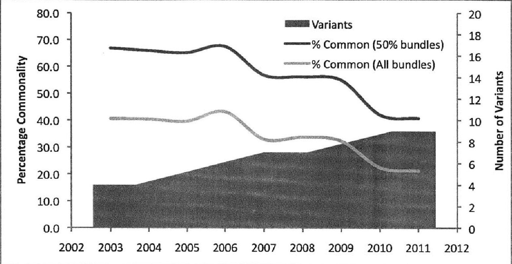

Figure 29 Commonality fell by 50% over the lifetime of the program

By plotting the total volumes for each CDim, we can see that the overall trend is downwards, but individual model introductions have had near term positive effects. We can see that both the introduction of the CDim1 midpoint variant had a strong effect on sales, while the CDim2 deck midpoint variant introduction corresponded to a reduction in sales in its first year. (the other 3 model introductions cannot be evaluated without the missing 2004 data or the European NewFunction data). It is conceivable that individual variant additions and model year updates were successful in catalyzing sales, but that the net effects of many variant additions negatively contributed to sales. We note here that the result of materials and overhead cost growth grew the cost of the base model by 7% from 2003 to 2010, but it is not the purpose of this report to examine sales drivers.

<!-- PDF_PAGE: 92 -->

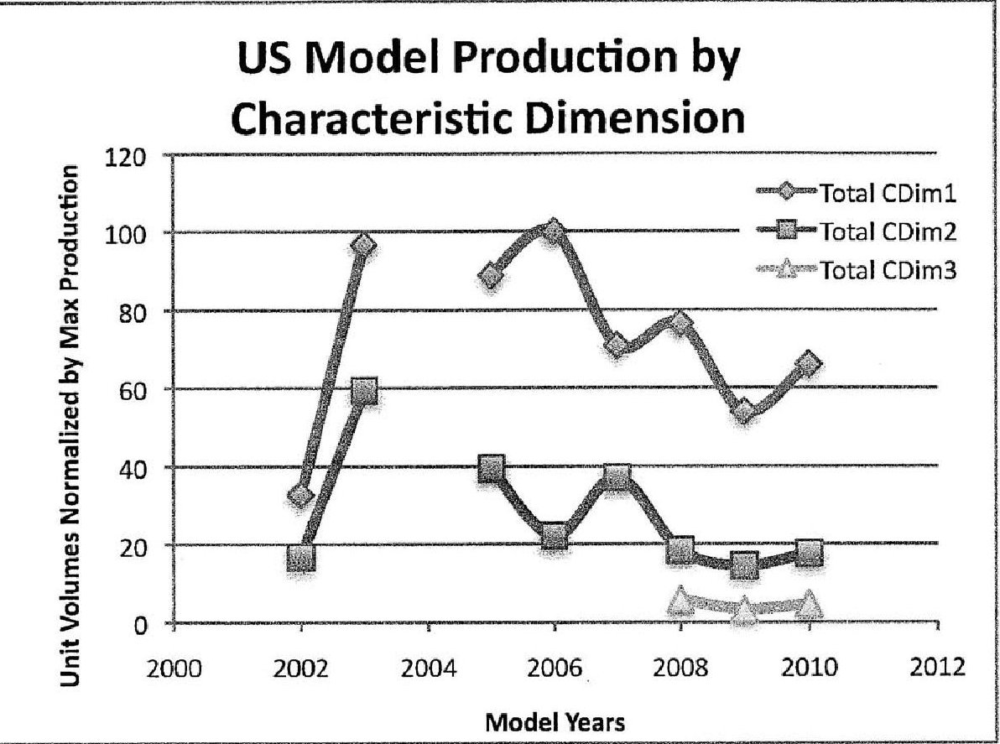

Figure

Figure 30 Model production volumes

## Variant Impact on Commonality Benefits

Given the timeline of variant addition and commonality trends as background, we can examine the evolution of commonality benefits attributed to the platform. These are summarize in the chart below, with Red indicating benefit erosion, Yellow indicating possible benefit erosion, and Green indicating realized benefits.

<!-- PDF_PAGE: 93 -->

<table border="1"><tr><td>Commonality Benefit</td><td>Changes with variant additions</td></tr><tr><td>Shared Development Cost</td><td>Design team size fixed at 5 or 6 FTEs for both new variants and model year updates did not see reduction over time (benefit not achieved). Additionally, design labor from other centers was used for new variant development, as much as 47% of total design time (for the NewFunction model).</td></tr><tr><td>Shared Tooling Cost</td><td>Minimal additional tooling for first 3 variants-$400K (or 4% of original tooling) for automation, switching pneumatic tools to electric tools. Significant additional tooling for NewFunction-$2.7M (30% of original tooling)</td></tr><tr><td>Economies of Scale</td><td>Overhead rate has grown from by 48% on $XXX in 2002 to 2010, signally fewer economies of scale at the factory Largely explained by decreases in platform volume decreased to 72% of max volume/year.</td></tr><tr><td>Learning Curves in Manufacturing</td><td>Productivity Growth-XXX to XXX units/shift/line, an increase of 48% Cost:2-3 new technicians,1 new manufacturing engineer, transfer of 4 technicians from variable labor to fixed labor.</td></tr><tr><td>Lower Quality Expense</td><td>Incremental internal quality improvements from 93-98% (Product First Pass Yield) No noticeable growth in warranty costs Cost:2 new technicians,1 new quality engineer</td></tr><tr><td>Reduced Raw and WIP Inventory</td><td>Raw inventory essentially constant over time, despite decreasing volume Savings foregone of $7M.</td></tr></table>

Figure 31 Heavy Equipment commonality benefit impact

## Shared Development Cost

The size of the development team at Location 1 has remained roughly fixed since the original product launch at 5-6 design engineers, or roughly half of the team size during platform design. This team has handled both new variant designs and model year updates. For some new designs, this team was augmented with labor from other centers or with contract labor.

Although labor for each new variant was not available, we can piece together some parts of the puzzle. From 2002-2003, the entire design team (6 FTEs) was engaged on re-designing the private label machines to Heavy Equipment machines, with additional labor from 2 contract FTEs. Between 2003 and 2004 the team pursued only model year updates (no new variants were introduced). From 2005-2010, a

<!-- PDF_PAGE: 94 -->

new model was launched every year save 2008. The only data available is from the NewFunction model [2009], the least common of all variants. Two members of the staff design team were employed for 2 years [2007-2009], together with 1.75 FTEs / year labor from other centers, for a total effort of 7.5 FTEs.

While the size of the design team is clearly a reduction from the platform design team size, it is still large in an absolute sense, and has seen not reductions over time.

## Shared Tooling Cost

From 2003-2007, minimal additional tooling was required ($400K), none of which was directly connected to the addition of new variants. Where these tooling investments were made, such as DC tools, they drove manufacturing productivity (discussed below).

The NewFunction model required significant tooling ($2.7M), consistent with the fact that it has the least commonality of all the variants on the line. This tooling investment was evaluated against the incremental revenue potential and found to have a positive ROI.

## Economies of Scale

Although it is clear that the original platform design achieved economies of scale relative to its predecessor, it is not clear what economies were lost due to variant complexity, and what economies were lost to volume decreases.

As noted originally, labor + overheard cost decreased by 50% from the Previous Platform 1 to the 2002 models on Platform 1. Since then, labor + overhead has risen as high as $XXX, a 47% increase over the 2002 cost. The changes in overhead (excluding labor) are shown below.

<!-- PDF_PAGE: 95 -->

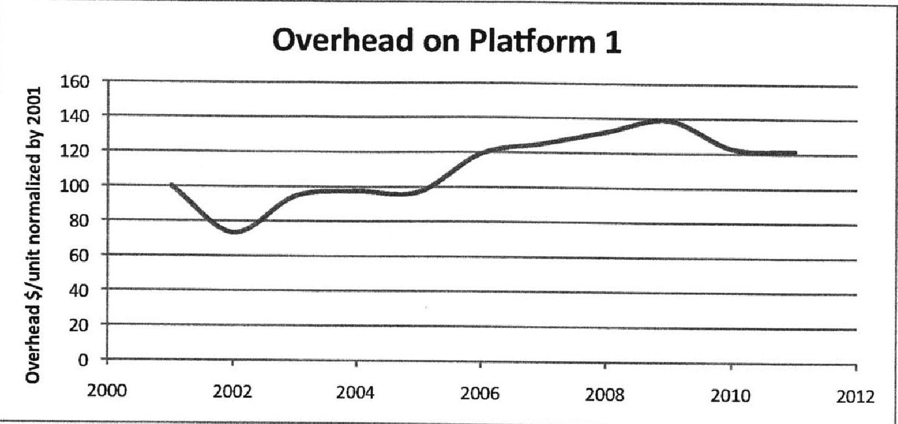

Figure 32 The program saw rising inventory, but primarily due to falling volumes not commonality changes

We would expect some of this growth to be accounted for by decreasing volumes. Plotting volumes against overhead rates, we can see that roughly 90% of the growth in overheads can be accounted for by volume, with 10% unaccounted for.

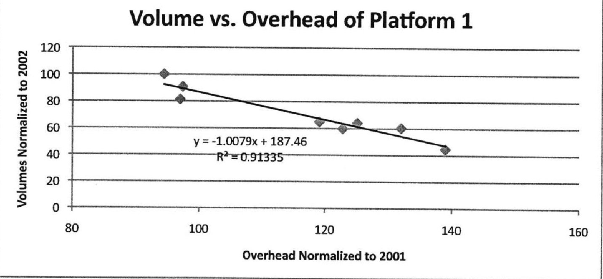

Figure 33 Overhead is largely correlated with volume

This analysis does not enable us to conclude what gains would have been made in overhead over time without variant introductions. For example, this data includes a change in the factory shipping strategy, where a $2M investment to bring storage onsite yielded a $2.5M benefit in the first year, or a reduction of $4% of the total fixed costs of the factory. The open question is whether overhead would have

<!-- PDF_PAGE: 96 -->

decreased over time with constant variants and constant volume. Given that overhead is stable with respect to volume here, any of those gains would be equal to the costs of increased complexity from additional variants.

## Learning Curves in Manufacturing

Overall, Location 1 has made productivity gains on the Platform 1 production line. As shown in the figure below, line productivity has grown. Further, the number of stations on the line has decreased slightly, and the time per station has dropped from 45s to 38s.

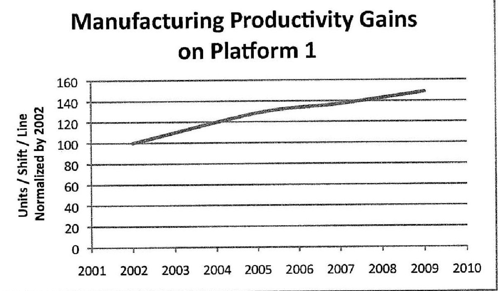

Figure 34 Manufacturing productivity rose significantly over time, due to labor investments

This overview data above would suggest that benefits were achieved on the line. However, employees described significant "strain" on the line. Where production used to be scheduled on a daily basis, it is not uncommon for schedules to change within a given day. Scheduling production occupies a greater fraction of the team's time - for example, they have developed precedence relationships for model switches on the line - Variant A should not precede Variant B - which has added complexity to the scheduling function.

Increases in the line complexity are seen both in terms of manpower and in terms of process.

The line initially employed 2 manufacturing engineers. A manufacturing engineer (2006) and 2-3 manufacturing technicians were added (2004, 2006) to handle manufacturing specifications for new products and process changes. The timing of these additions is consistent with the new variant introductions. A further

<!-- PDF_PAGE: 97 -->

technician per line was added (4 technicians for 4 lines) to walk down the line when switching variants, but this was offset by a reduction in the number of staff on the line. This practice alone was insufficient, so the line has also begun skipping as many as 10 places between variant changes, rather than the traditional 1 place. Overall, the labor changes to the line represent a transfer from variable labor to fixed cost labor, despite decreasing volumes!

The increase in variants is also apparent in changes to the manufacturing procedures. Changes to procedures amounted to 10 changes/ year in the first 2 years of the program, and grew steadily to 80-90 changes/ year from 2003 through 2010. An additional half FTE was required to process these elevated change levels (included in the 2 technicians above). Changes to manufacturing procedures occur for a number of reasons - process improvement (representing 30-40% of volume) and changes required by new parts (60-70% of volume). This data does not unequivocally signal divergence, as model year improvements at constant commonality levels could account for the data. However, discussions with team members suggested that these changes were representative of the impact of new variant addition on program complexity.

## Lower Quality Expense

Quality metrics tracked by the team suggest that both internal quality checks as well as external quality checks (warranty claims] have remained stable or improved. Product First Pass Yield, an internal quality check giving the fraction of units that were ready for shipping off the line rose incrementally from 93% to 98% during 2003-present. Additionally, the team reported stable warranty claims rates.

However, these quality improvements came at significant effort. Initially in 2001, there was no quality manager. One quality manager was added in 2002, then 2 new technicians [2004, 2006], and then 1 quality engineer [2006]. Although these costs were widely acknowledged to be the result of new variant introductions in retrospect, they were not directly costed as part of new variant introductions.

## Reduced Raw, WIP, and Finished Goods Inventory

Location 1 has reduced Finished Goods inventory throughout the period of new variant introductions (2005-present) as part of a conscious policy, which coincides with the rise of asset productivity at Heavy Equipment (decreasing assets improves asset productivity]. This decrease is all the more stark considering variant introductions - at constant days on hand inventory per variant, total finished goods would rise with increasing variants, which implies that days on hand per variant decreased faster than new variant introductions.

<!-- PDF_PAGE: 98 -->

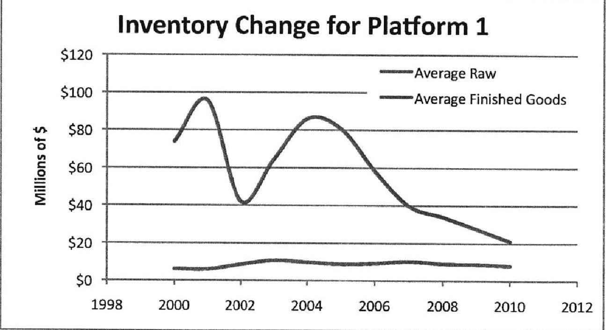

Figure 35 Finished goods inventory decreased exogenously (policy), but Raw Inventory did not

Through this period, Raw Inventory has remained roughly constant, and data for WIP was not available. Computing Raw Inventory per Unit and per Finished Goods $, reveals that Raw Inventory has grown significantly over time. This is consistent with decreasing commonality and more unique parts, requiring production to hold more parts up in stock. Interviewees suggested that WIP would display similar trends to Raw. We value the savings foregone by assuming Raw Inventory had decreased at similar rates to Finished Goods, which yields that the organization could have saved $7M in Raw Inventory per year. Note that this does not include the corporate externalities associated with new part introduction of 261 not valued under the factory's inventory.

<!-- PDF_PAGE: 99 -->

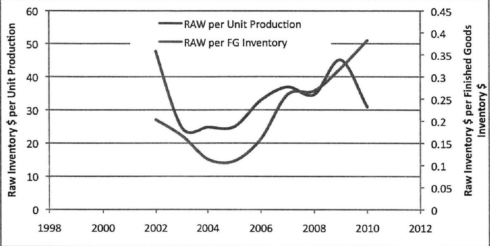

Figure 36 Comparison of counter-factual changes to Raw Inventory

## Summary of Platform 1

The original entry into the mass market for Platform 1 was clearly successful, as were the strategy of employing commonality to increase volumes and decrease costs. Pressures to add variants arose from a combination of competitor price points and retailer price points. It is not clear from this analysis whether the total number of variants was appropriate for the market, nor is does this analysis conclude whether the organization should have planned 9 initial variants or proceeded incrementally with additions.

What is clear is that variant addition decisions were driven from the market side, and that these pressures resulted in decreasing commonality over time. The level of effort applied to manufacturing learning and to programmatic challenges suggests that the team was certainly cognizant of lifecycle costs when creating new variants. It is also clear that reductions in the benefits of commonality were not explicitly costed in decision making.

Reductions in the benefits of commonality fall in two categories - explicit costs and foregone additional savings. The increased quality expenses and raw inventory carrying cost represent explicit costs to the program. The potential for additional savings from line productivity represents foregone opportunity, a more challenging

Analysis of the benefits in retrospect reveals that divergence had both direct and indirect cost implications on the program. To the extent that the incremental variant revenue exceeds these costs, beneficial divergence was evidenced. The challenge, as seen on Platform 1, is that these incremental costs are diffuse. Tracking these costs

<!-- PDF_PAGE: 100 -->

historically is the first step towards developing appropriate commonality analogies for use in future commonality projections.

## Conclusions and Recommendations

Heavy Equipment has a wealth of previous commonality experience, spread across its product base. Commonality as a strategy for achieving cost savings has been successfully applied on a number of product lines. However, commonality is not a broad organizational focus. Heavy Equipment's strong product lines and focus on incremental improvement sit in tension with the centralization and change management required for successful commonality.

The challenge in a diversified organization like Heavy Equipment is that the support necessary for implementing platforming must be championed at a senior executive level together with the recognition that it is not beneficial to all product lines. Heavy Equipment frequently displayed concerns relating to platforming, particularly in the high margin, high market power division. Other concerns cited include possible restriction of technology adaptation and barriers to incremental product improvement

These results suggest that where commonality strategies were pursued, Heavy Equipment projects did not have a clear template of commonality benefits. Investments were made at a variant level, and did not evaluate the impact to other variants within the platform. While managing to commonality goals was seen to be a very effective motivator, in the initial platform development, later variant addition does not appear to have set similar goals for the retention of commonality

Knowledge of commonality premiums was widespread among commonality users, but thin overall in the organization. While capital spending decisions related to commonality were readily evaluated against future cash flows, design time premiums and integration challenges were not. Early estimates of that commonality premiums can be used downstream to force consideration of commonality benefits, in the same way that tooling investments force an evaluation of payback period.

The concept of new part introduction as a disincentive for divergence was identified. Divergence faced relatively weak incentives from new part costs at Heavy Equipment, in that costs were not mandated, nor was there agreement internally on what the cost should be.

Cost pressure played an important role in surfacing and sustaining commonality initiatives at Heavy Equipment. The division under cost pressure developed stronger commonality reporting and presented more mature management processes. These practices were not easily transmitted, within the division or to other divisions. Decentralized product control clearly played a role in the diffusion rate of commonality practices. However, labor mobility was also identified as a transmission mechanism for commonality analogies - engineers setting parts

<!-- PDF_PAGE: 101 -->

proliferation targets on new projects, engineers transitioning commonality metrics from a project to the whole division, etc.

Heavy Equipment faces a number of market challenges moving forward - competition on cost in existing markets and opportunities for expansion to emerging markets. Both of these challenges present opportunities for commonality. Specifically, the potential for higher volumes in emerging promise strong benefits against which investment could be allocated, while the low margins offer useful design pressure.

<!-- PDF_PAGE: 102 -->

## Chapter 8 Case 2: Rail Equipment

## Executive Summary

This report was chartered to evaluate Rail Equipment's commonality practices. Specifically, it sought to capture how commonality benefits (such as shared development cost and reduced inventory levels) are projected based on commonality targets, how investments and costs are allocated based on commonality benefits, and how commonality benefits are accounted for when commonality changes.

Rail Equipment has a wealth of strong design and customization experience, but limited forward commonality planning experience. Design reuse as a strategy for achieving cost savings has been successfully applied on a number of previous orders. However, this case was is focused primarily on intended commonality, not passive design reuse.

Overall, interviewees struggled to identify commonality benefits. Commonality is understood as a concept within the organization, but it is not operationalized in the form of metrics or commonality targets, and the depth of understanding of the concept varied significantly.

The historical business mindset of detailed tender, gaps analysis, and high volume orders still permeates the organization. The design team continues to dominate control of the platform, as evidenced by the succession of technical managers progressing to platform managers. Although the design review includes manufacturing, procurement, and testing, none of these groups could recall a design constraint imposed on Platform 1. Rail Equipment displayed impressively detailed cost estimates for individual projects. However, these estimates were grounded in component redesign estimates and integration buffers, and did not display strong historical understanding of the reuse percentage as a potential cost driver, or detailed analysis of the difference between identical reuse and "reuse but modify".

Interviewees had difficulty describing product family planning. Identification of configurations was challenging even with detailed plans available. While design teams understood required 'customization' work, i.e. variant specific design work, it appeared there was a gulf between high level goals (80% standard / 20% customization) and detailed design knowledge. No evidence of cross-disciplinary analysis of configurable options, such as cost to redesign as a function of

<!-- PDF_PAGE: 103 -->

configuration choice, common sourcing fractions, common labor processes, could be found.

Although key management personnel extended the commonality strategy from common design out to delayed differentiation in manufacturing and build to stock concepts, these strategies were unknown to several department heads. Specifically, projections of common manufacturing processes, time to differentiation, and significantly, the additional WIP cost of partial production were not yet anticipated by department heads. In part this was driven by project pressure - many departments moved from one project to the next, not being necessarily afforded the time or encouragement by management to project the consequences of commonality. Additionally, the lack of previous experience with commonality clearly plays a role, in that the division did not have previous attempts at platforming from which to draw lessons. Finally, strong divisional separations enforced by site-specific product specializations meant that employees were not able to import significant commonality wisdom from other divisions.

Further strategy extensions around reconfigurability and commonality of maintenance were not planned in detail. There are (slight) differences between design for modular production and for reconfiguration, and the team certainly invested in design for modularity. While an important segment of the R&D investment plan, neither the costing the business case for reconfiguration from a customer perspective and nor the business case for maintenance benefits of commonality was costed. Interviewees surfaced the rival explanation that the design was not complete as the reason the business cases were not completed, but this would appear to contradicted by the issuance of a parallel contract for the lead variant, and indications that the completion of the R&D program was being delayed while the program awaited customer orders.

The combined effects of higher volumes and smaller orders merit consideration of parallel production challenges and opportunities. The timing of the Country 7 contract offered an opportunity to refine these techniques and processes, with important differences arising from the fact that one was a prototype and the other was not an intended variant. The degree of organizational pain experienced, from employee turnover to coordination costs, to schedule and cost overruns suggests there is significant room for improvement.

Interviewees did not have strong lessons learned from parallel production, choosing instead to stick to serial production where possible. Examples of future questions around parallelism include the carryover of learning curves between parallel lines, new test procedures, and appropriate measures of cost sharing benefit.

Rail Equipment has taken an impressive leap in moving towards platforming. While slow industry clockspeeds, large offsets between variants and challenges in leveraging certification will continue to pose structural challenges, Rail Equipment has worked to define a platform that can create significant development cost,

<!-- PDF_PAGE: 104 -->

procurement, and manufacturing benefits. However, the majority of the challenges in managing to commonality benefits lie ahead, where the team will have to constrain desires to optimize in order to realize a return on its investment.

## Disclosure

This report was conducted under a Project Agreement between Rail Equipment and MIT, which governs the scope of the report as well as the treatment of confidential information. This report represents the work of the authors. Any inaccuracies contained are the authors' fault.

Rail Equipment's participation in the report, and all of the interviews contained within, was voluntary. Rail Equipment did not fund the creation of the report.

This copy is a Public Report, but the Author's explicit written permission is required for distribution.

## Thanks

This case would not have been possible without Rail Equipment's consistent support for the project. The authors would like to thank VP Employee for his sponsorship of the project, as well as Employees 2 and 3 for their tireless work in support of its recommendations.

## Rail Equipment Table of Contents

Company Overview ...105

Background on Commonality: Previous Initiatives and Commonality Tensions

...105

Commonality Benefits Considered ...106

Concept of the Platform 1 Rail product...108

Initial Commonality Plan, Benefits, and Investment...110

Execution on Original Commonality Plan ...112

Commonality Management, Commonality Metrics and Parts Growth ...115

Manufacturing and Contract for the First Variant...116

Validation, Testing, Certification ...120

Procurement, Supply Chain, and Site Manufacturing Initiative ...122

Financial Incentives for Commonality ...125

Commonality Benefits Realized and Projected ...128

Results to Date and Current State of the Program ...130

Conclusions and Recommendations ...132

<!-- PDF_PAGE: 105 -->

## Company Overview

Rail Equipment manufacturers a series of product for the rail market. The firm has traditionally pursued a bespoke engineering strategy, where clients specify requirements and equipment is designed and produced to order.

Rail Equipment's Holding Company is divided intro Rail Equipment, Business 2, and Business 3, with Rail Equipment accounting for 20-30% of sales and 20-30% of income before taxes.

Rail Equipment was historically centered on the French railway market and the French Rail Authority [Home Country National Operator], but today, Home Country accounts for only 20-30% of revenue for Rail Equipment. Business lines within Rail Equipment include:

- Product 1

- Product 2

- Product 3

- Services [maintenance and modernization]

- Lifecycle Products

Rail Equipment's position in the market varies widely by business line. Revenue by business line also varies significantly year to year, with portfolio effects stabilizing total orders.

Terminology

Unless otherwise indicated, the following terminology is used in the report.

- Product Line = Product Family = A series of similar models performing the same function, often scaled by performance and price.

- Model = Variant = An individual model, possibly contained within a product line.

- Commonality = The sharing of parts or processes across several models or product lines

- System = A large architectural piece of a rail product, such as the Running Gear.

Background on Commonality: Previous Initiatives and Commonality Tensions

The previous generation of Power2 Market Category 1 rail product, Predecessor, was originally intended to leverage a common design across several markets. Two configurations were originally intended - Inside Home Country and Outside Home Country - with appropriate voltages, signaling, and pantographs. Outside Home Country rail product were to be capable of operating in Country 2 and Country 4.

<!-- PDF_PAGE: 106 -->

The lion's share of the orders for the Predecessor were placed by the Home Country National Operator, and as a result, the Outside Home Country configuration fell by the wayside, leading to a unique development program.

The Predecessor design was successfully reused in a number of (originally unintended) applications. Small adaptations were made to allow Predecessor to be used with Market Category 2 rail product. The design was again reused for a small order from a private operator, again with small modifications.

A Power1 Market Category 1 variant of the Predecessor was developed 5 years after the initiation of the Power2 Market Category 1 variant. Significant modifications to the design were made, and engineers interviewed indicated that the Power2 design did not contain any concessions or commonality penalties related to the Power1 design. The Power1 rail product is more appropriately classified as partial design reuse, as opposed to serial production of platformed variants.

Rail Equipment's organization of factories into constituent component manufacturers and integrator factories suggests a historical commonality strategy of systems-based commonality and production techniques commonality. The history is in fact more complex, with site roles often arising from acquisitions. Current commonality strategies is discussed in more detail later.

The central commonality tension for Rail Equipment is the desire for standardization of product and process weighed against the business model of 'work for hire'. Historically, the vast majority of Rail Equipment's business came from Home Country National Operator, who commissioned rail products to exacting standards. Additional commonality tensions in the organization arise from the volume-based tradeoff of fixed costs of design against the variable costs of expensive manufacturing.

## Commonality Benefits Considered

The level of awareness of the concept of commonality benefits varied widely among interviewees. Some interviewees were able to name several benefits, and to prioritize them according to Rail Equipment's strategy. Several employees were not able to name any benefits, or suggested 1-2 smaller benefits closest to their given function - for example, the reduced hourly effort associated with quoting for a variant, when a lead variant has already been produced.

A broad swath of benefits were covered in aggregate, with the most frequent being reduced time to market (specifically reduced quoting time, procurement time, and design time). Those benefits shown in bold were not mentioned by any interviewees. Interviewees were not explicitly asked to list as many benefits as possible, but rather they were asked to identify important benefits.

The benefits shown below are separated into builder and producer benefits, to

<!-- PDF_PAGE: 107 -->

recognize that not all benefits accrue to the builder. They are roughly ordered according to lifecycle phase.

## Builder benefits

- Reduced development cost on later variants

- Shared testing equipment investment

- Learning effects in testing - fewer labor hours / unit

- Shared manufacturing equipment and tooling investment, or the ability to move to higher volume production methods

- Learning effects in manufacturing - fewer labor hours / unit

- Fewer internal quality control rejections

- Reduced external testing / validation (ex. aircraft type certification)

- Reduced sales and logistics effort against fewer configurable options

## Builder or Purchaser benefits

- Reduced purchasing cost (bulk discount from suppliers)

- Lower inventory for production and sparing (fixed storage cost and variable acquisition and maintenance costs)

- Lower training expense (fixed capital cost and variable hours]

- Shared fixed cost of operations / support

- Learning effects in operations / support (lower service time / cost)

- Slower replacement rate for spares from higher quality / better design (overlaps with inventory saving, includes reliability)

Note: [bold items were not listed by any interviewees]

As noted, coverage across the organization of commonality benefits was strong. Shared testing equipment and spares replacement were the only benefits not named. Many interviewees understood commonality across product lines better than within a platform - tooling for example is dominantly understood as a plantwide resource, with specific tooling adapters produced on a per-project basis.

The focus of discussion for the remainder of the report is on the operational actions related to these commonality benefits. In many cases, commonality benefits were cited, but not operationalized or projected going forward. For example, shared fixed cost of operations (for purchasers) was cited as a differentiating factor for sales, but no work was uncovered around pricing this benefit.

In the list, benefits are not necessarily the same order of magnitude. Employees listed several benefits as being the 'most valuable'. Shared development and bulk purchasing benefits emerged were the most prominently cited - later analysis in this report examines this hypothesis.

Of the archival documents reviewed relevant to commonality, many listed benefits pertaining to interoperability between different rail markets, which translates as a

<!-- PDF_PAGE: 108 -->

benefit to purchasers of shared fixed cost of operations, training expense, as well as non-cost benefits like flexible capability deployment. Reliability benefits to operators also figure prominently. Maintenance cost benefits to purchasers are discussed in technical detail, but no savings projections are listed. Documents contained allusions to builder cost benefits, using words like "platform producing the best price", "configurations at the lowest cost", "optimized costs from reconfiguration", "increased competitiveness". Reduced time to market is cited, with the implication of reduced development times on latter variants, but this logic is not explicitly included. Graphics illustrated the concept of leveraged common development cost. The most explicit illustration of builder commonality benefits was a projection of production cost over time, but this decrease is not attributed to individual benefits.

Options, configurations, and customization are noted as qualities of the platform, but little content is dedicated to illustrating configurations or options. Options are noted "toilets, comfort equipment, ...", as is the concept of "evolution management", but no plans were evidenced in the documents reviewed. Configurations content includes the first level of decomposition - types of pantographs, types of brakes, etc but the content does not progress to define plans for configuration management or comparisons of configurations.

## Concept of the Platform 1 Rail product

As previously noted, the previous generation of rail product was a ground-up design of both Power1 and Power2 variations, with significant offset. Following the Predecessor, plans were put in place for a derivative rail product with an updated motor, the Platform Attempt, around early 2006. The motor development was funded through R&D at the site responsible for this system (separate from the final integration site for rail product). At least one contract was bid based on the Platform Attempt concept, but it was not won. Interviewees indicated the remainder of the design was not executed beyond the costing study.

## Origins of the Platform 1: Market Analysis

The business leads for the Platform 1 program described three steps undertaken to plan Platform 1. A market sizing exercise was conducted, customers were interviewed, and a technical feasibility exercise created.

In mid 2006, a review of the rail product market was conducted. This review was motivated by the rough conclusion of the Predecessor lifecycle [~10 years], specifically the obsolescence of the electronics, the failure of the Platform Attempt to win its contract, and most importantly, the emergence of new of type of client private operators. Private operators resulted from the deregulation of Market Category 1 markets (cited by interviewees as 2005 for Country 2, Country 5, Country 6), where firms run Market Category 1 traffic using private equipment. These private operators often lease the equipment, who are often closely tied to the

<!-- PDF_PAGE: 109 -->

banking industry. In 2007, purchases by private operators was 20-30% of new orders (by volume)

The 2006 review found:

- Private operators want to buy rail products off the shelf, in order to react rapidly to demand changes. Operators were unlikely to set as detailed requirements as traditional national rail departments, and similarly, would expect the firm to complete testing and commissioning activities (traditionally completed by national rail departments).

- The study found operators would be willing to wait a maximum of 9 months, as opposed to the traditional 3 year delivery schedule.

- The study sized the target market at $XXX-XXXX M for the current generation of rail products, including private and national operators.

Based on this study, early market capture goals were set to capture XX% of sales in the market within 5 years of the first Platform 1 rail product delivered, increasing linearly to XX% over the remaining 5-10 years of the generation. The market leader, Competitor 1, captured much of the private operator business beginning in 2004, with a platform spanning Power1 and Power2 variants and was known to build to stock to reduce delivery times. Market capture by for by Rail Equipment was X% in 2005. This was clearly an ambitious plan, against which significant investment would be allocated.

The 2 $ ^{n d} $ step the team took was to conduct customer interviews. From September 2006 to March 2007, 8-10 meetings with potential customers were held. The desired attributes retained were:

- Rail products that are interoperable between countries

- Rail products that can service both Market Category 1 and Market Category 2 traffic

- Rail products that can be retrofitted to service different markets.

- Inclusion of new signaling equipment

- A desire to purchase homologated rail products

In addition these attributes, Rail Equipment raised the issue of customer Willingness to Pay for these "features", but the conclusion drawn was that these features could not be included as a premium - customers would only pay a market price.

The 3rd step conducted by Rail Equipment was a review on feasibility with engineering. Specifically the exercise sought to determine whether a common product was possible (although the platform extent or level of commonality was not defined at this stage), and a review of how a common product could build in features that would be competitive differentiators with customers. The conclusion of this study was that a common product was possible, and that an 'complete solution' would differentiate Rail Equipment from competitors. This 'complete solution' would package the rail product with signaling and services. At the time, Rail

<!-- PDF_PAGE: 110 -->

Equipment was the market leader for signaling equipment, had previously completed retrofitting services, but had not previously offered maintenance services. This feasibility study did not finalize a business case for services.

## Origins of Platform 1: Technical Origination

Several engineering interviewees had a different perspective on the creation of the program. They variously described the limitations of the Predecessor as the power available (P1 compared with competitor's P2), the available voltages (V2 not available), and the inability to run the existing Running Gear in Country 2, among others. They describe the technical team leading the genesis of a new program, based initially on updating only the power and the voltage. Engineering didn't feel it had a sufficiently strong understanding of the market to merit a full redesign.

This scope then grew within the Rail Equipment team, powered by engineering, as opposed to market requirements. The Body shell was included in the scope as a platform capable of receiving both Market Category 1 and Market Category 2 Running Gear. Other scope changes were included, as described later. It is worth noting that the Body shell is the largest individual design element for Final Integration Site. Within the Rail Equipment multi-site locations divided into component design / manufacturing and final integration sites, Final Integration Site is the final integration site as well as the Body 'component' supply site. Therefore, the organizational incentives for commonality would suggest platforming on the Body was the natural direction for the design team.

It is clear that both of these perspectives are valid histories of the program - the progression from market changes to design evaluation, and the internal design push. Both took place. We will later show how the tension between them shaped the evolution of commonality on this program.

## Initial Commonality Plan, Benefits, and Investment

On the basis of the process described, Rail Equipment's President and Board approved an investment for Platform 1. The 2007 investment made a number of programmatic and technical decisions. Chief among the programmatic decisions was to fund the development from internal R&D funds, all the way through Certification, which was intended to conclude in 2010.

The program also made a number of technical decisions. They decided to platform based on voltages, in order to meet private operator expectations on interoperability. They decided not to platform on rail type, therefore excluding chiefly Countries 8 & 9 from the market, focusing on five countries. Country 6 was also eliminated from design scenarios, as its height restrictions would have require new Running Gear designs, and Country 6 market is dominated by Power1 rail products, possessing less Power2 infrastructure. This decision was set by a broader strategy of building Home Market rail product as technology leaders, expanding to

<!-- PDF_PAGE: 111 -->

the remainder of world on a project-by-project basis. They chose to pursue both Market Category 2 and Market Category 1 variants, although the informal emphasis was heavily on Market Category 1 variants, and the initial budget included only Market Category 1.

They decided not to platform on power source, excluding Power1 constraints from the design, based on market considerations. Notably, Rail Equipment is not back-integrated into Power1 engines, and the supplier relationship was perceived to add time-to-market, reduce margins, and pose warranty questions for customers (who is responsible for systems problems involving the engine).

Despite the new technical content (Running Gear, V2 voltage) members of the technical team noted that the primary challenges were not purely technical, but rather, the short delivery time, configuration management, and modular design would pose the greater challenges.

The development effort was costed by the technical team Final Integration Site. This was the same team developing the technical proposal for the program, and represented a departure from normal practice. The rail product organization has a strong 'tender' team, with allocated design engineers, bid managers, and cost estimators, who produce binding estimates for contracts. In hindsight, interviewees suggested this enabled them to input optimistic development cost figures, motivated by the concern that the board would not approve a larger effort.

The investment decision does not appear to have explicitly costed commonality benefits. Cost savings appears to be "as important" as the revenue side benefits of interoperability and time to market. Interviewees tended cited reduced time to market as a necessity, followed by the admission that this implied development cost savings. Fear of losing market share in Home Market drove the revenue side commonality considerations. This fear was compounded by implications of the old business model (customers funding non-recurring contract costs of development plus variable cost of production) - if Rail Equipment loses market share in Home Market, it won't be able to pay down the non-recurring costs, the leverage of which enables a profitable rest-of-the-world business. An executive on the program addressed this directly, "we didn't balance the level of commonality against the benefits - commonality was a means of survival".

In addition to development cost spreading, some degree of manufacturing cost savings were expected. A consortium activity with a competitor had revealed the competitor had significantly lower manufacturing times for the Body. This led to the expectation that Body manufacturing cost could be reduced by XX%.

These commonality benefits are illustrated in order to make 2 points.

1. Although the team has since identified more commonality cost benefits, the original investment decision did not set specific commonality benefit expectations

<!-- PDF_PAGE: 112 -->

2. The team had mixed reasoning for commonality - a combination of market imperatives and cost opportunities. Although it is common to have both revenue and cost benefits of commonality, the team would face challenges separating these for the purpose of commonality decision making.

The President of Rail Equipment approved the program in June 2007, with funds released September 2007.

## Execution on Original Commonality Plan

The team for Platform 1 was led by a platform director and a technical director. Three platform directors were used over the course of the program - one who had previously been the technical director, and one who occupied the roles of technical director and platform director simultaneously. Early project meetings included engineers familiar with maintenance requirements. Design reviews included representatives from manufacturing engineering and procurement. To understand the requirements created, several interviewees referenced a framework of norms requirements (rail industry standards), contract requirements, and past experience requirements. Interviewees described contract requirements as typically dominating the process.

Several interviewees noted that the requirements phase of the program proved a challenge, in that the organization was accustomed to receiving and translating customer requirements from lengthy specification documents, and was not accustomed to setting requirements internally. Negotiating requirements internally took longer than anticipated, representing the first 6 months of effort on the program. Note that employees did have relevant prior experience in requirements negotiation, best illustrated by the bid options produced. Bids from Rail Equipment are often submitted with multiple prices, created by parsing the specification into 'minimum scope', 'interpreted desired scope', and 'full compliance scope'. Despite this relevant prior experience, the translation to internal requirements negotiation and control proved challenging.

The requirements and design process was entirely dominated by the technical team. Of interviewees in supply chain, procurement, manufacturing engineering, testing, and quality, none could recall requirements imposed by their groups on the design process. Further, despite participation in design reviews of manufacturing engineering and procurement, no interviewees could recall issues they raised or championed. With respect to past experience requirements, interviewees noted that these were mostly engineering and warranty issues. As a rough guide, there are 100 engineering staff members at Final Integration Site, compared with 30 manufacturing engineering staff members.

This organizational structure appears consistent with the dominant benefit identified being shared development cost. It is also consistent with later challenges regarding purchased cost and parallel production & test.

<!-- PDF_PAGE: 113 -->

The upfront architecture defined aspects of the commonality (ex. the Body would be common), but did not define commonality targets either for the rail product or separately for each of the systems. Although there was no explicit commonality goal, the team has consolidated around a figure of 80% commonality since the design concluded. This appears to be an extension of the Motor System commonality, which is the only system to have 80% commonality.

As variants have not been built as yet, the end commonality across variants remains to be seen. The team provided the following percentages as a rough estimate of parts commonality intended among future variants.

<table border="1"><tr><td>System</td><td>Commonality Estimate</td></tr><tr><td>Body</td><td>100%</td></tr><tr><td>Cab</td><td>100%</td></tr><tr><td>Motor</td><td>10%$\cdot$</td></tr><tr><td>Motor System</td><td>80%</td></tr><tr><td>Common Block</td><td>30%$\cdot$</td></tr><tr><td>Running Gear</td><td>10%$\cdot$</td></tr><tr><td>Control Software</td><td>100%</td></tr><tr><td>Electrical Cabling</td><td>50%$\cdot$</td></tr><tr><td>Brakes</td><td>100%</td></tr><tr><td>Auxiliary</td><td>100%</td></tr><tr><td>Signaling Block</td><td>100%</td></tr><tr><td>Rheostat Block</td><td>0%</td></tr><tr><td>Systems Cabinet</td><td>50%$\cdot$</td></tr><tr><td>Circuits</td><td>0%</td></tr><tr><td>Air System</td><td>10%$\cdot$</td></tr></table>

Figure 37 Estimated commonality among future variants by subsystem

*number in italics represent judgments based on interview information, as opposed to direct quotes

In retrospect, the team estimated the following commonality premiums spent-the design effort spent over a unique design, as shown in the table below.

<!-- PDF_PAGE: 114 -->

<table border="1"><tr><td>System</td><td>Commonality Premium</td></tr><tr><td>Body</td><td>20%</td></tr><tr><td>Cab</td><td>20%</td></tr><tr><td>Motor</td><td>?</td></tr><tr><td>Motor System</td><td>10% to other</td></tr><tr><td>Common Block</td><td>60%</td></tr><tr><td>Running Gear</td><td>60%</td></tr><tr><td>Control Software</td><td>100%</td></tr><tr><td>Cabling</td><td>20%</td></tr><tr><td>Brakes</td><td>30%</td></tr><tr><td>Auxiliary</td><td>20%</td></tr><tr><td>Signalling Block</td><td>50%</td></tr><tr><td>Rheostat Block</td><td>0%</td></tr><tr><td>Systems Cabinet</td><td>0%</td></tr><tr><td>Circuits</td><td>0%</td></tr><tr><td>Air System</td><td>30%</td></tr></table>

Figure 38 Estimated commonality premiums incurred by subsystem

On some systems, the team made decisions to take over-performance penalties. For example, the cab was design to the aerodynamic constraints at Speed 2, even though Market Category 1 variants will only run to Speed 1. The thickness of the windscreen is set by the Speed 2 case, as is the wiper strength, and the seals on the cab doors and windows. This decision was dominated by regulatory concerns and saving development cost - some aerodynamic features are required on all rail product for Country 2, and it is cheaper to only design 1 cab. In this case, no evidence of inclusion of later commonality benefits was discovered. The team made this decision on the basis of an evaluation of the design effort required for unique vs. common, but those interviewed suggested this was a judgment call.

On some systems, the team explicitly subdivided systems and created interfaces, in order to create commonality. The Auxiliary design was split into supply and contactors, so that the contactor design could be managed locally and kept common, whereas the supply units came from an Rail Equipment plant in Country 3.

The team also faced a number of challenges relative to commonality. The team defined the Body-Running Gear interface as common, even though the Market Category 1 and Market Category 2 Running Gear are significantly different, and the resulting work was cited as one of the largest project challenges. Although the Body carried only a 20% overall commonality premium, the interface design was cited as 50% more difficult because of commonality. Members of the team used language indicating they controlled only the Body design, and could not modify the Running Gear, the suspension, or the fixings. Whether this was an intentional choice of architecture, resulting from Rail Equipment's component strategy, or whether this

<!-- PDF_PAGE: 115 -->

was a communication challenge across sites could not be established from interviews. Interviewees did not cite trades of 'going unique' with the Body interface.

As separate from the individual systems, the engineering team tracks integration as a separate function (note - this is different from manufacturing engineering). Interviewees cited that in the design, they spent a 20% commonality premium planning mechanical integration for various options. However, they also cited that mechanical integration is where much of the effort will be spent when the rail product is customized for an order, for which the estimate figure is 20% of the total cost content is customization. Therefore, the team's effort is projected to represent a very small down-payment on the future work of mechanical integration.

## Commonality Management, Commonality Metrics and Parts Growth

For configuration and commonality management, the team binned parts in retrospect into 3 commonality categories;

- Standard equipment - same for all variants

- Unique equipment - different for each variant

- Optional equipment - specified by the customer, ex. toilets.

Members of the technical team were able to identify which equipment was standard vs. unique, but no formal tracking of this categorization was implemented. Unique equipment was presented in the marketing literature as "customized", referring to 3 systems - connection to the power line, signaling equipment and environmental systems (noise, fire extinguishing, etc). Customization is typically referred to in reference to country differences, and does not comprise selection of the operating voltages, or selection of Market Category 1 vs. Market Category 2 version. Many different views are presented of unique systems, but no comprehensive view emerged which could demonstrate the fraction of the rail product that is common vs. unique.

It is clear from interviews with design engineers that the choice of unique equipment impact a number of systems. The choice of voltage, and the number of voltages, impacts whether the common block contains DC equipment or not, how the Motor System is design, which type of main electrical equipment is used, which type of wiring is run, whether a Circuits Systems is needed, etc. Although these links are well understood by technical team members, the other lifecycle functions as well as project management personnel clearly struggled to operationalize commonality in manageable terms.

In response to this complexity, much of the program literature refers to 'standardized' or 'reference' equipment. Rather than choosing a product family representation or a configuration based representation, documentation revolves around a reference machine. This reference machine is a defined a choice of the

<!-- PDF_PAGE: 116 -->

unique equipment. Rail Equipment did not maintain a set configurations or likely variants for use analysis cases, choosing instead to use only the reference machine.

Rail Equipment did not track a commonality metric through the design. Design team members correctly identified that every metric has associated flaws. Interviewees cited that the team had not 'agreed upon' a metric. Four possible metrics were elicited:

1. Fraction shared parts, weighted by volume used.

2. Fraction major subsystems identical

3. Platform design cost in relation to customization cost

4. Weighted average of requirements gaps between 'standard product' and individual variants

Of the four, the latter two clearly related to the standardization mindset. The Motor System commonality figure quote of 80% is based on the cost of standard components compared to the cost of unique components, a derivative of #3 which excludes the platform design effort.

Interestingly, the costing team maintains a commonality metric separately. For the purpose of evaluating manufacturing engineering and production costs as a function of change in specification from a previous design, the costers built a spreadsheet working through every subcomponent, taking design change fractions from engineering and translating them into percentage change in manufacturing engineering and production. Change per subcomponent is calculated as a 2/3 weighting of production change and 1/3 weighting of manufacturing engineering change, which is the rolled up using a customized weighting of subcomponents to produce a summary number. This summary figure is referred to as the "Standardization KPI". While certainly a rough metric given the subjectivity of the percentages and the ad-hoc manner in which weights are assigned, the costing organization has begun to build experience around this measure. That said, the measure it not formally tracked going forward, nor is it evaluated against realized design commonality.

## Manufacturing and Contract for the First Variant

A number of changes to the program occurred through the design process. Chief among these was the acceptance of a contract for XX rail products from Country 7. Additionally, the team decided to require a new external shape, and to add an additional braking option. By the end of 2007, $XX M (33%) had been added to the R&D budget, bringing it to $XX M.

## Addition of Country 7

In March of 2007, Rail Equipment initiated discussions with the state of Country 7 to supply 20 Market Category 2 rail products based on the Platform 1. The decision to

<!-- PDF_PAGE: 117 -->

supply Country 7 with Platform 1 rail product, prior to the completion of the program, was made by the President of Rail Equipment. Three reasons were recalled by interviewees - the Country 7 contract would help cover some of the fixed costs of platform development, the Country 7 contract would subsidize the creation of the Market Category 2 Running Gear, and it would offer an opportunity to work on a V2 Voltage system (of the four voltages offered by Platform 1, Rail Equipment had the least experience with V2 Voltage),

The Country 7 rail products did not fall entirely within the expected platform extent of Platform 1 - they required a different pantograph, the several subsystems had to be modified for the heat (+50C instead of +40C), and Country 7 requested a second auxiliary converter for powering the Market Category 2 cars.

The agreement with Country 7 was signed in September 2007. Interviewees remember this as a "coming halfway through design" and "it came 4-5 months into the design", when in fact the R&D funding was released the same month. This is indicative that the design had been evolving since before the formal decision, and also that the ramifications of the decision took months to spread through the team.

Country 7 was costed by the costing team, rather than by the technical team. One interviewee indicated that the costing was aggressive on both design cost for Country 7 as well as margin for Country 7. Another interviewee described how the price for the contract was set by the market price, then working down from margin to cost. In retrospect, the costing team identified two mistakes:

1. Procurement budget was set based on rates available from suppliers for a contract of XXX rail products, instead of XX. The realized variable costs for Country 7 were higher than quoted, due to the increased procurement costs.

2. All 3 Platform 1 prototypes were assumed to be completed 8 months before first Country 7 delivery. In actuality, the first prototype were completed 2 weeks before the first Country 7 rail products was completed, and the $ 3^{\mathrm{rd}} $ prototype was cancelled. Thus the manufacturing proceeded almost in parallel.

Although the team had developed an estimation of the "fixed costs" required for Country 7 up front (specifically design, manufacturing engineering, and tooling), they weren't able what fraction of the fixed costs what unique cost for Country 7, vs. what fraction helped cover R&D. Although there were separate teams for Country 7 and Platform 1, many of the underlying design resources were shared. Rail Equipment does maintain a project based cost code system, but we infer that it did not distinguish between these two activities. The situation is further complicated by the fact that the parallelization of the projects created coordination costs and stretched schedules. No member of the team was able to quote what portion of the R&D Country 7 covered.

<!-- PDF_PAGE: 118 -->

## New External Shape

Some interviewees felt that the creation of Platform 1 caused design engineers to implement new features - the "once in a generation chance" problem. While some of these scope growths were resolved before the investment decision, other change were levied during the design.

Most notably, the external shape of the Body was altered. The President of Rail Equipment mandated the shape have smooth walls, rather than the corrugated design of the previous generation. The effort required to design and build the new shape was multiplied by 3x or 4x, relative to the cost anticipated for reusing the old shape, primarily due to manufacturing challenges encountered (deformation of the surface when welding to vertical supports). The cost of the shape is typically X% of the total design effort, so as a rough calculation, this might have been responsible for cost growth of $XXX K to $XXX K.

## Brake Change

A second brake type was added to the program. The timing of this addition was referred to as "almost at the end of design" and "1 year into the design process" the actual timing was December 2008. The existing brakes were unable to meet the braking requirements of the Country 2 market. Interviewees also cited supply diversification as a benefit, in that past monopoly suppliers had raised prices during production. Effort expended on the brake system was estimated at 10-20% of the total design effort.

The braking change, together with the decision that the brakes would share the same interfaces with other systems created rework for the Running Gear, Motor, and Air Systems. This rework was not only in design, but also in manufacturing and production, as it was decided that the $ 2^{\mathrm{nd}} $ prototype would be built with the new brakes.

## Manufacturing, Prototypes, and Program Challenges

Detail on the manufacturing engineering work for the program was limited, as the original manufacturing engineering lead was put on stress leave following the program, and subsequently left the company. No reported judgments of the commonality premium for manufacturing engineering were available.

For the construction of Platform 1 alone, $X M was spent to develop customized tooling. The platform manager estimates this will 85% of tools required for each variant. Tooling at Final Integration Site is broken up into factory tooling (shared broadly by all lines) and customized tooling (adapters to the factory tooling that to generate exact fit, typically scrapped after a year).

<!-- PDF_PAGE: 119 -->

The production of prototypes and Country 7 rail products essentially proceeded in parallel. This was routinely cited as the greatest challenge of the program. Although by volume, parallel production should have had a minimal impact, it was design and manufacturing engineering changes which posed the challenge.

Prototype builds are expected to take significantly longer than traditional manufacturing builds. For Rail Equipment, 1 prototype was expected to take XX,000 hours to build, compared with XX00 hours for a stable product (a 13x multiplier). This estimation was on the high end of prototype time multipliers, which range from 3x to 8x of the stable product manufacturing time. Changes arise with regards to tooling, production process, testing, and performance. No measure was available to suggest whether the Platform 1 prototype underwent the same number or scope of changes, as changes are not directly tracked.

However, we can note that a major source of changes on this program was an underestimation of weight, resulting in an overweight first prototype, and a weight reduction program. The restudy program reduced the weight of the Body by 1%. The relation of the weight estimation to the commonality premiums was not established.

In order to help manage these changes, a "runner" was designated, whose sole function was to communicate design change to production. The design team made the decision to publish design changes to the Bill of Materials as they arrived, rather than to process changes in batches in the hopes that the sooner the information was available, the smaller the magnitude of the impact. Some interviewees felt this exacerbated the complexity of managing changes. Other interviewees felt that decisions to outsource some fabrication and cabling to suppliers caused longer delays in prototyping, as the parts could not be modified or re-fabricated in house.

The net result on the prototypes was an increase of XX,000 touch labor hours to a total of XX,000 hours for the two prototypes, an increase of 21%. A conservation valuation of this overage, based only the increased labor, is $XXX K.

The manufacturing of the Country 7 rail products faced similar challenges resulting from the parallelization. In terms of batch size, XX rail products is small compared to traditional contracts (c.f. a maximum batch size of XXX). The shape of the learning curve is such that the knee in the curve is expected at NA units, and the previous record is expected to be reached within NA units. Within the batch for Country 7, there were actually 6 different configurations, with 15% touch labor differences between them. Much of the differences are in software, discussed under Testing below.

Finally, it should be noted that the factory was busy during this period, with 2 traditional contracts. While the detailed cost estimates do not vary according to projected plant utilization, this was cited by two interviewees as a possible factor.

<!-- PDF_PAGE: 120 -->

Manufacturing hours for Country 7 rail products averaged XX00 hours, relative to the 'record' of XX00 hours, or a growth of XX,000 hours / $X M. Although the counterfactual of serial production of Platform 1 prototypes and Country 7 rail products is unobservable, it was estimated that the direct labor hours would have been 15% lower for both if they had been completed serially. This would accounts for just under half of the growth seen on Country 7, and most of the growth on the prototypes.

Validation, Testing, Certification

Rail Equipment divides the post-manufacturing tasks into 3 groups:

Validation - Ensuring the rail product was built as designed

Testing - Verifying the rail product systems work

Certification - Obtaining certification of regulatory compliance

The testing group puts significant effort into regrouping train systems in the Functional Breakdown (created by engineering) to suit test purposes. Test for Platform 1 and Country 7 were divided into standard tests and non-standard tests. According to the team, standard tests are created only for standard equipment that is to say, identicality is required. are Although tests are currently dominated by variable hours, interviewees made the argument that it was not worthwhile to invest in complexity to standardize tests across similar hardware.

There were significant parallelization challenges and feedback between manufacturing, validation, and testing - examples of these phenomena abound. For example, the cabling for the first two Country 7 rail products was 100% redone after testing revealed some flaws. For reference, cabling is the primary task in the $ ^{2 n} $ of 3 manufacturing stages. This $ ^{2 n} $ stage represents 45% of the labor hours, producing an upper bound of $ XXX K for touch labor alone, not including testing effort.

Many of the tests are conducted on the driver's desk. The design team had originally anticipated testing with the desk in the rail product - set as a goal based on a tool seen at a competitor's facility. Testing with the prototypes revealed there wasn't enough space in the operator's cabin, and the desks would have to be tested outside the rail product, necessitating the creation of a testing bench for desks. Desks were assembled on the production line, but then completely torn down for testing, owing to a combination of the aforementioned external testing, as well as a lack of test inputs on the desk. Once testing was completed, desks were returned to the manufacturing line for re-assembly! As testing is done in series on the line, this required the rail product to be lifted from one section of the factory floor to another via overhead crane.

Challenges arose between testing and validation. Validation proceeded by functions, with a priority on the prototypes. Testing maintains that validation must come before testing, in order to prevent rework. Validation incurred delays by enforcing

<!-- PDF_PAGE: 121 -->

that some Platform 1 systems be completed before work began on Country 7, resulting in delays in Running Gear fitting and transformer fitting. Delays in validation of the prototypes resulted in queues of Country 7 rail products awaiting validation and testing. At one point, there were 5 rail products awaiting testing, but only 20% of the testing could be completed as the remaining 80% of functions weren't validated.

As an indication of the relationship between design and testing, the test team was queried on the utility of a common interface developed for cables. The test team responded that they believe the interface to be useful, but considered it "luck" that the design team included it. Test did not have a strong sense of inclusion in design, and further, they expressed doubts about the design team's ability to represent their needs.

Therefore, the tight production schedules, parallel tasks, and the out-of-sequence work caused challenges in testing and validation. The final Country 7 train was delivered in July 2010, 3 years and 1 month after the approval of the Platform 1 program, or 1-2 months late.

As a result of the challenges described, the validation costs allocated to Platform 1 rose from a budgeted $X M to a resulting $X M (33% increase).

Relative to the original schedule, the Country 7 rail product arrived in test 2 months late, and left 2 months late, suggesting there were no overruns. However, more hours were expended than expected, and the rail product left for Country 7 with only 85% of tests completed. Relative to an expectation of XXX hours / unit on average, the Country 7 rail products averaged roughly XXX hours each (2.2x). The 15% of tests that were conducted at the client site ran an estimated 10x longer than they would have in the factory, contributing to the hourly overrun.

When asked what the premium for parallel production was, interviewees were able to describe issues that arose, but did not retain an overall understanding of the premium. For example, interviewees were unable to describe a baseline expectation of Country 7's testing time on the presumption that the 2 prototypes had been completed beforehand. Further, when asked what was learned about validation and testing in parallel production, interviewees were unable to move past "parallel production is difficult, produce in series where possible".

## Certification

Certification of the Platform 1 is currently expected to cost $X M, and is projected to be complete in 2012 for Country 2, and later for the 4 other countries in the intended market. This is 2 years later than originally planned. The Country 7 rail product did not have to be certified.

The Certification rules present a significant commonality benefit in theory - achieve

<!-- PDF_PAGE: 122 -->

the type certificate for one variant, then leverage that investment for later variants at minor cost. However, in the rail industry, it would appear that much of the variation between variants is cause for re-evaluation of the type certificate. For example, changes in the brake system can require a new type certificate. Similarly, producing 2 variants at the same time, even for the same country, requires 2 type certificates. Whether or not variant changes can retain the same type certificate is not clearly defined - rather, the operator must present a case to the regulatory authority. Rail Equipment has made a series of guesses around which options and customization operators in Country 2 will choose, and is homologating against that configuration.

The program was originally supposed to have a $ 3^{\mathrm{rd}} $ prototype, whose function was primarily to enable Certification in 2 countries at once. However, this was cancelled. A variety of reasons were given, from "we learned all we needed to with the first 2" to "budget cuts".

Despite uncertain benefits from commonality for Certification, the team is attempted to achieve benefits where possible. For example, Rail Equipment is paying $XXX K extra (38% extra) on a normally $XXX K dynamic test, on the hypothesis that it can show the test was valid for both Country 2 and Home Country. If so, this will save $XXX K in 1-2 year's time as well as 40 days of planning.

## Procurement, Supply Chain, and Site Manufacturing Initiative

A significant fraction of the total cost of a rail product is the procured cost (70-80%) The team does not appear to have had a strong procured cost goal for the rail product, although there were likely estimates created after the market study.

The first thing noted about purchasing for commonality is that Final Integration Site does not differentiate between components sourced from other Rail Equipment locations as separate from suppliers. This is suggestive of the decentralized or site-specific viewpoint. It is also illustrative of the organizational setup, whereby a centralized sourcing group negotiates contracts, a decentralized procurement group inputs volumes and places site-specific orders, and supply chain owns the inventory and primarily coordinates timing and availability.

From the perspective of the local procurement group, the centralized sourcing is as distant as external suppliers. Until recently, the local representatives of the sourcing group were located in a different area from the procurement group. The local sourcing managers do not have direct authority over procurement buyers - they can coordinate, but cannot issue metrics or set compensation incentives.

Of the full cost (under the same volume assumptions as the above chart), only 20- 30% is procured by Final Integration Site from external suppliers, where the other 50-60% is transferred internally. No breakdown of "purchased finished" supplied components was available from a global Rail Equipment perspective.

<!-- PDF_PAGE: 123 -->

Rail Equipment divides suppliers into 3 categories, according to the level of cooperation.

<table border="1"><tr><td>Category</td><td>Relationship</td><td>By Cost</td><td>By Parts</td></tr><tr><td>A</td><td>Co-developed, Rail Equipment pays some tooling</td><td>60%</td><td>10%</td></tr><tr><td>B</td><td>Difficult interfaces, but not many functions</td><td>35%</td><td>?</td></tr><tr><td>C</td><td>Purchasing from catalog</td><td>5%</td><td>?</td></tr></table>

Figure 39 Rail Equipment supplier relationship partitioning

The collaboration with suppliers includes Rail Equipment paying for some of the supplier development, tooling, documentation, and project management - much more than simply tooling. Overall $X M was spent on suppliers, the majority of which went to A suppliers- 90% of A suppliers got some non-recurring funding.

Sourcing and procurement were told to produce quotes for the prototypes and the Country 7 order based on volumes of XXX rail products over 5-6 years. Only A suppliers were issued these guidelines. Sourcing's rationale for this decision was that B and C parts were more likely to change during testing. Although no specific instances were cited, the level of design change would suggest that A components were also affected by design changes before and during testing.

As a result, all A items procured were executed under "frame agreements" (negotiated discounts presuming volume discounts), but B and C components were procured in smaller batches. Critically, Rail Equipment's systems do not log the equivalent rail product volume purchasing rate, so analysis is easily fragmented, nor do they log the number of suppliers quoted.

Several interviewees cited small purchase volumes as a current barrier to successful capture of commonality benefits. Without systematic tracking of volumes procured, let alone discounts applied at those volumes, it is not possible to size the opportunity. While a majority of the cost (60%) was said to achieve the volume discount, the larger and more expensive items are less likely to be procured in quantity, and therefore may not achieve the necessary scale for sufficient benefits. The B & C group parts, on the other hand, compose 90% of the part numbers purchased (and an even higher percentage of the units purchased), and therefore are more likely to achieve economies of scale.

<!-- PDF_PAGE: 124 -->

Several interviewees cited high "change costs" incurred from suppliers, but data to evaluated the magnitude of this problem was not available. In conversation this was implicitly linked to the decision to outsource some prototype parts fabrication.

Despite the importance of purchased cost, no studies were uncovered of economies of scale discounts as a function of number of rail products produced (or market captured).

Rail Equipment's procurement software faces similar parts proliferation challenges to many firms, in that new part numbers are created when any attribute is changed (including color), and it does not track the similarity of parts easily. Similarity of parts is clearly a critical negotiating tactic when establishing the cost burden on suppliers of variety or commonality.

## Inventory

Inventory is currently managed deterministically, rather than stochastically. Inventory carrying costs were not discussed relative to Platform 1 and Country 7, but the site is proud of have the lowest inventory coverage of Rail Equipment sites.

Related to platforming, inventory cited significant project closure costs. In particular, excess inventory purchased to gain minimum order size and engineering changes resulted in $XX K of excess inventory for just Platform 1 and Country 7. Further, suppliers currently charge for packaging per project, while inventory interviewees indicated that simple design considerations could enable generic, reusable packaging. For reference, $XXX K was spent on packaging for Platform 1 and Country 7, of which $XXX K (66%) is currently rusting in an exterior storage lot, awaiting guidance from the platform team on reuse for later variants.

Rail Equipment has not currently developed detailed cost breakdown relationships with suppliers. In particular, inventory cited the split between production cost and transportation cost. Rail Equipment hopes to shift WIP and RAW inventory charges by holding more inventory at suppliers, but interviewees cited significant work remaining to determine the impact on transportation cost (lower container utilization with small delivery sizes?) and on supplier FG inventory levels.

Inventory currently has no knowledge of a partial build strategy which has been floated by the platform. This strategy would incur carrying costs and inventory risk in order to reduce delivery times for Platform 1 variants, but has not yet been analyzed by either the platform or inventory.

## Site Manufacturing Initiative

In parallel with the Platform 1 project, the Final Integration Site is preparing an initiative to reduce floor space and reduce WIP. The REVAMP project, as it is called, is targeting a 50% reduction in floor space and a 50% reduction in inventory for the

<!-- PDF_PAGE: 125 -->

same yearly output level. The initiative has spent $X M of its projected $X M (18%) budget, with the remainder on hold pending further contracts. The REVAMP project was not around when Platform 1 was designed, and it should be emphasized that it is not scoped to include design work on any current program.

Proponents hope to achieve learning benefits in manufacturing resulting from greater standardization of manufacturing process across product lines, but no formal projection has been developed. Further, the REVAMP project has provided a platform for manufacturing engineering to gather requirements on manufacturing which it is hoped will enable greater coordination with engineering.

Critically, however, the project has not defined a new facility for resolving disputes between design and manufacturing. The prevalent expectation is one of increased communication yielding stronger outcomes, but the team has not yet recognized the coordination costs or tradeoffs involved as yet. Although this initiative may act to increase design standardization via published processes and guidelines, the team has not yet factored in the potential for increased work-arounds, nor have they addressed the higher risks involved in coupling the output rates of all lines together.

## Financial Incentives for Commonality

## Bid Process

Rail Equipment has a large team in place for producing bids. This team is dominated by engineering resources, but also includes manufacturing engineering, production and procurement. As noted earlier, the team routinely produces 2-3 prices, based on a modification or selective adherence to the customer's specifications.

The bid placed is a fixed price contract, but with revisions agreed upon for labor and raw material price changes. Raw materials does not include changes to supplierproduced components, but an effort is made to define the full scope of raw material's impact by setting similar raw materials variation formulas in supplier contracts. For reference, the price quoted is 15% unchanging, 30% subject to change with labor, 55% subject to change with raw materials.

The bid process assumes learning curves in production, based on the data tracked within the production function. These curves vary based on the total number of rail product, but also on the rate of production of rail product. However, neither the manufacturing team nor the costing team has a strong understanding of how learning curves would manifest when producing similar variants - in essence, what the synergy would be.

Rail Equipment also rigidly tracks fixed costs vs. variable costs. The definition of this division is then used in the contract payout schedule. If a contract is won, 10% to 20% of the fixed costs and a small fraction of the variable costs are paid up front. The remaining fixed and variable payments are dependent on program milestones.

<!-- PDF_PAGE: 126 -->

Of the variable costs, 80% are received before delivery, 15% around and 5% is paid at termination of the warranty (typically 2 years).

The split between fixed and variable costs on a contract varies significantly with volume, ranging from fixed costs at 5% of total costs to 50% of total costs.

The accuracy of the cost projection was quoted as 5% "normally", but up to 30% off in cases where Rail Equipment was hungry for contracts or where the costing team was told to cut costs. They do a historical comparison of tender price against realized costs from past projects, but the team does not maintain a database or metrics.

## Division of Platforming Costs

The investment in Platform 1 is divided into 3 categories:

- Pure R&D XX M$ (49%)

- Prototypes XX M$ (42%)

- Certification X M$ [9%]

Of these costs, 100% of the Pure R&D is capitalized, but neither the Prototypes nor the Certification is capitalized. Prototypes are not capitalized because they may be retrofitted and sold, while Certification is seen as undirected research. Costs for future variants will exclude all of these development cost at a product level. Future product costs will include only the marginal content involved for that variant.

In order to understand the return on the directed R&D investment for Platform 1, an Excel model of "Excess Profit" is used. This calculation works from a model of the market, assuming a fixed market capture to find volumes, and assuming a selling price, to determine total revenue. A standard gross margin of 20% is applied to this revenue. If this gross margin is sufficient to corporate overhead, fair return on fixed assets and working capital, tax, and development cost at the corporate discount rate, then the investment is considered to have met the return target.

The capitalized cost of the R&D from the program is not allocated specifically to the Platform 1 program, but is spread much more widely across the organization. It is depreciated on a linear schedule, where the total time is the difference between the spend date and the R&D program conclusion, plus 10 years. Therefore a 2 year delay on the program enable the R&D to be spread over 2 more years. The amount of R&D kept on the ledger has to be less than the expectation of future revenues. The 3 categories of R&D spending are reviewed for Platform 1 annually, as well as at the close of the R&D spending, to monitor the spending rate. Only the Excess Profit calculation determines whether the investment was merited, not later 'product profitability' calculations.

Currently, there is no projection of Platform 1 platform R&D costs past 2012, and given that the R&D budget is projected forward by 3 years, we can say that it is

<!-- PDF_PAGE: 127 -->

being excluded from the plan. Further, the Platform 1 team has not decided how the on-going "platform ownership cost" will be funded, although the presumption appears to be that they will be fee to manage the platform assessed of the variants. No other fixed recurring costs are currently projected.

Interviews highlighted past work that was leveraged for the Platform 1 program. Specifically, the development spend for the motor and for the Platform Attempt. Although this work is being depreciated, it is not included in the Platform 1 R&D budget. Interviewees familiar with the program financials were not able to recall how much traction motor and Platform Attempt content there was. To the extent that the Platform 1 evolved from this past work, and to the extent that it is the only source of revenue for this work, the investment calculations will therefore underestimate the platform cost and overestimate profitability.

Further, several interviewees in management positions were unfamiliar with the extent to which Country 7 helped cover R&D costs. Further, interviewees struggled to identify the benefit of Country 7 (R&D coverage) against the price paid (program delays, cost of coordination, etc). One interview went so far as to assert that Rail Equipment does not make design decisions on a financial basis, to the extent that it should.

## Cost Allocation for Production

Currently all production labor at the site is categorized. New tooling is paid for by specific projects, and maintenance on general tooling is paid out of the factory overhead charged per labor hour. Where two vehicles share the same line and the same tooling, tooling charges are accrued by hours used.

One interviewee described a past allocation problem, at a different site within Rail Equipment. The interviewee created a complicated mathematical formula, a combination of hours for manufacturing engineering, cost of procurement, logistic cost, revenue forecasts for the variants, and prediction of cost of warranty. The allocation difference between variants would max out at 10% difference. In the end, it was perceived as overly complicated by site management.

## Modifications and Implications for Platform 1

The treatment of bid costing in lean times is particularly important for commonality. It would appear that Rail Equipment prefers to underestimate costs but apply the mandated margin, than to accurately estimate costs but to make up front compromises on margin. Execution of platformed products requires an organizational willingness and honesty to sacrifice margin in the near term in order to leverage fixed costs on later variants. While this appears to have been the strategy with Country 7, Rail Equipment did not modify the return expectation for the Country 7 contract accordingly.

<!-- PDF_PAGE: 128 -->

The team is working to reduce the bid time from 6-12 months down to a goal of 3 weeks. Current efforts require the equivalent of 20 people for 3 dedicated months, spread over 6-12 months, or roughly $XXX K. The projected team size for the 3 week effort is 23-26 people for 3 weeks, or roughly $XXX K. While this costing may in save money, it is primarily being instituted in order to meet shorter lead times.

Currently, the bid estimate does vary with some of the design variables (power, safety equipment), but no with others (such as voltage). To date, the team has produced an estimate of development effort for a 'representative variant' of XXXX hours. This figure is used as a universal figure for all variants. Further, a variant project management budget is created, but is scoped relative to existing single projects, rather than the more significant budget that will be required for managing the platform, and has no provisions for continuity between variants.

More importantly, there is no facility for trading the extent of configuration against the price. Although the team is receptive to this, the lack of configuration management infrastructure and market uncertainty have stalled them.

Of the tooling budget spent for the Platform 1, X% is being carried forward. Recall that one interviewee expected 85% of the tooling to have been purchased. Current projections do not modify the tooling budget based on how many variants have already been produced.

## Commonality Benefits Realized and Projected

We can examine the evolution of commonality benefits attributed to the platform. These are summarize in the chart below, with Red indicating benefit erosion, Yellow indicating possible benefit erosion, and Green indicating realized benefits.

<!-- PDF_PAGE: 129 -->

<table border="1"><tr><td>Commonality Benefit</td><td>Benefits Achieved and Projected</td></tr><tr><td>Shared Development Cost</td><td>Calculations of investment project this to be the largest benefit, but are sensitive to market penetration and realized cost of procurement. Payback period has grown with R&amp;D cost growth.
Non-recurring cost shared between Country 7 and Platform 1 prototypes, but relevant parties could not recall to what extent, and significant cost growth on Country 7 reduced this benefit
Forecast of XXXX hours per variant. Forecast of engineering hours does not vary with configuration</td></tr><tr><td>Shared Tooling Cost</td><td>Informal forecast of 85% tooling bought by R&amp;D, 15% tooling required per variant
Formal forecast 1.2% of future variant cost expected for manufacturing engineering, including tooling upkeep charges and unique tooling charges
Program holding $X M of depreciation on tooling in anticipation of reuse</td></tr><tr><td>Bulk Purchasing</td><td>Mixed use of volume leverage with suppliers
$X M invested in supplier tooling
Currently 20% over procured cost target</td></tr><tr><td>Economies of Scale</td><td>21% cost overruns in prototypes manufacturing cost
44% cost overruns in Morocco manufacturing cost
$XXX K investment in packaging currently rusting, no guidance given.
No data on change in overhead rate</td></tr><tr><td>Learning Curves in Manufacturing</td><td>Detailed tracking of project learning curves, but no platform learning curves projected
Forecast 15% reduction in hours/unit with parallel site initiative</td></tr><tr><td>Lower Quality Expense</td><td>10-15% cost overrun on prototypes
CONQ X-X% (2x) on Country 7, compared with X-X% target, primarily due to parallel production with prototype</td></tr><tr><td>Reduced Raw and WIP Inventory</td><td>Limited awareness of idea/plan to run partial builds and store in inventory- no forecast of inventory holding cost
$XX K of parts leftover‘accidentally’
Forecast 50% reduction in WIP with parallel site initiative</td></tr><tr><td>Testing and Validation</td><td>2.5x per unit cost expectation for Country 7 testing
33% cost overrun of validation budget</td></tr><tr><td>Validation and Certification</td><td>Examples of investment for later benefit, ex. spending 38% extra on one test to avoid duplication of the remaining 62% on a second test.</td></tr></table>

Figure 40 Rail Equipment commonality benefit impact

<!-- PDF_PAGE: 130 -->

## Results to Date and Current State of the Program

The Country 7 contract largely met its fixed cost estimate, but overran its variable cost by 10% due to additional testing and higher manufacturing costs. This resulted in a X% increase in program costs, or a XX% margin instead of XX% (50% drop].

The Platform 1 R&D program budget grew from XX M$ to XX M$ (33% increase), and is projected to completed the first Certification 2 years later than originally planned. Additionally, the projected cost for the reference design is 20% higher than expected. Several opinions were given by interviewees.

## Interviewee 1

- Running design studies in parallel, resulting in schedule delays and coordination costs

- Design effort required to converge Market Category 1 and Market Category 2 Running Gear.

- Introduction of Country 7. Country 7 would have taken only 18 months had Platform 1 been completed beforehand, but instead it took 24-27 months.

## Interviewee 2

- Underestimated the cost of development of suppliers, particularly tooling for suppliers. (33% of overrun)

- Development cost overruns internally on Platform 1. (33% of overrun)

- Cost to manufacture Platform 1 was higher than expected. (33% of overrun)

## Interviewee 3

- Changes to the signalling

- New brake addition

- Cancellation of the $ 3^{\mathrm{rd}} $ prototype

## Interviewee 4

- New brakes added 1 year to the design, because they had to reevaluate the motor and some other subsystems

- Schedule was initially too ambitious by 1 year

## Interviewee 5

- Purposeful underestimation of the engineering budget

- Implicit underestimation of non-engineering functions such as scheduling and procurement

Other interviewees noted that the budget for the program was prolonged, with 25% of the funding which was supposed to arrive by 2010 being spread through 2012.

Clearly, opinions varied significantly. Some employees felt that Country 7 did not have an impact on Platform 1, but that the impact of delays was borne entirely by

<!-- PDF_PAGE: 131 -->

Country 7. Interviewees did not frame the mutual delays caused to Platform 1 and Country 7 as the consequence paid for the R&D cost coverage afforded by Country 7.

Several critical aspects of the program remain undefined:

- Despite a dominant consideration in the business plan, no client business cases for manufacturing savings from commonality have been created. Further, no business cases for reconfiguration have been put forward - one interviewee went as far as to assert that the discounted present value of this capability is negligible. Rail Equipment has decided that it will not operate maintenance facilities (as suggested by the "full service" business case), but is pursuing talks with maintenance firms.

- Divergence pressures are emerging with cost pressures. For example, interviewees questioned whether standard cabling could be made unique. However, without a defined commonality management plan, these divergence decisions are likely to be made in isolation.

- Some interviewees expressed a desire to build partially to stock, but manufacturing engineering and inventory remain completely unaware of these plans. The cost impact of these plans has not been evaluated

- Commonality benefits for manufacturing have not been evaluated.

Going forward, the team also faces market challenges. One interviewee described basic communication challenges between setting market target prices and translating those prices into target costs.

Currently, given the estimated effort, a base case of XX rail products is 20% over the target cost. On a small scale, the design team continues to modify the design they've done redesigns to reduce the procured cost and the manufacturing time (such as the driver's desk). However, the R&D authorized only includes design labor, not the concomitant manufacturing engineering funding for changes. A manager has been placed in charge of working further with suppliers to achieve a 20% cost reduction in procured cost, but basic questions such as the division of this reduction among systems remains undefined.

Several interviewees volunteered opinions on the feasibility of the commonality plan and on the system level that commonality would be most appropriate. One interviewee thought commonality at a system level was a strong strategy, but expressed heavy skepticism that commonality of Body / architecture would produce benefits, particularly based on the notion that design for manufacturing it very expensive. Another interviewee expressed concern that the gaps between a standard rail product and the individual variants would be too large to merit the 'standardization effort'. This interviewee expressed a belief that system standardization was the correct approach, but not for all systems - for example, the

<!-- PDF_PAGE: 132 -->

Running Gear span too broad a performance range. These comments are noted to express that the core management team had a message, but it had not necessarily penetrated the full site.

The team continues to refrain from referring to Country 7 as a variant of the Platform 1.

## Conclusions and Recommendations

Rail Equipment has a wealth of strong design and customization experience, but limited forward commonality planning experience. Design reuse as a strategy for achieving cost savings has been successfully applied on a number of previous orders. However, this case was is focused primarily on intended commonality, not passive design reuse.

Overall, interviewees struggled to identify commonality benefits. Commonality is understood as a concept within the organization, but it is not operationalized in the form of metrics or commonality targets, and the depth of understanding of the concept varied significantly.

The historical business mindset of detailed tender, gaps analysis, and high volume orders still permeates the organization. The design team continues to dominate control of the platform, as evidenced by the succession of technical managers progressing to platform managers. Although the design review includes manufacturing, procurement, and testing, none of these groups could recall a design constraint imposed on Platform 1. Rail Equipment displayed impressively detailed cost estimates for individual projects. However, these estimates were grounded in component redesign estimates and integration buffers, and did not display strong historical understanding of the reuse percentage as a potential cost driver, or detailed analysis of the difference between identical reuse and "reuse but modify".

Interviewees had difficulty describing product family planning. Identification of configurations was challenging even with detailed plans available. While design teams understood required 'customization' work, i.e. variant specific design work, it appeared there was a gulf between high level goals (80% standard / 20% customization) and detailed design knowledge. No evidence of cross-disciplinary analysis of configurable options, such as cost to redesign as a function of configuration choice, common sourcing fractions, common labor processes, could be found.

Although key management personnel extended the commonality strategy from common design out to delayed differentiation in manufacturing and build to stock concepts, these strategies were unknown to several department heads. Specifically, projections of common manufacturing processes, time to differentiation, and significantly, the additional WIP cost of partial production were not yet anticipated by department heads. In part this was driven by project pressure - many

<!-- PDF_PAGE: 133 -->

departments moved from one project to the next, not being necessarily afforded the time or encouragement by management to project the consequences of commonality. Additionally, the lack of previous experience with commonality clearly plays a role, in that the division did not have previous attempts at platforming from which to draw lessons. Finally, strong divisional separations enforced by site-specific product specializations meant that employees were not able to import significant commonality wisdom from other divisions.

Further strategy extensions around reconfigurability and commonality of maintenance were not planned in detail. There are (slight) differences between design for modular production and for reconfiguration, and the team certainly invested in design for modularity. While an important segment of the R&D investment plan, neither the costing the business case for reconfiguration from a customer perspective and nor the business case for maintenance benefits of commonality was costed. Interviewees surfaced the rival explanation that the design was not complete as the reason the business cases were not completed, but this would appear to contradicted by the issuance of a parallel contract for the lead variant, and indications that the completion of the R&D program was being delayed while the program awaited customer orders.

The combined effects of higher volumes and smaller orders merit consideration of parallel production challenges and opportunities. The timing of the Country 7 contract offered an opportunity to refine these techniques and processes, with important differences arising from the fact that one was a prototype and the other was not an intended variant. The degree of organizational pain experienced, from employee turnover to coordination costs, to schedule and cost overruns suggests there is significant room for improvement.

Interviewees did not have strong lessons learned from parallel production, choosing instead to stick to serial production where possible. Examples of future questions around parallelism include the carryover of learning curves between parallel lines, new test procedures, and appropriate measures of cost sharing benefit.

Rail Equipment has taken an impressive leap in moving towards platforming. While slow industry clockspeeds, large offsets between variants and challenges in leveraging certification will continue to pose structural challenges, Rail Equipment has worked to define a platform that can create significant development cost, procurement, and manufacturing benefits. However, the majority of the challenges in managing to commonality benefits lie ahead, where the team will have to constrain desires to optimize in order to realize a return on its investment.

<!-- PDF_PAGE: 134 -->

## Chapter 9 Case 3: Vehicle Manufacturer

## Executive Summary

This report was chartered to evaluate Vehicle Manufacturer's commonality practices. Specifically, it sought to capture how commonality benefits (such as shared development cost and reduced inventory levels) are projected based on commonality targets, how investments and costs are allocated based on commonality benefits, and how commonality benefits are accounted for when commonality changes.

Vehicle Manufacturer has a wealth of previous commonality experience, spread across its product base. Commonality as a strategy for achieving cost savings has been successfully applied on a number of product lines. Vehicle Manufacturer's organization displays a moderate commitment to achieving commonality benefits in some areas, this strategy could be stronger, but in general, Vehicle Manufacturer is executing well.

Vehicle Manufacturer's organizational strategy of grouping vehicles by 'families', with consolidated design authority and profitability gave rise to a number of examples of strong commonality decision-making. However, as a consequence, a number of examples of missed commonality opportunities between families arose, such as one product line refusing to take a cost penalty for the greater benefit of the corporation. On balance, commonality opportunities within families are generally richer, but Vehicle Manufacturer should create negotiation mechanisms between families.

Knowledge of commonality premiums and benefits was widespread in the organization. However, Vehicle Manufacturer faces challenges valuing some benefits, particularly in manufacturing and inventory benefits. Program managers were not armed with design guidance for either, and lacked the ability to price these benefits into investment submissions. Bulk purchasing was very well executed in some sectors and poorly executed in others - use of dedicated supplier collaboration engineers generated strong practice. None of the documents reviewed or interviews contained benefit projections for the purpose of project approval or investment, other than supplier consolidation efforts.

A detailed case study of the Platform 1 was conducted. The Platform 1 is a fourvariant platform, containing Performance 1 and Performance 2 vehicles, with shared production between Location 1 and Overseas Location. The program is

<!-- PDF_PAGE: 135 -->

undergoing generational divergence - variants on the Platform 1 will be less common than the current production of the Previous Generation Platform. Broadly, the transmission and the chassis represented the major generational commonality changes, with additional divergence in electrical system and the axle. Many of the other systems were common on Previous Generation Platform, and retained similar commonality on Platform 1.

To aid in the evaluation of change to commonality benefits as a result of this generational divergence, the benefits considered by each subsystem are summarized below. Red indicates that the benefit was not considered in decision making, and is unlikely to be realized. Yellow indicates the benefit was considered verbally but not explicitly costed, and is potentially at risk of not being realized. Green indicates that the benefit was implemented and Green indicating realized benefits.

<table border="1"><tr><td></td><td>Shared Development</td><td>Shared Tooling</td><td>Shared Testing</td><td>Bulk Purchasing</td><td>Manufacture Economies of Scale</td><td>Learning Curves in Manufacture</td><td>Quality</td><td>Inventory</td></tr><tr><td>Chassis</td><td>Implemented</td><td>Implemented</td><td>Considered</td><td>Implemented</td><td>Considered</td><td>Considered</td><td>Implemented</td><td>Missed</td></tr><tr><td>Transmission</td><td>Implemented</td><td>Implemented</td><td>Implemented</td><td>Missed</td><td>Missed</td><td>Missed</td><td>Considered</td><td>Missed</td></tr><tr><td>Electrical</td><td>Implemented</td><td></td><td></td><td>Considered</td><td>Missed</td><td>Missed</td><td>Implemented</td><td>Missed</td></tr><tr><td>Operator</td><td>Implemented</td><td>Implemented</td><td>Implemented</td><td>Implemented</td><td>Implemented</td><td>Considered</td><td>Considered</td><td>Considered</td></tr><tr><td>Axles</td><td>Implemented</td><td>Implemented</td><td>Considered</td><td>Implemented</td><td>Considered</td><td>Considered</td><td>Implemented</td><td>Missed</td></tr><tr><td>Exterior</td><td>Implemented</td><td>Implemented</td><td>Missed</td><td>Implemented</td><td>Implemented</td><td>Implemented</td><td>Missed</td><td>Considered</td></tr><tr><td>Hydraulics</td><td>Implemented</td><td></td><td></td><td>Implemented</td><td>Implemented</td><td></td><td></td><td></td></tr><tr><td>Body</td><td>Implemented</td><td>Considered</td><td>Considered</td><td>Implemented</td><td>Implemented</td><td>Implemented</td><td>Considered</td><td>Considered</td></tr><tr><td>Engine Installa</td><td>Implemented</td><td>Considered</td><td>Implemented</td><td>Considered</td><td>Considered</td><td>Missed</td><td>Missed</td><td>Considered</td></tr></table>

Figure 41 Vehicle Manufacture consideration of commonality benefits by subsystem

This analysis indicates that the team was particularly cognizant of shared development benefits. Almost all systems were aware of the benefit potential of bulk purchasing, given the high purchased cost fraction of variable cost. Divergence in the chassis seems unlikely to result in benefit erosion, as the team made efforts to commonize constituent parts and suppliers. Divergence in transmission is at risk of causing later benefit reduction, as a result of volume changes to other programs sharing similar transmissions, and a focus on development cost to the detriment of purchasing cost in transmissions.

However, manufacturing economies of scale, learning curves, and inventory benefits were not universally well captured. Under current overhead and production accounting methods, if the assembly time for the Platform 1 program changed from Previous Generation Platform, as a result of loss of learning curves from common chassiss and transmissions, the causation and impact of the change will be spread across the whole line. Current estimates put Platform 1 10-15% higher on parts count than Previous Generation Platform, which could translate to $1.5M of additional holding cost. Historically low inventory carrying costs (6-9%) have not sufficiently incentivized inventory reduction.

<!-- PDF_PAGE: 136 -->

On a financial basis, the program displayed an unusual mixed methods investment evaluation. Specifically, only the higher volume variants are evaluated against a formal investment return, but at the same time, only allocated the marginal cost of development. This led to a partial investment evaluation. Despite divergence, the program is expected to realize variable cost savings, indicating the team invested significantly in non-recurring engineering cost in order to reduce variable costs. Changes to volume recognition policies under regulatory change and formal guidance on R&D allocation would aid in the evaluation of whether the fixed costs merited the variable cost reduction.

Work within the Platform 1 program demonstrated strong decision-making, but interviewees cited that considerable effort could have been saved had a framework been available for identifying the relevant variables, and for standardizing calculations across different decisions.

## Disclosure

This report was conducted under a Project Agreement between Vehicle Manufacturer and MIT, which governs the scope of the report as well as the treatment of confidential information. This report represents the work of the authors. Any inaccuracies contained are the authors' fault.

Vehicle Manufacturer's participation in the report, and all of the interviews contained within, was voluntary. Vehicle Manufacturer did not fund the creation of the report. This copy is a Public Report, but requires the authors' written permission for distribution

## Thanks

This case would not have been possible without Vehicle Manufacturer's consistent support for the project. The authors would like to thank the CTO the sponsorship of the project, as well as Employee 2 for his tireless work in support of its recommendations.

## Vehicle Manufacturer Table of Contents

Company Overview ...137

Commonality Benefits Considered ...137

Commonality Impact - Parts Growth ...139

Existing Commonality Practices ...140

Financial Incentives for Commonality ...145

Case Study - Platform 1 ...146

Conclusions and Recommendations ...165

<!-- PDF_PAGE: 137 -->

## Company Overview

Vehicle Manufacturer is a vehicle manufacturer, producing a range of products. The firm has traditionally pursued a market domination strategy, supported by a strong installed base and brand image.

Vehicle Manufacturer operates divisions which sell end vehicles, systems, replacement parts and financing. With overall sales over $XXB, it is a large player in all markets in which it chooses to compete.

## Terminology

Unless otherwise indicated, the following terminology is used in the report.

- Product Line = Product Family = A series of similar models performing the same function, often scaled by performance and price, an organizational grouping of products or platforms (e.g. Performance 1,2,3,4 Vehicles)

- Model = Variant = An individual model, possibly contained within a product line.

- Platform = A combination of models displaying intentional commonality

- System = A system within a model, such as the chassis

- Commonality = The sharing of parts or processes across several models or product lines.

## Commonality Benefits Considered

By and large, the employees interviewed were cognizant of the concept of commonality benefits. Many were able to name 3-5 benefits when asked to name the benefits, recognizing that the purpose of interviews was to discuss experience with benefits, not to survey interviews as to benefit categories. A broad swath of benefits were covered in aggregate, with the most frequent being development cost savings. A list of commonality benefits which impact cost is provided below, with indications of product lines who had previously experienced the benefit (maximum two lines noted). Those benefits shown in bold were not mentioned by any interviewees. Interviewees were not explicitly asked to list as many benefits as possible, but rather they were asked to identify important benefits.

The benefits shown below are separated into builder and purchaser benefits, to recognize that not all benefits accrue to the builder. They are roughly ordered according to lifecycle phase.

## Builder benefits

- Reduced development cost on later variants

- Shared testing equipment investment

- Learning effects in testing - fewer labor hours / unit

- Shared manufacturing equipment and tooling investment, or the ability to

<!-- PDF_PAGE: 138 -->

move to higher volume production methods

- Learning effects in manufacturing - fewer labor hours/ unit

- Fewer internal quality control rejections

- Reduced external testing / validation [ex. aircraft type certification]

- Reduced sales and logistics effort against fewer configurable options

## Builder or Purchaser benefits

- Reduced purchasing cost (bulk discount from suppliers)

- Lower inventory for production and sparing (fixed storage cost and variable acquisition and maintenance costs)

- Lower training expense (fixed capital cost and variable hours)

- Shared fixed cost of operations / support

- Learning effects in operations / support (lower service time / cost)

- Slower replacement rate for spares from higher quality / better design (overlaps with inventory saving, includes reliability)

Note: [bold items were not listed by any interviewees]

External testing benefits are of low relevance, as few of Vehicle Manufacturer's lines of business require extensive external testing or type certification (with the possible exception of System 1). While support activities are an important component of the business model (distributors offering repair and warranty services, Parts supplying replacement parts), interviewees did not link the fixed cost of these activities to commonality benefits, but they did connect commonality to learning curves and reliability (ex. mechanics prefer to see common designs).

In the list, benefits are not necessarily the same order of magnitude. Employees listed several benefits as being the 'most valuable'. Several interviewees noted shared development cost, but also noted this is the most difficult benefit to account for. Several corporate employees listed 'simplification' (i.e. reduced inventory, reduced sales & logistics effort), but awareness of this benefit was markedly lower among product lines. While the most valuable benefit varies by platform, we can conclude that there isn't an organizational wisdom about this at Vehicle Manufacturer.

Of the archival documents reviewed relevant to commonality, many listed benefits of commonality, such as "savings from reuse of parts design" and "demand consolidation". Benefits were not exclusively listed in cost terms (ex. "improved operational efficiency") but the vast majority related at least indirectly to cost. No benefits listed could be interpreted as relevant to platforming objectives outside cost, such as reducing time to market.

None of the documents or interviews contained benefit projections for the purpose of project approval or investment, other than supplier consolidation efforts.

<!-- PDF_PAGE: 139 -->

## Commonality Impact - Parts Growth

The chart below shows the rate of new part number introductions at Vehicle Manufacturer. A conservative estimate suggests Vehicle Manufacturer currently creates 120,000 parts / year. Part numbers are almost never eliminated due to service potential, so this growth rate is representative of the net rate of growth.

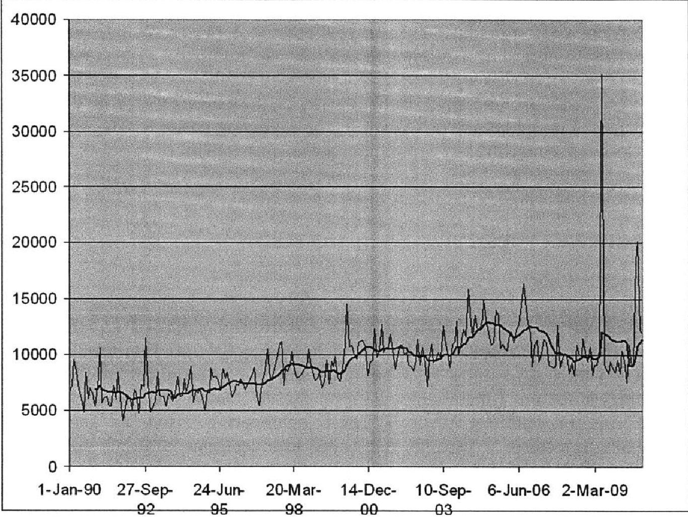

Figure 42 Monthly New Parts Creation at Vehicle Manufacturer, conservatively 120,000 parts/year

Several interviewee were asked about the cost of introducing new parts, all of whom responded in the $500 - $1500 range. Several interviewees volunteered that this was a very limited valuation of the impact, i.e. simply the cost for releasing a new drawing. Some suggested it should be higher. This cost is not mandatory for engineering change orders, and some interviewees expressed concern that it could be misused if disseminated too broadly within the organization.

Using the cost of new part creation and the rate, the cost to Vehicle Manufacturer can be currently estimated at $180M/year to the corporation at ($1500/part), but could easily be valued at $1B/year based on a revised estimate of $10,000/ part (as informed by other cases in the Commonality Study).

<!-- PDF_PAGE: 140 -->

Several employees described motivations for creating new parts. A central theme was the difficulty to describing subsets within a part number - for example, to use a new color of an existing part, it is simply easier to create a new part number.

Other interviewees described challenges coordinating with production. For example, creating backwards (but not forwards) interchangeable part with the same part new number, so that a new generation's parts can service the previous generation's sparing need. In this case, the system will attempt to pull the old version of the part number on prototype and pilot production, to reduce the inventory to zero before transitioning ot the new part number.

Clearly this parts proliferation challenge needs addressing. Several distributed mechanisms for doing so are described in the following sections. The corporation does track several measures of commonality, the most salient of which is "Part New Content", a watched variable in Development programs. Metrics around reuse were also available, but lacked transparency and a user base.

## Existing Commonality Practices

## Vehicle Design Group

Vehicle Manufacturer has organizationally centralized some of its engineering resources within a group it calls the "Vehicle Design Group". This group serves a subset of all vehicles (Families 1,2,3, but not Families 4,5,6), and contains a subset of engineering functions (engine installation, chassis, body, etc, but not engines, transmissions, or operator station). These engineering resources are formally charged out to vehicle programs, but some product lines continue to maintain dedicated staff.

This organizational structure also serves as a nexus for communication and special initiatives. For example, quarterly workshops are held between all functional personnel within VDG working on engine installation. Special initiatives examples include a rationalization of steel grades used.

Interviewees noted that the VDG was considered 'an experiment' internally, to determine whether indirect cost savings could be achieved as a result of closer organizational structures. Expectations were set that the VDG would realize savings on the order of 3-4 years.

## Components Group

The components group captures similar opportunities for consolidation as VDG, but at a component level. The example of Low Complexity Component, a basic steel fabrication component, described below.

<!-- PDF_PAGE: 141 -->

The Low Complexity Component Project was partially motivated by steel price increases (steel is 45-65% of the cost this Low Complexity Component), partially by parts proliferation [12,000 different Low Complexity Component types used, of which only 3,000 in current production], and partially by competitor pressure (a competitor vehicle had 50% fewer Low Complexity Component types). The program produced an up-front estimate of savings of $5M/year by Year 3 (or 4.8% of Vehicle Manufacturer's yearly Low Complexity Component spending), based entirely on steel savings. Savings were not estimated for internal development time, inventory benefits, or quality.

Steel savings are primarily expected to come from supplier consolidation, and a shift from purchasing smaller batches at warehouses to purchasing large quantities directly from steel mills (a 20-30% price difference). Interviewees expressed point examples of quality benefits, noting that each Low Complexity Component incurs a $100K validation cost during development.

Currently the effort is based around providing design guidance to Product Families, in that the team does not have design control over parts or the ability to mandate Low Complexity Component use. The effort was sized from available resources, as opposed to an explicit calculation of effort against returns. However, additional resources have been added over time, including 3 FTEs x 3 months for a blueprint analysis.

## Transmissions Business Unit

Vehicle Manufacturer has separated out transmission as a separate business unit, with a view to generating internal synergies and accountability. The R&D for transmissions is partially centrally funded, and partially funded by existing businesses. The business model is based on variable cost transfer prices, which is to say transmissions does not charge an internal fee to fund its R&D. Accountability is tracked for individual vehicles by use of 'books' (profitability accounting), but as transmissions does not generate external revenue, it does not have a 'book'. This has the consequence that transmissions cannot split R&D among participating vehicles if they are not conceived as a single development program. For example, transmissions could not co-develop a transmission for vehicles from two different families, with the cost split according to projected volumes. One of the two would have to fund the program in its entirety, with the second receiving the non-recurring R&D for free.

When multiple products are conceived as a single development platform, transmissions faces further barriers from cost allocation. For example, a common transmission was developed across 3 vehicles within a family. The transmission was essentially overdesigned for the bottom variant, causing it to be heavier than a unique design. This bottom variant raised objections, and was in a position to stall development. Transmissions could not mandate the use of a common transmission

<!-- PDF_PAGE: 142 -->

across all three without each giving its approval, which in this case, would not have been given by the lowest performing variant. Therefore, commonality must be both a local and a global optimum. Although the team costed the development savings and the tooling savings, they did not include economies of scale in purchasing, learning curves in manufacturing, or inventory in terms of racks, kitting, shipping tubs, floor space, etc. In this case, the only mechanism by which the common transmission was able to proceed was that the common transmission delivered a fuel savings for the lowest performing variant, relative to a previous generation, and this savings outweighed the weight penalty (valued using a common customer willingness-to-pay per pound calculation).

Despite being organizationally separated from product lines, transmissions receives cost pressures from business units. A common complaint that has emerged has been "peanut butter spreading", used to refer to percentage cost reductions per team (rather than a weighted reduction based on system cost), but also referring to overhead allocated by volume rather than by unit cost, labor hours, or activity cost. From Transmissions' perspective, this has resulted in divergence, as products seek out local optimalities while foregoing commonality savings of consolidation.

## Radiators and Mufflers Consolidation

Interviewees in engines described past incidences of part creation resulting in part proliferation.

For example, Vehicle Manufacturer currently maintains 600-700 mufflers, so of which support legacy systems at sales rates of 10/year, compared with 2500/year for high-volume sales rates. Control over muffler configurations grew diffuse, with no centralized owner. This business practice was relatively stable until the primary supplier went bankrupt. An analysis of the existing parts in late 2010 suggested the parts count be greatly reduced, and more importantly, forms used to produce the parts could be reduced by 42%. However, the estimated cost of the new tooling was deemed too risky in lean times, with the result that low-volume mufflers are produced by specialist suppliers as custom pieces. Ad-hoc design activities have proceeded since to achieve some simplification, but without a clear trade of estimated time against a return.

Another study examined proliferation in Radiators and Oil Coolers. At the initiation of the study, Vehicle Manufacturer was producing 103 variants of radiators and oil coolers. Two cases were laid out, reducing parts to 59 or 32 parts. The team did trade development investment against later benefits, in the sense that they chose between these two cases. The only benefit evaluated from this consolidation was in the reduction of purchased cost, which is to say the development cost savings, learning curves in final assembly, and inventory cost savings were not included! Purchased cost savings were generated from use of cheaper materials and cheaper labor cost - negotiations were not conducted on volume. Even without the inclusion

<!-- PDF_PAGE: 143 -->

of these benefits, savings were projected at $11M/ year (net of invested development, tooling, and validation).

However, since the exercise, delays on the order of 4-5 months have been incurred in design and validation, although no information was available on whether this was due to divergence pressures. In retrospect, interviewees cited a failure to plan for manufacturing benefits and constraints - for example, providing 3 month notice to existing suppliers to ramp down, and Vehicle Manufacturer manufacturing engineering choosing to batch changes monthly or quarterly.

Even in retrospective analysis, the teams had difficulty valuing the cost of divergence - the savings foregone historically from producing 58% more mufflers and 57% more radiators and oil coolers than could span their needs.

## Emissions Control

In response to regulatory requirements on emissions, Vehicle Manufacturer initiated significant work to develop the associated emissions control systems in parallel. Vehicle Manufacturer synchronized the development process by hosting a 9-week workshop, in which all relevant engine design groups, engine installation affiliates, and vehicle representatives were hosted in a central location. The scope of the effort included 100 vehicle variants, but which shared a core of 5 engine platforms. Note that the participating vehicles are not all perfectly synchronized they are released over a 6 month span.

The process aimed to solidify the number of emissions control systems that would span the 100 vehicle variants. The group defined both a functional, as well as a set of commonality grouping definition [4 levels, ranging from "same principle and function, but scaled core design" to "cannot observe differences visually"] . Over the course of the 9 weeks they worked to define the relevant parts, working through 6 formal design iterations.

Commonality pressures were dominantly exerted by development cost constraints. Interviewees noted that they simply did not have the schedule or the resources to pursue unique developments. The budget for this activity was set largely within existing resources on the basis of "what would we like to spend for this program", rather than on a bottom-up listing of activities, or a return on commonality investment. The team estimated commonality premiums in design of 50-100% percent of the unique design counterfactual. Commonality benefits were not explicitly accounted.

Changes in commonality levels were permitted, as shown in the diagram below. In the diagram, Review 6 was still contained within the workshop.

<!-- PDF_PAGE: 144 -->

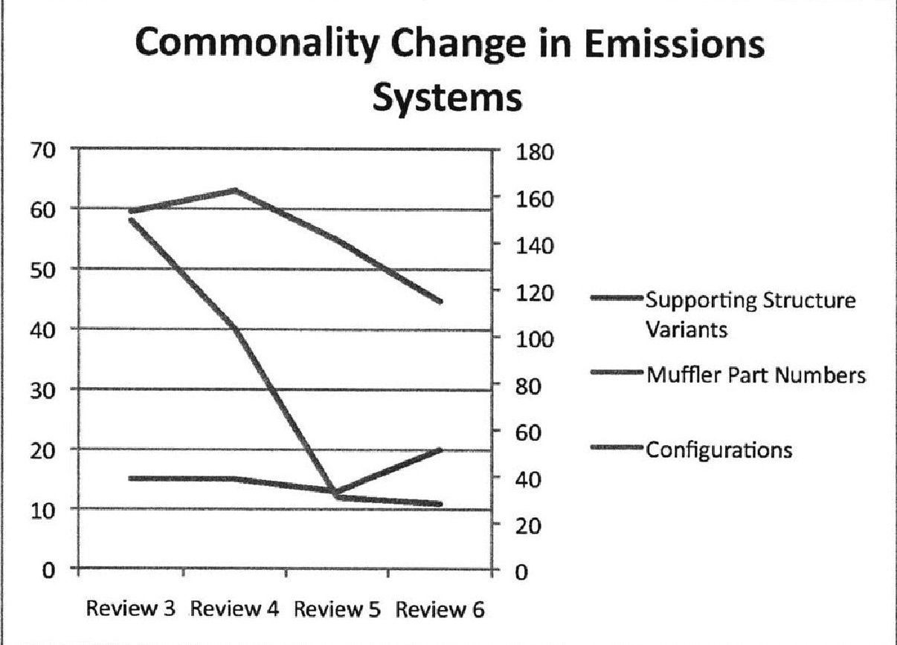

Figure 43 Tracked metrics of commonality change on an emissions program

After the workshop, participating personnel returned to their respective engine and vehicle groups to perform detailed design work. Ownership of the agreed upon platforms was retained centrally. In order to dissuade variants from changes, the central team established punitive change costs - that is to say, costs in excess of any estimation of the distributed burden of engineering change costs. The initial fee was payable with the initiation of the change requests.

<table border="1"><tr><td rowspan="2"></td><td colspan="2">Initial Fee</td><td rowspan="2">Total</td></tr><tr><td>Processing Fee</td><td>Deposit</td></tr><tr><td>Level1-NewVariantDesign</td><td>$68,500</td><td>$322,500(15%)</td><td>$2.15M/20mo.</td></tr><tr><td>Level2-NewSubsystemDesign</td><td>$60,000</td><td>$125,00(10%)</td><td>$1.25M/20mo.</td></tr><tr><td>Level3-NewConfigurationofExistingSubsystems</td><td>$44,000</td><td>$25,000(5%)</td><td>$0.5M/10mo.</td></tr></table>

Figure 44 Schedule of punitive penalties for commonality changes

In addition to the fees, the team explicitly estimated the combined effect of platform management overhead growing with variant and reduced economies of scale from producing more variants, and appropriated these costs wholly to the variant requesting divergence.

<!-- PDF_PAGE: 145 -->

<table border="1"><tr><td rowspan="2"></td><td colspan="3">Variable Cost Change For New Variant</td></tr><tr><td>&lt;100 Units</td><td>&gt;100 Units</td><td>&gt;500 Units</td></tr><tr><td>Level1-New Variant Design</td><td>+50%</td><td>+30%</td><td>+20%</td></tr><tr><td>Level2-New Subsystem Design</td><td>+20%</td><td>+10%</td><td>+5%</td></tr><tr><td>Level3-New Configuration of Existing Subsystems</td><td>+5%</td><td>+2.5%</td><td>+51%</td></tr></table>

Figure 45 Schedule of punitive variable cost charges for commonality changes

Finally, the team implemented management practices. Commonality goals were required at all gate reviews, on the belief that "if you do it at an engineering level, you'll never be successful with commonality". Sign-off was required by the VicePresident for Change Level 1. The available configurations were broadly disseminated, with effort placed on making information easily accessible in a 'catalog' format and resources dedicated to communications.

The team received several requests for changes, all of which but one were resolved by changing other aspects of the design. The one change request submitted did incur the full change fee total, but was not charged the higher variable cost. This change occurred later in the design cycle (during validation), and has caused more rework than originally anticipated at the change request, but an estimate of whether the cost growth was similar in magnitude to the variable cost charges was not available.

Overall, the commonality level was maintained at workshop-levels through validation. The team has elected to use a very similar process for the second phase of the regulatory process designs.

## Financial Incentives for Commonality

A number of financial practices relevant to commonality were cataloged at Vehicle Manufacturer.

Vehicle Manufacturer's Development process centralizes design control and financial responsibility with a separate manager, as opposed to with a product manager for the current generation. A Development Program can be composed of either a single product, or a platform with multiple variants. This in turn enables Vehicle Manufacturer to evaluate and appropriate funds across the full platform extent, rather than with the lead variant only.

At Phase 3 of the design process, Development managers are required to create vehicle and system-level variable cost projections. Changes to these projections after Phase 3 require a formal review.

<!-- PDF_PAGE: 146 -->

Development Programs are evaluated primarily on ROI. Payback period is also calculated, but it is infrequently cited as the active constraint. From the perspective of the finance and accounting employees interviewed, spreading development costs is always the dominant commonality benefit, although commonality benefits are not explicitly priced in the investment decision.

There is an additional allocation practice of interest - division of profits from spare parts sales. These part sales contribute significantly to product profitability. Profits are allocated back to the product family. In some cases, Parts revenue used to be allocated back to Functional Groups, such as Operator Stations, which was used to fund Operator Station R&D. As profitability is only evaluated at the product family level, spare parts revenues (or savings from commonality) are not allocated to individual platforms.

## Cost Allocation

Several interviewees described a policy of "local and global optimums", with regards to common costs. Specifically, Vehicle Manufacturer will generally not permit one program to pay a commonality premium unless that program achieves a return on the premium. This was discussed in terms of R&D funding under Transmissions earlier. Within a Product Family or a Product Program, this appears to be a weaker constraint, as discussed through the case study.

Where Vehicle Manufacturer manufactures parts internally, but then transfers them to another factory for final assembly, fully-allocated costs are used as transfer prices. The fixed costs for the factory are computed in an overhead rate and allocated out to all the cylinders that leave the factory. Several interviewees used the term 'yellow dollars' to describe internal Vehicle Manufacturer transfer payments, as opposed to 'green dollars' which leave the company. These interviewees also expressed mild skepticism about savings on 'yellow dollars', espousing the view that these should not be treated literally.

Overhead rates are discussed in detail in the Platform 1 Case Study for the Location 1 facility.

## Case Study - Platform 1

The Platform 1 is a four-variant platform, covering Performance 1 and Performance 2 vehicles, with shared production between Location 1 and Overseas Location. Vehicle Manufacturer groups Performance 1,2,3,4,5 vehicles as a product family, but also vehicles with higher and lower performance. Additionally, Vehicle Manufacturer produces a closely related platform with similar performance but different architecture. The program is currently engaged in pilot builds, with full production expected in 2012 and 2013.

<!-- PDF_PAGE: 147 -->

## History

Vehicle Manufacturer currently produces the two generations previous to Platform 1, the more modern variants at Location 1, and the older designs in Overseas Location. The previous generation, the Previous Generation Platform program faced some development challenges, which in turn shaped management's approach to the Platform 1 program.

The Previous Generation Platform program initially included significant changes from the previous generation - a new chassis, a new engine, an integrated transmission and new body, all of which were to be common across a Performance 1&2 variant. The program also attempted to reuse the operator station from an neighboring family vehicle.

Tracking the interaction of the new content proved challenging. Previous Generation Platform team members noted that at Phase 3 (where cost targets are set) and at Phase 4, they didn't have a sense of the cost consequences of the work, feeling that it would only be revealed upon integration. Previous Generation Platform developed a weight distribution problem, resulting in a full program reevaluation and the initiation of 'Phase 2'. In order to correct the weight distribution, the integrated transmission was dropped from both variants, with a driveshaft inserted between the engine and the transmission. Changes to the design grew over time, with more changes after the pilot builds than after the prototype builds (prototypes built first, pilots built afterwards). The reused operator station required significant design work, and ended up being built on a separate line given all the changes, resulting in the same cost as would have a unique design.

Previous Generation Platform convinced the Platform 1 program manager that changes midway through the program caused significant delays. Previous Generation Platform convinced the manufacturing lead of the need for Production Intent builds, in addition to prototypes and pilots.

## Initial Commonality Plan & Benefits

The Platform 1 program was launched 3 times, resulting from a technical rescoping followed by a strategic rescoping. The current program began in 2009.

The earliest work on Platform 1 began in August of 2005, with 5-6 months work on customer needs and strategy. The program launched in June 2006, but was rescoped at a Phase 1 review due to an engine technology change. In the second instantiation, the program ran for a year. At the conclusion of the year, a new Vice President requested a new NPV calculation of the investment payback. Calculation of the investment proved negative under current conditions, although team members

<!-- PDF_PAGE: 148 -->

dispute Vehicle Manufacturer's NPV methodology, which does not allow programs facing regulatory deadlines to fully credit future sales. The NPV calculation found the program would only achieve an IRR of X% , as compared with the corporate target of XX%.

Given the opportunity for change, two additional strategies arose. The first was the possibility of making the program Regulatory Change 2 compliant, rather than Regulatory Change 1. Simply put, this program change enabled Vehicle Manufacturer to earn regulatory benefits (delaying regulatory changes on other programs) in exchange for early compliance on the Platform 1 program.

The second opportunity was the possibility of including a second market, the lesserregulated countries (LRC]. Vehicle Manufacturer was producing a legacy design in Overseas Location, but looking to upgrade its offering for LRC. The team was faced with 3 possibilities:

1) New ground-up design for LRC

2) Introduce Previous Generation Platform to LRC, but with design changes to accommodate the supply base

3) Produce a variant of Platform 1 for LRC

The team's evaluation indicated #2 was marginally cheaper than #1, and that #3 was somewhat cheaper than #2. The firm's history with cost reducing a Highly Regulated Market (HRC) design, i.e. Strategy #2, often requires major changes. For example, designs which are cost effective with robotics may be dominated by labor production methods when labor costs are substantially lower.

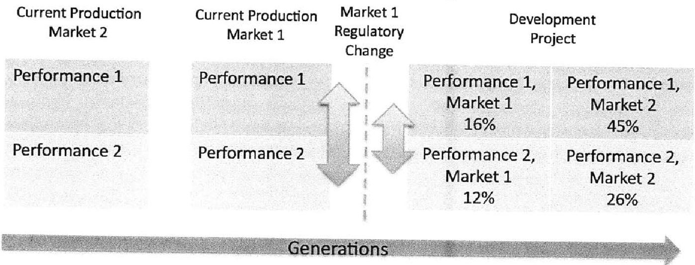

Figure 46 Previous Generation Platform to Platform 1 Strategy. Projected Volume Shared Shown as a Percentage

From a commonality perspective, Platform 1 and Overseas Location conducted separate customer needs exercises. These studies identified very similar requirements around reliability and durability, but vastly different cost preferences

<!-- PDF_PAGE: 149 -->

around electronics and features. This laid the ground work for the commonality plan, discussed below.

From Platform 1's perspective, the switch to Regulatory Change 2 was an imposition of cost by the corporation, the result of a global optimization decision. However, the addition of the LRC market offered both local and global benefits. Namely, Platform 1 would double its production volume, and could spread its development cost across 2 programs. From the Corporation's perspective, this was a chance to standardize (and share) some manufacturing processes with Overseas Location, such as by commonizing plate thicknesses used on the two variants.

The resulting strategy was to pursue a combined program, producing Performance 1 & 2 vehicles the LRC, and Performance 1 & 2 vehicles compliant with Regulatory Change 2 for the HRC. The program would be centrally controlled in the US, with a single business leader owning the Platform 1 development program, as well as the combined resulting sales in HRC and LRC.

The Program Manager described these strategic decisions as taking place over 7 months, with the Platform 1 program put on hiatus. Significant effort was placed on stabilizing program requirements, in the hopes of avoiding any changes after Development Phase 3 (when cost targets are set), motivated by learning from Previous Generation Platform. The program was re-launched in 2009, with many new personnel - in fact, as of 2011, the Program Manager is the only continuous team member with experience from 2005 onwards.

During the 7 month hiatus, major commonality decisions were made. Namely:

1) The chassis, the body, and powertrain will be common between the LRC and HRC variants of the same performance.

2) The chassis will be unique to the Performance 1 and Performance 2 variants, therefore diverging from the previous generation's chassis commonality. This was a possibility as early at 2006, but was solidified based on weight projections of the Regulatory Change 2 engine. Essentially, the new engine weighs more than the old engine, which when combined with the overperformance penalty of the extra weight of a common chassis with Performance 2, would exceed the tire rating. The team fought significant organizational resistance in order to diverge. This decision was finalized at the Phase 1 review following the hiatus.

An investment submission was sent to the Vehicle Manufacturer Board of Directors in late 2009, with the combined program showing an IRR in excess of the corporate hurdle of XX%. The valuation noted the impact to the rest of the Corporation of the regulatory benefits of meeting Regulatory Change 2 early, but did not explicitly price this into the program's finances.

<!-- PDF_PAGE: 150 -->

Under current projections, the program spent 25% of the total budget during the first two "rescopings", leaving 75% of the budget for the third iteration of the scope.

## Execution on Original Commonality Plan

The table below provides a summary of the state of commonality between variants on the program. Major changes from the Previous Generation Platform generation were divergence in the chassis, transmission and electrical systems. Each system is discussed in detail below, with coverage of commonality benefits evaluated important commonality decisions, and resulting commonality.

<table border="1"><tr><td></td><td>Common P1&amp;2</td><td>Common LRC/HRC</td><td>Commonality Premium(%)</td><td>Overperformance(%)</td></tr><tr><td>Chassis</td><td>Medium</td><td>High</td><td>Medium(35%)</td><td>Low</td></tr><tr><td>Transmission</td><td>None</td><td>High</td><td>Low</td><td>Low</td></tr><tr><td>Electrical</td><td>Medium</td><td>Medium</td><td>High(200%)</td><td>Low</td></tr><tr><td>Operator</td><td>High</td><td>Medium(65%)</td><td>Low</td><td>Low</td></tr><tr><td>Axles</td><td>Low</td><td>Low</td><td>Low(10%)</td><td>Low</td></tr><tr><td>Exterior</td><td>High</td><td>High(65%)</td><td>Low</td><td>0</td></tr><tr><td>Hydraulics</td><td>High</td><td>High</td><td>Low</td><td>Medium(20%)</td></tr><tr><td>Body</td><td>Medium(75%)</td><td>High</td><td>Medium</td><td>Low</td></tr><tr><td>Engine</td><td>None</td><td>None</td><td>None</td><td>None</td></tr><tr><td>Engine Installation</td><td>Medium</td><td>Medium</td><td>Low</td><td>Medium</td></tr><tr><td>Testing</td><td>Medium</td><td>High</td><td>Medium</td><td>NA</td></tr><tr><td>Manufacturing</td><td>High(80-85%)</td><td>Medium</td><td>Medium</td><td>NA</td></tr></table>

Figure 47 Commonality plan for Vehicle Manufacturer and estimates of commonality premium and overperformance. Legend-Colors match High, Medium, Low for easier reading

## Chassis

Despite the weight-saving decision to pursue separate chassis, the team made significant efforts to retain design, tooling, and process commonality. The main chassis rails were made 2 inches taller for Performance 2, but with other aspects of the geometry remaining constant (saving weight). Several of the chassis elements remain common, such as the superstructure, the bumpers, and the drop tubes. Where castings could not be kept common, they were sourced from the same supplier.

The design team estimated they paid a commonality premium of 30-40% for the commonality that remained in the chassis [130%-140% of the cost of one chassis, compared with 200% for 2 unique chassis]. Said otherwise, they saved 30-35% relative to the cost of executing 2 completely unique designs, calculated as (200- 130)/200. The diverged chassis design cost more than a 100% common chassis. The savings from divergence on the chassis did not equal the cost of the chassis divergence, although it was initially anticipated it would. However, when compared against the broader system benefits, the decision was revenue positive in retrospect - new tires alone would have cost 5-7.5% more / unit.

The program also decided that a common chassis fixture would be enforced. This required organizational authority to force. The chassis fixture carried a 50%

<!-- PDF_PAGE: 151 -->

commonality premium, compared with $500K for a unique chassis fixture. Experience with the previous chassis design helped commonize the fixture manufacturing enforced design constraints, such as bumper location and rear chassis locating points. In fact, the fixture was designed for retroactive commonality, such that Previous Generation Platform chassis can be built on Platform 1 tooling. Slight differences between fixtures for Overseas Location and US production exist, but dominantly, Overseas Location designed all of its tooling based on existing US tools.

## Transmission

Early-on in the re-launched Platform 1 program, the team made a second divergence decision - to use an integrated transmission on the Performance 1 variants, but not on the Performance 2 variants. This decision was made at the Phase 1 review, motivated by weight reduction, as with the chassis divergence. The integral transmission allowed the team to remove weight (a driveshaft, one housing instead of two, as well as a gear drop).

The marginal costs of going unique were small compared to a ground-up design, as the integrated transmission was being sourced from an existing neighboring family vehicle unit. In order to adapt this transmission, 5% of the parts were changed, at a cost of $2.5M in design time, compared with an order of magnitude or two higher for a new transmission.

It does not appear that benefit reduction was costed, specifically the increased manufacturing and inventory cost of holding transmissions for the Performance 2. The transmissions team believes all transmission require roughly the same touch labor content, and they do not have any visibility into inventory costs. Economies of scale, specifically the movement to higher volume production methods are considered generally within transmissions, but given that the existing transmission was being reused, this was not an active consideration.

Later in the design process, the transmission team recognized an error in the initial calculations, such that the integrated transmission for the Performance 1 would have also been capable of sustaining the loads on the Performance 2. However, the axle design had already incurred design expense for the Performance 2 program, and given significant organizational separation between the two groups, a re-design was not investigated.

## Electrical

The primary benefit of commonality for electrical systems is reliability. Commonality between programs boost the 'operated hours', highlights problems, and produces more reliable designs. In some cases, commonality also drives bulk

<!-- PDF_PAGE: 152 -->

purchasing benefits. The team was unclear on pricing of several benefits - inventory and floor space, subassembly labor rates compared with final assembly, and learning curves in final assembly. As a general rule of thumb, the team required a demonstrable per unit savings of $5 net of commonality investment (undiscounted).

The electrical system faced a number of commonality challenges. Firstly, cannibalization. The program decided to offer highly-optioned and minimally optioned LRC vehicles. The combination of cost pressure and the potential for cannibalization forced uniqueness, at least in customer-accessible attachments. Second, complexity. Commonality was clearly a design goal, but the combinatorial complexity of harnesses made it challenging to identify and maintain commonality.

In order to convey commonality trends, the electrical group originally tracked a commonality metric (shared parts per total parts). However, this was phased out after Phase 2, due to workload growth for the electrical team. Operationally, the team used the number of wiring groups as an indication of commonality. A typical variant would have 25 wiring groups, and 80 groups are required to span the 6 variants and configurations. This represented significant divergence from the original intention of 25-30 groups for all of Platform 1, which on average translates to 56% parts commonality across all variants.

Divergence in the electrical system occurred due to pressures to remove overperformance cost. This pressure was manifested by a directive from the program manager any features over $5/unit had to be directly approved by the program manager. Interviewees expressed that the design was scoped for 1 FTE, but ended up requiring 2.5 FTEs over the lifetime. This growth was accommodated by overtime and by leaning on centralized resources, without an explicit recognition of cost growth. This scope growth was compounded by personnel churn, both within Platform 1 (rolled over 3 times) and in the broader product family (churn was equivalent to rolling the team over 5 times).

The challenge of managing configurations would have been handled differently had the team realized the true scope. More design resources up front would have architected more commonality into the program.

## Operator Station

The operator station for Previous Generation Platform was derived from an neighboring product family design, with the same supplier manufacturing the operator stations for both Previous Generation Platform and the neighboring family. The Performance 1 and Performance 2 Previous Generation Platform variants were identical. Early systems breakdown indicated the structural loads on the operator station would require significant rework, resulting in significant design divergence from the neighboring family vehicle line. For example, an operator station subsystem, a large fraction of the operator station structure, moved from 50%

<!-- PDF_PAGE: 153 -->

commonality with the neighboring family vehicles, down to 10% with neighboring family vehicles in 2008 (before the $ 3^{\mathrm{rd}} $ re-launch).

Since the re-launch (and a personnel change in operator stations), the program has been successful in boosting commonality with other product platforms, while maintaining identicality between the Performance 1 & 2 HRC variants. Examples include commonizing doors with nearly identical fit (but which had been designed uniquely), window motors, and seats (which were developed for the range of Performance 1-8 vehicles). Changes in commonality levels were ad-hoc evaluated for cost impacts before Phase 3, with a formal process including benefit reduction required after Phase 3.

In several systems, shifts away from neighboring family vehicles has been partially compensated for by sharing with Performance 1-5 or 6-8 vehicles. For example, an operator station subsystem picked up 10-15% commonality with Perfomance 5-8 vehicles since its divergence from the neighboring vehicles. This seems to fit well with the hypothesis that platforms achieve commonality with other platforms to which they organizationally close (i.e. within Performance 1-8). The resulting commonality with neighboring family vehicles is explained by the organizational structure of the operator station group - the manager for operator stations has responsibility for the Performance 1-2 variants, as well as the Performance 3-4 platform and the neighboring family Performance 1-3 platforms.

Commonality benefits were broadly considered with operator stations. Interviewees noted that volume benefits dominate over leveraging development costs. Goals are set based on production costs, whereas development costs are governed by the yearly budgeting process. Interviewees were conversant with volume discount curves - for example, cutting volumes on power window motors (divergence decision) would raise the price for both variants by 20%. Development cost savings were noted from reuse, such as $50,000 for door development, including durability and reliability costs. A separate group within Vehicle Manufacturer performs testing, which helps development managers price and recognize commonality benefits. Learning curves in manufacturing and economies of scale internally were noted, although purchased parts dominate the variable cost of the operator station. Inventory and quality benefits were noted in principle, but as with many other interviewees, operator stations struggled to define the dollar value of the benefit.

The commonality level between HRC and LRC Platform 1 vehicles is the most interesting commonality tension for operator stations. Without a clear 'legacy' for the LRC vehicles, the group assumed 100% commonality with HRC, then analyzed the differentiating factors along the primary dimension, cost reduction. The group has tracked a commonality metric between the variants, based on identicality at high level aggregations of the BOM, but only since Phase 2. Initial targets were 75% commonality, but the design is down to 65-70% of parts with the HRC variants due to cost pressures on LRC.

<!-- PDF_PAGE: 154 -->

In cases where the designs are different, there is a strong understanding of customer willingness to pay. For example, ventilated seats were rejected from the design, as customers were willing to pay 0.05% of unit cost, but the variable cost would be 0.15%/unit.

In cases where the HRC and LRC designs are common, the team is faced with global sourcing vs. local sourcing decisions. Analysis including logistics, transport cost, and import tariffs was conducted. For example, the ROPS structure will be produced in Overseas Location, at a savings of 0.5% / unit for US models, composed of 0.1% / unit savings in volume discounts (applicable to both HRC and LRC models) and 0.4% / unit savings in materials and labor for HRC variants.

Challenges continue to arise along organizational boundaries. For example, a change in an air conditioning unit shared between the neighboring family vehicles and Performance 1-5 family generated cost asymmetries. The new unit would have been a 0.01% / unit increase for the neighboring family vehicles, but a 0.02% / unit savings for Performance 1-5 vehicles, where the prices include an allocation of the fixed costs (development, tooling, etc). Neighboring family vehicles would not support the change. Performance 1-5 family vehicles ended up switching their supplier to achieve some cost savings on the new unit, but not at the level that common units would have yielded.

Moving forward, the operator station group is looking at commonality fluidly - the group manager is looking to forward propagate common Performance 1-5 designs into a new neighboring family vehicle operator station.

## Axles

Commonality in axles varies significantly depending on product volumes. On the Platform 1 program, volumes are higher than many other neighboring products, so as a result, only 10% commonality design time premiums are incurred, in contrast with other programs at 50%.

The power train has greater exigencies on performance and optimality than many other subsystems. Although the basic architecture has remained unchanged for many years, the axle design requires roughly 3 times the design resources of other subsystems - 4 FTEs for 6-7 months. These resources were shared among Performance 1-5 family vehicles.

Overperformance penalties are conceivable but rare in this subsystem. The primary architectural design variable is the number of gears (determined by speed, inclinations, and weight), followed by bearing design for supporting gears and structures to support bearings. Reuse is determined by exact fit with an existing gear set.

<!-- PDF_PAGE: 155 -->

The Performance 2 variants (LRC and HRC) will reuse the existing Previous Generation Platform gear sets, whereas each of the Performance 1 HRC and LRC variants will receive a new gear set - one of which is a direct reuse of an existing gear set. The new gear set for the Performance 1 design will create 3 new parts, at a cost of $1M total. In contrast, Previous Generation Platform used a common gear set across all variants.

Additionally, post-development, the lower power train will produce 2 new gear sets, one for each of the Performance 2 variants, in order to support a move to an integrated transmission (due to the architectural calculation errors noted previously in transmissions). The team will spend an additional $1M for 2 gear sets, realizing a $1M savings due to concurrent designs and common test equipment. This $1M will generate 0.05% in savings / unit. The team uses a maximum of 2 years payback period as a rule of thumb, but this investment will take longer to recover.

Given the expense of development, commonality benefits related to design reuse are significant-a theoretical $3M saved for initial production in Platform 1.

Production cost is dominated by weight, of which 70% of the weight and cost is the housing, a series of cast parts. The majority of the housing is common between all variants, and is sized to the Performance 2 variants, but no estimation of the overperformance on the Performance 1 variant was available. Depending on the design, 30-50% of the parts are purchased off the shelf, but these represent a minority of the cost. The majority of the cost is incurred in castings.

Attempting to achieve volume benefits, Previous Generation Platform used a single-source foundry to produce all of its castings. The foundry chosen saw 3x the demand they could handle, resulting in 33% cost increases late in the Previous Generation Platform development (between Phase 5 and Phase 6). The Previous Generation Platform team was forced to accept the price increase. The team noted that much of the production cost estimates from procurement are based on prototype costs (at much lower volume), where actual production prices are likely to rise due to the volumes hitting supplier capacity constraints. Other interviewees disagreed, citing the change costs charged by the supplier as the dominant mechanism of prototype to production cost growth. Nevertheless, both agreed that prices change between prototype and production, and that these costs are not as well recognized as they should be.

The supply strategy for Platform 1 was to source upwards of 10 quotes from foundries. Previous Generation Platform designs were used for quotes, which were similar enough for cost comparison. 5-8 foundries were chosen. To offset the volume / foundry decreases, the team coordinated sourcing across Performance 1-5 family vehicles.

An additional strategy was used for solving capacity constraints on the Performance 3&4 platform - the new design paid an up front development cost penalty

<!-- PDF_PAGE: 156 -->

(magnitude unknown) to make the new design interchangeable with the old design. This enabled the team to source at full volume in the prototype stage, thus 'reserving' supplier capacity.

In addition to bulk purchasing and development benefits, the team cited challenges identifying economies of scale in manufacturing, and identifying benefits of inventory and shipping.

Internal economies of scale for cast parts are based on machining castings with internal capacity. Volatility in internal machining capacity forces machining outsourcing, at a 100%-200% premium. Machining capacity reductions of 20-50% were cited historically. For example, a 20% capacity due to vehicle downtimes forced outsourcing of an entire part number, costing $630K/ year. Forecasting commonality benefits is clearly dependent on forecasting internal capacity, with significant challenges arising from commonality changes and capacity changes.

Interviewees were similarly unable to cost inventory benefits of commonality. In particular, supplier charges for inventory holding and shipping are not allocated per product, but rather at a plant level, then allocated out as overhead on a volume basis. Therefore, expensive low-volume parts held at suppliers will fail to recognize the costs they are imposing on the whole factory.

Interviewees expressed a desire to move towards centralized powertrain architectures leading development, as opposed to power trains proceeding forward with vehicle developments. They felt this could both alleviate communications challenges (as between transmissions and axle on the Performance 2 transmission), and produce more efficient designs at lower costs (due to greater powertrain optimization), at the cost of putting more development money at risk, and centralizing development funding which is more difficult to allocate to product lines (and revenue).

## Exterior

The exterior includes the method of entering the vehicle, the grill, and the radiator mounts. The 40 and Performance 2 vehicles are 100% common (as were the Previous Generation Platform models), but significant differences exist between the HRC and LRC designs - 30-40% by parts, such as the steps to the operator station. The team designed the HRC variants, then "cost-reduced" the design, resulting in 20- 30% cost differences.

Despite the high commonality levels from the previous generation, significant additional commonality benefits were driven by collaboration with suppliers. Whereas previous supplier collaboration had existed only on 70% parts (parts >$50), Platform 1 collaborated on all parts with suppliers. Together with supplier consolidation (40 down to 15), this resulted in 0.25% savings / unit. Supplier

<!-- PDF_PAGE: 157 -->

collaboration was enabled by specific supplier collaboration personnel attached to the engineering groups.

Specific parts were also targeted for consolidation, within and across variants, such back-up plates. Interviewees were very cognizant of benefits, citing that the consolidation did not generate materials cost savings or labor cost of assembly, but did create savings on non-recurring engineering work, labor cost of subassemblies, inventory holding cost, and parts management overhead. However, inventory cost and parts management were not explicitly costed, but rather treated as 'gravy'.

The central commonality challenges for the exterior were global vs. local production, and subassemblies at suppliers vs. at Vehicle Manufacturer. In several cases, the team explicitly costed the shipping, inventory, and tariff costs associated with global production (centralizing production at 1 supplier or 1 Vehicle Manufacturer factory) against the economies of scale to be had. Subassemblies created challenges in that they can reduce the cost of assembly (through learning curves and lower supplier labor costs), but they also transfer commonality benefits of component parts to suppliers. The team used virtual manufacturing tools to determine subassembly times and make associated outsourcing decisions.

## Hydraulic & Suspension, Body, Engine Installation

The hydraulic and suspension system has significant commonality, with identical hardware and only slight software changes to realize different capacities.

The vehicle body, is offered in 3 styles for each of the Performance 1 & 2 variants, with the goal of 100% commonality between HRC and LRC variants. The Performance 1 & 2 variants have the same basic design, but some functional components are different on the Performance 2 variant. There was relatively little carryover from Previous Generation Platform [12%], and high parts commonality between 40 and Performance 2 variants of the same body style [75%]. The greatest commonality challenge was forecasting the relevant benefits (shared tooling & fixture between Overseas Location and US, bulk purchasing of steel). The body team was able to take an overperformance penalty on the steel grade used for Overseas Location in order to support bulk purchasing and inventory benefits, but could not recall the extent of the inventory benefits.

The engine installation system covers cooling, mounting, and exhaust. The cooling system is identical between the Performance 1 & 2 variants (overdesigned for the Performance 1 variant). The dominant benefits are bulk purchasing (together with other families), tooling cost sharing (relatively small), and testing benefits [1 structural test saved $100K]. Inventory benefits were known but uncosted. Interviewees were conversant about the shape of the learning curve (for example, batching X000 units together instead of X00 is worth a 30% price reduction). The engine installation is dominantly a 'dependent engineering group', in the sense that

<!-- PDF_PAGE: 158 -->

they accommodate architectural decisions made upstream. They were willing to take small overperformance penalties (add an additional hole to a part for commonality, source a part as "make-from" rather than "new" to maintain supply volume).

## Manufacturing, Test, and Launch

The Platform 1 program has built prototypes, is currently in testing, and is preparing for pilot and production intent builds. The lead manufacturing engineer is estimating 80-85% of the processes will be shared among Performance 1 & 2 variants. The design divergence has not yet been evaluated against its impact on assembly time or inventory, but a manufacturing plan was set at Phase 3 to define standard operations procedures. Interviewees described a mental model of pushing the boundaries of platform extent, to determine how broadly the standard manufacturing procedures can span.

Manufacturing provided a number of inputs to the design. Beginning at Phase 2, manufacturing is involved in commenting on the design, before cost and design decisions are locked at Phase 3. Manufacturing initially fought some aspects of design change such as the assembly of the integrated engine and transmission into the body on the Performance 1 variant and the common fixture for 40 and Performance 2 chassis. In both cases, manufacturing is now looking for more further examples to leverage similar techniques (subassemblies and common tooling).

As previously noted, the challenges encountered in Previous Generation Platform helped motivate the need for production intent builds (at a $500K cost). Specifically, the rate of changes to Previous Generation Platform increased from prototypes to pilots, which not only required additional engineering effort, but impacts on the line after the official launch, as changes continued. Shipments of Finished Goods on Previous Generation Platform had to be stopped at one point, lowering production rates while labor was re-allocated to retrofitting. Interviewees estimated that the largest impact was on the supply chain, as supplier passed WIP charges back to Vehicle Manufacturer, but a formal accounting of the event was not completed. The inclusion of LRC models with HRC has lowered the effective cost of the Production Intent cost.

Commonality between the US and Overseas Location manufacturing plants has been both a challenge and a focus for program management. The overall intent has been to keep as much tooling common between the facilities, subject to trades where equipment costs or labor costs can achieve local cost savings, and trades to build a part at one site for global consumption. The team benchmarked the facility at Location 1 first, to provide a goal for the Overseas Location plant update.

Location 1 and Overseas Location were both expected to build 2 prototypes, but only 1 prototype was built in Overseas Location, due to challenges bringing

<!-- PDF_PAGE: 159 -->

personnel up to speed and installing tooling. The Overseas Locationn prototype enabled the team to pressure the local supply chain into an early start. Management wanted to test the Overseas Locationn prototypes in Overseas Location to achieve cost savings, but this proved expensive [ $1M investment in non-recurring ], so the lone prototype was simply placed at a customer site.

The manufacturing plan has been phased between the two markets. While the prototypes were first built in Location 1, the pilot vehicles will be built in Overseas Location first, with Location 1 to follow. The original intent had been to produce pilots in parallel (which would have saved money), but delays in the HRC engines have cascaded through to the program. Full manufacturing will launch in Overseas Location first, given that the original business plan called for LRC variants 2 years before HRC variants (the realized plan will split the difference - LRC 1 year late, HRC 1 year early).

## Generational Change Impact on Commonality and Program Financials

Broadly, the transmission and the chassis represented the major generational commonality changes, with additional divergence in electrical system and the axle. Many of the other systems were common on Previous Generation Platform, and retained similar commonality on Platform 1.

The chart below shows the expected variable cost change from the previous generation for the HRC variants. Only Electrical and Engines are expected to increase cost, as a result of complexity management and technology change, respectively.

The two diverged systems, transmission and structures, are both expected to realize savings, indicating that the overperformance penalties outweighed the benefit reduction, and that the team invested significantly in non-recurring engineering cost in order to reduce variable costs. This projection includes only procured cost, labor, and expected overhead, but does not include changes to tooling beyond currently projected, assembly time, inventory levels, floor space, learning curves as a result of higher production volumes with LRC, or importantly, any allocation of the fixed cost of on going program support.

<!-- PDF_PAGE: 160 -->

<table border="1"><tr><td colspan="3">Variable Cost of Production Generational Change(HRC)</td></tr><tr><td>Systems</td><td>P1 Previous to Current</td><td>P2 Previous to Current</td></tr><tr><td>Chassis</td><td>-18%</td><td>-16%</td></tr><tr><td>Transmission</td><td>-15%</td><td>-6%</td></tr><tr><td>Electrical</td><td>29%</td><td>29%</td></tr><tr><td>Operator</td><td>1%</td><td>1%</td></tr><tr><td>Axles</td><td>-7%</td><td>-8%</td></tr><tr><td>Exterior</td><td>-8%</td><td>-8%</td></tr><tr><td>Hydraulics</td><td>-24%</td><td>-23%</td></tr><tr><td>Body</td><td>-14%</td><td>-12%</td></tr><tr><td>Engine</td><td>108%</td><td>103%</td></tr><tr><td>Engine Installation</td><td>-3%</td><td>0%</td></tr><tr><td colspan="3">Total At Projected Volumes=-6% “-” indicates cost reduction</td></tr></table>

Figure 48 Estimates from Vehicle Manufacturer of changes to variable cost. Note t that these projections do not incorporate all relevant costs.

The relative distribution of the $82M R&D investment is shown below. As can be seen, Program Management and Testing are the two most significant expenses incurred.

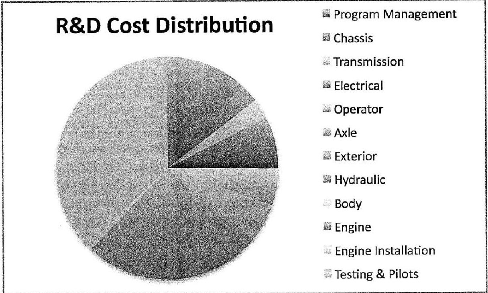

Figure 49 R&D cost distribution by subsystem

In order to develop a full accounting of the commonality investment, it is necessary to combine variable costs with an amortization of the fixed costs as well as the expected commonality benefits.

<!-- PDF_PAGE: 161 -->

Up through the Phase 3 review for the final scoping of the program, the 'whole' program was considered against it return. However, at the Phase 3 review, the program was split between the LRC and HRC variants, as separate investments. The cited motivation for this split was that the LRC program was a sourcing and capacity expansion program (with a significant tooling budget), while the HRC program was a mandatory regulatory change, which should not be evaluated against a return.

As a result of the decision, a separate investment cash flow was conducted for LRC. For capital spending occurring in Overseas Location, the investment was easy to calculate. However, crucially for the R&D content, the cost allocation to Overseas Location was determined on a marginal basis. The result is that Overseas Location was allocated only 18% of the R&D spent ($15M), despite composing 72% of the projected volume for the program.

Program Cost Under Overseas Location Marginal Allocation

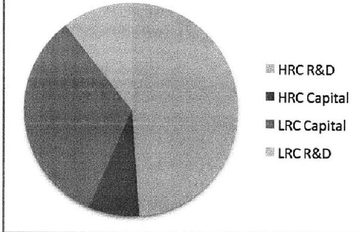

Program Cost Under Overseas Location Volume Allocation

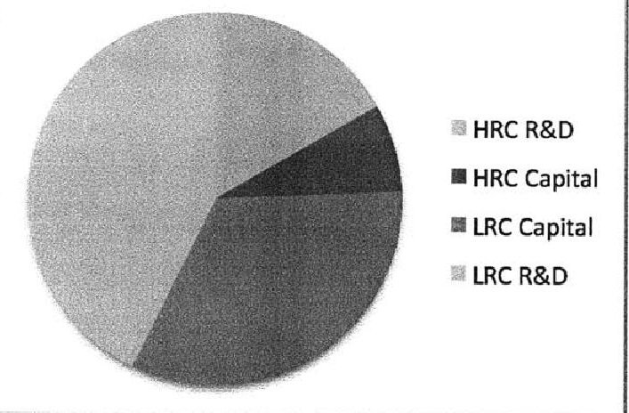

Figure 50 Comparison of existing and possible R&D cost allocation for the program

The HRC variant also produced a business plan, but was held to less stringent criteria, which were not disclosed by the team. The capital spending is reviewed against financials controls, but the labor is not.

Clearly, the method of commonality cost allocation will create favorable commonality investment returns. Overseas Location will produce the majority of units, but will not be held against the majority of the R&D spending. For reference, Overseas Location's R&D allocation had the projection been split by intended volumes would be $59M, which would have added an additional 70% to its total budget. Interviewees cited "risks" of the Overseas Location portion of the investment being killed, based on its high capital expense. Thus, a marginal allocation was also a mechanism to protect the HRC program, which would not survive without Overseas Location's marginal contribution to R&D, as well as its contribution to volume.

<!-- PDF_PAGE: 162 -->

The program's financials are subject to other combined controls. The projected cost of product development created at Phase 3 is reviewed by the Vice President in a post-implementation review. This review takes place at Phase 7, occurring 1 year after the final variant goes into full production.

Once the Development program closes at Phase 7, responsibility for the program returns to the Product Family Manager, who owns the Performance 1-5 family variants. At this level, current product margins fund R&D for future programs. The current Previous Generation Platform Performance 1&2 platform is not responsible for funding the R&D for Platform 1, but neither does the money for Platform 1 come from a centralized corporate investment pool. Instead, the program R&D is aggregated at the Family level, spanning Performance 1-5 vehicles.

To aid in the evaluation of change to commonality benefits as a result of this generational divergence, the benefits considered by each subsystem are summarized below. Red indicates that the benefit was not considered in decision making, and is unlikely to be realized. Yellow indicates the benefit was considered verbally but not explicitly costed, and is potentially at risk of not being realized. Green indicates that the benefit was implemented and Green indicating realized benefits.

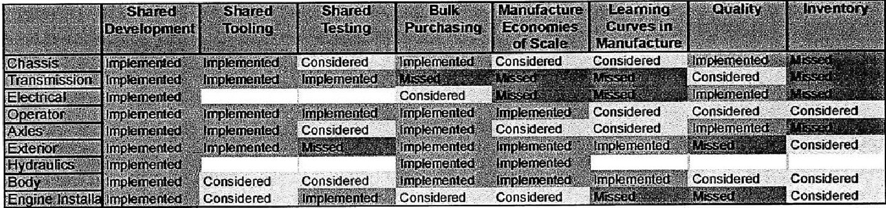

Figure 51 Vehicle Manufacturer consideration of commonality by subsystem

This analysis indicates that the team was particularly cognizant of shared development benefits, which is consistent with the platform-level commonality ownership and joint ownership of engineering personnel within the product family and the functional organization (the Vehicle Design Group).

Tooling was similarly well captured. In some cases this was explicitly driven by the program (as with the chassis tooling), in other cases it resulted from organizational structure (as with the transmission).

Common testing was variable within the program. Overall, the program made efforts to use virtual testing and manufacturing to reduce testing time. This did not result in substantial savings for vehicle-level testing, but the design commonality did lead to several instances of investment in common testing and achievement of a return on that testing investment. Some systems were particularly cognizant of

<!-- PDF_PAGE: 163 -->

testing based on internal transfer prices (enforced by organizational separation), but others were largely unaware of the benefits of commonality that would or would not result during system and vehicle tests.

Almost all systems were aware of the benefit potential of bulk purchasing, given the high purchased cost fraction of variable cost. Divergence in the chassis seems unlikely to result in benefit erosion, as the team made efforts to commonize constituent parts and suppliers. Divergence in transmission is at risk of causing later benefit reduction, as a result of volume changes to other programs sharing similar transmissions, and a focus on development cost to the detriment of purchasing cost in transmissions. The use of supplier collaboration engineers drove significant change on the exterior - potential exists in other systems for improvement based on this model. This type of analysis can lead to sophisticated decisions, including deliberate strategies to not sole-source parts due to monopoly prices and transferring subassembly cost to suppliers to achieve labor cost reductions.

Manufacturing economies of scale and learning curves were not universally well captured. Partially this is due to the state of the design, in that standard manufacturing times have not been developed as pilot builds have not yet been conducted (although virtual estimates are available). However, several interviews explicitly rejected tracking learning curves, and we were unable to find reference data on historical learning curves. Further, several interviewees espoused the idea that labor cost was fixed based on unionized content, therefore economies of scale and learning curves were untenable. Additionally, as previously noted, volatility in internal capacity forecasts has forced manufacturing to outsource manufacturing at significant cost. Some subsystems, particularly light structures, were cognizant of differences between Vehicle Manufacturer labor and supplier labor costs, as well as between Vehicle Manufacturer subassembly labor cost and Vehicle Manufacturer final assembly cost. The program manager agreed that many of these differences remained unrealized. That said, one could relatively easily conduct a differential analysis of Previous Generation Platform to Platform 1 manufacturing labor content, with assumed historical learning curves, in order to determine the order of magnitude of the impact.

Additionally, several employees cited challenges tracking plant-level overhead, and the associated difficulties of recognizing indirect savings from commonality. Notably, only "assembly" and "vehicle" are tracked per assembly line, with receiving and general burden capturing aspects of indirect cost - inventory maintenance, parts storage, materials, handling, etc. All products in the Performance 1-5 family are manufactured on one line. While this is consistent with the profitability valuation and the organizational structure, it makes identifying individual platform savings very difficult. Depreciation on vehicles is not easily disaggregated, as many allocation bases are used, and further, the unit of analysis tends to be product families, not products. Therefore, any gains made from commonality within a platform (itself within a family on a line) will be spread among the whole line, according to the volumetric share of line production.

<!-- PDF_PAGE: 164 -->

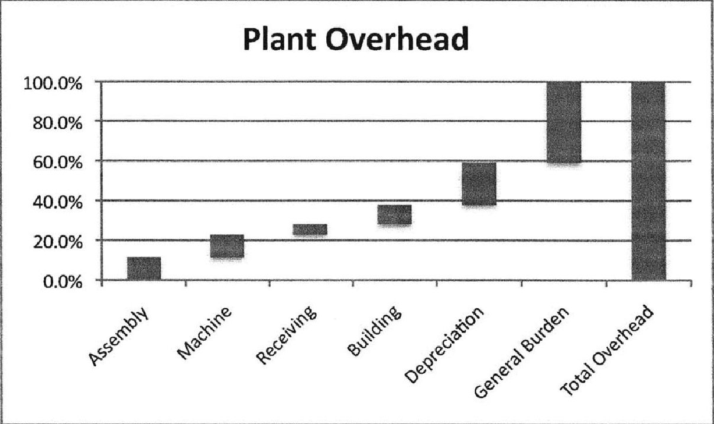

Figure 52 Breakdown of plant overhead charges

Therefore, if the assembly time for the Platform 1 program changed from Previous Generation Platform, as a result of loss of learning curves from common chassis and transmissions, it will likely come as a surprise when standard assembly times on the line rise, and further, the impact of the change will be spread across the whole line.

Quality and reliability benefits were discussed by several interviewees, but no specific references of Previous Generation Platform to Platform 1 changes were noted. Quality seemed a more dominant concern of structural component groups (Chassis, Body), the former of which who noted that the divergence will effectively double the time required in order to accumulate chassis failure modes, which in turn will slow the clockspeed of chassis learning.

Inventory benefits were the least well understood benefit of commonality. While manufacturing benefits likely represent the greatest impact of generational divergence, inventory benefits are certainly second. For Previous Generation Platform production, the program is currently holding $11M of Raw and WIP inventory, therefore small fractional changes could have significant cost impact. Current estimates put Platform 1 10-15% higher on parts count than Previous Generation Platform, which could translate to $1.5M of additional holding cost! Almost all interviewees cited past challenges identifying a valuation of inventory, be it inventory holding charges, floor space, or even rough $ / kg costs.

Inventory is managed on the current production side of the house, as opposed to Development. The only liaison appears to be a weak connection provided by manufacturing engineering, with no connection provided by purchasing that could be discerned. Manufacturing engineers assigned to current production are assigned

<!-- PDF_PAGE: 165 -->

WIP targets, but given a very low carrying cost [6-9%], this has not carried much weight. Accounting has put forward a plan to increase incentives by more than doubling this holding cost to 17% , but this will arrive after the relevant design decisions have been made.

The global nature of this platform has brought new challenges to light. For example, some parts produced in Overseas Location and shipped to the US will accumulate in a warehouse buffer in the US, but not all. While the design benefits of commonality are easily shared, many of the volume benefits, such as inventory and learning curves will not be possible or will require significant coordination to achieve, based on separated production facilities.

## Summary of Platform 1 Program

Going forward, the program is well placed to achieve commonality benefits. To date, the program has withstood challenges to its commonality levels in the form of 15% on a year's budget cut (implemented across several Vehicle Manufacturer programs). The program responded by enabling more common tooling on the chassis, developing other common global tooling at suppliers, and by reducing the number of built prototypes from 8 to 4, while maintain pilot and production intent builds. The ability to retain commonality through budget cuts is an indication of strong commonality decision-marking.

The Platform 1 program has clearly made significant investments in commonality. A rough calculation of system commonality premiums (the additional design effort over a unique design, with a view to achieving later benefits) suggests the program invested $10M, or 12% of the R&D budget. Note that this is separate from the idea of 'commonality savings', which requires a counterfactual (ex. 4 independent development programs).

Going forward, the program will continue to face commonality challenges, in particular with respect to opportunities for divergence in manufacturing process and from late changes to the HRC models due to engine changes. Management has espoused the belief that the development program will continue to fund changes to all variants - if a component requires updating due to HRC constraints, and is currently common with LRC, the development program will fund the LRC program to make the change as well. The ceiling for this funding was roughly quoted as 0.1%- 0.15%/unit changes, which will be evaluated on a case by case basis. As previously stated, the platform ownership by the development team will continue through 1 year's production of the final variant.

## Conclusions and Recommendations

Vehicle Manufacturer has a wealth of previous commonality experience, spread across its product base. Commonality as a strategy for achieving cost savings has

<!-- PDF_PAGE: 166 -->

been successfully applied on a number of product lines. Vehicle Manufacturer's organization displays a moderate commitment to achieving commonality benefits in some areas, this strategy could be stronger, but in general, Vehicle Manufacturer is executing well.

Previous experience suggests that successful platforming takes 5-10 years of dedicated effort, combined with the appropriate market conditions to reward the commonality strategy. It is not universally applicable. The challenge in a diversified organization like Vehicle Manufacturer is that the support necessary for implementing platforming must be championed at a senior executive level together with the recognition that it is not beneficial to all product lines or at all levels of detail.

Vehicle Manufacturer's organizational strategy of grouping vehicles by 'families', with consolidated design authority and profitability gave rise to a number of examples of strong commonality decision-making. However, as a consequence, a number of examples of missed commonality opportunities between families arose, with one product line refusing to take a cost penalty for the greater benefit of the corporation. On balance, commonality opportunities within families are generally richer, but Vehicle Manufacturer should create negotiation mechanisms between families.

Vehicle Manufacturer's strategy of centralizing a subset of design resources within the Vehicle Design Group is generating internal savings through reuse of design knowledge. However, challenges accounting for these benefits on a project-byproject basis poses a risk for this organization.

Knowledge of commonality premiums and benefits was widespread in the organization. However, Vehicle Manufacturer faces challenges valuing some benefits, particularly in manufacturing and inventory benefits. Program managers should be armed with design guidance for both, including necessarily the ability to price these benefits into investment submissions. Bulk purchasing was very well executed in some sectors and poorly executed in others - use of dedicated supplier collaboration engineers generated strong practice. None of the documents or interviews contained commonality benefit projections for the purpose of project approval or investment, other than supplier consolidation efforts.

On a financial basis, the program displayed an unusual mixed methods investment evaluation. Specifically, only the higher volume variants are evaluated against a formal investment return, but at the same time, only allocated the marginal cost of development. This led to a partial investment evaluation. Despite divergence, the program is expected to realize variable cost savings, indicating the team invested significantly in non-recurring engineering cost in order to reduce variable costs. Changes to volume recognition policies under regulatory change and formal guidance on R&D allocation would aid in the evaluation of whether the fixed costs merited the variable cost reduction.

<!-- PDF_PAGE: 167 -->

Work within the Platform 1 program demonstrated strong decision-making, but interviewees cited that considerable effort could have been saved had a framework been available for identifying the relevant variables, and for standardizing calculations across different decisions.

Where parts consolidation activities are pursued, Vehicle Manufacturer almost universally refused to value internal benefits of simplification. This was in contrast to the development program studied, which willingly accepted commonality premiums to achieve later internal savings. These programs expressed a desire to quantify internal benefits, but also cited challenges pulling appropriate data and parsing costs under current corporate accounting methods. Further work is required to generate confidence in internal overhead savings when these savings accrue across many product lines.

<!-- PDF_PAGE: 168 -->

## Chapter 10 Cross Case Analysis and Recommendations

Analysis Overview

While the case studies provide rich detail with regards to individual links between divergence and cost, they do not generally allow us to compare behaviors across different platforms and industries. With a view to examining what causation can be generalized to all commonality situations, we conduct a series of cross-case analyses.

The analysis proceeds along a number of dimensions. The primary and secondary hypotheses, which informed the case selection, are discussed first. The remainder of the findings are discussed in the context of the Commonality Cost Framework elements. At the conclusion of the analysis, we note several macro-behaviors, such as the existence of a Commonality Cycle.

The diagram below shows a comparison among the 3 core cases and the 2 detailed discussion cases. Note that the primary benefit of commonality varies among the cases discussed, partially correlated with the volume produced. The variables listed below form the basis for the detailed case analysis which follows.

<table border="1"><tr><td></td><td>Heavy Equipment</td><td>Rail Equipment</td><td>Vehicle Manufacturer</td><td>Helicopter</td><td>Automotive Reduced Inventory</td></tr><tr><td>Dominant benefit</td><td>Manufacturing Econ.</td><td>Shared Development</td><td>Bulk Purchasing</td><td>Shared Dev &amp; Reduced Inventory</td><td></td></tr><tr><td>Development Cost</td><td>$30M</td><td>$X0M</td><td>$146M</td><td>$6.75B</td><td>NA</td></tr><tr><td>Volume</td><td>X00,000</td><td>X00</td><td>X000</td><td>257</td><td></td></tr><tr><td>Current Phase</td><td>Complete Lifecycle</td><td>Certification</td><td>Pilot Production</td><td>Fullscale Production</td><td>N/A</td></tr><tr><td>Primary commonality driver</td><td>Cost</td><td>Market</td><td>Cost</td><td>Cost</td><td>Cost</td></tr><tr><td>Secondary commonality driver</td><td>Competition</td><td>Competition</td><td>NA</td><td></td><td></td></tr><tr><td>Commonality metric</td><td>Yes</td><td>No</td><td>No</td><td>Yes</td><td></td></tr><tr><td>Lifecycle costing</td><td>Yes/No</td><td>No</td><td>Yes</td><td></td><td></td></tr><tr><td>Benefit projection for funding?</td><td>No</td><td>No</td><td>No</td><td>Yes</td><td>Yes</td></tr><tr><td>Sole lead variant investment?</td><td>No</td><td>No</td><td>No</td><td>No</td><td>Yes</td></tr><tr><td>Funding source</td><td>Corporate/Factory</td><td>Corporate</td><td>Product Line</td><td>Contract</td><td>Corporate</td></tr><tr><td>Largest volume first?</td><td>N/A</td><td>No</td><td>Yes</td><td>No</td><td></td></tr><tr><td>Variant addition?</td><td>Yes</td><td>Likely</td><td>No</td><td>No</td><td></td></tr><tr><td>Lead Profitability?</td><td>Strong</td><td>Weak</td><td>N/A</td><td></td><td></td></tr><tr><td>Cost Growth to Date?</td><td>2-5% of margin</td><td>33% of cost</td><td>None</td><td>High</td><td></td></tr></table>

Figure 53 Case summary matrix. Note that a different benefit dominates in each of the cases.

The diagram below enables a comparison among the 3 core cases. These cases are narrowly focused on capital intensive, long lifecycle industry in order to enable direct comparisons. The cases were selected to first examine the long-term consequences of divergence through variant addition (Heavy Equipment), followed by a comparison of commonality outcomes as a result of management practices such as the duration of the costing horizon (Rail Equipment and Vehicle Manufacturer).

<!-- PDF_PAGE: 169 -->

For the latter 2 cases, the end of development was chosen as the time period, in order to capture more detail on development decisions.

## Capital-intensive, long lifecycle, low volume industries

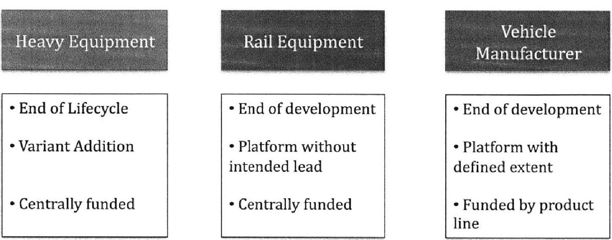

Figure 54 High-level comparison of case variables

## Sizing the Benefits of Commonality

The literature search revealed that commonality is rarely framed explicitly as an investment. That is to say, the separation in time between investment and benefits is poorly understood. Analysis of the individual cases demonstrates that firms have developed a combination of qualitative and quantitative forecasts of commonality benefits. Examples include estimation of the future development effort in Vehicle Manufacturer and quantitative learning curves in the Rail Equipment case. However, none of the firms in the sample explicitly analyzed commonality investments - that is to say, none estimate the premiums associated with commonality, nor did they compare the timing of the premiums against the returns.

<!-- PDF_PAGE: 170 -->

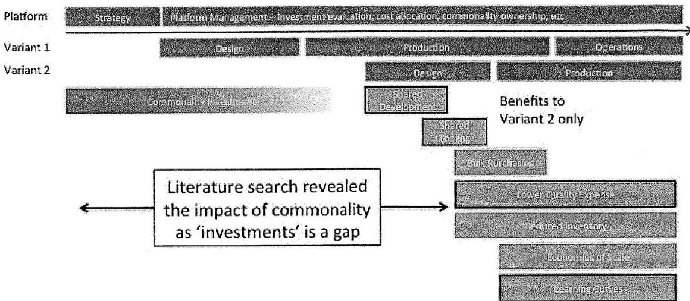

Figure 55 Lifecycle offsets have implications for investment return

These premiums calculations are discussed shortly. First, however, we discuss issues that arise from the phasing of benefits.

As shown in the Figure above, shared development and tooling benefits don't begin to accrue until a second variant is initiated. These are typically non-recurring benefits, in the sense that the program invests once, then attempts to amortize that investment over as many use cases as possible.

Bulk purchasing benefits only lasts the duration of the overlap between variants, unless a frame agreement is created with the supplier. Inventory reduction effects are only initiated in the production ramp-up period, where stocks from the previous build are depleted or shared.

Learning curves, manufacturing economies of scale, and quality expense are all recurring benefits which do not expressly depend on parallel production of variants.

Determining the relative size of benefits is an important analysis within commonality planning. Which benefits are targeted through the design process depends on an understanding of the platform cost structure, the platform extent (how many variants will be built), and the potential for synergies among variants.

Our research indicates that the sizing of benefits is both industry- and program specific. Within an industry, cost structures can be similar, but volumes sufficiently different from one firm to another, such as to make volume-based benefits viable for one firm and not for another. Within a firm, differences in design costs, volumes, and in market-cost pressure can make commonality an attractive proposition for one division and a risk for another division.

The central challenge of establishing comparative commonality benefits is the counter-factual: the benefits of a common system must be compared against a

<!-- PDF_PAGE: 171 -->

unique design. These unique designs are rarely logged historically, let alone fully costed. For this reason, it is useful to reason about the conditions and parameters which lead to strong benefits, but it is much more challenging to make general arguments about which benefits are strongest across an industry.

Among many variables in this study, we have found three variables useful in identifying broad benefit dominance. These are:

- Development Cost as a fraction of Total Cost

- Materials Cost as a fraction of Variable Cost

- Total Platform Volume

In cases where Development Cost was a large fraction of Total Cost, savings from reusing the non-recurring labor of development, integration, test and certification represented fertile ground for commonality. In cases where Development Cost was a small fraction, recurring benefits in purchasing and production are much more important. Interviewees in low development cost environments were easily willing to spend time examining commonality, as small per unit cost savings were highleverage cost savings when multiplied by production costs.

Low materials cost as a fraction of Variable Cost implies value-added labor content in manufacturing. Of the recurring benefits in manufacturing, economies of scale and learning curves relate to the efficiency of the labor. High materials cost fractions indicate capital carrying costs of inventory and the importance of bulk purchasing.

Finally, volume is clearly a key determinant of benefits. Industries with low volumes are often correlated with high development costs, such as in aerospace. The shape of the economies of scale curve, the learning curve, bulk purchasing curve, etc., are all hugely variable across firms.

Inter-relationships between two of the main variables are shown on the plot below. We plot the case studies on a quad-chart with the two dimensions of Volume and Materials Cost (as a fraction of Total Variable Cost).

<!-- PDF_PAGE: 172 -->

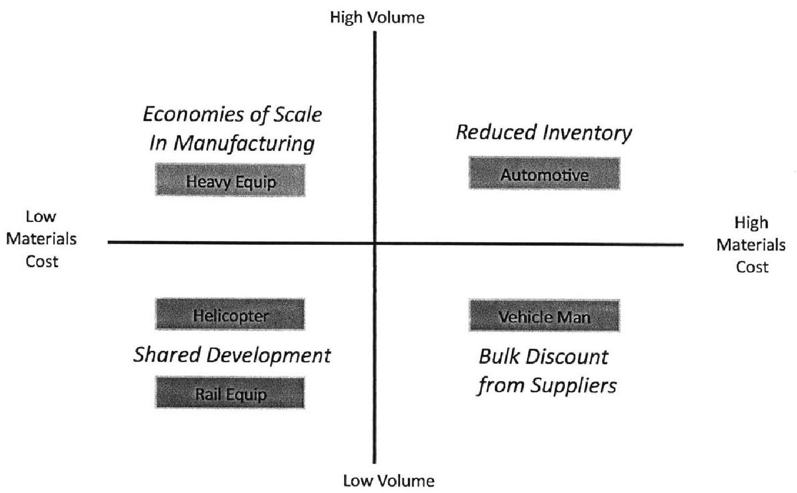

Figure 56 Which benefit is the largest?

Through the cases, we observed a systemic argument: "Our volumes are too small to merit volume benefits". However, we also observed volume benefits at several orders of magnitude. A Launch Vehicle Manufacturer observed significant benefits comparing building 5-8 units against 2-3 units. The Rail Equipment Manufacturer illustrated benefits of volumes of 50 compared with 20.

We coin the term "Volume Envy", to illustrate the idea that many firms believe volume benefits are out of reach. The lack of robust data tracking methods internally, coupled with cost accounting challenges to be discussed, prevented managers from querying the data to determine where volume benefits could and could not be achieved.

## Estimating the Producer's Benefits of Commonality

Methods used for estimating benefits are often firm- and program-specific. However, we have collated a series of methods below, informed by practice observed during the cases. The fidelity of these estimates is separated, to distinguish the fact that early estimates (which inform design exploration activities) serve a different purpose from cost-commitment estimates. The former is a rough sizing, which answers the question "is this benefit big enough to spend time examining?". As such, it may merit over-estimation. On the other hand, cost commitment estimates are much more likely to be conservative valuations, as the estimates will serve as a baseline against which program and variant managers are measured.

<!-- PDF_PAGE: 173 -->

<table border="1"><tr><td></td><td>Early Stage Estimates</td><td>Cost Commitment Estimates</td></tr><tr><td>Shared Development Cost</td><td>Historically benchmarked estimation of change effort for subsequent variants</td><td>Common / not common task estimates</td></tr><tr><td>Shared Tooling Cost</td><td>Estimated from historical purchases</td><td>Estimated from virtual manufacturing</td></tr><tr><td>Shared Testing</td><td>Fixed time, fixed dedicated resources, available centralized resources</td><td>Identified common large tests, work up of procedure generalizability</td></tr><tr><td>Economies of Scale</td><td>Takt-time targets, use of existing manufacturing procedures</td><td>Common / not common task breakdown, takt station design, workforce estimates</td></tr><tr><td>Bulk Purchasing</td><td>Based on known price / quantity curves or supplier frame contracts</td><td>Internal grouping by part extent and change controls</td></tr><tr><td>Learning Curves in Manufacturing</td><td>Historically benchmarked estimation of labor content,f(volume,production rate)</td><td>Goals on learning curves</td></tr><tr><td>Lower Quality Expense</td><td>Incremental quality goals x warranty costs</td><td>Effort for quality plan,including Cost of Non-Quality,as a function of total budget</td></tr><tr><td>Reduced Raw and WIP Inventory</td><td>Parts count x carrying cost</td><td>Detailed parts count,volume projection,supplier negotiated charges</td></tr><tr><td>Shared Certification</td><td>Identified common large tests</td><td>Agreement on shared tests</td></tr></table>

Figure 57 Possible methods for estimating commonality benefits

As with many topics in commonality, and in cost accounting and system architecture more broadly, just because a value can't be estimated does not mean its value is zero. Later in this document, we will examine which benefits firms chose to plan on, as compared with benefits which were desired but not expected.

## Estimating the Purchaser's Benefits of Commonality

This research was intentionally scoped to include only the financial savings from commonality, as captured by the builder of the system. Therefore the scope does not include non-financial benefits (such as reliability or flexibility), nor does it include financial benefits which accrue to the purchaser.

As with any scoping decision, the attempt to separate off dependent concepts comes at a cost of potentially excluding effects which cross the scoping boundary. Estimating the purchaser's benefits is one of these effects.

Several organizations in the broad practice surveys indicated that they estimated the benefit to the purchaser of commonality benefits. As a simple example, an aircraft engine manufacturer selling a second engine fleet to a customer could cost the benefit of common spare parts on inventory holding costs for the customer.

<!-- PDF_PAGE: 174 -->

However, more in depth examples were also cited. An organization described how they would request data inputs from the customer, notably labor rates, service times, and inventory charges. From these inputs, the marketing team would calculate commonality benefits to the purchaser over decadal lifetimes, including reduced maintenance training time, learning curve benefits in maintenance at higher (common) volumes, procurement staffing savings, documentation, in addition to detailed inventory charges. These savings were large - on the order of $100M. Several airlines explicitly pursue this policy - Southwest Airlines and WestJet - although it is not clear whether the sales team included commonality arguments.

Three important observations stem from this practice.

1) Early indications suggested a correlation with strong internal commonality benefits practice. Organizations that were willing to cost benefits to the customer appeared to have strong internal practices as well.

2) Organizations that operated in multiple industries cited transfers of practices from one business unit to another. For example, while sparing is a common topic in aircraft sales, it is less present in other transport segments. The transfer involved both powerpoint templates and advice.

3) One organization cited an inability to "price in" commonality benefits. That is to say, the seller was unable to charge a premium for common systems. Rather, the seller argued commonality savings helped earn "points" (common in government acquisition structures), and thus helped boost sales volumes. Pricing in commonality benefits depends on market price structures (in the example cited, large government purchasers enforced a "market price" across all competitors), but also depends on the data collected, and the market's experience with commonality.

None of the full case studies displayed examples of costing purchaser benefits, so we can't develop an in-depth examination. However, a coupled observation is explored later in the document: strong knowledge of customer willingness to pay with weak knowledge of internal cost structure (ex. "We know what 1 kg is worth to the customer, but I don't know how much $100K of inventory costs us").

Finally, it should be noted that government acquisitions represents a different context from that discussed above. The Helicopter Case discussed 10 studies of logistical benefits accruing to the government as a result of commonality. These studies were conducted by the government alone, or by firm - government cooperation. However, we could not obtain a copy of any of the studies.

<!-- PDF_PAGE: 175 -->

## What benefits should be costed?

Several cases would only cost the benefits which are contractually obligated. For example, the Vehicle Manufacturer would only list bulk purchasing savings as a result of parts consolidation activities. This raises the question of which benefits should be costed?

A related issue was identified in the Rail Equipment Manufacturer case, which maintained a very detailed costing capability of bids. Very detailed information was expected of any cost estimate, as a result of contract type and industry structure. For benefits which were challenging to forecast in detail (such as shared inventory cost), the organization failed to include them.

The logic of excluding benefits was often expressed in the cases as one of conservatism - any additional benefits that appear will only boost platform investment returns. The counter-claim to this notion arises from the goals literature (Hall 1977], which finds that failure to measure and set targets for goals often results in failure to achieve the goal. In a corporate context with high fixed or overhead costs, this manifests as lower productivity and challenges setting or reducing fixed cost levels.

The cases are clear in the finding that the more sophisticated platforming organizations in the sample of 16 were more likely to set goals for benefits. However, the research design cannot explicitly argue that this is causational, and indeed it may be merely correlated behavior. As will be described under cost allocation, one firm described a heavy process around negotiating the division of fixed costs, with a deliberate view to resolving unneeded fixed costs.

There is significant anecdotal information gathered during the cases that failure to set benefit targets resulted in the benefits not being achieved. For example, one interviewee in the Heavy Equipment manufacturer described how his engineers used a variety of part diameters, until the interviewee mandate the use of only one part. The interviewee had informally monitored development time expended, finding that engineers spent less time once the interviewee mandated the singular part. Although it is certainly conceptually possible for benefits to arise without being measured, the case interviews suggest that measuring benefits represents a best practice.

It is useful to separate the best practices in commonality around measuring benefits from the risk mitigation / conservative cost estimation aspect. As a thought exercise, let's assume all benefits can be projected, but that they carry vastly different uncertainty levels around the error of the projection. It would therefore make sense to treat conservatism for different benefits nevertheless. The only situations in which benefits should be set at zero in a projection is where the volatility is so large the benefit could be negative.

<!-- PDF_PAGE: 176 -->

The only additional problem with projecting benefits that arises is "what if we add up all the savings, and they are not reflected in actual costs at the end of the year?". This is a classic issue in management accounting, relating to the savings around fixed cost. The solution is to match benefit projections with discussions around fixed cost allocation, to coordinate the reduction of fixed costs or redeployment of assets. This is further discussed under cost allocation.

## Commonality Metrics

Early on the research, it was hypothesized that tracking a commonality metric would be positively correlated (and possibly causational) with achieving benefits from commonality. The logic is that tracking a commonality metric makes managers aware of dynamic lifecycle trends in commonality, which is likely to lead to strong lifecycle perspectives around benefits. Further, tracking a commonality metric can be used as an input to rough benefit calculations.

The data from the cases are plotted below.

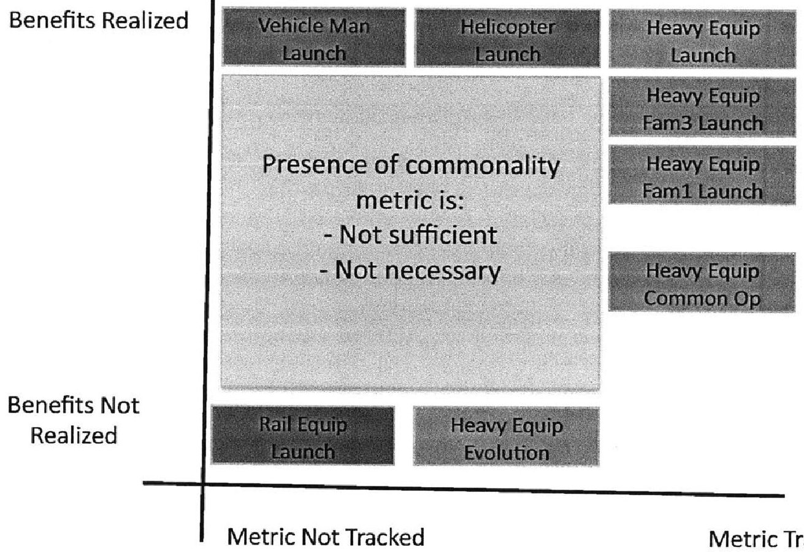

Figure 58 Commonality metrics do not ensure retention of benefits

In a formal sense, we can see from the data that the presence of a commonality metric is not sufficient to create benefits (the bottom right-hand corner), nor is a metric a necessary condition for benefit achievement (the top left-hand corner). This is because there are counter examples for both.

<!-- PDF_PAGE: 177 -->

A deeper analysis identifies that there are situations in which benefits are useful, and there are also reasons that firms do not track benefits.

Metrics are useful in at least three contexts:

- Signal large swings or trends in commonality. As in the Heavy Equipment case, where plotting the metric reveals that commonality levels had fallen from 40% to 20%.

- Make communication on the state of complicated subsystems easier. The Vehicle Manufacturer case tracked an metric for a short period of time, and only the Electrical System, where the intent was to enable the platform manager to quickly grasp how many configurations were being managed. The risk, as with all abstractions, is to not communicate enough information. The Vehicle Manufacturer platform manager abandoned the requirement, because the tracking did not convey sufficient information, and was onerous to create.

- Aid in building an organizational "feeling" for commonality. Metrics enable direct comparisons across families. In Heavy Equipment, a metric was exported from one platform to the whole division, revealing that some programs were sharing more than in others.

Given the utility of benefits as described above, what are the reasons that firms do not track metrics. As described by an interviewee in the Vehicle Manufacturer case, individual engineers quickly develop the full decomposition of the system into common and not common items. A metric is redundant, as they can capture all the information. How well a platform manager can capture this information varies with the complexity of the system. In the Vehicle Manufacturer case, the platform manager appeared to capture the vast majority of the design details, except for on the electrical system. With more complex systems, the manager is able to hold less detail (such as with the Joint Strike Fighter).

## Finding

Commonality metrics were not formally necessary or sufficient for achieving benefits, but did aid in creating benefit trades

Overall, best practice from the cases is to track a simple, parts based metric at the minimum. Many interviewees cited transparency and simplicity as key attributes of a metric, compared with the more sophisticated weighted average metrics proposed in the literature.

Fundamentally, it is clear from the cases that tracking a metric is not sufficient to realize benefits. In part, this is due to the discord between parts and process commonality, where metrics are almost always based on parts, and labor and capital commonality drive many commonality benefits.

<!-- PDF_PAGE: 178 -->

The resolution to the parts vs. process debate is likely not the 'cousin' parts definition proposed by the Joint Strike Fighter team, as discussed by Boas (2008). The intent of cousin parts definition was to capture parts that retained process commonality, but did not share a part number. Substantial disagreement has arisen on the treatment of these common parts in recent years, as revealed by interviews conducted in the DoD and at aerospace firms. The weakness of the 'cousin' parts definition is that it attempts to categorize based on attributes of the part, rather than on the specific question of what manufacturing processes are in fact shared?

This dissertation proposes that tracking commonality benefits will be the eventual resolution to the parts vs. process debate. Tracking a commonality metric is simply a proxy for tracking benefits. Boas (2008) began to hint at this notion in his dissertation, revealing that second variants on a platform did in fact have lower headcount levels than the first variant. This concept can be expanded across all cost-saving commonality benefits. The templates provided earlier under Estimating Commonality Benefits provide a starting point for identifying the cost drivers that underlie benefits.

## Sizing Commonality Premiums

As discussed in the literature search, it is well established that pursuing commonality carries an initial cost. Specifically, designing intentional commonality into a platform requires more design effort. For example, designing a chassis which will be shared among an economy car and a luxury imposes more design constraints on the design, more requirements analysis, more design concept search, and likely more analysis. All of this effort is separate from individual integration expenses borne by variants to receive a common part.

This research provides the first actual data on design premiums, and the first comparison of design premiums vary across platforms. The definition of premium used was "how much more would it cost to make a common part, compared with the cost of designing a part for a single variant?". This information was elicited from interviewees in the 3 cases - in the Rail and Vehicle cases, a detailed analysis of premiums was conducted at the subsystem level.

<!-- PDF_PAGE: 179 -->

<table border="1"><tr><td>Platform</td><td>Premium</td><td>Max. Subsystem Premium</td><td>Variants</td></tr><tr><td>Heavy Equipment</td><td>25-50% ($1-2M)</td><td>50%</td><td>4(6-12%/variant)</td></tr><tr><td>Rail Equipment</td><td>29%($X.6M)</td><td>100%(Software)</td><td>1-25(?)</td></tr><tr><td>Vehicle Equipment</td><td>12%($10M)</td><td>200%(Electrical)</td><td>4(3%/variant)</td></tr></table>

Figure 59 Commonality premiums are large, and vary significantly by subsystem

The first observation is that the premiums are large. Interviews described significant work effort required in all of the categories listed above. In offset development programs (particularly Rail), this premium comes easily under cost pressure, as it represents spending today, with uncertainty around the payback date.

Significant organizational commitment was required to ensure this premium was preserved, particularly in the face of technical challenges, schedule changes and cost overruns. The Heavy Equipment case notes how a previous market attempt which did not use commonality failed to achieve the mass market sales volumes intended, and how this experience motivated the organization to invest in commonality. Another mechanism of creating this motivation was competitor examples. Both the Rail Equipment and the Heavy Equipment cases faced competitors with larger market shares and (apparently) strong commonality. The Vehicle Equipment case did not directly display either of these motivations, but appears to have withstood challenges to the premium based on the organizational strategy for development and retained learning from past commonality successes.

## Finding

Commonality premiums represent significant investments, in contradiction to previous estimates and concepts.

The second observation is that premiums are particularly large when compared with a lead variant. This becomes important when the cost allocation rule places most or all of the common costs on the lead variant, which are discussed subsequently.

The third observation is that commonality premiums varied significantly by subsystem. The two more complex machines in the sample (Rail and Vehicle) both

<!-- PDF_PAGE: 180 -->

incurred the greatest premiums in Software / Electrical. In both cases this is due to a multiplicity of configurations - the same variant can be ordered with several options, the majority of which are either electrically enabled or directly connected to electrical / software units like GPS and hardware management control programs. Additionally, architecturally critical subsystems (such as Power Systems for Rail), which are upstream of most design decisions, saw significant premiums. This is logical, as more analysis and design effort is required to hone the architectural parameters, ensuring that other components can exist within the platform extent.

This variation in premiums suggests that funding, incentives, and oversight need to be different for different subsystems. High premium systems will necessarily command more program management time, are more likely to produce system-level conflicts with other subsystems, and are at greater risk for cost growth (simply by virtue of their size, but also reinforced by observed cost growth in the bogies subsystem for Rail and the Electrical in the Vehicle Manufacturer).

The following taxonomy of commonality penalty is proposed:

## Small Penalty

- Negligible effort required, such as adding brackets or connections

- Real challenge is getting the information in at the right point in time.

## Medium Penalty

- Analysis of design trade-offs is required - performance comes at a price

- Ex. Brake in Rail Equipment paid a 30% penalty

- Challenge is funding the penalty

## Large Penalties

- Ex. 200% premium on electrical system in Vehicle Manufacturer

- Effort is in the configuration management

- Typically only arises with strong platform management

- Penalty is larger if variant extent is undefined

## Funding Commonality

Several funding sources for commonality premiums (and more generally for platform developments) were evidenced in the full cases. These included:

- Current product margin

- Current product family margin (Vehicle Manufacturer)

- Factory-level initiatives (Rail Equipment and Heavy Equipment)

- Corporate (Rail Equipment)

<!-- PDF_PAGE: 181 -->

Several cases used combined funding arrangements. In the Rail Equipment case, the combined funding was not formalized (parallel efforts with minimal coordination), whereas in Automotive, a formal arrangement was available, where Corporate would advance funding on behalf of a second variant.

The funding source is a key determinant of the pressures placed on the development program, as well as of the level of investment oversight.

Our analysis suggests that funding from a current product margin or product family margin can constitute a very stable mechanism. Products have available budgets, which reduce the barriers to getting funding approved, and more critically, enables flexibility in the timing of commonality spending. A recurring problem with offset development programs is finding mechanisms for second variants to contribute during the development of the first variant.

Interviewees also raised advantages related to accountability and setting organizational incentives. These are discussed subsequently when we review organizational structures for commonality.

The concern that arises with funding from current product line margins is inertial budgeting, leading to underinvestment. The term inertial budgeting is used to convey the idea that the number of resources allocated is determined by resources available in an existing and convenient pool, rather than sized to the task. Commonality often fails to fit this mode - it requires peak workloads up front, ideally parallel development. Particularly in labor-intensive development programs, "funding commonality" means allocating personnel. In the case context in our 3 case sample, labor mobility among departments was low, partially due to specialized skills, and partially due to organizational cultures.

Several instances of inertial budgeting were noted in the cases. The Heavy Equipment variants were often designed by the on-site engineering staff, whose time was split between "current product" (correcting design flaws and quality issues) and "future product". This team did not necessarily have the resources to conduct studies on the impact to the remainder of the platform. This was only an issue on some variants - the last variants were able to source design resources from another facility. The Vehicle Manufacturer also described sizing design effort based on available product line resources.

Inertial budgeting implies higher pressures on commonality premiums. Our selection of full cases do not allow us to separate organizational cultures of gradual (as opposed to radical) design changes from the financial practice of funding from existing product lines. However, it seems logical that the combination of these two factors cause challenges funding commonality premiums. Anecdotal evidence from case interviews supports this view-interviewees described challenges to radical design changes and product development culture focused on incremental

<!-- PDF_PAGE: 182 -->

performance changes. Signs of under-investment in platforms are discussed under Commonality Investments.

Two of the cases used partial factory funding. In Heavy Equipment, the factory helped fund a major volume expansion, for which the dominant stakeholder was the platform studied. Despite different funding sources, there was 1 team executing the design and the factory expansion. In Rail Equipment, a factory-level productivity initiative was proceeding in parallel with product development of the platform, but the initiative was targeted at all products manufactured at the factory (of which the platform was only roughly 1/3). Critically, the teams were separate - the mentality described was more one of achieving some synergy between separate initiatives, than one of combined effort under split funding. In the Rail Equipment case, these conditions are linked to future funding uncertainty and manufacturing coordination issues.

The Rail Equipment case described the least "anchored" funding. The majority of the platform was funded by centralized R&D, even though an existing product line existed. Compared with the other two cases, this resulted in less direct "ownership" of the product and revenue. This raised issues of ownership after the R&D project concluded, where Rail interviewees noted that the funding for commonality management overhead during the construction of variants was still uncertain. In Heavy Equipment and Vehicle Manufacturer, the funding responsibility was already negotiated and did not have to endure as steep a transition.

Centralized R&D funding exhibited pros and cons. The R&D funding stream was able to accommodate a large, early cost growth of 33%, which would have stretched product line margins in the other 2 cases. It was also relatively free of influence from existing current product lines, who might have otherwise argued for requirements to be customized to their needs. Note that this freedom from tug-ofwars is more strongly attributable to the concept of platform development before variants, and only weakly attributable to the funding origin. The cons of centralized funding are a potential for weaker oversight, and potential for exogenous cuts. The willingness of firms to cut R&D budgets has been studied previously, and in some firms, R&D budgets face risks due to corporate policy and broader corporate profitability.

## Evaluating Investments

The cases described varying levels of corporate oversight for commonality investments. This is partially a function of funding source, and partially a function of centralization / de-centralization of decision-making. All of the full cases were sufficiently large that investment approval went to the President (Rail Equipment) or the Board of Directors (Heavy Equipment and Vehicle Manufacturer).

None of the cases explicitly evaluated commonality premiums (i.e. excluding the unique cost of the first variant) against benefits. Rather, they either produced full

<!-- PDF_PAGE: 183 -->

investment calculations for the intended platform extent (Vehicle Manufacturer and Heavy Equipment), or calculated investment payback as a function of order rates (Rail Equipment).

The scope of content included is the primary variable of interest. Many organizations have historical process around investments at a vehicle (rather than a platform level). From a commonality perspective, there is concern that firms will scope which variants are included in platform investments, in order to make the investment appear more favorable.

The cases displayed two mechanisms by which less than the full platform extent of fewer than the intended number of variants was included in investment calculations.

The first mechanism is excluding variants. The Vehicle Manufacturer evaluated only 2 of 4 variants against a formal investment method, where the other 2 variants were evaluated less stringently. This was done to recognize that 2 variants were 'new markets', whereas the other 2 variants were "regulation-forced redesigns". The firm didn't want to show a poor investment result on the regulation-forced redesigns, as they didn't have a choice as to whether to incur the costs. The case analysis demonstrates how this decision coupled to variant cost allocation (the formal investments only bore marginal costs, making the investment look strongly positive) and also coupled to platform strategy (the formal investment segment was at risk, and its cancellation would have sunk the whole platform). Cost allocation and platform strategy are discussed in more detail subsequently.

The second mechanism is excluding early stage costs or earlier investments. The Rail Equipment case demonstrates how the team excluded 2 predecessors' R&D programs which led directly to the platform development, but were not included in calculations of R&D return. One of these programs was a subsystem which made its way onto a number of other revenue-producing projects. The other program was an earlier attempt at platforming which failed, and never generated revenue, but which the design team directly linked to current development. While the case raises questions about dynamically re-scoping R&D to boost returns, it does not specifically suggest intent on the firm's part.

These mechanisms are important to learning in platform organizations - enabling coping mechanisms makes it challenging for the organization to evaluate whether the overall platform investment yielded the desired return.

The common theme in evaluating investments is ensuring that the full scope of costs are included, so as to place a lower bound on IRR. The Automotive case required platform investment calculations to include all of the content required for completion of the desired platform extent.

<!-- PDF_PAGE: 184 -->

## Primary Hypothesis - Divergence Has Cost Consequences

Recall that the primary hypothesis was that decreases in commonality would reduce the benefits from commonality. Given that the scope of this study is restricted to the cost savings that arise from commonality, we are particularly interested in whether benefit decreases can be valued as specific costs. This hypothesis is not primarily causal (all divergence has costs), but is rather focused on evidencing (can divergence be shown to have a cost consequence?). Another way of stating the problem is that this research sought to examine whether the opposite hypothesis (divergence does not have cost consequences) could be invalidated.

The Heavy Equipment case study has clearly demonstrated that divergence caused by variant addition resulted in a number of cost consequences. For example, quality costs on the line (as measured by increased personnel) grew with the introduction of more models. Materials costs increases were correlated with decreases in commonality.

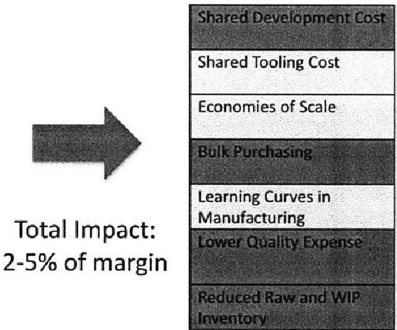

Figure 60 Impact of falling commonality on benefits. Color legend (right)- Red showed a direct impact of commonality on the benefit, yellow showed a plausible but indirect impact, and green showed no impact.

In addition to divergence costs, the Heavy Equipment case demonstrated foregone benefits. Although the stock of finished goods decreased exogenously, the RAW and WIP inventory failed to achieve similar reductions, which was linked to the growth of non-common parts.

## Finding

Divergence is linked to additional development effort, as well as reduction in commonality benefits.

The other two core cases demonstrated links between commonality and cost, but their findings were not as directed as with Heavy Equipment.

<!-- PDF_PAGE: 185 -->

In part, this is due to the timing in their project lifecycles - the Vehicle Manufacturer exhibited inter-generational divergence, but was only at the completion of development, whereas the majority of the projected impact of divergence will occur during manufacturing. Evidence from the case supports a projected increase in inventory cost and overhead charges as a result of commonality change, but this will not be known until manufacturing is well underway.

The Rail Equipment case demonstrated a coupling between requirements negotiation (a mechanism for commonality change) and increased development cost, but has not yet seen substantial commonality change. This is primarily due to the fact that the development team has not explicitly defined variants, but has rather worked to a given platform extent. Therefore, as with the Vehicle Manufacturer, any commonality changes (and their associated costs) will not be known until several variants have been manufactured. This case has several important findings to support regarding financial practices around commonality management, but these are discussed separately as they were not in scope for the Primary Hypothesis.

## Secondary Hypothesis - Near-Term Costing vs. Lifecycle Costing

Whereas the primary hypothesis sought similar behavior across the 3 cases, the secondary hypothesis makes use of case selection to test a comparative hypothesis. We hypothesized that cases which demonstrated "near-term costing" would see greater cost effects as a result of divergence, than would cases which demonstrated "lifecycle costing".

This hypothesis was inductively built on two coupled mechanisms. The first is that costs would appear to rise with divergence because the full impact of divergence was not forecast. For example, a commonality decision which does not project the impact on inventory holding cost should expect to see inventory charges 'unexpectedly' rise. The second hypothesized mechanism was that more divergence would occur under near-term costing, as decisions would undervalue the future benefits of retaining commonality, which in turn would feedback into more cost implications.

Note that these two mechanisms are not explicitly tested by the research design. An effort is made to describe mechanisms in the cases, but the overall emphasis is on discovering whether the costing horizon is a relevant variable for future study.

Each case was labeled either 'near-term costing' or 'lifecycle costing', except for Heavy Equipment, which was split into two phases, then labeled. The categorization was based on the following criteria.

<!-- PDF_PAGE: 186 -->

## Near-term costing:

1. Few rules-of-thumb for future benefits were cited by design interviewees. An example of a rule-of-thumb is "eliminating a takt station is worth $100/unit in labor costs, all else being equal".

2. Few design constraints on future benefits were issued for the design. For example, "all assembly will be conducted from the left side of the vehicle, in order to save assembly time".

3. Cited examples of budget constraints, such as "we would have liked to spend more time building commonality into the chassis, but we would have exceeded our quarterly budget target".

## Lifecycle costing:

1. Many rules-of-thumb for future benefits are available, or analysis was conducted to generate guidance on future benefits.

2. Interviewees were able to link design decisions to future benefits, based on the existence of design constraints.

3. In retrospect, interviewees felt that the project invested appropriately in commonality, and did not cite missed commonality opportunities due to budget pressures.

On the basis of these criteria, the cases were categorized to form the dependent variables for the study. Heavy Equipment was separated into two distinct phases, to recognize a shift in practice. In Phase 1, a unified design team planned and built 4 variants in parallel. The team employed commonality targets, and functioned as a cohesive whole. In Phase 2, additional variants were created by a single variant team, as opposed to a global platform leadership. Variants in Phase 2 were costed based solely on the marginal cost of development, and omitted the impact on the original 4 variants.

<!-- PDF_PAGE: 187 -->

Case 1: Heavy Equipment

Case 3: Vehicle Manufacturer

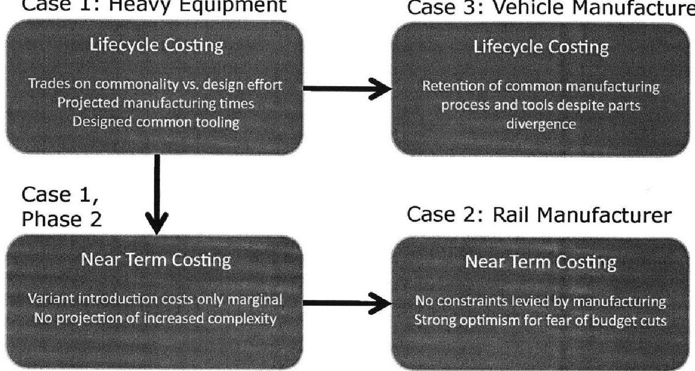

Figure 61 Case partitioning for decision-horizon hypothesis

## Heavy Equipment, Phase 1 - Lifecycle Costing

The team set clear commonality goals (80-85% parts commonality), and linked those goals to downstream commonality benefits, such as manufacturing time. This lifecycle costing was enabled by a clear challenge, in that previous efforts had failed to obtain downstream benefits, specifically a targeted cost/unit.

## Heavy Equipment, Phase 2 - Near-Term Costing

The challenge of Phase 2 was predicting the impact to the platform and the line of variant addition. Individual new variants were costed based only on the marginal cost of their development and production, such as capturing additional tooling specific to the new variant. Despite the existence of solid experience having built and operated the line for the original platform, the team was not able to reliably predict the increased effort necessary to keep the line running with more variants.

## Rail Equipment - Near-Term Costing

Although the overall outlook of the platform was far-sighted and broad, the team faced challenges managing to commonality benefits. No design constraints from manufacturing were levied on manufacturing, for example. The team was unable to project the effect of learning curves across variants. Optimistic cost projections and cost overruns in manufacturing led to tight budget constraints and lower up-front prototyping and testing than desired.

## Vehicle Manufacturer - Lifecycle Costing

This platform was characterized by careful consideration of lifecycle benefits, despite an intergenerational trend towards less commonality. Despite parts

<!-- PDF_PAGE: 188 -->

divergence (such as the chassis), design constraints were set to retain manufacturing benefits (such as enforcing common tooling for the unique chassis). Significant analysis was undertaken to understand downstream benefits, such as the impact of grouping components for sub-assembly at the supplier.

## Dependent Variable - Cost Consequences

The descriptions provided below provide a summary of the cost consequences generated by the detailed benefit-based analysis given in each of the cases.

## Heavy Equipment, Phase 1 - Benefits Achieved

As described in the case report, the benefits for the initial 4 variants were largely achieved. The program successfully reduced the labor and overhead component of cost per unit by 50% from the previous generation, thus achieving economies of scale.

## Heavy Equipment, Phase 2 - Unseen platform costs

Working through each of the benefits of platforming in turn, the variant addition is shown to plausibly cause unexpected costs, particularly an increase in the quality labor required, a rise in materials costs (falling bulk purchasing benefit), and relative increases in RAW and WIP inventory held. Not all benefits fall with falling commonality - productivity as measured by units per shift per line in fact rises. Nevertheless, the dominant trend is one of benefits falling as a result of increasing complexity delivering 9 variants instead of the original 4.

## Rail Equipment - Manufacturing and test costs rising

Challenges forecasting the effort required to manufacture, integrate, and test common components led to significant manufacturing cost overruns on a prototype and a lead variant. Schedule slip resulting from elongated requirements negotiation is directly related to difficulties scoping commonality. Further, coordination costs of parallel manufacturing are shown to result from assumptions around commonality benefits. While a number of other dynamics contribute to rising costs, such as technical difficulties in manufacturing unrelated to commonality, and an exogeneous change to the program (the introduction of an unintended lead variant), the case analysis demonstrates that near-term costing contributes to the challenges sizing the benefits and costs of commonality.

## Vehicle Manufacturer - Benefits Retained

Despite intergenerational divergence, the case study largely supports the program's current projections of a decrease in variable cost across the whole platform. Examples include clear benefits of bulk purchasing, as well as of reduced capital expenditure from shared tooling. The achievement of these benefits is linked to explicit design decisions, such as the use of common "design templates" for the diverged chassis, resulting in similar analysis runs across both chassis. The case study illustrates how not all benefits are achieved (inventory benefits are not well

<!-- PDF_PAGE: 189 -->

forecast, understood, or retained), but that on the whole, the program is consistent with broad retention of commonality benefits.

## Analysis

On the surface, the data from these cases appear to support the correlation between near-term costing and larger cost consequences from divergence. Heavy Equipment Phase 2 and Rail Equipment both displayed large consequences from divergence, as opposed to the other two instances.

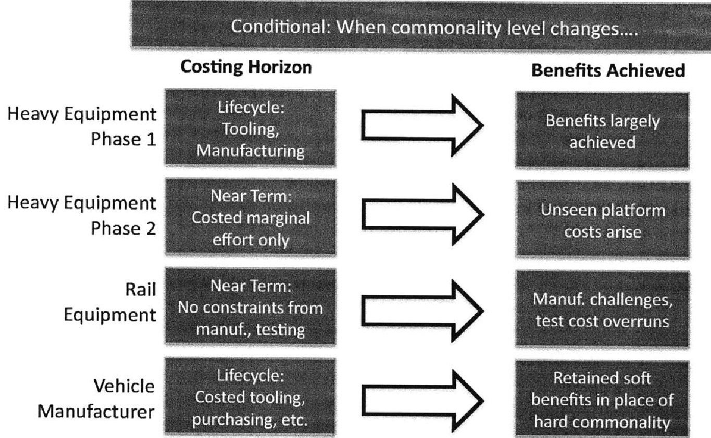

Figure 62 Decision horizon findings indicate near-term costing is more likely to showcase unintended costs from divergence

So what do the cases teach us about the causes of near-term costing? An examination of the cases enables us to further develop the theory of the dynamics behind the original hypothesis. The availability of data is clearly a barrier to lifecycle costing - if previous programs did not track learning curves, for example, it is difficult to generate projections. This supports the concept of a feedback loop of experience and available commonality analogies.

Two financial practices can contribute to near-term costing. The first is costing at a variant-level for variant additions, as seen in Heavy Equipment Phase 2. It is not the time horizon that was lacking, but the scope horizon. Conducting variant-only cost estimates, while ignoring the impact to other variants, is shown to give rise to unseen platform management costs in Heavy Equipment Phase 2. The second is an inability to finance commonality across variants. Specifically, in the absence of a strong platform budget, if variants cannot transfer funds to other variants, they will

<!-- PDF_PAGE: 190 -->

exclude opportunities for future commonality. This was seen in development in the Vehicle Manufacturer case, where a subsystem was constrained to be funded by only one variant, as well as in operations in the Helicopter case, where an update to one variant was causing divergence as the updated variant could not fund the same update to the second variant.

Two organizational factors can contribute to near-term costing. The first is inertial budgeting, whereby organizations size commonality development effort based on available resources. These resources are most typically drawn from the previous platform's supporting engineering team. An insufficiently team size then leads to a focus on near-term design issues, rather than full consideration of the budget. Note that this labor planning process can theoretically also lead to over-budgeting, but this appears less common.

The second factor is communication and cultural challenges among departments assigned to each benefit. For example, the Rail Equipment case described a strongly linear product development process, with feedback only notionally requested from engineering, rooted in historic manufacturing labor vs. engineering challenges.

It is worth examining some of the additional variables in play, in order to assess covariance and challenges to validity. The magnitude of the divergence is not equal among the cases, and the size of the potential commonality benefits (and thus the potential for erosion) is different despite the narrow industry focus. The focus in the case studies is on determining which benefits were unrepresented by existing cost systems. This lens enables us to examine the full spectrum of benefits, and the research design explicitly shies away from direct comparisons of the cost of divergence for this reason. Further, the true magnitude and cost effects be known until the Rail Equipment and Vehicle Manufacturer cases have completed a lifecycle. This research intentionally focused the latter 2 cases on development, in order to capture more detail around design decisions (manifested in the cases through subsystem-level commonality evaluations). Further studies with a research design focused on a yet more granular level of detail, specifically forecast horizons per commonality decision, would enable an understanding of how horizons broaden as the design progresses, but at greater expense of waiting to examine the consequences.

We also have the presence of contravening variables, such as the organizational capability for product costing (separate from platform issues). Specifically, one might expect that organizations with weak costing process (large overhead accounts with few allocation rules, historic challenges managing product portfolios, etc) would fare worse with attempts at lifecycle costing, and additionally, would see large cost consequences from divergence despite attempts at lifecycle costing. For this reason, the research design explicitly captured product costing methods, with a view to gauging sophistication and it's impact on commonality outcomes. This is discussed in a later section.

<!-- PDF_PAGE: 191 -->

## How do Divergence Costs Arise?

The individual cases provide descriptions of how divergence in commonality translated into costs. However, in the interests of completeness, we summarize here the various levels of divergence costs. As shown in the figure below, it is important to capture the lifecycle benefits to the variant in question, the cost and benefit implications to the other variants, as well as the potential for increased overall platform effort.

Figure 63 Framework for understanding scope of costing in platforms

This figure helps present the data on divergence cost from the cases. For example, taking the Heavy Equipment example, we can represent the following unforeseen costs.

<!-- PDF_PAGE: 192 -->

Manufacturing coordination team from 2 to 6 FTEs

Figure 64 Unforeseen costs in Heavy Equipment case plotted on commonality cost scope framework

Additionally, we can see that this representation has the potential for explanatory power. In the Heavy Equipment case, variant addition processes required only investment evaluation calculations at the variant level (as shown in green). The scope of inclusion was limited by explicit process.

The Table below presents mechanisms by which costs can arise. This table is separated into platform development divergence and variant addition divergence.

<!-- PDF_PAGE: 193 -->

<table border="1"><tr><td></td><td>Divergence During Platform Development</td><td>Divergence from Variant Addition</td></tr><tr><td>Shared Development Cost</td><td>Requirements negotiations, unique content, or integration complications</td><td>Dedicated new variant labor or current production resources</td></tr><tr><td>Shared Tooling Cost</td><td>More tooling required, recognition of process challenges</td><td>Marginal new tooling, failure to service existing depreciation</td></tr><tr><td>Shared Testing</td><td>Revealed &#x27;fit&#x27; problems, challenges managing configurations</td><td>Unforeseen re-testing, new testing, may add to fixed costs of platform</td></tr><tr><td>Economies of Scale</td><td>Unique content requires workarounds, more variable labor</td><td>Overhead rises with fixed coordinating labor</td></tr><tr><td>Bulk Purchasing</td><td>Supplier volume negotiations, part similarity &amp; impact on cost structure</td><td>New parts at higher supplier margins averaged into platform cost</td></tr><tr><td>Learning Curves in Manufacturing</td><td>Reduced volumes on subassemblies, configuration labor on final assembly</td><td>More frequent changes to process, lower learning for the whole line</td></tr><tr><td>Lower Quality Expense</td><td>Quality labor required, interaction with testing and learning</td><td>Forgotten interfaces require quality rework</td></tr><tr><td>Reduced Raw and WIP Inventory</td><td>Parts count rises, as does inventory holding cost</td><td>Parts count rises, as does inventory holding cost</td></tr><tr><td>Shared Certification</td><td>Similarity of use case decreases, shared tests span more conditions</td><td>Rework in certification of formerly common parts / process</td></tr></table>

Figure 65 Mechanisms by which divergence creates cost implications

The other conclusion from the cases that merits consideration is the feedback behavior around divergence costs. Through most of this document, the benefits of commonality have been separated linearly (as shown in the Table above). The reality is that the costs and benefits of divergence are intimately coupled - a challenge achieving one benefit likely implies challenges achieving other benefits.

A cascade of effects described in the Heavy Equipment case is provided below. While the individual case histories provide descriptions of this feedback and cascade of design decisions, it was not the primary intent of this study to catalog these effects, so at the cross-case level, we merely note the existence of this phenomena.

<!-- PDF_PAGE: 194 -->

<table border="1"><tr><td></td><td>Divergence During Platform Development</td><td>Divergence from Variant Addition</td></tr><tr><td>Shared Development Cost</td><td>Rail Equip</td><td></td></tr><tr><td>Shared Tooling Cost</td><td>More tooling required, recognition of process challenges</td><td></td></tr><tr><td>Shared Testing</td><td>Revealed &#x27;fit&#x27; problems, challenges managing configurations</td><td></td></tr><tr><td>Economies of Scale</td><td></td><td></td></tr><tr><td>Bulk Purchasing</td><td>Supplier volume negotiations, part similarity &amp; impact on cost structure</td><td></td></tr><tr><td>Learning Curves in Manufacturing</td><td></td><td></td></tr><tr><td>Lower Quality Expense</td><td></td><td></td></tr><tr><td>Reduced Raw and WIP Inventory</td><td></td><td></td></tr><tr><td>Shared Certification</td><td>Similarity of use case decreases, shared tests span more conditions</td><td></td></tr></table>

Figure 66 Mechanisms are not necessarily independent - example from Rail Equipment

## Commonality Investment Payoff

On the basis of evidencing divergence cost consequences, several predictions and hypotheses were set up. These are shown on the diagram below, where each arrows indicates causation. The case study's primary hypothesis has already addressed the first prediction.

Figure 67 Predictions of commonality cost outcomes

<!-- PDF_PAGE: 195 -->

## Lower Platform Investment Returns

The hypothesis is that the cost consequences from divergence will cause lower investment returns. While any cost consequences will necessarily cause a small impact on the return, the hypothesis centers on whether the cost consequences will be large enough to cause a noticeable decrease in investment performance. Notice also that this hypothesis has an intervening variable - the revenue upside of beneficial divergence. Therefore, while support of the hypothesis by the data would be interesting, it is not expected.

<table border="1"><tr><td>Platform</td><td>Profitability</td></tr><tr><td>Heavy Equipment</td><td>“Consistently profitable”</td></tr><tr><td>Rail Equipment</td><td>Payback in 5-6 years(?)，delayed by 2 years</td></tr><tr><td>Vehicle Manufacturer</td><td>Forecasted to achieve IRR</td></tr><tr><td>Automotive</td><td>Several past examples of failed commonality investments</td></tr><tr><td>Helicopter</td><td>Overran development by 141%，excluding company overrun($X00 M)</td></tr></table>

Figure 68 Divergence cost impacts cannot be found to universally cause poor platform level investment returns

The cases reveal that the hypothesis cannot be supported by the data. The Heavy Equipment case was described as 'consistently profitable' by interviewees, despite the large margin impact of divergence. While there are certainly incidences of failed commonality investments due to divergence, raised anecdotally in several interviews (particularly in Automotive), the purpose of this dissertation is to equivocate whether all divergence leads to failed commonality investments.

What this data does reveal is that two observations.

1) Successful programs can mask the cost consequences of divergence (Heavy Equipment)

2) Failed programs can offer commonality-related challenges.

<!-- PDF_PAGE: 196 -->

The first observation is important to organizational opportunities for learning. While it may be tempting to attribute the success of a platformed program to the platforming execution, it is entirely possible that other attributes such as timing, marketing, or industry attractiveness create the program's success. This was shown in Heavy Equipment to be the case for Division 1, where commonality initiatives often met with resistance on the basis of current successes. In a sense, these successes can inhibit learning about commonality, or can decrease "organizational will" around commitment to a commonality strategy. This discussion is further explored in the context of a proposed Commonality Cycle.

By contrast, failed programs offer opportunities to learn about commonality, at the risk of confluence with other failure modes. The Vehicle Manufacturer case describes how a failed previous generation led to significant investment in 'commonality strategy', with a view to minimize in-program scope changes. The challenges that arose through the cases are discussed in their respective categories of commonality measures, incentives, cost allocation, etc.

Although it is clear that from the platform investment perspective it is not possible to confirm this hypothesis, it is still possible that divergence costs will have a noticeable effect at the variant level. Variants have smaller budgets within which to hide cost consequences, and more importantly, the consequences are likely to be disproportionately distributed among the variants. At the variant level, variant investment returns depends heavily on the cost allocation practices used. Therefore, the exploration of this topic is split into 'lead variant pays' discussion, and other cost allocation practices that distribute cost among variants.

## Weaker Lead Variant IRR Under Lead-Pays Development Cost Allocation

Several firms described a policy of 'lead-pays', or allocating all of the common costs of a platform to the first variant. This section explores the advantages, consequences, and frequency of the use of this policy.

The sample captured by this research included several organizations who require 'lead-pays' in some cases - the Automotive firm studied, for example. However, none of the 3 full cases had a 'textbook' example of 'lead-pays'. The Heavy Equipment case captured interviews on a development program different from the primary program of study, where a new subsystem was being rolled out across the organization, and a lead integrator was chosen - the first machine to receive the subsystem. This is not the classic 'lead-pays', because the program was only responsible for the costs of integration and test, not the full development costs. A similar program was observed in the Vehicle Manufacturer. The Rail Equipment case is also not a textbook case, in that the lead did not bear a full cost allocation. However, conceptually it begs treatment under lead-pays, as it did not have a formal cost allocation arrangement (as discussed in the next section), and the intent of the decision was similar to lead-pays - to help fund development, rather than to necessarily maximize profitability.

<!-- PDF_PAGE: 197 -->

<table border="1"><tr><td>Platform*</td><td>Profitability</td><td>Cost Allocation</td><td>Forecast?</td></tr><tr><td>Heavy Equipment(other)</td><td>Cost=$Millions</td><td>Costs of integration&amp;test</td><td>Informally factored in</td></tr><tr><td>Rail Equipment</td><td>50% of margin goal</td><td>Partial cost(marginal costs+a contribution)</td><td>Explicit strategy,no IRR target</td></tr><tr><td>VehicleManufacturer</td><td>Cost=$Millions</td><td>Costs of integration&amp;test</td><td>None</td></tr></table>

*Only instances where with a clear lead variant

## Figure 69 Lead Pays cost allocation had a noticeable impact on lead profitability

In the Heavy Equipment and Vehicle Manufacturer cases, interviewees describe the non-recurring cost impact of being the lead in the millions of dollars. These were commonality investments, which later variants would be able to leverage directly, such as system characterization tests, process for integration tests, and integration hardware development. In the Rail Equipment case, the lack of clear cost allocation rules makes separating the commonality investment challenging. By its participation, the lead not only bore some fraction of non-recurring, it also experienced a dynamic effect of being a lead, that is, it absorbed cost growth from the platform.

The case data make it conceptually clear that the practice of allocating all common costs to a lead, does in fact lead to significantly lower profitability for leads. The particular level of impact is dependent on the common cost: total cost fraction, and the distribution of market sizes to which the variants are targeted. The conceptual points that are of central interest for commonality costing are therefore: is this strategy explicit, how are expectations set around lead-pays performance, and under what conditions is this a useful strategy?

The cases reveal that this can be an explicit strategy - all lead-pays situations were described as intentional choices. For example, in the Rail Equipment case, the decision to accept the lead contract was made by the President of the firm, one of few platform decisions explicitly made at that level.

Understanding of the cost consequences of lead-pays varied. While both Heavy Equipment and Vehicle Manufacturer Platform Managers were quick to point out the order of magnitude, neither had made an effort to bookkeep these investments separately. Awareness of the consequences was higher in the Rail Equipment case, owing dominantly to the fact that the contract was let externally, forcing some accounting around contract performance. It can be concretely said that all firms in

<!-- PDF_PAGE: 198 -->

the sample were aware of some level of cost consequences, but none felt it was important enough to have performed detailed analysis.

What is most interesting is how firms showcased a disconnect between strategy decisions and consequences. All of the firms kept IRR calculations at a variant level, but none had modified the IRR expectations due to the lead-pays cost consequences. The consequences were either informally logged (the VP responsible for the Heavy Equipment example was expected to 'informally forgive' poorer IRR performance on the basis of lead-pays investments), or not logged at all.

The concern that this 'explicit strategy, implicit consequences' raises is false organizational learning. Premature evaluation of a platform, based solely on the IRR of the lead-pays variant, would under-represent the benefits of commonality, as none of the benefits accrue until the second variant development begins.

There is clearly a range of intent for lead-pays. In some firms, it arises opportunistically, whereas in others it is a formal corporate policy. This research would suggest that lead variant IRR targets should be modified when lead-pays is organizationally formalized, as the extent of the consequences are much broader and systematic. In opportunistic cases, platform managers need to examine both the possible cost consequences, as well as the advantages conferred, before deciding whether modified IRR targets may have adverse consequences (like challenging variant managers less on cost targets) or would most accurately represent targets for their program.

## Finding

Lead-pays variants bearing non-recurring costs are likely to see lower profitability than later variants

As a sub-hypothesis, we sought to examine whether lead-pays behavior was a reaction to the risk of write-downs from unrealized second variants, in a strict accounting sense. None of the cases provide supporting evidence - it was uniformly rejected. Interviewees described how this accounting criteria would not have been salient to managers.

However, interviewees did describe other pressures for lead-pays investments. Centralizing control was the primary pressure - it enables the one variant to have full ownership of common parts, and therefore reduces the risk of diffuse responsibility leading to poor design outcomes. In particularly, this may prove effective when the lead is at risk of being swamped by requests for functionality in common components. Restricting the investment to a level where it can be borne entirely by one variant has the effect of constraining the possible scope of the common components.

<!-- PDF_PAGE: 199 -->

The other pressure for lead-pays was driven by variant-cancellation risk. The Vehicle Program Manager described how later variants were at risk of cancellation for financial reasons. Allocating all of the common costs to the lead improved the performance of the at-risk variant. Had the later variant been cancelled, it would have also forced cancellation of the lead, as the economies of scale would be diminished. Therefore, this was a cost worth internalizing on the part of the lead.

As we've noted above, lead-pays can beneficially restrict the scope of common components. We've noted that this is desirable in some situations. However, if this behavior arises unintended, it may be detrimental. Specifically, lead-pays may lead to underinvestment at a platform level, as there is only so much investment a lead can bear.

Based on the cases, the following signs are consistent with underinvestment.

- Failure to take clear wins due to near-term budget constraints

- Difficulty financing commonality across lifecycle and firm functions

- Repetition of design effort, desire for larger scope

- Divergence due to underperformance on later variant's criteria

Having examined the advantages and disadvantages of allocating all cost to the lead variant, we can now move on to cost allocation schemes that spread the charges among variants.

## Common Development Costs Allocated Among Variants

The chart below provides an overview of the concepts and actions that are expected from R&D cost allocation. The blue boxes at the top indicate the cascade of concepts. For example, choosing a cost allocation partially determines the variant's awareness of platform costs, which in turn enables (or disables) a variant to influence design decisions. The spread of influence among variants has a number of effects, listed on the right in blue - it can drive the variant to participate more in the platform, or to pro-actively seek out other variants for sharing, in order to boost its own volumes. However, it can also have negative effects, such as a enabling a variant with strong control to customize the platform to its needs.

The green boxes illustrate the link between cost allocation and the resulting return on investment for the platform. As shown in the previous chart, allocating all the cost to the lead variant has a negative impact on the lead's IRR. However, the $ 2^{\mathrm{nd}} $ variant's IRR can also be impacted by cost allocation, particularly if the allocation allows the first variant so much control (and in the absence of strong platform-level decision-making), the lead customizes the common components to its needs - this has the effect of forcing divergence on the second variant, who has to create more unique content than anticipated. There are also platform-level effects, separate from the sum of variants, in that certain allocation strategies require significantly more

<!-- PDF_PAGE: 200 -->

time spent on platform mediation. From this conceptual map, we can begin to see that the R&D cost allocation has an important impact on the total investment return from the platform.

Figure 70 Framework for understanding expected outcomes from cost allocation

On the bottom of the diagram, a matching allocation evaluation framework is illustrated, summarizing the concepts. This will be used to compare different allocation outcomes.

The following chart provides the data from the case studies, showing the number of variants, the allocation based chosen (in bold), and ancillary rules and conditions for the cost allocation.

<!-- PDF_PAGE: 201 -->

<table border="1"><tr><td>Platform</td><td>Allocation</td></tr><tr><td>Heavy Equipment Platform</td><td>First 4 variants, allocated R&amp;D and tooling by volume</td></tr><tr><td>Heavy Equipment Common Operator Subsystem</td><td>Lead of 5 variants, with 80% of volume, allocate R&amp;D by volume, but lead pays all common tooling</td></tr><tr><td>Rail Equipment Platform</td><td>Standalone development centrally funded, minor lead (&lt;20% of volume) paid only marginal costs</td></tr><tr><td>Vehicle Equipment Platform</td><td>Leads (2 of 4, 70% of volume) pay marginal costs of R&amp;D, remaining variants fund common costs of R&amp;D (not sub-allocated to the 2 variants)</td></tr><tr><td>Vehicle Equipment Subsystem</td><td>R&amp;D can only be paid by one program, later variants free.</td></tr><tr><td>Automotive</td><td>Lead variant pays R&amp;D, unless 2nd&lt;1 year away</td></tr><tr><td>White Goods</td><td>Required co-investment by a 2nd variant</td></tr></table>

Figure 71 Cost allocation by platform and case

The first observation is that there is a spread of different allocations used, even within an individual firm. Although there is variation, the cost allocation was not universally treated as a decision variable. In the Vehicle Manufacturer platform, for example, the cost allocation was decided within a week, when a request from central finance came in asking for information. Others projects identified allocation as a strategic choice, such as the Heavy Equipment Subsystem noted above, where the participating variants discussed several allocations as well as the intended outcomes from the allocation.

The main principle that was elicited for choosing a cost allocation based was to align the allocation with the variant with dominant requirements. The situation that interviewees sought to avoid was where performance constraints or organizational power would enable a variant to enforce expensive requirements, without having to bear the cost of those requirements.

## Cost allocation bases

Volume-based when there is a dominant volume

Variant-based (an even split among variants) when there is no dominant volume Negotiated for preventing high performance, small volume variant from dominating requirements

Centralized to enable mediation among warring parties

Marginal after development paid and adaptation cost is low

Note that aligning cost allocation with dominant requirements is simply a heuristic. The ideal situation is to carry the analysis forward to projected volumes and variant

<!-- PDF_PAGE: 202 -->

margins, coupled with the understanding of the cost impact of individual requirements on the shared common cost. This analysis would enable one to determine whether lower performing and cheaper variants are able to compete given the imposed common costs, and whether higher performing variants are benefiting from the volumes and sharing with other variants, despite the inevitable performance compromises of platform development.

However, in the absence of this idealized analysis, this heuristic allows for the broad programmatic incentives to be aligned with the desired behavior in the design process.

Other program factors could also supersede this heuristic. Large lifecycle offsets can make it difficult to place costs other than with the lead variant. Technology development strategy can force highest performing variants later in the process (and therefore likely lower cost allocations) as the technology is characterized and built-up. In order to illustrate two important program factors, we compare two platforms using the allocation framework.

Interviewees stressed the importance of determining the appropriate cost allocation. While organizational arrangements and process steps for mediating among variants have some leverage, they face an uphill battle when the cost allocation is fundamentally misaligned. The question that arises is therefore how to initiate the allocation discussion.

A comparison of our cases reveals that funding sources can help drive the allocation discussion. Note that the concept of funding is separate from allocation, as the allocation can in some cases be determined after the fact and often serves different corporate purpose.

Funding across a composition of Profit&Loss (P&L) groups was observed to create an allocation discussion. For example, in the Heavy Equipment case, the Common Operator Subsystem was funded across a number of P&L groups, triggering several management and accounting discussions, resulting in an explicit allocation choice.

Funding under one P&L, or centralized R&D funding, does not create these same incentives. In the Vehicle Manufacturer case, the extent of P&L aggregation (combined with common assembly lines) led to little attention paid to allocation.

## Related Investment Policies

Several related measures were also revealed from the series of 16 cases. These two policies are described below, together with their intended effect and potential externalities.

<!-- PDF_PAGE: 203 -->

The White Goods interviewees described a mandatory co-investment by a second variant on new parts. This policy was placed in the context of a stable and consolidated set of 'building blocks' for the products - this strategy would have different effects pre-consolidation activities or in an organization with decentralized, heavyweight product managers. The intent of the policy was to eliminate "point solutions" proposed by individual products. The surrounding organization was very centralized. A centralized components group had authority over the "building blocks", and a second group controlled interfaces. This policy was enforced by the SVP for Operations, who reviewed all new component development programs, and stated that "I haven't accepted any unique applications in 2 years". No further data was collected on this case, so it is not possible to determine empirically if this policy was over-constraining beneficial divergence.

Key to this approach is a mechanism of communication and the ability to co-invest. This policy would be significantly less effective in a case where product managers rarely communicated and maintain separated design staff.

The Automotive interviewees described a policy of centralized corporate funding available to bridge second variants. If the second variant was to initiate development within a year of the first variant, predicated on the context that the second variant is not a generational continuation of an existing product and does not have funding available, the centralized fund will 'loan' the second variant their share of platform costs. This policy enables platforms to move away from lead-pays despite lifecycle offsets. It can potentially alleviate the effects of those lifecycle offsets, to the extent that the available funding from the second variant enables more design control (despite not yet having ramped up its design team). Potential externalities include a risk to centralized funds (if the second variant is cancelled or is delayed), which the Automotive firm sought to mitigate by setting a 1 year maximum.

## Framework Comparison of Development Cost Allocation

In this section, we compare an allocation practice across 2 cases, in order to examine key similarities and differences.

## Subject 1: Marginal Cost Allocation to the "demonstrator lead" in Rail Equipment

As described in the case, the "minor lead" (<20% of intended platform volume)was built and sold in order to help cover the R&D costs of platform development. A detailed allocation was not constructed, but in general, interviewees described the costs allocated as simply the marginal costs for this minor lead variant.

## Subject 2: Marginal Cost Allocation to both leads in Vehicle Manufacturer

As described in the case, the first 2 variants (of 4 total variants), representing 70% of the total volume, were explicitly allocated only the marginal costs of R&D. The remaining 2 variant covered the full common costs.

<!-- PDF_PAGE: 204 -->

The figure below shows a comparison of these two marginal cost allocation practices.

Figure 72 Cost allocation does not uniquely determine outcomes

Subject 1 produces the intended effect from an awareness and control perspective the lead variant had weak control over platform design decisions, and from a constraints perspective, was generally subservient to the needs of the platform. However, the marginal cost allocation did not produce a strong investment performance, contrary to expectations. Specifically, this variant only achieved 50% of its margin target. The case describes how the finances of this variant were coupled to the platform development costs, via a limited labor pool and an intended design order (platform prototypes were to be constructed first). The net result is that delays in the platform development delayed the lead variant, during which the lead variant incurred recurring costs.

This illustrates that the allocation produced the desired control, but that the allocation did not produce the intended financial effect. The resulting takeway is that system effects among variants can play a role in the results of cost allocation decisions.

Subject 2 'failed' to produce the expected awareness and control outcomes - the two variants in question were treated as full partners on the platform, and were often the subject of dominant design decisions. However, the cost allocation did produce the intended investment evaluation - both appeared significantly more profitable than the remainder of the platform.

<!-- PDF_PAGE: 205 -->

This illustrates that the cost allocation only partially determines the variant's influence and control over the platform. As it were, weak control was not a desired attribute - the platform manager made the decision on cost allocation in order to protect the two lead variants. The case reveals that these leads were built in a new factory, and were already bearing significant tooling costs. Further, they faced more organizational pressure around their financial performance, partially because they were intended for a market with historically lower margins. Therefore, the decision was taken in order to protect the lead variants' financial performance.

A comparison of these two marginal cost allocation subjects illustrates the presence of intervening variables in determining the balance of control in platforms. This is supported by previous research, which suggests successful platform management requires the coordination of organizational, technical, and financial incentives around the intended platform strategy - no one measure is enough.

## Production Cost Allocation

Cost allocation in production is not as impactful on commonality incentives development cost allocation, as the majority of the decisions governing commonality benefits have been made.

However, many commonality benefits arise during production. As previously noted, economies of scale, quality benefits, and learning curves are but three examples. The choice of cost allocation has two important roles to play:

1. How attributable are benefits on to the platform in question?

2. How are on-going development and update issues funded and managed?

The Vehicle Manufacturer case demonstrated the first issue. The production line does not explicitly separate costs by variant, and multiple platforms are produced on the same line, with the result that generational divergence in one platform will be spread across the line.

The Helicopter case demonstrated the third issue. As issues arise on the platform, or as updates to common components are issued, it is desirable to fund the updates from an agreed cost allocation among variants, as opposed to requiring the individual variants to find update funds individually and on spec.

## Platform Cost Structure - Incentives

Having discussed the various cost allocation practices available, we now move to more targeted commonality incentives.

The aim of an incentive system for commonality is not to ensure maximum

<!-- PDF_PAGE: 206 -->

commonality. Rather, from a narrow perspective, its function is to maximize the lifecycle benefits of commonality. The distinction hinges on opportunities for beneficial divergence - a program that realizes 70% commonality (and the associated benefits) is preferable to a program that enforces 80% commonality at the cost of schedule delays and budget overruns.

Taking a broader perspective, an incentive system should reward decisions which weigh lifecycle benefits against opportunities for beneficial divergence. In the example cited above, beneficial divergence from 80% commonality has internal benefits, however, it can also have external benefits - for example, enabling sales in niche markets. In an ideal case, the benefits of commonality are known, thus enabling a comparison between benefits of commonality and benefits of divergence. However, in the absence of perfect information about future commonality benefits, many organizations have employed either commonality targets or incentives to arbitrate challenges to commonality. The incentives described below are primarily aimed at maintaining commonality levels among variants, rather than at setting the ideal commonality level for the program.

The four categories of incentives that we investigate are:, taxing non-common parts, new part introduction costs, setting transfer prices for common parts among variants, and pooling common parts investments at the platform level. For each, we will describe both the concept behind the incentive, and a representative metric or measure for operationalizing the incentive.

There are three aspects that we would like to examine for each incentive:

1. How well the incentive achieves the target measure?

2. How closely the target measure matches the concept?

3. What externalities may be associated with the incentive?

<!-- PDF_PAGE: 207 -->

Figure 73 Evaluation framework for commonality incentives

## Taxing non-common parts

The intent of taxing non-common parts is to maximize adherence to the platform. It is an incentive focused directly on commonality levels, as opposed to the cost focused incentive above.

The concept behind this incentive is that higher commonality levels produce greater benefits. Commonality has two prominent upper bounds. The first is technical difficulty / over-performance penalties, where unique functions are sufficiently different that a common solution is either technically expensive or imposes a prohibitive carrying cost for the unneeded functionality in base models. The second upper bound is product differentiation, where high commonality produces too little differentiation among variants, causing sales cannibalization to cheaper variants.

Figure 74 Competing influences of lost revenue and prohibitive costs from commonality premiums in tax incentives

<!-- PDF_PAGE: 208 -->

A tax is a linear incentive - it does not proscribe an optimal commonality target. The two parameters that operationalize a tax are the unit of measure and the tax rate. For simplicity, we assume the unit of measure is parts, as opposed to non-common manufacturing processes, for example. As a tax is a linear incentive, the optimal tax would set the marginal cost of the tax on the remaining unique components equal to the marginal benefit that those unique components provide.

While a tax may represent a useful incentive during development, divergence has been shown to occur frequently in detailed design or manufacturing. Thus, managers may incur heavy tax penalties late in development, when they have less ability to rework a common solution, and where divergence may in fact be the logical choice.

Additionally, where taxes are set punitively (i.e. greater than the fixed and variable cost of new part introduction), the rate indirectly sets the optimal commonality level. To the extent that the costs of commonality and the marginal revenue curves are not known in advance, it is therefore difficult to set this tax rate. Setting punitive tax rates presumes accurate cost - benefit knowledge and strong centralized control, as opposed to enabling employees to make decentralized decisions with lifecycle cost information.

The cases provide two contrasting examples of explicit taxes. Heavy Equipment previously set a punitive tax rate on new part introductions at the Enterprise level, led by the Vice President for Engineering. The tax was created in order to reduce part proliferation, but was not coupled to a design exercise to determine the envelope of existing parts (which may or may not have covered future part performance needs). The initiative was subsequently withdrawn after strong factory-based opposition.

Vehicle Manufacturer implemented a punitive tax on non-common parts after a design consolidation activity. A central commonality owner collected the tax from subscribing product lines. The rationale was that significant effort had been put into developing the necessary platform extent, and that paying back this investment would require holding fast to the existing work scope. A copy of the fee structure is reproduced below. This effort was successful in retaining most commonality although one part change was processed and charged the full tax.

<!-- PDF_PAGE: 209 -->

<table border="1"><tr><td rowspan="2"></td><td colspan="2">Initial Fee</td><td rowspan="2">Total</td></tr><tr><td>Processing Fee</td><td>Deposit</td></tr><tr><td>Level1-NewVariantDesign</td><td>$68,500</td><td>$322,500(15%)</td><td>$2.15M/20mo.</td></tr><tr><td>Level2-NewSubsystemDesign</td><td>$60,000</td><td>$125,00(10%)</td><td>$1.25M/20mo.</td></tr><tr><td>Level3-NewConfigurationofExistingSubsystems</td><td>$44,000</td><td>$25,000(5%)</td><td>$0.5M/10mo.</td></tr></table>

Figure 75 Schedule of punitive charges for commonality changes from Vehicle Manufacturer

These two contrasting examples suggest that taxes can be effective if implemented properly. The key consideration at stake is whether a consolidation activity takes place before the tax is created. If there is no funding for consolidation prior to the tax, there can be serious challenges to the measure. However, in the presence of design activity and process to create an agreed-upon span of products to meet needs, punitive taxes appear to be a feasible (if strong) incentive.

## New Part Introduction Costs

Creating costs for new part introduction is a less extreme variation on taxing non- common parts. It is typically implemented firm-wide, rather than on a specific platform. The concept is that the creation of new unique parts represents an opportunity to search for existing parts, and the cost of new part creation allows the engineer to value the time spent searching for existing parts.

New part charges are easily implemented, thus the concept and measure are well aligned and transparent. Although this approach may seem heavy-handed, consider that existing inventory systems often face challenges determining the overhead associated with new parts introduction.

<!-- PDF_PAGE: 210 -->

<table border="1"><tr><td>Company</td><td>New Part Lifetime Cost</td><td>Calculation</td><td>Control</td></tr><tr><td>Heavy Equipment</td><td>$500-$25,000</td><td>Bottom Up
(drawings, overhead, deletion)</td><td>No mandated costs, controlled for simple parts</td></tr><tr><td>Rail Equipment</td><td>None</td><td>None</td><td>Engineering</td></tr><tr><td>Vehicle Manufacturer</td><td>$1,500</td><td>Bottom Up
(drawing creation)</td><td>No mandated costs, controlled for simple parts with 6-12 months for approval</td></tr><tr><td>Automotive</td><td>$40,000/year</td><td>Top Down
(50% engineering support, 50% materials handling)</td><td>Mandated costs, centrally approved</td></tr></table>

Figure 76 Comparison of new part introduction charges

The Table above illustrates the new part introduction parameters gathered from the cases. Although we do not expect these costs to be identical across the cases, there is a basis for comparison, in that all firms manufacture complex vehicles. The first observation is that the surveyed cost varied within firms, most noticeably in Heavy Equipment. Both Heavy Equipment and Vehicle Manufacturer were hesitant to disseminate these costs internally, citing concerns that these charges would hinder innovation and charge teams unnecessary fees.

Two methods were used to calculate new part introduction costs. The first method builds costs from activity charges, such as the labor involved in creating a new part number at the equivalent hourly charge for that employee. This calculation is flawed, in that employees in question are salaried, and a reduction in 10 hours of their time does not actually save money. The second calculation proceeded from the top down, dividing the total budget for supporting functions responsible for parts management by the number of new parts introduced. This calculation is also flawed, in that this budget is not solely devoted to new parts, not all new parts cost the same, and it also falls prey to the fixed cost savings issue listed above.

Based on these costs, firms either chose to enforce these charges formally or chose to provide them as optional wisdom.

Automotive forced mandatory charges, using change orders as the transmission mechanism, whereby the charge was included as part of the change order's business proposal. It was asserted that this would lead to much broader awareness of part change costs.

Heavy Equipment chose not to enforce these costs, but rather decentralized control to the individual Engineer or Engineering Manager as to what costs to include on the Change Order Form. This creates a conflict, in that few engineers would logically

<!-- PDF_PAGE: 211 -->

choose to include a diffuse charge which 'weakens' the change order. This is reflected in the low awareness levels of these costs across the organization.

What is particularly interesting in the Heavy Equipment case is that a detailed part creation study was available, created by the Spare Part Sales organization, which is reproduced below.

Figure 77 Heavy Equipment had a detailed study of new part introduction cost, but the information was not disseminated

Across all the cases, it becomes clear that the appropriate concerns around this incentive are broad agreement and mandatory charges, rather than on accuracy. The cases demonstrate that in the absence of a charge, engineers will not value the indirect costs of part creation in change orders.

## Transfer pricing for common parts among variants

The intent of transfer pricing is to enable lead variants to recapture their operating costs for shared components, or in extreme cases, their commonality investment. These arrangements can arise when later variants are scheduled in sequence or with significant offsets from the lead variant, and do not have precursor product lines able to fund commonality investments in parallel with the lead.

The figure below illustrates a representative example. The benefits retained by the lead variant as insufficient to merit the investment, but taken from the perspective of the platform as a whole, the benefits are greater than the costs.

<!-- PDF_PAGE: 212 -->

Transfer pricing occurs in many contexts outside commonality [7]. For example, a firm with separate production facilities for engines and final assembly may set engine transfer prices at the engine factory, so as to enable the engine factory to track its financials more easily and to avoid setting a firm-wide overhead rate. There are several established methods for setting transfer price, each of which contains different incentives. The two we will consider here are full cost pricing and marginal cost pricing.

Although transfer pricing was discussed in all cases, no examples were found of transfer pricing in the presence of lifecycle offsets, as a mechanism for spreading development costs.

Figure 78 Sample commonality investment and payback, where lead variant does not benefit from commonality, but platform retains positive NPV, across a notional time x-axis

Full cost transfer pricing is an attempt to fund both the fixed and variable portions of part cost. As fixed costs are typically yearly costs, traditional 'full cost accounting' may omit commonality investments made earlier (such as tooling investment). Full cost also assumes a known production rate and an allocation base for fixed costs (such as units produced or hours by variant). Fixed cost allocations set with optimistic projections of volume will under-allocate, while pessimistic projections will return rents to the lead variant. Production environments where variant participation is uncertain may err to the pessimistic side of expensive transfer prices, making platform participation for later variants less desirable.

Full cost transfer pricing is therefore appropriate when total cost is known, volumes are fixed, and the number of variants is certain.

Marginal cost pricing arises in two contexts. First, marginal cost pricing arises when late variants can be shown to be profitable at marginal cost but not at full cost, and the fixed costs and investment in commonality have already been funded. Second,

<!-- PDF_PAGE: 213 -->

marginal cost pricing arises when the marginal cost exceeds the variable cost (i.e. production for every additional unit is more expensive, as is the case near capacity constraints). Marginal cost transfer pricing is useful when non-recurring costs have already been paid down and the complexity of additional volume or variants is low.

In transfer pricing, the target for the incentive is not easy to compute. From the platform manager's perspective, the target is to set pricing to maximize margin across the platform. If all variants are assumed to make similar margin (i.e. no lossleaders or significant volume differences), this translates into representing full cost as accurately as possible. Where capacity constraints and small niche markets exist, marginal cost pricing may more accurately reflect the margin maximizing price. For example, one interviewee described how relaxing full cost transfer pricing enabled the auto maker to successfully enter a niche foreign market, without compromising the coverage of platform fixed costs.

The externalities associated with transfer pricing are: rents by lead variants, free riding by later variants paying marginal cost, and divergence where pricing inhibits platform participation. Given that transfer pricing can be difficult to change, industries facing volatile demand will have to trade fixed cost coverage against the possibility of overcharging on transfer pricing. Industries with longer clockspeed cycles, like the aerospace industry, can implement stable transfer pricing schemes built on longer data histories. The challenge is negotiating prices and allocations at the beginning of a platform development - one firm described a yearly process by which new shared manufacturing equipment was allocated across the participating product lines, at significant effort.

It should also be noted that there is traditionally an expectation that transfer prices remain stable over time. The intent is to facilitate decision making, not incentivize costly internal hedging strategies. Several interviewees described an aversion to earning a return on fees charged to other variants, as might arise if transfer prices were both variable and controlled at the variant level.

## Pooling common parts investments at the platform level

Pooling investments arises from the idea that individual variants under-invest in commonality if they cannot charge later variants for use of the common resources (as discussed above). The intent is that the platform has the full picture of platform profitability, and can therefore make investments in commonality where appropriate. This discussion presumes that the platform has sufficient capital of its own to pursue investments - some firms allocate all funds to individual products, and run small platform management teams from corporate overhead.

It is tempting to measure this concept by dividing an available pool of money to

<!-- PDF_PAGE: 214 -->

variants according to volume or margin. However, the subdivision of budgets creates the very problem this incentive is intended to resolve - variant suboptimization. In order to hold funds at the platform level, it is also common to set the total size of the pool beforehand, which all but ensures that 150% of the pool will be requested. These two challenges illustrate that the firm needs a strong concept of the platform, and existing organizational methods for answering such questions as "if there is money left over at the platform level, how does it get redistributed to the variants?".

The most appropriate measure is savings to the platform as a whole. The term 'savings' is used as opposed to ROI, to avoid the implication of short term returns. Having a pool incentivizes variants to cooperate and bring commonality ideas forward, as it reduces their individual outlays. Variants may be inclined to overstate benefits or the cost of coordination, in order to increase the projection of savings. Firms with decentralized control and powerful product lines have found it challenging to examine or evaluate benefits, as they lack the detailed knowledge necessary to cross-examine variants.

Pooled investment is sometimes tied to the notion of commonality ownership. If the platform 'owns' the common parts in which it invests, it has a degree of control over its investment, in that it can moderate among requests to change common parts. Some organizations outsource commonality parts ownership to functional branches (ex. the engines group owns all alternators). While this can resolve the information asymmetry between platform and variant, it creates new challenges if the horizons of the functional groups are broader than that of the platform. Either strong platforms (as opposed to strong variants) or functional groups at the platform level can enable commonality ownership for investments.

Commonality ownership at the platform level without decision control over commonality levels poses further challenges. If the platform does not have explicit control over commonality levels, the common parts in the pool will become subsidized unique parts when variants make sub-optimized decisions. For example, one of the firms studied described a $ 2^{\mathrm{nd}} $ variant with high volumes who determined that an external supplier could more closely match desired performance and provide lower cost than the platform's braking system. The platform management had been significantly reduced after the development of the lead variant, and was not able to exert control over intended common systems. The $ 2^{\mathrm{nd}} $ variant diverged, increasing costs for the lead variant, which had assumed economies of scale from the volume of later variants.

The externalities created are tied to the implementation decisions for the common pool and to the commonality oversight parameters listed above (commonality ownership, commonality levels control). Variants will seek to offload near term

<!-- PDF_PAGE: 215 -->

development costs to the platform as 'common costs', and it is up to the platform to ensure their common development is scoped to benefit all. Even with appropriate platform control, sizing the pool too large will result in systems with more commonality than warranted. The risk of over-investment is present whether strong variants can overstate benefits, or whether the platform exercises control without sufficient grasp of product realities. The more generalized externalities are that centralized control will hurt individual product "finish" or differentiation. To first approximation, this risk can be sized as the relative budgetary control at the product and platform levels.

A further challenge that arises with pools is that firms often want to recognize revenue and expenses at the product line level. Allocating the pooled cost to variants raises all of the same concerns listed under 'allocating commonality investment among variants.

The only example seen in the cases of pooled common parts investment (as separate from the full platform) was in the Automotive case, where a small bridging pool was available in order to tide the vehicle over until the next yearly funding cycle. No detailed data was provided on the practice to evaluate its use.

## Organizational Factors

A number of organizational factors have already been discussed - the challenge of investments on the part of one variant and returns accruing to the second variant, the existence of stable product lines to fund development, and combinations of funding sources for commonality.

In this section we discuss participating by functional groups (marketing manufacturing, purchasing) in design reviews, organizational control of common components, and the commonality cycle.

## Functional Participation in Design Reviews

In the context of the discussion on benefits, we frequently cited the need to aggregate downstream information for upstream consumption, such that rough consideration for the benefits could be traded during design. One of the most frequently used techniques is to invite participants from relevant functional groups to design reviews.

All 3 of the detailed cases discussed participation during design reviews as a strategy they employed. However, strong contrasts exist between the cases, in terms of benefit projections and achievement. While the Vehicle Manufacturer was successful in creating requirements for manufacturing (such as shared chassis tooling) on the basis of negotiations, Rail Equipment failed to plan for or achieve a

<!-- PDF_PAGE: 216 -->

number of benefits, despite the presence of participants at the design reviews. A detailed examination of case data revealed that the participants could not recall any design constraints being levied for the purpose of later benefit achievement.

## Finding

Participation by functional departments in design reviews is not sufficient to ensure all benefits are represented in decisions.

This suggests that participation is not sufficient to ensure benefit realization, and that design constraints are one mechanism by which active contribution can be measured. A Heavy Equipment interviewee suggested a possible mechanism for this behavior - he argued that 'everybody's trying to be a team player'. When engineering proposes divergence, manufacturing and procurement (in particular) work to define how to accommodate this change, rather than argue from their perspective how it will create costs. This proposed mechanism would be exacerbated by poor visibility into cost structure and the specific costs of divergence. This mechanism reveals that in order for functional participation to be effective, to some extent functional groups have to argue in their own (narrowly defined) interest and attempt to value the costs of divergence.

Boas (2008) notes the use of the "8-Square" or "Variant Impact Matrix" at Lockheed Martin, used to evaluate the impact of individual variant changes on the remaining variants. A variation on this theme could be used for functional departments, citing the impact on agreed upon metrics of interest.

The Vehicle Manufacturer case used a targeted strategy to increase these lines of communication. They used "Supplier Collaboration Engineers", owned by procurement, but tasked specifically to subsystems within the platform, whose responsibility it was to coordinate design decisions with supply chain cost information. This was very successfully used in one instance to commonize components, and then have them sub-assembled at the supplier.

## What Functions Are Impacted By Commonality?

Some benefits are easily aligned to organizational functions. Economies of scale and learning curves impact manufacturing, shared development impacts product development. Other benefits depend on the organizational setup. For example, testing may be a separate department, part of product development, or part of manufacturing. Finally, some benefits accrue broadly, and need to either be recognized by centralized departments, or allocated to one or more functions. A list of centralized functions and the potential benefits to them is given below, as well as possible indirect cost or revenue consequences.

<!-- PDF_PAGE: 217 -->

## Finance/Audit

- Inventory benefits - if these benefits are now owned by product development or supply chain, they will accrue to Finance, who may lack the visibility to tie specific inventory savings to platforming investments.

- Reduced overhead from platforming, although often charged-back to functions, may accrue to finance. If the source of the savings are not traceable to platforming investments, traceability of cost reduction activities is reduced

## Pricing / Marketing

- Marketing will often act as the stakeholder for cannibalization risk and brand risk from commonality.

- Marketing will often act at the stakeholder for reduced time to market as a result of platforming. To degree feasible, communication of the shape of lead time reduction vs. revenue curve will enable product development to trade the increased organizational pain of front-heavy development projects.

- Marketing may see increased revenue from customization to high margin options enabled by the platform, but may also be reluctant to bundle existing options in the interest of platform simplification.

- To the extent that benefits of commonality accrue to the purchaser, explicitly costing those benefits to the customer can be used to either elicit higher prices, or win higher volume orders at the market price.

## Supplier Development / Supply Chain

- Supplier non-recurring contributions will appear as costs to the supply chain, but the concomitant benefits of reduced parts costs or even reduced downstream supplier non-recurring contributions may not accrue to supply chain.

## Aftermarket Parts

- Slower replacement rate of spares may arise as a negative to aftermarket parts departments, which needs to be balanced by quality pricing in the product price.

- Reduced differentiation of parts may inhibit high margins, to the extent that higher purchased volumes enable third parties to stock higher volumes. Serving broader parts communities may also create challenges differentiating among customer willingness-to-pay in different niches, creating downward pressure on price.

- Where services are operated, lower training expense benefits will accrue to the firm as well.

- Shared fixed cost of operations may accrue to aftermarket parts divisions, to the extent that reduced staff and overhead are required to serve smaller parts counts.

<!-- PDF_PAGE: 218 -->

## Organizational Control of Common Parts

Previous work on commonality has described the importance of commonality ownership, either at the platform level, or at the component level by functional groups. The concept of ownership is closely tied to commonality cost, in that the decisions made by owners rely on projections of cost. Previously we discussed what costs were associated with new part introduction - here we examine who has control for new part creation. The chart below shows the varying levels of control exercised in the case sample.

<table border="1"><tr><td>Platform/Subsystem/Commodity</td><td>Control for New Part Creation</td></tr><tr><td>Heavy Equipment Platform</td><td>Variant Manager</td></tr><tr><td>Heavy Equipment Common Operator Subsystem</td><td>Engineering Manager</td></tr><tr><td>Rail Equipment Platform</td><td>Individual Engineer or Engineering Manager</td></tr><tr><td>Vehicle Manufacturer Platform</td><td>Individual Engineer or Engineering Manager</td></tr><tr><td>Vehicle Manufacturer Low Complexity Parts</td><td>6-12 month approval timeline</td></tr><tr><td>Automotive Commodities</td><td>Director chairs a panel</td></tr><tr><td>White Goods Components</td><td>SVP approval required</td></tr></table>

Figure 79 Organizational control over new part creation varied from low to executive levels

As previously discussed, both Heavy Equipment and Rail Equipment platforms have decentralized approval structures. The Automotive and White Goods firms both had centralized control (for some span of components at some level of the aggregation in the architecture) with very senior approval levels.

In a broad sense, the trend appears to be that organizations with more advanced commonality practices moved from low complexity parts up to higher complexity parts and higher levels of aggregation in the hierarchy. For comparison, Heavy Equipment controls some types of nuts and washers centrally, whereas the White Goods controlled compressors. This progression of strategy is predicated on a stable architecture, which allows change and innovation at the part level, but few architectural changes over time. Almost all of the cases studied shared this slow clockspeeds and stable architectures.

One of the Vehicle Manufacturer interviewees captured the central tension as 'we want to capture economies of scale from parts, but we also want to preserve the flexibility of non-architectural parts to accommodate architectural parts'.

<!-- PDF_PAGE: 219 -->

There is a parallelism between design reviews, which are the organizational process for platforms, and control boards, which are the organizational process for firmwide commonality initiatives. The case studies reveal a best-practice of control boards, composed of departmental representatives (marketing, manufacturing, purchasing), which made decisions regarding controlled parts. The benefit of this setup is that challenges to the common parts can be championed by the representatives. Many control strategies involve costs to one department, to the benefit of others - such as more work in coordinating supplier relationships in purchasing to reduce manufacturing costs. Control boards allow an organization to define the breadth of the perspective from which costs should be evaluated, and then create champions for the decisions in each of the participating departments.

It should be noted that control boards are not only possible at senior management levels. It is possible to layer these boards, to create cross-functional lines of communication at multiple levels of the organization.

The primary drivers of a commonality control setup are illustrated in the diagram below. The aim of a strategy is to enable differentiation valued by the customer, while minimizing the costs of variety (either internally or due to supplier cost structures). The number of options chosen should then be propagated in terms of organizational control, supplier collaboration efforts, and clear communication around the variety offered.

Figure 80 Commonality control setups must balance differentiation against the costs of variety

A representative control setup and the corresponding organizational setup from the Automotive example is shown below. The intent of the setup is to develop a tiered control strategy, dependent on the importance of differentiation (to the customer). Parts which are non-differentiating are tightly controlled, for which there is a fixed set from which to choose. This control enables the firm to buy large enough volumes to descend the price-volume curve, which is otherwise very flat. Parts which have both differentiating (customer-facing) and non-differentiating parts are architected to allow component innovation in differentiating parts, but non-differentiating parts and the overall architecture are kept stable. Finally, for parts where differentiation is important, the raw material inputs are controlled, so as to increase volumes and

<!-- PDF_PAGE: 220 -->

decrease the costs of variety from purchasing very similar materials (such as grades of steel).

<table border="1"><tr><td></td><td>Example</td><td>Strategy</td><td>Control</td><td>Authorization</td></tr><tr><td>True Commodities</td><td>Wiper Motors</td><td>Very flat price volume curves</td><td>Options</td><td>Director-level</td></tr><tr><td>Configurable Commodities</td><td>Steering Wheels</td><td>50% of parts are non-differentiating</td><td>Building blocks</td><td>Director-level</td></tr><tr><td>Commodity Inputs</td><td>Steel Fenders</td><td>Differentiation is important</td><td>Raw materials, treatments</td><td>Manager-level</td></tr></table>

Figure 81 Sample commonality control setup from Automotive

Commonality Cycle

Several of the firms in the study described an 'ebbing and fading' of commonality as a strategy. They described the salience and effort placed on commonality as often being set by senior management in response to judgment call on the potential of the strategy or on their past personal experience with the returns.

Ford is a well known example of oscillations on commonality, varying between the use of heavyweight program managers with considerable independence, and worldcar attempts with the intent of producing one model for many regional markets. This oscillation is illustrated in the cartoon below.

Figure 82 Many firms observed oscillating commonality salience on roughly a decadal period

We hypothesized that this oscillation could be driven by a pair of feedback loops, perhaps coupled to systematic delays. Under this hypothesis, the oscillation is driven by an inability to charter the appropriate commonality strategy, rather than market conditions determining a cyclic level of platforming.

<!-- PDF_PAGE: 221 -->

Previously, Rhodes (2010) and Boas (2008) observed 3 commonly used strategies, but did not link them on a timeline. For reference, the 3 previously observed strategies were

1. Opportunistic Reuse: No commonality is intended. Rather, subsequent projects choose whether to reuse systems or pursue unique designs. This only works for sequential development programs.

2. High-Value Component Commonality: Those components with the highest costs are deemed common, thus targeting the commonality strategy at the biggest cost drivers in the system.

3. Commonality Culture: Commonality is extensively used and monitored. The platform, or set of common components, is chosen for its internal couplings, its stable interfaces to non-platform components, and benefits from commonality.

The figure below illustrates the hypothesized commonality dynamics. This new dynamic expands upon these strategies, placing them in the context of a progression. High-Value Component Commonality is an example of Minor / Major Subsystems (in the diagram below). Commonality Culture is represented as a selection of several of the strategies on the increasing commonality loop.

Figure 83 Proposed commonality cycle

This chart describes two feedback mechanisms. The 'Increasing Commonality' loop builds on the success of small initiatives, leading to increased organizational comfort with the concept and increased project size. The 'Faltering Commonality' loop recognizes challenges from divergence, failed common programs, and premature investment evaluation.

<!-- PDF_PAGE: 222 -->

In the cases, we've identified two factors which have historically motivated firms to pursue commonality for cost savings (as separate from revenue-side motivations like reduction in lead time). The first is parts proliferation, resulting from an examination of either parts in manufacturing or in operations, leading the firm to conclude that many parts have overlapping capability and could potentially be consolidated. The second factor is configuration complexity, evidenced by a large number of options and the resulting product configurations. Note that the first is focused on bottom-up standardization efforts typically, while the second is much more likely to focus on architectural-level platforming efforts.

## Increasing Commonality Loop

The initial foray into commonality, particularly for firms without a prior history of commonality, often has a limited scope, and is structured to minimize intrusion into the design process. Specifically, firms often construct databases of current parts, possibly searchable by performance parameters. The contention is that 'engineers aren't reusing parts because they can't find what we've previously designed or bought'.

The second step results when firms achieve some level of reuse, but recognize that design pressures and culture continue to emphasize new, unique designs. Therefore, the firm elects to forcibly standardize which parts must be reused. This was in some cases accompanied by a design exercise (what parts span all of our needs?), and in some cases was not.

From standardized parts, many firms progressed to consolidating manufacturing inputs and raw materials purchased, often linked with supplier consolidation. The intent remains to not affect the design of the product as a whole, but rather to insert individual components where savings can be achieved.

The remainder of the loop focuses on explicit design strategies for commonality, where the firm is prepared to invest at a product level in creating commonality. These strategies can result from individual product groups choosing to platform, or from broad organizational re-alignment leading to the recognition of possible internal synergies.

Several instances in the cases describe a previous experience with commonality leading to larger commonality plans. The Rail Equipment case described a previous platform built around common running gear, which led to a platforming exercise including several architectural systems beyond the running gear.

However, the majority of the case data represents a project or a firm at a particular stage of the cycle. It is only by comparison among the cases that the variety of stages appear as a potential cycle. A graphic of the cases as tagged to stages of the cycle is shown in the next section.

<!-- PDF_PAGE: 223 -->

## Faltering Commonality Loop

The dynamics of divergence have been well described through this document as well as in several other (Boas 2008, Rhodes 2010). The novel addition to the dynamic is the concept of premature investment evaluation. Previous sections described how lead variants can yield lower investment returns, depending on the cost allocation practice. The hypothesis is that firms choosing to evaluate the platform based only on the returns of the lead (or on fewer variants than the original scope) would fail to recognize the expected benefit from commonality, which we've shown tends to accrue dominantly to later variants.

The figure below illustrates the incidence of commonality strategies in the cases.

Figure 84 Cases plotted on commonality cycle

Plotting the case data provides some support for the stages of the cycle, in that many were covered in the case selection. However, there is a second major point to be made from this data, which is that we can see several firms occupying more than one stage of the cycle. Therefore, while it is plausible that there is a firm-wide dynamic at stake, there are also intra-firm dynamics in play.

The Heavy Equipment case provides a clear backdrop for the intra-firm dynamics. One of two main divisions had implemented several common platforms. Pressure to create platforms was driven by competitor strategies (which on several lines employed higher levels of commonality) and cost pressure in the industry. The second division faced less pressure, and was less sophisticated in its practices.

<!-- PDF_PAGE: 224 -->

The questions that this raised are:

- How are best practices and experience with commonality best transferred among divisions?

- What parts control should be firm wide?

The Heavy Equipment experience suggests that labor is the dominant vehicle by which commonality experience is transferred. One Engineering Manager described successful implementation of a tool for tracking parts commonality, which he then brought with him and customized when he moved to a new product line.

The second finding from the cases related to transferring experience is that the organizational strategy can create pull for commonality practices. The Vehicle Manufacturer's explicit grouping of platforms into larger product families created both a financial pool in which savings between platforms could be recognized, as well as a labor pool in which engineers and managers could search for previous commonality practices.

More broadly, the framing of this cycle as a control system forces a number of proactive questions:

- Is there an optimality or equilibrium to the cycle? This would contravene the hypothesis that the cycle results from a failure to set the appropriate level of commonality, proposing instead that the cycle enables firms to manage different internal and external conditions.

- Does the overshoot vary industry? One might imagine that industries with short clockspeeds would have more opportunities to experiment with platforming, and thus to converge on a solution. On the other hand, the overshoot may be unobservable by industry, as firms with failed strategies exit.

- Can the system be damped by strong commonality practice and knowledge capture? This suggests that industries which face large offsets and slow clockspeeds could at minimum reduce amplitudes by absorbing practice from other industries, or further, could more appropriately recognize the state of commonality practice and the external drivers.

From a practioner's standpoint, there are several practices we can identify from the cycle.

The easy part is clearly transferring commonality language and process ideals between platforms. This was seen in Heavy Equipment with the transfer of the commonality metric. Many platforms have organizational post-mortems, either formally as documents or informally as organizational stories. These lessons, while not always captured, are relatively easy to capture. Similarly, process ideals, such as the consideration of tooling commonality in Vehicle Manufacturer, are also relatively easy to capture.

<!-- PDF_PAGE: 225 -->

The challenge with these knowledge transfer mechanisms is convincing a broader corporate audience that practices which led to commonality on one platform are meaningful and appropriate in others. There are several strategies used in the cases to reduce organizational distances, thus enabling more rapid transfer of experience. The Vehicle Manufacturer chose to aggregate functional resources centrally (all electrical engineers in the same group), which were then charged out to platforms. Sharing was facilitated by monthly conferences within each function. Another strategy used was to transition staff among variants on the platform, as described in Cusumano (1998). Nevertheless, this is the less difficult challenge.

The far more difficult part is generating meaningful comparisons of benefits, to enable individual platforms to make appropriate decisions given their context. For example, although one team saw reduced development effort of 30% does not imply a similar product line stands to realize the same gains. This difficulty was well captured in the Heavy Equipment case, where one product line had seen increased margins from sales configuration reduction (which drove buyers into higher option bundles), but a second product line was convinced that they would lose customers if the number of configurations offered was reduced.

## What Not to Do

In complex product development systems, it is often all too easy to become inundated in proscriptions and guidance. It is sometimes more instructive to list failure modes and mistakes.

- Exclude later commonality benefits for lack of design guidance (ex. inventory metric at Vehicle Manufacturer). Several firm cultures placed a heavy emphasis on determining the exact extent of the benefit, with the unacknowledged downside that benefits which were challenging to cost were assumed to be zero. While this can be interpreted as leading to a positive outcome, the cases often demonstrated that failure to plan for a benefit indicated it was less likely to arise. Therefore, simplistic design guidance is often better than no design guidance.

- Measure later benefits by representation at design reviews. The Rail Equipment case provides the counter-example -representation from many functional departments was included in design reviews, yet many challenges delivering benefits were encountered. Benefits are best represented by projections of intended impact and by actual decisions and design constraints enforced.

- Cost variant addition based only on variant cost. The Heavy Equipment case demonstrates the diffuse impact of individual variant decisions on the cost base of the platform as a whole. While it may be difficult to span several variant's accounting charges, there are defined consequences as a result of

<!-- PDF_PAGE: 226 -->

rising configuration complexity, which will be much more broadly spread beyond the variant being added.

- Distribute commonality control and funding entirely to variants. The existence of heavy commonality premiums shows that if left to their own devices, there will often be one variant that stands to pay more and benefit less from commonality than others. If both control and funding are distributed entirely to variants, the platform is left with nothing but cajoling and information sharing as levers for boosting commonality.

- Expect commonality as a local optima to arise without transfer prices or cost allocation. Several cases expressed the desire to choose only commonality which benefits all variants. While in theory this should lead to strong equilibria, the reality of commonality investments is that one variant will often bear the cost. Unless the investing variant has a mechanism to recover its investment from other variants, it will fail to invest.

- Allow coping practices for excluding past platform investments. The Rail Equipment case demonstrated how it is possible to exclude past platform-level investments, in order to make current investment appear more profitable. While we are not advocating sunk-cost decision-making, the broader organizational learning from commonality needs to be aware of the full scope of investment. As many firms were not aware of the size of commonality premiums, coping practices like those seen in Rail Equipment are popular.

## When Is Platforming Likely To Produce Benefits?

Holistically, strong commonality strategies arise at the intersection of three criteria. Technically feasible, financially beneficial, and organizationally possible, as shown in the diagram below. This dissertation is focused entirely on financially beneficial and organizationally possible.

Figure 85 Three criteria for commonality

<!-- PDF_PAGE: 227 -->

The following diagram illustrates several of the high-level trade-offs that emerge at an industry level. Namely, industries with unstable architectures, low competition, high customization, or low visibility into supplier cost structure are unlikely to benefit from platforming.

Market Variables

<table border="1"><tr><td>Stable-Rail</td><td>Stability of Architecture</td><td>Changing-High Tech</td></tr><tr><td>Plan for Commonality</td><td></td><td></td></tr><tr><td>Low-Mining</td><td>Competition</td><td>High-Automotive</td></tr><tr><td>Difficulty Justifying</td><td></td><td></td></tr><tr><td>Customized-Rail</td><td>Customer Preferences</td><td>Stock-White Goods</td></tr><tr><td>Challenging</td><td></td><td></td></tr><tr><td>Low-Heavy Industry</td><td>Vertical Coordination</td><td>High-Automotive</td></tr><tr><td>Missing Visibility</td><td></td><td></td></tr></table>

Figure 86 Market variables help determine suitability of a firm for a commonality strategy

We examine specific criteria for both the "financially beneficial" and "organizationally possible" criteria.

## Financially Beneficial

The first summary criterion is that firms have to be able to plan multiple variants in advance in order to find reason to invest in commonality. The existence of future variants has to be both reliably planned (i.e. they will exist) as well as scoped. Variants have to be scoped, in the sense that there can be a rough expectation of future work. Industries and firms which were unable to determine the extent of customization from the platform faced large challenges. For example, in the Rail Equipment case, past work suggested that the firm would customize any design for a client, and did not have an internal mechanism to price that customization effectively. Therefore, if the firm can't leverage initial platform development work because the scope of later variants is subject to large changes, platforming is unlikely to be financially beneficial.

<!-- PDF_PAGE: 228 -->

## Industries Dominated By Development Cost

Two criteria emerge in industries with large development cost (and typically low production volumes).

The first criterion is that the saved development labor can either be productively placed elsewhere, or it can be cut. It is typical to employ large salaried workforces in several of the industries studied (Aerospace, Heavy Equipment). If the reduced headcount required for later variants is not productively re-deployed, the firm will not save any money. Challenges re-deploying were found in organizations with high product-to-product walls and those with very dissimilar product lines.

The second criterion is that the business model does not depend on cost-plus (or similar) contracts. A number of Aerospace and Transport firms operate, or have historically operated, under design-for-fee contracts, which make it difficult to charge higher margins on later designs. This contract structure is often coupled with the practice of modifying scope or requirements (as previously discussed), which also inhibits development cost savings.

## Industries Dominated By Manufacturing Cost

Three possible criteria emerge, each of which can individually create a financially beneficial platform.

Significant learning curves are possible. This typically implies direct labor is a significant fraction of total lifecycle cost, and also that volumes are sufficiently large to reach these learning curves. Platforms where only 1-2% learning curves from aggregating volumes can be achieved are unlikely to merit platform investment. Similarly, industries where configuration complexity is likely to swamp learning benefits are unlikely to retain benefits.

Strong bulk purchasing discounts is available. In industries that purchase a large fraction of product cost, like the Vehicle Manufacturer, platforming will only be beneficial if there is a strong potential for a discount. If the firm cannot aggregate over sufficiently large volumes, or the suppliers have monopolies, it will be difficult to achieve a meaningful discount. In the Vehicle Manufacturer, several subsystems did not have sufficient visibility into their supplier's cost structure in order to assess whether a discount could be achieved.

Investments in economies of scale and capital equipment will outlast the platform. Particularly in industries that are capital-intensive, if the industry clockspeed dictates new manufacturing methods on short cycles, it will be challenging to invest. This is potentially the situation in semiconductor manufacturing, although Boas (2008) illustrates how, from the perspective of the manufacturer of the capital equipment (as opposed to the purchaser and user), there are sufficient projections to merit platform investment.

<!-- PDF_PAGE: 229 -->

## Organizationally Possible

Three criteria emerge around platforming being organizationally possible.

First, coordination among and control of variant must be possible. Whether this coordination takes the form of price incentives for platform participation, or mandated use of a part, at some level, this coordination has to be possible. Therefore, organizations which have regimented heavyweight manager setups, or strongly decentralized product control, or regionally diffuse markets with communications challenges, or where is entirely funding distributed to variant (like NASA), will face large challenges attempting to bridge variant-level differences.

Second, platform-level accounting or financial transfers across variants must be possible. As described earlier, unless there are price incentives or variants proceed only in parallel, platforming will not be beneficial to all variants. Therefore, the firm can either accept some less profitable variants subject to platform accounting demonstrating overall profitability, or it can arrange transfer prices to allow early variants to recover investments. Several firms studied, such as the Vehicle Manufacturer, had selective rules around financial transfers, which can potentially invalidate platforming activities.

Third, it must be possible for downstream functional groups to coordinate with product development. Achieving benefits demands design considerations, and unless information can be propagated upstream about the size of the benefit, platform managers will fail to make the right commonality decisions. Organizations that have historically high functional walls, such as the Rail Equipment case, stand testament to the importance of this criteria in generating meaningful benefits.

## Control vs. Incentives - Platforming Strategies

It is instructive to examine how different platforming strategies target specific benefits, and face specific cost challenges, where 'strategy' is used narrowly to define which components are shared. Boas (2008) identified three primary commonality strategies - maximize reuse, commonize high cost parts, and pervasive commonality culture. This work has shown that there are a number of other strategies, such as commonize non-differentiating systems (common operator subsystem).

The table below represents an selection of the available platforming strategies, arranged from low commonality planning effort at the top, to high commonality planning effort at the bottom.

<!-- PDF_PAGE: 230 -->

<table border="1"><tr><td>Strategy</td><td>Applicability</td><td>Benefit</td><td>Challenges</td><td>Incentives Control?</td><td>or Example</td></tr><tr><td>Reactive Reuse(Siddique 2001)</td><td>Low planning abilityLow R&amp;D spending</td><td>DevelopmentTooling</td><td>High risk of optimal solutionsPotential for missed benefits</td><td>Incentives</td><td>White Goods</td></tr><tr><td>Low Cost Components(Labro 2004)</td><td>Flat Component CurveLow planning ability</td><td>Bulk PurchasingInventory</td><td>Hard to define fixed cost savingsAssumes labor mobility across</td><td>Control &amp; Incentives</td><td>Automotive</td></tr><tr><td>Building Blocks(Fisher 1999)</td><td>Stable architectureHigh overhead</td><td>Bulk PurchasingInventory</td><td>Challenging to synchronize developmentDifficult to fund R&amp;D</td><td>Control &amp; Incentives</td><td>Automotive</td></tr><tr><td>Non-DifferentiatingSubsystems</td><td>Stable architecture</td><td>DevelopmentTesting</td><td>Managing stable interfacesEnabling differentiating features</td><td>Control &amp; Incentives</td><td>HeavyEquipment</td></tr><tr><td>High Cost Components(Boas 2008)</td><td>Steep component curveHigh R&amp;D spend</td><td>TestingEconomies of scale</td><td>Risk of high integration costsDegradation to reactive reuse</td><td>Control &amp; Incentives</td><td>VehicleManufacturer</td></tr><tr><td>Backbone / CommonArchitecture(Halman 2003)</td><td>Low clockspeedHigh R&amp;D spend</td><td>DevelopmentEconomies of scale</td><td>Risk to development savings-customizationDoes not imply testing savings</td><td>Control &amp; Incentives</td><td>Rail Equipment</td></tr><tr><td>Commonality Culture(Boas 2008)</td><td>High planning abilityHigh R&amp;D spend</td><td>DevelopmentInventory</td><td>High coordination costs</td><td>Control &amp; Incentives</td><td>Joint StrikeFighter</td></tr></table>

Figure 87 Platforming strategies arranged from low forward planning (top) to high forward planning (bottom)

We can see from this table that pervasive commonality strategies tend to target development benefits, but invest significantly up front in order to achieve this benefit. Lower order strategies, which tend to be organization-wide rather than platform-wide, are more likely to cite bulk purchasing and inventory charges.

## Finding

Best practice for all platforming strategies involves combining control and incentive measures to achieve benefits.

In terms of challenges, diffuse low order commonality strategies clearly face greater coordination challenges, and specifically are more likely to face funding challenges. Higher order commonality strategies are more likely to face 'execution' challenges, in terms of holding off unplanned customization.

Finally, from this table, we can reason that all of these strategies require both control and incentive strategies. Essentially, each of the strategies requires some element of control - low cost components must define which variants are acceptable, and prevent engineers from designing their own. However, short of rigid monitoring of designers, this strategy stands to benefit from incentives such as new part introduction costs. This blending of incentives and control measures is a reflection of the scoping of this dissertation around intentional commonality, as compared with the reactive reuse strategy illustrated in the table. Reactive reuse is by definition the absence of forward planning or control.

It is instructive to re-graph the preceding sections in terms of incentives and control. In the table below, we can see that both measures were captured in the scope explored in this dissertation.

<!-- PDF_PAGE: 231 -->

<table border="1"><tr><td></td><td>Control</td><td>Incentives</td></tr><tr><td>Technical</td><td>Tagging intended common Measuring commonity</td><td></td></tr><tr><td>Financial</td><td>Variant Impact Matrix Investment evaluation Development cost allocation Production cost allocation Mandatory co-investment</td><td>New part introduction cost Taxing non-common parts Transfer pricing Investment pool for common parts</td></tr><tr><td>Organizational</td><td>Commonality owners Tiered parts control strategy Participation in design reviews</td><td>Variant ordering by volume Contract strategy PnL aggregation Pooled funding</td></tr></table>

Figure 88 Comparison of control and incentive strategies for managing commonality. Measures in gray are not novel in their application to commonality challenges.

## How To Structure A Commonality Initiative

Commonality often arises as an organizational initiative, pushed by central management rather than by product groups. These initiatives are either targeted product platforming activities, or broad consolidation activities.

At the heart of the initiative there should be a tension between customization and consolidation. This tension forces managers and engineers to actively trade commonality against uniqueness, offering rewards and positive feedback for both as appropriate Best practice is to deliberately create a tension between standardization and differentiation. This tension helps clarify which aspects of the product are differentiating, leaving the remainder as possible targets for commonization.

- One strategy for creating this tension is to centralize design engineers then lease engineers to the variants/platforms

- A second strategy is to decentralize design, but require broad examination of new part creation

If the commonality initiative is not a senior management special project, there are often two broad choices - independent development program or functional department. These choices correspond to the axes in many matrix organizations.

IF the platform is an independent development program, the challenges are:

- Negotiations with variants to establish the program's revenue contribution

<!-- PDF_PAGE: 232 -->

- Temptation to end the program once common elements are designed

- Clear start / end dates create a "near-term benefits only" mentality

IF the platform is a functional department, the challenges are:

- Challenges identifying the functional program's "added value"

- Requires a clear articulation of the problem (ex. parts proliferation)

- Beware the "information sharing is sufficient" hypothesis

Neither of these choices is necessarily optimal for all organizations. The choice is often made to offset the existence of existing biases. Strong decentralized organizations may choose the functional department approach, to deliberately foster the centralization tension.

Subsequent to the choice of initiative type, the control and incentives strategies listed in the previous section can be used piecemeal to adjust the balance.

## Commonality Strategies in Project-Based Organizations

Readers often choose a product organization as their primary mental model for platforming activities. Indeed, it is instructive to assume that products can be reliably planned, in order to examine what levers exist for a fixed development activity.

However, platforming is often of interest to project-based organizations, as separate from product organizations. These organizations have close customer interaction, where an individual customer composes a large enough fraction of sales to merit dedicated design activity. Note that this is not necessarily restricted to government purchasing. The Rail Equipment case and the Helicopter case fall within this frame.

While these organizations are typically low volume, we can recall that the dominant benefits to the firm are:

- Shared development cost across offset variants

- Shared tooling and associated fixed costs

- Bulk purchasing of components from

The largest challenges we observed to platforming in project organizations are:

- Customization driving development benefits down

- Difficulty planning variants, resulting 'standard + options' setup

As a result, several actions are recommended specifically for project-based organizations.

- Separate out funding for commonality premium during funded projects, in order explicitly recognize the costs that should not be accounted for with the project. Otherwise, there is significant downward pressure on

<!-- PDF_PAGE: 233 -->

commonality benefits, and when corporate financials are simply the sum of project profitability, it will be difficult to bear investments on an individual project.

- Synchronize development and production schedule when possible

- Set explicit downstream benefit goals. This is more difficult to track for project organizations than in product organizations, particularly because of the "this project is unique" argument. Nevertheless, if commonality investments are funded on the basis of reduced project engineering non-recurring, it only makes sense that this should be a measured outcome.

- Price benefit of standardization to the customer.

## Targeting Specific Benefits

Strategies and tactics for targeting individual benefits are given below. In some cases, similar benefits have been lumped together

Shared Development Cost and Shared Testing Cost

- Group subsystems together (ex. structure + body), on the assumption that the skills are sufficiently similar to enable labor mobility within them.

- Define which subsystem groups require deep expertise, then aggregate all other subsystems into a labor pool

- Aggregate similar function people across multiple products.

- For project-based organizations with large contracts and low ability to define / force variants, create labor mobility between project tasks and bid tasks.

- Balance very detailed component projects with strong holistic/ performance groups, as opposed to strong product groups

- Boost centralization for components that are less differentiating to the customer (Cusumano 1998), are newer technically (and intended for broad use), or arrive late in the design process (are designed to be subservient to other subsystems' needs) (Cusumano 1998).

## Bulk Purchasing Discounts

- Add constraint of backwards compatibility with current production, in order to 'reserve' supplier capacity, and enlarge the order (Vehicle Manufacturer)

- Design future parts to share supplier tooling (and other non-recurring), with

<!-- PDF_PAGE: 234 -->

explicit separation of charges for tooling and for variable costs at supplier.

- Order inventory for future variants with the first variant (trading discount against inventory holding cost and divergence risk).

- Set frame agreements for future purchases - lock-in price at some volume (Rail Equipment)

- Set supplier price - volume curves with supplier for future purchases

- Mandate the supplier use the same packaging/ shipping containers (if containers are purchased as non-recurring)

- Consolidate similar business across several business lines to 1 supplier (Vehicle Manufacturer)

o A dissent: Price - volume discounts can be swamped by discounts from competition (Automotive)

- Despite lifecycle offsets, phase product design to create overlaps in subsystems with high bulk purchasing potential. This typically means accelerating later variants, not delaying current variants.

## Manufacturing Economies of Scale, Shared Tooling and Learning Curves

- Identifying the cross-product learning curve is important. Deliberately scheduling parallel manufacturing test runs (whether or not those runs are on the same line or adjacent lines) can help identify the benefit

- Creating shared manufacturing process descriptions can help identify further opportunities for process-consolidation or simplification (Helicopter case)

- Differentiating manufacturing steps and test procedures should not involve dis-assembly - ordering tasks so as to move differentiating tasks down the line (and common tasks upstream) will boost process learning, and prevent rework (Rail Equipment)

- Movement to higher volume manufacturing methods often requires additional design considerations. As such, consolidating parts without movement to higher volume methods will only yield learning curve benefits. Furthermore, it is often difficult to re-design for higher volume methods after the fact.

<!-- PDF_PAGE: 235 -->

## Quality Benefits

- Achieving quality and testing benefits often requires investment in quality and testing procedures - again, consolidating parts is not necessarily sufficient.

- Invest in procedures that cover the full platform extent. Recalibrating for every new configuration, while lower cost up front, is unlikely to lead to significant headcount savings.

- The risk of a common component failing (and impacting a broader range of products) must be met with higher initial investment in characterization and quality process.

## Inventory Benefits

- Inventory benefits will appear greater at higher carrying cost charges raising the carrying cost is a potential lever for incentivizing commonality

- In business with large spare parts revenue, including the carrying cost of spare parts inventory in design calculations will expand the size of the incentive for commonality.

- Where inventory charges include materials handling equipment or transportation equipment, standardizing and reusing this equipment across common product (or similar products) will increase inventory savings.

- Failure to adjust RAW or WIP levels as a result of parts consolidation will fail to generate inventory savings - safety stock levels under consolidated parts (compared with the unique alternative) have to actually decline in order to save inventory. If the demand pooling effect is unknown, it is unlikely that inventory savings will be achieved.

## Certification Benefits

- While certification standards vary across industries, many have guidelines available for the magnitude of changes that can be issued under the same regulatory approval or type certificate. Understanding how many subsystems can be modified and which performance figures cannot change can help in pricing customization.

- Seeking regulatory approval or counsel in advance regarding shared tests can help reduce duplication of tests.

<!-- PDF_PAGE: 236 -->

## List of Factors to Consider

Figure 89 Summary of commonality cost factors to consider

## Do Benefits Inform The Platform Extent?

Several interviewees raised questions around what the platform extent should be, and specifically, how consideration of benefits should impact the initial platform extent.

Several pieces of guidance are offered by the cases.

- It is much easier to add variants within the extent than outside the extent. The majority of the variants added to the Heavy Equipment platform were for compromise variants at halfway points between the existing variants. This suggests that the platform should at the least be composed of the minimum and maximum extent initially, but it is in conflict with traditional technology development wisdom, which suggests that one should incrementally build on performance.

- Exclude variants from the initial extent which require marginal design changes. An Automotive Manufacturer noted that Long Wheelbase Versions of existing models were excluded, because after the variant design, vehicles can easily be 'stretched', and require generally few modifications.

<!-- PDF_PAGE: 237 -->

- Exclude variants from the initial extent which are only profitable when allocated very few or none of the common costs. The decision to proceed with these variants should only be made once the platform has been shown to be profitable or has paid down its commonality investment. The first exception to this rule is where the marginally profitable variants form a majority of the volume, in which case the platform manager should trade the benefits of their inclusion against the risk of cost and scope growth from their inclusion.

- Exclude variants with large offsets if possible. Given the financial and organizational challenges around offsets, it is often easier to make reuse decisions after proceeding with a parallel platform development than it is to manage design and configurations of a time-stretched platform.

- When performance or flexibility benefits dominate over commonality cost savings, it was often expressed that designing the platform to the highest performing variant ensured the remaining variant could meet performance requirements.

## Platform End of Life Criteria

The view of variant addition divergence can be placed within a natural cycle of platform lifetime. This begs the question of what can be considered platform end-of-life criteria.

- The platform configuration management effort, variant duplication of fixed cost, and common variable cost has grown to where cost + margin exceeds customer willingness-to-pay.

- Common costs are impeding cost competition for the cheapest variant.

- The platform has achieved its desired return on investment. O This is not a binding criteria, but a possible signal.

- The platform did not achieve its desired return on investment, and continued production is more expensive than the unique alternative and the non-recurring investment required for a move to unique.

- New technology has emerged and is cost-prohibitive to design in. O Highest cost variants cannot bear performance penalty.

<!-- PDF_PAGE: 238 -->

- The market has shifted, and existing options and variety offered by the platform is not sufficient to meet customer expectations for variety, or is delivering the wrong variety.

- Based on variant addition, it has become unwieldy to manage the products as a platform.

- The corporate externalities are large (costs that are not borne or explicitly cost by the platform, but are borne by the firm nevertheless), even though sales are not declining.

- Opportunities exist to synchronize the development of new variants

## Generalizability of Findings

The conceptual scoping of this work was to include only platforms displaying intentional commonality (as opposed to passive reuse), and only platforms where cost savings was the dominant benefit or a large benefit (as compared with reliability or other non-cost benefits).

The broad practice surveys were deliberately conducted across a wide range of industries, in order to generate a broad range of commonality practices. The theory is that different industries have different cost structures, and will display different dominant benefits. Further, those dominant benefits will be costed in more detail.

The full case studies conducted were intended to enable comparisons across firms, which had to be traded against lower generalizability. The three cases were all selected in long lifecycle, slow clockspeed, capital-intensive manufacturing industries. The central premise was that these cases would share similar planning horizons for commonality, which was upheld upon closer examination of case data. These 3 full cases were all conducted in industry, hindering our ability to generalize them to a government context.

Despite the similarity of industries, cases were chosen to display different dominant benefits, in order to gather a theoretical spread. As noted previously, this is partially determined by volume, which ranged in the case same. Additionally, the cases were chosen to display a range of decision-making, namely displaying both development divergence decisions as well as variant addition decisions.

Given this background, the finding that divergence has cost implications is broadly generalizable, as this was an existence proof based on an industry-spanning phenomena. Similarly, the trade-off of benefit concepts in variant addition and development divergence are also broadly applicable.

<!-- PDF_PAGE: 239 -->

The findings which size commonality premiums and which size the aggregated cost consequences of divergences are the least generalizable outside the defined scope, in that those are theorized to be heavily dependent on industry cost structure.

The primary conceptual concern in generalizability across industries rests with shorter lifecycle, faster clockspeed industries. Future work will have to examine whether shorter lifecycles enable firms to better predict benefits, leading to reduced consequences of divergence, or on the other hand, if shorter lifecycles prevent multi-generational planning, leading to higher incidence of divergence.

## Generalizability to Government Procurement

One of the primary decisions made in scoping was to exclude government cases from the list of full cases. We now revisit that decision by questioning the differences across this context.

The primary divide centers on who retains the benefits. In government procurement, the government stands to gain from benefits in operations, and may in fact sacrifice higher development or manufacturing costs to these ends. Therefore, decision-making in the firm executing the platform is beholden not only to questions of savings to the firm in development and manufacturing, but also to contractual constraints and involvement / interference by the government. Therefore, government cases are likely to violate the scoping assumption that cost savings to the firm are the primary motivation for commonality.

The cost consequences from divergence may be different in government cases, as the contractor may have an incentive to divergence. For example, in a cost-plus contract, higher unique content implies more revenue (Wicht, 2011). In any statistical study (as in Chapter 5), the modes of cost growth are many more in the government context than in the private sector.

With these conceptual divides in mind, we have illustrated a number of differences in the Table below.

<!-- PDF_PAGE: 240 -->

<table border="1"><tr><td>Industry</td><td>Government</td></tr><tr><td>Retention of benefits</td><td>Division of commonality benefits with contractor</td></tr><tr><td>Budgets often written for development+production</td><td>Contracts written separately for development and production/agency problems</td></tr><tr><td>Volume uncertainty</td><td>Volumes quoted by customer</td></tr><tr><td>N/A</td><td>Risk of customer requirements interference</td></tr><tr><td>Potential for funding from existing product lines</td><td>No existing‘revenue’ streams</td></tr><tr><td>Lead variant margin pressures</td><td>Lead variant performance pressures</td></tr><tr><td>Operations yield strong revenues</td><td>Operations decisions more performance than cost sensitive</td></tr><tr><td>Platforming sometimes out of generational consolidation</td><td>Expanding performance while targeting cost</td></tr></table>

Figure 90 Comparison of industry vs. government context along attributes relevant to commonality

Volume uncertainty plays a large role in the private sector. Theoretically, volumes are quoted in government procurement contracts, which would suggest government contracts should retain higher benefits during divergence, because there is lower uncertainty present. In reality, procurement contracts are also subject to change, although perhaps with lower volatility than sales forecasts.

The government context can make funding commonality more challenging. As noted in Chapter 4, the government is 'not allowed to borrow', i.e. faces greater challenges paying for commonality premiums, particularly on projects where variants are funded through separate organizations. The cross-case analysis on transfer pricing and cost allocation is particularly relevant here, in that these financing mechanisms have to be more explicit in government in order to succeed.

While the government does not face the same margin pressures, Chapter 4 illustrated that lead-pays is a much more common government cost allocation. Therefore, the government faces similar, if not greater, risk of premature investment evaluation. Additionally, government-procured systems often face greater performance pressure (particularly in Aerospace and Defense), making lead

<!-- PDF_PAGE: 241 -->

variants all the more critical. This pressure can be partially mitigated by pursuing parallel development programs and using cost allocation practices.

In cases where firms retain benefits from operations, as with higher margins (and lower costs) on spare parts, the incentives in development are only weakly in favor of commonality. In Heavy Equipment, the firm perceived parts proliferation as a benefit, in that it made it easier to charge higher margins for selected spare parts. However, when the government operates common equipment, there are cost savings from aggregated inventory and from non-monetary benefits such as performance and reliability benefits. These performance benefits are more likely to dominate. For example, in the Helicopter case, lower spare inventory was primarily designated for saving ship-board available storage, rather than to reduce carrying costs of inventory.

This has two implications for generalizability. First, the government is more likely to place emphasis on operational savings than the private sector. Second, the government is likely to use different modes of decision-making, in that it will likely preference performance-benefits or fixed capacity allocation above incrementally accrued financial savings (like inventory holding cost).

The final point is to illustrate that the government is less likely to accept performance compromises, partially because product generations are perceived to be longer. This again makes the compromises necessary for platforming more difficult to achieve, and could have substantial effects on the magnitude of divergence cost consequences seen.

<!-- PDF_PAGE: 242 -->

## Chapter 11 Conclusion

This dissertation set a general objective to investigate the link between changes in commonality levels, and to develop a framework to capture all of the relevant decisions which require cost information.

A coordinated research programme was conducted against these objectives. A detailed literature search revealed the extent to which negative cost consequences of commonality change have been previously studied, and produced comprehensive list of the benefits and costs of commonality. A numerical analysis of available data from military acquisitions revealed the plausibility of a connection between programs that employ commonality as a strategy and the resulting cost growth. A series of case studies was conducted to study how firms evaluate the benefits of commonality, and to capture data around the cost consequences of divergence.

The contributions of this dissertation are listed in short form below, and discussed in the context of the Commonality Costing Framework subsequently.

## Empirical Contributions

- Evidenced divergence cost consequences

- Numerical study of commonality as variable in cost growth

## Theoretical Contributions

- Illustrated limitations of static view commonality cost, produced a dynamic representation of commonality cost varying through the lifecycle

- Proposed dynamics of a commonality cycle

## Methodological Contributions

- Defined the scope of commonality costing activities

- Defined primary financial variables of interest

- Framing of commonality premiums as investments

<!-- PDF_PAGE: 243 -->

Results in the Context of Commonality Framework

Figure 91 Commonality cost framework

## Commonality as a Cost Strategy

We find that commonality strategies are driven by a set of external and internal dynamics, initiated by experiences with previous commonality successes and by competitor strategies, in contrast to the view espoused by the Quantitative Management literature reviewed in Chapter 2. The decision to investigate platforming was not typically a rational weighing of costs and benefits, but rather a political- and cultural-driven process, in keeping with Cusumano's (1998) discussion of organizational structure determining platform strategy.

We propose a Commonality Cycle as an explanation of the observation that many firms exhibit rising and falling commonality salience. The feedback loops expressed in the cycle serve as a starting point for understanding how firms make initial commonality strategy decisions.

The important observations from this cycle are that firms face challenges evaluating the past success of commonality, as separate from related market factors and technical success. Further, we observe that premature investment evaluation, coupled with heavy lead variant cost allocation, could be leading firms to draw false messages from past commonality experience.

This cycle enables a number of recommendations. First, it suggests that strong practice of a commonality strategy includes diffusion of experience from one platform to the next. The relevant parameters, such as cost allocation base and benefits estimation practices, are enumerated subsequently in the framework. Second, commonality cannot be universally considered a risk-mitigating strategy. While commonality enables niche market entry within the platform extent, it also

<!-- PDF_PAGE: 244 -->

constrains investment opportunities outside the platform extent by tying up R&D budgets.

## Commonality Investments

The literature review revealed that there is a gap in previous conceptual models of platforms, whereby lifecycle offsets imply distinct phasing of commonality investment, followed only later by commonality benefits.

Where previously only judgment estimates (Younossi 1997) such as were available for the size of the commonality investment (in comparison with the unique development counterfactual), the case investigations returned data for 3 platforms, which ranged from a 12% premium over of a single unique variant to a 50% premium.

In terms of the return generated by this investment, we build upon the theory that lead variants bearing common costs will generate poorer returns. Specifically, this dissertation examines in detail how the return is dependent upon cost allocation practices. In platforms where the lead bore all of the common costs, we find a traceable impact to lead profitability supported by case data. This finding contradicts a previous study by Tatikonda (1999), where the difference between Tatikonda and this study is potentially Tatikonda's use of subjective 'project objectives' rather than more focused cost content analysis.

In terms of generating projections of benefits, we found the varying levels of practice to be consistent with the variation in dominant benefits across the cases. We also found that all firms attempted to use representation at design reviews as a proxy for representing lifecycle benefits. The cross case analysis demonstrates a straightforward counterexample from the Rail Equipment case, where despite representation no design constraints from downstream functions were elicited.

## Platform Cost Structure

This dissertation places heavy emphasis on determining an appropriate cost structure for the platform. The descriptive effort of the 3 individual cases is aimed at showcasing the context in which allocation discussions arise, and illustrations of the impact that the choice of allocation base can have. For example, in the Vehicle Manufacturer case, the allocation (and corresponding variant-level investment evaluation) was used to protect the volumes associated with an at-risk variant.

The industrial concept of new part introduction cost was revealed to play an important role in commonality incentives. Specifically, this concept can act as a balancing force for divergence, adding emphasis to the creation of broader fixed costs associated with managing parts proliferation, which should be weighed against the beneficial aspects of divergence. Cross case analysis reveals that the

<!-- PDF_PAGE: 245 -->

important parameters are the level of agreement (as opposed to the precision) of this cost, and whether the cost is mandated across the organization.

This dissertation provides recommendations around parts control effort, specifically moving beyond whether a type of part is centrally controlled or not to strategies that match the level of control with the benefits of aggregation. For example, for a common function where differentiation is important and where the architecture of the function is stable (like a steering wheel), the parts relating to the non-differentiating common aspect can be evaluated for consolidation benefit against the effort required to stabilize and control the overall architecture. This enables individual variants to choose unique parts, while providing a clear signal from the platform around the cost structure of non-differentiating parts.

## Costing for Program Control

The function of costing for program control is to track information relevant to commonality decisions. In this dissertation we explicitly separate off decisions which modify the commonality level during initial platform development under Platform Launch Tensions, and decisions which modify the commonality level during variant addition after the initial platform under Dynamic Evolution of Commonality.

Under this heading we examine the utility of tracking commonality metrics. We find that commonality metrics are not formally necessary for achieving benefits, nor are they formally sufficient. Commonality metrics provide a view into the state of the system, which can be used to identify large trends or compare designs across platforms. However, metrics are not a substitute or necessarily a good proxy for tracking benefits. Metrics focus almost exclusively on parts commonality, to the exclusion of process or indirect commonality. Where metrics are used, this study places an emphasis on simplicity over sophistication of the metric - the metric is not a replacement for tracking benefits, and as such should be treated as a signal input to platform managers.

We also find that platform managers are much more likely to list and cite platform benefits than they are to track those benefits through development. None of the platforms studied produced documentation that formally tracked a cohort of benefits through the development. To these ends, a comprehensive list of benefits and attributable costs are provided in this dissertation.

The findings on commonality investments have implications for program control. This dissertation has shown that commonality will not be both a local and global optima in the presence of lifecycle offsets. Unless transfer prices are set to balance investment with benefit (or fees paid for benefit) at a variant level, then one variant will inevitable attempt to locally reject commonality, even though commonality is in the interest of the platform as a whole. An initial examination of how these prices transfers and cost allocation practices can be implemented for program control is provided.

<!-- PDF_PAGE: 246 -->

## Platform Launch Tensions

The case selection for this dissertation was created around the hypothesis that projects which costed only the near-term benefit impact (or did not cost the benefit impact) would be more likely to see large consequences from divergence than projects which costed the lifecycle benefit impact of divergence decisions. We find evidence to support this hypothesis across the cases, where unrealized benefit erosion was more likely to occur with firms that did not project benefits.

Case analysis reveals that near-term costing is driven by a failure to aggregate later benefit information and by organizational barriers between design and other functions. Successful platforming requires projects to gather appropriate data on later benefits, and more importantly, to make decisions based on incomplete or aggregated data. Summary measures such as floor space charges per square foot do not contain all necessary information to project benefits in detail. However, the use of summary measures ensures that the benefit is not valued at zero. Anecdotal evidence from the cases suggests that failure to project and track benefits can easily lead to failure to achieve benefits, but the research design was not created to formally evaluate this possibility.

The use of a variant-impact matrix is supported as a mechanism to evaluate the consequences to different benefits and the consequences to different variants of a given commonality change decision. This tool enables platform managers to balance tensions between variants during product development, consistent with the chosen cost allocation and commonality funding sources.

## Dynamic Evolution of Commonality

In this dissertation, we used variant introduction as a means to investigate whether divergence has cost implications. During platform development, the eventual impact of commonality decisions can only be judged by projections of impact and by counterfactual comparisons against the eventual benefits achieved. Variant addition provides a baseline level of benefits achieved, against which benefits after commonality change can be evaluated, subject to the challenges of history in inference.

This dissertation demonstrates clear cost implications from divergence. This was achieved by triangulating interview data with time series of benefit measures. For the Heavy Equipment platform, the impact was estimated at 2-5% of margin. The existence of cost implications is by no means an indictment of divergence - the focus of this research was to evaluate whether a downside exists. The weighing of that downside against the beneficial aspects of divergence was outside the scope of this work.

<!-- PDF_PAGE: 247 -->

This research reveals the importance of costing variant introduction in the platform context. Organizations with product-centric focus were likely to cost only the unique, incremental costs of designing a variant, leaving off the costs of accommodating that variant and the resulting new content within the platform management's scope. Examples of platform-level costs that were elicited include increased configuration management labor, increased quality labor on the manufacturing line, and increased platform inventory holding costs.

This research also illustrates a new dynamic for divergence, where variants undergo selective updates to common parts. We recommend that the platform management mediate these individual variant decisions when common parts are at stake, as well as agree upon the funding of updates to other variants at the platform's outset.

## Future Work

While modern commonality strategies have been studied for the last 3 decades, much remains to the investigated. This is not for lack of projects to study anecdotal evidences suggests use of platform strategies is accelerating in many of the industries studied here. The primary challenge for research studies is platforming strategies and the resulting outcomes are closely held by firms, and in many firms, form a key competitive advantage.

The broad trends into which this research fits is the movement from platforming as a universal good to a weighing of benefits against costs, and the movement from executive fancy to calculated strategy.

The descriptive approach taken in this dissertation, with a focus on generating variables and mechanisms for study, will enable later work on this topic:

- Surveys of IRR achievement on lead variants to build supporting evidence in a larger-N context for the impact of cost allocation of lead variant profitability

- Conduct a decision-centric study of divergence, to examine how the uncertainty in revenue gain compares against the uncertainty in benefit loss

- Case investigation of criteria for dynamic evolution of commonality, specifically how measures of complexity can be used to choose between adding more variant and re-designing the platform

- Theory around analogies and comfort with commonality as enablers of commonality strategy transfer from one project to the next

- Model-building based around the theory generated for the commonality cycle

<!-- PDF_PAGE: 248 -->

## References

Alptekinoglu, A., and C. J Corbett. 2008. "Mass customization vs. mass production: Variety and price competition." Manufacturing Service Operations Management 10 (2): 204-217.

Baker, K. R, M. J Magazine, and H. L.W Nuttle. 1986. "The effect of commonality on safety stock in a simple inventory model." Management Science 32 (8): 982- 988.

Biery, F. 1992. "The Effectiveness of Weapon System Acquisition Reform Efforts. Journal of Policy Analysis and Management." Journal of Policy Analysis and Management 11 (4): 637-664.

Boas, Ryan. 2008. Commonality in Complex Product Families: Implications of Divergence and Lifecycle Offsets. Ph.D. Thesis, MIT ESD.

Bremner, R. 1999. "Cutting Edge Platforms." Financial Times Automotive World, September.

Congressional Budget Office (CBO). A Budgetary Analysis of NASA's New Vision for Space Exploration. http://www.cbo.gov/ftpdocs/57xx/doc5772/09-02- NASA.pdf.

Conrow, E. H., and P. S. Shishido. 1997. "Implementing risk management on software intensive projects." IEEE Software 14 (3): 83-89.

Cook, H. E. 1997. Product management: value, quality, cost, price, profits, and organization. Chapman & Hall.

Cooper, R., and R. S Kaplan. 1991. "Profit priorities from activity-based costing." Harvard Business Review 69 (3): 130-135.

Cusumano, M. A, and K. Nobeoka. 1998. Thinking beyond lean: how multi-project management is transforming product development at Toyota and other companies. Free Pr.

Desai, P., S. Kekre, S. Radhakrishnan, and K. Srinivasan. 2001. "Product differentiation and commonality in design: Balancing revenue and cost drivers." Management Science: 37-51.

Drezner, J. A. 1993. An analysis of weapon system cost growth. DTIC Document.

Fine, C. H. 1998. Clockspeed: Winning industry control in the age of temporary advantage. Basic Books.

Fisher, M. L., A. Jain, and J. P MacDuffie. 1995. Strategies for product variety: lessons from the auto industry. Oxford University Press, New York.

<!-- PDF_PAGE: 249 -->

Fisher, M., K. Ramdas, and K. Ulrich. 1999. "Component sharing in the management of product variety: A study of automotive braking systems." Management Science: 297-315.

Fixson, S. 2006. A roadmap for product architecture costing. Springer.

Fixson, S. K. "Assessing product architecture costing: product life cycles, allocation rules, and cost models." Ann Arbor 1001: 48109.

Flyvbjerg, B., M. K.S Holm, and S. L Buhl. 2004. "What causes cost overrun in transport infrastructure projects?" Transport reviews 24 (1): 3-18.

Fricke, E., and A. P Schulz. 2005. "Design for changeability (DfC): Principles to enable changes in systems throughout their entire lifecycle." Systems Engineering 8 (4): no-no.

Fujita, K. 2002. "Product variety optimization under modular architecture." Computer-Aided Design 34 (12): 953-965.

Gardiner, P., and Rothwell. 1988. "Re-innovation and robust designs: Producer and user benefits." Journal of Marketing Management 3 (3): 372-387. doi:10.1080/0267257X.1988.9964053.

Government Accountability Office (GAO). 1971. Acquisition of Major Weapon Systems. March.

. 2003. Cost and Oversight of Major Highway and Bridge Projects - Issues and Options. May.

. 2005a. Tactical Aircraft: Opportunity to Reduce Risks in the Joint Strike Fighter Program with Different Acquisition Strategy. March. www.gao.gov/products/GAO-05-271.

.2005b. FAA Has Made Progress but Continues to Face Challenges in Acquiring Major Air Traffic Control Systems. June.

.2006a. Major Weapon Systems Continue to Experience Cost and Schedule Problems under DOD's Revised Policy. April.

.2006b. GAO DOD Needs to take more action to address unrealistic initial cost estimates of space systems. November.

Grubert, H., and J. Mutti. 1991. "Taxes, tariffs and transfer pricing in multinational corporate decision making." The Review of Economics and Statistics: 285-293.

Hauser, J. 2001. "Metrics thermostat." Journal of Product Innovation Management 18 (3):134-153.

Ho, J., and J. Li. 1997. "Progressive engineering changes in multi-level product structures." Omega 25 (5): 585-594.

<!-- PDF_PAGE: 250 -->

Jans, R., Z. Degraeve, and L. Schepens. 2008. "Analysis of an industrial component commonality problem." European Journal of Operational Research 186 (2): 801-811.

Jarvaise, J., J. Drezner, and D. Norton. 1996. "The Defense System Cost Performance Database: Cost Growth Analysis Using Selected Acquisition Reports."

Jiao, J., A. Kumar, and C. M Lim. 2006. "Flexibility valuation of product family architecture: a real-option approach." The International Journal of Advanced Manufacturing Technology 30 (1): 1-9.

Johnson, Glen. 2006. "Governor seeks to take control of Big Dig inspections." Boston Globe, July 13. http://www.boston.com/news/local/massachusetts/articles/2006/07/13/g governor_seeks_to_take_control_of_big_dig inspections.

Johnson, M. D., and R. Kirchain. 2010. "Developing and assessing commonality metrics for product families: a process-based cost-modeling approach." Engineering Management, IEEE Transactions on 57 (4): 634-648.

Kim, Kilsun, and Dilip Chhajed. 2000. "Commonality in product design: Cost saving valuation change and cannibalization." European Journal of Operational Research 125 (3) (September 16): 602-621. doi:16/S0377-2217(99)00271-4.

Kogut, B., and N. Kulatilaka. 1999. "Options thinking and platform investments: Investing in opportunity." The internationalization of the firm 278.

Krishnan, T. V, F. M Bass, and D. C Jain. 1999. "Optimal pricing strategy for new products." Management Science: 1650-1663.

Krishnan, V., and S. Gupta. 2001. "Appropriateness and impact of platform-based product development." Management Science 47 (1): 52-68.

Labro, E. 2004. "The cost effects of component commonality: a literature review through a management-accounting lens." Manufacturing & Service Operations Management 6 (4): 358.

MacDuffie, J. P, K. Sethuraman, and M. L Fisher. 1996. "Product variety and manufacturing performance: evidence from the international automotive assembly plant study." Management Science: 350-369.

Merrow, E. W, and K. E Phillips. 1981. Understanding cost growth and performance shortfalls in pioneer process plants. Rand Corporation.

Meulbroek, L. K, M. L Mitchell, J. H Mulherin, J. M Netter, and A. B Poulsen. 1990. "Shark repellents and managerial myopia: An empirical test." The Journal of Political Economy 98 (5): 1108-1117.

<!-- PDF_PAGE: 251 -->

Meyer, M. H. 1997. "Revitalize your product lines through continuous platform renewal." Research Technology Management 40 [2]: 17-28.

Meyer, M. H, and A. P Lehnerd. 1997. The power of product platforms: building value and cost leadership. Free Press.

Meyer, M. H, and J. M Utterback. 1993. "The product family and the dynamics of core capability." Sloan Management Review 34 (3): 29-47.

Moore, D. S, and L. Sorenson. 2005. Introduction to the Practice of Statistics SPSS Manual. WH Freeman.

Muffatto, M., and R. Panizzolo. 1996. "Innovation and product development strategies in the Italian motorcycle industry." Journal of Product Innovation Management 13 (4): 348-361.

Nelson, S. A, M. B Parkinson, and P. Y Papalambros. 2001. "Multicriteria optimization in product platform design." TRANSACTIONS-AMERICAN SOCIETY OF MECHANICAL ENGINEERS JOURNAL OF MECHANICAL DESIGN 123 (2): 199- 204.

Niazi, A., J. S Dai, S. Balabani, and L. Seneviratne. 2006. "Product cost estimation: Technique classification and methodology review." Journal of manufacturing science and engineering 128: 563.

Nidamarthi, S., and H. Karandikar. 2005. "Architecting and Implementing Profitable Product Families and Shared Engineering Platforms Subject to Organizational Constraints." Product Platform and Product Family Design: Methods and Applications,(eds. TW Simpson, Z. Siddique and J. Jiao), Springer, New York: 475-498.

Nobelius, D., and N. Sundgren. 2002. "Managerial issues in parts sharing among product development projects: a case study." Journal of Engineering and Technology Management 19 (1): 59-73.

Otto, K., V. Tang, and W. Seering. 2003. Establishing quantitative economic value for features and functionality of new products and new services. In MIT PDMA Toolbook II. http://hdl.handle.net/1721.1/3821.

Park, J., and T. W Simpson. 2005. "Development of a production cost estimation framework to support product family design." International journal of production research 43 (4): 731-772.

Pollack, A. 1992. "Japan eases 57 varieties of marketing." The New York Times, October 15.

Quirk, J., and K. Terasawa. "Sample Selection and Cost Underestimation Bias in Pioneer Projects." Land Economics 62 (2): 192-200.

<!-- PDF_PAGE: 252 -->

Ramdas, K. 2003. "Managing product variety: An integrative review and research directions." Production and Operations Management 12 (1): 79-101.

Rhodes, Richard. 2010. Application and Management of Commonality within NASA Systems. Master's, Cambridge, MA: MIT, January.

Robertson, D., and K. Ulrich. 1998. "Planning for product platforms." Sloan Management Review 39: 19-32.

Sanderson, S., and M. Uzumeri. 1995. "Managing product families: The case of the Sony Walkman." Research Policy 24 [5]: 761-782.

Seepersad, C. C, G. Hernandez, and J. K Allen. 2000. A quantitative approach to determining product platform extent. In ASME Advances in Design Automation Conference.

Siddique, Z., and B. Repphun. 2001. "Estimating cost savings when implementing a product platform approach." Concurrent Engineering 9 [4]: 285.

Siddique, Z., D. W Rosen, and N. Wang. 1998. On the applicability of product variety design concepts to automotive platform commonality. In ASME Design Engineering Technical Conference, DETC1998/DTM. Vol. 5661.

Simpson, Timothy W. 2004. "Product platform design and customization: Status and promise." Artificial Intelligence for Engineering Design, Analysis and Manufacturing 18 (1) (January): 3-20. doi:10.1017/S0890060404040028.

Stein, J. C. 1988. "Takeover threats and managerial myopia." The Journal of Political Economy: 61-80.

Suárez, F. F, M. A Cusumano, and C. H Fine. 1991. "Flexibility and performance: a literature critique and strategic framework." MIT Sloan School White Paper 3298-91-BPS.

Sundgren, N. 1999. "Introducing interface management in new product family development." Journal of product innovation management 16 (1): 40-51.

Tatikonda, M. V. 1999. "An empirical study of platform and derivative product development projects." Journal of Product Innovation Management 16 (1): 326.

Thevenot, H., and T.W. Simpson. 2006. "Commonality Indices for Product Family Design: A Detailed Comparison." Journal of Engineering Design: 99-119.

Thonemann, U. W, and M. L Brandeau. 2000. "Optimal commonality in component design." Operations Research: 1-19.

Triantis, A. J. 2000. "Real options and corporate risk management." Journal of Applied Corporate Finance 13 [2]: 64-73.

<!-- PDF_PAGE: 253 -->

Ulrich, K. T, and D. J Ellison. 1999. "Holistic customer requirements and the designselect decision." Management Science: 641-658.

Ulrich, K., T. Randall, M. Fisher, and D. Reibstein. 1998. "Managing product variety." Product Variety Management: 177-205.

Valerdi, Ricardo. 2010. Course Notes for MIT Course 16.866 Cost Estimation and Measurement Systems. Cambridge MA.

Vidal, C. J, and M. Goetschalckx. 2001. "A global supply chain model with transfer pricing and transportation cost allocation." European Journal of Operational Research 129 (1): 134-158.

Ward, J., B. Zhang, S. Jain, C. Fry, T. Olavson, H. Mishal, J. Amaral, et al. 2010. "HP transforms product portfolio management with operations research." Interfaces 40 (1): 17-32.

de Weck, O. L. 2006. DETERMINING PRODUCT PLATFORM EXTENT. In J. Product platform and product family design: methods and applications, by T. W Simpson, Z. Siddique, and J. Jiao. Springer Verlag.

Wilson, Stephen, and Andrei Perumal. 2009. Waging War on Complexity Costs. McGraw-Hill.

Yin, R. K. 1981. "The case study crisis: Some answers." Administrative science quarterly 26 [1]: 58-65.

Younossi, Obaid. 1997. Cost Modeling in the JSF. In Drammen, Norway, September 22.

Zimmerman, Jerold. 2005. Accounting for Decision Making and Control. 5th ed. McGraw-Hill Education.