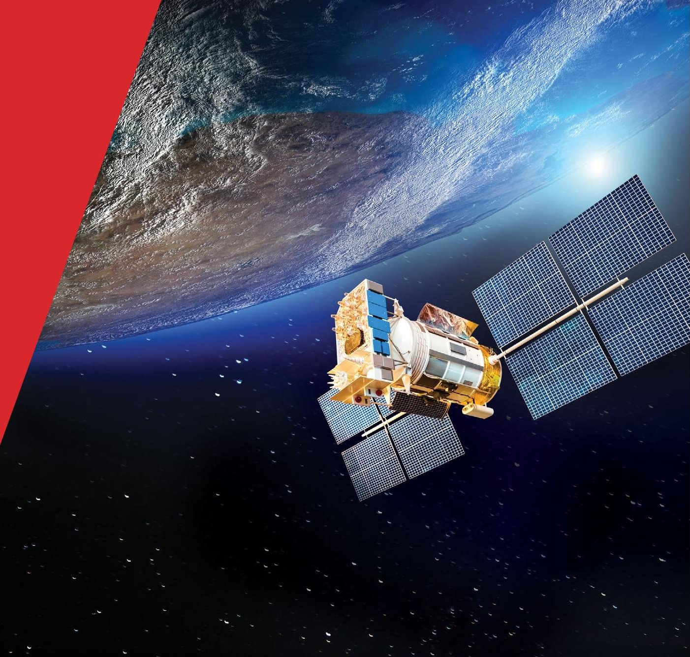
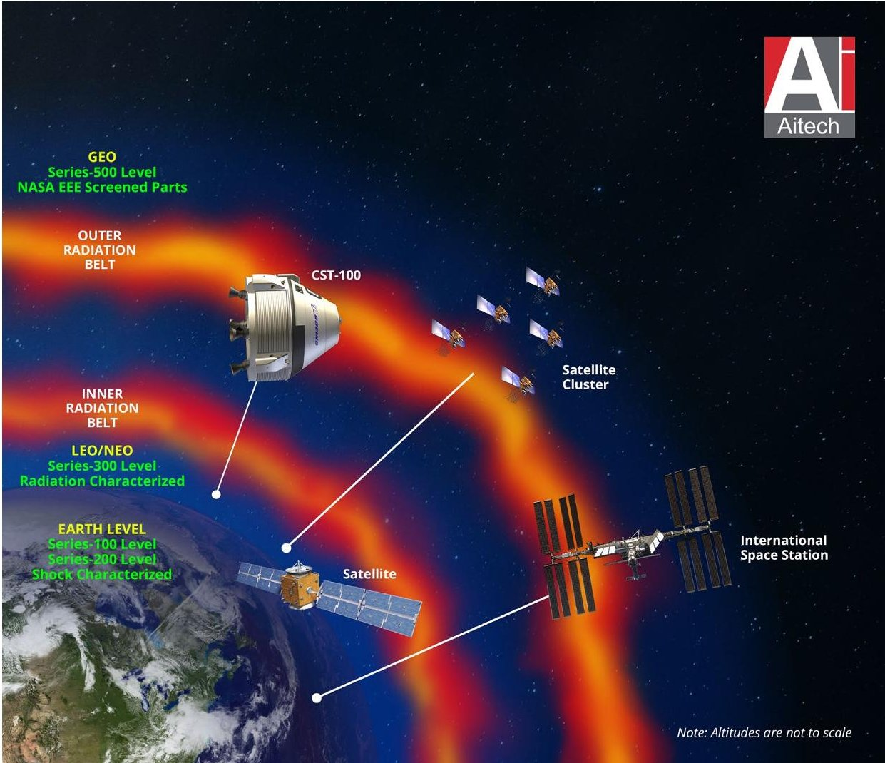
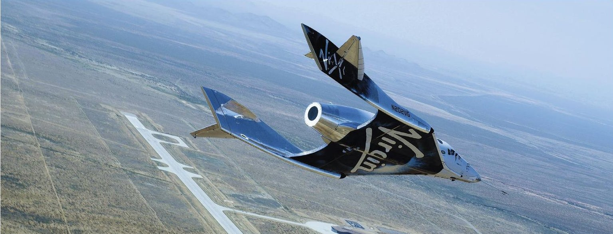
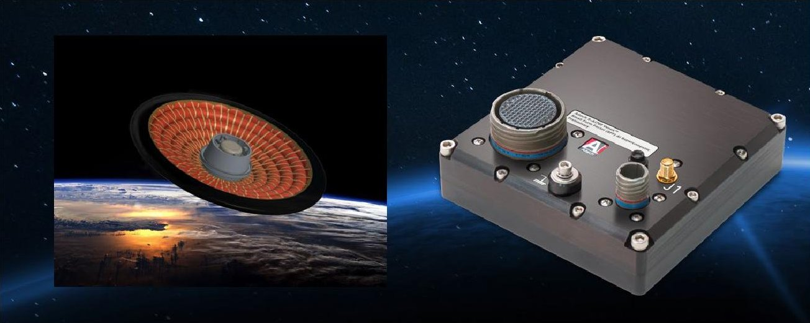

<!-- PDF_PAGE: 1 -->

# COTS in Space From Novelty to Necessity

Pratish Shah, General Manager of Aitech USA

Anthony Lai, Business and R&D Director

for Space, Aitech

PRIMARY AUTHORS:

sales@aitechsystems.com

JULY 2021

<!-- PDF_PAGE: 2 -->

This is the perfect point in our industry to build out the next 10 years in space electronics, as the significant lowering of launch cost has enabled this space boom.

## Space is one of the harshest environments

operate in and is also one of the hardest to sustain repeating success. These reasons underscore the importance of testing and validation of mission critical systems used in space. Success in a space system is defined by its continued reliability, autonomous operation, and unwavering communication within its limited uplink and downlink network bandwidth for the missions.

A growing challenge among satellite and payload builders, from privately-funded organizations to government entities, is to meet aggressive development-to-deployment schedules with a tight budget. The industry pushes for designs with increased computing performance and tighter system integration in space electronics to achieve the smallest size, weight and power (SWaP). As a result, mission-specific design priorities and cost implications are addressed at the start of the design cycle to help mitigate risks and ensure mission success.

## Space Market Trends: Entering the Space Boom

This is the perfect point in our industry to build out the next 10 years in space electronics, as the significant lowering of launch cost has enabled this space boom. Market reports show that up to 20,000 satellites may be launched over the subsequent decade, the majority of which will be in low-earth orbit (LEO) and near-earth orbit (NEO). With connectivity and bandwidth needs increasing, design flexibility and cost-to-performance ratios are top priority for a majority of designers.

Companies are buying subsystems, versus the previous need for modules or boards, to improve vertical satellite integration. Simultaneously, they have requirements for increased digital platforms in multiple satellite subsystems. Like most industries, there are requests for faster processing, more I/O better integration, early delivery, higher volumes, etc. Yet, the systems must still withstand the rigors of launch and the space environment, including radiation effects, as well as meet the processing demands with fixed downlink throughput or bandwidth.

## Building Systems for LEO & NEO Applications

"COTS in Space" is not a new concept. In fact, Aitech has been providing reliable COTS-based systems to the space industry for more than three decades. What is new the ability to better integrate COTS electronics into higher density, more compact, network-based satellite clusters being developed throughout the space industry at significantly lower cost and shorter development cycles.

<!-- PDF_PAGE: 3 -->

## FIGURE 1

The growing use of COTS in LEO & NEO space applications mandates a standardized level of component qualification classified here as Series 300.

As the use of COTS in LEO and NEO applications grows, the industry needs clearly defined parameters to ensure these commercial components can still withstand the rigors of the space environment. Lower levels of ruggedization are defined for in-development lab (100 level) and test flight (200 level) uses.

Although COTS components have proven reliable in space electronics, the current push to grow applications in LEO and NEO is launching the next evolution in COTS space technologies. The use of COTS has become a necessity in order to meet the cost, time to market and integration requirements mandated in these new space application areas.

A new 300 level qualification for space components has been designed to provide a standardized infrastructure to validate COTS-based components that will be used in real-world, deployed LEO and NEO space applications. The next level up is fully-qualified and validated components (500 level), where cost and the time for validation exceed the requirements for LEO and NEO applications, for long-duration mission and beyond LEO into lunar environments.

<!-- PDF_PAGE: 4 -->

This widening adoption and standardization of COTS components in relaxed/less stringent requirement-dependent orbits is also forging paths for innovations like GPGPU-based artificial intelligence (AI) technologies to be applied to space applications, enabling on-orbit and in-situ data processing and deep learning.

## Effective Use of Rugged COTS in Space

Building space electronics centers on risks mitigation strategies. Each mission is unique, and these risks vary based on the necessary level of reliability, mission duration, orbital parameters, whether it is a manned or unmanned mission, etc. Environmental factors—temperature fluctuations within minutes to hours per orbit, launch shock and vibration, natural and tactical radiation exposure—all impact risk factors, as well. The extensive use of COTS hardware enables satellite providers the ability to meet aggressive schedules using proven, reliable embedded designs to mitigate program or mission risks throughout the lifecycle of any satellite.

This new Series 300 ruggedization level is aimed at shorter-duration NEO and LEO programs, while offering SEU mitigation with radiation characterization for conduction-cooled products. A Series 300 product will address and mitigate potential risks to mission success by providing a calculated approach to short-term missions. For longer missions or missions into MEO, GEO and deep space, existing space-rated Series 500 products, with additional parts screening to NASA EEE-INST-002 parts standards as well as more robust radiation mitigation for better Single Event Effects (SEE) performance, would be applied.

To close the gap between in-lab test units and fully qualified and characterized space-rated electronics, the Series 300 level ruggedized COTS products will operate in near-earth or low-earth orbital missions.

<!-- PDF_PAGE: 5 -->

Table 1: Series 300 Level Parameters for NEO & LEO Space Application

<table border="1"><tr><td>Parameter</td><td>SERIES 100 Development/Lab</td><td>SERIES 200 Test Flight</td><td>SERIES 500 Flight: Beyond LEO</td><td>SERIES 300(Flight:NEO&amp;LEO)</td></tr><tr><td>Cooling Method</td><td>Convection</td><td>Conduction1</td><td>Conduction1</td><td>Conduction</td></tr><tr><td>Temperature(℃)StorageOperating</td><td>-40℃to+85℃0℃to+55℃</td><td>(In air)-50℃to+100℃-40℃to+71℃</td><td>(In vacuum)-62℃to+125℃-40℃to+65℃</td><td>(In vacuum)-62℃to+125℃-40℃to+65℃</td></tr><tr><td>Vibration(3 axes)Random(Freq)Sine(Freq)</td><td>0.02g(20-2000Hz)2g(10-100Hz)</td><td>0.01g(0-2000Hz)10g(0-500Hz)</td><td>0.01g(0-2000Hz)10g(50-500Hz)</td><td>0.01g(0-2000Hz)10g(50-500Hz)</td></tr><tr><td>Shock(3 axes)Half Sine G(duration)Saw Tooth G(duration)</td><td>20g(6ms)20g(6ms)</td><td>40g(11ms)100g(6ms)</td><td>40g(11ms)1000g(6ms)</td><td>40g(11ms)1000g(6ms)[SRS]</td></tr><tr><td>Altitude(ft)Operating Max</td><td>15,000</td><td>70,000</td><td>10-4Torr</td><td>10-3Torr</td></tr><tr><td>Relative HumidityOperating</td><td>0-90%</td><td>0-100%</td><td>0-100%</td><td>0-100%</td></tr><tr><td>Conformal Coating</td><td>Optional</td><td>AcrylicSilicone</td><td>Urethane</td><td>Arathane5750</td></tr><tr><td>Part Selection</td><td>Commercial</td><td>Unscreened</td><td>EEE-INST-002 Level 2 or higher by lot</td><td>COTS with no screening</td></tr><tr><td>Radiation ToleranceTIDLatch up immunitySEU rate[ISS Orbit]</td><td>Not Applicable</td><td>Not Applicable</td><td>&gt;25krads(Si)≥37MeV·cm2/mgOne Type-2 SEFI per1,200 days at ISS orbit</td><td>&gt;1.5krads(Si)2MitigatedOne Type-2 SEFI per14 days at ISS orbit</td></tr></table>

NOTES:

1. Conduction-cooled per ANSI/VITA 30.1 - 2008 3U cPCI Mechanical Format Factor, Conduction-cooled PMCs: per ANSI/VITA 20-2001 (R2005)

2. Aitech has characterized the TX2i module in proton irradiation with final characterization to be done for updates at the box-level characterization later in 2021.

## Ease of Integration Means Rapid Development

One question that arises - why did the space industry look towards commercial components in the first place?

First, designers were looking to emulate the functionality found on desktop PCs and embedded systems in the space environment. More often than not, space-qualified components were limited in many functionalities. Only so much could be done with the traditional approved EEE parts earmarked for on-orbit

<!-- PDF_PAGE: 6 -->

applications to meet demanding mission requirements in command and data handling as well as payloads.

Second, as its moniker suggests, a space-qualified component has undergone rigorous, and therefore costly and time consuming, testing and validation. With research and development budgets tightening at every turn, ways to reduce overhead and extend the value of each dollar is high on every system designer's priority list, and not having to wait for testing results would certainly speed up time to market.

Ruggedizing less expensive, yet more bleeding-edge and leading-edge commercial/industrial/automotive components for space is the natural answer to this challenge. Furthermore, these components themselves had advanced in form and function with large volume production and very low failure rates, making them potentially viable alternatives to qualify these components for space use considerations.

## Applying COTS to In-orbit Applications

In theory, commercial components can be used in space applications, but important to note is that radiation tolerance in space components plays a significant role in determining the success or failure for the duration of a mission. As a result, characterizing the radiation hardness is critical.

Radiation has one of the largest impacts on Earth orbital systems, and two of the most important aspects to consider are the length of the mission and operational orbit. These factors determine the type and severity of radiation that a system will be exposed to. Additionally, the criticality of the mission is a key area to consider. One small shift in a component's internal functional thermal envelop and the entire system architecture can be sent out of whack.

## Advanced Processing Technologies Applied to Space Electronics

Artificial intelligence (AI) has joined the ranks of the advanced digital capabilities being integrated into rugged systems throughout military and defense applications. These advances help facilitate high performance embedded computing (HPEC) in harsh environments. Since space systems demand autonomous operation, data processing on site, video and image processing, and the ability to maintain reliable network connections to ground stations, moving AI capabilities into the space environment is the next logical step.

<!-- PDF_PAGE: 7 -->

Balancing system needs and processing requirements with the environmental aspects of the application means using proven ruggedization techniques as well as verified testing methodologies. GPU accelerated computing can offer unique advantages in system performance, even in the harshest of environments.

## Using GPGPU in Space:

- Leverage existing mil/aero rugged AI GPGPU SFF systems for space applications, focusing on LEO small sat segments (Example: S-A1760 Venus $ ^{\mathrm{TM}} $ NVIDIA $ ^{\mathrm{R}} $ Jetson $ ^{\mathrm{TM}} $ TX2i SoM: 256 CUDA $ ^{\mathrm{R}} $ cores; 2 Dual-core ARM $ ^{\mathrm{R}} $ CPU + Coretex $ ^{\mathrm{R}} $ -A57 Quad-core ARM CPU, 1 TFLOPs, SFF)

- SWaP-C-optimized for small sat applications in LEO

- Processing power for vision computing, imaging, AI and analytics at the edge

- Upcoming GPGPU family of products in development across different orbit levels

## Parallel Processing Leading the Charge

Because it is based on a parallel architecture, GPU accelerated computing processes tens of thousands of data points simultaneously, versus only hundreds using serial processing. Even a typical multi-core CPU-based architecture only offers a handful of cores running in parallel. When integrated into a ruggedized system, GPGPUs can meet the growing data requirements of today's military, defense and space applications.

The space industry is adopting AI GPGPU capabilities for beneficial reasons. Managing multiple streams of high definition graphics is literally what parallel processing was designed for. Another reason is to reduce latency, since you can achieve near-real-time processing when using parallel computing. As the number of data inputs and image resolution continue to grow, the need for a parallel processing architecture will become the norm, not a luxury, especially for mission- and safety-critical applications that need to capture, compare, analyze and make decisions on several hundred images and data inputs simultaneously.

<!-- PDF_PAGE: 8 -->

## FIGURE 2

Aitech provided the rocket motor controller for SpaceShipTwo.

## Examples of COTS & AI-based space programs

## Virgin Galactic Short Duration Spaceflight

Space tourism is making significant strides, most notably with Virgin Galactic founder Richard Branson's 90-minute suborbital Unity 22 flight, which further demonstrated the success of the SpaceShipTwo spaceplane in reaching its targeted altitude and resolution. Aitech provides the rocket motor controller (RMC) that is part of VSS (Virgin Space Ship) Unity. The RMC unit is a rugged 4-slot, 3U CompactPCI system with a PowerPC SBC, several I/O cards and a power supply. This system was developed in cooperation with Scaled Composites, a company that provides one of the I/O cards and the associated harness for this unit.

## SmallSat Clusters and Constellations

The trend to launch satellite clusters and constellations, instead of one large unit with a single-point of potential mission failure, helps to spread the burden of reliability by distributing operation across multiple smaller units. If one satellite in the cluster fails, and if the system is designed as such, another can pick up where the failed unit left off, so mission failures can be mitigated and minimized as the 'constellation' stays operational. This is a shift from the traditional ideology of launching one extremely qualified, large satellite with rad-hard parts in GEO, lunar and other deep space orbits for the mission's entire operation and success. The new era of fielding GPUs in space applications has indeed started the development with at least one CubeSat mission in La Jument in the recent months.

<!-- PDF_PAGE: 9 -->

S-A1760 Venus $ ^{\mathrm{TM}} $ Radiation-characterized Space AI GPGPU Based on NVIDIA $ ^{\circ} $ Jetson $ ^{\mathrm{TM}} $ TX2i SoM

## FIGURE 3

Aitech's S-A1760 uses the NVIDIA $ ^{\circledR} $ Jetson $ ^{\circledT} $ System-on-Module for video processing and data recording on NASA's LOFTID, a cross-cutting aeroshell for atmospheric reentry.

## NASA LOFTID Atmospheric Reentry Program

As the birthplace of many disruptive technologies, space is also adopting advanced GPU-accelerated supercomputing technologies. An upcoming NASA LOFTID space mission is planned for 2022 to demonstrate an inflatable heat shield that acts as a viable braking system by deploying a large inflatable aero shell (in a deployable structure with a flexible heatshield) before entering the atmosphere. It's targeted to capture reusable space assets or for the delivery of heavier cargo to land on Mars. For this mission, the Aitech GPGPU system will collect video data and telemetry and transmits it to ground-based stations or spaceborne assets for near-real-time monitoring of the entire reentry from deployment to touchdown, while much of the decisions are made on-board with powerful computing to achieve autonomous mission success.

<!-- PDF_PAGE: 10 -->

## Earth observation

Private and public space agencies alike are looking at GPU accelerated computing for space applications. One of the biggest initiatives comes from the European Space Agency (ESA) to "promote the development of radically innovative technologies such as Artificial Intelligence (AI) capabilities on-board Earth Observation (EO) missions" to foster the use of AI technologies in space applications.

Dubbed $ \Phi $ Sat-2, the mission is a follow-on to the $ \Phi $ Sat (or PhiSat) experiment, which was the ESA's first demonstration of improved efficiency in reporting Earth observation data from space, using AI on-board a satellite. $ \Phi $ Sat-2 expands on the initial ESA project, launched in January 2020, by focusing on the disruptive potential of onboard AI-based data processing. The suggested innovative algorithms and techniques would not be possible with traditional computer processing power within the size of small satellites. The project specifically focuses on CubeSat-based implementations, which is a perfect mission for rugged, compact, space-rated systems using high data processing GPGPU technologies with limited power in clusters or constellations.

Aitech USA

19756 Prairie Street

Chatsworth, CA 91311

Ph: (818) 700-2000

Toll Free: (888) 248-3248

sales@aitechsystems.com

Aitech Israel

1 Atir Yeda

Kfar Saba 4464301, Israel

Ph: +972 (9) 960-0600

sales@aitechsystems.com

Aitech India No.91 Prestige South End Road Basanvagudi, Bengaluru, Karnataka 560004, India

Ph: +91-80-4866-8105 sales@aitechsystems.com

## AitechSystems.com

