<!-- PDF_PAGE: 1 -->

# CYBER-PHYSICAL SYSTEM IMPLEMENTATION FOR THE AR-ASSISTED AIT OF AEROSPACE COMPONENTS

J. Pesce $ ^{1} $ , A. Carini $ ^{2} $ , M. Marinacci $ ^{2} $ , M. Boscia $ ^{1} $ , P. Marzioli $ ^{1} $ , M. Pasquali $ ^{1} $ , M. Eugeni $ ^{1} $ , M. Mecella $ ^{2} $ P. Piergentili $ ^{1} $ & P. Gaudenzi $ ^{1} $

$ ^{1} $Department of Mechanical and Aerospace Engineering, Sapienza University of Rome, Via Eudossiana 18, 00184, Rome, Italy

$ ^{2} $Department of Computer, Control and Management Engineering, Sapienza University of Rome, Via Ariosto 25, 00185, Rome, Italy

## Abstract

Industry 4.0 technologies are profoundly transforming the assembly, integration, and testing (AIT) processes of aerospace components, with augmented reality (AR) and cyber-physical systems (CPS) at the forefront of this evolution, marking a significant shift in traditional methodologies. This research explores the integration of CPS into the AIT processes of aerospace components, leveraging AR as a powerful tool to enhance efficiency, precision, and safety. To do so, the case of an aerospace system that showcases the practical implementation of the proposed CPS and AR framework in aerospace AIT is presented. Results show how the developed CPS can provide valuable assistance to the AIT operator, constituting a promising option to achieve significant improvements in assembly accuracy and overall process efficiency. The research also explores the implications of the proposed framework on the testing phase of aerospace components resorting to the CPS capability to facilitate real-time monitoring of performance metrics, ensuring the accomplishment of stringent quality standards.

Keywords: Cyber-Physical Systems, Digital Twins, Augmented Reality, Assembly-Integration-Testing, Smart Manufacturing

## 1. Introduction

The aerospace industry is witnessing a transformative paradigm shift driven by recent advancements in technologies associated to Industry 4.0 [1][2]. This rapid evolution is fostered by the onset of a series of big market-driven challenges: (i) the increased diversification of requirements asked by customers or users, (ii) the short lead-time to market from product development to product delivery, reduced by global competitiveness, (iii) the higher quality assurance needed by more complex new technologies [3], (iv) the increased need for products reliability, stability, and longevity [4][5]. This change is affecting both the final product and the manufacturing process, with particular reference to the assembly, integration and testing (AIT) phases, giving rise to the so called Smart Manufacturing paradigm (SM) [6]. SM in aerospace is focused to reach improvements on autonomous interoperability, agility, flexibility, decision-making, efficiency or cost reductions, mass customisation, servitization [7]-[8]. These goals are reached via the throughout use of what researchers and stakeholder agree to consider the 9 Key Enabling Technologies (KET) of SM [7]: Internet of Things (IoT), Cloud integration and Computing (CC), Big Data & Analytics (BDA), Simulation & Digital Twin (DT), Augmented Reality (AR) & Virtual Reality (VR), Additive Manufacturing (AM), Cyber-Physical Systems (CPS), Autonomous Robots & Collaborative Robots (CoBots), Artificial Intelligence (AI) (see Figure 1). Most of these tools takes the heritage of the developments in computing [9] as they are based on a "cyberspace" interconnecting both local computing intelligence and the manufacturing process through an easy-to-use interface. As a consequence, modern aerospace systems have thus become cyberphysical, that is they are made of physical components, but they are commanded and controlled

<!-- PDF_PAGE: 2 -->

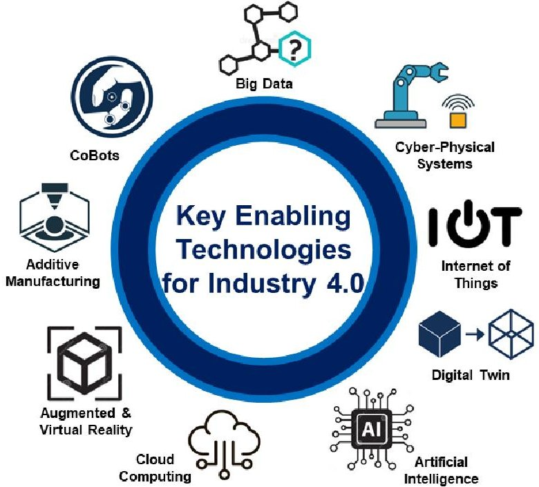

Figure 1- The Key Enabling Technologies (KET) of Smart Manufacturing are specific technologies considered crucial to address the challenges of enhanced competitiveness and innovation posed by the new Industry 4.0 era.

by communication and computing elements (called "cyber") [10]. Among the aforementioned tools of SM, AR and CPS have gained particular attention in the aerospace field over the last years. In particular, augmented reality, characterized by the overlay of digital information onto the physical world, has gained substantial attention for its ability to enhance human-machine interactions in assembly processes [11]. AR can be considered as one of the two extremes of the so called eXtended Reality (XR) [12] the other end being represented by Virtual Reality (VR). While augmented reality allows the user to see digital parts, superimposed on physical parts, the virtual one isolates the user from the external environment, making him immerse in a parallel digital reality. Mixed reality (MR) is the mix use of the two. AR can provide real-time, interactive visualizations of complex assembly tasks: technicians equipped with AR headsets can overlay digital information onto physical components, guiding them through intricate assembly steps with enhanced accuracy. AR applications can display 3D models, assembly instructions, and real-time error detection, reducing the likelihood of mistakes and rework. This not only speeds up the assembly process but also ensures higher precision and consistency in the final product [11]. Several studies emphasize AR's capacity to provide real-time visualizations, step-by-step instructions, and interactive overlays during complex assembly tasks [13][14]. This not only expedites the learning curve for assembly line workers but also significantly reduces errors and improves overall task efficiency. On the other hand, CPS are defined as transformative technologies for managing systems that interconnect with computational capabilities [15]. CPS integrate computational entities which are in intensive connection with the surrounding physical world and its on-going processes, providing and using, at the same time, data-accessing and data-processing services available on premise or on the Internet [16]. In other words, CPS can be generally characterized as "physical and engineered systems whose operations are monitored, controlled, coordinated, and integrated by a computing and communicating core" [17]. To this end, CPSs are able to: (i) collect data referred to themselves and their environment, (ii) process and evaluate these data, (iii) connect and communicate with other systems, and (iv) initiate actions [18]. The growing availability, affordability and adaptability of sensors and connection systems are increasing the widespread adoption of CPS. Production and testing data are easier to be collected and transferred to cloud platforms, where analytics and Artificial Intelligence (AI) tools permit to analyse and predict the production behaviours, and consequently act (manually or automatically) to increase performances. A complete CPS should be able to get information from the physical world and act on it, generally after data computations suggested the action to be implemented. Obviously, CSP should not be confused with IoT, because IoT is part of a CPS system, that for example could also include AI

<!-- PDF_PAGE: 3 -->

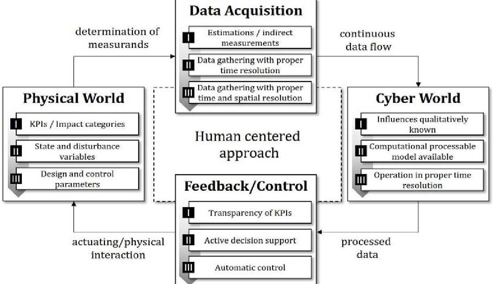

Figure 2- Structure and flow of assessment procedure for analysis and development of a CPS [19].

technology. Figure 2 shows how CPS connect a system in the physical world and its digital twin (cyber world), with an important remark about the human centered vision of this systems, because the operator/manger is always needed to check the process reliability, and often to validate the analysis and the actuating decisions.

This study explores the integration of CPS into the assembly, integration, and testing processes of aerospace components, leveraging augmented reality as a powerful tool to enhance efficiency, precision, and safety. The goal is to establish a comprehensive understanding of the potential benefits and challenges associated with the incorporation of CPS and AR in the aerospace assembly domain.

## 2. CPS for AR-assisted aerospace AIT

A CPS is defined as a system in which physical objects are required to be accompanied by their representation in the digital world, to be integrated with elements with computing, storage and communication capabilities, and to be networked between them. CPSs are typically classified resorting to a 5C level architecture [20] where five levels are identified to define, through sequential activity flows, the architecture of a CPS starting from the initial data acquisition, up to the creation of final value. The five levels are (see Figure 3):

1. Smart Connection Level: guarantees the timely and reliable acquisition of data from sensors, controllers or company production systems (ERP, MES, SCM and CMM). It is central, considering the heterogeneity of the data, to select appropriate data acquisition methods and sensors (in terms of types and specifications);

2. Data-to-Information Conversion Level: converts the data collected into significant information through specific algorithms and analysis;

3. Cyber Level: acts as a central hub, where all the information deriving from the various machines and components, arrives and creates an intelligent network. They are then analyzed to understand specific or collective information about the state of the system, and evaluated to predict future events;

4. Cognition Level: the implementation of the CPS at this level generates an in-depth knowledge of the monitored system, a valuable support in the decision-making process. This knowledge allows operators to manage the system optimally. To ensure visibility, clarity and immediacy in the understanding of the system by the operators, it is often necessary to implement graphic analysis and representations;

<!-- PDF_PAGE: 4 -->

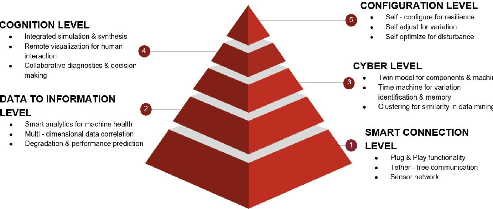

Figure 3 - The CPS functions and attributes: lower levels collect data that is analyzed and condensed at each upper level. Information fed to each higher level is more valuable than information coming into the level below.

5. Configuration Level: the configuration level constitutes the feedback of the cyberspace in the physical space and acts as a supervisory control to make the machines self-configuring and self-adaptable. It acts as a resilience control system (RCS) and allows to monitor, prevent, and correct the systems.

This 5-level framework is by far the main reference for CPS. CPSs enable seamless communication between machines, sensors, and human operators [21]. In aerospace AIT processes, CPS are envisioned to monitor and control various aspects of assembly and testing in real time: sensors embedded in assembly stations collect data on temperature, pressure, and vibration, which is then analyzed to optimize assembly conditions and ensure component integrity [22]. CPS can also facilitate automated adjustments to machinery based on real-time data, ensuring optimal performance and reducing the likelihood of human error [23]. Various works demonstrate the deployment of CPS with embedded sensors and actuators to facilitate adaptive manufacturing processes, responding dynamically to variations and uncertainties during assembly [24]-[25]. This adaptability ensures heightened precision and efficiency in the assembly phase, capable of meeting the high demands of aerospace production, with AR enhancing human capabilities by providing critical information at the point of use and CPS ensuring seamless integration and optimization of physical and computational elements [11].

To establish the transformative impact of integrating CPS and AR in the assembly, integration, and testing processes of aerospace components, the AIT process of the structure of a CubeSat is here selected as case study. The CPS of the structural subsystem of the satellite is realized leading to the definition of an application to be run with AR visors so to assist operators during the assembly and testing of the structure. In particular, such application is envisioned to be based on a CPS featuring functions belonging to the first 4 of the the 5 levels showed in Fig. 3, ensuring:

1) Tether-free communication of sensors;

2) Sensor data management;

3) Twin model for components and machine;

4) Remote visualization for human interaction.

On the other hand, no adaptability or self configuration/optimization capabilities is intended to be implemented in the present the CPS (i.e., the Configuration Level). The development of the proposed

<!-- PDF_PAGE: 5 -->

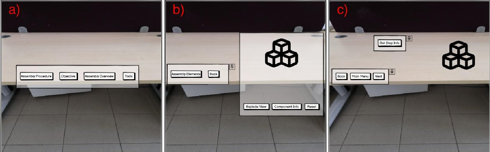

Figure 4- The mock-ups of the graphical interface of the application.

framework starts with the analysis of the various phases of the structural subsystem's assembly process so to define a set of macro-steps to be considered within the AR-assisted assembly procedure. Once the requirements and data the system must handle are formalized, the second step of the framework envisions the definition of a high-level application's architecture based on the assembly methodology previously identified. This phase, highlighting the structure and the behavior of the system, serves to guide the development of the final application. In particular, each component represented in the architecture is designed to work in a container representing a unit of software that encapsulates together the code and all its dependencies. Containerization is chosen as it allows applications to run fast and reliably independently from the system they are executed on.

Once the structure of the architecture is defined, the realization of the mock-ups (see Fig. 4) necessary for developing the user interface of our virtual environment is tackled [26]. In this phase three different main interfaces are set: (i) a Main Menu, i.e., the first interface with the operator and it is characterized by four different buttons the user can press to get access to further functionalities and information (Fig. 4a); (ii) the Assembly Overview, which is intended to enable the exploration of the final assembled product and to find detailed information regarding all its components(Fig. 4b); (iii) the Assembly Procedure, namely the interface the user is envisioned to spend most of the time with and is designed to contain all tools the user may need without overcrowding the virtual scene, through this interface the user can change the assembly step and look for additional details about it (Fig. 4c). The realization of mockups is a necessary step to be able to produce a usable user interface for the application (see Fig. 8). All satellite parts involved in the process are therefore CAD modeled via a reverse-engineering process so to enable objects recognition and tracking. The application's front-end is subsequently developed allowing the operator to virtually interact with the AR-projected elements and accomplish the assembly of the CubeSat's structure. This step is implemented choos-

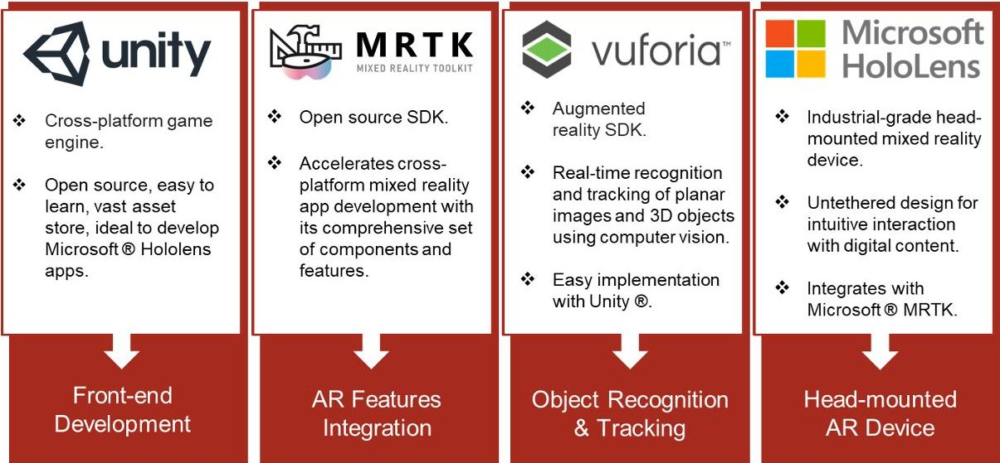

Figure 5 - The tools adopted for the development of the CPS.

<!-- PDF_PAGE: 6 -->

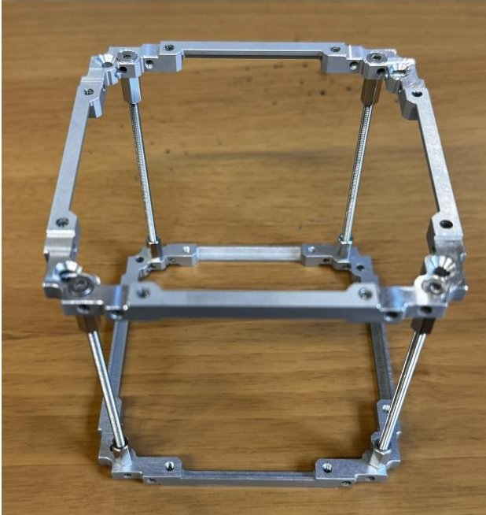

(a)

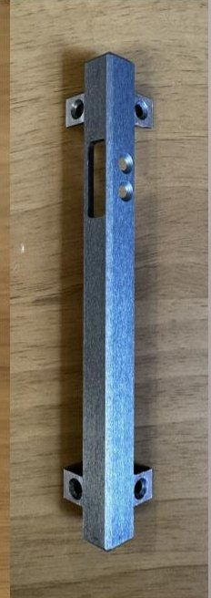

(b)

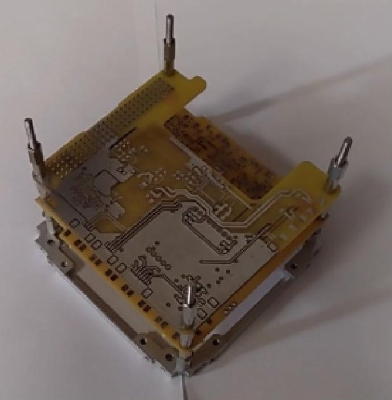

(c)

Figure 6 - The CubeSat's main parts including its frame (a) and the rails (b) plus some empty electronic boards representative of the satellite's payload (c)

ing Unity $ ^{\circledR} $ as a graphics engine that offers extensive support for mixed reality, integrating well with other tools (see Fig. 5). Microsoft's Mixed Reality Toolkit $ ^{\circledR} $ (MRTK) SDK is also implemented to ease the application development by adding components and functionalities to Unity $ ^{\circledR} $ . As final step, an IoT-based electrical continuity check is performed on one of the satellite electronic boards thus validating also the testing step of the analysed AIT process.

## 3. Case study: assembly of a CubeSat's structure

The case at hand is represented by a 1U CubeSat structural subsystem, from NPC Spacemind. The structure is composed of a primary structure, which is the one that carries the satellite's major loads, and a secondary structure, which is used to support the components. In this case, the primary structure is represented by the upper and bottom frames and the four rails, while the secondary structure is represented by the four rods assembled inside, as shown in figures 6 (a) and (b). The assembly procedure considered here takes into account also some empty electronic board mimicking the CubeSat's payload which can be observed in 6 (c). The structure is assembled through 16 screws, which allow to connect mechanically the four rails with the two frames. The four rods are assembled using 8 screws and a spacer. Before implementing the capabilities of the CPS, the assembly process of our case study have been analyzed, identifying 86 specific steps (Table1). For each of these, the component to be used, the actions required, the position, and the tools required were defined. From these steps, 10 macro-steps have been eventually identified (Table2), defining the assembly steps within the application and the targets for recognition. The subdivision is undertaken with the objective of identifying a balanced solution that would grant an easy object recognition for the different macro-steps and simultaneously avoiding to overwhelm the operator with instructions to accomplish in a single step. As a result, a detailed list of instructions to be followed by the operator to assemble the CubeSat structure is drawn up, accompanied by pictures for ease of understanding.

## 3.1 Application architecture

The developed application relies on a robust architecture (see Fig. 7) composed of different Docker containers having the role of coordinating which kind of information is needed and should be displayed to the user through the visor, in the virtual environment. Each Docker container is used to start a web server, developed in Python with the Flask micro-framework, that will keep running until it is shut down to make its functionalities always available. The architecture is composed of three web servers lying on three different containers that allow developers to improve the application by introducing newer services. Moreover the architecture, exploiting a Docker container to handle database

<!-- PDF_PAGE: 7 -->

Cyber-physical system implementation for the AR-assisted AIT of aerospace components

<table border="1"><tr><td>ID</td><td>ITEM</td><td>ITEM DETAIL</td><td>ACTION</td><td>APPLIED TO</td><td>TOOL</td><td>TOOL DETAIL</td></tr><tr><td>1</td><td>Frame 1</td><td>Type=Lower;</td><td>Place</td><td>Frame1;</td><td></td><td></td></tr><tr><td>2</td><td>Screw 1</td><td>Head=Hexagonal; Diameter=3mm; Length=11mm;</td><td>Insert</td><td>Frame1Hole1;</td><td>Screwdriver</td><td>Tip=CR-V2.0mm;</td></tr><tr><td>3</td><td>Spacer 1</td><td>Body=Hexagonal; Threaded=True; Diameter=3mm; Length=10mm;</td><td>Screw in</td><td>Screw1;</td><td>Wrench</td><td>Diameter=3mm;</td></tr><tr><td>$\vdots$</td><td>$\vdots$</td><td>$\vdots$</td><td>$\vdots$</td><td>$\vdots$</td><td>$\vdots$</td><td>$\vdots$</td></tr><tr><td>86</td><td>Screw28</td><td>Head=Torx; Diameter=3mm;</td><td>Screw in</td><td>Rail4Hole4;</td><td>Screwdriver</td><td>CR-VT8tip</td></tr></table>

Table 1- Overview of some of the 86 single operations which are identified within the amessembly procedure of the CubeSat structure: for each one of them an identification number, a short description of the actions to be accomplished and the parts and tools involved is defined.

requests and a Docker container to handle external sensors, aims to be a configurable and maintainable solution.

When the user starts using the application, the Orchestrator Docker container begins to listen for incoming requests, coming from the AR application, to forward them to the Storage Server Docker container or the Sensors Server Docker container according to the type of action the user has to perform. Currently, the user, through the Orchestrator Docker container, may perform two types of actions involving retrieving data and 3D models, which redirect this request to the Storage Server Docker container, or enabling communication with a specific sensor, which redirect this request to the Sensors Server Docker container.

The Storage Server Docker container is composed of Application Programming Interfaces (APIs) responsible for finding requested data, stored in the Local Database, packaging them, and forwarding them back to the Orchestrator Docker container. The application is designed to keep in memory only the information and 3D models that are meant to be shown in each step of the assembly procedure: for this reason, this container is mandatory to have a light and fast application. To achieve this, the package Addressable provided by Unity that leverages an API for organizing Unity assets and loading and unloading them at runtime in asynchronous mode has been considered.

The Sensors Server Docker container is composed of a set of APIs that are necessary to establish the communication and start exchanging data, in real-time, from a specific sensor available in our Sensors Pool, these data are then forwarded to the Orchestrator Docker container. A concrete ex-

<table border="1"><tr><td>STEP N°</td><td>ID</td><td>DETAILS</td></tr><tr><td>1°</td><td>1</td><td>The frame is taken from the component bench and isolated by placing it in front of you so that it is accessible for the next step</td></tr><tr><td>2°</td><td>from 2 to 9</td><td>The first 4 hexagonal spacers are attached using the appropriate screws</td></tr><tr><td>3°</td><td>from 10 to 13</td><td>Screw the 4 roads due to which the different layers of the cubesat will be stacked</td></tr><tr><td>4°</td><td>from 14 to 29</td><td>Three washers and a hexagonal spacer are stacked for each road</td></tr><tr><td>5°</td><td>from 30 to 38</td><td>Insert the payload sheet the circular spacers and screw the hex spacers</td></tr><tr><td>6°</td><td>from 39 to 47</td><td>Same previous steps with the difference that now the battery and PDI sheet is inserted</td></tr><tr><td>7°</td><td>from 48 to 56</td><td>Same previous steps with the difference that now the on-board computer board is inserted</td></tr><tr><td>8°</td><td>from 57 to 61</td><td>The upper frame is screwed</td></tr><tr><td>9°</td><td>from 61 to 66</td><td>The upper closure is screwed to the upper frame</td></tr><tr><td>10°</td><td>from 67 to 86</td><td>Attach the 4 rails each to the 4 corners through 4 appropriate screws</td></tr></table>

Table 2- The 10 macro-steps of the CubeSat assembly procedure considered within the application. Each macro-step is composed of a series of the 86 single operations previously identified so to accomplish the complete assembly of the satellite's structure.

<!-- PDF_PAGE: 8 -->

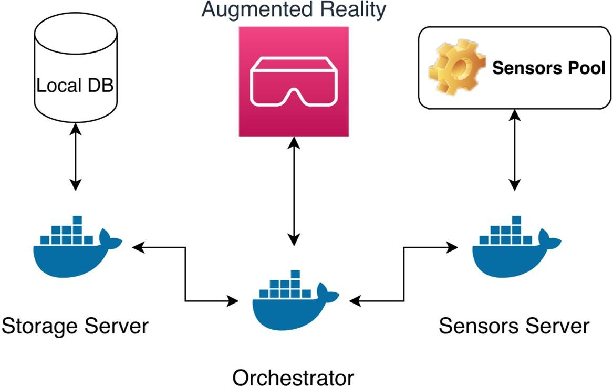

Figure 7 - Overall Application Architecture

ample is the use of a digital multimeter that once it is connected to the container, exploits the Python SocketIO library for real-time bidirectional low-latency communication.

## 3.2 Front-end development

Leveraging on the mockups, realized considering all important aspects highlighted by domain experts, an User Interface for the application is developed so to be able to provide a clear, engaging, and easily interactive User Experience. The application is composed of three main interfaces the user is envisioned to be be interacting with the most, and from which many other sub-interfaces can be reached. These interfaces are:

- The Main Menu interface from which the user can reach all other functionalities of the system (Fig. 8a). It presents a draggable menu with four buttons: when one of them is pressed it allows the user to navigate through the application. In particular, a button named Assembly Procedure redirects the user to the associated main interface to start the assembly simulation; another named Objective shows up a panel containing useful insights about the use of the simulator and the assembly of the current physical object; an additional button named Assembly Overview redirects the users to the associated main interface, and a final one named Tools that through a panel illustrates to the user how and which tools will be used in the simulation;

- The Assembly Overview interface which provides the user with the possibility to analyze the physical object and all its components(Fig. 8b). Through this interface, the user can freely move the object in the virtual environment, possibly "exploding" the visualization to observe how various elements are connected to each other (Fig. 8c). Moreover, he can activate a panel in which all components are separated with the possibility to move them independently and retrieving their associated details. In addition, the operator can also retrieve information regarding each single step needed to perform the assembling of the object;

- The Assembly Procedure interface through which the user can receive information and assistance to proceed to a step by step guided assembly of the physical object. When accessing this interface, the user is given the possibility to choose the assembly step for which he needs assistance, downloading CAD data from the Database and displaying information for the selected step. To make the system lighter and smoother and to avoid too much information from being displayed at the same time, previously displayed assistance data are cleared from the scene at each new request. To this end, Unity's Addressable Asset System is resorted to as it allows

<!-- PDF_PAGE: 9 -->

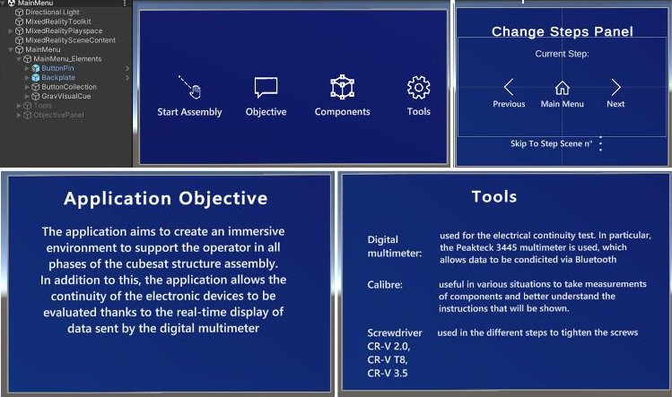

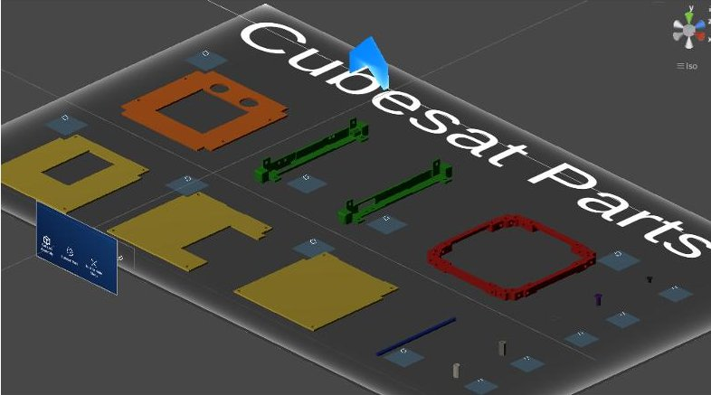

(a)

(b)

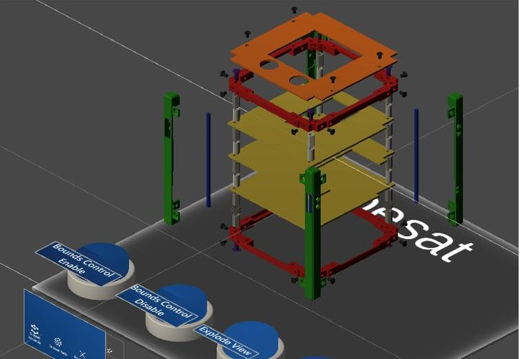

(c)

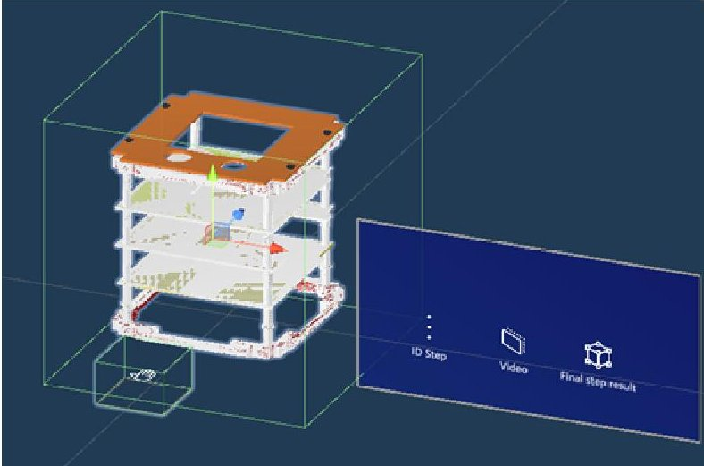

(d)

Figure 8 - Main scene elements of the application: the main menu and its sub-menus (a), the CubeSat constitutive parts selectable for further info (b), the explorable 3D model of the assembled satellite (c) and the prefab of a single assembly step.

to keep in the memory of the application only the elements needed at the selected assembly step, improving the overall performance of the system. Proceeding this way the system asynchronously loads the prefabs that comprise all data related to a step (Fig. 8d). A single prefab contains (i) the actions that need to be performed in the step, (ii) a video showing the correct assembling procedure, (iii) a 3D view of the completed assembly step, and (iv) information to allow recognition of the object necessary to show the 3D Object with the animation of the action to perform.

## 3.3 Object recognition and tracking

Object recognition and tracking capabilities enable digital systems to understand and interact with the physical world in real-time. In the present case object recognition is used in conjunction with AR to identify and classify objects within the operator's environment. This process leverages computer vision algorithms to analyze input from the visor's cameras, matching patterns to a database of known objects. This capability is crucial to allow the AR system to superimpose relevant digital information onto physical objects. Object tracking, on the other hand, is required to continuously follow the position and orientation of recognized objects as they move within the AR environment. Effective tracking ensures that the augmented elements stay accurately aligned with the physical world, maintaining a seamless interaction between the digital and the real world. This is key to grant the AIT operator a stable and immersive AR experience, enabling consistent interaction with the virtual content regardless of changes in the user's viewpoint or the object's position.

Technologies enabling object recognition and tracking in AR include marker-based and markerless systems. In the analyzed case objects recognition and tracking capabilities, needed to assist the operator during the assembly of the CubeSat structure, are developed resorting to a markerless approach. Marker-based tracking uses predefined visual markers (e.g., QR codes) that the system can

<!-- PDF_PAGE: 10 -->

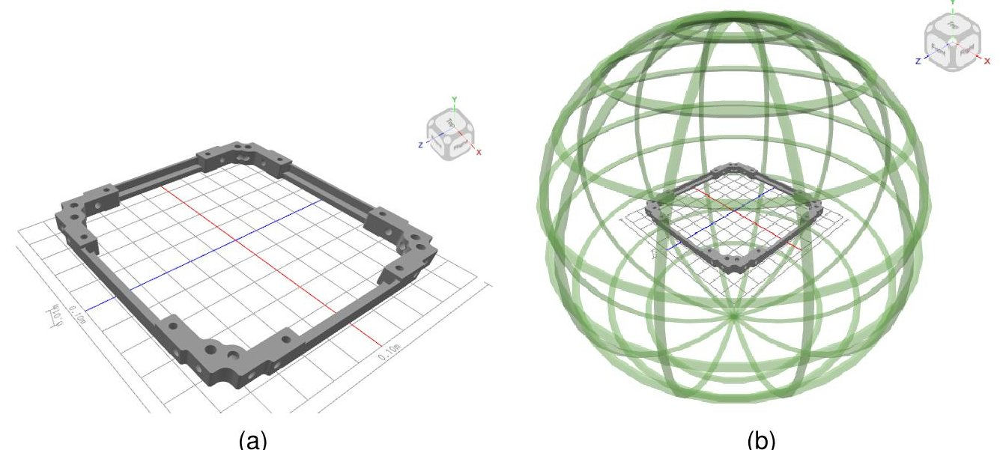

(a)

(b)

Figure 9 - Creation of 3D model-based targets for the CubeSat's parts: the original CAD model (a) and the adopted full $ 3 6 0^{\circ} $ view guide (b) for the first step of the AIT process.

easily recognize and track, while markerless tracking relies on natural features within the environment (in the present case, the shapes of the CubeSat's parts) to identify and follow objects without any special markers. Given the general-purpose nature of the proposed approach, whose adoption is intended not to be limited to the AIT of a specific aerospace system, the markerless option represents the most promising option and is therefore adopted. The software of choice to implement such approach is Vuforia SDK (Software Development Kit). Aside from the possibility to carry out a markerless object recognition and tracking, Vuforia's choice lays also in its easy integrability with Unity's environment delivered by the presence of a specific API.

To be performed, object recognition and tracking need to rely on a database of digital targets built resorting on of both pictures and CAD models of the parts to be recognized and followed. The efficacy of such database is evaluated according to three main criteria:

1. Speed and ease of recognition: recognition must be quick and easy to achieve for the operator, which means that the target should be quickly and effectively recognizable from different perspectives;

2. Positioning of a digital object with respect to the target: the target's digital child must be easily positioned according to the user's perspective considered within Unity scenes;

3. Tracking quality: the digital objects are to remain firmly anchored to the target avoiding flickering and without loosing recognition upon small movements of the operator.

Making reference to these considerations and given the results of a set of preliminary investigations which showed inferior performances of image-constituted targets databases to deliver fast and effective recognition and tracking of the CubeSat's parts, a CAD model-based strategy is implemented (see Fig. 9). The accuracy granted by model-based targets, however, comes at the cost of a higher implementation time and effort. In order to ensure optimal recognition, in fact, it is essential to dispose of CAD models that are as similar as possible to the physical objects to be recognized. To cope with such requirement and in order to try to reduce the time needed to accomplish this step of the methodology, free scanning technologies (e.g. Polycam $ ^{\circ} $ ) are initially evaluated to build the CAD models of the various parts, eventually achieving unsatisfactory results. Consequently, 3D models of the CubeSat parts (namely, its structure and the electronic plain boards shown if Fig. 6) are created. This phase has also involved extensive use of reverse engineering logic with the intent of obtaining CAD models as close as possible to the real objects.

Once the CAD models are realized, the subsequent creation of the associated targets is tackled. In so doing, particular attention is paid to choose the most appropriate guide views, i.e. the set of views for which recognition of a part is accomplished. This choice is based on a trade-off between the need

<!-- PDF_PAGE: 11 -->

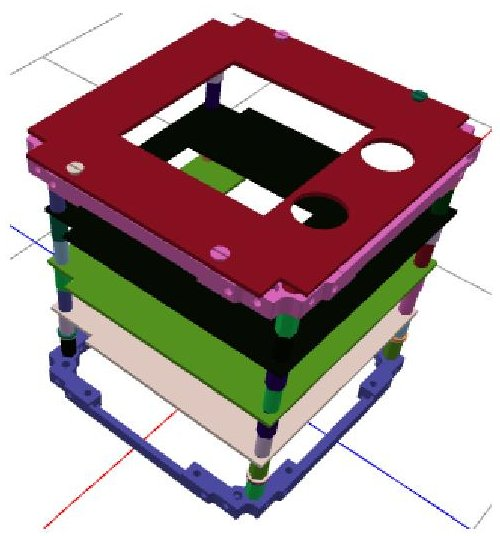

(a)

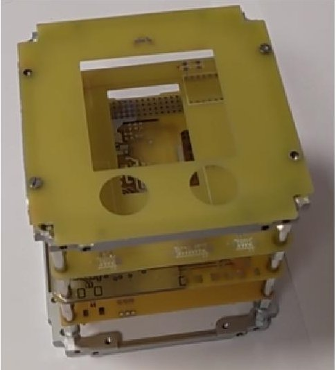

(b)

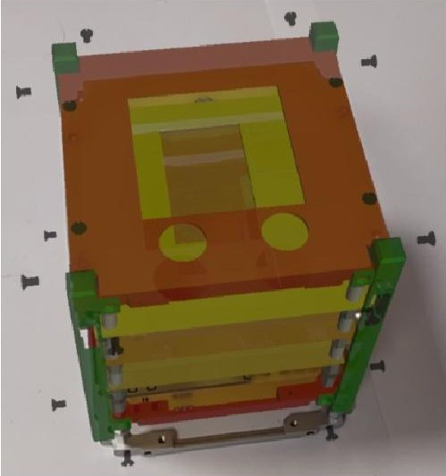

(c)

Figure 10 - The object recognition process for a step of the CubeSat's AIT: once the 3D model-based target is realized (a) the real object is recognized (b) and a 3D animation sequence showing the action to be implemented by the operator for the specific AIT step (i.e., screws insertion and tightening) is superposed within the AR visor (c).

to enable recognition for the wider possible set of viewing angles and the consequent deterioration in the target performance. Based on these considerations, the targets are constructed for all parts and AIT steps (see Fig. 10).

## 3.4 IoT for testing

The framework here proposed is envisioned to assist the operator with an AR-projected set of clear instructions and modular procedures which can also exploit data coming from different sensors, in compliance with the realization of a smart connection level for the CPS (see Fig. 3). These sensors, which are external to the application and can be easily invoked when needed, will increase the functionalities the CPS can provide: when the user selects one of the available sensors for data exchange, it will start to deliver information in real-time with the system through the Sensor Server docker container previoulsy defined. This set of features has the goal of delivering AR-based assistance to the operator also during the Testing phase of the AIT process.

In the case at hand, connection and data exchange with external sensors are implemented to enable the user to perform an electrical continuity check on the electrical boards of the CubeSat. The tests are carried out using a PeakTech $ \textcircled{2} $ 3445 Bluetooth digital multimeter: the choice of this device falls back to the necessity of having sensors equipped with interfaces easily accessible from other devices through wireless connection. By exploiting the Python SocketIO library for real-time bidirectional communication, the realized CPS can perform the exchanging of data from the multimeter to the virtual environment simulation in four steps:

1. Multimeter Data Acquisition and Parsing: this phase is necessary to transform data generated from the multimeter in an easily interpretable data format. The multimeter generates packets where each byte represents the starting, ending, unit, and value of measurement. This step is performed inside the Sensors Server docker container;

2. Data Transmission: it is performed leveraging on the SocketIO library which uses a client-server communication architecture. When a multimeter packet is successfully formatted according to the considered data format, it will be sent to the Orchestrator docker container for the last communication and processing operation;

3. Client Data Reception: the data are correctly received by the HoloLens 2 application and are ready to be visualized. The developed application relies on the UnityWebRequest class in UnityEngine.Networking to request data from the Orchestrator docker container;

<!-- PDF_PAGE: 12 -->

4. Data Visualization: this step is needed to visualize the data in the augmented environment. To do so a panel is first created in Unity whose most important objects are the values and body text within the canvas object. The text variables associated with these objects are then updated whenever a new value is received. In particular, the value 0L measured by the multimeter and indicating an open circuit condition is associated to the message "Open circuit", while a "There is electrical continuity" message is shown whenever the value $ \Omega $ indicating a negligible value of electrical resistance is measured.

## 4. Results

The functionality of each scene and object is tested first: in so doing, a complete walk-through of the AIT workflow the operator is asked to follow in order to accomplish the assembly of the CubeSat structure is carried out. Each element of the various menus of the application is found to correctly interact with the user (e.g., opening panels in expected location, properly deal with scene changes and object handling - grabbing the panels, changing their position/orientation/size) as shown in Fig. 11. The interaction with the CubeSat's model, thought to enable the operator to get familiar with the parts to assemble prior the start of the real AIT process, is also ascertained to operate as expected, enabling the user to interact with 3D part models in a variety of ways. These include picking up, rotating, zooming in, and displaying exploded views of the virtual parts (see Fig. 12a). Via the virtual desktop which includes all the parts constituting the CubeSat's structure, it is possible to open a panel for each component, thereby providing information about the selected parts, as shown in Fig.

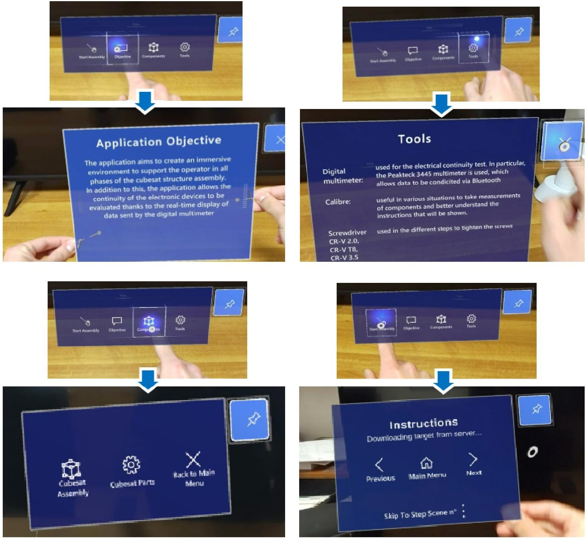

Figure 11 - Functionality test for the app's menus.

<!-- PDF_PAGE: 13 -->

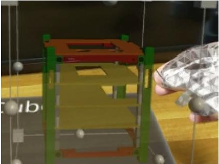

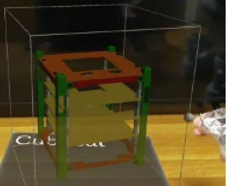

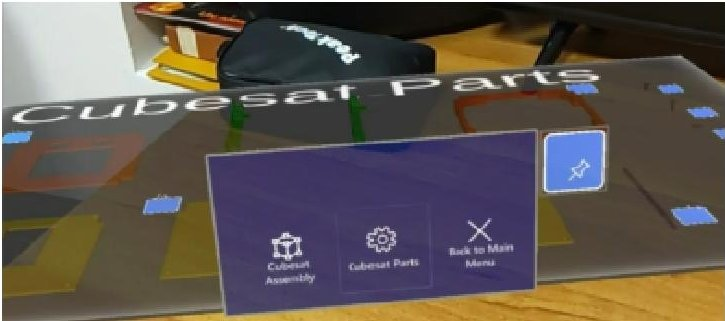

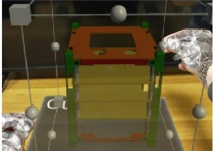

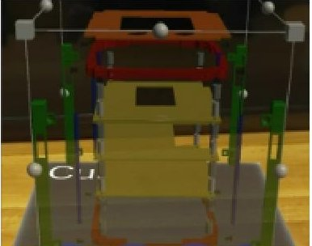

(a)

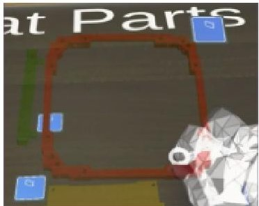

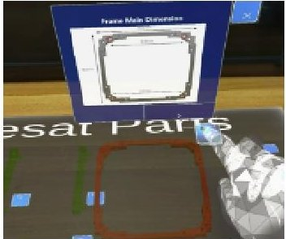

(b)

Figure 12 - The operator can explore the model of CubeSat before the start of the AIT process by virtually interacting with its parts (a), receiving additional info on the selected components (b).

12b). Prefabs are found to be instantiated properly as well, with correct features, object positioning and removal when another one is called in. All the elements responsible for capturing the digital objects that appear work correctly, including the button in front of the CubeSat's digital model used to activate / deactivate the possibility of manipulating the object. Figure 13 shows the results. The elements appear in the correct positions: here the assembly panel - giving instructions to carry out the seventh step of the AIT procedure - and the video information panel - showing how to perform the ninth step of the process - take the place of the menu and and are freely manipulable.

For scenes related to assembly stages, both object recognition / tracking and interaction of target-related objects are verified for each step of the AIT process, including the interaction with all other non-target-related elements (see Fig. 14). It is observed that recognition time and positioning improve significantly when observing the target from a non-frontal view and when the target has marked elements of asymmetry (the average recognition time is few seconds). On the other hand, parts tracking is fairly achieved as long as movements remain controlled and executed below a certain speed.

In the proposed framework, assistance for the operator is available both in terms of assembly instructions at each step of the AIT process and in terms of parts identification, to direct the user towards the correct components to be used to complete the assembly. In particular, the CPS is capable of

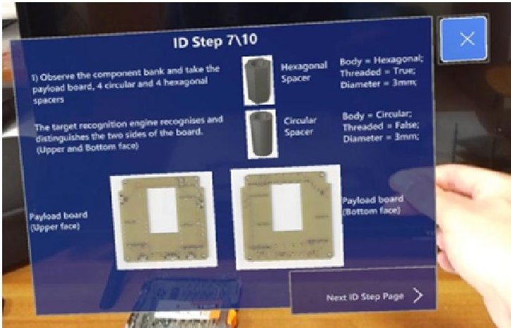

(a)

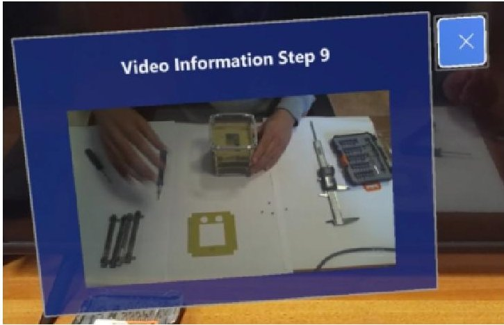

(b)

Figure 13 - Elements of the AIT steps: an assembly panel, giving instructions to carry out the seventh step of the AIT procedure (a) and the video information panel, showing how to perform the ninth step of the process (b).

<!-- PDF_PAGE: 14 -->

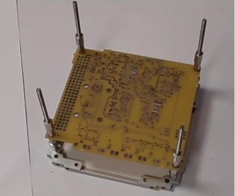

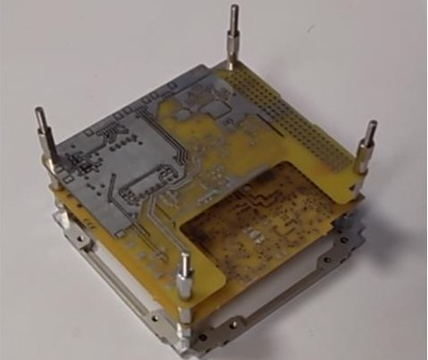

(a)

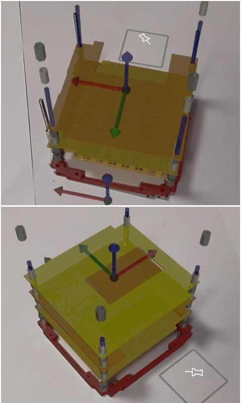

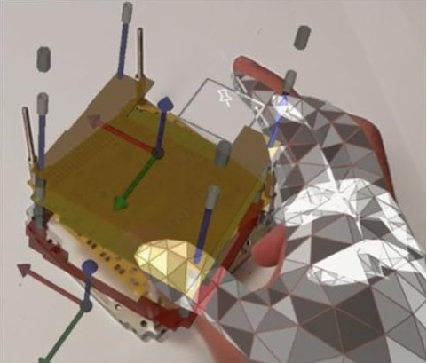

(b)

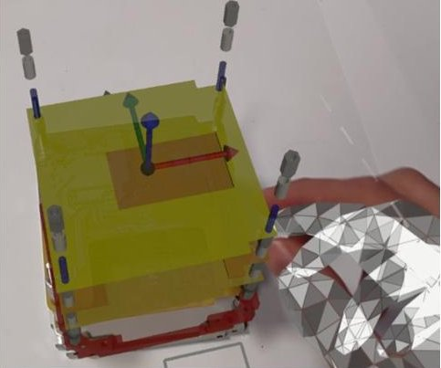

(c)

Figure 14- Parts recognition (a)-(b) and tracking (c) during various AIT steps.

distinguishing between the different electronic boards, enabling the user to select the appropriate one. In so doing, the system it is also able to distinguish between the two different faces,as attested by the digital SDR consistent with the physical board (see figure 15b).

Last, the electrical continuity of the CubeSat boards is verified. The architecture to exchange data with the bluetooth multimeter works correctly: as can be observed figure 16, the value displayed on the multimeter is identical to that shown on the digital panel, and the information message is consistent with the data received.

## 5. Conclusion

This study has investigated the integration of AR-assisted CPSs into the assembly, integration, and testing processes of aerospace components, with the goal of establishing a comprehensive under-

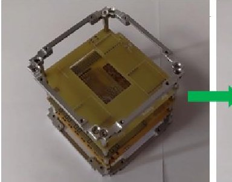

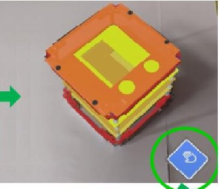

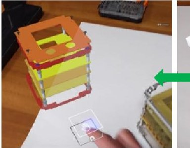

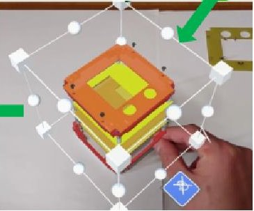

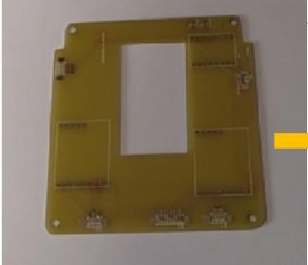

(a)

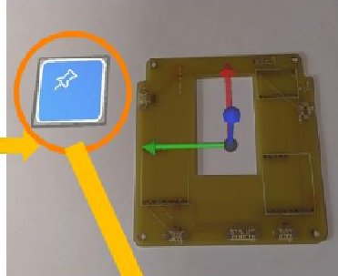

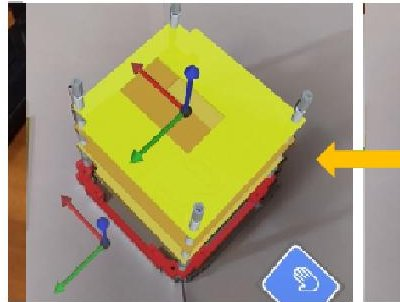

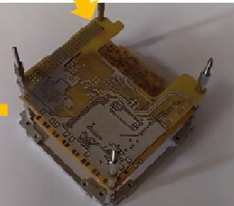

(b)

Figure 15 - Recognition of the correct assembly step and identification of the necessary parts to proceed with the process.

<!-- PDF_PAGE: 15 -->

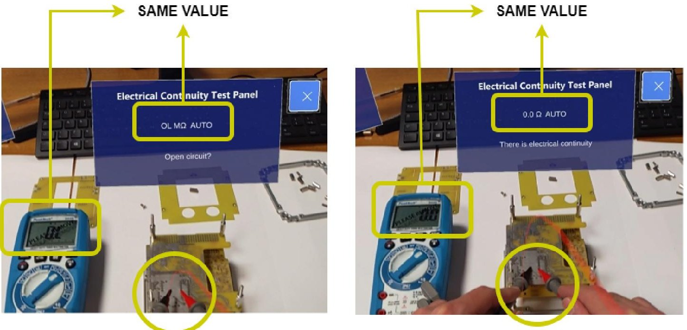

Figure 16 - Electrical continuity check for the electronic boards of the CubeSat.

standing of the potential benefits and challenges associated to the adoption of these technologies. To do so, an AR-based CPS has been successfully developed to enhance the AIT process of the structure of a CubeSat. The development of the proposed framework has ranged from the analysis of the various phases of the structural subsystem's assembly process to the definition of the application's front-end, enabling the operator to virtually interact with the AR-projected elements and accomplish the assembly of the CubeSat's structure. Results have shown the appropriate functionality of each scene and object of the application, allowing a correct interaction of the user with menus and virtual replicas of various part of the CubeSat. Recognition and tracking of the satellite's structural components have shown to work appropriately for each step of the AIT process as long as the operator's movements are executed in a controlled way. Finally, an IoT-based electrical continuity check of the satellite electronic boards has been accomplished, proving the validity of the proposed framework also the testing step of the analysed AIT process. Comparative assembly tests between AR-assisted and non AR-assisted operators are currently being conducted to gain additional quantitative insight for the proposed approach.

## 6. Acknowledgement

The work of Matteo Marinacci is supported by Thales Alenia Space and Regione Lazio, through the fellowships 35752-22066DP00000040-A0627S0030 Utilizzo dell'Intelligenza Artificiale a supporto della progettazione e qualifica del prodotto spaziale.

The work of Michele Pasquali, Fabrizio Piergentili and Massimo Mecella is supported by SPACE IT UP Extended Partnership and received funding from ASI (Agenzia Spaziale Italiana) and MUR (Ministero dell'Università e della Ricerca). The work of Massimo Mecella is also supported by the MICS (Made in Italy - Circular and Sustainable) and received funding from the European Union Next GenerationEU (Piano Nazionale di Ripresa e Resilienza — PNRR).

The authors gratefully acknowledge NPC SpaceMind for providing the 1U CubeSat prototype structure used for developing the research.

## Copyright Statement

The authors confirm that they, and/or their company or organization, hold copyright on all of the original material included in this paper. The authors also confirm that they have obtained permission, from the copyright holder of any third party material included in this paper, to publish it as part of their paper. The authors confirm that they give permission, or have obtained permission from the copyright holder of this paper, for the publication and distribution of this paper as part of the ICAS proceedings or as individual off-prints from the proceedings.

<!-- PDF_PAGE: 16 -->

## References

[1] Erik Hofmann and Marco Rusch. Industry 4.0 and the current status as well as future prospects on logistics. Computers in Industry, 89:23-34, 2017.

[2] Andrew Kusiak. Fundamentals of smart manufacturing: A multi-thread perspective. Annual Reviews in Control, 47:214-220, 2019.

[3] Phani Kumari Paritala, Shalini Manchikatla, and Prasad K.D.V. Yarlagadda. Digital manufacturing- applications past, current, and future trends. Procedia Engineering, 174:982-991, 2017. 13th Global Congress on Manufacturing and Management Zhengzhou, China 28-30 November, 2016.

[4] HOU J. Huo, Y. ZHAO, Zhou Y, X. Du, and Z. Xuan. The creative application of diy manufacturing technology in remote sensing satellite. Aerospace China, 17:17-26, 2016.

[5] M. Eugeni, T. Quercia, M. Bernabei, A. Boschetto, F. Costantino, L. Lampani, A. Marchetti Spaccamela, A. Lombardo, M. Mecella, L. Querzoni, R. Usinger, M. Aliprandi, A. Stancu, M.M. Ivagnes, G. Morabito, A. Simoni, A. Brandao, and P. Gaudenzi. An industry 4.0 approach to large scale production of satellite constellations. the case study of composite sandwich panel manufacturing. Acta Astronautica, 192:276 290, 2022.

[6] Klaus-Dieter Thoben, Stefan Wiesner, and Thorsten Wuest. "industrie 4.0" and smart manufacturing a review of research issues and application examples. International Journal of Automation Technology, 11(1):4-16, 2017.

[7] V. Alcacer and V. Cruz-Machado. Scanning the industry 4.0: A literature review on technologies for manufacturing systems. Engineering Science and Technology, an International Journal, 22(3):899-919, 2019.

[8] Ray Y. Zhong, Xun Xu, Eberhard Klotz, and Stephen T. Newman. Intelligent manufacturing in the context of industry 4.0: A review. Engineering, 3(5):616-630, 2017.

[9] Célia Martinie, Philippe Palanque, David Navarre, and Eric Barboni. A development process for usable large scale interactive critical systems: Application to satellite ground segments. In Marco Winckler, Peter Forbrig, and Regina Bernhaupt, editors, Human-Centered Software Engineering, pages 72-93, Berlin, Heidelberg, 2012. Springer Berlin Heidelberg.

[10] Keiichi Shirase and Keiichi Nakamoto. Simulation technologies for the development of an autonomous and intelligent machine tool. International Journal of Automation Technology, 7(1):6-15, 2013.

[11] Emanuele Marino, Loris Barbieri, Fabio Bruno, and Maurizio Muzzupappa. Assessing user performance in augmented reality assembly guidance for industry 4.0 operators. Computers in Industry, 157- 158:104085, 2024.

[12] Philipp A. Rauschnabel, Reto Felix, Chris Hinsch, Hamza Shahab, and Florian Alt. What is xr? towards a framework for augmented and virtual reality. Computers in Human Behavior, 133:107289, 2022.

[13] Anna Syberfeldt, Oscar Danielsson, Magnus Holm, and Lihui Wang. Visual assembling guidance using augmented reality. Procedia Manufacturing, 1:98-109, 2015. 43rd North American Manufacturing Research Conference, NAMRC 43, 8-12 June 2015, UNC Charlotte, North Carolina, United States.

[14] Antonino Gomes de Sá and Gabriel Zachmann. Virtual reality as a tool for verification of assembly and maintenance processes. Computers & Graphics, 23(3):389-403, 1999.

[15] Radhakisan Baheti and Helen Gill. Cyber-physical systems. In Tariq Samad and Anuradha Annaswamy, editors, The Impact of Control Technology. IEEE Control Systems Society, 2011.

[16] L. Monostori, B. Kádár, T. Bauernhansl, S. Kondoh, S. Kumara, G. Reinhart, O. Sauer, G. Schuh, W. Sihn, and K. Ueda. Cyber-physical systems in manufacturing. CIRP Annals, 65(2):621-641, 2016.

[17] Ragunathan (Raj) Rajkumar, Insup Lee, Lui Sha, and John Stankovic. Cyber-physical systems: the next computing revolution. In Proceedings of the 47th Design Automation Conference, DAC '10, page 731-736, New York, NY, USA, 2010. Association for Computing Machinery.

[18] Alessia Napoleone, Marco Macchi, and Alessandro Pozzetti. A review on the characteristics of cyberphysical systems for the future smart factories. Journal of Manufacturing Systems, 54:305-335, 2020.

[19] Sebastian Thiede, Max Juraschek, and Christoph Herrmann. Implementing cyber-physical production systems in learning factories. Procedia CIRP, 54:7-12, 2016. 6th CIRP Conference on Learning Factories.

[20] Jay Lee, Behrad Bagheri, and Hung-An Kao. A cyber-physical systems architecture for industry 4.0-based manufacturing systems. Manufacturing Letters, 3:18-23, 2015.

[21] Rinat Galin, Roman Meshcheryakov, Saniya Kamesheva, and Anna Samoshina. Cobots and the benefits of their implementation in intelligent manufacturing. IOP Conference Series: Materials Science and Engineering, 862(3):032075, may 2020.

<!-- PDF_PAGE: 17 -->

[22] Francisco Fraile, Raquel Sanchis, Raul Poler, and Angel Ortiz. Reference models for digital manufacturing platforms. Applied Sciences, 9(20), 2019.

[23] Md Ariful Haque, Sachin Shetty, and Bheshaj Krishnappa. Cyber-Physical System Resilience, chapter 12, pages 301-337. John Wiley & Sons, Ltd, 2019.

[24] H. Yazdani Nezhad, X. Wang, S.D. Court, B. Thapa, and J.A. Erkoyuncu. Development of an augmented reality equipped composites bonded assembly and repair for aerospace applications. IFAC PapersOnLine, 53(3):209-215, 2020. 4th IFAC Workshop on Advanced Maintenance Engineering, Services and Technologies - AMEST 2020.

[25] Chan Qiu, Shien Zhou, Zhenyu Liu, Qi Gao, and Jianrong Tan. Digital assembly technology based on augmented reality and digital twins: a review. Virtual Reality & Intelligent Hardware, 1(6):597-610, 2019. VR/AR in industry.

[26] I Scott MacKenzie. Human-computer interaction: An empirical research perspective. Elsevier, 2024.