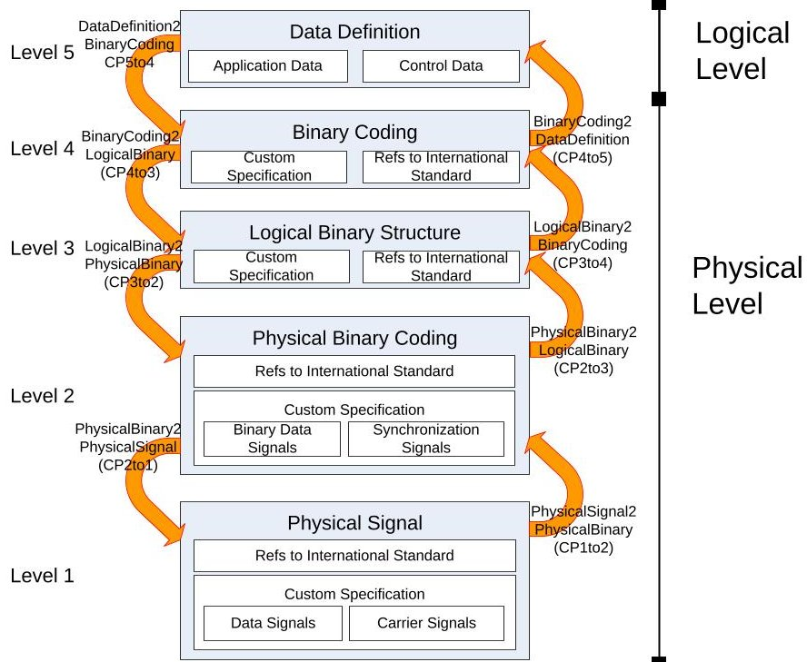
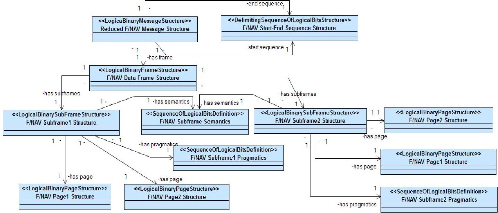
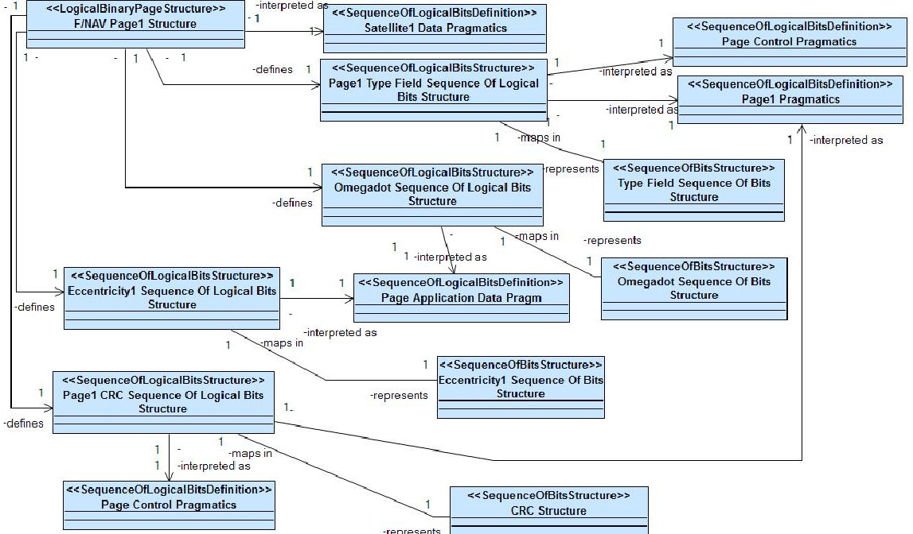
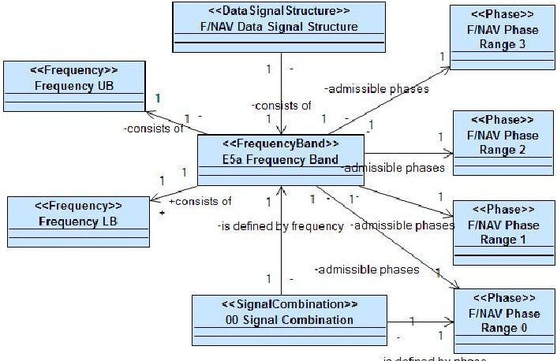
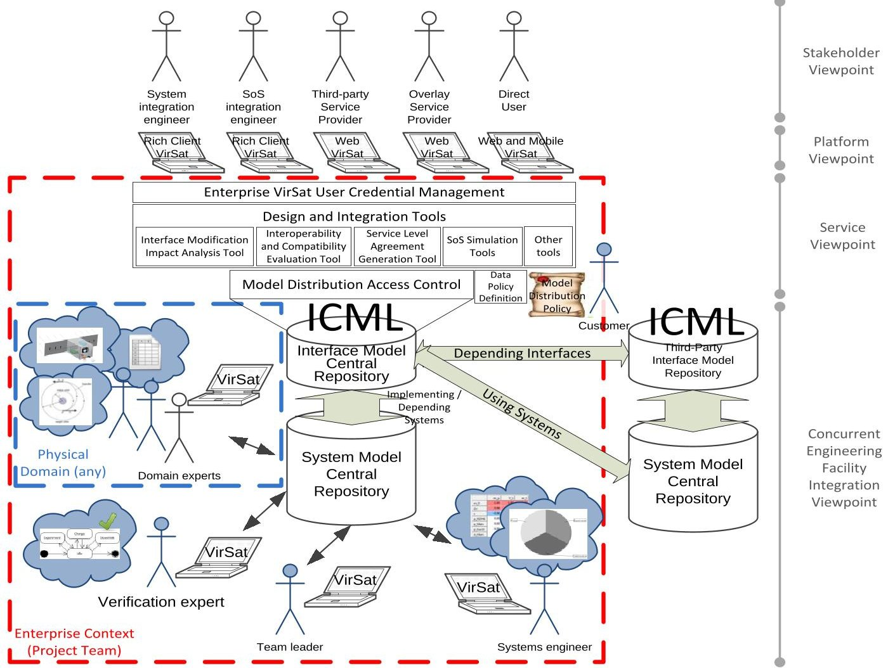
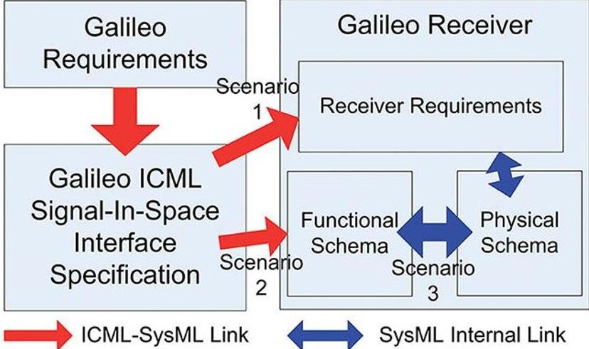
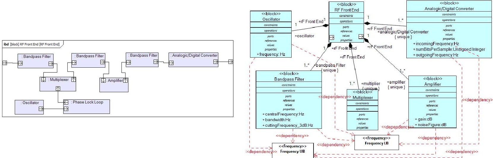
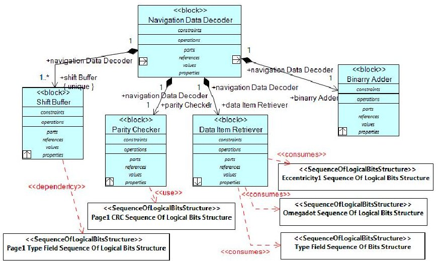

<!-- PDF_PAGE: 1 -->

# 6th International Conference on Systems & Concurrent Engineering for Space Applications Model-based Interface Engineering in Concurrent Engineering Facilities: Motivations and Possible Applications to Systems and Service Systems Engineering

Daniele Gianni $ ^{(1)} $ , Volker Schaus $ ^{(2)} $ , Andrea D'Ambrogio $ ^{(3)} $ , Andreas Gerndt $ ^{(2)} $ , Marco Lisi $ ^{(4)} $ , Pierluigi De Simone $ ^{(4)} $

$ ^{(1)} $ Consultant at EUMETSAT Darmstadt, Germany danielegmail-icml@yahoo.it

$ ^{(3)} $Dept. of Enterprise Engineering University of Rome TorVergata (Rome), Italy dambro@uniroma2.it

$ ^{(2)} $Deutsches Zentrum für Luft- und Raumfahrt (DLR) Braunschweig, Germany {Volker.Schaus, Andreas.Gerndt}@dlr.de

$ ^{(4)} $European Space Agency Noordwijk, The Netherlands {Pierluigi.DeSimone, Marco.Lisi}esa.int

## INTRODUCTION

Model-based Systems Engineering (MBSE) methods have been deployed in Concurrent Engineering Facilities (CEF) primarily as enablers for the effective (i.e. unambiguous) communication in the collaborative activities in CEF studies. Moreover, MBSE has also paved the way for the reuse of engineering artefacts across projects, with potential benefits not only on the reduction of the activity effort but also on the more accurate estimation tools for project and product performance metrics. However, MBSE methods have primarily focussed on the representation of intra-system related artefacts (from requirements to functional and physical schemas), and partially neglected the formalisation of the inter-systems aspects. The inter-systems aspects, namely interfaces, can be even more critical in CEF studies as they are key specifications for cross-functional and cross-enterprise systems integrations [1]. Currently, interfaces are commonly maintained in document-based forms, therefore leaving the interface engineering method behind with respect to the MBSE state of the art. Moreover, as the system complexity increases, more and more specialized knowledge is required for the individual parts of a CEF study, for independent functional domains and/or for segments/sub-parts of the full system. This can be particularly exacerbated in those cases were no internal know-how or resources are available for the full system engineering. In these cases, functional studies, or part of the systems engineering activities, may need to be outsourced or, more critically, the final system may have to integrate with existing or to-be-designed third-party systems (conventional systems or systems of systems).

In these cases, using a Model-based Interface Engineering (MBIE) method (as a sub-set of MBSE), several benefits can be brought to the CEF activities as this method provides key capabilities for:

- Supporting the communication for integration-specific aspects, similarly to what has been currently achieved by state-of-the-art MBSE for systems in CEFs;

- Contributing to define restricted views on what is strictly necessary to share with project partners for systems and functional domain integrations

- Maintaining traceability between interface elements and system models

- Providing means for the identification of the impact of interface modification on the internal system functional and physical design.

- In this paper, we propose the integration of the Interface Communication Modelling Language (ICML) (https://sites.google.com/site/icmlmodellinglanguage/) [2] into the existing MBSE methods for the CEF software framework VirSat [3]. In particular, we identify the business needs driving the use of model-based interface specification. And we show possible CEF scenarios and how that could benefit from such an approach for the Galileo programme [4][5]. We also show preliminary example applications of interface modelling to:

- Galileo receivers engineering, for supporting the reuse of existing hardware (HW) and software (SW) resources [6];

- Service Systems Engineering for Galileo Early Services, for the exploitation of Galileo services through integration of the Galileo SoS (System of Systems) with end-user and third-party service provider segments [7].

MODEL-BASED INTERFACE ENGINEERING

MBIE is the application of MBSE methods and technologies to the interface specification. Similarly to systems, an interface specification consists of concepts and relationships that can be formulated in natural language or in a (semi-) formal graphical language.

In systems and service systems engineering activities, the introduction of MBIE is motivated by the following observations:

Observation 1) A relevant part of the documents concerns interface specification (ICDs);

Observation 2) There may be no needs to share internal details of sub-systems ("can-understand" principle);

Observation 3) Confidentiality issues may limit the distribution of internal sub-systems module (e.g. when reusing third-party system);

<!-- PDF_PAGE: 2 -->

Observation 4) Confidentiality issues may limit the access rights to the stakeholders of the interface models ("Need-to-know" principle in multi-partner projects);

Observation 5) Support for the verification activities with more effective verification campaigns, reducing risks in the transition to user activities (primarily in systems engineering);

Observation 6) Service performance may also depend on external service performance besides from the internally measured process Key Performance Indicators (KPIs) (primarily in service systems engineering);

Observation 7) Interface models are critical to ensure a seamless transition of a SoS configuration from two phases, involving different partners, e.g. from validation to operation with external users (primarily in service systems engineering);

Similarly to MBSE, MBIE can be supported by the definition of modelling languages and technologies that can be used to represent interface specifications (i.e. interface control document) and to exploit the interface models within systems and service systems engineering activities, which are typically performed in CEF for large and complex projects. In theory, an interface modelling language can be defined in any available technology. In practice, however, most of the MBSE methods rely on UML-derived technologies and therefore one cannot disregard UML when defining an interface modelling language. However, the core issue is not about conforming to a set of technologies to offer a seamless exploitation to the end user. The core issue is rather to ensure that an interface model can be integrated with system and service systems models (typically in UML-based technologies). This allows interface elements to be traced onto systems and service systems models and will therefore contribute to provide a more comprehensive view of the systems and services being designed.

## Interface Modelling Communication Language (ICML)

Basing on the above observations, we have introduced ICML (Interface Communication Modelling Language), a modelling language for the representation of interface specification using UML-based technologies. ICML is defined as UML profile and can integrate with system specifications based on compliant technologies. However, ICML is still in a prototypal form and reviews are undergoing for improvements and extensions. The prototypal version has been implemented [8] and has been made available under the GPL v3.0 license from the ICML project website and can be immediately deployed in TopCased (http://www.topcased.org/), one of the most popular UML and SysML open source modelling tool.

An ICML-based interface specification is structured in the layout shown in Figure 1. The specification covers the definition of both the message structure and conversion processes. The message structure consists of five abstraction levels, and describes how the data is structured within the message. The conversion processes describe how the data values are transformed between adjacent levels of the message specification.

Figure 1 Layout of ICML-based interface specification [2]

The message structure is defined at five levels: Data Definition, Binary Coding, Logical Binary Structure, Physical Binary Coding, and Physical Signal, each covering specific aspects of the Signal-In-Space interface specification. For example, the Data Definition level covers the specification of the logical data structure, which includes the data items composing the message information. A data item is either of application or control type. An application data item represents a domain specific concept that conveys the information expected by the message recipient. Differently, a control data item represents a domain independent concept that can support the correctness and integrity verification of the associated application data items. A data item can also be associated to semantic and pragmatic definitions. The

<!-- PDF_PAGE: 3 -->

former specifies the meaning of the data item and the latter specifies the contextual interpretation for the semantic definition. Analogously, the Binary Coding level covers the specification of the binary coding for each of the data item defined at the above level. For a data item, the binary coding is represented as binary sequence and it includes at least a sequence identifier, the semantic definition, and the pragmatic definitions. Similarly to the above level, the semantic and pragmatic definitions enrich the interface specification, contributing to convey accurate representation of the binary coding.

The conversion processes describe the activities to be performed for deriving message values between adjacent levels of the above structural specification. As shown in the above figure, eight processes (depicted as CPs, Conversion Processes) should be defined to specify all the conversions between adjacent levels. For example, the DataDefinition2BinaryCoding process defines the activities to be performed for the derivation of the logical binary sequences representing data values. Similarly, the LogicalBinary2PhysicalBinary process defines the activities for the implementation of convolution or encryption algorithms on the logical binary sequence. However, these processes do not always need to be explicitly defined. In particular, if a process is of trivial or standard implementation, a textual note referring to an external document may suffice for the specification purposes.

Only for exemplification purposes, we show a simplified part of a Galileo-like OS (Open Service) interface concerning the above-defined level 3 and level 1. Figure 2 shows a detail of the specification for a reduced F/NAV (Freely Accessible Navigation) message structure. This structure consists of one Data Frame that in turn consists of F/NAV Subframe 1 and F/NAV Subframe 2.

Figure 2 Example ICML-based specification of a F/NAV-like Message Structure at Level 3 [6]

Figure 3 details the specification of F/NAV-like Page 1. In particular, this page consists of four sequences: Eccentricity and Omegadot—representing application data; Type Field and Cyclic Redundancy Check (CRC)—representing control data. Each of these sequences are also associated to a number of properties (not displayed by the tool) that describe further details, such as the sequence length, the associated scale factors and offsets, for instance. The specification also links these sequence specifications to the respective sequences at level 4.

Figure 3 Example ICML-based specification of a F/NAV-like Page 1 Structure at Level 3 [6]

<!-- PDF_PAGE: 4 -->

Figure 4 shows some details of an F/NAV-like specification at physical signal level. The diagram defines the frequency band and the admitted phase ranges. Each phase range is also associated to the binary combination that is represented by the respective signal properties of amplitude (not shown in the diagram), frequency, and phase.

Figure 4 Example ICML-based specification of F/NAV-like at Level 0 [6]

INTEGRATION IN CONCURRENT ENGINEERING FACILITIES

MBIE can bring similar and complementary benefits to those provided by MBSE deployed in CEFs. For example, in CEFs, MBIE can:

- Further support the communication on integration-specific aspects for systems, sub-systems, and service systems;

- Contribute to define restricted views on systems models that are strictly necessary to share with project partners for systems and functional domain integrations

- Maintain traceability between interface elements and system models

- Provide means for the assessment of the impact of interface modification on the internal system functional and physical design.

- When integrating MBIE into the Concurrent Engineering (CE) approach, three dimensions are to be considered:

- Physical domain, which regards the discipline partitioning (e.g. thermal, mechanical, electric, etc.);

- Sub-/System, which regards the physical partitioning of the system, sub-systems, or SoS

- Enterprise context, which regards the scope of responsibility and of authority across the project scope.

- Moreover, each of the above dimensions identifies a distinguishing aspect in MBIE:

- Physical Domain identifies interface models using the same physical quantities

- Sub-/System identifies interface models related to physically adjacent components

- Enterprise context identifies limitation on sharing of interfaces models and of traced system models

These dimensions have a different relevance to the typical actors (domain experts, systems engineer, end-users, project partners, or third-party service providers) participating in a CEF study. Table 1 collects the initial identification of the concerns (and of their intrinsic relevance) that each CEF actors may have towards each dimension.

Table 1 Dimension relevance to CEF Actors

<table border="1"><tr><td>CEF Actors</td><td>Physical Domain(Within)Thermal, Mechanical,Electronics,etc.</td><td>Sub-/System(Between)Sensor, Instrument, Satellite,Ground Segment,etc.</td><td>Enterprise Context(Within)Core Team,Project Team,SoSConfiguration,Public Service</td></tr><tr><td>Domain Expert</td><td>For workload partitioning amongexperts of the same domain,over distinct components</td><td>Possible only for transducer components</td><td>Not directly interested.May be subjected to model sharingrestrictions,depending on the system/service interfaces with externalworld</td></tr><tr><td>Systems Engineer</td><td>Not interested</td><td>For system integration when allthe components are designed bythe same organisation</td><td>For system integration when thecomponents are designed bydifferent organisations(sharingconditions may apply on interfaceand system models)</td></tr><tr><td>Users,ProjectPartners,orThird-partyServiceProviders</td><td>Not directly interested,except forthe system and service interfacesrelated to the integration with theexternalworld</td><td>Not directly interested,exceptfor the interfaces related to theintegration with theexternalworld</td><td>For system integration and serviceconsumption(sharingconditionsmay apply on interface models)</td></tr></table>

<!-- PDF_PAGE: 5 -->

Following all the above observations (1-7) and the review in terms of "enterprise" use (i.e. spanning several organisational boundaries) of a CEF activity, we have sketched an integration diagram that could extend the VirSat CEF software to embed also MBIE capabilities in Figure 5. The diagram is structured in four viewpoints: CEF Integration viewpoint, Service viewpoint, Platform viewpoint, and Stakeholder viewpoint.

The Stakeholder viewpoint concerns the identification of the possible actors in a VirSat environment that can support also MBIE and that can leverage interface models to enrich also its current capabilities. Besides the existing VirSat actors of Team Leader, System Engineer, Domain Expert, and Verification—which are shown at the bottom and bottom-left sides of the diagram for visual analogy with the existing VirSat integration layout—other actors become of relevance in the context of MBIE in CEF for systems and service systems engineering: System Integration Engineering, SoS Integration Engineering, Third-Party Service Provider, Overlay Service Provider, and Direct (or end interface) User. The Platform viewpoint concerns the platforms that the newly considered CEF actors can use to access interface models, primarily, and the traced system model, eventually and conditionally. Currently, three types of platforms are identified: Rich Client VirSat (i.e. the current VirtSat), Web VirSat (i.e. a web-enabled version of VirSat), and Web and Mobile VirSat (i.e. a light version that can be access through Web-mobile interfaces). The Service viewpoint illustrates the enriched services that can be introduced as consequence of the availability of interface models as limiting and tracing proxies for system models. Basing on the above observations, we foresee that service architecture based on three levels:

1. Enterprise VirSat User Credential Management—which addresses the observations related to the model audience identification for the controlled distribution and access of interface and traced system model;

2. Design and Integration Tools—which addresses the observations related to integration and verification activities, under the assumption of limited system model access;

3. Model Distribution Access Control—which address the definition and the verification of system model distribution, including also capabilities for the definition of data policies for models, on the example presented in [9].

Finally, the CEF Integration viewpoint specifically concerns the technical details for embedding the ICML language in VirSat. In this viewpoint, the modelling facilities as well as the model storing facilities for interface specifications are introduced along side the existing one for system models. Moreover, this viewpoint also shows the links for the traceability between interfaces and systems models, the interdependencies between local interfaces and external systems, and between external interfaces and internal systems.

## POSSIBLE APPLICATIONS

MBIE approaches based on ICML can have a wide application to systems and service systems in CEF, far beyond the space domain. However, in the context of this experimental activity, we have initially focussed on the space domains

Figure 5 Sketch of Integration Diagram with VirSat CEF Facility

<!-- PDF_PAGE: 6 -->

and we have identified two possible applications to the Galileo receivers and to the Galileo early services. In both applications, ICML can bring the MBSE benefits to all the stakeholders, from systems engineers to the interface users. For example, ICML can: 1) provide a reference guideline for structuring the specification data and thus facilitating the communication between the Galileo SIS designers and the receivers producers, and more generally all the interface users (including also overlay service providers); 2) ease visual inspection of the specification, for verification purposes; 3) support syntactical model validation using existing tools; 4) support for future advance exploitation by means of a machine-readable data format. In particular, the availability of a machine-readable format is also the base for advanced use cases that can exploit the capabilities of modern computer technologies, such as model-based verification and model-driven simulation engineering with data-driven experiments.

## Application to Galileo Receivers

Specifically, for the Galileo receivers, we identified three possible exploitation scenarios in the physical domain "Electronics", sub-/system "Instrument", and enterprise context "Project Team" (Figure 6):

- Scenario 1: identification of the receiver requirements that are introduced or modified by the Galileo OS SIS, with respect to existing GPS receivers.

- Scenario 2: linking between the ICML specification and the receiver functional schema to identify how a Galileo receiver will differ from existing GPS solutions.

- Scenario 3: a development of Scenario 1 and Scenario 2, in which the physical schema definition and the physical components identification (HW and SW) may further exploit the ICML-based approach for supporting the reuse of existing GPS components.

In the context of this paper, for the sake of brevity, we only present Scenario 2, which is however underpinning both Scenario 1 and Scenario 2.

Figure 6 Graphical Insight on the Exploitation Scenarios for Galileo receivers

In this scenario, we exemplify two cases: case 1) the tracing of interface elements on the RF (Radio Frequency) Front End functional schema; and case 2) the tracing of the interface elements on the data decoding functional schema. Similarly to the above diagrams, the below diagrams are meant for exemplification purposes only, to show the ICML potential benefits. Indeed, these diagrams are not to be considered fully realistic and detailed for real Global Navigation Satellite System (GNSS) receivers. Moreover, only the above defined ICML level 1 and level 3 elements are considered.

Case 1: From Interface Elements to RF Front End Schema.

Error! Reference source not found. shows the above RF Front End's Internal Block Diagram (IBD) on the left hand side, and the Block Definition Diagram (BDD) in conjunction with ICML level 1 elements (in white) on the right hand side. A preliminary number of relationships are drawn in red, including the respective relationship <<dependency>> qualifier. This qualifier indicates that the originating block inherently depends on the connected ICML element. The dependency mainly concerns the value of the block's properties, although refined and extended semantics may be introduced.

## Case 2: From Interface Elements to Data Decoding Schema.

Figure 8 shows the Navigation Data Decoder's BDD in conjunction with ICML level 3 elements (in white). As in Case 1, the relationships are drawn in red including a richer set of relationship qualifiers. For example, the <<use>> qualifier indicates that the originating block uses the data specified in the connected ICML element. Similarly, the <<consumes>> qualifier indicates that the originating block takes in input instances of the ICML element. ICML level 4 elements are also relevant to this BDD; however, they are not shown for the sake of conciseness.

<!-- PDF_PAGE: 7 -->

Figure 7 SysML RF Front End IBD (left [10]) and Linking Level 1 Elements to RF Front End Block Definition (right)

Figure 8 Linking Level 3 Elements to SysML Navigation Data Decoder DB

Application to Galileo Early Services

The Galileo programme is entering in its services delivery phase, while the system is steadily proceeding towards its Full Operational Capability configuration. In the preparation activities for this phase, the EC, the European GNSS Agency, and ESA are presently engineering and developing the organization needed for a continuous and reliable provision of the Galileo services to EU and worldwide users. In this context, the aspects related to the Galileo interface specifications are of primary importance to address three concerns:

Concern 1) Develop the end-user community

Concern 2) Support overlay service providers (switching costs from other GNSSs)

Concern 3) Integration with third-party service providers (e.g., COSPAR-SAT integration, Multi-GNSS interoperability)

From initial investigative activities, the use of ICML-as MBIE methodhas shown a promising potential to technically support the solution to the above three concerns, which on their technical side might also require a concurrent engineering approach because of their large scope and inherent complexity. In particular, Concern 1) can be addressed similarly to what already described in Scenario 3) as developing Galileo receivers may require new design and adaptation of existing software (SW) or hardware (HW), as well as new production chains and higher costs—in particular no recurring costs—are likely to occur with respect to the well-established GPS receivers. As a consequence, limitations may be experienced in the market penetration and in the growth velocity of the Galileo receivers' share in the receiver market. In turn, this may hinder the estimated economical return for the Galileo project. Differently, Concern 2) can be analyzed from a provider prospective and from a Galileo programme prospective. On the provider side, cost-benefit analysis may need to be considered for balancing the cost of switching the positioning service to Galileo vs the enhanced Galileo accuracy. This analysis can be facilitated—therefore further reducing the analysis costs-by the guideline described for Scenario 2). Specifically, the service provider could benefit from the MBIE method offered by ICML for the identification of the systems to be updated or to be replaced. Differently, from the Galileo side, one possible objective is to reduce the switching costs from other GNSS service providers. Consequently, in this situation, Scenario 3) may be used as guideline for an extended process that can sustain the unambiguous understanding of the Galileo interfaces (starting from the signal in space one) and that may provide references for compliant solutions at functional and at physical levels, thus contributing to reduce the switching costs to the overlay service providers. Finally, Concern 3) is likely to the one requiring an engaging business-level strategy to be addressed. Nevertheless, an ICML-CEF approach may technically sustain possible business strategies by making their implementation economically more convenient for reasons similar to those above mentioned for Concern 1) and

<!-- PDF_PAGE: 8 -->

Concern 2). For Multi-GNSS interoperability, validated results have shown how the ICML language can support the receiver-side interoperability, i.e. the receiver capability to use independent GNSS signals for the computation of the global positioning. This capability implicitly requires that the receiver computations are decoupled from the signal-in-space interface of any GNSS. Key condition to achieve this decoupling is that the interface specifications are available in a consistent, unambiguous, and if possible—a standard format, which can support engineers to more effectively design interoperable receivers. Moreover, an integrated approach in the VirSat CEF tool can further facilitate the interactions among the involved actors in the respective studies.

Currently, ICML has only a preliminary integration with UML and SysML. When deploying ICML in VirtSat to support the solution of the above concerns, a more extensive integration with UML, SysML, and other related modelling standards can more evidently benefit the systems and service systems engineering activities. For example, integrating ICML with UML sequence diagrams can contribute to reduce the ambiguity on the format of the exchange message. Similarly, the integrating ICML with UML state diagrams can provide the capabilities to define state dependent interfaces as well as linking guards to values of a message for triggering state changes or process executions. Other examples can be drawn with SOAML (Service-oriented Architecture Modeling Language) and UPDM (Unified Profile for Department / Ministry of Defense Architectural Framework). In the case of SOA, the integration could offer more detailed means to specify (and agree) on service specifications, further contributing the replacement of the ambiguous document-based specification with the model-based specification. Finally, in the case of UPDM, the integration can offer a multi-resolution modelling approach that spans from the service and architectural concerns down to the technical interoperability ones.

## CONCLUSIONS

Model-based Interface Engineering (MBIE) can bring several benefits to large and complex projects that are undertaken in Concurrent Engineering Facilities (CEF) as MBIE can support the encapsulation of system models beyond interface models, thus reducing the visible complexity while supporting the identification of the systems models to be shared. Consequently, the communication with the stakeholder is also facilitated as it focalised on the boundary concerns represented by the interfaces, which can span several dimension. Moreover, the use of a MBIE can also enhance the existing MBSE capabilities with the traceability of the interface elements on the system functional and physical schemas, with the final objectives of supporting assessment of interface modification, supporting cost-benefit analysis in service provider switching, systems interoperability, system model distribution control, for instance. Aside from the motivation analysis, the paper has also outlined the definition of ICML (Interface Communication Modelling Language) as MBIE method, including a brief exemplification of a Galileo-like OS service interface specification. Next, the paper has also presented an initial integration and analysis between ICML and the VirSat CE tool. The integration analysis has proceeded in three steps: CEF actors identification in a interface-intensive engineering activity; actors concerns along the three dimensions of physical domains, system, or enterprise context; and integration diagram with VirSat, along the viewpoints of Stakeholder, Platform, Service, and CEF Integration. Finally, the paper has discussed two possible applications of ICML in VirSat, for the Galileo receivers and for the Galileo early services. For the application for Galileo receivers, three possible scenarios have been identified and one has been detailed with ICML and SysML diagrams. All the scenarios are aimed to support the design of Galileo receivers with the reuse of existing GNSS solutions for Galileo by tracing the interface elements on system models of existing receivers. Similarly, the application for Galileo early services can leverage on similar exploitation scenarios, in which a wider integration with UML and relevant languages, such as SOAML and UPDM, may be needed.

## REFERENCES

[1] A.W. Wymore, "Model-Based Systems Engineering Methodologies, in Journal of National Council on Systems Engineering 1(1):83-92, 1994.

[2] D. Gianni, J. Fuchs, P. De Simone, and M. Lisi, "A Modeling Language to Support the Interoperability of Global Navigation Satellite Systems", GPS Solutions, Springer Verlag, July, 2012.

[3] V. Schaus, P.M. Fischer, D. Lüdtke, M. Tiede, A. Gerndt, "A Continuous Verification Process in Concurrent Engineering", 2013 AIAA Space Conference.

[4] M. Lisi, "Engineering the Galileo Service Exploitation Phase", International Workshop on GNSS technologies advances in a multiconstellation framework", SOGEI, Roma, Italy, April 2013.

[5] M. Lisi, "Galileo, the European GNSS: Status, Challenges and a Glance at the Future", International Conference on Localization and GNSS, Helsinki, FI, August, 2014.

[6] D. Gianni, M. Lisi, P. De Simone, A. D'Ambrogio, and M. Luglio A Model-based Signal-In-Space Interface Specification to Support the Design of Galileo Receivers" in Proceedings of the 6th ESA Workshop on Satellite Navigation Technologies and European Workshop on GNSS Signals and Signal Processing (NAVITEC), Noordwijk, The Netherlands, December 5-7, 2012, 8 pp., doi: 10.1109/NAVITEC.2012.6423066.

[7] D. Gianni, A. D'Ambrogio, P. De Simone, M. Lisi, and M. Luglio, "Model-based Interface Specification to Support Systems Integration in Systems of Systems Engineering", INCOSE International Symposium 2012, Rome, 2012.

[8] S. Annarilli, C. Bartolomei, D. Gianni, A. D'Ambrogio, "First Prototypal UML Profile Implementation for the ICML language", Technical Report, University of Rome TorVergata, October, 2012.

[9] D. Gianni, et al., "SSA-DPM: A Model-based Methodology for the Definition and Verification of European Space Situational Awareness Data Policy", Proceedings of the 1st European Space Surveillance Conference, June, 2011.

[10] K. Borre, D.M. Akos, N. Bertelsen, P. Rinder, S.H. Jensen, A Software-Defined GPS and Galileo Receiver A Single-Frequency Approach Applied and Numerical Harmonic Analysis. Birkhauser, 2006.