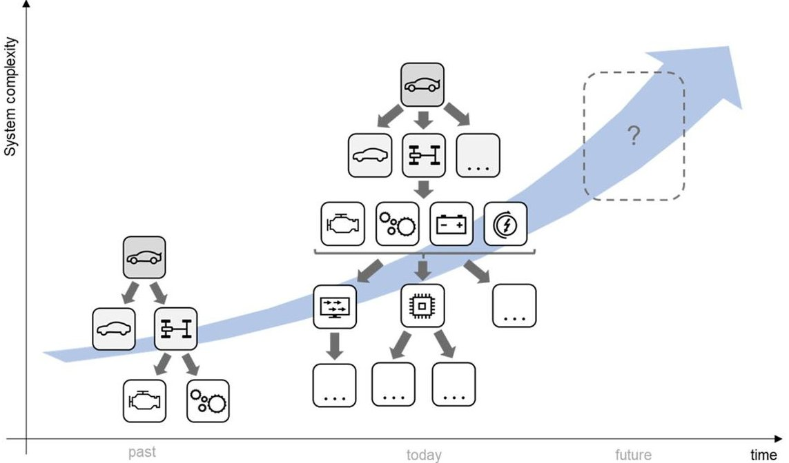
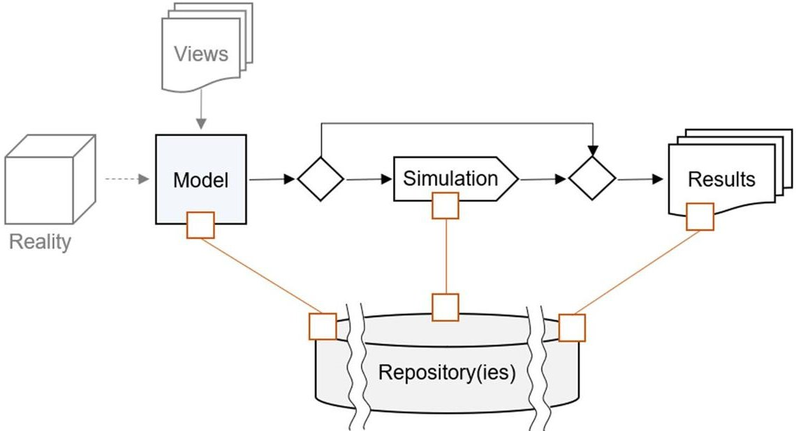
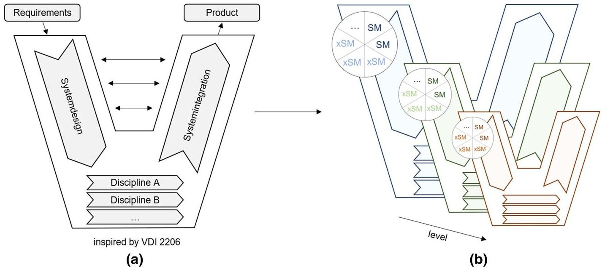
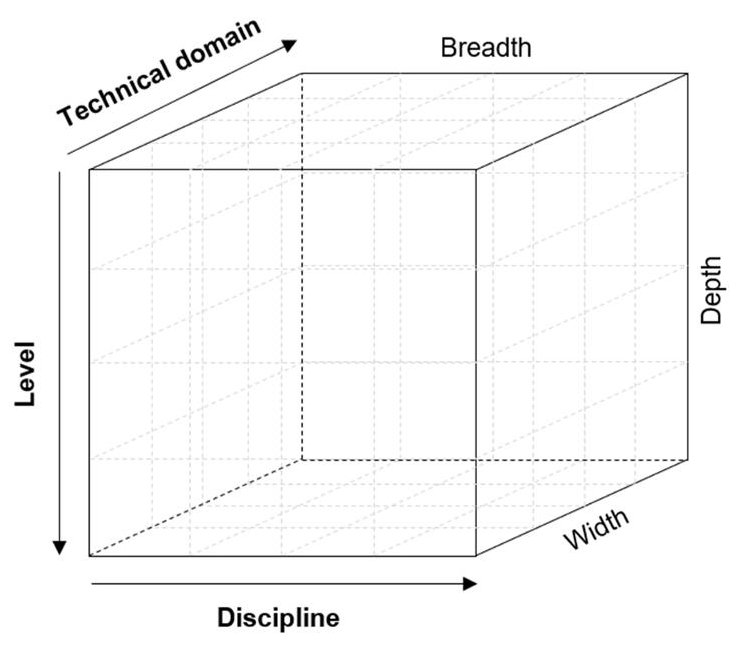
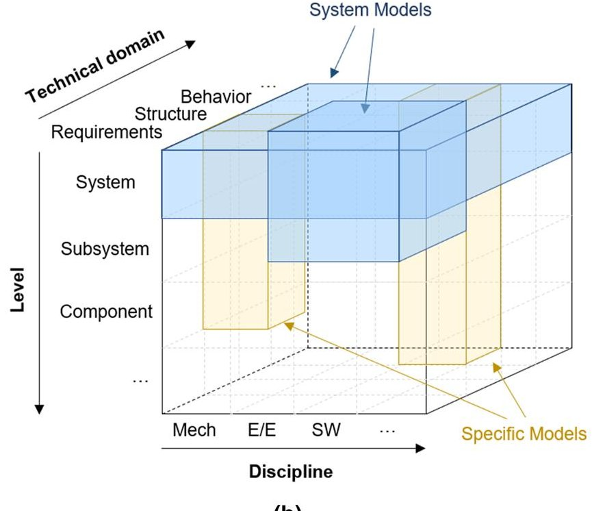
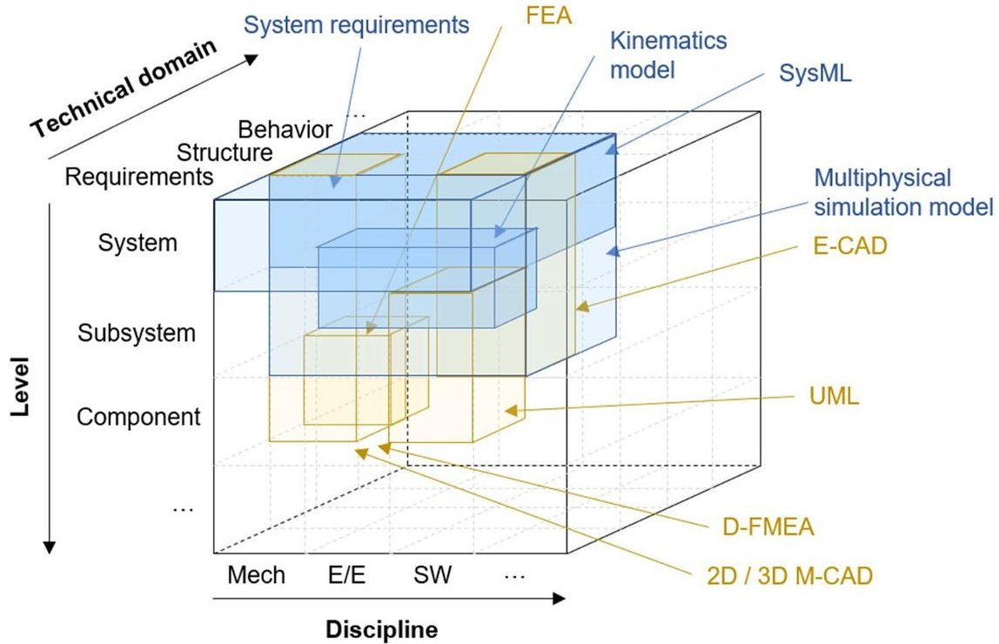
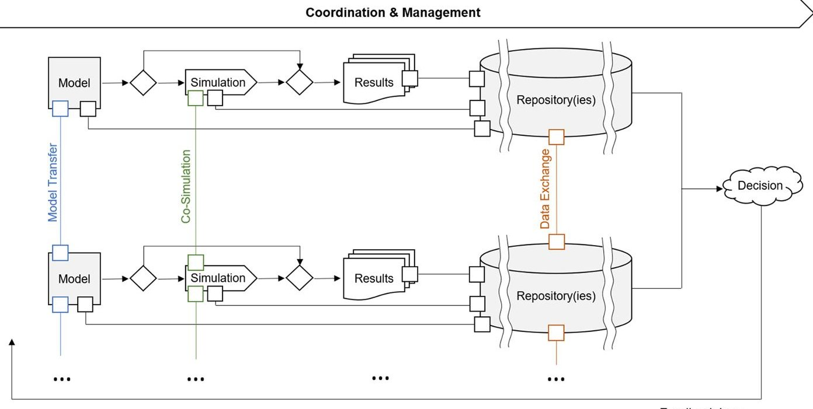

<!-- PDF_PAGE: 1 -->

Research Article

# Definition of a system model for model-based development

Hannes Hick $ ^{1} $ · Matthias Bajzek $ ^{1} $ · Clemens Faustmann $ ^{1} $

$ \textcircled{c} $ The Author(s) 2019 OPEN

## Abstract

The term'system model' is used in many different domains, fields of application and in various forms with different meanings. One of model-based systems engineering's targets is the generation of a system model, which is used to describe complex system aspects across multiple views of disciplines and technical domains. Often a system model generated with systems modeling language is used as a central placed model in development. Besides, there are practical approaches, where models generated with other languages are also sometimes called system models. The scope of this paper is a generic definition of the term'system model' and its interactions with other types of models in a model-based development ecosystem. Based on the analysis of the actual situation, a concept for the definition of system models is presented, which enables the use of multiple system models and which helps to understand the interactions with other types of models. For better comprehension of a system model's role in development, a three dimensional cube for visualization of system models and specific models is presented. Coupled with the definition of the term, interactions to other approaches like product lifecycle management and the vision of a single source of truth for development are investigated and discussed.

Keywords System model · Model-based systems engineering · Model-based development · Discipline specific model Domain specific model

## 1 Introduction

Trends are showing a continuously increasing complexity of development of socio-technical systems [11,26]. In parallel, development resources, time and cost have to be in balance while rising system quality, safety, reliability and durability as well as trust in the system [19]. This leads to approaches such as systems engineering to manage complexity, to work effectively and efficiently. Systems engineering combines best practices, and integrates them into development processes to ensure an interdisciplinary collaborative, structured and connected development [13, 20, 28].

A consideration of the automotive domain shows the rising complexity exemplary in many different areas from technologies of the system to organizational matters, development approaches, involved stakeholders and

developer, lifecycle considerations and much more. Following the path of technology legislative regulations and the resulting reduction of emission until the approach of green vehicle leads to actual increasing degree of electrification of passenger cars. This results in new functionalities which have to be developed, as briefly shown in Fig.1. Furthermore, services such as autonomous driving functions, and infotainment systems, etc. rapidly increase the system complexity. To satisfy customer needs, the number of vehicle variants offered by original equipment manufacturers (OEMs) is increasing, while at the same time development and production time need to be decreased. To cope with these contradictory requirements, today's vehicle development strongly relies on a massive supplier network. Furthermore, there is a rising number of suppliers which have to be managed. In parallel, due to integration of new technologies in modern vehicles, there is a high number of

<!-- PDF_PAGE: 2 -->

Fig.1 Trend of increasing system complexity in the automotive domain

different teams and disciplines involved in development. OEMs and other developers have to master these and many more challenges to deliver a well-working system [12].

Increasing system complexity leads to many terms used in development, resulting in different meanings and interpretations by developers. This paper focuses on an approach for definition of the term'system model' generated and used in development. This should conduct further research and development based on the presented results.

'System model' is a popular and common term used in various forms.A clear and consequently used definition is not available and may not be possible due to application of system models in different industry domains.Increasing system complexity and development effort lead to a frequent use of the term 'system model', which fundamental idea is an interdisciplinary view on the system to support the understanding of the whole system and the following development activities.To describe an applicable system model, it is necessary to define the purpose and context for its usage. For the right use and understanding of the term it is also important to know the fundamental ideas and concepts the idea of a system model is based on.

For better understanding of the term, the area of application is investigated. The core idea of modelbased engineering (MBE) is to support the development process by using semi-formal and formal models [18] instead of written informal documents [9]. The intentions behind the use of models in development cover various aspects e.g., clear interpretation, reusability, merging of information from different sources and a possibility to better describe the reality [4,7]. Therefore, the principles of model-based engineering constitute the context for a system model. The targets of MBE are not the focus

of this paper and are therefore not further described here. Nevertheless, they are important to understand the motivation behind the use of system models in development.

A model-based approach is especially beneficial if its core idea is pervasively persecuted over the whole development process to provide traceability and consistency of information [4]. Therefore, suitable models on several levels of abstraction and for various purposes have to be defined. According to Stachowiak [25], a model is a representation of an object or system in reality and is characterized by three attributes—mapping, reduction and pragmatic property—described in detail in the following. Furthermore, the term 'model' is narrowed by focusing on designated types of models, more precisely on computer generated digital models. Moreover, only semi-formal and formal models [18] are considered. The limitation on these selected kinds of models is necessary to provide processability and reusability.

Model-based systems engineering (MBSE) incorporates additional targets from systems engineering while focusing on some main concepts of MBE [3]. Defined targets of a MBSE approach are model-based consistency from system development until detail part development by generation of a system model and central repository(ies) [4]. This paper focuses on the definition of such a system model not only in context of MBSE but for the wider context of MBE. Nevertheless, the definition of the system model should enable a proper application of it in MBSE but should not reduce the usability to a MBSE approach. By defining a system model only in context of MBSE, essential aspects of the general MBE are missing, and as result some important aspects of the system model may not be considered. In addition, the link between central repository(ies) and system models is briefly described.

<!-- PDF_PAGE: 3 -->

In current practical approaches, commonly used system model definitions either strongly rely on the principles provided by the System Modeling Language SysML requirements, structure, behavior, parametrics[10] or are seen as a visionary framework acting like a central model and repository, which is linked to all other models in development and further provides data management activities. The implications of these views on a system model will be described in the next section and a new approach of how to define the term 'system model', based on these perceptions, is presented.

Starting with an analysis of the as-is situation, how the term 'system model' is currently used, interpretations and implementations of system models are discussed. Following, necessary requirements for defining the term are investigated. Furthermore, an approach of defining a system model in context of model-based development is presented which should contribute to further research and development activities in this topic and should enable a reasonable use of the term.

## 2 General intent

It is the main objective of this paper to enhance the discussion about what system models are or could be in developments of socio-technical systems. Nevertheless, it is not the objective to describe the general process of generating these kind of models. The findings presented in this paper should be an enabler to further implement modelbased development approaches by classifying, structuring and connecting models, which are used to develop a system. As the context for the developed concepts is stated in the introduction, no further concretization of a certain technical system is done in this paper, in order to provide a common starting ground for different possible applications. In future research, the concepts are applied on a specific technical development use case to exemplary show the adaptation to specific needs and to evaluate the practical usability.

## 3 Inconsistent as-is situation

It is necessary to understand the background of approaches which include the use of system models, as there are many different definitions of the term 'system model'. As development targets can be quite divergent, system models are used in different abstraction degrees, on different levels of detail and for a variety of different purposes. On the one hand, many of them lead to an implementation in SysML as interpretation of a system model. On the other hand, the system model

is sometimes seen as an overall provider and integrator, which represents some kind of single source of truth thinking.

## 3.1 Divergent definitions of system models

By analyzing the current state, it becomes obvious that there exist many different definitions of the term 'system model'. There are several identified reasons for that.

The term 'system model' is used in face-to-face communication, often resulting in a loss of exact meaning due to human language uncertainty and multiple possible interpretations. Transferring these basic thoughts to technical development, further different interpretations of the term 'system model' are in use. It is important to develop a framework, which enables common understanding of system models to support interdisciplinary communication.

There are many disciplines and technical domains in engineering and development in general, which use the term 'system model'in their own kind of way. For instance, in software engineering, a system model is used for documentation of different perspectives and should enable discussions among stakeholders and engineers [24]. In the automotive industry system models are used on different levels of development (vehicle system, powertrain system, engine system, etc.) and different degrees of technical detail (different system maturity). Furthermore, system models are often used to document requirements, structure, behavior, and verification & validation [1]. Other sources see the system model as combination of several models and repositories, which is able to act as one single model and central repository [29]. This triggers the demand for data management tasks, but often the responsibilities for that are not clearly defined.

Another reason is the obvious disparity of purposes of system models. To address information in the early phase system design in the V-model [27], which can be e.g., system requirements or system architecture, SysML may be an appropriate implementation of a system model [30]. Further, if the purpose is to establish and manage information exchange between different disciplines, e.g., from project management, through system development until production, the demand for a central system model acting as single source of truth is a logical consequence.

In conclusion, two main views on what a system model can be are established. One of them is a strict limitation of the system model to the principles defined by SysML. The other one is some kind of vision of a system model, which is the connector, provider and integrator of product relevant information and which acts like a central model providing also management activities.

<!-- PDF_PAGE: 4 -->

## 3.2 System models as defined with SysML

In many approaches the system model is reduced to the four pillars that describe the contents of the system representation in SysML. These four pillars include requirements, structure, behavior and parametrics [10, 21]. By concentrating only on these predefined principles, the solution of how a system model could look like automatically leads to a SysML implementation. By doing so, potentially beneficial parts of a system model are not further considered (e.g., verification and associated test cases). However, this approach also provides advantages, as there exists a semi-formalized modeling language that enables stakeholder communication by uniform notations, semantics and syntax. Nevertheless, SysML is just one way of how to model a system.

## 3.3 Single source of truth thinking

A single source-, single point-, or sole source of truth represents an entity which contains every kind of constantly updated information about the system under development to enable 100% traceability and consistency. Interesting to note is that many concepts, such as a central model, claim to be the single source of truth in development.

In some approaches, the system model is positioned in the center of development. Therefore, it has to contain and manage all information about the system under development and has to be connected to all other kinds of models in use. To overcome the shortages of a central system model approach using SysML, new concepts for an overall system model, e.g., the total system model (TSM) [2], were developed. The aim of such concepts is to cope with the incredibly sophisticated task to connect all technical domains (and tools) within a development process.

It has to be discussed which purposes a system model has, and which tasks are already fulfilled by other concepts or tools. In this context, product lifecycle management (PLM) has to be mentioned. PLM is an approach which aims to integrate and process all product related information and tasks over the whole lifecycle of the product. The challenges an PLM approach faces are data management, the organization and integration of different kinds of information. It should be mentioned that PLM is an approach/vision, not a realized in a single system and not a purchasable as a single IT-tool [22]. PLM's target is to provide product relevant data whenever it is needed. Therefore, PLM requires structured and connected data management systems to provide a consistent information flow, and to enable better handling of complex systems [23]. Understanding the targets of PLM, it can be concluded that a system model might not have the same purpose and has to be carefully harmonized

with the PLM approach. To successfully create an added value for development activities the strengths of both concepts have to be combined and the boundaries between them need to be defined.

However, the task to provide a single source of truth—a central repository—might not be possible because of the increasing complexity, interdisciplinarity and amount of specific data and needs in state of the art and future projects. A look back in history to concepts like the engineering backbone [6] shows that a central data storage (repository) over the whole lifecycle is an enormous challenge and this conclusion leaded to the need for connected tailored repositories. Many department specific repositories appeared due to specific requirements. Now, PLM as approach tries to connect these repositories. Same way of thinking transferred to the system models, there can't be a central model which collects and provides information all over the development.

## 4 New comprehension of system models

This section provides the definition of the term 'system model', starting with the identification of general requirements. Derived from the problematic as-is situation, the definition of a system model needs to be clearly understandable and it must be possible to transfer the definition to a real development process. Due to various applications in many different industries, the system model should be able to be used in all of them. This would lead to an universal definition with no practical relevance. Therefore, it has to be clearly outlined, that a system model needs to be tailored to the field of application, the industry domain and to organizational requirements (available methods and IT-tools, engineer's skills, etc.).

For the development of complex socio-technical systems digital models are in use, which are created on computers. This type of models is processable and computerized and can be used to describe a system under development with a certain amount of information, which is stored in databases/repositories.

This type of model is used to increase the consistency of the system description, which is possible in a computerbased language, resulting in increasing development efficiency by a more structured development, right definition of interfaces etc. Furthermore, models support the exploration in design space to find a better, more performant and less expensive solution, as well as verification and validation (V&V) activities. Beside this, models are used for (semi)-automatic documentation of system. These and many more benefits show the importance of models used in development [28].

<!-- PDF_PAGE: 5 -->

## 4.1 Requirements for a system model

There are basic requirements, every kind of model should be able to fulfil. Two concepts used to proof the quality of models are model verification and validation. While model validation confirms, that the model corresponds to a real system, model verification ensures that a model has been implemented correctly. The correctness of a model implies three attributes, according to Madni and Sievers [18]:

- Completeness: All relevant elements, relationships and parameters are sufficiently specified

- Consistency: Common concepts and definitions are implemented consistently into the model

- Traceability: Concepts are derived from common standards, requirements or guidelines

These generic requirements have to be fulfilled by all kind of models. As pointed out earlier, the focus is on semi-formal and formal models which provide the possibility of continuing simulation. To characterize models even further, more categories of models have to be mentioned. Therefore, differentiation between qualitative and quantitative models is usual. Further, models are sometimes seen as abstract or detailed models, depending on the amount of content they provide. Depending on relevance to simulation, characteristic values i.e., fidelity, resolution, accuracy, uncertainty are of relevance. For the following definition of the system model a differentiation between the terms 'model' 'simulation' and 'repository' is necessary. Figure 2 shows the principle that not every model is created to be used for an ongoing simulation (processing/manipulation of the model in a defined environment). Both, the model itself and the simulation, deliver information needed in development, which is stored in repositories. This figure

hides the methods which are necessary for transferring the reality into a model, modeling the model (modeling methods), filling the model with information, providing possibility for exchange, etc. Methods for doing that are not focus of this paper, but are the key element to provide an effective and efficient development.

To really create an added value, a feasible system model implementation must be possible. A central model as single source of truth is not a realistic concept for complex systems under development (with the current technologies and solutions) and is therefore seen as a vision. Often a practicable system model definition needs to be more than a SysML model contains. Based on SysML's unified notations, syntax and semantics, it can be used to generate a common view and understanding of the system in an abstract way, enabling internal general system discussions and providing a platform for stakeholder (internal and external) interactions.

So, already existing understandings of system models have to be incorporated or evolved in a new definition. There has to be noted, that it is useful to refuse the idea of only one system model. In complex and time-consuming system development projects it is simply not possible to create one system model which coordinates every discipline and fulfill their specific needs within the development process. State of the art development has to be more flexible than ever and many stakeholders and occurring data/information from external suppliers, partners and customers as well as company internal data must be managed. Due to different operating areas and tasks system models have to fulfill e.g., stakeholder interaction, system concept and design (descriptive, analytical) fast system verification (benchmarking, analytical, numerical), information backbone, interface management, etc., the use of multiple system models in development project is senseful and has to be possible with a definition of a system model.

Fig.2 Model, simulation and repository(ies)

<!-- PDF_PAGE: 6 -->

Therefore, it is reasonable to define what the contents of a system model can be. As other contributors deducted, every discipline has its own view on the system und defines the system model by using different sets of information [14]. According to Zafirov, a set of modeling concepts can be defined, that incorporates the various views of different disciplines. These are requirements, structure behavior, parameter, context, validation and verification [31]. A system model may contain this information, but should not be limited to it, as the enumerated kinds of information are closely related with SysML as the modeling language to be used.

## 4.2 Definition of the term system model

To conclude an appropriate definition, a brief consideration of the two terms'system'and'model'is done.A system is defined as follows:

[...] a system is sometimes considered as a product or as the services it provides. [...] in practice, the interpretation of its meaning is frequently clarified by the use of an associative noun, e.g., aircraft system. Alternatively, the word "system" is substituted simply by a context-dependent synonym, e.g., aircraft, though this potentially obscures a system principles perspective. [...] a complete system includes all of the associated equipment, facilities, material, computer programs, firmware, technical documentation, services and personnel required for operations and support to the degree necessary for self-sufficient use in its intended environment. [15]

According to Stachowiak [25], a model is always a generalized abstraction of reality and is defined by three properties:

- Mapping property: Models represent natural or artificial things, which can be models themselves.

- Reduction property: In general, models do not cover all attributes from the origin, they are reduced to the ones which are necessary for the creator or observer.

- Pragmatic property: Models are not a direct link to their origin,rather they have a replacement function

Based on the previous described definitions, the term'system model' is further characterized. It is not just a simple combination of the definitions of 'systems' and 'models'. Referring to the fundamental idea of Aristotle: "The whole is more than the sum of its parts". So, the term'system model' represents more than just a simple combination of these two terms. Setting up a definition of a system model which is applicable in development, a clear statement, based on the described requirements, is necessary.

Due to the huge number of models with different targets and purposes the resulting framework for the definition of these models implies that there can't exist only one system model in a whole development project.

This statement is further pursued with the following thinking. Systems engineering principles support the translation of a problem into a solution. In this case the definition of systems, subsystems and parts, as well as top-down (rough to detail) are taken up. The system under development is structured in different levels, and is considered by multiple disciplines (mechanics, electrics/ electronics, software, etc.) and technical domains (requirement, structure, behavior, V&V, etc.). At least for every combination (part-mechanics-behavior, subsystem-electrics/electronics-structure, etc.) one model has to exist in a model-based development approach. Considering the role of the system model, it follows that the intention of it is to combine multiple views (subsystem-mechanics and electrics/electronics-structure, etc.). As there exists a huge number of views (for each combination), the idea of one single system model combining them all, does not seem to be feasible. This leads to the statement that there can't exist only one unique system model. In theory one system model, which connects all these submodels may be feasible, but a practical realization is not in sight.

The one and only system model in a development project is just a conceptual idea, a way of thinking, an engineering vision.

Current realizations of system models in practical approaches prove that this is the case. Notwithstanding, centralized thinking is good and necessary. Thinking of one overall system model above all other models as single source of truth supports the understanding of the need to collect, distribute and manage information in a better way. The following sections provide a detailed view on how these conclusions are incorporated in a system model definition.

## 4.3 The bigger picture

A commonly used procedural model for development is the V-model. It provides multiple views: Interdisciplinary and discipline specific; system design, implementation and integration [5]. These are typically global considerations, but cascading these views on system, subsystem and part level is also common [16], whereby a part can also be a system, depending on the local point of view.

Transferring this way of thinking to system models and their position in the V-model, this leads to a global placement of system models in the upper half of the V-model. Discipline specific and technical domain specific models—in the following referred to as specific models—are placed globally at the bottom half. This principle can be

<!-- PDF_PAGE: 7 -->

cascaded into several levels if needed and shows that the local system models can also be placed in lower levels. For example, considering the vehicle as system, one of its subsystems is the powertrain and parts of the powertrain would be the engine, transmission, etc. From this it follows that the engine appears as part or system, depending on the point of view. The same principle leads to the conclusion that there exists an overall vehicle V-model, but also in parallel a powertrain V-model as well as an engine V-model etc. However, this means a system model is not fixed to one specific level, rather it is possible to have system models on different levels as well as multiple system models on the same level. Depending on the point of view and the development task, it might be useful to have, for example, a system model representing an engine as well as a system model for the whole vehicle. Figure 3, illustrates this way of thinking applied to the V-model according to VDI 2206 [27].

The system model is a combination of multiple views. Therefore, a distinction between system models and specific models is needed, emphasizing the divergent focuses of each model type. This is based on the concepts of Friedenthal and Moore [10], who distinguished system models and analytical models because of their differences regarding scope and fidelity. Enhancing this idea, system models incorporate multiple views in breadth and width focusing on at least two technical domains or disciplines. The focus of specific models is to represent the view of a single discipline on a single technical domain and targets to provide more depth than a system model. E.g., if the view of mechanical engineering on structure is worked out with CAD, resulting in a structural model of the system under consideration, this represents a specific model. Both types of models provide benefits for the development and

have to be used to a certain extent. However, to define the multiple views and areas incorporated within system models, three dimensions are introduced. The general dimensions are in this case tailored and further narrowed down for a model-based engineering approach.

- Breadth: There are many disciplines involved in the development of a system (e.g., mechanics, electrics/ electronics, software, etc.). These disciplines are represented by this axis.

- Width: This dimension describes involved technical domains in development (e.g., requirement, structure, behavior, verification & validation, etc.).

- Depth: Due to the reason that the dimensions described before are available in different degrees of detail and on several levels of the system structure, a third dimension is needed, which describes the depth of the model.

These three dimensions can be visualized as a cube. Each dimension defines one side of the cube (x-breadth, y-width, z-depth), see Fig. 4a. Considering the 'cube' and its placement in the V-model, the 'cube' is valid for the global and local V-model, as described earlier. Depending on the field of application, operating area, global or local, the terms used for each dimension has to be specified if necessary (e.g., mechanic to thermal, mechanics, hydraulic, etc.). System models as well as specific models can extend over several levels.

The system model is typically placed at the upper half of the presented cube, see Fig. 4b. Several meaningful combinations are imaginable, resulting in multiple possible system models. One exemplary system model covers the technical domains requirements, structure, behavior, and

Fig.3 a Global V-model, b V-model on different levels and placement of system models (SM) and specific models (xSM) [27]

<!-- PDF_PAGE: 8 -->

(a)

(b)

Fig.4 a General dimensions and structure of the 'cube'; b multidimensional placement of the system model

another domain as views of multiple disciplines on system level. This system model represents the view described with of SysML. Another system model is a combination of structure, behavior and electrics/electronics, software, with quasi less breadth and width, but therefore more included levels. Multiple system models with different combinations for diverse purposes and targets can exist in parallel. Depending on the kind of information needed, system models can embody more or less views.

The system model enables breadth and width by including several discipline and technical domains, but as result less depth. Combined views allow system relevant statements, represent important aspects of the system, provide common understanding of the system etc. Another kind of models, specific models, provide depth, i.e., technical detail of one view, in contrast to system models. Both, system models and specific models, support decision making for engineers and other responsible persons.

## 4.4 Generation of model types from the cube

To enhance understanding of this multidimensional model, it is helpful to use an analogy from data management. It is a common way to store and manage data in multidimensional structures which are often visualized by data cubes. The dimensions are hierarchical structured by a so-called classification scheme to further detail each dimension [8]. To navigate in this multidimensional space and to execute data analyses, standardized operations are available to filter the required data. The ones most frequently used are slice and dice, which can be transferred

to the cube shown above for models in development. For instance, if it is of interest to extract the view of the discipline mechanics, a slice operation would reduce the visible information to the perspectives a mechanical engineer might have on a system on different technical domains and levels of detail. This leads to a system model as it incorporates several technical domains. Another system model can be the result of a dice operation, which reduces all three dimensions, e.g., representing the views of mechanical and electrical engineers on the same subsystem and its components described with requirements and structure information. This can be visualized as a new, smaller cube within the original one. To generate a specific model, the dimensions breadth and width, discipline and technical domain, are each reduced to one aspect while the dimension level is left open as it is the focus of specific models to provide depth. This visually leads to a pillar within the original cube. These slice and dice operations show that multiple system models within the development exist and can be interpreted meaningfully.

It cannot be ruled out, that there exists double information between the numerous specific models and system model. It is possible that the models have overlapping zones. Friedenthal and Moore [10] refer to this as overlapping truth and state that the information used in multiple models has to be kept updated and consistent. Due to the huge number of models with different targets, it is likely that overlapping zones occur. Therefore, interfaces between models as well as interfaces between repositories are necessary to provide information consistency and traceability.

<!-- PDF_PAGE: 9 -->

Due to increasing system complexity the number of used models in development is heavily growing. It is impossible, neither effective to avoid the natural overlapping zones of models and multiple existence of information. This shows the importance of standardized interfaces to enable connected development.

## 4.5 Transmission case study

The 'cube' provides the possibility to visualize required and available models in system development, by considering which models cover which views such as geometric or electric view on the system. It provides a possibility to identify which aspects of a system are already modeled and which systems aspects are still not understood explicitly. In order to implement the 'cube' as proposed in the previous sections, it is necessary to follow a certain procedure to classify and structure models over the development process (as well as over time):

- Analysis of information which describes the system,

- Definition of dimensions and views to classify this information, and

- Classify models according to defined dimensions and views.

By considering a development approach of a mechatronic system, many different models with different purposes at different time periods are used to develop the system. For example, an automotive dual clutch transmission for passenger cars represents a mechatronic system. Models are used in all phases of transmission development, from requirements definition based on stakeholder (especially customer) targets and expectations, through its requirements engineering, specification and early verification & validation activities (virtual simulation), the implementation (prototyping and coding) until verification & validation activities with the physical existing hardware (hardware-in-the-loop, test bed).

During development, many different technical disciplines are involved such as mechanics, controls, thermal, electrics/electronics, and others. All of them use specific models to describe details of the transmission system (as described before the term system model and specific model vary depending on point of view in system hierarchy. As well, subsystems and parts of the transmission can be described with system models too, but this is not further investigated in this case study). Furthermore, models are used to describe different technical domains of the system, subsystem and its parts, such as the transmission requirements, its structure, or behavior. In parallel, system models are used to describe the system by combining all/ some of the discipline and technical domain views. An

overview of all the used models, their information which is needed to generate the model, its outputs, their links, the use of same information for different models, and many other topics get essential for development of the transmission system.

By starting to generate the 'cube' stakeholder needs and expectations are analyzed. The result of the analysis provides a rough view of which 'information' has to be delivered to the stakeholders in order to hand-in the developed transmission system later. Based on that, and in combination with the company's expertise of mechatronic system development the necessary involved development disciplines are defined. Furthermore, the logical V-model or the transmission development process provides a first definition of necessary technical domains to develop the system. The identified disciplines use models at different levels in system hierarchy as well as for describing the system with several different technical domains.

Table 1 provides a brief, non-exhaustive, overview of used models. For this case study the dimensions and views are identically defined and used as in Fig. 4. Depending on required detail the dimensions and views can be split, such as mechanics into strength, kinematic and geometry. Methods and tools which are necessary to generate the models as well as use the modeled content are not considered in this case study.

The listed models provide an overview of used models in transmission development, which is not a complete list of all possible models. Furthermore, some questions arise:

- Which model is used to describe a certain aspect of a system?

- Are there overlapping areas (same kind of information in different models)?

- Describe the models all relevant aspects of the system?

- Which information is used within a model?

- How are models linked to each other?

Knowing which model is used to describe a certain aspect of the system, what information is used in which model, as well as how the models are linked and interact in which way is difficult. To support the investigation of this open questions, a classification and structuring scheme is recommended. Therefore Table 1 not only provides a list of models but also the allocation of models to disciplines and technical domains. The visualization of the table provides the possibility to support to answer the listed questions above. Figure 5 shows the 'cube' filled with some of models in Table 1. The 'cube' provides a fast overview of all the used models, their orientation (system model, specific model) and placement.

After this 'cube' is generated it can be used to support the development e.g., by performing analyses. One

<!-- PDF_PAGE: 10 -->

Table 1 Overview of used models for development of a transmission (non-exhaustive), alphabetically listed

<table border="1"><tr><td>Type of model</td><td>Discipline</td><td>Technical domain</td><td>Note</td></tr><tr><td>2D/3D mechanical computer-aided design(M-CAD) model</td><td>Mechanics</td><td>Structure</td><td>Geometry of the transmission and material definition</td></tr><tr><td>Computational fluid dynamics(CFD) model</td><td>Mechanics, electrics/electronics</td><td>Behavior</td><td>Thermal, cooling and lubrication aspects of the transmission, as model for further calculations</td></tr><tr><td>Design failure mode and effect analysis(D-FMEA) model</td><td>Mechanics</td><td>Structure</td><td>Possible risks and their effects of the mechanical structuree.g., gear fracture, incl. their relationships and prioritization</td></tr><tr><td>Electrical computer-aided design(E-CAD) model</td><td>Electrics/electronics</td><td>Structure,(behavior)</td><td>Circuit design,PCB-design,chip design,and simulation(depends on tool)</td></tr><tr><td>Finite element analysis(FEA) model</td><td>Mechanics</td><td>Behavior</td><td>Model used for the following simulation,used to investigatee.g., fatigue strengths of housing,shaft and gears</td></tr><tr><td>Kinematic model</td><td>Mechanics,electrics/electronics</td><td>Behavior</td><td>Investigation of the movements and interactions e.g., of actuators for gear shifting</td></tr><tr><td>Mechanical requirements model</td><td>Mechanics</td><td>Requirements</td><td>Similar models for other disciplines(electrics/electronics,software),but not further listed in this case study</td></tr><tr><td>Multi-physical simulation model</td><td>Mechanics,electrics/electronics,software</td><td>Structure,behavior</td><td>E.g.,to describe the behavior of the clutches,to optimize the shift strategy.Continued with simulation as analysis and verification.The characteristic diagrams are embedded in transmission control unit</td></tr><tr><td>Noise, vibration,harshness(NVH) model</td><td>Mechanics</td><td>Behavior</td><td>Investigation and optimization of NVH effects e.g.,of transmission under high load and speed</td></tr><tr><td>Preliminary design model</td><td>Mechanic</td><td>Structure,behavior</td><td>Model which describes and optimizes the parameters of the transmission design</td></tr><tr><td>System modeling language(SysML) model</td><td>Mechanics,electrics/electronics,software</td><td>Structure,behavior</td><td>Consideration of the transmission system as a whole(interfaces,subsystems and parts,relationships,functions,etc.)often requirements are not modeled with SysML</td></tr><tr><td>System requirements model</td><td>Mechanics,electrics/electronics,software</td><td>Requirements</td><td>System requirements of the transmission</td></tr><tr><td>Test case model</td><td>Mechanics,electrics/electronics,software</td><td>Behavior</td><td>E.g.,to investigate the performance of the transmission on the testbed,test cases describe which load points have to be performed</td></tr><tr><td>Unified modeling language(UML) model</td><td>Software</td><td>Structure,behavior</td><td>E.g.,description of software functions for the transmission control unit</td></tr></table>

<!-- PDF_PAGE: 11 -->

Fig.5 Cube filled with models used in transmission development

analysis is the identification of gaps (e.g., based on missing verification requirements), empty spaces in the 'cube' where no model is used (e.g., should the SysML model also be present at subsystem and part level? Why the UML model is not used at system level?). Now it has to be investigated why for this empty space no model is used. Some general questions have to be answered in that case: Is this view on the system important? What are the reasons for that? Do methods and tools exist to generate this model?

This 'cube' and how it is used in this case study represents a suggestion for a graphical representation of the models in the model-based development approach provides first answer to handle the high number of models in development and also shows the challenges and possibilities for further investigations.

- Which methods are necessary to generate the models?

- Which inputs and outputs the models have?

- Are all the models necessary?

- Which models are depending from each other?

- Which information is exchanged between the models?

- Which models provide system statements and which inputs the need from other models?

- etc.

Another purpose for this 'cube' is process and organizational orientated. By considering the process and organizational aspect additional questions such as who is responsible for the model, who uses the model in which phase, how the information contained in models is updated, and many others occur. However, these and many other questions show the importance of classification and structuring of models used in development, and especially for this

case study models used in transmission development. The 'cube'is a possibility to visualize the number of used models as well as to differentiate between system models and specific models. Further research activities are necessary to answer the additional listed questions.

## 5 Discussion and conclusion

This section provides a briefly discussed integration of system models in a model-based development approach. To understand the position of system models as well as the role of associated management activities, some basic principles are shown in a very generic way. Of course, they have to be tailored to the development environment of the organization. When tailoring the concepts to a practical approach, detailed methods, exchange formats, specific definition of interfaces between models, etc. get essential, but these are not discussed in this paper.

## 5.1 System model definition

To distinguish system models from specific models, the scope of the model has to be analyzed. The scope of system models is to provide breadth and width and therefore they incorporate multiple views of at least two technical domains or disciplines. On the contrary, specific models provide depth by detailing the view of a single discipline on a single technical domain. System models have the objective to consider and analyze systems as a whole (e.g., behavior of the whole system which is the result of multiple subsystems and components acting together) while

<!-- PDF_PAGE: 12 -->

specific models describe one certain aspect of a system in detail.

One key conclusion of this paper is the refusal of the idea that only one system model for the whole development of complex systems can exist. Centralized thinking provides a possibility to better understand and manage the complexity of system development. Nevertheless, the feasibility of a practical implementation of a system model which is able to act as a central hub for information and communication is depending on development complexity and project size. Therefore, there exist multiple 'central hubs' used at different phases (horizontal) in the project at different places in the system hierarchy (vertical). Single solutions (one system model as central hub, generated and used with a single IT-tool) which perfectly ensure the horizontal and vertical distribution of information are confronted with massive challenges, and may not fulfil the expectations (usability, content, etc.). Also, the management of such a model and its tool and the included system model would be demanding and requires massive engineer skills (because of model size, number of views, etc.). With today's methods and tools, this model would be enormous, unmanageable and would not deliver added value for the development considering required time and resource efforts in mind. Due to this, the term 'system model' is interpreted as combination of a limited amount of different views, resulting in the fact that there doesn't exist only one system model. These system models are able to provide the required flexibility and other benefits for development project while being realizable. This emphasizes the importance of connected development, which clearly has to be tailored to the organizational environment. Models described using SysML represent commonly implemented system models. The tools used for generation of system models with SysML often doesn't include functions to perform management activities e.g., change management, release management, but that is part of PLM anyway. SysML has a different purpose and targets (common understanding of the system, base for discussions, stakeholder interactions, etc.). Further, even if management activities are carried out in parallel to a centralized SysML model, it is the language which can't handle all system development relevant aspects and information. Therefore, tailored system models should be used, which include not all views but instead incorporate the views needed for a defined development target. However, an application of SysML is also one possibility for a system model, but not the only one. It can be visualized as slice in the described 'cube', with the focus on higher (abstract) levels.

The presented system model definition, together with the 'cube' as visualization, is checked regarding the requirements for every model described by Madni and Sievers

[18]. To achieve an appropriate degree of completeness a multidimensional combination of disciplines, technical domains and levels is used to integrate the system models in a wider context. Furthermore, relevant elements are properly defined for the purpose of model-based development and the interrelations with other approaches especially PLM, are described. To provide consistency, acknowledged definitions for used terms are considered. Also, common interpretations of a system model are discussed and the SysML view on a system model is incorporated within the definition. To achieve traceability, standards established by ISO 15288 [15] and VDI 2206 [27] are included and requirements for a system model definition were derived from an analysis of the as-is situation. The context for the system model is defined by the targets and principle of model-based engineering, where also the main purpose for a system model definition is derived from. The most essential idea of model-based development should be supported by the use of applicable models, including the defined system model approach.

## 5.2 Application of the model classification scheme

To classify several models in development, a scheme was introduced. This multidimensional scheme (in this case presented in as three dimensional grid) has the objective to classify and order system information and associated models. Therefore, dimensions have to be defined (discipline—technical domain—level), which can be visualized as multi-dimensional system cube. This principal classification scheme for models has to be adapted to its application which can be done by defining the dimensions accordingly.

## 5.3 Model-based development context

A huge number of models (system models and specific models) is used in development and therefore also the generated amount of information is immense. As described in the section before, models have natural overlapping zones (same information used in different models), which cannot be avoided. This results in the need for defined interfaces.

Another view on the term 'models' (system models and specific models), simulations and results show the interfaces and relationships within development, see Fig. 6. This figure pursues the idea presented in Fig. 2 and expands the principal structure for multiple models, simulations and repositories in place. Depending on targets and purpose, multiple models (system models and specific models) can exist in parallel. If an ongoing simulation is necessary it can be executed based on an existing model. Therefore, it is expanded by showing

<!-- PDF_PAGE: 13 -->

Fig.6 Model-based development

the links with other models, simulations and results (which can be models itself). These links are necessary to provide information for each element which opens up opportunities to gain massive benefits from the connected development (e.g., up-to-date data, reusability of information, resorting to several sources of information, etc.). On the one side this is done to achieve effectiveness and efficiency in development by reusing already existing up-to-date information and furthermore it enables traceability and consistency. On the other side this is also an important contribution to support engineers in making daily decisions by providing the required system information in form of models.

To achieve the mentioned targets with a model-based development approach, applicable management processes and activities are required. Therefore, key factors for successfully implemented model-based development are model management, simulation management and data management. The MBE approach requires interfaces and relations:

- Interfaces between models are essential to allow reuse of already existing information in other models. This points to the previously explained overlapping areas of models, which have to be kept up-to-date. These links provide also the possibility to use synergies between different models.

- In many workflows, different simulations need to be jointed. This co-simulation is also represented by a link between several simulations.

- To allow the exchange of data and information, the repositories need to be connected.

Figure 6 provides a generic overview of interfaces between models, simulations, results and their repositories. These generic interfaces have to be tailored to the specific environment of the organization. Therefore, required information exchange and overlapping models have to be identified. Relevant information is then being forwarded to standardized interfaces for data exchange and is also used by methods to generate models, execute simulation, etc. Nevertheless, it is important to emphasize that not all information is needed everywhere. The challenges to connect models, simulation and results, as well as their repositories, is huge. Maybe an even bigger challenge is to provide effective and efficient management processes and activities for this, to really make a model-based development approach feasible. Especially the coordination of different approaches like process management, data management etc. is important. With this in mind, the importance and impact of a PLM approach becomes clear and shows the essential role of PLM in development.

## 6 Outlook

These definitions regarding system models should conduct further research and discussions. In future investigations, these findings have to be reviewed by analyzing specific use cases and also interdependencies with other approaches like PLM have to be evaluated. Especially the generation and evolution of system models out of emerging data and information seems to be of interest. Methods for example, alter the system model by adding more or better information. This filling process of the

<!-- PDF_PAGE: 14 -->

system model by methods and the resulting evolution of a system model over time have to be further examined. Furthermore, the triangle model, methods and tools as to be considered to describe and optimized its interplay, the exchange of information, etc. Well defined methods (method landscape) can be the enable for a well defined toolchain to generated and use the model and increase the quality of the development. The triangle is an enabler for consistency and traceability, but demands high resources and efforts to gain these benefits.

The popular term digital twin, which is seen as a virtual and digital equivalent of a product or system [17], and the link to (system) models have to be considered in detail. Two scenarios, representing different point of views, are identified. An existing digital twin, as result from previous development activities, is used to collect production and in-use data and is on the contrary also delivering data back to development. This should lead to a more efficient development, decreasing development and production efforts in parallel to increasing quality and availability of the product. Furthermore, to provide customer services, approaches such as predictive maintenance should be supported. The other view describes the generation of the digital twin, which is not already existing. It can be interpreted as a derivation of a well-working PLM system (in first instance, which uses the information and relationships from the models) to one product with its own serial number. This means a digital twin can be understood as merged information which is available in a PLM system, but which is then derived from the PLM system. To manage increasing system complexity as well as to obtain customer satisfaction, model-based development is necessary to increase development efficiency. Therefore (system) models are an essential base, but further investigations about the link of system models and digital twin have to be done.

In conclusion, the use of multiple system models provides benefits and is a way to cope with the inadequacies of a central model. The placement of system models and specific models in a three-dimensional grid, is visualized as cube. With this classification scheme, the model landscape can be analyzed to identify, for example, overlapping areas of models.

Acknowledgements Open access funding provided by Graz University of Technology. This study was carried out without funding. Authors are grateful to the Graz University of Technology for providing the infrastructure.

## Compliance with ethical standards

Open Access This article is distributed under the terms of the Creative Commons Attribution 4.0 International License (http://creativecommons.org/licenses/by/4.0/), which permits unrestricted use, distribution, and reproduction in any medium, provided you give appropriate credit to the original author(s) and the source, provide a link to the Creative Commons license, and indicate if changes were made.

Conflict of interest On behalf of all authors, the corresponding author states that there is no conflict of interest.

## References

1. Albers A, Müller-Glaser K, Schyr C, Kühl M (2007) Model-based powertrain development. In: Integrated tool chain from design to validation. ATZ 02l2007, pp 15-17

3. Dori D (2016) Model-based systems engineering with OPM and SysML. Springer, New York

2. Bajaj M, Zwemer D, Yntema R, Phung A, Kumar A, Dwivedi A, Waikar M (2016) MBSE++foundations for extended modelbased systems engineering across system lifecycle. In: 26th annual INCOSE international symposium. Intercax LLC, Atlanta

4. Dvorak D (2013) Model-centric engineering, part 1, an introduction to model-based systems engineering. http://nescacademy.nasa.gov/review/downloadfile.php?file=SEWG_MBSE_Module_1_v20.pptx&id=251&distr=Public. Accessed 08 11 2018

5. Eigner M (2014) Einleitung—Modellbasierte virtuelle Produktentwicklung. In: Eigner M, Roubanov D, Zafirov R (eds) Modellbasierte virtuelle Produktentwicklung. Hanser, Munich

6. Eigner M, Stelzer R (eds) (2009) Product lifecycle management. In: Ein Leitfaden für product development und life cycle management, 2nd edn. Springer, Heidelberg

7. Estefan JA (2008) Survey of model-based systems engineering (MBSE) methodologies. Jet Propulsion Laboratory, INCOSE MBSE Initiative

8. Farkisch K (2011) Data-Warehouse-Systeme kompakt, Aufbau, Architektur, Grundfunktionen. Springer, Heidelberg

9. Fernandez L, Moreno G (2016) MBSE for engineering students. In: 26th Annual INCOSE international symposium (IS 2016)

10. Friedenthal S, Moore A (2012) A practical guide to SysML. The systems modeling language. Elsevier, Amsterdam

11. Gausemeier J, Czaja A, Wiederkehr O, Dumitrescu R, Tschirner C, Steffen D (2013) Studie: systems engineering in der industriellen Praxis. Tag des Systems Engineering

12. Grebe DU, Fischer R (2018) Entwicklungen für die Mobilität in einer digitalisierten Welt. ATZ Jubiläumsausgabe 120:86-94

13. Haberfellner R, de Weck O, Fricke E, Vossner S (2015) Systems engineering. Grundlagen und Anwendung, 13th edn. Orell fussli Verlag, Zurich

14. Holt J, Perry S, Brownsword M (2016) Foundations for modelbased systems engineering. From patterns to models. In: IET Professional Applications of Computing Series. The Institution of Engineering and Technology

15. ISO:15288 (2015) Systems and software engineering—system life cycle processes, 1st edn. International Organization for Standardization, Geneva

16. Kossiakoff A, Sweet W, Seymour S, Biemer S (2011) Systems engineering principles and practice, 2nd edn. Wiley, New York

17. Lindemann U (2016) Handbuch Produktentwicklung. Carl Hanser Verlag, Munich

18. Madni A, Sievers M (2018) Model-based systems engineering: motivation, current status and research opportunities. Syst Eng 21:172-190

19. Maier W, Rechtin E (2009) The art of systems architecting, 3rd edn. Taylor & Francis Group, London

20. NASA (2016) Systems engineering handbook, 2nd edn. National Aeronautics and Space Administration, Washington

<!-- PDF_PAGE: 15 -->

21. OMG (2017) OMG systems modeling language. Version 1.5. An OMG Systems Modeling Language Publication, Needham, MA

22. Peschke F (2017) Product lifecycle management (PLM). In: Kamiske G (ed) Pocket power. Hanser, Munich

23. Rudolf S, Schrey E (2015) Product lifecycle management—Herausforderungen einer ganzheitlichen IT-Unterstützung der Geschäftsprozesse. Complex Manag J 8-12

24. Sommerville I (2011) Software engineering, 9th edn. Addison-Wesley, Boston

25. Stachowiak H (1973) Allgemeine modelltheorie. Springer, Wien

25. Stachowiak H (1973) Allgemeine modeltheorie. Springer, Wien

26. Ulrich H, Probst G (1988) Anleitung zum ganzheitlichen Denken und Handeln. Ein Brevier für Führungskräfte. Haupt Verlag, Bern

27. VDI2206 (2004) Design methodology for mechatronic systems. Verein Deutscher Ingenieure, Berlin

28. Walden D, Roedler G, Forsberg K, Hamelin K, Shortell T (2015) INCOSE systems engineering handbook. A guide for system life cycle, 4th edn. Wiley, Hoboken

29. Weilkiens T (2014) Systems engineering mit SysML/UML. In: Anforderungen, Analyse, Architektur, 3 edn. dpunkt.verlag, Heidelberg

30. Weilkiens T, Lamm J, Roth S, Walker M (2016) Model-based system architecture. In: Sage A (eds) Wiley Series in Systems Engineering and Management. Wiley, New York

31. Zafirov R (2014) Modellbildung und Spezifikation. In: Eigner M, Roubanov D, Zafirov R (eds) Modellbasierte virtuelle Produktentwicklung. Hanser, Munich

Publisher's Note Springer Nature remains neutral with regard to jurisdictional claims in published maps and institutional affiliations.