<!-- PDF_PAGE: 1 -->

Research Article

# Design and Implementation of 3U CubeSat Platform Architecture

Sua Song, Hongrae Kim, and Young-Keun Chang

Aerospace and Mechanical Engineering, Korea Aerospace University, Goyang City, Gyeonggi-Do 10540, Republic of Korea

Correspondence should be addressed to Young-Keun Chang; ykchang@kau.ac.kr

Received 23 July 2018; Revised 29 September 2018; Accepted 9 October 2018; Published 24 December 2018

Academic Editor: Jeremy Straub

Copyright © 2018 Sua Song et al. This is an open access article distributed under the Creative Commons Attribution License, which permits unrestricted use, distribution, and reproduction in any medium, provided the original work is properly cited.

This paper describes the main concept and development of a standard platform architecture of 3U Cube Satellite, whose design and performance were implemented and verified through the development of KAUSAT-5 3U CubeSat. The 3U standard platform is built in 1.5U size and developed as a modular concept to add and expand payloads and attitude control actuators to meet the user's needs. In the case of the electrical power system, the solar panel, the battery, and the deployment mechanism are designed to be configured by the user. Mechanical system design maximizes the electrical capability to accommodate various payloads and to integrate and miniaturize EEE (Electrical, Electronic, and Electromechanical) parts and subsystem functions/performance into limited-size PCBs. The performance of KAUSAT-5 adopting standard platform was verified by mounting the VSCMG (Variable Speed Control Moment Gyro), which is one payload for technical demonstration, at the bottom of the platform and the infrared (IR) camera, which is the other payload for science mission, on the top. The 3U CubeSat equipped with the electronic optical camera is under development implementing the standard platform to reduce development cost and schedule by minimizing additional verification.

## 1. Introduction

The interest in micro/nanosatellites and CubeSat has increased, as the time passes by, with the development of miniaturized and lightweight electronic components and manufacturing technologies in the 2000s. Many researches are being conducted by universities and satellite development institutes for the verification of satellite technology as well as educational purposes because of the advantage that the satellite can be developed at a small cost in a short period of time compared with the existing conventional satellites. In the early stage of CubeSat development, only simple functions were implemented, but in recent years, it has been used for the purpose of prior research or technical verification of core technologies necessary for developing medium and large satellites [1].

in size and volume, while 3U CubeSats are free a little more from these limitations.

These CubeSats are being developed in various configuration and sizes, among which 3U CubeSats are the most widely developed. This is because 1U CubeSats are limited

In recent years, due to the high application of the 3U CubeSat, many CubeSat start-up companies such as Pumpkin, Nano Avionics, and Clyde Space or universities are developing and commercializing 3U CubeSat platform and subsystem modules. Of these, the platform developed by PEARL (Picosatellite Exo-Atmospheric Research Lab.) was designed to utilize 1.5U bus platform, 0.5U reaction wheel, and 1U for payload. Nano Avionics has developed and commercialized 3U platform PLT3 [2, 3]. Figure 1 shows platform configurations developed by PEARL and PLT3.

Research on these standard platforms has been done quite a lot in satellite development projects. Airbus, Boeing, Lockheed Martin, and NEC, which sell mid- to large-sized satellite buses, are able to easily interface with payloads by providing standard platforms. Next-generation compact-sized satellites being developed by the Korea Aerospace Research Institute are also using a standard platform. The

<!-- PDF_PAGE: 2 -->

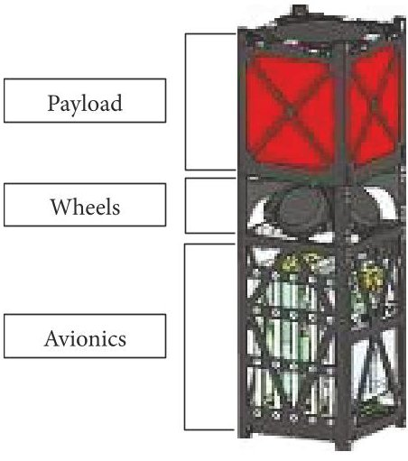

(a)

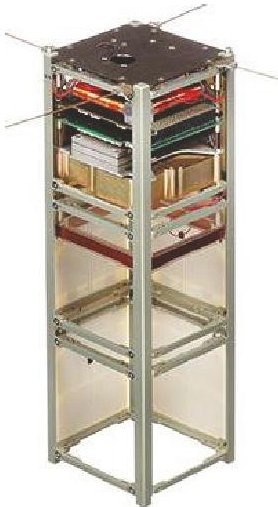

(b)

FIGURE 1: Platforms of 3U CubeSat. (a) PEARL. (b) PLT3.

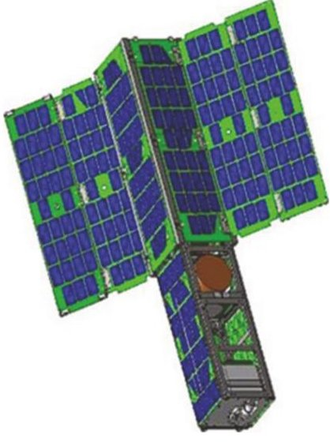

(a)

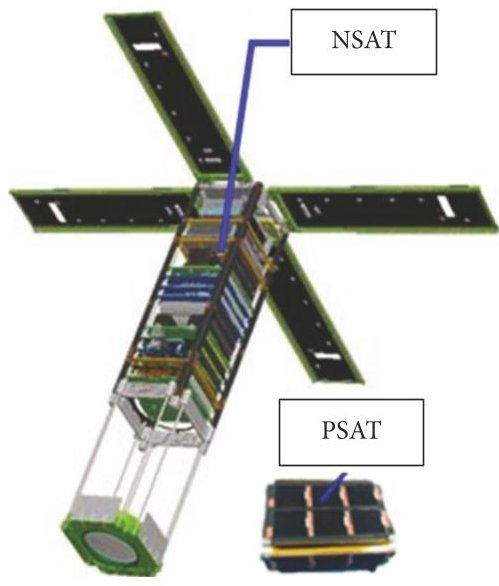

(b)

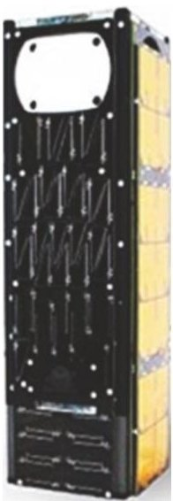

(c)

FIGURE 2: Solar array deployment configuration. (a) All-Star/THEIA. (b) VELOX-1. (c) Lemur-1.

reliability of the system through the repeated use of the standard platform can be ensured due to the implementation of standardized electrical and mechanical interfaces which made satellite development easier without additional efforts.

The shape of the CubeSat is greatly changed depending on operational modes and deployment configuration of the solar panel. There are three different configurations in the 3U CubeSat solar array deployment: one is a shape where the solar panel is attached on the satellite structure surface, the second is a shape where the solar panel is deployed from the satellite side edge (called as a diagonal deployment type), and the last is a shape where the solar panel is deployed from the upper edge as shown in Figure 2. The solar array deployment of All-Star/THEIA of Space Technology Acceleration and Research Lab. is more advantageous to produce higher power than conventional shape because the solar panel is deployed in the satellite edge [4]. However, since this solar panel is deployed twice, the probability of occurrence of solar panel defects due to the vibration generated when the launch vehicle is launched is higher than that of the conventional method, and the probability of failure upon deployment is also high. On the other hand, the VELOX-1 satellite of

Nanyang Technological University used a common method, with four deployed solar panels. This is because the power efficiency is lower than that of the former, but it is structurally simple and stable in development and has a relatively small malfunction occurrence rate (Figure 2(b)) [5]. Lemur1, as shown in Figure 2(c), of which the solar panel is attached on the side panel, thereby eliminating the problem of the solar panel deployment. However, there is a disadvantage in that the number of solar panels is limited due to the direct mounting on the side panel, resulting in relatively low power efficiency [6].

The purpose of this study is to design and develop an efficient standard platform of 3U CubeSat which can be repetitive and scalable. For the standard platform design, the specification and configuration of the 3U CubeSat standard platform are selected based on the specifications of the currently operated 3U CubeSats. In addition, this study aims at deriving the configuration, function, and performance of a 3U standard platform that minimizes effort and duration of satellite development and can be used universally. Based on the derived 3U standard platform, KAUSAT-5 was developed and verified through functional/performance tests and

<!-- PDF_PAGE: 3 -->

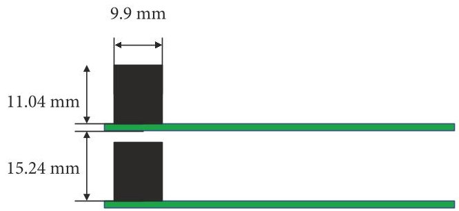

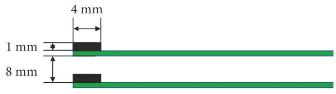

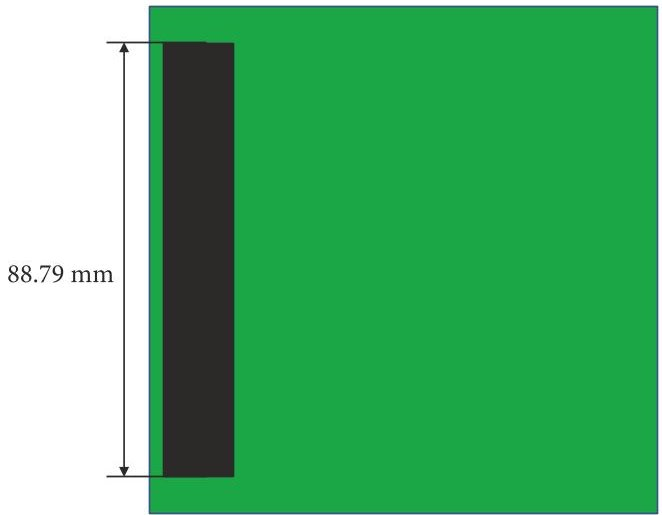

(PC104)

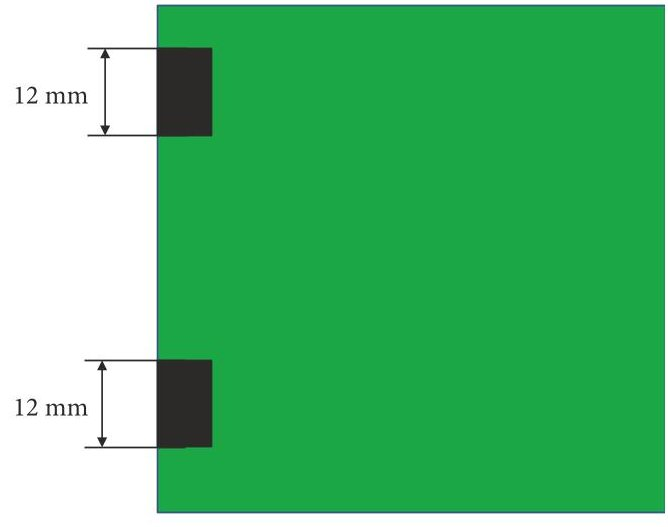

(FFC 52pin connectors $ \times2 $)

FIGURE 3: Comparison of PC104 vs FFC space.

environmental tests. KAUSAT-5 was launched in Jan. 2018 to verify the core technology of the VSCMG for small satellites developed by the Space Systems Research Laboratory of the Korea Aerospace University, carrying out the sensors for earth observation and radiation measurement. Unfortunately, the satellite has been lost due to the communication failure during the LEOP (Launch & Early Operational Phase).

## 2. Standard Platform Design

2. 1. Main Philosophy for Standard Platform. The main objective of the standard platform developed in this study is to be able to include the requirements of various missions through minimal modification. The modularity and reconfigurability of each component are the most important for the standard platform. The following major design drivers are derived for standard platform design and verification.

(a) Inclusion of various mission payloads being developed recently

(b) Reuse in educational satellites developed by universities

(c) Maximized reuse of hardware and software

(d) Optimization for lighter and more space (volume) than traditional platforms

(e) Highly reliable interface

(f) Minimization of FM (flight model) production period

(g) Minimization of AIT (assembly, integration, and test)

To implement the above major design drivers, the following core solutions have been applied to this standard platform.

(a) Space (volume) extension and mass minimization using FFC (Flexible Flat Cable) instead of PC104

(b) Using CAN communication

(c) Apply Plug & Play technology

PC104 is the most commonly used interface in the current CubeSat Kit. Since the existing CubeSat started with PC104, most CubeSat developers adopt PC104 as bus interface. The advantage of using the PC104 is that it creates a load path in the vertical direction on the printed circuit board, so that direct physical load is not concentrated on the board, so that it is easy to mechanically connect and assemble. However, the satellite has recently been diversified and uses a variety of interfaces, and PC104 is not scalable in this respect and occupies lots of space, so the utilization is low. Therefore, in the development of the standard platform of this study, connection space and weight were minimized by using the FFC connector instead of PC104. Figure 3 shows the configuration and arrangement of the FFC connector in place of PC104.

When using one set of PC104, the mass is about 25 g, but when two FFC connectors are used, the mass is only 0.11 g. For example, if there are 10 boards in a satellite, the PC104 has 250 g of connectors and the FFC connectors are only

<!-- PDF_PAGE: 4 -->

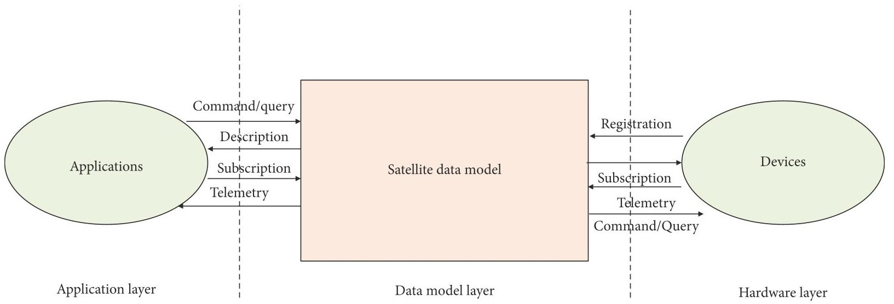

FIGURE 4: Plug & Play concept.

1. 1 g. However, the allowable current of the PC104 is 3 A per contact point, whereas it is 0.2 A for the FFC connector, so it is not suitable for power transmission. For this purpose, different connectors are used for the power supplied to each satellite through the LCL (Latch-Up current Limiter) switch. In recent products, the PC104 is used as a signal line rather than a power supply, and a separate power supply connector is used. From this point of view, it can be seen that the FFC has a larger margin in terms of space (volume) and mass than PC104.

Like the PC104, I2C is an interface that has been used in small satellite for a long time. However, I2C is evaluated as a low-reliability interface due to the hang-up problem. In the case of I2C, it is often observed that the whole system fails due to a hang-up when the system malfunctions. In addition, since it is a single-ended system, it is extremely vulnerable to noise, and good reliability is not achieved because a communication protocol with a fault tolerance is not implemented. Single-ended interfaces are more vulnerable to noise when there are many EMI (electromagnetic interference) sources in a small space like miniature satellites. In order to overcome these weaknesses, various interfaces such as CAN (Controller Area Network) and SpaceWire are considered in the area of small satellites. Both interfaces are as reliable as those used in large satellites, but SpaceWire is not suitable for CubeSat in terms of cost versus reliability because of the high cost of IP (Intellectual Property). For this reason, this standard platform implements CAN as the main bus.

In the platform developed in this study, basic Plug & Play technology is applied to automatically detect, register, identify, command/response messages, distribution and subscription, failure identification, and system monitoring. Even if the component is changed, the interface with the component is automatically identified using Plug & Play technology. This allows for quicker identification of the interfaces between components and facilitates system integration when only the physical interface is known in advance. In the case of hardware, the data is collected according to satellite data model as shown in Figure 4. In application, it is configured to access satellite data model, and data can be retrieved so that mission application and various subsystem

applications can be configured easily even if application is changed. Figure 4 represents a schematic showing the Plug & Play concept.

2. 2. Standard Platform Architecture. The standard platform design has requirements that it is based on an optimized and lightweight modular design with reducing the cost and schedule of the entire satellite development. The optimized and lightweight modular design allows to develop and modify only the modules related to payload development and interface changes for various missions.

In order to reflect requirements, the architecture of the standard platform is basically configured to include the necessary subsystems, and further extensibility of the platform is considered in the future. The major subsystems provided for the standard platform are as follows.

(a) SMS (Structure and Mechanism Subsystem)

(b) ADCS (Attitude Determination and Control Subsystem)

(c) C&DHS (Command and Data Handling Subsystem)

(d) EPS (Electrical Power Subsystem)

(e) CS (Communication Subsystem)

(f) MDHS (Mission Data Handling Subsystem)

(g) TCS (Thermal Control Subsystem)

The standard platform implements I2C and CAN, which are widely used in the existing miniature satellite, as the basic communication interface considered for interworking with the currently sold products. Because the interface supports M2M (multi-to-multi) communication, the number of components can be extended as much as the user's convenience. It has a mission data processor for payloads, a separate interface for data storage, and an S-band communication system for mission data transmission, so that the interface between platform and payload can be minimized. The user can implement the actuators and the sensors for CubeSat attitude control. In the case of the electrical power subsystem, the solar

<!-- PDF_PAGE: 5 -->

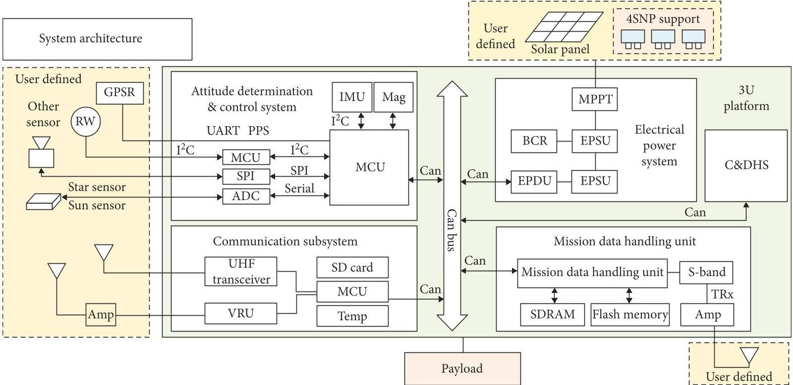

FIGURE 5: System architecture of standard platform.

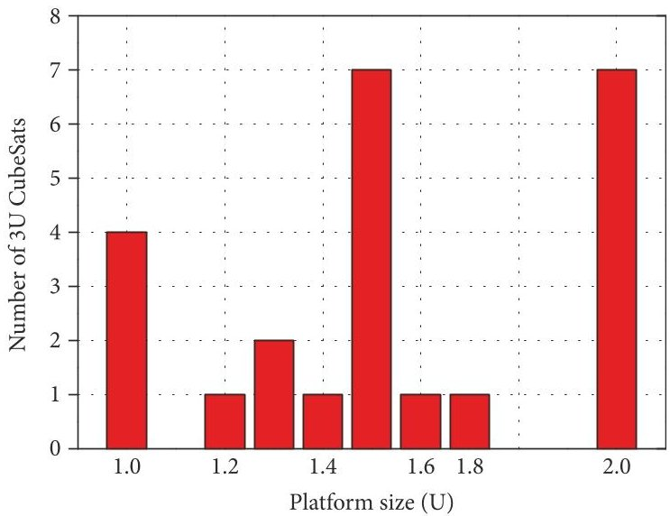

FIGURE 6: Number of 3U CubeSats according to space (volume) occupied by platform in 3U CubeSat systems.

panel, the battery, and the mechanism can be configured by the user. The system architecture of the standard platform thus constructed is shown in Figure 5.

2. 3. Configuration Selection. First of all, in order to select the platform size, 25 3U CubeSats being developed and operated in space are analyzed. Figure 6 shows the number of 3U CubeSats according to space (volume) occupied by the platform in 3U CubeSats system. The platform includes various subsystems such as SMS, ADCS, EPS, TCS, and CS. The size of the surveyed platform varies depending on the mission of each satellite, but 1.5U or 2U is the most common, which indicates that the size of the payload is between 1.5U and 1U. Based on this data, the 3U standard

TABLE 1: Baseline specification for 3U standard platform.

<table border="1"><tr><td>Item</td><td>Specification</td></tr><tr><td>Power generation</td><td>&lt;30W</td></tr><tr><td>BCR(battery charge regulator) function</td><td>Included</td></tr><tr><td>MPPT(maximum peak power) function</td><td>Included(P&amp;O,fuzzy)</td></tr><tr><td>Uplink</td><td>UHF or VHF,1200 or 9600bps</td></tr><tr><td>Downlink</td><td>UHF or VHF,1200 or 9600bps</td></tr><tr><td>Mission data downlink</td><td>S-band up to1Mbps</td></tr><tr><td>Mission data handling unit</td><td>Included</td></tr><tr><td>ADCS board</td><td>462MIPS,215MHz220MIPS/200MHz,ND&amp;DHS board</td></tr><tr><td>CMD/TLM bus</td><td>CAN,I2C</td></tr><tr><td>ADCS actuator expansion</td><td>CAN,I2C</td></tr><tr><td>ADCS sensor expansion</td><td>I2C,SPI</td></tr><tr><td>GPS expansion</td><td>UART,PPS</td></tr></table>

platform developed for this study is selected as 1.5U for the platform and the remaining 1.5U for the payload ADCS actuators, and sensors.

2. 4. Specification Selection. The main performance parameters are selected for specification and function identification of the standard platform, by referring to the specification of the CubeSat currently being operated based on CubeSat kit being sold. The performance of C&DHS and ADCS has been

<!-- PDF_PAGE: 6 -->

TABLE 2: 3U CubeSat configuration according to solar panel deployment [8-12].

<table border="1"><tr><td></td><td>CubeSat name</td><td>Mission</td><td>Solar panel type</td><td>Similar type of CubeSats</td></tr><tr><td></td><td>Aalto 1</td><td>Tech. demo EO imaging/radiation detect.</td><td>Attached type</td><td>Armadillo, RAX-1, CanX-2, GOMX-1, etc.</td></tr><tr><td></td><td>Dove 1</td><td>Low cost, observation satellite development &amp; verification</td><td>Side deployment type</td><td>Flock-1, ExoplanetSat, Helio 4</td></tr><tr><td></td><td>Aeneas</td><td>Tracking location cargo containers on a global scale</td><td>Upper deployment type</td><td>Alice, Cadre Lightsail A, Delfi-n3xt</td></tr><tr><td></td><td>All-Star/Theia</td><td>THEIA verification</td><td>Diagonal deployment type</td><td>Inspire A, Lemur-2, Delfi phi</td></tr><tr><td></td><td>ISARA</td><td>Ka-band reflector array antenna verification</td><td>Etc.</td><td>ORS Tech. Mayflower-Caerus</td></tr></table>

remarkably improved due to the introduction of miniature technology. Initially, ADCS and C&DHS have used 8-bit, 8 MHz MCUs, but currently the data are being processed using high-performance MCU more than a 32-bit, 200 MHz. In addition, ADCS had been manually controlled using a permanent magnet in the past, but active control techniques implementing a control moment gyro or a reaction wheel are currently used.

Basically, CubeSats belong to amateur satellites, so they commonly use the frequency of amateur radio band and the uplink/downlink data rate remains the same since early CubeSat development. However, the additional downlink transmitter with different frequency band may be mounted for high-capacity mission data transmission.

Power generation is estimated to be from 3W to 30W depending on the performance of the past 3U CubeSats, system power consumption, solar panel configuration, and solar panel deployment. This electrical power system is determined by the user. MPPT (Maximum Peak Power Tracking) and BCR (Battery Charge Regulator) are designed to be operated up to 30 W, and it is designed to be easily changed by the user in the future development. The structure subsystem is designed according to CDS (CubeSat Design Specification) REV.13[7]. Table 1 shows the baseline specifications of the 3U standard platform.

## 2.5. Design of 3U Standard Platform Subsystems

2. 5.1. SMS (Structure and Mechanism Subsystem). SMS (Structure and Mechanism Subsystem) supports the satellite's platform and payload and protects the satellite from the environments that the satellite is exposed from launch to space.

Since the configuration of 3U CubeSat is limited, SMS of standard platform is basically designed according to the CDS. The new configuration and size of the frame itself cannot be considered. The deployment mechanism of the solar panel is one of the main considerations for the shape of the entire CubeSat. Table 2 shows the mission for each satellite being

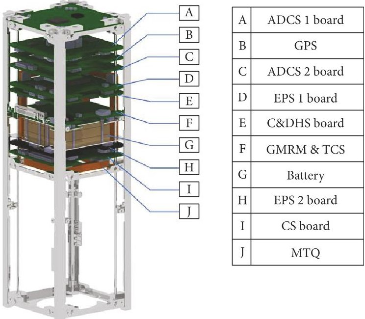

FIGURE 7: Structure configuration of standard CubeSat platform.

operated and the shape of the solar panel deployment. Table 2 also presents examples of various satellites with similar solar panel deployment shapes. This deployment mechanism is a part that must be defined by the user because it will be used for mission-dependent tasks or other purposes. The designed standard platform only provides a basic frame, and the deployment mechanism is not included in the standard platform configuration.

The structure configuration of the designed standard platform is shown in Figure 7. If the payload meets the required specifications, the payload can be housed mechanically within the platform using a pole for PCB connection, and if necessary, only by changing or modifying the electrical interface.

2. 5.2. ADCS (Attitude Determination and Control Subsystem). The ADCS of the standard platform is equipped with MTQ (magnetic torquer), MEMS (Micro Electro

<!-- PDF_PAGE: 7 -->

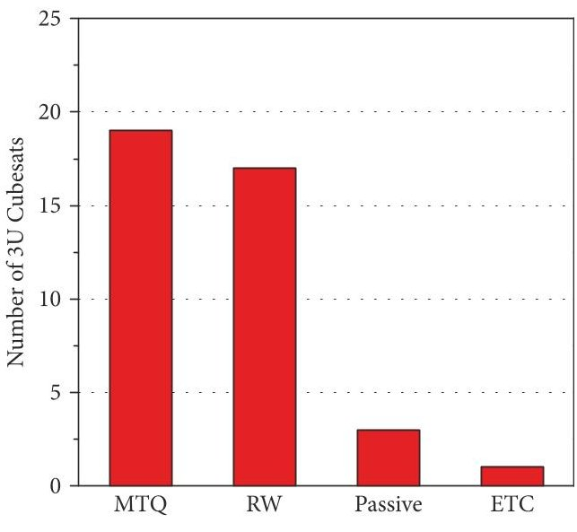

(a)

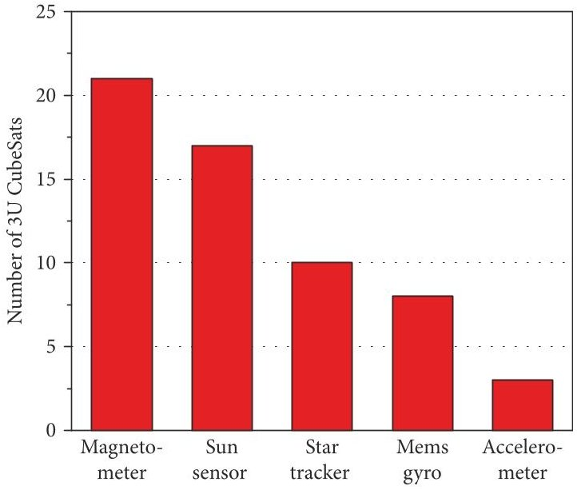

(b)

FIGURE 8: Number of 3U CubeSats according to ADCS actuators and sensors. (a) Actuator type. (b) Sensor type.

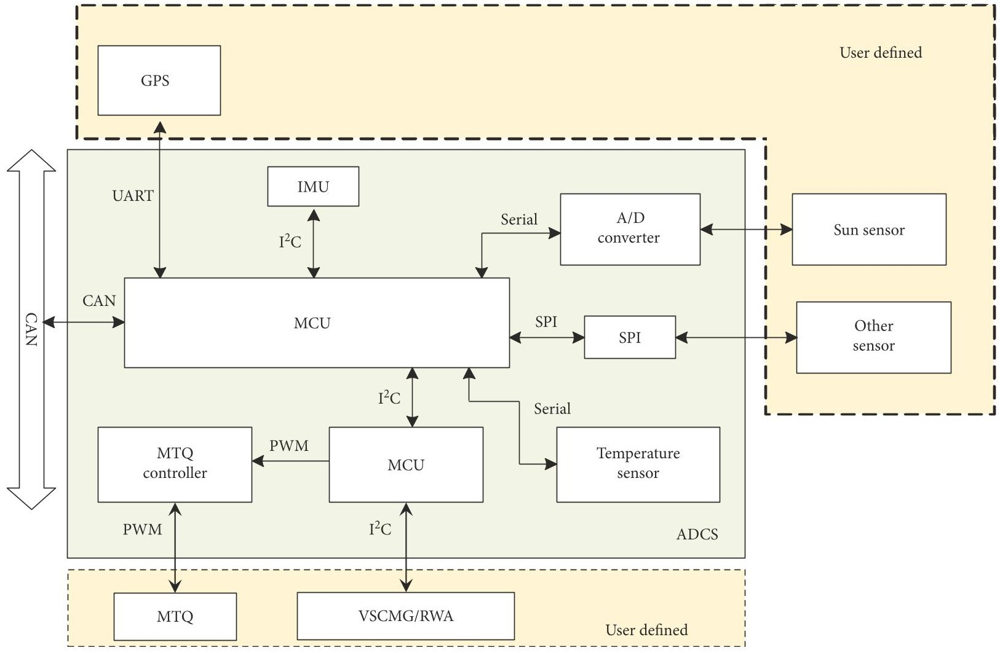

FIGURE 9: ADCS functional diagram.

Mechanical Systems) IMU (Inertial Measurement Unit), and MEMS magnetic sensor which are used to sense and actuate the satellite attitude. Depending on the mission, RWA (Reaction Wheel Assembly) or CMG (Control Moment Gyro) might be installed for high torque actuation. Figure 8 is a graph of the attitude control actuators and attitude determination sensors used for various 3U CubeSats. The actuators

used in most of the CubeSats are MTQ and RWA, and the most popularly adopted attitude determination sensors are magnetometer and sun sensor. MTQ is selected as a baseline actuator that is mounted on the standard platform, and the magneto sensor and sun sensor are selected as basic sensors.

The functional diagram of the ADCS is shown in Figure 9. A sensor for determining an additional attitude

<!-- PDF_PAGE: 8 -->

and a GPS for positioning can be mounted by a user with a UART (Universal Asynchronous Receiver/Transmitter) and a PPS (pulse per second) interface.

2. 5.3. C&DHS (Command and Data Handling Subsystem). The C&DHS of the standard platform focuses on devices that are widely used by 3U CubeSat developers in various fields and have flight heritage in space. Conventional CubeSats have used low-end computers such as 8-bit, 16 MHz Microchip PIC or AVR ATmega. As the number of MCUs operated and verified in space environment gradually increased, various types of OBC (on-board computer) for C&DHS have been developed. Currently, the most commonly used MCUs are ARM-based CPUs, and the ARM architecture is expected to continue to be used in space in the future due to its scalability and maintainability advantages.

In the standard platform, AT91SAM926X CPU based on ARM-926EJ Core is selected. ARM-926EJ Core provides BSP (Board Support Package) in various RTOS such as uCLinux, Real-Time Executive for Multiprocessor Systems (RTEMS), uC/OS-III, FreeRTOS, and VxWorks. It is easy to select the OS according to user's convenience.

The C&DHS of the standard platform is designed to be composed of a microcontroller with flight software, an interface part for sending and receiving commands and data to CAN/I2C, which is a common communication interface between memory and subsystem.

2. 5.4. EPS (Electrical Power Subsystem). The EPS of the standard platform shall supply enough power to the satellite payload and platform for a successful mission during the satellite's mission [13, 14].

The EPS is consisted of some components in addition to the solar panel that can be changed depending on the mission and the battery that can be adjusted depending on DoD (Depth of Discharge) requirements. The EPS has to find the maximum peak power by the MCU, adjusts the BCR, and allows the deployment of various solar panels depending on the situation and settings. Generally, conventional CubeSats are using 12 V regulation voltage. It is designed that battery provides 4S (series) which can supply more than 12 V and BCR which can charge up to 4P (parallel).

The power generation capability in Figure 10 is shown based on the database of 3U CubeSat, in which 90% of 3U CubeSat produce the power less than 30 W. Therefore, the standard platform in this study is assumed to allow maximum power to be accommodated up to 30 W. MPPT is equipped with P&O (Perturb & Observe) and Fuzzy Logicbased MPPT, and the algorithm of MPPT can be changed by the user.

Figure 11 shows the EPS functional diagram. The electrical energy generated by the solar panels is regulated to produce the maximum power that the EPSU (Electrical Power Storage Unit) will charge the battery. The charged battery is controlled by 3.3 V, 5 V, and 12 V, which are used in the standard platform through an EPCU (Electric Power Control Unit) and an EPDU (Electric Power Distribution Unit). It also includes a latch-up current limit switch, which allows ON/OFF control for power distribution with each subsystem

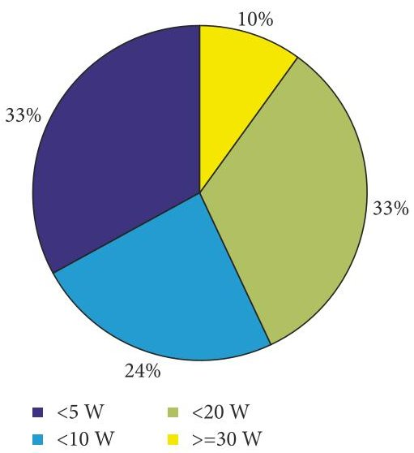

FIGURE 10: Electrical power generation of 3U CubeSat.

component and performs functions such as power shutdown by overcurrent.

2. 5.5. CS (Communication Subsystem). The CS transmits and receives commands and data remotely to the satellite and the ground station using wireless communication. In the standard platform, two communication bands with VHF and UHF can be used, and the communication protocol is AX.25. The VHF receives the remote command of the ground station, and the UHF transmits the beacon transmission and the telemetry containing the status information of the satellite to the ground station. Figure 12 shows the functional diagram of the CS and MDHS.

2. 5.6. MDHS (Mission Data Handling Subsystem). The MDHU is a subsystem configured to process and store mission data and transmit to the ground in S-band. This subsystem belongs to the payload, but it can also be classified as one of platform subsystems. It is designed to be able to process image or mission data and transmit it to the ground. S-band data link up to 1 Mbps can be transmitted through interface (I2C, SPI, CAN, Serial, and ADC) for data collection and it can be utilized for various tasks.

As the mission data are processed separately from housekeeping data, the electrical connections and the amount of data processing between the platform and the payload can be minimized. This makes it possible to shorten the effort and development period for the associated hardware and interface.

2. 5.7. TCS (Thermal Control Subsystem). The TCS is adopting both passive and active thermal control methods in the standard platform. In the passive thermal control, it is designed that the heat sources within the platform are balanced effectively and heat is dissipated to outside of the platform. In the active thermal control, the temperature change is checked through the battery temperature sensor and the battery temperature is controlled through the heater. Heaters can also be added depending on the user's need.

<!-- PDF_PAGE: 9 -->

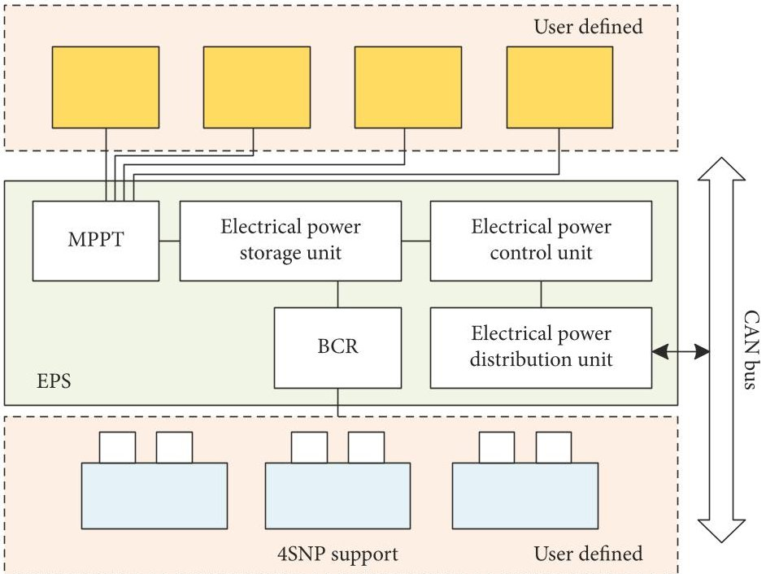

FIGURE 11: EPS functional diagram.

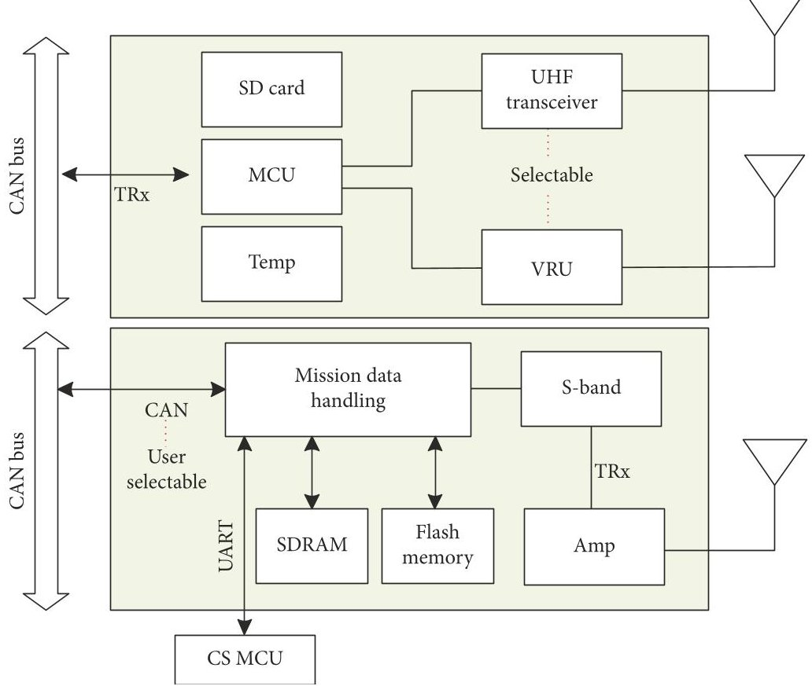

FIGURE 12: CS and MDHS functional diagram.

## 3. Application of 3U Standard Platform

3. 1. Application of 3U Standard Platform to KAUSAT-5 CubeSat. In this study, the design and development of the KAUSAT-5 were conducted by implementing the standard platform. KAUSAT-5 is a 3U size $ ( 1 0 0 \times1 0 0 \times3 4 0 \mathrm{~ m m}^{3} ) $ CubeSat that performs multiple scientific missions and technical verification.

The components used for KAUSAT-5 CubeSat are shown in Table 3. The main payload consists of an infrared

camera and a Geiger Mueller radioactivity meter. The VSCMG is a payload for technical verification, and it will be operated as a main actuator of ADCS when the technology verification is completed.

Figure 13 shows the configuration of the KAUSAT-5 CubeSat developed based on the standard platform. As described above, the VSCMG is mounted on the top of the platform and the infrared camera is mounted on the bottom. The infrared camera at the bottom part occupies 0.8U, and the lens diameter is 66 mm; the lens barrel length is 67 mm,

<!-- PDF_PAGE: 10 -->

TABLE 3: Components of KAUSAT-5 CubeSat.

<table border="1"><tr><td></td><td>Subsystem</td><td>Components</td></tr><tr><td rowspan="6">Platform</td><td>SMS</td><td>Structure, deployer(solar panel, antenna)</td></tr><tr><td>TCS</td><td>Heater,temperature sensor</td></tr><tr><td>EPS</td><td>Solar cell,battery,MPPT,EPSU,EPCU,EPDU</td></tr><tr><td>C&amp;DHS</td><td>On-board computer,MU(memory unit),SU(sensor unit),IU(interface unit)</td></tr><tr><td>ADCS</td><td>Sun sensor,magnetic torquer,GPSRU(GPS receiver unit)</td></tr><tr><td>CS</td><td>UTU,STU,VRU,antenna</td></tr><tr><td rowspan="3">Payload</td><td>IRC</td><td>Lens,detector,shutter,IRC temperature control unit</td></tr><tr><td>GMRM</td><td>GMRM tube,transformer</td></tr><tr><td>VSCMG</td><td>VSCMG,interface unit</td></tr></table>

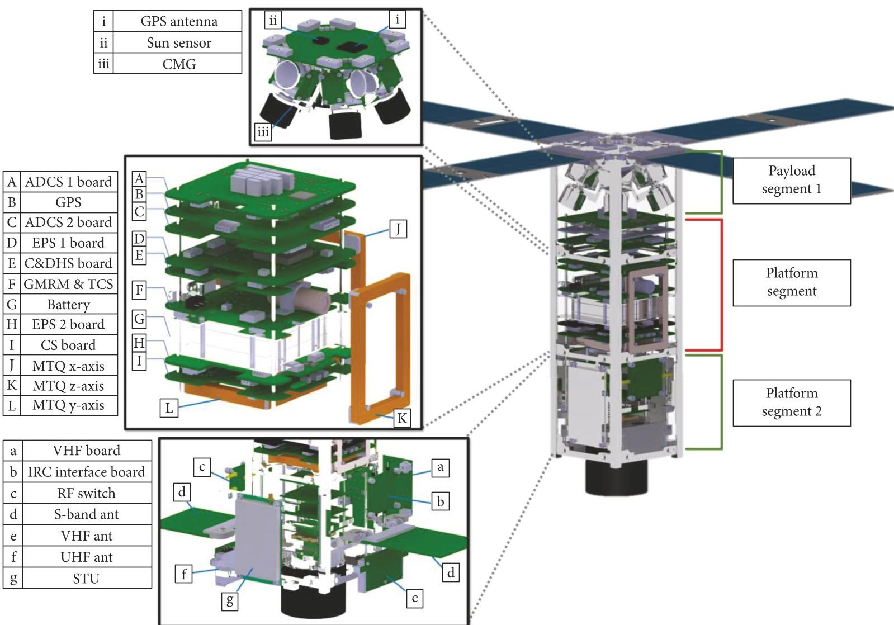

FIGURE 13: KAUSAT-5 configuration.

and the length of the module including CCD and heat sink is about 30 mm. The VSCMG occupies 0.7U on the top part of the platform, while the platform on the KAUSAT-5 occupies the remaining 1.5U. The VSCMG is located at the top because it is designed considering the possibility of electromagnetic field due to noise of BLDC motor of VSCMG, the problem of deflection of the center of mass to the bottom, and convenience of assembling. Additionally, the standard platform of KAUSAT-5 is designed to be able to change only the payload and interface to the basic platform according to mission requirements, and the platform position can be

changed as needed. It is possible to reduce the time and cost for KAUSAT-5 platform development.

The mechanical system design of the standard platform allows for the integration of miniature components and subsystem functionality/performance into a small PCB and minimizes it as much as possible. Therefore, the payload space can be designed to maximize various payload requirements. It can also accommodate multiple payloads with minimal changes to the mechanical interface. The electrical system design of the standard platform maximizes the electrical capability of the payload to accommodate multiple payloads.

<!-- PDF_PAGE: 11 -->

TABLE 4: KAUSAT-5 system specification.

<table border="1"><tr><td>Item</td><td>Description</td></tr><tr><td>Mission orbit</td><td>Sun synchronous elliptical orbit:450km×720kmInclination:98°</td></tr><tr><td>Mission lifetime</td><td>&gt;1 year</td></tr><tr><td>CubeSat dimension</td><td>100×100×340mm3</td></tr><tr><td>Payload</td><td>IR camera,GMRM,VSCMG,FLCMPPT</td></tr><tr><td>Payload mass</td><td>IRC mass:580gGMRM mass:47g</td></tr><tr><td>IR camera</td><td>Resolution:320×240(m)FOV:13.5deg.</td></tr><tr><td>GMRM</td><td>Resolution:＞18CPS/mR/hAccuracy:＜3mR/h</td></tr><tr><td>Spacecraft mass</td><td>&lt;4kg</td></tr><tr><td>Satellite power</td><td>&lt;6.4W@EOL(nadir)&lt;13W@EOL(sun pointing)3-axis stabilization</td></tr><tr><td>ADCS</td><td>Accuracy:＜0.88deg.Knowledge:＜0.87deg.Stability:＜0.42deg/s</td></tr><tr><td>Link margin</td><td>&gt;3dB@10deg.elevation angleUHF downlink:9600bps</td></tr><tr><td>Data rate</td><td>VHF uplink:1200bpsS-band downlink:115,200bps</td></tr></table>

The power generation capability of KAUSAT-5 is 13 W at the time of sun pointing and 6.4 W in average.

The communication between KAUSAT-5 subsystems is based on CAN communication. The flight software built in the on-board computer (OBC) of the C&DHS is executed according to the command and data. Table 4 shows system specifications of KAUSAT-5 CubeSat. KAUSAT-5 implementing the standard platform concept has been verified by successfully performing electrical performance test, functional test, and space environment test [15]. The 3U CubeSat using the standard platform adopted in KAUSAT-5 can reduce the additional cost and schedule to perform these tests because there is no need to repeat the similar electrical and mechanical tests and qualification test for the platform.

The development and qualification of micro/nano or CubeSat satellites can typically take a year or more, and the total development time can be much longer depending on the complexity of the mission and the experience of the development personnel. The standard platform is utilized, these periods can be minimized, and satellite development will be possible within several months depending on the preparation of the payload.

3. 2. Application of Standard Platforms to Various Payloads The configuration and size of the platform and the payload of KAUSAT-5 are shown in Figure 14(a). The standard platform of the 3U CubeSat can be applied not only to KAUSAT-5 but also to various payloads, an example of which is shown in Figure 14(b). Currently, our team is working on the design of 3U CubeSat equipped with EO (electro-optical) camera as a follow-up project to KAUSAT-5.

The configuration of the 3U CubeSat equipped with the electro-optical camera can be designed based on the EO camera requirements of the 3U CubeSat as the model $ \textcircled{1} $ in Figure 14(b). The model shown in Figure 14(b) is adopting an optical camera module developed by TU-delft with a resolution of 7.5 m, a focal length of 40 cm, and a volume of 1.5U. Since the volume occupies 1.5U, it cannot be equipped with an additional actuator, so the pointing accuracy may be insufficient. This can affect resolution and image quality, which can have a direct impact on mission success.

On the other hand, the model $ \textcircled{2} $ of Figure 14(b) is the GOM Space 3U CubeSat (NanoCam) equipped with a resolution of 25 m and a volume of 1U, but the barrel protrudes about 30 mm from the outside, 0.7U. When this EO payload is used, there is an advantage in that the attitude accuracy can be increased by adding an actuator such as a reaction wheel. If a reaction wheel is used, it occupies a volume of about 0.3U, leaving a volume of about 0.5U, in which case it can perform other tasks in addition to the optical payload. For example, an aircraft tracking system (ADS-B) and a ship tracking system (QubeAIS) can be installed in the space above the optical payload in $ \textcircled{2} $ of Figure 14(b).

As described above, the interface is not changed much, and if the interface board between the optical camera and the platform are compatible with the platform's allowable volume and mass, it can be mounted and applied to the standard platform. In addition, it is possible to verify the function and performance of payload in a space environment at a relatively low cost by mounting a commercially available kit as well as a technology verification test platform on a standard platform.

To design the camera that can be mounted, the trade-offs were done by investigating previously developed EO cameras and merchandise as shown in Figure 15. It is necessary to mount a reaction wheel or a CMG to improve pointing accuracy. To mount the actuator, the size of the camera and the module should be less than 1U because the size of the platform is limited to 1.5U. Therefore, the camera and module are given 5 points when the size is less than about 1U. In addition, the ground resolution was reduced by 5 points at less than 20 m and by 1 point every 10 m. From the viewpoint of heritage, 5 points were awarded for the experience of successful launch. Five points are awarded per 1U for mass.

## 4. KAUSAT-5 AIT (Assembly, Integration, and Test) and Verification of Standard Platform

4. 1. ETB Development and Test. ETB (Electrical Test Bed) test is performed to verify the operation between payload and platform subsystems, flight software, and the electrical interface between components, and functionality. For the ETB test, EGSE (Electrical Ground Support Equipment) to support and verify the data between tests has been developed. The hardware components that were not manufactured at the time of the ETB test were substituted with software to simulate the functions.

The ETB assembly and test sequence is shown in Figure 16. After assembly, the EGSE-MPS is integrated with data processing system to test the debugging state. Next,

<!-- PDF_PAGE: 12 -->

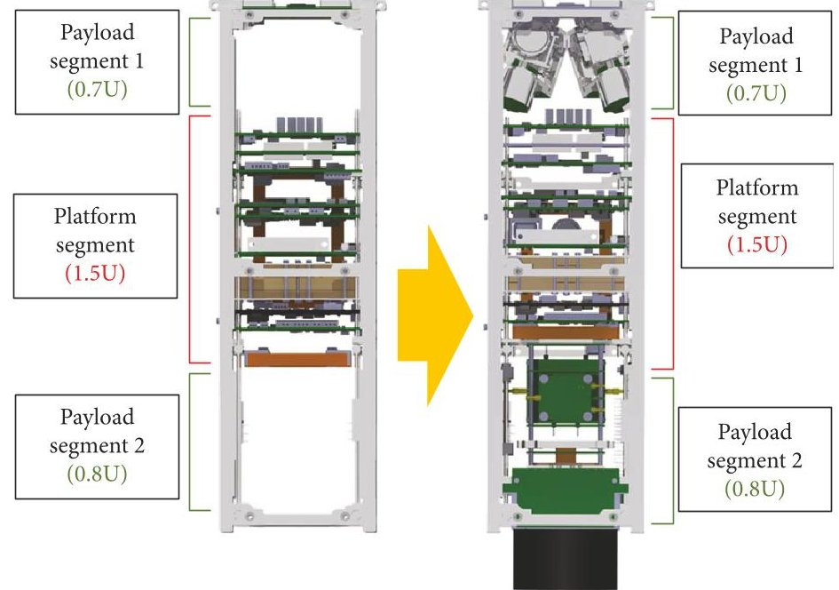

(a)

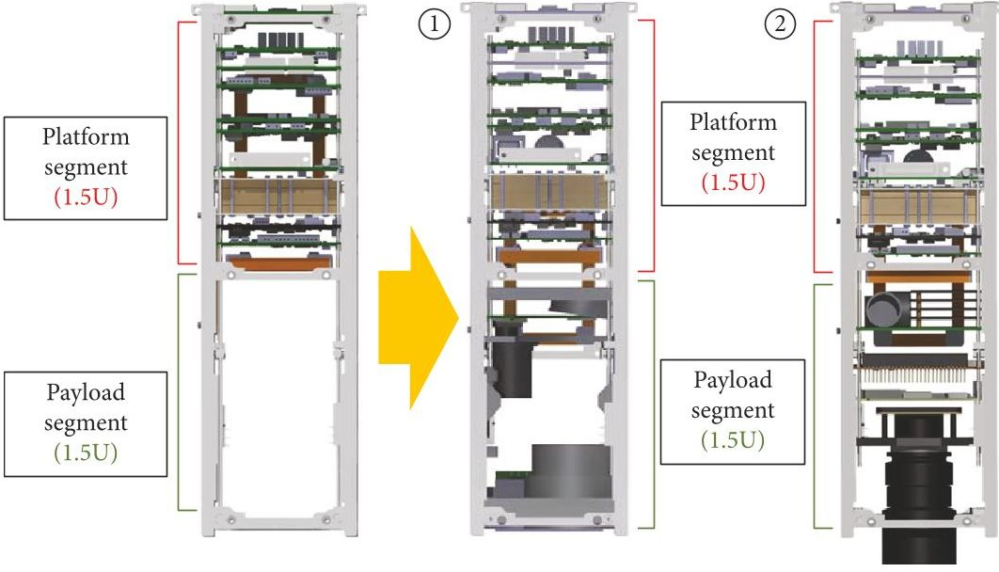

(b)

FIGURE 14: Comparison of application of standard platform to KAUSAT-5 and other missions. (a) KAUSAT-5. (b) Other missions.

EPS and EGSE are integrated to confirm the electrical performance and data transmission/reception. The iterative process of this step is also performed in the loader and the ADCS to verify the performance of the individual mission scenario and whether the entire operation phase is operated, and the performance is verified in the system integrated state. Finally, fault management test of the whole system integration is performed to detect faults occurring during operation, and if any component enter into fault state, then the system goes into the safe mode and it is checked whether it is recovered or not.

4. 2. Satellite System Functional and Performance Tests. Functional and performance tests are carried out to verify that the operations required by satellites to perform their actual missions are normally conducted. The hardware and software of the satellite are verified through functional and performance tests simultaneously. It also verifies the communication

between the satellite and the ground station through an end-to-end test.

Figure 17 shows an outline for performing the functional test. First, CubeSat, EGSE, and ground station are connected to check whether the satellite operation is performed according to the procedure. And then, normally, remote operation is checked by transmitting the actual radio command to the communication between the platform system and the communication equipment of the ground station. The EGSE data are compared with the data received from the ground station.

4. 3. Environmental Test. Typically, for conventional satellites, a qualification test is performed at the parts, materials, component, and mechanical system levels, and partial qualification can be performed at the system level, if necessary, with Protoqualification Model (PQM) or Protoflight Model (PFM). However, tiny satellites such as the 3U CubeSat are composed of a small number of miniature

<!-- PDF_PAGE: 13 -->

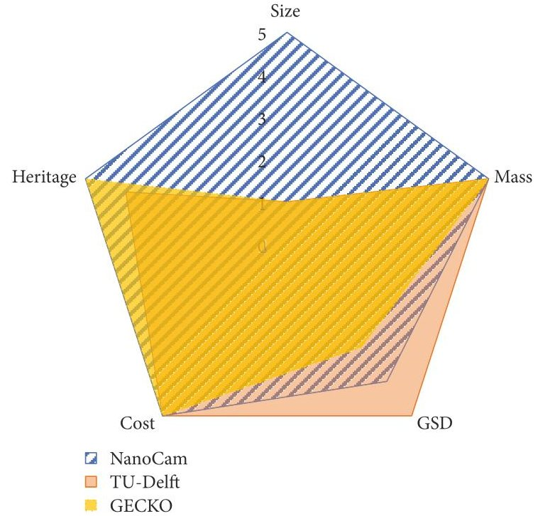

FIGURE 15: Trade-off of EO camera characteristics for various 3U CubeSats.

components and PCB-level modules, which means that one CubeSat serves as a component, thus enabling complete system-level qualification testing.

The satellites or components are subjected to an environmental test at qualification level prior to launch to verify the design margin and to determine their stability in space. Environmental testing at the qualification level will lead to harsh conditions and a large screening on satellites. Therefore, the QM (qualification model) cannot be used as a flight model. The actual flight models are tested at lower test levels or shorter test times and confirm the workmanship of the satellite production. To verify the space environment, KAUSAT-5 EQM has been developed to verify the design margins of the satellite by performing the environmental test at the qualification level. Acceptance level environmental test was carried out for the flight model.

The standard platform developed through this qualification can accommodate the payload according to the required performance in the future satellite development, and it is possible to reduce the cost and development schedule because qualification can be omitted for the qualified platform and only the acceptance test will be enough.

4. 4. Vibration Test. Vibration tests were performed on the KAUSAT-5 satellite including acceleration test, modal survey, random vibration, and shock tests. The vibration test was performed by both QM qualification test and FM acceptance test levels for each axis for the satellite inserted in P-POD. The vibration test first collects the natural frequency data of the satellite prior to performing the acceleration test or the random vibration test. Thereafter, the acceleration test and the random vibration test are performed, and a modal survey is again performed to check whether the natural frequency of the satellite changes after the test.

The system level acceleration test was performed only in the qualification level, and the test condition of the

acceleration test was carried out for 60 seconds at $ + 1 8. 7 5 \mathrm{~ g} $ at a sine wave of $ 0. 0 1 3 \mathrm{~ g}^{2} / \mathrm{H z} $ . The random vibration test was performed in both the qualification and the acceptance test. The conditions of the random vibration test are shown in Table 5. The amplitude of the qualification test is twice that of the acceptance test, and the duration of the qualification test is three times longer than that of the acceptance test. The modal survey was performed under the same conditions for both the qualification and the acceptance procedure, and the test levels are performed at $ 0. 4 \mathrm{~ g} $ at 5-2000 Hz.

4. 4.1. Random Vibration Qualification Test Results. The random vibration test results of the KAUSAT-5 QM are shown in Figure 18, and structural defects and functional failure of electronic components did not occur after the vibration test. It was confirmed through this test that KAUSAT-5 CubeSat and standard platform were structurally stable and had enough design margins.

4. 4.2. Random Vibration Acceptance Test Results. The random vibration test results for KAUSAT-5 FM are shown in Figure 19, and the natural frequencies of the X, Y, and Z axes were found to satisfy the predicted requirement of 90 Hz or more. It was confirmed through this test that the satellite structure had not any defect.

4. 5. Shock Test. The shock test was performed to verify the robustness against any shock environments caused by rocket stage separation and deployment of solar array or to withstand the nonrepeatable environment during normal operation. The shock test applied to KAUSAT-5 used pyro shock test method. The shock procedure is performed in the same manner as the vibration test, with the model used for the test inserted in the P-POD, and the test is performed for each of the x-axis, y-axis, and z-axis. It is checked through visual inspection whether there was any damaged part in the satellite, and in addition, a functional test is performed to confirm whether the satellite operates normally after shock test.

The shock test of KAUSAT-5 is only performed at the qualification level for QM, and the level of deformation for the shock test was analyzed under the same conditions. The shock conditions were 30g at 20Hz and 1000g at 1000~10,000 Hz.

4. 5.1. Shock Qualification Test and Shock Analysis Results. The shock test results for the x-axis of the qualification model are shown in Figure 20. After analyzing SRS (Shock Response Spectrum) results, it was confirmed that these meet within the range of upper and lower reference frame provided by the launcher provider. It was confirmed that there was no damage to the structure of KAUSAT-5 satellite before and after shock.

The shock at the acceptance level of KAUSAT-5 FM was verified by analysis instead of shock test. The results of the shock analysis for the flight model are shown in Figure 21. The tendency of the overall SRS curve is similar to the results of the actual shock test as a result of analyzing the damping effect in the P-POD. Like the actual shock value, the maximum deformation is $ 3. 9 \times1 0^{-7} $ m, which is not expected to damage the structure even if the damping effect is not

<!-- PDF_PAGE: 14 -->

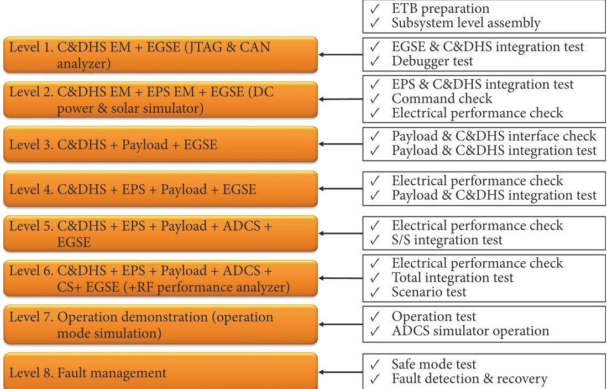

FIGURE 16: ETB assembly and test process.

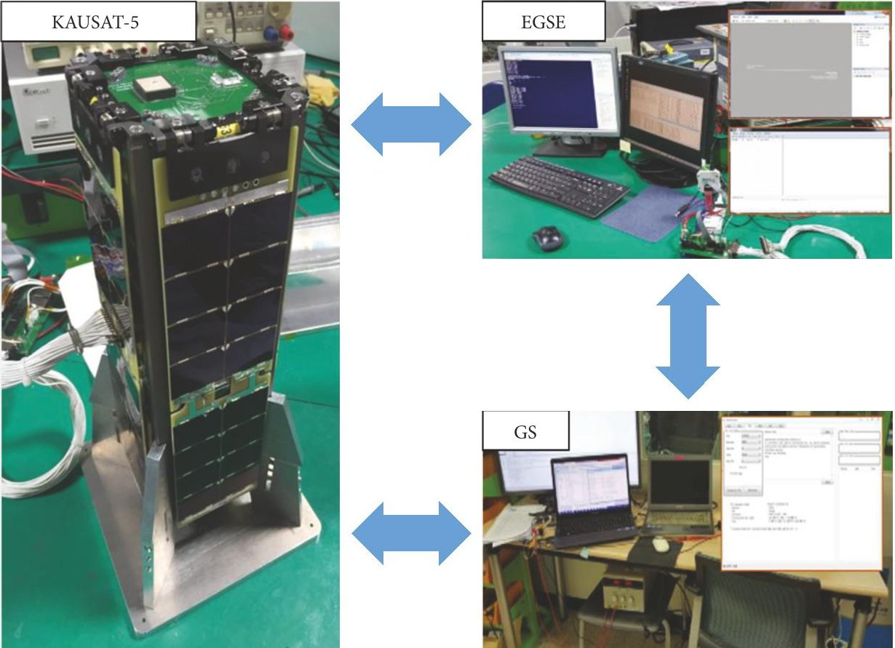

FIGURE 17: KAUSAT-5 functional test layout.

applied. In addition, it was confirmed that the maximum stress was applied to the internal PCB support by 12.8 MPa, but the maximum yield stress of the member was confirmed to be within about 2% at about 500 MPa, and the impact simulation of the flight model confirmed that there was no damage.

4. 6. Thermal Vacuum Test. The thermal vacuum test of KAUSAT-5 was performed for both qualification model and flight model under vacuum condition of $ 1. 0 \times1 0^{-6} $ torr.

The thermal vacuum test was carried out for three cycles at a temperature range of $ - 1 5^{\circ} \mathrm{C} $ to $ 4 5^{\circ} \mathrm{C} $ for the qualification model and two cycles at $ - 1 0^{\circ} \mathrm{C} $ to $ 3 5^{\circ} \mathrm{C} $ for the flight model.

4. 6.1. Thermal Vacuum Qualification Test Results. The thermal vacuum test of the qualification model was carried out for three cycles in total as shown in Figure 22. The regulator of the EPS board seems to be a risk factor in the performance due to excessive heat, and the regulator is replaced with a one with low heat in the flight model.

<!-- PDF_PAGE: 15 -->

TABLE 5: Random vibration test conditions.

<table border="1"><tr><td></td><td></td><td>Qualification</td><td>Acceptance</td></tr><tr><td rowspan="4">Freq. profile</td><td>20Hz</td><td>0.026g2/Hz</td><td>0.013g2/Hz</td></tr><tr><td>50Hz</td><td>0.16g2/Hz</td><td>0.08g2/Hz</td></tr><tr><td>800Hz</td><td>0.16g2/Hz</td><td>0.08g2/Hz</td></tr><tr><td>2000Hz</td><td>0.026g2/Hz</td><td>0.013g2/Hz</td></tr><tr><td colspan="2">RMS acceleration</td><td>14.1g</td><td>10.0g</td></tr><tr><td colspan="2">Duration</td><td>180sec/axis</td><td>60sec/axis</td></tr></table>

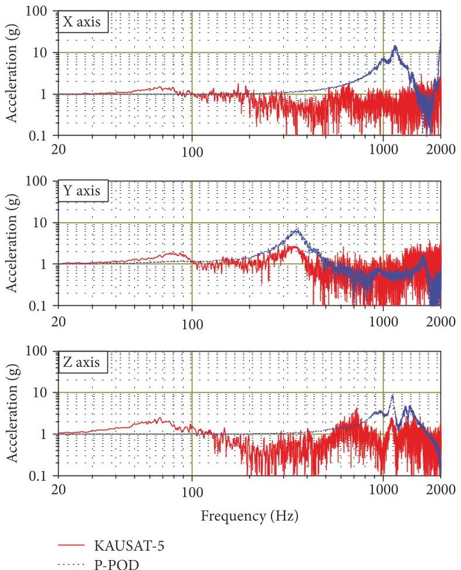

FIGURE 18: QM vibration test results.

The thermal vacuum test of the flight model was carried out for a total of two cycles, confirming that the satellite functions including deployment were working well. In addition, a thermocouple is attached to a device that requires attention due to heat, and the data are extracted by observing the change in temperature during the thermal vacuum test process. Figure 23 shows the temperature change trend of the thermal vacuum acceptance test of the KAUSAT-5 flight model.

Temperature-sensitive components of the KAUSAT-5 were battery, infrared camera, S-band transmitter module, EPS board, and microcontroller of C&DHS. It was confirmed that the temperature changes remain within the allowable temperature range of all the components. In addition, it was visually confirmed through the functional test that the antenna and solar panel were deployed successfully, and each function of the satellite operates normally.

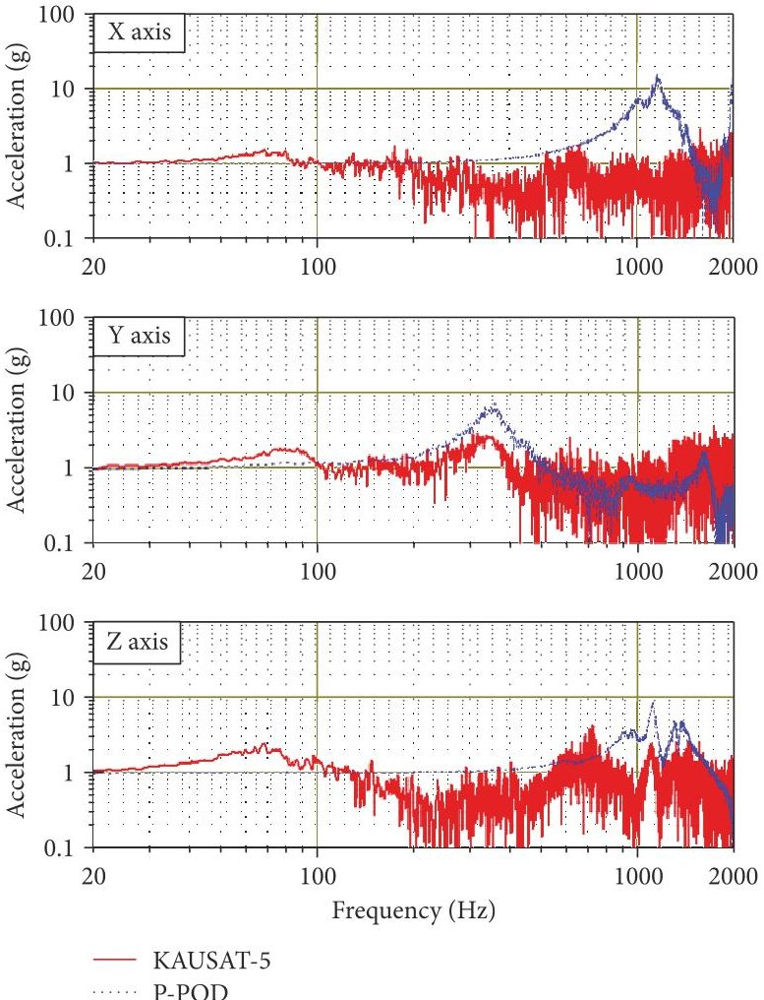

FIGURE 19: FM vibration test results.

## 5. Conclusion

In this research, a standard platform of 3U CubeSat has been developed and its function and performance have been verified by applying the developed standard platform to KAUSAT-5 3U CubeSat.

The existing 3U CubeSat and state-of-the-art technology were investigated, and the specification of 3U CubeSat platform was selected for design. The 3U CubeSat platform can be designed for general use. The following core solutions have been applied to this standard platform: (1) space extension and mass minimization using FFC (Flexible Flat Cable) instead of PC104, (2) using CAN communication, and (3) applying Plug & Play technology.

Since the standard platform was developed as a modular concept, it was designed to be able to mount a variety of mission equipment according to the user's requirement, and the number of components can be expanded electrically using I2C and CAN. In the case of the actuator and the sensor, the user can select and extend it according to the mission and size. In the case of EPS, the solar panel, the battery, and the mechanism can have various shapes. The standard platform subsystems integrate and miniaturize the functionality/performance into a small PCB module, maximizing electrical capability and accommodating multiple payloads. The 3U CubeSat standard platform is designed and manufactured so that it can be expanded and interfaced as long as it meets mass and volume requirements and can be developed within a short time.

<!-- PDF_PAGE: 16 -->

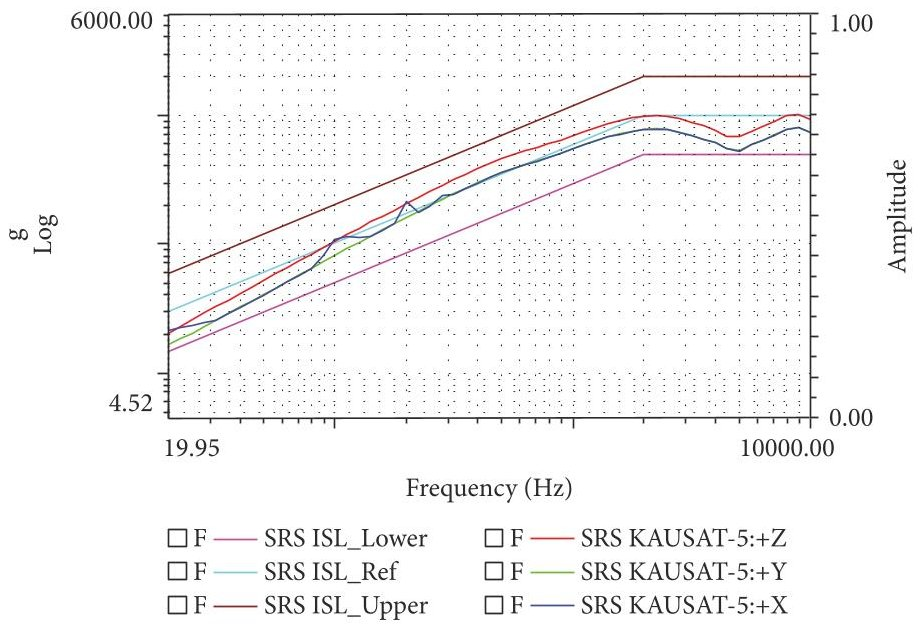

FIGURE 20: Shock test results on the x-axis.

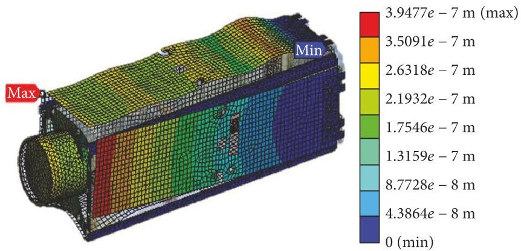

FIGURE 21: Shock analysis results on the x-axis.

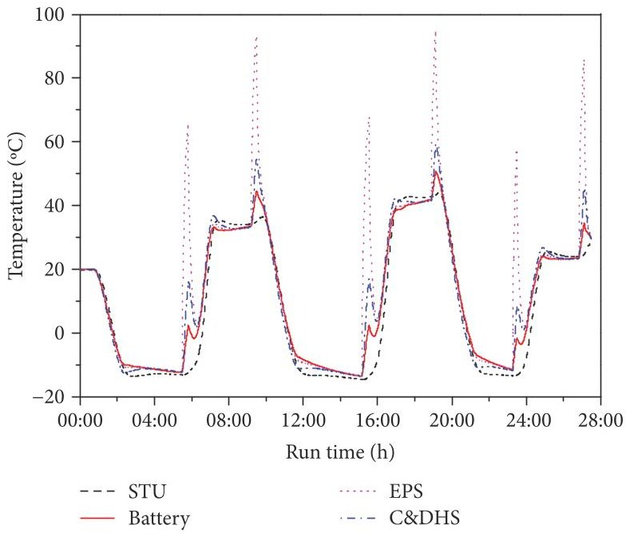

FIGURE 22: Thermal vacuum qualification test results for QM major components.

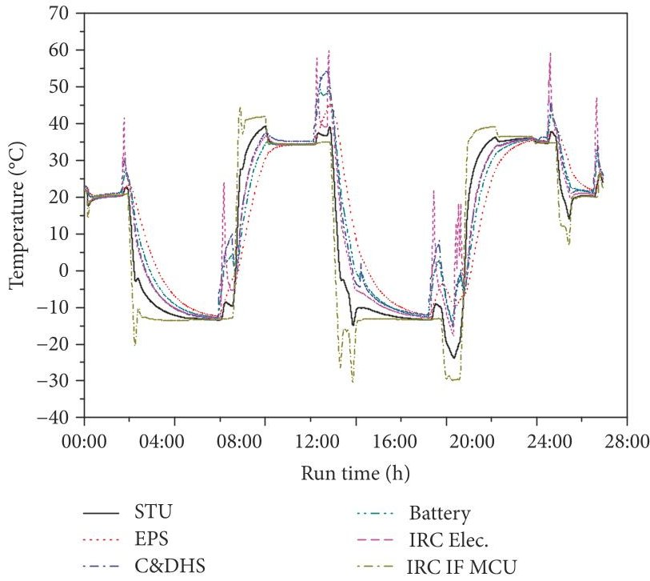

FIGURE 23: Thermal vacuum acceptance test results for FM major components.

<!-- PDF_PAGE: 17 -->

KAUSAT-5 CubeSat was developed by using the 3U CubeSat standard platform. It is verified that the developed satellites meet the vibration and thermal requirements to operate well in the space environment. It is possible to omit qualification tests for satellites using the standard platform that need to be built and developed, thereby reducing the cost and schedule.

## Data Availability

The authors declare that all data underlying the findings of the manuscripts can be shared with researchers to verify the results of an article, replicate the analysis, and conduct secondary analyses. The authors allow all readers to be able to access the data supporting the conclusions of the study. There is no unavailable data which cannot be released.

## Disclosure

An earlier version has been presented as a poster in Fourth IAA Conference on University Satellite Missions and CubeSat Workshop held in 2017.

## Conflicts of Interest

The authors declare that there is no conflict of interests regarding the publication of this paper.

## Acknowledgments

This research was supported by CubeSat Contest and Developing Program through the National Research Foundation of Korea (NRF) and the Korea Aerospace Research Institute (KARI) funded by the Korea government (Ministry of Science, ICT and Future Planning) (no. NRF-2015M1A3A4A01022139).

## References

[1] J. T. Kim, A CubeSat (HAUSAT-1) Mission and system design, Master's Thesis, Korea Aerospace University, 2003.

[2] T. Murphy, J. Kanaber, and C. Koehler, "PEZ: expanding CubeSat capabilities through innovative mechanism design," in 25th Annual AIAA/USU Conference on Small Satellite, SSC11-XII-5, pp. 1-4, UT, USA, 2011.

[3] L. S. Lim, T. D. V. Bui, Z. Lau et al., "Development and design challenges in VELOX-I nanosatellite," in 2015 International Conference on Space Science and Communication (IconSpace), pp. 158-116, Langkawi, Malaysia, August 2015.

[4] D. Geeroms, S. Bertho, M. D. Roeve, R. Lempens, M. Ordies, and J. Prooth, "ARDUSAT, an Arduino-based Cubesat providing students with the opportunity to create their own satellite experiment and collect real-world space data," in Proceedings of the 22nd ESA Symposium on European Rocket and Balloon Programs and Related Research, pp. 643-647, Tromso, Norway, 2015.

[5] Q. Young, R. Burt, M. Watson, and L. Zollinger, "PEARL CubeSat bus building toward operational missions," in Small Satellites Conference from AIAA/Utah State University, Logan, Utah, August 2009.

[6] Nanoavionics, "3U CubeSat platform PLT3," https://n-avionics. com/cubesat-components/platforms/cubesat-3u-platform-plt3/

[7] A. Mehrparvar and D. Pignatelli, "CubeSat design specification(CDS) REV 13," in The CubeSAR Program, Cal Poly, SLO, February 2014.

[8] A. Kestilä, T. Tikka, P. Peitso et al., "Aalto-1 nanosatellite technical description and mission objectives," Geoscientific Instrumentation, Methods and Data Systems, vol. 2, no. 1, pp. 121-130, 2013.

[9] M. Smith, S. Seager, C. Pong et al., "The ExoplanetSat mission to detect transiting exoplanets with a cubesat space telescope," in 25th Annual AIAA/USU Conference on Small Satellite, SSC11-XII-4, pp. 1-9, UT, USA, 2011.

[10] M. Aherne, T. Barrett, L. Hoag, E. Teegarden, and R. Ramadas, "Aeneas-colony I meets three-axis pointing," in 25th Annual AIAA/USU Conference on Small Satellite, SSC11-XII-7, pp. 1-11, UT, USA, 2011.

[11] N. Jeremy Kasdin, "Telescope for habitable exoplanets and interstellar/intergalactic astronomy," AIP Conference Proceedings, vol. 1158, no. 1, pp. 1-23, 2010.

[12] R. Hodges, B. Shah, D. Muthulingham, and T. Freeman, "ISARA-integrated solar array and reflect array mission overview," in 28th annual AIAA/USU small satellite conference workshop, UT, USA, August 2013.

[13] S. S. Jang, S. K. Lee, J. B. Jang, S. W. Park, and E. S. Sim, "The preliminary EPS sizing of KOMPSAT-2," Aerospace Engineering and Technology, vol. 1, no. 2, pp. 57-65, 2002.

[14] T. Y. Park, B. G. Chae, H. M. Jung, and H. U. Oh, "Conceptual design of electrical power subsystem for cube satellite with permanent magnet attitude stabilization method," Journal of Aerospace System Engineering, vol. 8, no. 1, pp. 42-47, 2014.

[15] S. Song, S. Y. Lee, H. R. Kim, and Y. K. Chang, "KAUSAT-5 development and verification based on 3U CubeSat standard platform," Journal of the Korean Society for Aeronautical & Space Sciences, vol. 45, no. 8, pp. 686-696, 2017.