<!-- PDF_PAGE: 1 -->

<div align="center">

# CENTIMETER-SCALE SPACECRAFT: DESIGN, FABRICATION, AND DEPLOYMENT

</div>

A Dissertation Presented to the Faculty of the Graduate School of Cornell University

in Partial Fulfillment of the Requirements for the Degree of Doctor of Philosophy

by

Zachary Robert Manchester

August 2015

<!-- PDF_PAGE: 2 -->

$ \textcircled{c} $ 2015 Zachary Robert Manchester

ALL RIGHTS RESERVED

<!-- PDF_PAGE: 3 -->

<div align="center">

# CENTIMETER-SCALE SPACECRAFT: DESIGN, FABRICATION, AND DEPLOYMENT

</div>

Zachary Robert Manchester, Ph.D. Cornell University 2015

The rise of the consumer electronics industry has led to a profusion of ever smaller, cheaper, and more capable devices, from sensors to computers to radios. Many of these components are suitable for use in spacecraft. Their availability has led to the ongoing revolution in small satellites, most visibly exemplified by the CubeSat standard. This study seeks to push these trends toward their ultimate extreme: a satellite-on-a-chip.

The ability to mass produce small, cheap, essentially disposable spacecraft has many implications for space exploration, Earth and atmospheric science, and education. New missions to characterize planetary surfaces and atmospheres, asteroids, and Earth's ionosphere could be planned using thousands of tiny spacecraft equipped with a variety of sensors. Such mission architectures would allow thousands of data points to be captured simultaneously across vast distances, offering unprecedented spatial resolution. Additionally, the cost of launching a satellite will be within reach for high schools, student groups, and even individual hobbyists, making space accessible to the general public in new ways.

This dissertation documents the development of the Sprite centimeter-scale spacecraft, along with the associated hardware and software necessary for its deployment in low-Earth orbit and communication with ground stations. In addition, new solutions to several general spacecraft dynamics, control, and estimation problems with relevance to small and low-cost spacecraft are presented. These include

<!-- PDF_PAGE: 4 -->

control laws for flat-spin recovery and spin inversion, an algorithm for on-orbit inertia estimation, and variational integrators for spacecraft attitude dynamics that offer improved performance over traditional Runge-Kutta schemes in spacecraft guidance, navigation, and control applications.

<!-- PDF_PAGE: 5 -->

## BIOGRAPHICAL SKETCH

Zac Manchester was born in Chicago but spent most of his childhood in Asia, returning to the U.S. in high school. Growing up, he had a long-running fascination with aviation and spaceflight. After experimenting with remote control aircraft, model rocketry, and flying lessons, Zac decided to attend engineering school at Cornell.

Zac earned his bachelor's degree in engineering physics in 2009. During his undergraduate years he rowed varsity crew for a year, played bass in the Cornell jazz ensembles, developed an autopilot for a UAV, and also worked part time for aerospace software maker Analytical Graphics, Inc (AGI). It was at AGI that Zac first became acquainted with the subject of astrodynamics and decided that he would pursue a Ph.D. in aerospace engineering.

Shortly after beginning graduate school at Cornell in 2010, Zac founded the KickSat project as an outgrowth of his Ph.D. research. The project has the goal of dramatically reducing the cost of access to space and has included participants from all over the world. KickSat was financed through the crowd-funding website Kickstarter and awarded a launch through NASA's Educational Launch of Nanosatellites (ELaNa) Program.

From 2012 to 2014, Zac worked at NASA Ames Research Center. In addition to his own research, he developed attitude determination and control algorithms for use on several NASA spacecraft. He also worked in the Ames SpaceShop experimenting with rapid prototyping equipment (3D printers, laser cutters, and desktop CNC machines) to build spacecraft components.

Zac looks forward to continuing his research in small spacecraft and spacecraft dynamics and control as a postdoc and is pursuing an academic career in which he can continue to advance space exploration and access to space.

<!-- PDF_PAGE: 6 -->

To the people of Earth, especially Becky.

<!-- PDF_PAGE: 7 -->

## ACKNOWLEDGEMENTS

this dissertation. First and foremost, my family has been a constant source of support and encouragement throughout my education. If not for my mother, I would almost certainly never have made it to Cornell in the first place as an eager and somewhat-cocky eighteen-year-old. My wife Becky has stuck with me through long hours, many late nights in the lab, and multiple cross-country moves, and my three siblings and my wife's family have also been there for me on numerous occasions during my time in graduate school.

I have had the privilege of meeting and working with many inspiring people at Cornell. My adviser, Mason Peck, has listened to too many of my crazy ideas to count and always seems to have something insightful to add. The other members of my special committee, Alex Vladimirsky, Brandon Hencey, and Mark Campbell, have all offered ideas, technical advice, and career guidance at various points. In addition to my committee, I'd also like to thank Liran Gazit and Rob McCurdy, who both played critical roles in some of the early work on the Sprite, Hadas Kress-Gazit for her academic career advice, and Marcia Sawyer and Pati Wojcik for keeping things running on a daily basis.

Much of the work documented in the following chapters was done during the nearly two years I spent at NASA Ames Research Center. Many people there were supportive of my research and were generous with their time and expertise, including Andy Filo, Matt Reyes, Pete Worden, John Hines, Harry Partridge, Elwood Agasid, and Chad Frost. Lastly, I must extend a huge thanks to the entire PhoneSat team, especially Oriol Tintore-Gazulla, Jasper Wolfe, Cedric Priscal, Alberto Guillen-Salas, and Ken Ovadomari, who provided the avionics for KickSat.

<!-- PDF_PAGE: 8 -->

## TABLE OF CONTENTS

Biographical Sketch . . . . .

<!-- PDF_PAGE: 9 -->

4.3.2 External Torques 47

4.4 Batch Inertia Estimation 48

4.5 Recursive Inertia Estimation 51

4.6 Numerical Examples 53

4.7 Conclusions 57

5 Lyapunov-Based Control for Flat-Spin Recovery and Spin Inversion of Spin-Stabilized Spacecraft 64

5.1 Existing Work 65

5.2 Background 66

5.2.1 Gyrostat Dynamics 67

5.2.2 Lyapunov Stability 68

5.3 Candidate Lyapunov Functions 70

5.4 Periodic Averaging 72

5.5 Almost-Global Asymptotic Stability 76

5.6 Controller Implementation 77

5.7 Examples 78

5.8 Conclusions 82

6 Quaternion Variational Integrators for Spacecraft Dynamics 85

6.1 Existing Work 86

6.2 Background 87

6.3 Euler’s Equation from Hamilton’s Principle 89

6.4 A Discrete-Time Euler’s Equation 91

6.5 A Variational Integrator for the Free Rigid Body 94

6.6 Gyrostats 97

6.7 External Torques 99

6.8 A Gyrostat Spacecraft With Damping 101

6.9 Numerical Examples 103

6.9.1 Free Rigid Body 103

6.9.2 Damped Rigid Body 106

6.9.3 Extended Kalman Filter 109

6.10 Conclusions 110

A KickSat Crowd Funding 111

B Sprite Hardware Schematics 113

C Sprite Bill of Materials 115

D Sprite Receiver Source Code 116

Correlator 116

Peak Detector 121

Soft Decoder 123

<!-- PDF_PAGE: 10 -->

E KickSat Verification Reports 130

Mass Properties 130

Venting Analysis 134

Functional Test 136

Vibration Test 139

Thermal Vacuum Test 151

<!-- PDF_PAGE: 11 -->

## LIST OF FIGURES

2.1 The Sprite Spacecraft 6

2.2 Thermal simulation of a Sprite in low-Earth Orbit 7

2.3 Sprite packet structure 15

2.4 Power spectral density of a Sprite signal 16

2.5 Sprite ground station hardware 17

2.6 GNU Radio signal flow diagram 18

2.7 Receiver correlator output during outdoor ridge test 20

2.8 Sprite prototypes mounted on the MISSE-8 experiment 21

3.1 The KickSat Spacecraft 24

3.2 Sprites in KickSat deployer 25

3.3 Sprite deployment 25

3.4 Altitude vs. time for a Sprite in low-Earth orbit 27

3.5 Bifilar pendulum schematic 28

3.6 KickSat z-axis inertia measurement 30

3.7 KickSat deployment test 32

3.8 Vibration test setup 33

3.9 Thermal vacuum test setup 35

3.10 Temperature and pressure during thermal vacuum test 36

4.1 Rotor momentum components during slew maneuvers 55

4.2 Body angular velocity components during slew maneuvers 56

4.3 Normalized inertia error during slew maneuvers 57

4.4 Normalized moment of inertia errors during slew maneuvers 58

4.5 Normalized product of inertia errors during slew maneuvers 59

4.6 Body angular velocity components for spinning case 60

4.7 Rotor momentum components for spinning case 61

4.8 Total normalized error for spinning case 62

4.9 Normalized moment of inertia errors for spinning case 62

4.10 Normalized product of inertia errors for spinning case 63

5.1 Momentum sphere with equilibria and example trajectories 68

5.2 Heat map of candidate Lyapunov function $V_Q$ 71

5.3 Heat map of candidate Lyapunov function $V_L$ 72

5.4 Heat map of candidate Lyapunov function $V'_L$ 73

5.5 Heat map of Lyapunov function $V$ 74

5.6 Flat-spin recovery trajectory 80

5.7 Flat-spin recovery momentum components 81

5.8 Flat-spin recovery reaction wheel momenta 81

5.9 Flat-spin recovery reaction wheel torques 82

5.10 Spin inversion trajectory 83

5.11 Spin inversion momentum components 83

5.12 Spin inversion reaction wheel momenta 84

<!-- PDF_PAGE: 12 -->

5.13 Spin inversion reaction wheel torques 84

6.1 Momentum error for a free rigid body 105

6.2 Energy error for a free rigid body 105

6.3 Long-term error for a free rigid body 106

6.4 Integrator running time 107

6.5 Energy for rigid body with damper 108

6.6 Energy for rigid body with damper 108

6.7 Multiplicative extended Kalman filter RMS attitude error 109

A.1 KickSat Kickstarter web page 111

A.2 Kickstarter fundraising progress 112

<!-- PDF_PAGE: 13 -->

## LIST OF TABLES

2.1 Link budget summary 10

3.1 Inertia measurement data 31

<!-- PDF_PAGE: 14 -->

## CHAPTER 1 INTRODUCTION

## 1.1 Motivation

The rapid miniaturization of commercial-off-the-shelf (COTS) electronics, driven in recent years by the emergence of smart phones, has made many of the components used in spacecraft available in very small, low-cost, low-power packages. This trend has inspired the "ChipSat" concept[1] $ ^{-} $ [3], the idea of building chip-scale satellites with the same devices and processes used in the consumer electronics industry. The ability to mass produce such devices, along with their small size, leads to the realistic near-term possibility of sub-thousand-dollar-per-satellite missions for scientific, educational, and hobbyist use.

By dramatically reducing the cost and complexity of building and launching spacecraft, ChipSats could help expand access to space. In the near future, it will be possible for a high school science class, amateur radio club, or motivated hobbyist to choose sensors, assemble a ChipSat, configure a ground station, and fly their own satellite mission. A new class of science missions could also be built around large ensembles or "swarms" of ChipSats equipped with a range of electromagnetic, micro-electro-mechanical (MEMS), and nanofluidic sensors. Such swarms could perform, for example, large-scale in-situ surveys of planetary atmospheres[4] or determine the composition of asteroids[5], allowing thousands of data points to be collected simultaneously over large spatial volumes. Earth's ionosphere, in particular, could be studied in ways that are impractical or impossible with current sounding rocket and multi-satellite missions[6], [7].

<!-- PDF_PAGE: 15 -->

In addition to providing a new and unique set of capabilities, building missions around large numbers of ChipSats will also provide a high degree of robustness. Traditional spacecraft are typically built with redundant subsystems and high-reliability components to achieve robustness, often leading to increased cost, complexity, and spacecraft mass. In contrast, a ChipSat mission could achieve a similar or even greater probability of success by simply deploying sufficiently many spacecraft. Due to their individual simplicity and mass-producibility, the marginal cost of producing additional ChipSats is very low. Even with relatively high rates of individual failure, a mission utilizing hundreds or thousands of ChipSats would have a very high likelihood of overall success.

## 1.2 Contributions

This dissertation describes a complete architecture for low-cost missions based on centimeter-scale spacecraft. In addition, solutions to several general spacecraft dynamics and control problems with relevance to small satellites are developed. The major contributions are:

1. The design and implementation of a complete spacecraft on a printed circuit board.

2. A long-range low-power communication system for centimeter-scale spacecraft scalable to hundreds of satellites.

3. A CubeSat-based deployment system for centimeter-scale spacecraft.

4. A novel algorithm for recursive estimation of spacecraft inertia based on semidefinite programming.

<!-- PDF_PAGE: 16 -->

5. Feedback control laws capable of both flat-spin recovery and spin inversion of spinning spacecraft.

6. The development of variational integrators for spacecraft attitude dynamics with quaternion state variables.

## 1.3 Outline

Each chapter in this dissertation corresponds roughly to a journal publication. Chapter 2 describes the design, fabrication, and testing of the Sprite spacecraft, a 3.5-by-3.5 centimeter printed circuit board satellite. It also details the communication architecture developed to allow many Sprites to simultaneously communicate with a single ground station from low-Earth orbit.

Chapter 3 discusses the KickSat project - an effort to launch and deploy over one hundred Sprite spacecraft in low-Earth orbit from a CubeSat "mothership." The first KickSat mission, KickSat-1, was launched in April 2014. The design and testing of the KickSat-1 spacecraft are discussed, as well as the outcomes of the mission.

Chapter 4 introduces a recursive algorithm for on-orbit estimation of spacecraft inertia. Its development was motivated by the need for inertia knowledge in the control system on the KickSat spacecraft along with the relatively high cost of traditional methods for accurate ground-based inertia measurements. The algorithm makes use of semidefinite programming to guarantee that a physically valid inertia matrix is always returned.

Chapter 5 develops a family of nonlinear control laws capable of reorienting

<!-- PDF_PAGE: 17 -->

a tumbling spacecraft so that it spins about its minor axis of inertia in a desired direction. This problem was also motivated by the KickSat mission, and is a generalization of the classic flat-spin recovery problem. The controllers are derived from a Lyapunov function and shown to be almost-globally asymptotically stabilizing.

Chapter 6 develops variational integrators for spacecraft attitude dynamics parameterized with quaternions. These integrators offer many advantages over Runge-Kutta schemes, including energy and momentum conservation. They are also very well suited for use in spacecraft guidance, navigation, and control algorithms, such as attitude determination filters.

<!-- PDF_PAGE: 18 -->

## CHAPTER 2 THE SPRITE SPACECRAFT

This chapter describes the Sprite ChipSat, along with its associated deployment, communication, and ground station systems. It begins with a survey of existing work in section 2.1. Section 2.2 then describes the hardware design of both the Sprite and its deployer, which is compatible with the CubeSat specification. Section 2.3 describes the code division multiple access (CDMA) communication architecture employed by the Sprite. Finally, section 2.5 summarizes the results of an on-orbit test of prototype Sprite hardware.

## 2.1 Existing Work

Previous studies have advocated the mass production of silicon-wafer-based spacecraft[1] and satellite-on-chip devices[2], [3]. There have also been several investigations of the dynamics of centimeter-scale spacecraft and the potential for creating "swarms" or constellations of such spacecraft: Atchison and Peck studied the dynamics of very small spacecraft subject to a variety of environmental perturbation forces[2], [4], [8], and Colombo and McInnes designed orbits that balance solar pressure and atmospheric drag effects to produce long-lived ChipSat swarms[9].

The fist laboratory prototype of a small planar spacecraft constructed using COTS components was built by Barnhart et. al.[3], [10]. Their "PCBSat," with dimensions of ten-by-ten-by-two centimeters and a mass of 200 grams, included solar cells, a battery, a microcontroller, a radio, a GPS receiver, and a variety of sensors. A serious deficiency in their design, however, is that the radio and communication protocols used provide a maximum range of 1.3 kilometers, mak-

<!-- PDF_PAGE: 19 -->

ing communication feasible only with other (very) nearby spacecraft, and direct communication with ground stations impossible.

## 2.2 Hardware Design

The hardware design of the Sprite, rather than being driven from the "top down" by mission requirements, as is typical of most spacecraft, is driven by a "bottom up" desire to build the smallest-possible functional spacecraft using standard commercial components and manufacturing technologies. The Sprite makes use of modern, low-cost, low-power integrated circuits to create a general purpose "spacecraft bus" for chip-scale sensors. It includes Spectrolab TASC solar cells, a Texas Instruments CC430 microcontroller and radio system-on-chip (SoC), a Honeywell HMC5883L three-axis magnetometer, and an InvenSense ITG-3200 three-axis MEMS gyro, as well as associated passive components, on a printed circuit board measuring 3.5 by 3.5 centimeters with a mass of four grams (figure 2.1).


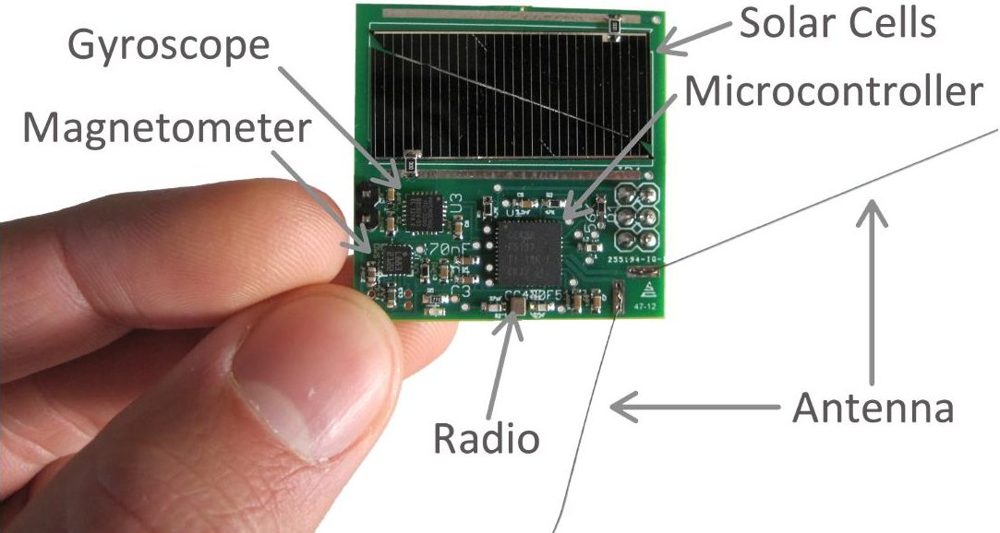


<div align="center">

Figure 2.1: The Sprite Spacecraft

</div>

The overall dimensions of the Sprite are determined primarily by the peak

<!-- PDF_PAGE: 20 -->

power required by the radio while transmitting. Figure 2.2 shows the expected temperature range of a Sprite in low-Earth orbit. The very cold temperatures


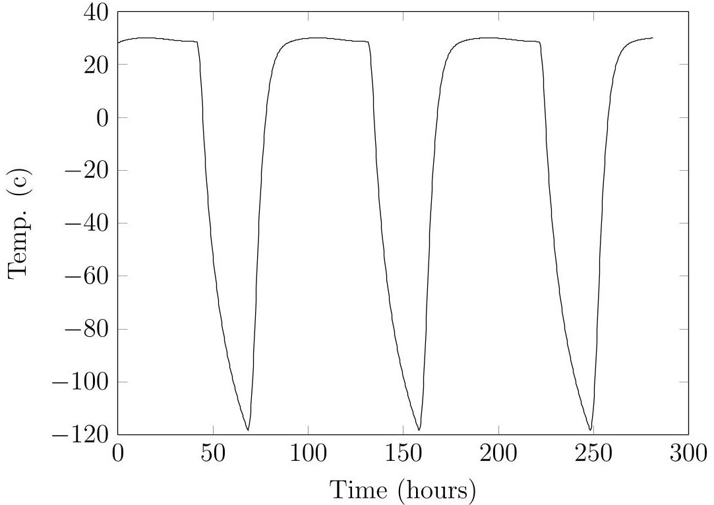


<div align="center">

Figure 2.2: Thermal simulation of a Sprite in low-Earth Orbit

</div>

encountered during eclipse cause modern batteries based on lithium-ion or lithium-polymer chemistries to fail permanently. As a result, all power must be delivered directly by solar cells, leaving Sprites completely unpowered while above the night side of the Earth.

The TASC solar cells used on the Sprite are a triple-junction gallium-arsenide design with an open-circuit voltage of 2.2V and a nominal conversion efficiency of 27%[11]. All of the integrated circuits chosen for the Sprite are capable of operating at a supply voltage of 2.2V or less, eliminating the need for additional power conditioning or regulation circuitry. The maximum current required by the radio during transmission is approximately 35 mA. A pair of TASC solar cells delivers 60 mA of current when aligned directly with the sun vector, offering considerable margin to account for attitude variations.

<!-- PDF_PAGE: 21 -->

The CC430 SoC provides the core computing and communication capabilities of the Sprite. It combines a 16-bit MSP430 microcontroller, which is clocked at 8 Mhz and provides 4 kB of RAM and 32 kB of flash memory, with a very flexible CC1101 UHF transceiver capable of an output power of 10 mW and raw bit rates up to 500 kbps. The 70 cm amateur band was chosen as a compromise between antenna size and transmitter efficiency. The 2.4 GHz S-band was also considered, which would allow a smaller antenna. However, the efficiency of available COTS transmitter ICs is an order of magnitude worse at 2.4 GHz than at 437 MHz. Both the MSP430 and CC1101 have flight heritage on previous CubeSat missions[12], [13].

The Sprite's antenna is a half-wave V-dipole, chosen for its isotropic gain pattern, easy tuning, and 50 ohm characteristic impedance, which eliminates the need for a matching network or balun circuit. The antenna is made of superelastic nitinol, a nickel-titanium alloy commonly referred to as "shape-memory alloy" or "memory metal," which can undergo very large strain and still return to its original shape. Nitinol was chosen so that the antenna could be tightly coiled for launch and return to its intended geometry after deployment.

## 2.3 Closing The Link

Perhaps the most difficult engineering challenge associated with the Sprite is closing the communication link from low-Earth orbit to ground stations. The Sprite's transmitter is limited to 10 mW of output power. A lack of closed-loop attitude control means a low-gain antenna with an omnidirectional gain pattern is required. Additionally, due to licensing constraints, the Sprites must efficiently share limited

<!-- PDF_PAGE: 22 -->

RF bandwidth. Closing link over several hundred kilometers with all of these constraints is a formidable challenge, but thanks to recent advances in software-defined radio technology, it is possible with relatively inexpensive hardware.

As motivation, the signal-to-noise ratio $ ( S/N) $ is first derived for a nominal set of orbit and receiver parameters. With a transmitter power $ P_{t}=1 0 $ dBm, a transmitter antenna gain of $ G_{t}=0 $ dB, receiver antenna gain $ G_{r}=1 0 $ dB, polarization loss of $ L_{p}=3 $ dB, atmospheric loss of $ L_{a}=2 $ dB, range $ R=6 5 0 $ km, and wavelength $ \lambda=7 0 $ cm, the received power $ P_{r}\approx-1 2 7 $ dBm is given by the Friis equation[14]:

$$
P _ {r} = P _ {t} + G _ {t} + G _ {r} - L _ {p} - L _ {a} + 2 0 \log_ {1 0} \left(\frac {\lambda}{4 \pi R}\right)
$$

The noise power in the receiver $ P_{n}\approx-1 1 2 $ dBm is given by,

$$
P _ {n} = F _ {n} + 1 0 \log_ {1 0} \left(K _ {B} T B\right)
$$

where $ F_{n}=4 $ dB is the receiver's noise figure, $ K_{B} $ is Boltzmann's constant, $ T=290 $ K is the noise temperature in degrees Kelvin, and $ B=64 $ kHz is the receiver bandwidth[14]. Subtracting the noise power from the signal power gives a signal-to-noise ratio of $ S/N=-10 $ dB. Table 2.1 summarizes the link budget parameters for a Sprite in a nominal low-Earth orbit.

It is worth pausing here to consider the implications of the previous result: A negative S/N means, in a power sense, that there is more noise than signal. If one were to connect an oscilloscope between the antenna and receiver, the observed signal would be nearly indistinguishable from white noise. In a more typical situation, a design engineer might use a more powerful transmitter or higher gain antenna, but in the case of the Sprite, neither of those solutions are possible.

<!-- PDF_PAGE: 23 -->

<div align="center">

Table 2.1: Link budget summary

</div>

<table border="1"><tr><td>Altitude</td><td>350km</td></tr><tr><td>Minimum Elevation Angle</td><td>30°</td></tr><tr><td>Range(R)</td><td>652.5km</td></tr><tr><td>Frequency</td><td>437MHz</td></tr><tr><td>Maximum Doppler Shift</td><td>9.7kHz</td></tr><tr><td>Transmitter Power(Pt)</td><td>10.0dBm</td></tr><tr><td>Transmitter Antenna Gain(Gt)</td><td>0.0dB</td></tr><tr><td>Free-Space Loss(Lfs)</td><td>-141.6dB</td></tr><tr><td>Atmospheric Attenuation(La)</td><td>-2.0dB</td></tr><tr><td>Receiver Antenna Gain(Gr)</td><td>10.0dB</td></tr><tr><td>Polarization Loss(Lp)</td><td>-3.0dB</td></tr><tr><td>Receiver Bandwidth(B)</td><td>64kHz</td></tr><tr><td>Receiver Noise Temperature(Tn)</td><td>290K</td></tr><tr><td>Receiver Noise Figure(Fn)</td><td>4.0dB</td></tr><tr><td>Receiver Noise Power(Pn)</td><td>-121.9dBm</td></tr><tr><td>Received Signal Power(Pr)</td><td>-126.6dBm</td></tr><tr><td>Code Gain(Gc)</td><td>27.1dB</td></tr><tr><td>S/N</td><td>-10.3dB</td></tr><tr><td>Eb/N0</td><td>16.8dB</td></tr></table>

## 2.3.1 Communication Background

The Sprite communication system makes use of two techniques, matched filtering and forward error correction (FEC), which have long histories in space and terrestrial communication, navigation, and radar systems, but have not yet seen widespread use within the small satellite community. This section will provide a brief overview of these techniques for an aerospace engineering audience with limited signal processing experience. More efficient utilization of communication bandwidth with techniques like these would enable far greater data throughput from small satellite missions.

To overcome low $ S/N $ , matched filtering, which is the optimal linear filter for

<!-- PDF_PAGE: 24 -->

maximizing signal-to-noise ratio[15], is used. The basic idea is to substitute each data bit with a long specially-chosen string of bits known as a pseudo-random number (PRN) code that is agreed upon by both the transmitter and receiver a priori. In this context, the bits making up the PRN code are commonly referred to as "chips" to differentiate them from the data bits. Rather than attempting to lock onto the carrier and demodulate the chips individually, the receiver instead looks for the entire PRN code by cross-correlating the incoming signal against the known code at each time step.

Cross-correlation in the discrete-time setting can be interpreted as a "sliding inner product," as shown in equation (2.3), where x is the cross-correlation, p is the sampled PRN code vector of length N, and s is a vector of signal samples. At each time step k, the signal vector is shifted one sample, with the oldest element being removed from one end and a new sample being added at the opposite end. A new inner product is then calculated. If the PRN is present, the correlation magnitude will be large, even in the presence of substantial noise, while if no code is present, the correlation will be small.

$$
x _ {k} = p ^ {\dagger} \left[ \begin{array}{c} s _ {k - N} \\ \vdots \\ s _ {k} \end{array} \right]
$$

Matched filtering essentially allows the energy in the entire PRN code to be summed, providing a "code gain" $ G_{c} $ equal to the length of the PRN. The trade-off, however, is that the data rate is also lower by the same factor. PRN codes with a length of 511 chips are used on the Sprite, providing a code gain $ G_{c}=1 0 \cdot\log_{1 0} ( 5 1 1 ) $ of about 27 dB for a very robust link margin. When adding $ G_{c} $ to the signal-to-noise ratio, the resulting dimensionless quantity is known as $ E_{b} / N_{0} $ (pronounced "energy-per-bit over noise-power-spectral-density"). $ E_{b} / N_{0} $ is the standard figure

<!-- PDF_PAGE: 25 -->

of merit used to characterize digital communication links.

Aside from adding code gain, matched filtering also makes it possible for multiple users to share a communication channel through what is known as code division multiple access (CDMA). By assigning each Sprite a different PRN, the receiver can "tune" to a particular spacecraft's signal by correlating against its unique code. This allows all the Sprites on a particular mission to share the same allocated frequency, simplifying licensing and eliminating the need for clock synchronization that would otherwise be required for the Sprites to alternate transmitting on the same frequency. CDMA has been used for many years in the cellular telephone industry[15] and the global positioning system[16], and has proven, in practice, to be the most efficient channel access method when a large number of users must be accommodated[15].

To successfully implement CDMA, the family of PRN codes assigned to the group of Sprites must be carefully chosen to minimize interference. They should be as orthogonal as possible in the sense that their cross-correlations should be close to zero. Unfortunately, it is mathematically impossible to generate code families with perfect zero cross-correlations for all time offsets[17]. Many code families exist, however, with low and bounded cross-correlations, notably the Gold codes[18] used in GPS[16]. A family of Gold codes of length 511 bits has been selected for use with Sprites, offering good cross-correlation performance and allowing up to 511 unique codes to be assigned to individual spacecraft.

Due to the finite cross-correlations between Gold codes, large numbers of Sprites cannot transmit simultaneously without causing unacceptable levels of interference. To overcome this problem, the Sprites operate their radios on a duty cycle with randomized sleep and wake times. Because excessive interference may still occur

<!-- PDF_PAGE: 26 -->

occasionally, forward error correction is applied to further improve robustness. FEC is widely used in modern digital communication systems because it allows a receiver to correct errors in a message without having to request a re-transmission. The idea is to pad the message with extra bits, known as parity bits, based on a mathematical rule. For the Sprite, a linear block code is used where the parity bits are generated by simple matrix multiplication.

To encode an 8-bit message byte m, the Sprite encoder treats the byte as an 8-dimensional binary vector and multiplies it by a 16-by-8-bit matrix G, known as the generator matrix of the code, producing a 16-bit code word c:

$$
c = m G
$$

All arithmetic operations in equation (2.4) are performed modulo-2, with multiplication equivalent to the Boolean and operation and addition equivalent to the exclusive-or operation. Note that it is conventional to use row vectors in coding theory[19].

The generator matrix used on the Sprite is

$$
G = \left[ \begin{array}{c c c c c c c c c c c c c c} 1 & 0 & 0 & 1 & 1 & 1 & 1 & 0 & 1 & 0 & 0 & 0 & 0 & 0 \\ 0 & 1 & 0 & 0 & 1 & 1 & 1 & 0 & 0 & 1 & 0 & 0 & 0 & 0 \\ 1 & 1 & 0 & 0 & 1 & 1 & 0 & 1 & 0 & 0 & 1 & 0 & 0 & 0 \\ 0 & 1 & 1 & 0 & 0 & 1 & 1 & 1 & 0 & 0 & 0 & 1 & 0 & 0 \\ 0 & 0 & 1 & 1 & 0 & 0 & 1 & 1 & 0 & 0 & 0 & 0 & 1 & 0 \\ 1 & 1 & 1 & 1 & 0 & 0 & 1 & 0 & 0 & 0 & 0 & 0 & 1 & 0 \\ 0 & 1 & 1 & 1 & 1 & 0 & 0 & 0 & 0 & 0 & 0 & 0 & 1 & 0 \\ 1 & 1 & 0 & 1 & 0 & 1 & 1 & 1 & 0 & 0 & 0 & 0 & 0 & 1 \end{array} \right]
$$

In the notation commonly used in coding theory, this is a (16,8,5) block code, where 16 is the code word length, 8 is the message length, and 5 is the Hamming distance[19], which determines the ability of the code to correct errors. With a Hamming distance of 5, up to 2 bit flips or 5 bit erasures can be corrected[19].

<!-- PDF_PAGE: 27 -->

There are several ways a receiver can decode a block code like the one presented here. In the Sprite receiver, a simple brute-force soft decoder is used, where the received code word is compared to all 256 possible code words. An inner product is calculated with each one, and the decoded byte is taken to be the best match. While this decoder is optimal in the sense that it produces the maximum-likelihood message byte, its computational complexity scales exponentially with the message length and it quickly becomes intractable for longer messages. Several algebraic decoding methods exist[15], [19] which are, in general, sub-optimal, but are much more computationally efficient.

## 2.3.2 Signal Design

The Sprite signal is designed to be easily transmitted by commercially available single-chip industrial, scientific, and medical (ISM) band radios like the CC1101 from Texas Instruments[20], and to be demodulated by software-defined radio (SDR) receivers. This combination allows for low cost and flexibility in both the transmitter and receiver. Additionally, the protocol is designed to accommodate multiple Sprites on the same channel, handle large frequency offsets due to Doppler shift and oscillator drift, and reliably close the communication link at a range of 650 km.

The Sprite protocol operates at the level of 8-bit bytes. A data byte is first encoded using the generator matrix in equation (2.5), producing a 16-bit codeword containing the original data byte along with a parity byte. A preamble and postamble are then added to the resulting codeword. Figure 2.3 illustrates this packet structure. The preamble and postamble are 7-bit Barker codes, which have optimal autocorrelation properties[21] and aid synchronization in the receiver.

<!-- PDF_PAGE: 28 -->


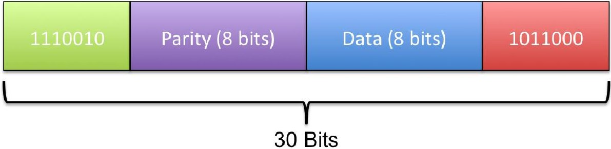


<div align="center">

Figure 2.3: Sprite packet structure

</div>

Every Sprite is assigned a pair of 511-bit Gold codes, one corresponding to a zero bit and the other corresponding to a one bit. Due to hardware constraints, an extra zero is appended to each Gold code to make its length exactly 64 bytes. After a packet has been encoded, each bit in the packet is replaced with the corresponding Gold code. The packet is then transmitted using some form of phase-coherent digital modulation. In the case of the CC1101 radio on the current Sprite, minimum-shift keying (MSK) modulation is used, but other modulation schemes, such as binary-phased-shift keying (BPSK) and quadrature-phase-shift keying (QPSK) could also be employed.

The maximum Doppler shift of a Sprite signal as seen by a ground station is approximately 10 kHz. Additionally, the crystal oscillator on the Sprite has a nominal frequency stability of 2 ppm, corresponding to roughly 1 kHz at the Sprite's operating frequency of 437 Mhz. As a result, a worst-case frequency deviation of 11 kHz must be handled. The Sprite's chipping rate of 64 kHz was chosen to accommodate this deviation while simultaneously balancing computational requirements in the receiver.

The power spectral density of a Sprite signal is shown in figure 2.4. The central lobe, which accounts for approximately 99% of the total signal power, occupies 64 kHz of bandwidth. With a frequency deviation of 11 kHz, a decrease of approximately 2 dB in received signal power occurs. While a lower chipping rate would

<!-- PDF_PAGE: 29 -->


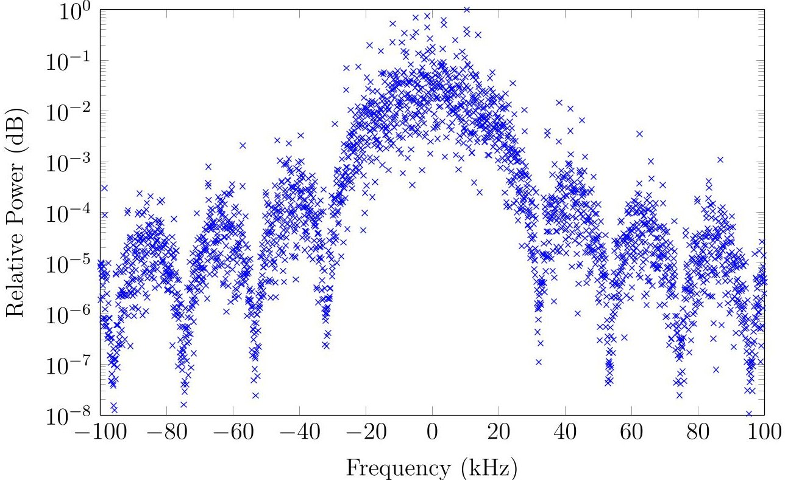


<div align="center">

Figure 2.4: Power spectral density of a Sprite signal

</div>

require less bandwidth and less computational throughput to demodulate, it would lead to a greater loss of signal power in the presence of frequency offsets, and an unacceptable degradation of link margin.

## 2.3.3 Receiver Implementation

Because of the signal processing requirements inherent in the Sprite communication protocol, a software-defined radio architecture was chosen for the receiver. In an SDR, a radio front end is connected directly to an analog-digital converter, which then feeds the resulting digitized baseband signal into a computer. All demodulation and decoding then happens in software. SDR architectures are very flexible, allowing changes to the signal structure, modulation, and decoding process to be implemented purely at the software level without any hardware changes.

<!-- PDF_PAGE: 30 -->

A reference design for a Sprite receiver has been developed using a hand-held Yagi antenna, a low-noise amplifier (LNA), a low-cost software-defined radio receiver (commonly known as a DVB-T or RTL receiver), and a laptop computer running the GNU Radio software[22]. All required hardware components are commercially available and are shown in figure 2.5.


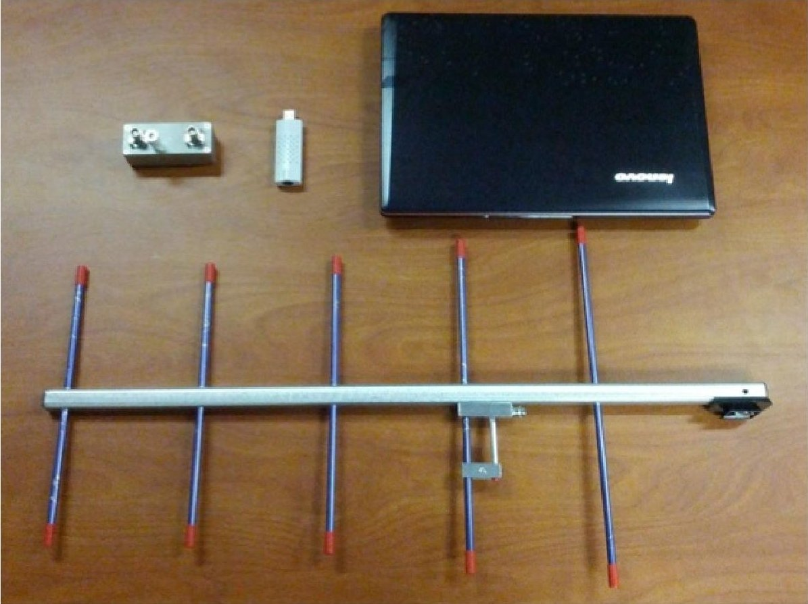


<div align="center">

Figure 2.5: Sprite ground station hardware

</div>

Figure 2.6 shows the signal flow diagram of the receiver in GNU Radio. Each signal processing block is written in either C++ or Python, with the GNU Radio libraries providing low-level hardware drivers, scheduling, and synchronization.

The first block in the upper left, labeled "RTL-SDR Source," is the driver for the USB radio receiver, which provides a tuner, gain stage, and analog to digital conversion. Next, the signal is low-pass filtered and re-sampled at the chipping rate of 64 kHz. The correlator block then simultaneously performs a frequency

<!-- PDF_PAGE: 31 -->


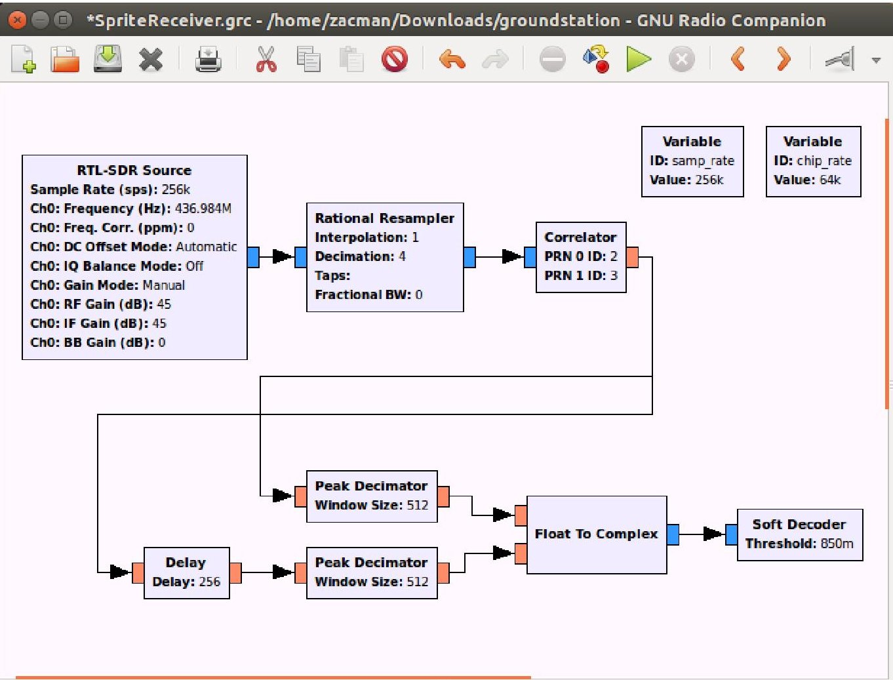


<div align="center">

Figure 2.6: GNU Radio signal flow diagram

</div>

search and cross-correlations against a pair of Gold codes. The frequency search operation is carried out efficiently using fast Fourier transforms[23].

At each time step, the correlator block outputs the largest-magnitude correlation coefficient, with those corresponding to the zero-bit PRN code negated. The "Peak Decimator" block then breaks the data stream into windows of 512 samples, returning only the largest magnitude sample in each window. The resulting data stream is at a sample rate of 125 Hz. A pair of these blocks operates in parallel, with windows offset by half a PRN period, to ensure that two bits are not conflated by being in the same 512 sample window due to slight clock offsets between the transmitter and receiver. Finally, the "Soft Decoder" block performs the soft-decision linear block code decoding operation described in section 2.3.1.

<!-- PDF_PAGE: 32 -->

The Sprite software receiver can run in real time on recent PC hardware. It can also run in a batch mode where RF data is recorded during a pass and fed through the receiver later, when the signals of each Sprite can be extracted individually. Both scenarios have been successfully tested in the laboratory and outdoors.

## 2.4 Communication Testing

Both laboratory hardware-in-the-loop and outdoor "ridge tests" have been performed to validate the Sprite communication system. The laboratory tests serve to validate decoding algorithms and test individual hardware components in a controlled environment. The outdoor tests, on the other hand, attempt to test the end-to-end communication system in as realistic a setting as possible before flight.

Hardware-in-the-loop tests have been performed using a combination of MATLAB and GNU Radio software to synthesize Sprite signals over a wide range of signal-to-noise ratios and Doppler shifts. Signals are then transmitted by an Ettus Research Universal Software Radio Peripheral (USRP), which performs digital to analog conversion, frequency conversion, and amplification[24]. The analog signal from the USRP is then fed through an attenuator and into the receiver. Reliable communication has been achieved under simulated link conditions equivalent to those in table 2.1.

Several outdoor link tests have been performed with Sprite flight units placed in sunlit locations at the University of California's Lick Observatory, atop Mount Hamilton in San Jose County, California. The Sprites were suspended several wavelengths above the ground to avoid ground effects and were entirely solar powered during the tests. The receiver described in section 2.3.3 was positioned at NASA

<!-- PDF_PAGE: 33 -->

Ames Research Center, in Mountain View, California. The line-of-sight distance between Sprites and receiver was 37 kilometers. An additional 23 decibels of attenuation was added between the receiving antenna and low-noise amplifier, producing an equivalent effective range of approximately 523 kilometers. Figure 2.7 shows an oscilloscope trace taken from the output of a correlator during an outdoor ridge test, with the spike indicating detection of a PRN code clearly visible.


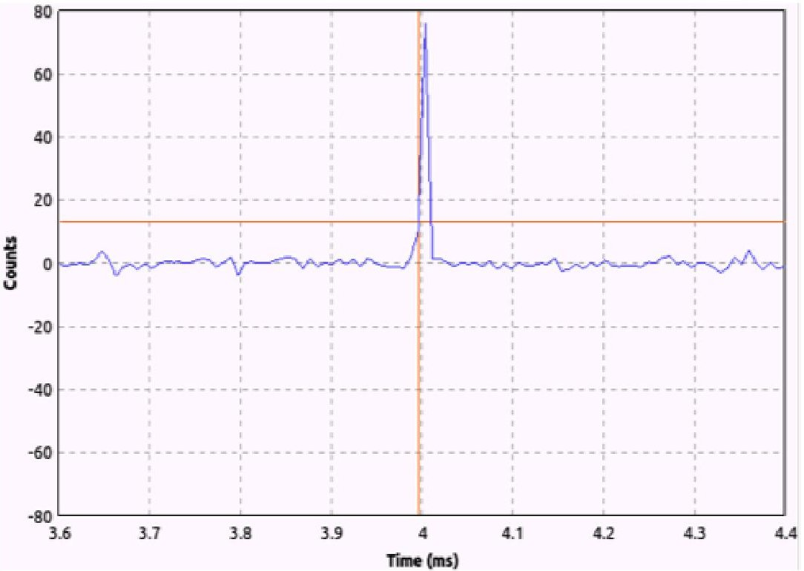


<div align="center">

Figure 2.7: Receiver correlator output during outdoor ridge test

</div>

## 2.5 On-Orbit Testing

Three Sprite prototypes were mounted to the outside of the International Space Station (ISS) during the STS-134 Space Shuttle mission in May 2011 as part of the 8th Materials International Space Station (MISSE-8) experiment[25]. While the Sprites were launched in fully functional condition and were presumably operating while on orbit, the location at which they were mounted on the ISS prevented

<!-- PDF_PAGE: 34 -->

any signals from reaching Earth. Figure 2.8 shows a photograph taken during the spacewalk in which the MISSE-8 experiment was installed on the ISS. The three Sprites are visible in the lower left.


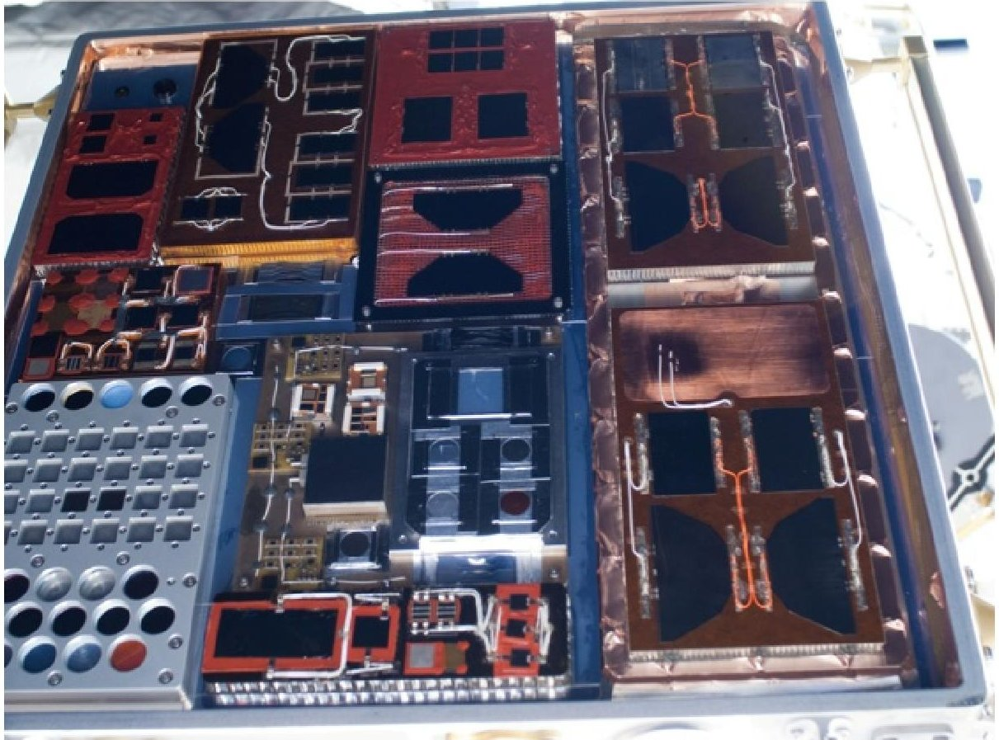


<div align="center">

Figure 2.8: Sprite prototypes mounted on the MISSE-8 experiment

</div>

The MISSE-8 experiment, including the Sprite prototypes, was returned to Earth in May 2014 on the Space-X CRS-3 mission after spending three years exposed to the space environment. Post-flight functional testing indicates that the solar cells, microcontrollers, and radios of all three Sprites remain in working condition. While functional testing alone cannot quantify radiation damage to the individual semiconductor devices, this early positive result indicates that the COTS components used on the Sprite can survive in the space environment for extended periods of time.

<!-- PDF_PAGE: 35 -->

## 2.6 Conclusions

The Sprite represents a significant advancement over previous femtosatellites. It is smaller and less massive than any existing spacecraft by at least one order of magnitude. In addition, the low-power, long-range communication solution developed for the Sprite not only solves a key outstanding problem with previous femtosatellite designs, but also has potential uses in other contexts, such as in fail-safe or backup modes on larger spacecraft.

<!-- PDF_PAGE: 36 -->

## CHAPTER 3

## KICKSAT

The KickSat project was founded in 2011 with the goal of advancing the core technologies needed to enable low-cost ChipSat missions. In addition to the Sprite ChipSat, this includes a CubeSat-based deployment system and a software-defined radio ground station. The project's first orbital demonstration mission, KickSat-1, launched as a secondary payload on the SpaceX CRS-3 mission in April 2014.

This chapter includes a description of the KickSat spacecraft in section 3.1, followed by a discussion of the mission profile for KickSat-1 in section 3.2. Next, section 3.3 describes the procedure used to measure the inertia of KickSat, followed by a discussion of deployment, thermal vacuum, and vibration testing in section 3.4. Finally, section 3.5 discusses the outcomes of the KickSat-1 mission.

## 3.1 The KickSat Spacecraft

The KickSat spacecraft, shown in figure 3.1, is a three-unit ("3U") CubeSat[26]. The bottom third of the spacecraft comprises the bus, which provides power, communication, command and data handling, and attitude determination and control functions. The upper two thirds contains a Sprite deployer. KickSat's avionics are based on the flight-proven PhoneSat 2.0 CubeSat developed at NASA Ames Research Center[27], and are built entirely from commercial-off-the-shelf (COTS) components.

The Sprite deployer is designed for simplicity and robustness while minimizing attitude disturbances on the spacecraft during deployment. The deployer houses 104 Sprites stacked in four columns in a two-by-two arrangement. Each Sprite is

<!-- PDF_PAGE: 37 -->


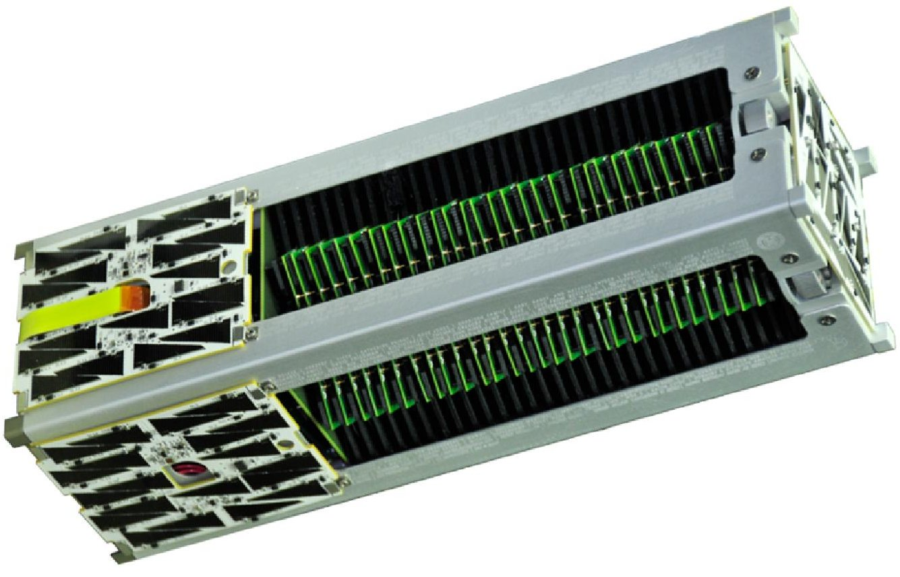


<div align="center">

Figure 3.1: The KickSat Spacecraft

</div>

housed in an individual slot and constrained by a carbon-fiber rod that runs the length of the column and passes through a hole in the corner of every Sprite, as shown in figure 3.2. The coiled nitinol wire antennas on the Sprites double as deployment springs to push the Sprites out of their slots.

All four carbon fiber rods are attached to a single plate at the top of the deployer that is actuated by a compressed spring and held in place by a locking mechanism. Deployment is triggered by a nichrome burn wire, which unlocks the mechanism, allowing the spring to pull the four rods out. The Sprites' antennas then push them from the deployer housing, as shown in figure 3.3.

<!-- PDF_PAGE: 38 -->


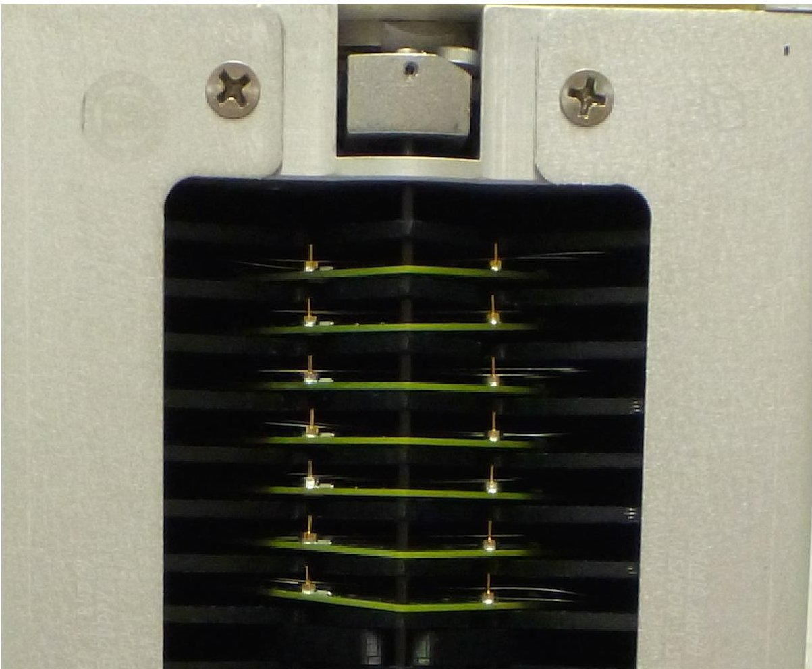


<div align="center">

Figure 3.2: Sprites in KickSat deployer

</div>


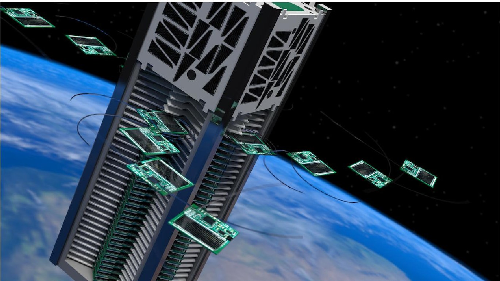


<div align="center">

Figure 3.3: Sprite deployment

</div>

<!-- PDF_PAGE: 39 -->

## 3.2 Mission Profile

KickSat has been awarded a launch through NASAs Educational Launch of Nanosatellites (ELaNa) program, which places university-built CubeSats as secondary payloads on NASA missions. The majority of ELaNa launch opportunities are to a roughly circular orbit with an altitude of approximately 400 km and an inclination of $ 51.5^{\circ} $ . This orbit has two useful properties. First, the high inclination puts the Sprites in view of almost every populated area of the Earth. Second, the low altitude limits the orbital lifetime of the Sprites to a few days, mitigating orbital debris concerns.

Upon separation from the launch vehicle, KickSat will power up and start a countdown timer. After 30 minutes, a UHF radio antenna will be deployed from the bus. Then, after 45 minutes, the bus radio will begin transmitting a beacon signal. During the first few passes, ground station operators will establish communication and perform checkouts of the spacecraft. Over the next three to four days, the attitude control system in the bus will be used to align KickSats minor axis of inertia (long axis) with the sun vector and spin the spacecraft up to 10-15 RPM, ensuring attitude stability during the deployment sequence.

Once a stable sun-pointing attitude has been established, all systems have been checked out, and KickSat is in view of a ground station, a signal from the ground will trigger a nichrome burn wire to unlock the deployer. The deployer's spring mechanism will then release the Sprites as free-flying spacecraft. The deployment sequence is intended to release the Sprites in a sun-pointing major-axis spin, which is dynamically stable[28]. While there are no strict pointing requirements, the goal of this spin stabilization is to keep the Sprites' solar panels pointed at the sun for the duration of the mission and to minimize nutation, which would otherwise

<!-- PDF_PAGE: 40 -->

introduce attitude-dependent fluctuations in power.

Due to their extremely low ballistic coefficient, the Sprites are expected to remain in orbit for only a few days before reentering and burning up in the atmosphere, alleviating debris concerns. Figure 3.4 shows altitude vs. time plots for bounding maximum and minimum, as well as average, atmospheric density taken from the MSIS atmospheric model[14]. In line with other CubeSat missions, the


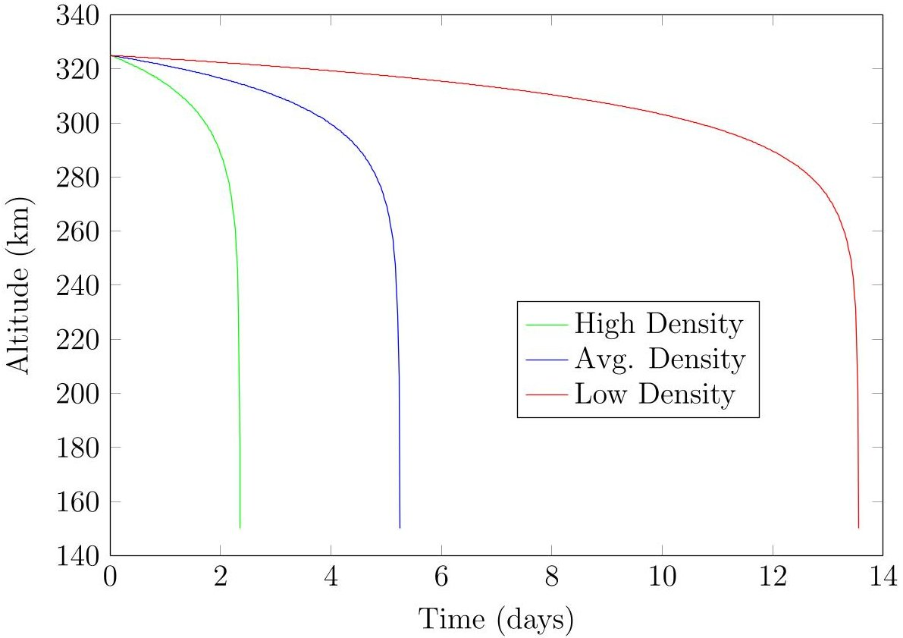


<div align="center">

Figure 3.4: Altitude vs. time for a Sprite in low-Earth orbit

</div>

KickSat bus is expected to remain in orbit for a few months before it too reenters. It may serve as a test bed for further communication and attitude control experiments during that time.

<!-- PDF_PAGE: 41 -->

## 3.3 Inertia Measurement

The attitude determination and control requirements of KickSat necessitate knowledge of the spacecraft's inertia tensor. Traditional methods (e.g. the "spin balance method") used in the aerospace industry to measure mass properties are accurate but require expensive specialized equipment[29]. As an alternative, a system known as a bifilar pendulum[30], [31] was used to measure moments of inertia about KickSat's body x, y, and z axes. This section provides a derivation of the bifilar pendulum's equation of motion and a description of the method's implementation.

## 3.3.1 The Bifilar Pendulum

A bifilar pendulum consists of a rigid body with mass m and inertia I suspended from a support structure by pair of parallel strings or cables of length L with horizontal separation 2r. Figure 3.5 depicts a such a device and and defines the coordinates used in the following derivation.


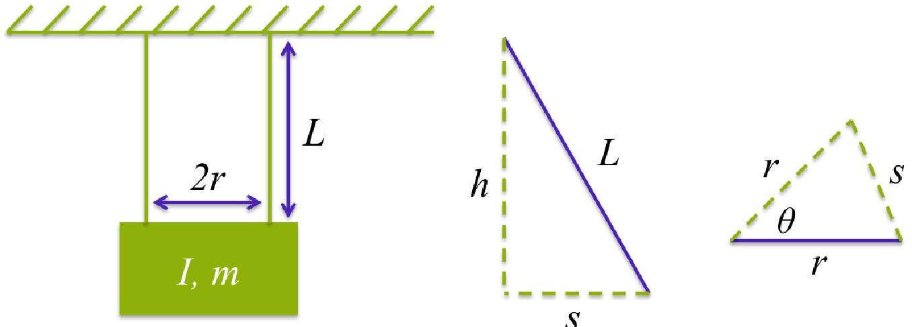


<div align="center">

Figure 3.5: Bifilar pendulum schematic

</div>

The dynamics of the bifilar pendulum will be parameterized in terms of $ \theta $ , the

<!-- PDF_PAGE: 42 -->

angular displacement about the vertical axis. Some trigonometry reveals that the height of the body h can be written as

$$
h = \sqrt {L ^ {2} - 2 r ^ {2} \left(1 - \cos (\theta)\right)}
$$

The Lagrangian of the system is then,

$$
\mathcal {L} = \frac {1}{2} I \dot {\theta} ^ {2} + m g \sqrt {L ^ {2} - 2 r ^ {2} \left(1 - \cos (\theta)\right)}
$$

where g is the local gravitational acceleration. Substituting equation 3.2 into the Euler-Lagrange equation[32],

$$
\frac {\mathrm {d}}{\mathrm {d} t} \left(\frac {\partial \mathcal {L}}{\dot {\theta}}\right) - \frac {\partial \mathcal {L}}{\partial \theta} = 0
$$

then gives the nonlinear equation of motion

$$
I \ddot {\theta} + \frac {m g r ^ {2} \sin (\theta)}{\sqrt {L ^ {2} - 2 r ^ {2} (1 - \cos (\theta))}} = 0
$$

To estimate the moment of inertia about the vertical axis I, a small-angle approximation is made and equation 3.4 is linearized, producing the following simple harmonic oscillator equation:

$$
I \ddot {\theta} + \frac {m g r ^ {2}}{L} \theta = 0
$$

The frequency of oscillation $ \omega $ can then be related to the inertia as follows,

$$
\omega^ {2} = \frac {m g r ^ {2}}{I L} \Rightarrow I = \frac {m g r ^ {2}}{\omega^ {2} L} = \frac {m g r ^ {2} T ^ {2}}{4 \pi^ {2} L}
$$

where T is the period of oscillation. A first-order error analysis gives the following approximation for the uncertainty in I given the uncertainties in the measured system parameters:

$$
\sigma_ {I} = \frac {m g r ^ {2} T ^ {2}}{4 \pi^ {2} L} \sqrt {\frac {\sigma_ {m} ^ {2}}{m ^ {2}} + \frac {\sigma_ {g} ^ {2}}{g ^ {2}} + \frac {\sigma_ {r} ^ {2}}{4 r ^ {2}} + \frac {\sigma_ {L} ^ {2}}{L ^ {2}} + \frac {\sigma_ {T} ^ {2}}{4 T ^ {2}}}
$$

<!-- PDF_PAGE: 43 -->

## 3.3.2 Experimental Setup and Results

A bifilar pendulum was constructed by suspending the KickSat spacecraft from the laboratory ceiling using two lengths of nylon monofilament, chosen for its light weight and high tensile strength. Small-amplitude oscillations were excited by applying a torque to the spacecraft. Measurements of the oscillation period T were averaged over ten periods. Figure 3.6 shows the apparatus during a measurement of the z-axis moment of inertia. Tests were repeated for the x-axis and y-axis.


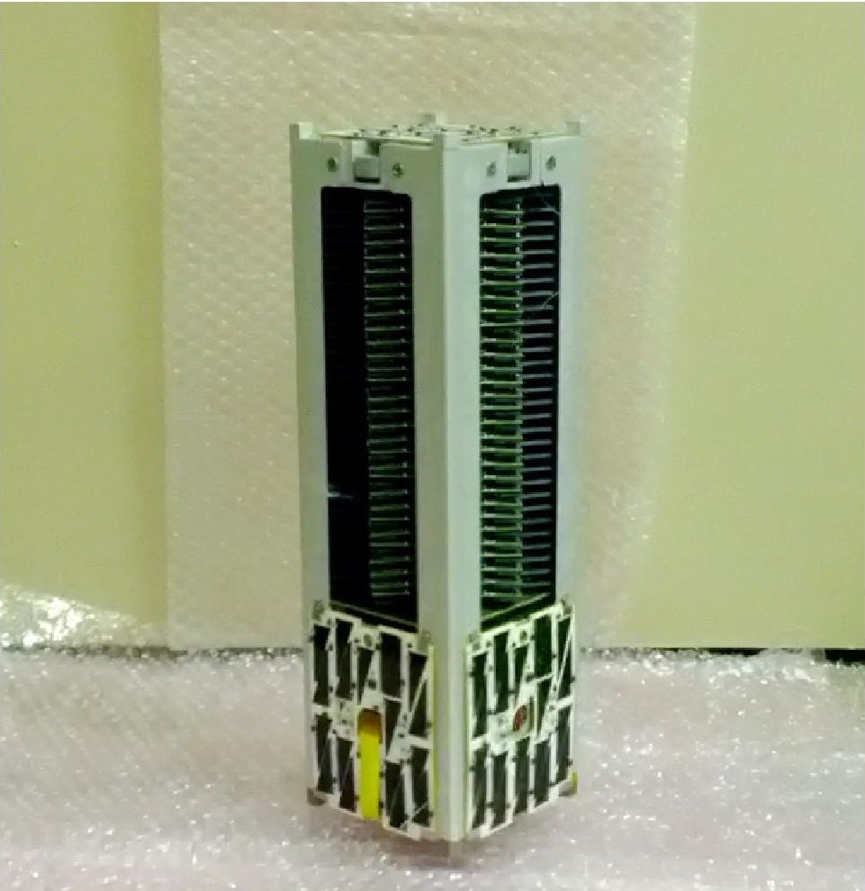


<div align="center">

Figure 3.6: KickSat z-axis inertia measurement

</div>

Table 3.1 lists the measurements recorded for each moment of inertia, along with corresponding measurement uncertainties. Relative uncertainties near 1% were achieved for all three axes. However, these bifilar pendulum experiments fail to capture information about the products of inertia or, equivalently, the true

<!-- PDF_PAGE: 44 -->

<div align="center">

Table 3.1: Inertia measurement data

</div>

<table border="1"><tr><td>Axis</td><td>L(mm)</td><td>r(mm)</td><td>m(kg)</td><td>g(mm/s2)</td><td>T(s)</td><td>I(kg·cm2)</td></tr><tr><td>x</td><td>1945±5</td><td>27.0±.5</td><td>2.68±.01</td><td>9807±10</td><td>11.60±.05</td><td>387±3.9</td></tr><tr><td>y</td><td>2000±5</td><td>33.5±.5</td><td>2.68±.01</td><td>9807±10</td><td>9.90±.05</td><td>366±3.3</td></tr><tr><td>z</td><td>1750±5</td><td>51.0±.5</td><td>2.68±.01</td><td>9807±10</td><td>2.25±.05</td><td>49.6±.65</td></tr></table>

orientation of the principle axes of inertia. As a result, significant uncertainty remains in the off-diagonal elements of the inertia tensor, necessitating the on-line inertia estimation algorithm developed in chapter 4.

## 3.4 Pre-flight Testing

KickSat was subjected to a variety tests, both during engineering development and to meet NASA requirements[33], [34]. This section documents deployment, vibration, and thermal vacuum testing. The full contents of all test and verification reports submitted to the NASA Launch Services Program are reproduced in appendix E.

## 3.4.1 Deployment Testing

Numerous deployment tests were performed to tune and verify the performance of the Sprite deployment system. Before each test, the KickSat spacecraft was loaded with Sprites and placed on a pedestal one meter above the laboratory floor, which was covered with antistatic padding material to cushion the impact of the Sprites. Deployment was triggered by a radio command and high-speed video was recorded at 240 frames per second during each test for subsequent analysis. Figure

<!-- PDF_PAGE: 45 -->

3. 7 shows a series of video frames captured during a deployment test.


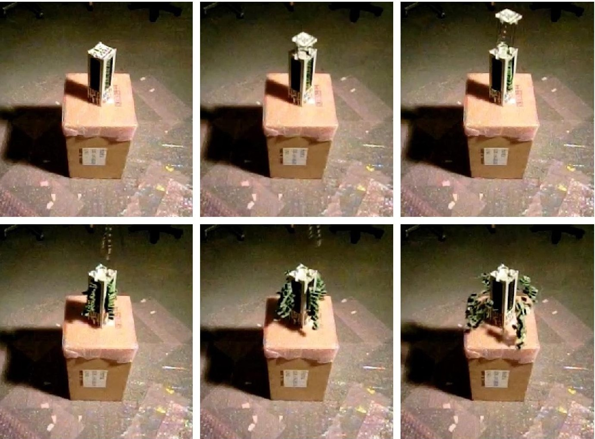


<div align="center">

Figure 3.7: KickSat deployment test

</div>

## 3.4.2 Vibration Testing

KickSat underwent vibration testing from August 26-28, 2013 at Space Systems Loral in Palo Alto, California. The testing process was performed in accordance with NASA CubeSat requirements[33]. Vibration frequency and amplitude profiles for the Falcon 9 launch vehicle were provided by SpaceX.

All tests were performed on a Ling shaker table. KickSat was mounted in a TestPOD, a mechanical simulator for the Poly Picosatellite Orbital Deployer (P-POD) used to deploy CubeSats from a launch vehicle[26]. A one inch thick

<!-- PDF_PAGE: 46 -->

aluminum adapter plate was fabricated to bolt the TestPOD to the standard two-inch-by-two-inch bolt pattern on the shaker table. A mechanical drawing of this plate is included in appendix E. Three three-axis accelerometers were used in all tests: one attached to the outside corner of the TestPOD, one attached to KickSat's structure, and a control accelerometer attached to the adapter plate. The complete test setup is shown in figure 3.8.


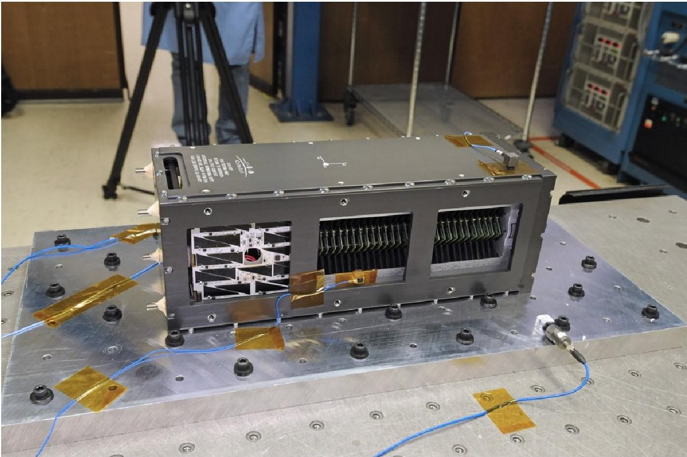


<div align="center">

Figure 3.8: Vibration test setup

</div>

For each of the spacecraft's x, y, and z axes, a sine sweep was first performed to measure the frequency response of the spacecraft's structure. The CubeSat was then subjected to random vibration, followed by a second sine sweep to ensure that the structural modes of the spacecraft had not changed, which would indicate damage. Plots of all test data are provided in appendix E. KickSat passed all vibration tests with no signs of damage.

<!-- PDF_PAGE: 47 -->

## 3.4.3 Thermal Vacuum Testing

KickSat underwent thermal vacuum testing from August 21-22, 2013 at NASA Ames Research Center's Engineering Evaluation Laboratory. The test requirements imposed by NASA's Launch Services Program specified maintaining a pressure less than $ 1 0^{-4} $ Torr and a nominal temperature of $ 6 0^{\circ} \mathrm{C} $ for a minimum of six hours. Additionally, the temperature ramp rate was not to exceed $ 5^{\circ} \mathrm{C} $ per minute.

KickSat was fitted with two thermocouples; one each on the $ +x $ and $ -x $ exterior faces of the spacecraft. The thermocouples were attached to the anodized aluminum surface of the CubeSat structure before the test as shown in Figure 3.9. Figure 3.10 shows the temperature and pressure data recorded during the test. The temperature readings of the two thermocouples agreed to within $ 2^{\circ} \mathrm{C} $ throughout the test.

In total, a minimum temperature of $ 6 0^{\circ} \mathrm{C} $ and maximum pressure of $ 3. 7 \times1 0^{-4} $ Torr were maintained for six hours and 50 minutes. Significant outgassing was observed as the chamber temperature increased, beginning approximately seven hours into the test. It was determined that this outgassing was due to sodium hydroxide residue left on 3D printed plastic components as part of the manufacturing process.

## 3.5 KickSat-1 Mission Outcomes

The KickSat-1 spacecraft launched on the SpaceX CRS-3 mission on April 18, 2014. After successful separation from the launch vehicle and antenna deployment, telemetry was received by Cornell's ground station during KickSat's second orbit.

<!-- PDF_PAGE: 48 -->


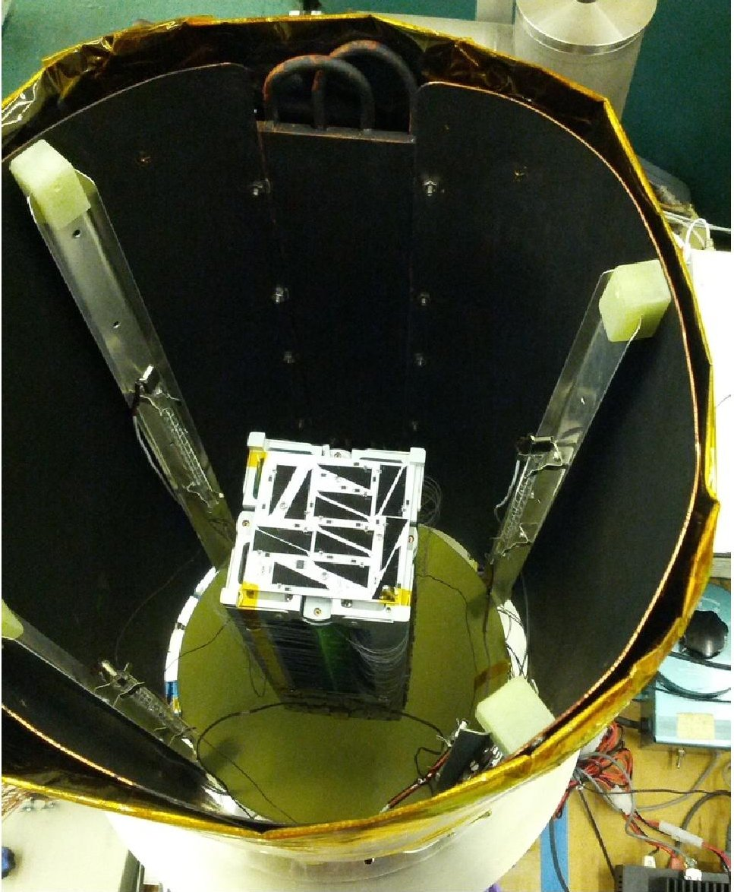


<div align="center">

Figure 3.9: Thermal vacuum test setup

</div>

Over the next few weeks, a group of dozens of amateurs from around the world collaborated over the internet to receive, decode, and analyze flight data; make reentry predictions; and share a wealth of technical information.

Sprite deployment had originally been planned for three to four days after launch. However, due to launch delays and scheduling conflicts with other spacecraft bound for the ISS, a 16-day delay between launch and Sprite deployment was imposed by NASA. This delay was implemented prior to launch in the form of a software countdown timer. Unfortunately, after operating normally for 14 days, KickSat experienced an anomaly in which the bus momentarily lost power and the

<!-- PDF_PAGE: 49 -->


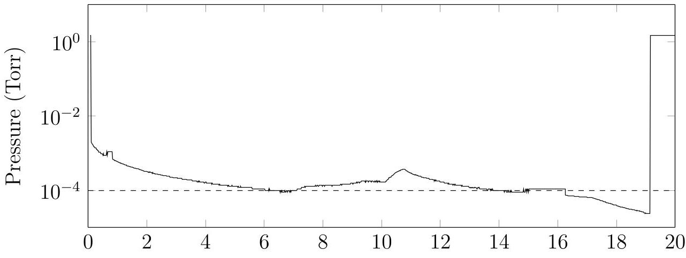


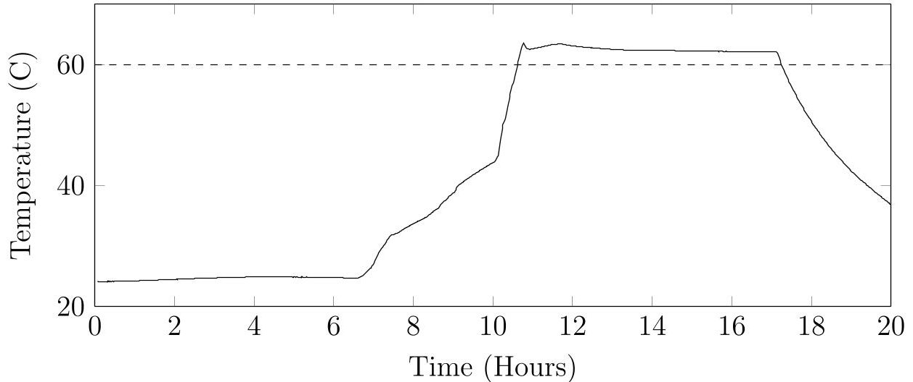


<div align="center">

Figure 3.10: Temperature and pressure during thermal vacuum test

</div>

avionics were reset. As a result, the 16 day deployment countdown was restarted.

Several attempts were made to uplink commands to the spacecraft. Ultimately, however, they were unsuccessful due to power and other technical constraints inherent in the spacecraft bus design. On May 13, after spending 25 days in orbit, KickSat reentered Earth's atmosphere without deploying its payload of Sprites.

<!-- PDF_PAGE: 50 -->

## 3.6 Conclusions

KickSat represents the beginning of a new paradigm for low-cost space missions. The small size, mass producibility, low cost, and short development cycles possible with ChipSats can enable new science missions, as well as expand access to space. While the KickSat-1 mission was not a complete success, it directly involved non-specialists from across the globe in spaceflight in new ways. To ensure that the technologies developed as part of KickSat are available to as broad an audience as possible, design files and code have been made freely available under open-source licenses. In the near future, it will be possible for students, hobbyists, and scientists alike to put together ChipSat-based missions in a matter of weeks or days, and at costs one to two orders of magnitude less than current small satellite missions.

<!-- PDF_PAGE: 51 -->

<div align="center">

# CHAPTER 4 RECURSIVE INERTIA ESTIMATION WITH SEMIDEFINITE PROGRAMMING

</div>

Knowledge of a spacecraft's inertia tensor is vital to the performance of guidance, navigation, and control algorithms. While estimates of the inertia can be calculated before launch by tabulating the masses and locations of spacecraft components, the accuracy of such estimates is limited. Additionally, a spacecraft's inertia may change in unpredictable ways throughout a mission due to fuel use, deployment failures, damage, or a variety of other reasons. As a result, the ability to estimate a spacecraft's inertia on orbit can offer improved pointing performance and robustness to modeling uncertainty and component failures.

This chapter proceeds with a review of existing methods for inertia estimation in section 4.1. Semidefinite programming is introduced in section 4.2, along with the notation conventions used throughout the chapter. Section 4.3 then develops a discrete-time equation of motion for a gyrostat spacecraft. Section 4.4 formulates batch inertia estimation as a semidefinite program. Section 4.5 uses the batch estimator as the basis for a recursive inertia estimation algorithm. Finally, numerical simulations involving both spinning and three-axis stabilized spacecraft are presented in section 4.6 to demonstrate the performance of the recursive algorithm.

## 4.1 Existing Work

Several algorithms for estimating a spacecraft's inertia parameters from telemetry data have been proposed. Bergmann, Walker, and Levy developed a filter for estimating inertia that ignores the nonlinear terms in the rigid body equations of mo-

<!-- PDF_PAGE: 52 -->

tion[35]. Ahmed, Coppola, and Bernstein proposed an adaptive attitude-tracking controller that recovers the elements of the inertia matrix under certain excitation conditions[36]. Psiaki presented a batch least-squares algorithm for estimating inertia as well as actuator alignment and scaling parameters[37]. Tanygin and Williams developed a least-squares estimator based on kinetic energy and integration of the work done by actuator inputs[38]. Norman, Peck, and O'Shaughnessy proposed a recursive least-squares algorithm for estimating inertia and actuator alignment parameters based on angular momentum[39]. The algorithm developed here is most closely related to that of Keim, Behcet, and Shields, who formulated batch least-squares inertia estimation as a semidefinite program to enforce positive-definiteness and constrain the elements of inertia with upper and lower bounds[40].

All of the existing inertia estimation methods cited suffer from at least one of the following drawbacks: First, most do not take into account the physical constraints on the components of the inertia tensor, in particular, positive-definiteness and the "triangle inequality"[41]. Without accounting for these constraints, estimation algorithms can return unphysical results and perform poorly when data is sparse or very noisy. Second, many algorithms require derivatives or integrals of measured spacecraft state variables as input, necessitating prefiltering that introduces additional complexity and numerical error. This study seeks to address both of these issues with a recursive estimator suitable for real-time implementation.

<!-- PDF_PAGE: 53 -->

## 4.2 Background

This section provides brief reviews of semidefinite programming and the algebra of quaternions. More thorough treatments of both topics are available in the books of Boyd and Vandenberghe[42] and Altmann[43], respectively.

## 4.2.1 Semidefinite Programming

A semidefinite program (SDP) is an optimization problem of the form

$$
\begin{array}{l} \underset {\boldsymbol {x}} {\mathrm {m i n i m i z e}} \quad \boldsymbol {c} ^ {\intercal} \boldsymbol {x} \\ \mathrm {s u b j e c t t o} \quad F (\boldsymbol {x}) \geq 0 \\ \end{array}
$$

where x and c are vectors in $ \mathbb{R}^{n} $ and F is an $ m\times m $ symmetric matrix defined as follows:

$$
F (\boldsymbol {x}) = F _ {0} + \sum_ {i = 1} ^ {n} x _ {i} F _ {i}
$$

The inequality constraint $ F ( \boldsymbol{x})\geq 0 $ means that F(x) must be positive semidefinite. That is, $ z^{\intercal} F ( x ) z\geq 0 $ for all vectors z in $ \mathbb{R}^{m} $ . Constraints of this type are known as linear matrix inequalities (LMIs)[44]. SDPs are convex. As a result, fast numerical algorithms with guaranteed convergence are available for solving them[42].

Many standard optimization problems, including linear and quadratic programs, can be put into SDP form. In particular, the linear least-squares problem

$$
\underset {\boldsymbol {x}} {\min i m i z e} \quad \| H \boldsymbol {x} - \boldsymbol {y} \| _ {2} ^ {2}
$$

where $ \boldsymbol{x}\in \mathbb{R}^{n},\boldsymbol{y}\in \mathbb{R}^{m} $ , and $ H\in \mathbb{R}^{m\times n} $ , can be recast as an SDP by introducing a scalar slack variable s into the vector of optimization variables:

$$
\boldsymbol {x} ^ {\prime} = \left[ \begin{array}{c} \boldsymbol {x} \\ s \end{array} \right]
$$

<!-- PDF_PAGE: 54 -->

Using the fact that the Schur complement of a positive semidefinite matrix must also be positive semidefinite, the least-squares problem can be embedded into the following LMI,

$$
F _ {L S} \left(\boldsymbol {x} ^ {\prime}\right) = \left[ \begin{array}{c c} s & (H \boldsymbol {x} - \boldsymbol {y}) ^ {\intercal} \\ (H \boldsymbol {x} - \boldsymbol {y}) & I \end{array} \right] \geq 0
$$

which is equivalent to the scalar inequality

$$
s - \left(H \boldsymbol {x} - \boldsymbol {y}\right) ^ {\intercal} \left(H \boldsymbol {x} - \boldsymbol {y}\right) \geq 0
$$

The least-squares problem in standard SDP form is then

$$
\begin{array}{l} \mathrm {m i n i m i z e} \quad \left[ \begin{array}{c c c c} 0 & \dots & 0 & 1 \end{array} \right] \left[ \begin{array}{c} \boldsymbol {x} \\ s \end{array} \right] \\ \mathrm {s u b j e c t t o} F _ {L S} \left(\boldsymbol {x} ^ {\prime}\right) \geq 0 \\ \end{array}
$$

Once an optimization problem is posed as an SDP, it can be modified by imposing a variety of additional LMI constraints. Multiple constraints can be enforced by forming a block-diagonal concatenation of their LMI representations. In this way, linear and quadratic problems subject to a large class of convex constraints can be solved efficiently.

## 4.2.2 Quaternion Algebra

Quaternions form an algebra with a non-commutative binary product operation. It is often convenient to think of them as four-dimensional objects composed of a three-dimensional vector part $ \boldsymbol{v} $ and a scalar part s.

$$
q = \left[ \begin{array}{c} \boldsymbol {v} \\ s \end{array} \right]
$$

<!-- PDF_PAGE: 55 -->

This representation allows the quaternion product to be written in terms of scalar and vector products:

$$
q _ {1} q _ {2} = \left[ \begin{array}{c} \boldsymbol {v} _ {1} \times \boldsymbol {v} _ {2} + s _ {1} \boldsymbol {v} _ {2} + s _ {2} \boldsymbol {v} _ {1} \\ s _ {1} s _ {2} - \boldsymbol {v} _ {1} \cdot \boldsymbol {v} _ {2} \end{array} \right]
$$

Note that $ q_{1} q_{2} \neq q_{2} q_{1} $ . Throughout the chapter, quaternion products are indicated by juxtaposition, while scalar and vector products are indicated in the usual way, with the $ \cdot $ and $ \times $ symbols, respectively.

Rotations can be conveniently represented by unit-length quaternions. If $ \boldsymbol{r} $ is a unit vector in $ \mathbb{R}^{3} $ representing the axis of rotation and $ \theta $ is the angle of rotation, then the quaternion representing the rotation is as follows:

$$
q = \left[ \begin{array}{c} \boldsymbol {r} \sin (\theta / 2) \\ \cos (\theta / 2) \end{array} \right]
$$

Both q and $ - q $ correspond to the same rotation, making the unit quaternions a "double cover" of the group of rotations.

The conjugate of a quaternion is denoted with a superscript $ \dagger $ and represents the rotation about the same axis $ \boldsymbol{r} $ by $ -\theta. $

$$
q ^ {\dagger} = \left[ \begin{array}{c} - \boldsymbol {v} \\ s \end{array} \right]
$$

Two rotations can be composed by multiplying their quaternion representations. A quaternion $ q_{3} $ representing a rotation $ q_{1} $ followed by a rotation $ q_{2} $ is simply $ q_{3}=q_{2} q_{1} $ . The rotation of a three-dimensional vector $ \boldsymbol{x} $ by a unit quaternion $ q $ is

$$
\hat {\boldsymbol {x}} ^ {\prime} = q \hat {\boldsymbol {x}} q ^ {\dagger}
$$

where $ \hat{x} $ indicates the formation of a quaternion with zero scalar part from the vector $ \mathbf{x} $:

$$
\hat {\boldsymbol {x}} = \left[ \begin{array}{c} \boldsymbol {x} \\ 0 \end{array} \right]
$$

<!-- PDF_PAGE: 56 -->

Finally, the subsequent analysis requires some kinematic identities relating quaternion derivatives to vector quantities more familiar in rigid body dynamics. First, the time derivative of a body's attitude quaternion is related to its angular velocity in the following way:

$$
\hat {\omega} = 2 q ^ {\dagger} \dot {q}
$$

Second, the quaternion generalized force corresponding to a torque on the body is[45], [46]

$$
\mathcal {F} = 2 q \hat {\boldsymbol {\tau}}
$$

Schaub and Junkins provide a thorough discussion of rigid body dynamics using quaternions[47].

## 4.3 Discrete Gyrostats Mechanics

A gyrostat is a system of coupled rigid bodies whose relative motions do not change the total inertia tensor of the system. This abstraction serves as a practical mathematical model for a spacecraft with reaction wheels. The fundamental differential equation governing the motion of a gyrostat is,

$$
J \cdot \dot {\boldsymbol {\omega}} + \boldsymbol {\omega} \times (J \cdot \boldsymbol {\omega} + \boldsymbol {\rho}) + \dot {\boldsymbol {\rho}} = \boldsymbol {\tau}
$$

where J is the symmetric positive-definite inertia tensor of the gyrostat, $ \omega $ is the body angular velocity, $ \rho $ is the total angular momentum stored in the rotors, and $ \tau $ is the external torque applied to the gyrostat[28]. In addition to being symmetric and positive definite, the elements of J are also constrained by the

<!-- PDF_PAGE: 57 -->

triangle inequality[41]:

$$
\begin{array}{l} J _ {1 1} + J _ {2 2} \geq J _ {3 3} \\ J _ {1 1} + J _ {3 3} \geq J _ {2 2} \\ J _ {2 2} + J _ {3 3} \geq J _ {1 1} \\ \end{array}
$$

In principle, the inertia can be estimated using equation (4.16) if time histories of the variables $ \omega, \dot{\omega}, \rho $ , and $ \dot{\rho} $ are available. In practice, however, the angular acceleration $ \dot{\omega} $ is not measured directly and must be obtained from noisy measurements of $ \omega $ . Many solutions to this problem have been proposed, including various finite difference and filtering schemes[40], [48] and integrating both sides of equation (4.16) with respect to time[37] $ - $ [39], but all add additional complexity and suffer to varying degrees from numerical error and noise amplification. Here, a new approach is taken in which discrete variational mechanics is used to derive a discrete-time version of equation (4.16) that does not contain $ \dot{\omega} $ .

Discrete mechanics is a mathematical framework for rigorously deriving discrete time algebraic equations of motion for mechanical systems[49]. The essential idea is to approximate the derivatives and integrals encountered in classical Lagrangian or Hamiltonian mechanics with finite differences and quadrature rules. Discretizations derived from variational principles offer many advantages over more traditional schemes like Runge-Kutta methods, including momentum and energy conservation[49]. The remainder of this section gives a brief derivation of the discrete time gyrostat equation originally presented by the authors in [50].

<!-- PDF_PAGE: 58 -->

## 4.3.1 Torque-Free Motion

The Lagrangian for a gyrostat is,

$$
\mathcal {L} = \frac {1}{2} \omega_ {B} \cdot J _ {B} \cdot \omega_ {B} + \sum_ {r = 1} ^ {N _ {r}} \frac {1}{2} \left(\omega_ {B} + \omega_ {r}\right) \cdot J _ {r} \cdot \left(\omega_ {B} + \omega_ {r}\right)
$$

where $ J_{B} $ is the carrier body's inertia tensor (including rotor masses), $ \omega_{B} $ is the carrier body's angular velocity, the $ J_{r} $ are the rotor inertia tensors, the $ \omega_{r} $ are the rotor angular velocities relative to the carrier body, and the $ x_{r} $ are the rotor positions relative to the carrier body's center of mass. Using equation (4.18), Hamilton's principle states that the equation of motion for the gyrostat, in the absence of external torques, can be found by setting the variation of the action equal to zero[32]:

$$
\delta \mathcal {S} = \delta \int_ {t _ {0}} ^ {t _ {f}} \mathcal {L} \mathrm {d} t = 0
$$

The transition to discrete mechanics begins by breaking the action integral into short segments of length h, with $ t_{k}=t_{0}+kh $:

$$
\delta \mathcal {S} = \delta \int_ {t _ {0}} ^ {t _ {f}} \mathcal {L} \mathrm {d} t = \delta \sum_ {k = 0} ^ {N - 1} \int_ {t _ {k}} ^ {t _ {k + 1}} \mathcal {L} \mathrm {d} t = 0
$$

The integral over a single time step on the right hand side of equation (4.20) is then approximated using a quadrature rule. First, the body's angular velocity is approximated by a finite difference of quaternions:

$$
\hat {\omega} _ {k} = 2 q _ {k} ^ {\dagger} \dot {q} _ {k} \approx 2 q _ {k} ^ {\dagger} \left(\frac {q _ {k + 1} - q _ {k}}{h}\right) = 2 \left(\frac {f _ {k} - 1}{h}\right)
$$

The rectangle rule is then applied to arrive at the following discrete Lagrangian[50],

$$
\mathcal {L} _ {d} = \frac {2}{h} \left[ f _ {k} \cdot \hat {J} _ {B} \cdot f _ {k} + \sum_ {r = 1} ^ {N _ {r}} \left(f _ {k} + \frac {h}{2} \hat {\omega} _ {r, k}\right) \cdot \hat {J} _ {r} \cdot \left(f _ {k} + \frac {h}{2} \hat {\omega} _ {r, k}\right) \right]
$$

<!-- PDF_PAGE: 59 -->

where $ \hat{J}_{B} $ and $ \hat{J}_{r} $ are augmented $ 4\times 4 $ equivalents of $ J_{B} $ and $ J_{r} $ :

$$
\hat {J} = \left[ \begin{array}{c c c c} J _ {1 1} & J _ {1 2} & J _ {1 3} & 0 \\ J _ {2 1} & J _ {2 2} & J _ {2 3} & 0 \\ J _ {3 1} & J _ {3 2} & J _ {3 3} & 0 \\ 0 & 0 & 0 & 0 \end{array} \right]
$$

Substituting the discrete Lagrangian back into equation (4.20) results in the discrete action sum:

$$
\mathcal {S} _ {d} = \sum_ {k = 0} ^ {N - 1} \frac {2}{h} \left[ f _ {k} \cdot \hat {J} _ {B} \cdot f _ {k} + \sum_ {r = 1} ^ {N _ {r}} \left(f _ {k} + \frac {h}{2} \hat {\omega} _ {r, k}\right) \cdot \hat {J} _ {r} \cdot \left(f _ {k} + \frac {h}{2} \hat {\omega} _ {r, k}\right) \right]
$$

Hamilton's principle can then be applied by setting the variational derivative of equation (4.24) equal to zero using a constrained variation of $ f_{k} $ which respects the quaternion unit-norm constraint[50],

$$
{} ^ {\epsilon} f _ {k} = f _ {k} + \epsilon \left(f _ {k} \hat {\boldsymbol {\eta}} _ {k + 1} - \hat {\boldsymbol {\eta}} _ {k} f _ {k}\right)
$$

resulting in

$$
\sum_ {k = 0} ^ {N - 1} \left[ f _ {k} \cdot \hat {J} _ {B} \cdot \left(f _ {k} \hat {\eta} _ {k + 1} - \hat {\eta} _ {k} f _ {k}\right) + \sum_ {r = 1} ^ {N _ {r}} \left(f _ {k} + \frac {h}{2} \hat {\omega} _ {r, k}\right) \cdot \hat {J} _ {r} \cdot \left(f _ {k} \hat {\eta} _ {k + 1} - \hat {\eta} _ {k} f _ {k}\right) \right] = 0
$$

To ensure that the variations $ \eta $ in equation (4.26) have the same time index, a "discrete integration by parts" is performed, which amounts to some simple index manipulation:

$$
\sum_ {k = 1} ^ {N - 1} \left[ f _ {k - 1} \cdot \hat {J} _ {B} \cdot \left(f _ {k - 1} \hat {\eta} _ {k} - \hat {\eta} _ {k} f _ {k}\right) + \sum_ {r = 1} ^ {N _ {r}} \left(f _ {k - 1} + \frac {h}{2} \hat {\omega} _ {r, k - 1}\right) \cdot \hat {J} _ {r} \cdot \left(f _ {k - 1} \hat {\eta} _ {k} - \hat {\eta} _ {k} f _ {k}\right) \right] = 0
$$

Recognizing that equation (4.27) must hold for all variations $ \boldsymbol{\eta}_{k} $ , making the substitution,

$$
f _ {k} = \left[ \frac {\phi_ {k}}{\sqrt {1 - \phi_ {k} \cdot \phi_ {k}}} \right]
$$

and performing some algebra, results in the discrete-time gyrostat equation,

$$
\begin{array}{l} \sqrt {1 - \phi_ {k + 1} \cdot \phi_ {k + 1}} \left(J \cdot \phi_ {k + 1} + \frac {h}{2} \boldsymbol {\rho} _ {k + 1}\right) + \phi_ {k + 1} \times \left(J \cdot \phi_ {k + 1} + \frac {h}{2} \boldsymbol {\rho} _ {k + 1}\right) \\ = \sqrt {1 - \phi_ {k} \cdot \phi_ {k}} \left(J \cdot \phi_ {k} + \frac {h}{2} \boldsymbol {\rho} _ {k}\right) - \phi_ {k} \times \left(J \cdot \phi_ {k} + \frac {h}{2} \boldsymbol {\rho} _ {k}\right) \\ \end{array}
$$

<!-- PDF_PAGE: 60 -->

where $ \rho $ is the total momentum stored in the rotors and J is the gyrostat inertia:

$$
J = J _ {B} + \sum_ {r = 1} ^ {N _ {r}} J _ {r}
$$

## 4.3.2 External Torques

External torques can be added to equation (4.29) using the integral form of the Lagrange-D'Alembert principle[51],

$$
\delta \int_ {t _ {0}} ^ {t _ {f}} \mathcal {L} \mathrm {d} t + \int_ {t _ {0}} ^ {t _ {f}} \mathcal {F} \cdot \delta q \mathrm {d} t = 0
$$

where the second term is the integral of the virtual work done by a generalized force $ \mathcal{F} $ . The discrete form of equation (4.31) is

$$
\delta \sum_ {k = 0} ^ {N} \mathcal {L} _ {d} + \sum_ {k = 0} ^ {N} \mathcal {F} _ {d} ^ {-} \cdot \delta q _ {k} + \mathcal {F} _ {d} ^ {+} \cdot \delta q _ {k + 1} = 0
$$

$ \mathcal{F}_{d}^{-} $ and $ \mathcal{F}_{d}^{+} $ , known as discrete generalized forces, are defined as follows[49]:

$$
\mathcal {F} _ {d} ^ {-} = \int_ {t _ {k}} ^ {t _ {k + 1}} \frac {1}{2} \mathcal {F} (q, \dot {q}) \cdot \frac {\partial q (t)}{\partial q _ {k}} \mathrm {d} t
$$

$$
\mathcal {F} _ {d} ^ {+} = \int_ {t _ {k}} ^ {t _ {k + 1}} \frac {1}{2} \mathcal {F} (q, \dot {q}) \cdot \frac {\partial q (t)}{\partial q _ {k + 1}} \mathrm {d} t
$$

Inserting the expression for the quaternion generalized force given in equation(4.15) and applying the rectangle rule results in the following discrete quaternion generalized forces:

$$
\mathcal {F} _ {d} ^ {-} \approx h q _ {k} \hat {\boldsymbol {\tau}} _ {k}
$$

$$
\mathcal {F} _ {d} ^ {+} \approx h q _ {k + 1} \hat {\boldsymbol {\tau}} _ {k + 1}
$$

<!-- PDF_PAGE: 61 -->

Substituting these terms into equation (4.32) and performing some additional algebra reveals the forced discrete gyrostat equation:

$$
\begin{array}{l} \sqrt {1 - \phi_ {k + 1} \cdot \phi_ {k + 1}} \left(J \cdot \phi_ {k + 1} + \frac {h}{2} \boldsymbol {\rho} _ {k + 1}\right) + \phi_ {k + 1} \times \left(J \cdot \phi_ {k + 1} + \frac {h}{2} \boldsymbol {\rho} _ {k + 1}\right) + \frac {h ^ {2}}{2} \boldsymbol {\tau} _ {k + 1} \\ = \sqrt {1 - \phi_ {k} \cdot \phi_ {k}} \left(J \cdot \phi_ {k} + \frac {h}{2} \boldsymbol {\rho} _ {k}\right) - \phi_ {k} \times \left(J \cdot \phi_ {k} + \frac {h}{2} \boldsymbol {\rho} _ {k}\right) \tag {4} \\ \end{array}
$$

While it may seem that $ \phi_{k} $ and $ \phi_{k+1} $ in equation (4.37) must be calculated by finite differences of quaternions, thus conferring no real advantage over equation (4.16) with respect to noise amplification, this is not the case. Most attitude determination filters used on board spacecraft, including the multiplicative extended Kalman filter (MEKF)[52], [53], directly estimate $ \phi_{k} $ or some other closely related three-parameter relative rotation at each time step. Equation (4.37), therefore, allows information readily available in existing spacecraft attitude determination systems to be used directly as input to the inertia estimation algorithm.

## 4.4 Batch Inertia Estimation

In this section, estimation of the components of the inertia tensor from a time history of attitude observations, rotor momenta, and external torques is formulated as a constrained batch least-squares problem. The resulting problem is then transformed into an SDP which can be efficiently solved.

While equation (4.37) is nonlinear in $ \phi $ , it is linear in J. To make this explicit, the matrix $ G(\phi) $ and the vector j are defined as follows:

$$
G (\phi) = \left[ \begin{array}{c c c c c c} \phi_ {1} & 0 & 0 & \phi_ {2} & \phi_ {3} & 0 \\ 0 & \phi_ {2} & 0 & \phi_ {1} & 0 & \phi_ {3} \\ 0 & 0 & \phi_ {3} & 0 & \phi_ {1} & \phi_ {2} \end{array} \right]
$$

<!-- PDF_PAGE: 62 -->

$$
\boldsymbol {j} = \left[ \begin{array}{l} J _ {1 1} \\ J _ {2 2} \\ J _ {3 3} \\ J _ {1 2} \\ J _ {1 3} \\ J _ {2 3} \end{array} \right]
$$

In terms of G and j, the matrix vector product J $ \phi $ becomes $ G(\phi)j $ , allowing equation (4.37) to be rewritten as,

$$
N \left(\phi_ {k + 1}\right) \left(G \left(\phi_ {k + 1}\right) \boldsymbol {j} + \frac {h}{2} \boldsymbol {\rho} _ {k + 1}\right) + \frac {h ^ {2}}{2} \boldsymbol {\tau} _ {k + 1} = M \left(\phi_ {k}\right) \left(G \left(\phi_ {k}\right) \boldsymbol {j} + \frac {h}{2} \boldsymbol {\rho} _ {k}\right)
$$

where the matrices $ M(\phi) $ and $ N(\phi) $ are defined as follows:

$$
M (\phi) = \sqrt {1 - \phi \cdot \phi} I - S (\phi)
$$

$$
N (\phi) = \sqrt {1 - \phi \cdot \phi} I + S (\phi)
$$

After collecting terms, equation (4.40) can be written as

$$
H _ {k} \boldsymbol {j} = \boldsymbol {y} _ {k}
$$

where the $ 3\times 6 $ matrix $ H_{k} $ and the $ 3\times 1 $ vector $ \boldsymbol{y}_{k} $ are defined as follows:

$$
H _ {k} = N \left(\phi_ {k + 1}\right) G \left(\phi_ {k + 1}\right) - M \left(\phi_ {k}\right) G \left(\phi_ {k}\right)
$$

$$
\boldsymbol {y} _ {k} = M \left(\boldsymbol {\phi} _ {k}\right) \frac {h}{2} \boldsymbol {\rho} _ {k} - N \left(\boldsymbol {\phi} _ {k + 1}\right) \frac {h}{2} \boldsymbol {\rho} _ {k + 1} - \frac {h ^ {2}}{2} \boldsymbol {\tau} _ {k + 1}
$$

Given a set of attitude measurements collected over time $ \phi_{1} $ . . . $ \phi_{N} $ , along with corresponding time histories of reaction wheel momenta $ \rho_{1} $ . . $ \rho_{N} $ and external

<!-- PDF_PAGE: 63 -->

torques $ \boldsymbol{\tau}_{1}\dots\boldsymbol{\tau}_{N} $ , the batch inertia estimation problem can be stated as,

minimize j

subject to

$$
\begin{array}{l} \left\| H _ {1: N} \boldsymbol {j} - \boldsymbol {y} _ {1: N} \right\| _ {2} ^ {2} \\ \left\{ \begin{array}{l} J > 0 \\ J _ {1 1} + J _ {2 2} - J _ {3 3} \geq 0 \\ J _ {1 1} + J _ {3 3} - J _ {2 2} \geq 0 \\ J _ {2 2} + J _ {3 3} - J _ {1 1} \geq 0 \end{array} \right. \\ \end{array}
$$

where $ H_{1:N} $ and $ \boldsymbol{y}_{1:N} $ are concatenations of the $ H_{k} $ and $ \boldsymbol{y}_{k} $ matrices corresponding to each measurement:

$$
H _ {1: N} = \left[ \begin{array}{c} H _ {1} \\ \vdots \\ H _ {N} \end{array} \right] \quad \boldsymbol {y} _ {1: N} = \left[ \begin{array}{c} \boldsymbol {y} _ {1} \\ \vdots \\ \boldsymbol {y} _ {N} \end{array} \right]
$$

The constrained least-squares problem (4.46) can then be transformed into an SDP using the results presented in section 4.2:

minimize

$$
\left[ \begin{array}{l l l l} 0 & \dots & 0 & 1 \end{array} \right] \left[ \begin{array}{l} \boldsymbol {j} \\ s \end{array} \right]
$$

subject to

$$
\left\{ \begin{array}{l} J - \epsilon I \geq 0 \\ J _ {1 1} + J _ {2 2} - J _ {3 3} \geq 0 \\ J _ {1 1} + J _ {3 3} - J _ {2 2} \geq 0 \\ J _ {2 2} + J _ {3 3} - J _ {1 1} \geq 0 \\ \left[ \begin{array}{c c} s & \left(H _ {1: N} \boldsymbol {j} - \boldsymbol {y} _ {1: N}\right) ^ {\intercal} \\ \left(H _ {1: N} \boldsymbol {j} - \boldsymbol {y} _ {1: N}\right) & I \end{array} \right] \geq 0 \end{array} \right.
$$

While the five LMI constraints in (4.48) have been written separately due to space constraints, they are concatenated to form a single block-diagonal LMI in practice. The $ \epsilon I $ term in the first constraint, where $ \epsilon $ is a small positive constant, ensures that J is strictly positive-definite rather than positive-semidefinite. This

<!-- PDF_PAGE: 64 -->

constant should be chosen slightly larger than the error tolerance of the SDP solver being used.

In addition to enforcing positive-definiteness and the triangle inequality, a variety of other constraints can be included in the SDP formulation. This is especially useful for incorporating a priori knowledge into the estimator. For example, if bounds can be placed on the elements of J from modeling or ground-based testing, they can be easily accounted for by adding additional diagonal elements to the LMI in (4.48).

For J to be uniquely determined, a few conditions on the observations must be met. First, $ \phi_{k} $ must be changing in time. Otherwise the corresponding $ H_{k} $ matrices will be zero. Physically, this means that the spacecraft cannot be stationary or in a spin about a principle axis with no nutation. Second, some non-zero internal rotor momentum or known external torque must be applied to the spacecraft. Otherwise, the vectors $ y_{k} $ will be zero. In that case, the least-squares problem reduces to finding a vector in the null space of H, which is only determined up to an arbitrary scale factor.

## 4.5 Recursive Inertia Estimation

While the batch estimation scheme (4.48) is sufficient for offline analysis of flight data, a recursive formulation that allows estimates to be updated as new data becomes available is preferred in real-time applications. This section develops a recursive version of (4.48) that enables efficient updating.

The key to the recursive algorithm is the QR decomposition. A given matrix A

<!-- PDF_PAGE: 65 -->

can always be factored into the product of an orthogonal matrix Q and an upper triangular matrix R[54], [55]. If A is rectangular with more rows m than columns n, the lower m-n rows of R are entirely filled with zeros:

$$
A = \left[ \begin{array}{l l} Q _ {1} & Q _ {2} \end{array} \right] \left[ \begin{array}{c} R _ {1} \\ 0 \end{array} \right]
$$

Only the first n columns of Q and first n rows of R, denoted $ Q_{1} $ and $ R_{1} $ above, are actually needed to reconstruct A. Standard linear algebra routines are available for calculating $ Q_{1} $ and $ R_{1} $ given an input matrix A, known as a "thin" or "economy" QR decomposition[54], [55]. In the rest of this section it is assumed that such a routine is available and the "thin" $ m\times n $ $ Q_{1} $ and $ n\times n $ $ R_{1} $ matrices will simply be denoted Q and R.

By applying the QR decomposition to $ H_{1:N} $ , the least-squares problem (4.46) can be rewritten as

$$
\begin{array}{l} \underset {j} {\mathrm {m i n i m i z e}} \quad \| R _ {1: N} \boldsymbol {j} - \boldsymbol {z} _ {1: N} \| _ {2} ^ {2} \\ \mathrm {s u b j e c t t o} \left\{ \begin{array}{l} J > 0 \\ J _ {1 1} + J _ {2 2} - J _ {3 3} \geq 0 \\ J _ {1 1} + J _ {3 3} - J _ {2 2} \geq 0 \\ J _ {2 2} + J _ {3 3} - J _ {1 1} \geq 0 \end{array} \right. \\ \end{array}
$$

where $ \boldsymbol{z}_{1:N}=Q_{1:N}^{\intercal}\boldsymbol{y}_{1:N} $ . If a new set of observations $ H_{N+1} $ and $ \boldsymbol{y}_{N+1} $ becomes available, R and $ \boldsymbol{z} $ can be easily updated:

$$
\left[ Q _ {1: N + 1}, R _ {1: N + 1} \right] = \operatorname {q r} \left(\left[ \begin{array}{c} R _ {1: N} \\ H _ {N + 1} \end{array} \right]\right)
$$

$$
\boldsymbol {z} _ {1: N + 1} = Q _ {1: N + 1} \left[ \begin{array}{l} \boldsymbol {z} _ {1: N} \\ \boldsymbol {y} _ {N + 1} \end{array} \right]
$$

Once $ R_{1:N+1} $ and $ z_{1:N+1} $ have been calculated, the constrained minimization (4.50) can be re-solved using the SDP formulation of section 4.4. Algorithm 4.1 summarizes the implementation of the recursive estimator.

<!-- PDF_PAGE: 66 -->

## Algorithm 4.1: Recursive Inertia Estimator

1: $ H_{1}\leftarrow $ Calculate using equation (4.44)

2: $ \boldsymbol{y}_{1}\leftarrow $ Calculate using equation (4.45)

3: $ [Q_{1},R_{1}]\leftarrow \mathrm{qr}(H_{1})$

4: $ \boldsymbol{z}_{1}\leftarrow Q_{1}^{\mathrm{T}}\boldsymbol{y}_{1} $

5: **for** $ k=2:N $ do

6: $ H_{k}\leftarrow $ Calculate using equation (4.44)

7: $ \boldsymbol{y}_{k}\leftarrow $ Calculate using equation (4.45)

8: $ [Q_{1:k},R_{1:k}]\leftarrow \mathrm{qr}\left(\left[ \begin{array}{c} R_{1:k-1} \\ H_{k} \end{array} \right]\right) $

9: $ \boldsymbol{z}_{1:k}\leftarrow Q_{1:k}^{\mathrm{T}}\left[ \begin{array}{c} \boldsymbol{z}_{1:k-1} \\ \boldsymbol{y}_{k} \end{array} \right] $

10: $ J_{k}\leftarrow $ Solve constrained least-squares problem (4.50) using SDP

11: **end for**

## 4.6 Numerical Examples

This section presents two test cases that demonstrate the performance of the recursive inertia estimation algorithm. First, a three-axis stabilized spacecraft is simulated performing a series of short slew maneuvers. Second, a spin-stabilized spacecraft is simulated spinning about its major axis of inertia with some nutation. The spinning case is used to illustrate the benefits of incorporating additional constraints into the estimator by bounding one of the moments of inertia to within 10% of a nominal value. Comparisons are made to the momentum-based recursive inertia estimation algorithm of Norman, Peck, and O'Shaughnessy[39].

All simulations use MATLAB's ODE45 solver to integrate equation (4.16) with white noise disturbance torques applied to the spacecraft. Simulated measurements

<!-- PDF_PAGE: 67 -->

are also corrupted with white noise equivalent to that produced by a low-cost single-chip commercial gyroscope[56]. The true inertia in all cases is

$$
J _ {t r u e} = \left[ \begin{array}{c c c} 1. 0 0 3 5 & 0. 0 3 6 8 & - 0. 0 6 7 8 \\ 0. 0 3 6 8 & 2. 0 0 4 7 & - 0. 0 7 5 5 \\ - 0. 0 6 7 8 & - 0. 0 7 5 5 & 2. 9 9 1 8 \end{array} \right]
$$

The MATLAB-based SeDuMi SDP solver[57] is used in these examples. A wide variety of other SDP solvers, both free and commercial, are available[58].

In the first test case, a series of short slew maneuvers which could be executed on a three-axis stabilized spacecraft are simulated. No a priori information is used to initialize the estimation algorithms. Figure 4.1 shows the commanded rotor momentum components in body-fixed axes while figure 4.2 shows the simulated body-fixed angular velocity components for the slew maneuvers.

Figure 4.3 shows the relative Frobenius norm error in the estimated inertia for both algorithms. Figures 4.4 and 4.5 show the normalized errors in the estimated moments and products of inertia, respectively, over the course of the simulation. The SDP-based estimator yields substantially more accurate estimates of the inertia components throughout the simulation.

The second test case demonstrates the advantages of including additional constraints in the SDP-based estimator. A spacecraft is simulated spinning about its major axis of inertia with some nutation. The only control input is a short pulse applied to a single reaction wheel 30 seconds into the simulation. Figure 4.6 shows the simulated body-fixed angular velocity components, while figure 4.7 shows the rotor momentum components.

The $ J_{33} $ component of the inertia matrix is constrained to be within 10% of a nominal value of 3. Such an assumption is reasonable if, for example, a CAD

<!-- PDF_PAGE: 68 -->


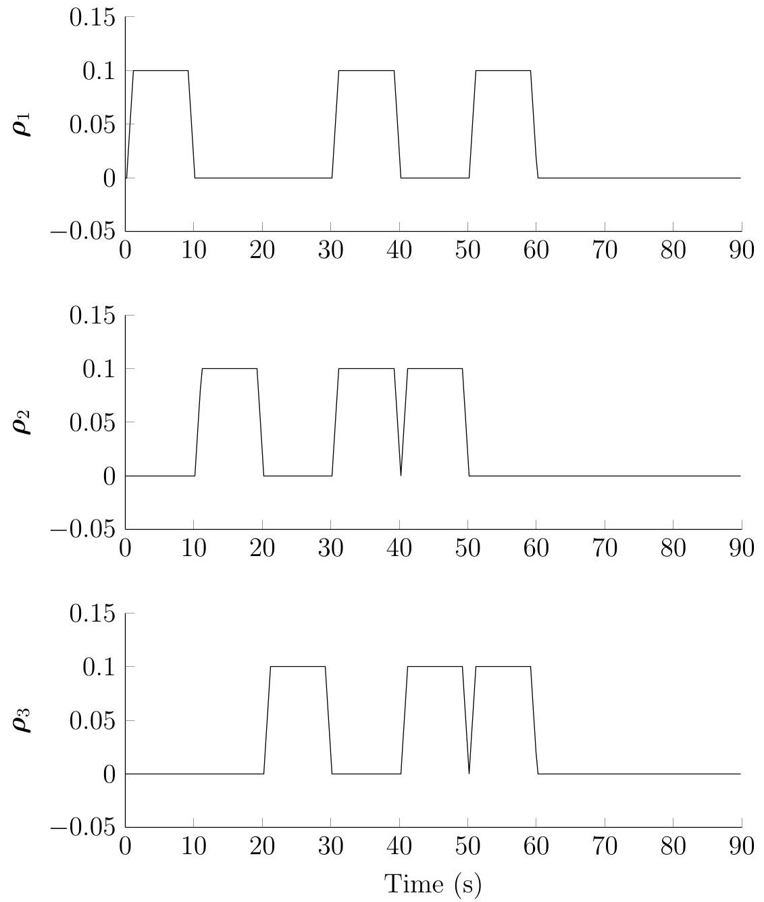


<div align="center">

Figure 4.1: Rotor momentum components during slew maneuvers

</div>

model or ground-based experiment is used to calculate inertia components before launch. Figure 4.8 shows the relative Frobenius norm error in the estimated inertia for both estimators. Normalized errors in the estimated moments of inertia are plotted in figure 4.9, while the normalized errors in the products of inertia are plotted in figure 4.10.

The SDP-based estimator achieves lower error in all inertia components throughout the simulation. In spite of the fact that a priori information is only supplied

<!-- PDF_PAGE: 69 -->


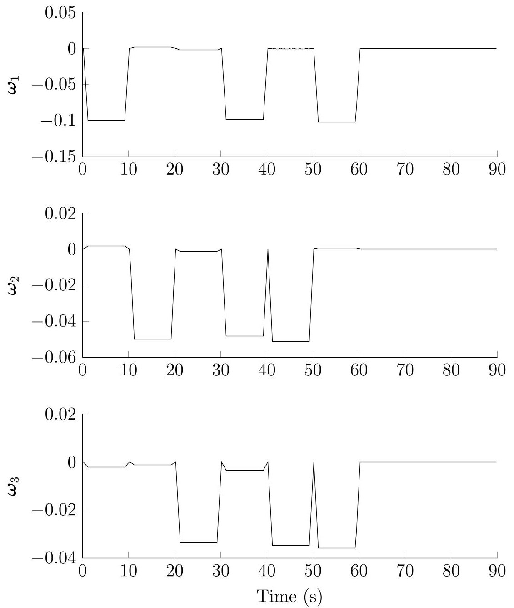


<div align="center">

Figure 4.2: Body angular velocity components during slew maneuvers

</div>

for a single component of the inertia, the SDP-based estimator is able to achieve relative errors of 10% or better on all inertia components during the first half of the simulation. Physically valid inertia estimates that can be used in other guidance, navigation, and control algorithms on board the spacecraft are always returned. The momentum-based estimator, on the other hand, provides no useful information until a control torque is applied.

<!-- PDF_PAGE: 70 -->


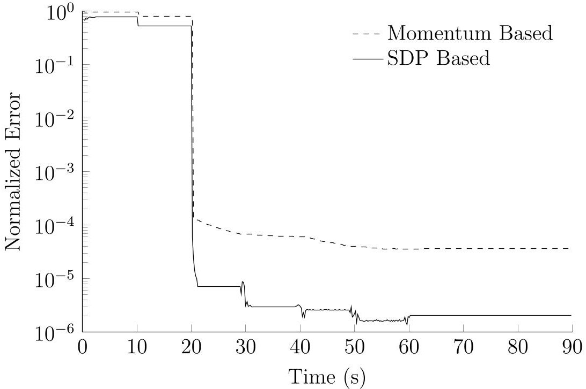


<div align="center">

Figure 4.3: Normalized inertia error during slew maneuvers

</div>

## 4.7 Conclusions

This study presents a recursive algorithm for spacecraft inertia estimation using semidefinite programming. A discrete mechanics formulation of the spacecraft dynamics allows data generated by standard attitude determination algorithms to be directly used as input to the estimator. By formulating the estimation problem as an SDP, the positive-definiteness and triangle-inequality constraints on the elements of the inertia tensor can be enforced, ensuring physically valid results. A priori knowledge can also be incorporated into the estimator in the form of additional LMI constraints, enhancing convergence and leading to more accurate estimates when limited data is available. The availability of fast interior-point SDP solvers makes the algorithm suited for real-time implementation.

<!-- PDF_PAGE: 71 -->


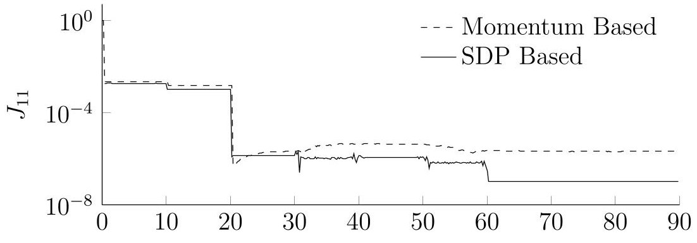


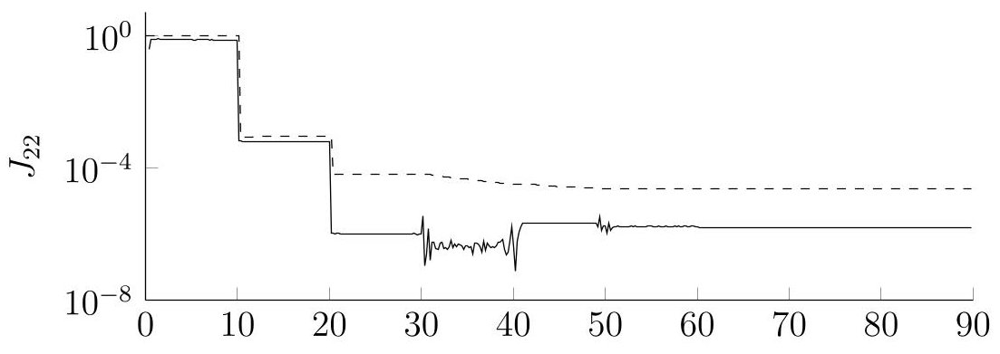


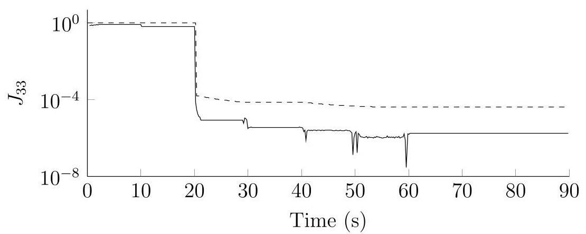


<div align="center">

Figure 4.4: Normalized moment of inertia errors during slew maneuvers

</div>

<!-- PDF_PAGE: 72 -->


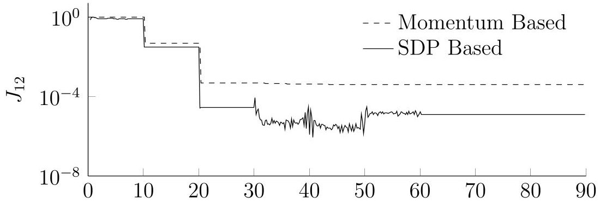


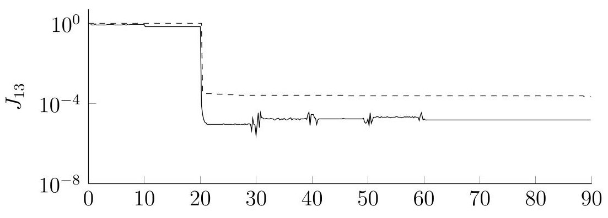


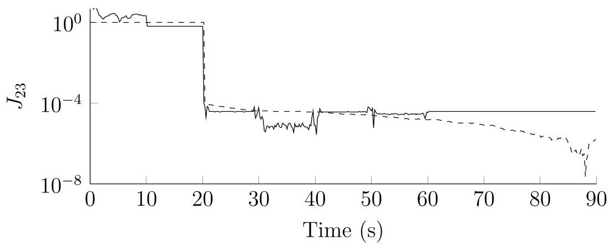


<div align="center">

Figure 4.5: Normalized product of inertia errors during slew maneuvers

</div>

<!-- PDF_PAGE: 73 -->


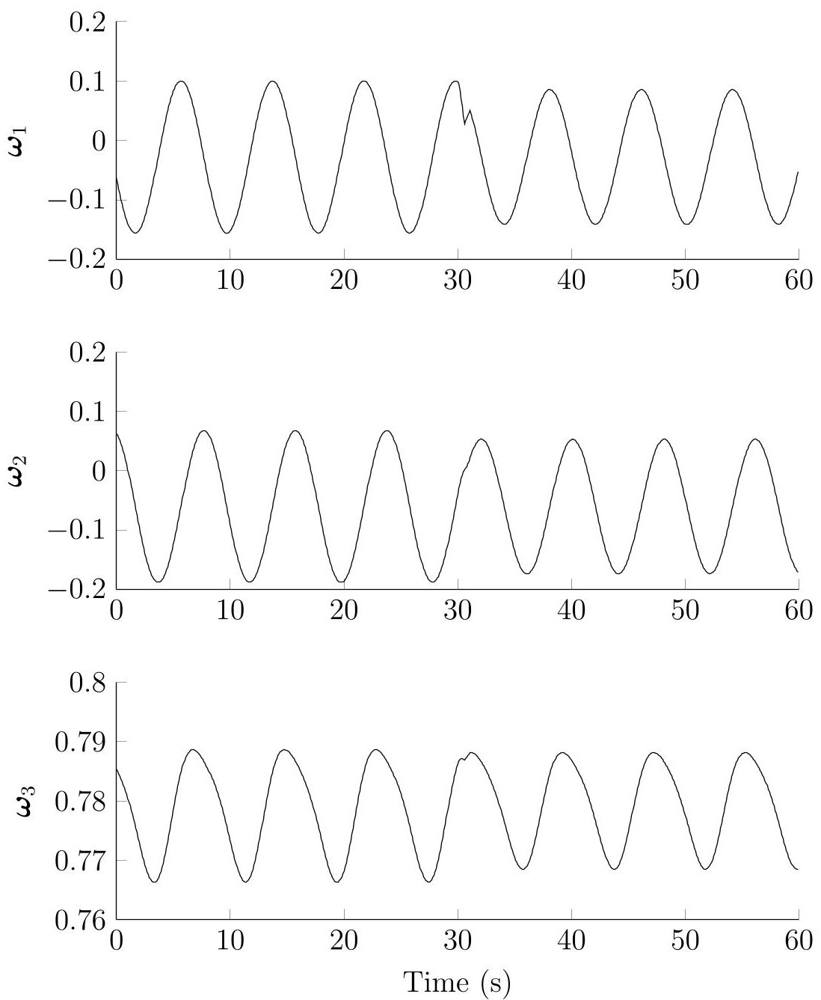


<div align="center">

Figure 4.6: Body angular velocity components for spinning case

</div>

<!-- PDF_PAGE: 74 -->


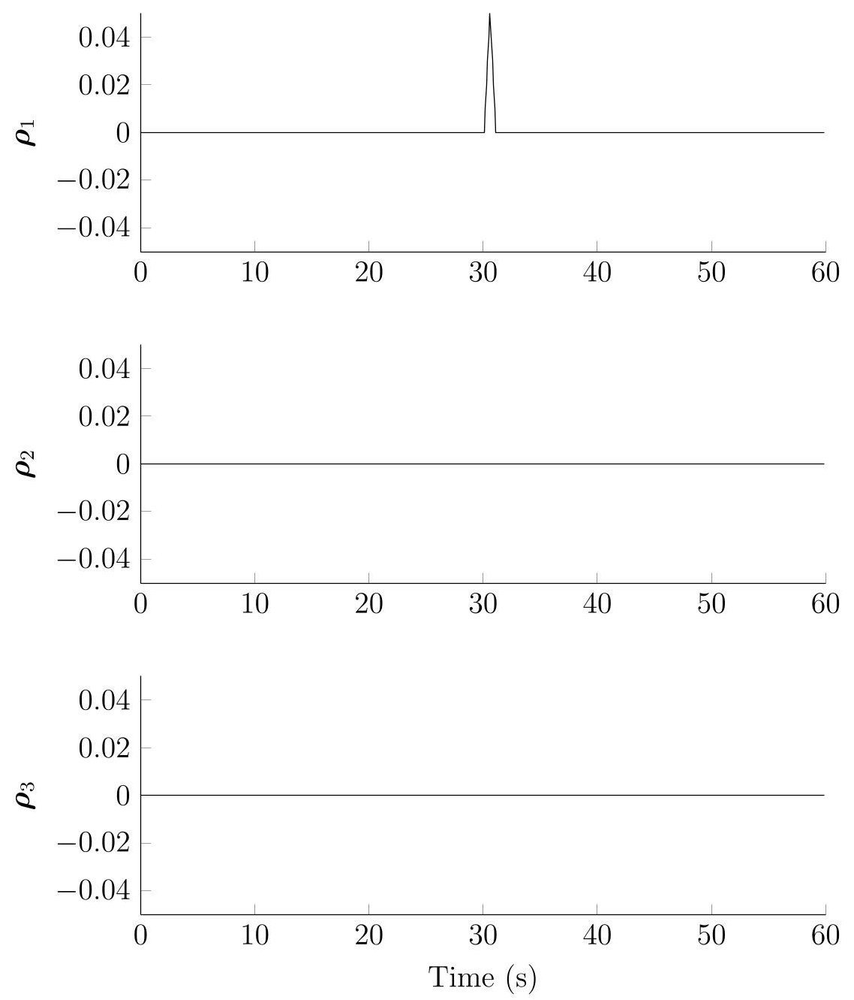


<div align="center">

Figure 4.7: Rotor momentum components for spinning case

</div>

<!-- PDF_PAGE: 75 -->


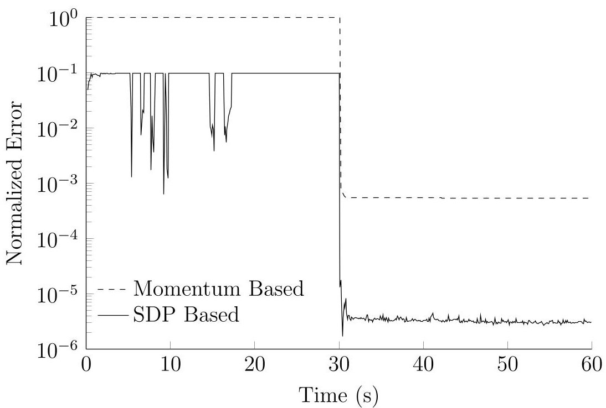


<div align="center">

Figure 4.8: Total normalized error for spinning case

</div>


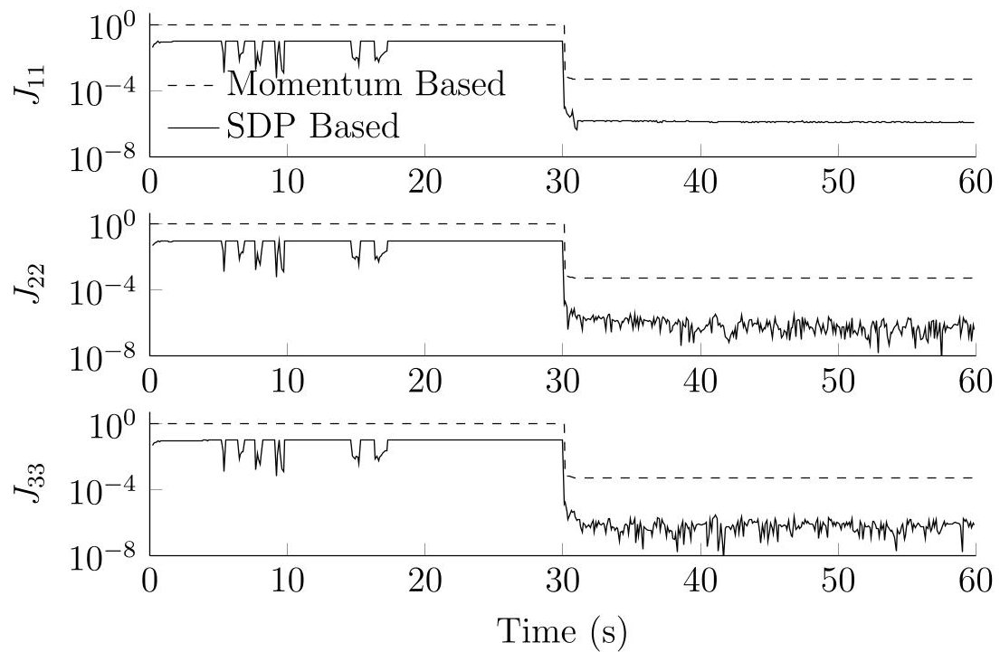


<div align="center">

Figure 4.9: Normalized moment of inertia errors for spinning case

</div>

<!-- PDF_PAGE: 76 -->


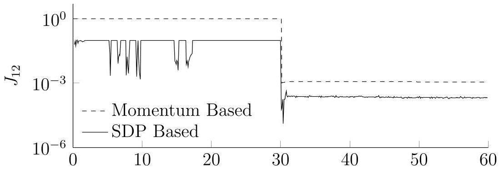


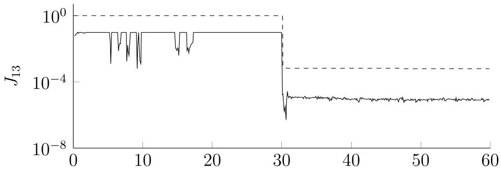


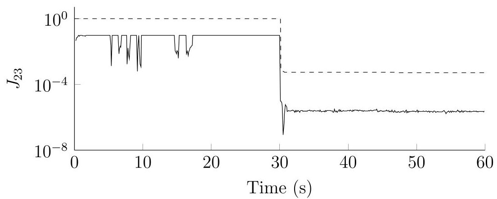


<div align="center">

Figure 4.10: Normalized product of inertia errors for spinning case

</div>

<!-- PDF_PAGE: 77 -->

## CHAPTER 5 LYAPUNOV-BASED CONTROL FOR FLAT-SPIN RECOVERY AND SPIN INVERSION OF SPIN-STABILIZED SPACECRAFT

Flat-spin recovery is a classic problem in spacecraft dynamics and control with a rich history dating back to the very first man-made satellites[59]. Fundamentally, the problem has its roots in the geometry of rockets and the fairings that house satellites during launch, which tend to be long and narrow. As a result, most spacecraft have prolate mass distributions, at least in their launch configurations.

In the presence of energy dissipation due, for example, to fluid slosh or flexible structural elements, a spacecraft spinning about its long axis, or minor axis of inertia, will tend to transition into a spin about its major axis, commonly known as a flat spin. Maintaining a minor-axis spin, therefore, requires active control. While spin-stabilized satellites have largely been supplanted by three-axis stabilized designs, many missions still call for spacecraft to spin about their minor axes temporarily, especially during critical phases like deployments and orbit insertion maneuvers[60]. Additionally, low-cost small satellites are frequently designed as minor-axis spinners, both to provide stabilization and to meet other mission requirements[61] $ ^{–} $ [63].

In this chapter, a family of nonlinear feedback control laws capable of driving a spinning spacecraft from any initial state to a desired minor-axis spin using reaction wheels is developed. The controllers provide almost-global asymptotic stability and can explicitly accommodate actuator limits. Additionally, the feedback laws have a simple and explicit mathematical form and are easy to tune and implement.

<!-- PDF_PAGE: 78 -->

The chapter proceeds as follows: Section 5.1 reviews existing methods for flat-spin recovery and spin-axis inversion. Section 5.2 then provides a review of relevant spacecraft dynamics as well as Lyapunov stability theory. Next, sections 5.3 and 5.4 introduce and analyze several candidate Lyapunov functions. Section 5.5 analyzes the global stability properties of controllers based on a particular choice of Lyapunov function. Section 5.6 then discusses the implementation of a family of control laws which are almost-globally asymptotically stabilizing. The control laws are then demonstrated in numerical examples in section 5.7. Finally, conclusions are outlined in section 5.8.

## 5.1 Existing Work

Many authors have analyzed variations of the flat-spin recovery problem over the past several decades. In its most basic form, the problem entails controlling a spacecraft in such a way that it transitions from a major-axis spin to a minor-axis spin. Early methods focused on utilizing thrusters as actuators[60], [64], however these have the disadvantage of consuming limited propellant resources. In the 1970s, Gebman and Mingori used perturbation methods to analyze control techniques for flat-spin recovery of dual-spin spacecraft in which actuation is provided by a motor applying internal torques parallel to the desired spin axis[65]. While these methods do not consume fuel, they have the disadvantage of leaving the spacecraft with residual nutation that must be damped out by some other means.

More recently, Lawrence and Holden have developed Lyapunov-based control laws for a spacecraft with a single reaction wheel mounted transverse to the desired spin axis[66]. While their method offers some asymptotic stability guarantees, their controller suffers from one potentially major drawback: It cannot determine

<!-- PDF_PAGE: 79 -->

the sign of the final body-frame angular momentum vector. Depending on initial conditions, the spacecraft could find itself rotated $ 1 8 0^{\circ} $ from the desired orientation.

The problem of effecting a $ 1 8 0^{\circ} $ inversion of a spacecraft's spin axis has often been treated separately from flat-spin recovery. Rahn and Barba have proposed a method for "spin polarity control" using thrusters[67]. Beachey and Uicker describe a method for inverting the spin of an axisymmetric spinning spacecraft using a single reaction wheel[68]. Uicker has also proposed a method for inverting a spacecraft's spin axis by manipulating its mass distribution[69].

To the author's best knowledge, the first unified treatment of flat-spin recovery and spin inversion, in the form of a single controller capable of uniquely determining a spacecraft's final spin axis, was given by Myung and Bang[70]. They make use of a control technique known as predictive control[71] to derive a nonlinear feedback law for a spacecraft with a single reaction wheel. While they demonstrate numerically that their controller converges to the desired spin axis in many cases, they do not give strong stability guarantees. Additionally, their controller does not explicitly account for actuator limits and must be carefully tuned based on system parameters.

## 5.2 Background

This section provides brief reviews of gyrostat dynamics and Lyapunov stability. It also serves to introduce the notation and terminology used throughout the rest of the chapter. Thorough treatments of Lyapunov stability are given by Khalil[72] and Slotine and Li[73], while a thorough treatment of gyrostat dynamics is given by Hughes[28].

<!-- PDF_PAGE: 80 -->

## 5.2.1 Gyrostat Dynamics

A gyrostat is a system of coupled rigid bodies whose relative motions do not change the total inertia tensor of the system. This abstraction serves as a practical mathematical model for a spacecraft with reaction wheels. The fundamental differential equation governing the motion of a gyrostat is[28],

$$
\boldsymbol {I} \cdot \dot {\boldsymbol {\omega}} + \boldsymbol {\omega} \times (\boldsymbol {I} \cdot \boldsymbol {\omega} + \rho) + \dot {\boldsymbol {\rho}} = \tau
$$

where I is the symmetric positive-definite inertia tensor of the gyrostat, $ \omega $ is the body angular velocity, $ \rho $ is the total angular momentum stored in the rotors, and $ \tau $ is the external torque applied to the gyrostat. Assuming external torques can be neglected, the total system angular momentum,

$$
\boldsymbol {h} = \boldsymbol {I} \cdot \boldsymbol {\omega} + \rho
$$

is conserved, and the gyrostat equation can be rewritten as,

$$
\dot {\boldsymbol {h}} = \boldsymbol {h} \times \boldsymbol {J} \cdot (\boldsymbol {h} - \rho)
$$

where $ J=I^{-1}. $

The dynamics of equation (5.3) have some properties that will be useful in the controller development to follow. First, because $ \| h \| $ is conserved, h is confined to the surface of a sphere, which will be referred to as the momentum sphere. Second, for a fixed value of $ \rho $ , the solutions to equation (5.3) are periodic. In fact, $ h ( t ) $ can be expressed in closed form in terms of Jacobi elliptic functions[74], [75]. The details of these solutions will not be of concern in this chapter, only their existence and periodicity. Lastly, in the case where $ \rho=0 $ , the uncontrolled system has, in general, six equilibria located along the eigenvectors of J. The equilibrium points corresponding to the largest and smallest eigenvalues of J (commonly referred to as

<!-- PDF_PAGE: 81 -->

the "minor" and "major" axes, respectively) are stable, while those corresponding to the intermediate eigenvalue are unstable[28].

Figure 5.1 depicts a momentum sphere with several trajectories marked in blue and the equilibria marked in green. Each of the four stable equilibria are


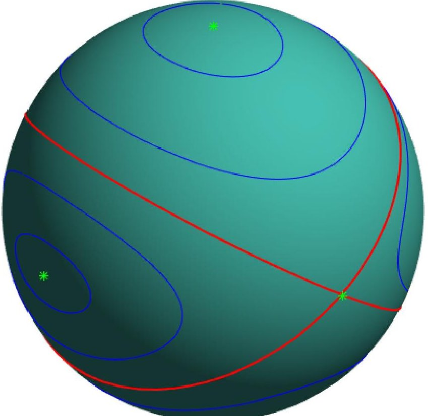


<div align="center">

Figure 5.1: Momentum sphere with equilibria and example trajectories

</div>

surrounded by stable periodic orbits. The trajectories marked in red in figure 5.1 are known as separatrices[28]. They connect the two unstable equilibria and separate trajectories orbiting the other four equilibria.

## 5.2.2 Lyapunov Stability

Lyapunov stability theory provides a means for determining the stability of equilibrium points of nonlinear dynamical systems. The method provides a generalization of the concept of energy dissipation in damped mechanical systems. The necessary

<!-- PDF_PAGE: 82 -->

ingredients are a system of the form,

$$
\dot {x} = f (x)
$$

where $ x\in\mathbb{R}^{n} $ , an equilibrium point $ x^{*} $ such that,

$$
f \left(x ^ {*}\right) = 0
$$

and a scalar function $ V ( x ) $ with the property,

$$
V (x) \geq 0
$$

where $ V ( x )=0 $ only at the point $ x=x^{*} $ . If the derivative of $ V ( x ) $ along trajectories of the system,

$$
\dot {V} (x) = \frac {\partial V}{\partial x} \frac {\mathrm {d} x}{\mathrm {d} t} = \nabla V (x) \cdot f (x)
$$

is negative-semidefinite, the system is said to be stable in the sense of Lyapunov. If the stricter condition $ \dot{V} ( x ) < 0 $ everywhere except at $ x=x^{*} $ , the system is asymptotically stable. The main deficiency of Lyapunov stability theory is that there are no general methods for finding or constructing a function $ V ( x ) $ , which is known as a Lyapunov function.

For a dynamical system with control inputs,

$$
\dot {x} = f (x, u)
$$

where $ x\in\mathbb{R}^{n} $ and $ u\in\mathbb{R}^{m} $ , a Lyapunov function can be used to find stabilizing control laws. In the controlled case, the stability condition becomes:

$$
\dot {V} (x, u) = \nabla V (x) \cdot f (x, u) \leq 0
$$

A controller can then be found by, for example, solving the following optimization problem,

$$
\begin{array}{l} \underset {u} {\operatorname {a r g m i n}} \quad \nabla V (x) \cdot f (x, u) \\ \mathrm {s u b j e c t t o} \quad u \in \mathcal {U} \\ \end{array}
$$

<!-- PDF_PAGE: 83 -->

where $ \mathcal{U} $ is the set of possible control inputs. If u can be chosen such that $ \dot{V} ( x, u ) < 0 $ for every $ x\neq x^{*} $ , the closed loop system will be asymptotically stable.

## 5.3 Candidate Lyapunov Functions

As motivation, two candidate Lyapunov functions are considered. The first is a quadratic function based on kinetic energy,

$$
V _ {Q} = \frac {1}{2} \boldsymbol {h} _ {d} \cdot \boldsymbol {J} \cdot \boldsymbol {h} _ {d} - \frac {1}{2} \boldsymbol {h} \cdot \boldsymbol {J} \cdot \boldsymbol {h}
$$

while the second is a linear function:

$$
V _ {L} = \boldsymbol {h} _ {d} \cdot \boldsymbol {J} \cdot \boldsymbol {h} _ {d} - \boldsymbol {h} _ {d} \cdot \boldsymbol {J} \cdot \boldsymbol {h}
$$

Since $ h_{d} $ corresponds to a spin state with maximum kinetic energy, it is easy to show that both $ V_{Q} $ and $ V_{L} $ are non-negative everywhere on the momentum sphere, satisfying condition (5.6).

Looking first at $ V_{Q} $ and taking its derivative along trajectories of the system yields:

$$
\dot {V} _ {Q} = \frac {\partial V _ {Q}}{\partial h} \frac {\mathrm {d} h}{\mathrm {d} t} = \boldsymbol {h} \cdot \boldsymbol {J} \cdot \boldsymbol {h} \times \boldsymbol {J} \cdot \boldsymbol {\rho}
$$

As expected, when $ \rho=0 $ $ V_{Q} $ does not vary. With an appropriate choice of $ \rho $ the condition $ \dot{V}_{Q}\leq0 $ can always be satisfied, indicating that the closed loop system will be stable. It must be noted, however, that $ V_{Q} $ is symmetric and possesses a pair of global minima located at $ h=h_{d} $ and $ h=-h_{d} $ . As a result, the system can only be guaranteed to converge to one or the other of these equilibrium states, with the result depending on initial conditions. Figure 5.2 depicts a heat map of the function $ V_{Q} $ on the momentum sphere, with $ h_{d} $ marked in green.

<!-- PDF_PAGE: 84 -->


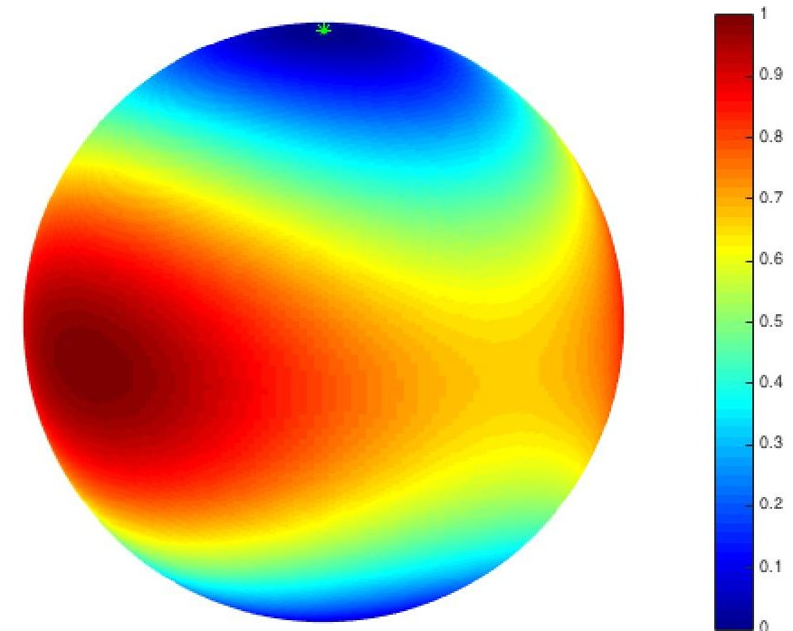


<div align="center">

Figure 5.2: Heat map of candidate Lyapunov function $ V_{Q} $

</div>

Unlike $ V_{Q} $ $ V_{L} $ has the advantage of possessing a single global minimum on the momentum sphere at $ h=h_{d} $ , as can be seen in figure 5.3. Therefore, if a control law can be found which drives $ V_{L} $ to zero, the system is guaranteed to converge to $ h_{d} $ . Unfortunately, $ V_{L} $ also suffers from several disadvantages. Evaluating its derivative with respect to time results in:

$$
\dot {V} _ {L} = \frac {\partial V _ {L}}{\partial h} \frac {\mathrm {d} h}{\mathrm {d} t} = - \boldsymbol {h} _ {d} \cdot \boldsymbol {J} \cdot \boldsymbol {h} \times \boldsymbol {J} \cdot (\boldsymbol {h} - \boldsymbol {\rho})
$$

Note that, unlike what was encountered with $ V_{Q} $ , when $ \rho=0 $ $ \dot{V}_{L}\neq0 $ , meaning that $ V_{L} $ varies along uncontrolled system trajectories. Additionally, in the presence of actuator limits, where the maximum-possible rotor momentum $ \| \rho\| $ might be much smaller than $ \| h\| $ , there may be situations in which the condition $ \dot{V}_{L}\leq0 $ cannot be satisfied.

<!-- PDF_PAGE: 85 -->


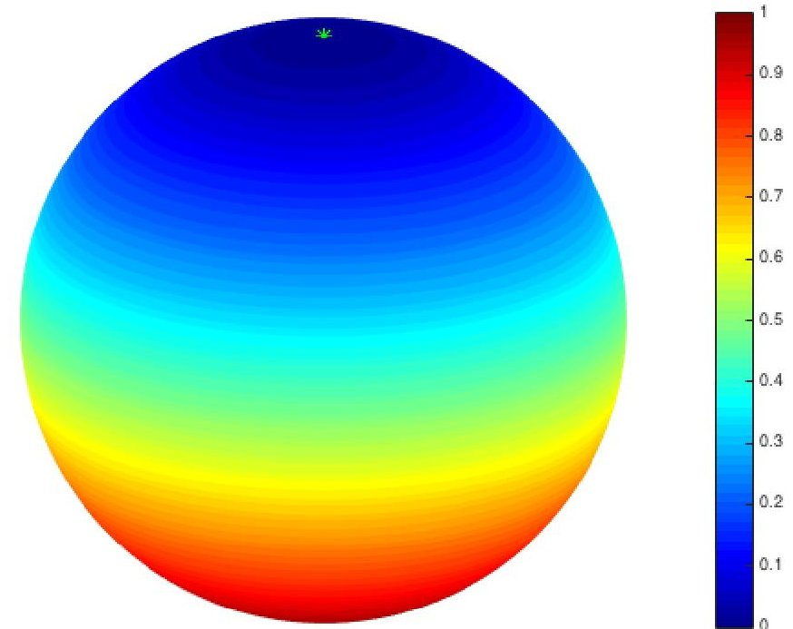


<div align="center">

Figure 5.3: Heat map of candidate Lyapunov function $ V_{L} $

</div>

## 5.4 Periodic Averaging

A variation on equation (5.12) will now be considered that mitigates some of the problems encountered in the previous section. A new candidate Lyapunov function $ V_{L}^{\prime} $ is obtained by averaging $ V_{L} $ over periodic orbits of the uncontrolled system, where T is the nutation period:

$$
V _ {L} ^ {\prime} = \boldsymbol {h} _ {d} \cdot \boldsymbol {J} \cdot \boldsymbol {h} _ {d} - \frac {1}{T} \int_ {t _ {0}} ^ {t _ {0} + T} \boldsymbol {h} _ {d} \cdot \boldsymbol {J} \cdot \boldsymbol {h} (t) \mathrm {d} t
$$

It is worth noting that $ V_{L}^{\prime} $ is a function only of the current state $ \boldsymbol{h} $ . While it does not have a convenient closed-form expression like $ V_{L} $ or $ V_{Q} $ , it could be, for example, precomputed over the entire momentum sphere and tabulated in a look-up table.

By construction, $ V_{L}^{\prime} $ takes on the same value at every point along a given periodic orbit. Therefore, it does not vary along trajectories of the uncontrolled system. Also, like $ V_{L} $ $ V_{L}^{\prime} $ has a single global minimum at $ \boldsymbol{h}=\boldsymbol{h}_{d} $ , as shown in figure 5.4. Unfortunately, $ V_{L}^{\prime} $ still suffers from one important deficiency: as can be understood based on simple symmetry considerations and seen in figure 5.4, $ V_{L}^{\prime} $ is

<!-- PDF_PAGE: 86 -->


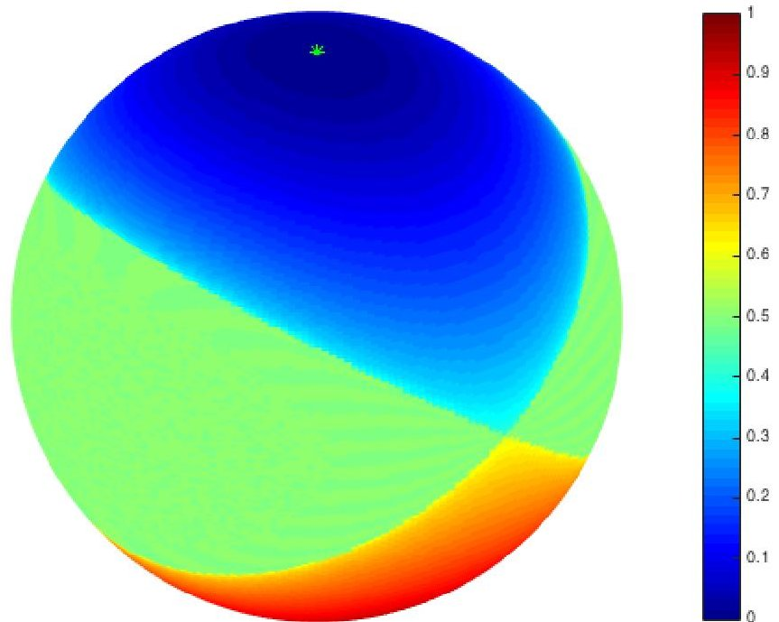


<div align="center">

Figure 5.4: Heat map of candidate Lyapunov function $ V_{L}^{\prime} $

</div>

constant over the entirety of the regions surrounding the major-axis equilibria. As a result, $ \dot{V}_{L}^{\prime}=0 $ , and the system will not converge to $ \boldsymbol{h}_{d} $ from initial conditions in these regions.

A Lyapunov function will now be formed from the sum of $ V_{Q} $ and $ V_{L}^{\prime} $ , combining the behavior of the former in regions near the major-axis equilibria with the behavior of the latter in regions near the minor-axis equilibria:

$$
V = \frac {3}{2} \boldsymbol {h} _ {d} \cdot \boldsymbol {J} \cdot \boldsymbol {h} _ {d} - \frac {1}{T} \int_ {t _ {0}} ^ {t _ {0} + T} \boldsymbol {h} _ {d} \cdot \boldsymbol {J} \cdot \boldsymbol {h} (t) + \frac {1}{2} \boldsymbol {h} (t) \cdot \boldsymbol {J} \cdot \boldsymbol {h} (t) \mathrm {d} t
$$

As with equation (5.15), the integral in equation (5.16) is understood to be taken over periodic orbits of the uncontrolled system. Figure 5.5 shows a heat map of V on the momentum sphere with $ h_{d} $ marked in green.

An expression for $ V $ will now be sought. To aid in this process, the integral in equation (5.16) will be discretized. First, sampled versions of $ h $ and $ \rho $ are defined,

$$
\boldsymbol {h} _ {k} = \boldsymbol {h} \left(t _ {0} + k \delta_ {t}\right)
$$

$$
\boldsymbol {\rho} _ {k} = \boldsymbol {\rho} \left(t _ {0} + k \delta_ {t}\right)
$$

<!-- PDF_PAGE: 87 -->


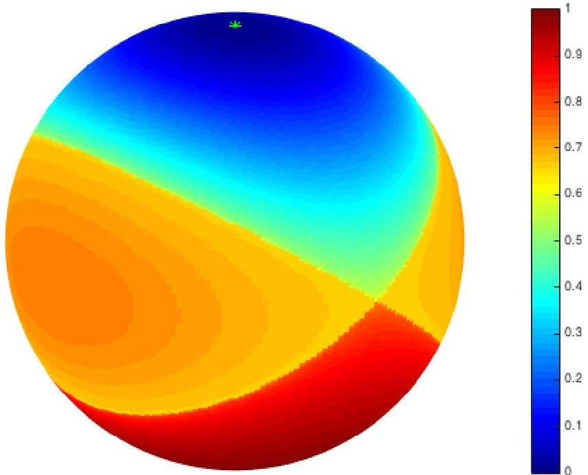


<div align="center">

Figure 5.5: Heat map of Lyapunov function $ V $

</div>

where $ \delta_{t}=T/N $ and N is the number of samples. Next, the following matrices, which consist of uniform samples of the state and control inputs, are defined:

$$
x _ {k} = \left[ \begin{array}{c} h _ {k} \\ \vdots \\ h _ {k + N - 1} \end{array} \right] \quad u _ {k} = \left[ \begin{array}{c} \rho_ {k} \\ \vdots \\ \rho_ {k + N - 1} \end{array} \right]
$$

In terms of $ x_{k} $ and $ u_{k} $ , the integral in equation (5.16) can be approximated as,

$$
\int_ {t _ {0}} ^ {t _ {0} + T} \boldsymbol {h} _ {d} \cdot \boldsymbol {J} \cdot \boldsymbol {h} + \frac {1}{2} \boldsymbol {h} \cdot \boldsymbol {J} \cdot \boldsymbol {h} \mathrm {d} t \approx \frac {1}{N} x _ {d} ^ {\intercal} \bar {J} x _ {k} + \frac {1}{2 N} x _ {k} ^ {\intercal} \bar {J} x _ {k}
$$

where $ x_{d} $ is,

$$
x _ {d} = \left[ \begin{array}{c} h _ {d} \\ \vdots \\ h _ {d} \end{array} \right]
$$

and $ \bar{J} $ is the following block-diagonal matrix:

$$
\bar {J} = \left[ \begin{array}{c c c c} J & 0 & \dots & 0 \\ 0 & J & \dots & 0 \\ \vdots & \vdots & \ddots & \vdots \\ 0 & 0 & \dots & J \end{array} \right]
$$

<!-- PDF_PAGE: 88 -->

The next step in determining $ V $ is to calculate the following finite difference:

$$
\Delta V = V \left(x _ {k + 1}\right) - V \left(x _ {k}\right) = \frac {1}{N} x _ {d} ^ {\intercal} \bar {J} x _ {k} + \frac {1}{2 N} x _ {k} ^ {\intercal} \bar {J} x _ {k} - \frac {1}{N} x _ {d} ^ {\intercal} \bar {J} x _ {k + 1} - \frac {1}{2 N} x _ {k + 1} ^ {\intercal} \bar {J} x _ {k + 1}
$$

Thanks to periodicity, the system dynamics along an orbit can be approximated as,

$$
x _ {k + 1} = A x _ {k} + B _ {k} u _ {k}
$$

where A is a cyclic permutation matrix,

$$
A = \left[ \begin{array}{c c c c c} 0 & \mathbf {1} _ {3 \times 3} & 0 & \dots & 0 \\ 0 & 0 & \mathbf {1} _ {3 \times 3} & \vdots & 0 \\ \vdots & \vdots & \ddots & \ddots & \vdots \\ 0 & 0 & \dots & 0 & \mathbf {1} _ {3 \times 3} \\ \mathbf {1} _ {3 \times 3} & 0 & \dots & 0 & 0 \end{array} \right]
$$

and $ B_{k} $ is the following block-diagonal matrix.

$$
B _ {k} = - \delta_ {t} \left[ \begin{array}{c c c c} h _ {k} ^ {\times} J & 0 & \dots & 0 \\ 0 & h _ {k + 1} ^ {\times} J & 0 & \vdots \\ \vdots & \ddots & \ddots & 0 \\ 0 & \dots & 0 & h _ {k + N - 1} ^ {\times} J \end{array} \right]
$$

The expression $ h^{\times} $ used in equation (5.26) denotes the formation of a $ 3\times3 $ skewsymmetric cross-product matrix from the elements of h:

$$
h ^ {\times} = \left[ \begin{array}{c c c} 0 & - h _ {3} & h _ {2} \\ h _ {3} & 0 & - h _ {1} \\ - h _ {2} & h _ {1} & 0 \end{array} \right]
$$

Substituting equation (5.24) into equation (5.23) yields the following expression for $ \Delta V $:

$$
\begin{array}{l} \Delta V = \frac {1}{N} x _ {d} ^ {\intercal} \bar {J} x _ {k} - \frac {1}{N} x _ {d} ^ {\intercal} \bar {J} A x _ {k} - \frac {1}{N} x _ {d} ^ {\intercal} \bar {J} B _ {k} u _ {k} \\ + \frac {1}{2 N} x _ {k} ^ {\intercal} \bar {J} x _ {k} - \frac {1}{2 N} x _ {k} ^ {\intercal} A ^ {\intercal} \bar {J} A x _ {k} - \frac {1}{N} x _ {k} ^ {\intercal} A ^ {\intercal} \bar {J} B _ {k} u _ {k} - \frac {1}{2 N} u _ {k} ^ {\intercal} B _ {k} ^ {\intercal} \bar {J} B _ {k} u _ {k} \\ \end{array}
$$

<!-- PDF_PAGE: 89 -->

Because A is simply a permutation matrix, several terms in equation (5.28) cancel each other, resulting in:

$$
\Delta V = - \frac {1}{N} x _ {d} ^ {\intercal} \bar {J} B _ {k} u _ {k} - \frac {1}{N} x _ {k} ^ {\intercal} A ^ {\intercal} \bar {J} B _ {k} u _ {k} - \frac {1}{2 N} u _ {k} ^ {\intercal} B _ {k} ^ {\intercal} \bar {J} B _ {k} u _ {k}
$$

Finally, $ \dot{V} $ is recovered by taking a limit:

$$
\dot {V} = \lim _ {N \rightarrow \infty} \frac {\Delta V}{\delta_ {t}} = \frac {1}{T} \int_ {t _ {0}} ^ {t _ {0} + T} \left(\boldsymbol {h} + \boldsymbol {h} _ {d}\right) \cdot \boldsymbol {J} \cdot \boldsymbol {h} \times \boldsymbol {J} \cdot \boldsymbol {\rho} \mathrm {d} t
$$

## 5.5 Almost-Global Asymptotic Stability

The expression inside the integral in equation (5.30) is linear in the rotor momentum $ \rho $ . To make this more explicit, the following vector is defined,

$$
\boldsymbol {b} (\boldsymbol {h}) = - \boldsymbol {J} \cdot \boldsymbol {h} \times \boldsymbol {J} \cdot \left(\boldsymbol {h} + \boldsymbol {h} _ {d}\right)
$$

such that:

$$
\boldsymbol {b} \cdot \boldsymbol {\rho} = \left(\boldsymbol {h} + \boldsymbol {h} _ {d}\right) \cdot \boldsymbol {J} \cdot \boldsymbol {h} \times \boldsymbol {J} \cdot \boldsymbol {\rho}
$$

In terms of b, the problem of choosing a control input such that $ \dot{V}\leq0 $ reduces to choosing $ \rho $ such that $ \boldsymbol{b}\cdot\boldsymbol{\rho}\leq0. $

Looking again at equation (5.30), it is clear that the condition for asymptotic stability, $ \dot{V}<0 $ , can be met as long as $ \boldsymbol{b}\cdot\boldsymbol{\rho}<0 $ can be achieved at some point along every periodic orbit of the uncontrolled system. For the fully actuated case where the spacecraft has at least three reaction wheels, this is possible everywhere on the momentum sphere except at the single point $ \boldsymbol{h}=-\boldsymbol{h}_{d} $ , which is simultaneously an equilibrium point of the system and a point at which $ \boldsymbol{b}=0 $ . This failure is to be expected as, in general, constant (time-invariant) feedback laws cannot achieve global asymptotic stability for systems with rotational degrees of freedom[76]. In

<!-- PDF_PAGE: 90 -->

practice, however, this does not present a problem, since $ - h_{d} $ is an unstable equilibrium of the closed-loop system, and perturbations will ensure that the system does not remain there.

## 5.6 Controller Implementation

If sufficient reaction wheel torque is available, wheel dynamics can effectively be ignored and direct control over $ \rho $ can be assumed. In this case, equation (5.31) can be applied directly to derive very simple controllers. One possible feedback law is,

$$
\rho = - k \boldsymbol {b}
$$

where k is a scalar gain.

The optimal choice of $ \rho $ , in the sense of decreasing V the fastest, can be found by minimizing $ b\cdot \rho $ , as in equation (5.10). In the particular case of a spacecraft with three reaction wheels, each aligned with an axis of the body coordinate frame, such a control law assumes the following form in body coordinates,

$$
\rho = - \rho_ {\max } \operatorname {s i g n} (b)
$$

where $ \rho_{\mathrm{m a x}} $ is the maximum wheel momentum and $ \operatorname{s i g n} ( b ) $ denotes the element-wise signum function:

$$
\operatorname {s i g n} (x) = \left\{ \begin{array}{c c} 1 & : x > 0 \\ 0 & : x = 0 \\ - 1 & : x < 0 \end{array} \right.
$$

In cases where reaction wheel torque is limited and the assumption of direct control over $ \rho $ cannot be made, a control law that specifies $ \dot{\rho} $ and respects torque limits is needed. One such controller can be derived by first defining a smoothed

<!-- PDF_PAGE: 91 -->

version of the controller (5.34), where the signum function is replaced with a hyperbolic tangent:

$$
\rho = - \rho_ {\max } \tanh (\alpha b)
$$

The scalar parameter $ \alpha $ in equation (5.36) can be tuned to set the maximum allowable torque. Equation (5.36) is then differentiated with respect to time, which yields,

$$
\dot {\rho} = \frac {\partial \rho}{\partial b} \frac {\partial b}{\partial h} \frac {\mathrm {d} h}{\mathrm {d} t} = - \rho_ {\max } \alpha \operatorname {d i a g} \left(\operatorname {s e c h} ^ {2} (\alpha b)\right) J \left[ \left(J \left(h + h _ {d}\right)\right) ^ {\times} - h ^ {\times} J \right] h ^ {\times} J (h - \rho)
$$

where $ \operatorname{diag}(x) $ indicates the formation of a diagonal matrix from the elements of x:

$$
\operatorname {d i a g} \left(\left[ \begin{array}{l} x _ {1} \\ x _ {2} \\ x _ {3} \end{array} \right]\right) = \left[ \begin{array}{c c c} x _ {1} & 0 & 0 \\ 0 & x _ {2} & 0 \\ 0 & 0 & x _ {3} \end{array} \right]
$$

While equation (5.37) can, in principle provide explicit wheel torque commands, the stability results of the previous section are specified as conditions on the wheel momenta. Therefore, to ensure stability, an actual implementation should track the wheel momenta specified by equation (5.36) using, for example, PID motor controllers on each wheel.

## 5.7 Examples

This section presents two simulations that illustrate the performance of the control laws developed in section 5.6 in the presence of model uncertainty and actuator limits. Both simulations are performed using MATLAB's ODE45 variable-step Runge-Kutta solver[77] with default error tolerances. To demonstrate the robustness of the controllers to model uncertainty, the following nominal inertia is used

<!-- PDF_PAGE: 92 -->

in the controller,

$$
I = \left[ \begin{array}{c c c} 2 & 0 & 0 \\ 0 & 1. 5 & 0 \\ 0 & 0 & 1 \end{array} \right]
$$

while the true inertia used to simulate the dynamics differs by 5% in the the moments of inertia and $ 5^{\circ} $ in the orientation of the principal axes:

$$
I _ {\mathrm {t r u e}} = \left[ \begin{array}{c c c} 2. 0 9 6 1 & - 0. 0 4 5 5 & 0. 0 2 9 9 \\ - 0. 0 4 5 5 & 1. 4 2 7 1 & 0. 0 1 6 7 \\ 0. 0 2 9 9 & 0. 0 1 6 7 & 1. 0 5 1 7 \end{array} \right]
$$

Additionally, white noise is added to the simulated gyro measurements fed to the controller.

The first simulation illustrates the performance of the controller (5.36) in a flat-spin recovery maneuver on a spacecraft with three reaction wheels. The initial angular momentum is,

$$
h _ {0} = \left[ \begin{array}{c} 1 \\ 0 \\ 0 \end{array} \right]
$$

and the desired final angular momentum is set to,

$$
h _ {d} = \left[ \begin{array}{c} 0 \\ 0 \\ 1 \end{array} \right]
$$

which corresponds to an angular velocity of roughly 10 RPM about the minor axis. The maximum reaction wheel momentum is $ \rho_{\mathrm{m a x}}=0. 0 1 \mathrm{N} \cdot \mathrm{m} \cdot \mathrm{s} $ , and the maximum reaction wheel torque is $ \dot{\rho}_{\mathrm{m a x}}=0. 1 \mathrm{N} \cdot \mathrm{m} $ . The parameter $ \alpha $ is set to a value of 60, which ensures that commanded torques are within the actuator saturation limits.

Figure 5.6 shows the closed-loop trajectory of the system, while figures 5.7- 5.9 show the system momentum, reaction wheel momentum, and reaction wheel torque components, respectively. Rapid convergence to the desired minor axis-spin

<!-- PDF_PAGE: 93 -->

is achieved. The residual error in the angular momentum components and nonzero steady-state reaction wheel momenta are due to the error in the inertia used in the controller.


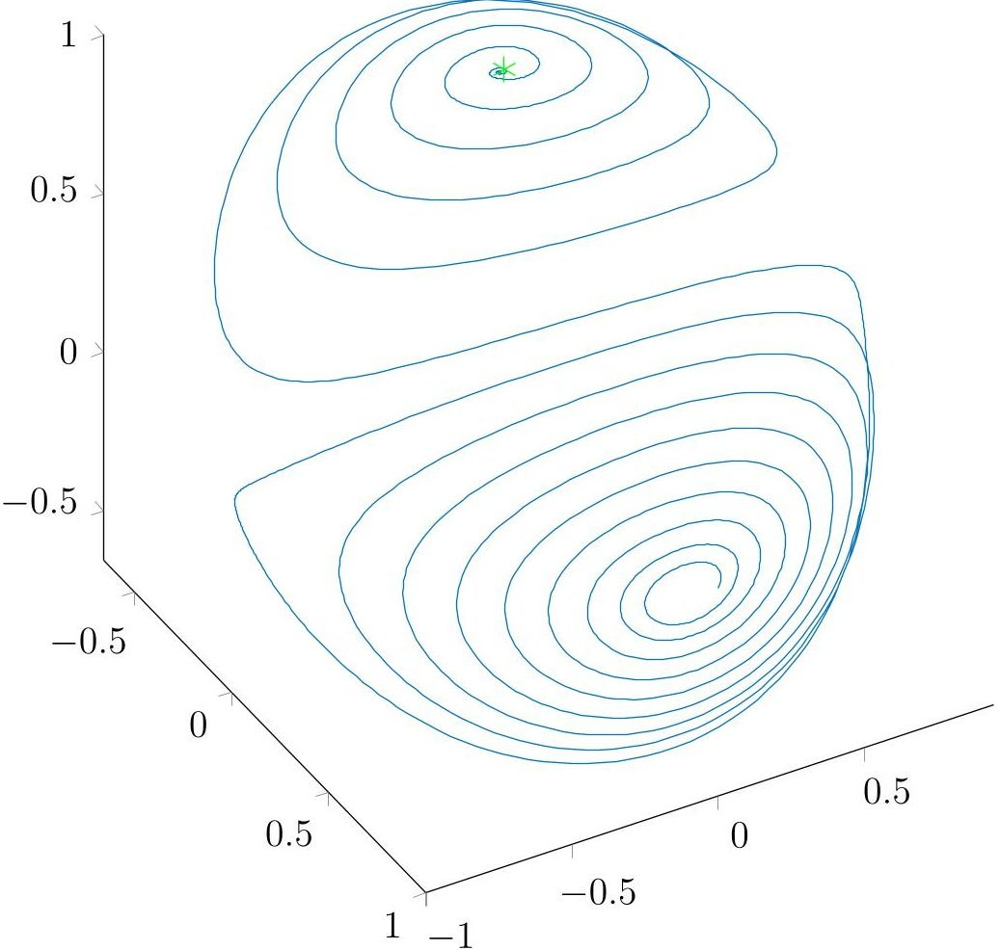


<div align="center">

Figure 5.6: Flat-spin recovery trajectory

</div>

The second test case uses the same system and controller parameters but a different set of initial conditions to illustrate the control law's ability to perform spin inversion maneuvers. The initial angular momentum is,

$$
h _ {0} = \left[ \begin{array}{c} 0 \\ 0 \\ - 1 \end{array} \right]
$$

and the desired final angular momentum is again set to:

$$
h _ {d} = \left[ \begin{array}{c} 0 \\ 0 \\ 1 \end{array} \right]
$$

<!-- PDF_PAGE: 94 -->


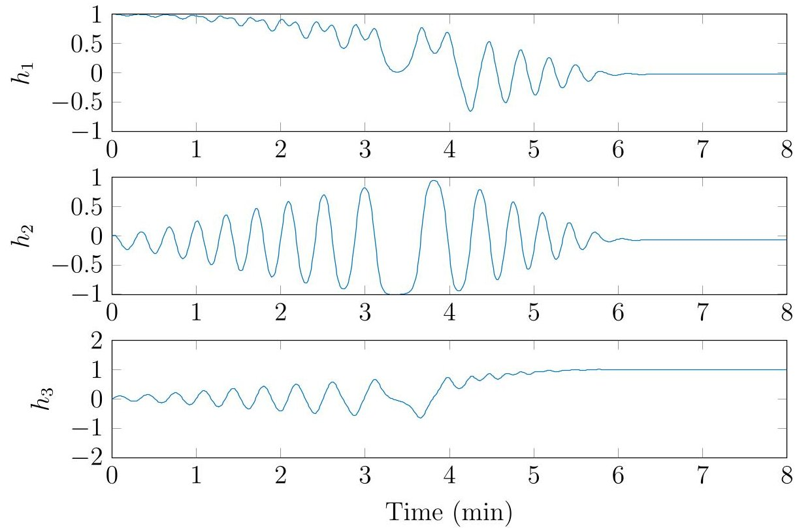


<div align="center">

Figure 5.7: Flat-spin recovery momentum components

</div>


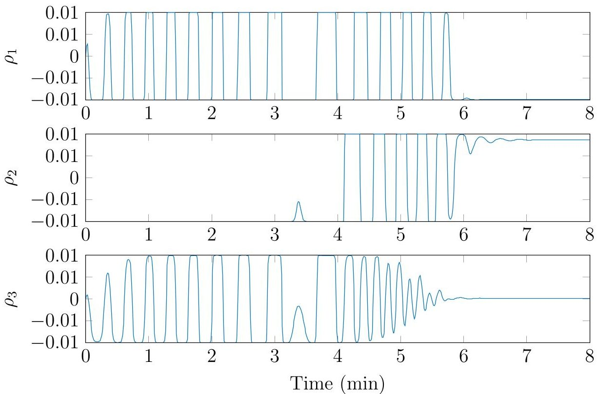


<div align="center">

Figure 5.8: Flat-spin recovery reaction wheel momenta

</div>

Figure 5.10 shows the closed-loop trajectory of the system, while figures 5.11- 5.13 show the system momentum, reaction wheel momentum, and reaction wheel

<!-- PDF_PAGE: 95 -->


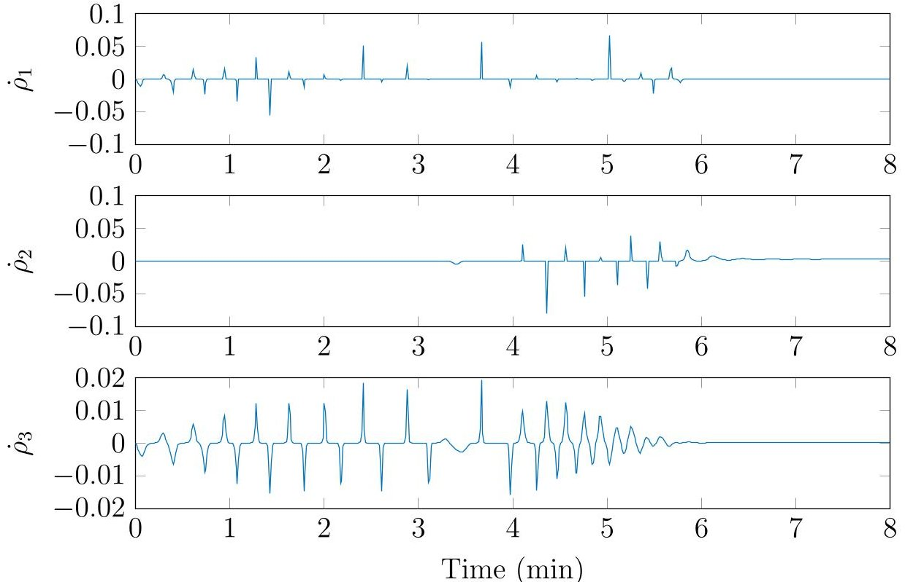


<div align="center">

Figure 5.9: Flat-spin recovery reaction wheel torques

</div>

torque components, respectively. Once again, the controller demonstrates rapid convergence. This example also illustrates the behavior of the closed-loop system around the point $ - h_{d} $ . As discussed in section 5.5, noise and modeling errors ensure that the system is perturbed away from this unstable equilibrium.

## 5.8 Conclusions

The control laws developed in this study provide a unified solution for both flat-spin recovery and spin inversion of spin-stabilized spacecraft. They are shown to be almost-globally asymptotically stabilizing using a Lyapunov function argument, and their performance is also demonstrated in the presence of model error and actuator limits through numerical simulation. Finally, the controllers have a simple mathematical form and are easy to tune, making them practical for implementation

<!-- PDF_PAGE: 96 -->


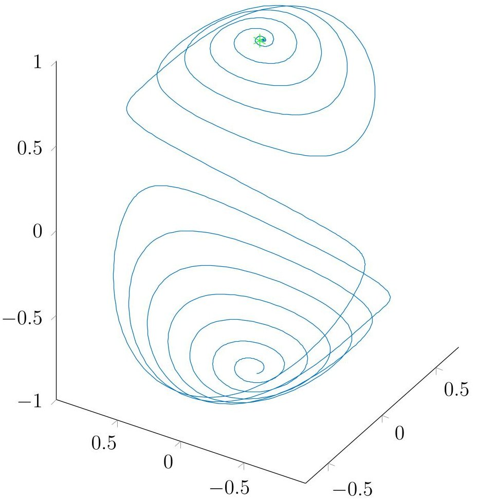


<div align="center">

Figure 5.10: Spin inversion trajectory

</div>


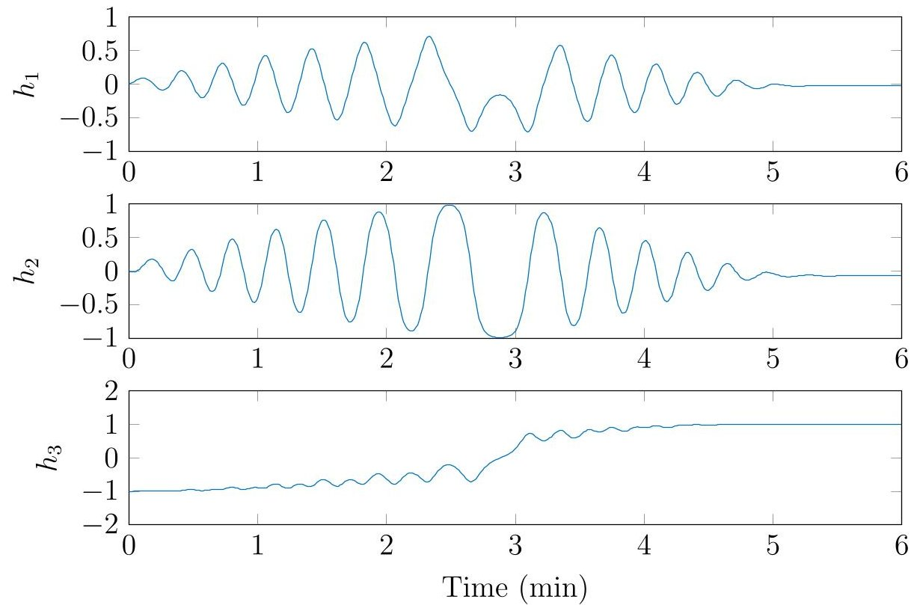


<div align="center">

Figure 5.11: Spin inversion momentum components

</div>

<!-- PDF_PAGE: 97 -->


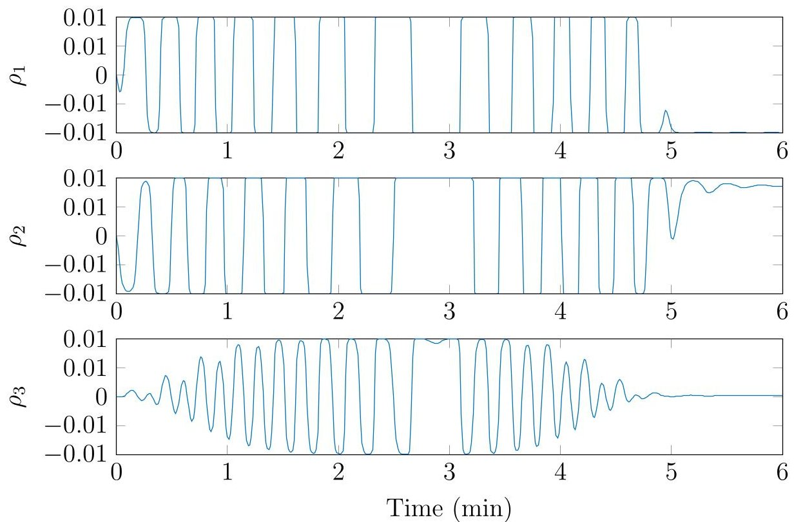


<div align="center">

Figure 5.12: Spin inversion reaction wheel momenta

</div>


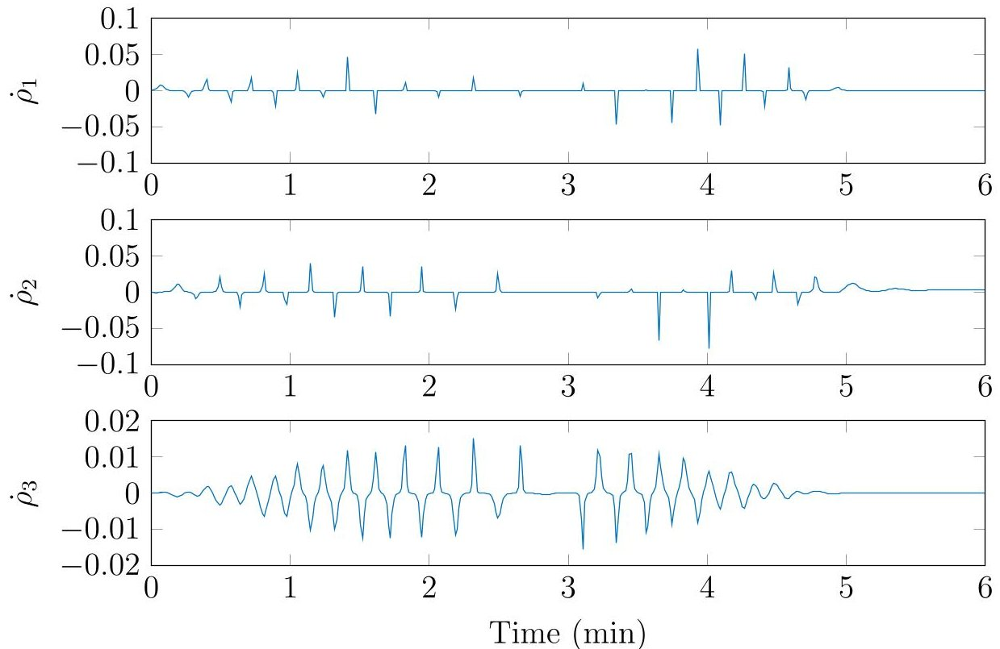


<div align="center">

Figure 5.13: Spin inversion reaction wheel torques

</div>

in flight software.

<!-- PDF_PAGE: 98 -->

## CHAPTER 6 QUATERNION VARIATIONAL INTEGRATORS FOR SPACECRAFT DYNAMICS

Variational integrators have many advantages over Runge-Kutta methods and other traditional algorithms for numerically integrating equations of motion for mechanical systems. Rather than deriving differential equations of motion for a given system in continuous time, then discretizing them, variational approaches begin by discretizing the Lagrangian and the action integral for the system. The tools of variational mechanics are then used to derive discrete-time equations of motion. Integrators derived in this way retain many of the properties of the continuous system, such as momentum and energy conservation[49]. These integrators are also computationally efficient and stable, even for relatively large fixed time steps, making them well suited for use in real-time estimation and control applications.

The chapter proceeds as follows: Section 6.1 gives a brief survey of existing and related methods for numerically integrating the equations of motion for rigid body dynamics. Section 6.2 then gives a brief review of quaternions and outlines the notation used throughout the chapter. Section 6.3 derives the classical Euler equation of rigid body dynamics in continuous time using Hamilton's principle. Next, section 6.4 presents this derivation in discrete time, leading to the variational integrator presented in section 6.5. Sections 6.6-6.8 incorporate several extensions to the basic rigid body integrator, including reaction wheels, external torques, and internal damping. Finally, in section 6.9 several numerical examples are presented, including an extended Kalman filter for attitude determination.

<!-- PDF_PAGE: 99 -->

## 6.1 Existing Work

Examples of integration methods that respect motion integrals of mechanical systems, often called geometric or symplectic integrators, have been known for decades. The classic example is the Verlet or Störmer-Verlet method[23], [78]. These early methods were often devised in ad hoc ways that do not generalize well to arbitrary mechanical systems or higher orders of accuracy. More recently, systematic methods for deriving symplectic integrators using discrete-time versions of ideas from variational mechanics have been introduced[49]. These methods are straightforward applications of Lagrangian and Hamiltonian dynamics, and they can generate integration schemes of any desired order of accuracy.

Discrete variational mechanics has previously been applied to problems in rigid body dynamics and the optimal control of rigid bodies using rotation matrices to parameterize attitude[79]----[81]. Momentum-preserving integrators have also been derived by other (non-variational) means for rigid body dynamics using quaternions to parameterize attitude[82]----[85]. The primary contribution of this chapter is the application of discrete variational mechanics to spacecraft attitude dynamics using quaternion state variables. The emphasis on quaternions over other attitude parameterizations here is due to both the compact and elegant derivations they enable and their prevalence in the implementation of spacecraft guidance, navigation, and control algorithms. Specifically, they lend themselves to straightforward feedback control and estimation schemes of practical relevance in flight software.

<!-- PDF_PAGE: 100 -->

## 6.2 Background

Attitude dynamics and rotations are parameterized with quaternions throughout this chapter. A brief review of their properties is presented in this section. A more thorough treatment is given by Altmann[43].

Quaternions form an algebra with a non-commutative binary product operation. It is often convenient to think of them as four-dimensional objects composed of a three-dimensional vector part $ \boldsymbol{v} $ and a scalar part s.

$$
q = \left[ \begin{array}{c} \boldsymbol {v} \\ s \end{array} \right]
$$

This representation allows the quaternion product to be written in terms of scalar and vector products:

$$
q _ {1} q _ {2} = \left[ \begin{array}{c} \boldsymbol {v} _ {1} \times \boldsymbol {v} _ {2} + s _ {1} \boldsymbol {v} _ {2} + s _ {2} \boldsymbol {v} _ {1} \\ s _ {1} s _ {2} - \boldsymbol {v} _ {1} \cdot \boldsymbol {v} _ {2} \end{array} \right]
$$

Note that $ q_{1} q_{2} \neq q_{2} q_{1} $ . Throughout the chapter, quaternion products are indicated by juxtaposition, while scalar and vector products are indicated in the usual way, with the $ \cdot $ and $ \times $ symbols, respectively.

Rotations can be conveniently represented by unit-length quaternions. If $ \boldsymbol{r} $ is a unit vector in $ \mathbb{R}^{3} $ representing the axis of rotation and $ \theta $ is the angle of rotation, then the quaternion representing the rotation is as follows:

$$
q = \left[ \begin{array}{c} \boldsymbol {r} \sin (\theta / 2) \\ \cos (\theta / 2) \end{array} \right]
$$

Both q and $ - q $ correspond to the same rotation, making the unit quaternions a "double cover" of the group of rotations.

The conjugate of a quaternion is denoted with a superscript $ \dagger $ and represents

<!-- PDF_PAGE: 101 -->

the rotation about the same axis $ \boldsymbol{r} $ by $ -\theta. $

$$
q ^ {\dagger} = \left[ \begin{array}{c} - \boldsymbol {v} \\ s \end{array} \right]
$$

Two rotations can be composed by multiplying their quaternion representations. A quaternion $ q_{3} $ representing a rotation $ q_{1} $ followed by a rotation $ q_{2} $ is simply $ q_{3}=q_{2} q_{1} $ . The rotation of a three-dimensional vector $ \boldsymbol{x} $ by a unit quaternion $ q $ is

$$
\hat {\boldsymbol {x}} ^ {\prime} = q \hat {\boldsymbol {x}} q ^ {\dagger}
$$

where $ \hat{x} $ indicates the formation of a quaternion with zero scalar part from the vector $ \mathbf{x} $:

$$
\hat {\boldsymbol {x}} = \left[ \begin{array}{c} \boldsymbol {x} \\ 0 \end{array} \right]
$$

Analytic functions can be defined for quaternion arguments in much the same way as for complex numbers and matrices. In particular, the quaternion exponential has a simple closed-form expression in terms of the quaternion's scalar and vector parts:

$$
e ^ {q} = \sum_ {n = 0} ^ {\infty} \frac {q ^ {n}}{n !} = e ^ {s} \left[ \begin{array}{c} \frac {\boldsymbol {v}}{| \boldsymbol {v} |} \sin (| \boldsymbol {v} |) \\ \cos (| \boldsymbol {v} |) \end{array} \right]
$$

The formula for a rotation quaternion in equation (6.3) can be compactly written in terms of the exponential:

$$
e ^ {\hat {r} \theta / 2} = \left[ \begin{array}{c} \boldsymbol {r} \sin (\theta / 2) \\ \cos (\theta / 2) \end{array} \right]
$$

Finally, in addition to the purely algebraic properties of quaternions outlined so far, the subsequent analysis requires some kinematic identities relating quaternion derivatives to vector quantities more familiar in rigid body dynamics. First, the time derivative of a body's attitude quaternion is related to its angular velocity in the following way:

$$
\hat {\omega} = 2 q ^ {\dagger} \dot {q}
$$

<!-- PDF_PAGE: 102 -->

Second, the quaternion generalized force corresponding to a torque on the body is[45], [46]

$$
\boldsymbol {F} = 2 q \hat {\boldsymbol {\tau}}
$$

Schaub and Junkins provide a thorough discussion of rigid body dynamics using quaternions[47].

## 6.3 Euler's Equation from Hamilton's Principle

This section presents a detailed derivation of the classical Euler equation using Hamilton's principle. While the results are not new, the techniques used provide the foundation for the development of the variational integrators in the following sections. A more in-depth treatment of variational mechanics on Lie groups, including the rotation group SO(3), is given by Holm[86].

The derivation begins with the Lagrangian for a free rigid body which, in the absence of a potential, is simply its kinetic energy:

$$
L = \frac {1}{2} \boldsymbol {\omega} \cdot I \cdot \boldsymbol {\omega} = \frac {1}{2} \hat {\boldsymbol {\omega}} \cdot J \cdot \hat {\boldsymbol {\omega}}
$$

J is the following augmented inertia matrix:

$$
J = \left[ \begin{array}{c c c c} I _ {1 1} & I _ {1 2} & I _ {1 3} & 0 \\ I _ {2 1} & I _ {2 2} & I _ {2 3} & 0 \\ I _ {3 1} & I _ {3 2} & I _ {3 3} & 0 \\ 0 & 0 & 0 & 0 \end{array} \right]
$$

Following the standard approach in variational mechanics[32], [87], an action integral is constructed and its variational derivative is taken.

$$
\delta S = \delta \int_ {t _ {0}} ^ {t _ {f}} \frac {1}{2} \hat {\omega} \cdot J \cdot \hat {\omega} \mathrm {d} t = 0
$$

<!-- PDF_PAGE: 103 -->

At this point one must be careful to take variations of $ \omega $ in such a way that the quaternion unit-norm constraint is maintained. There are several ways of explicitly enforcing the constraint in the action integral[46], [88]. An alternative is to incorporate the constraint into the variation[79], [80], [86]. From the fact that the exponential of a quaternion having zero scalar part is always a unit quaternion, a varied unit quaternion can be defined as

$$
{} ^ {\epsilon} q = q e ^ {\epsilon \hat {\eta}}
$$

where a left superscript $ \epsilon $ is used to denote a varied quantity. Next, $ ^{\epsilon} q $ is differentiated with respect to time.

$$
{} ^ {\epsilon} \dot {q} = \dot {q} e ^ {\epsilon \hat {\eta}} + \epsilon q e ^ {\epsilon \hat {\eta}} \dot {\hat {\eta}}
$$

Equations (6.14) and (6.15) can be substituted into the identity in equation (6.9) to obtain the desired variation of $ \omega $ , keeping in mind that only terms linear in $ \epsilon $ need to be retained.

$$
{} ^ {\epsilon} \hat {\omega} = 2 ^ {\epsilon} q ^ {\dagger} ^ {\epsilon} \dot {q} = e ^ {- \epsilon \hat {\eta}} \hat {\omega} e ^ {\epsilon \hat {\eta}} + 2 \epsilon \dot {\hat {\eta}} \approx \hat {\omega} + \epsilon \left(\hat {\omega} \hat {\eta} - \hat {\eta} \hat {\omega} + 2 \epsilon \dot {\hat {\eta}}\right)
$$

Using equation (6.16), the variational derivative of the action integral in equation (6.13) is

$$
\delta S = \frac {\mathrm {d}}{\mathrm {d} \epsilon} \bigg | _ {\epsilon = 0} \int_ {t _ {0}} ^ {t _ {f}} \frac {1}{2} ^ {\epsilon} \hat {\boldsymbol {\omega}} \cdot J \cdot^ {\epsilon} \hat {\boldsymbol {\omega}} \mathrm {d} t = \int_ {t _ {0}} ^ {t _ {f}} \hat {\boldsymbol {\omega}} \cdot J \cdot \left(2 \hat {\boldsymbol {\omega}} \hat {\boldsymbol {\eta}} + 2 \dot {\hat {\boldsymbol {\eta}}}\right) \mathrm {d} t = 0
$$

Following the usual procedure, integration by parts is used to eliminate $ \hat{\eta} $ , noting that variations must be zero at the endpoints of the integration interval.

$$
\delta S = \int_ {t _ {0}} ^ {t _ {f}} 2 \hat {\omega} \cdot J \cdot \hat {\omega} \hat {\eta} - 2 \dot {\hat {\omega}} \cdot J \cdot \hat {\eta} \mathrm {d} t = 0
$$

Since all of the quaternions in equation (6.18) have scalar parts equal to zero, it can be converted to vector form:

$$
\delta S = \int_ {t _ {0}} ^ {t _ {f}} \boldsymbol {\omega} \cdot I \cdot (\boldsymbol {\omega} \times \boldsymbol {\eta}) - \dot {\boldsymbol {\omega}} \cdot I \cdot \boldsymbol {\eta} \mathrm {d} t = 0
$$

<!-- PDF_PAGE: 104 -->

Using the fact that cyclically permuting the factors in a scalar triple product does not change its value, equation (6.19) can be rewritten as

$$
\delta S = \int_ {t _ {0}} ^ {t _ {f}} \boldsymbol {\eta} \cdot \left(\left(I \cdot \boldsymbol {\omega}\right) \times \boldsymbol {\omega}\right) - \dot {\boldsymbol {\omega}} \cdot I \cdot \boldsymbol {\eta} \mathrm {d} t = 0
$$

Finally, recognizing that equality must hold for all perturbations $ \eta $ results in Euler's equation.

$$
I \cdot \dot {\boldsymbol {\omega}} + \boldsymbol {\omega} \times I \cdot \boldsymbol {\omega} = 0
$$

## 6.4 A Discrete-Time Euler's Equation

This section derives an algebraic equation that is a discrete-time analogue of Euler's equation. The ideas used, collectively known as discrete mechanics, are presented in detail by Marsden and West[49]. The derivation here roughly follows that of Lee, Leok, and McClamroch[79] but uses quaternions where they have used rotation matrices.

The point of departure from classical mechanics is the action integral in equation (6.13). It is first broken into finite short segments of length h, with $ t_{k}=t_{0}+kh. $

$$
S = \int_ {t _ {0}} ^ {t _ {f}} \frac {1}{2} \hat {\omega} \cdot J \cdot \hat {\omega} \mathrm {d} t = \sum_ {k = 0} ^ {N - 1} \int_ {t _ {k}} ^ {t _ {k + 1}} \frac {1}{2} \hat {\omega} \cdot J \cdot \hat {\omega} \mathrm {d} t
$$

The integral of the Lagrangian over a single time step $ h $ inside the summation on the right hand side of equation (6.22) is known as the exact discrete Lagrangian[49].

$$
L _ {d} ^ {E} = \int_ {t _ {k}} ^ {t _ {k + 1}} \frac {1}{2} \hat {\boldsymbol {\omega}} \cdot J \cdot \hat {\boldsymbol {\omega}} \mathrm {d} t
$$

The next step is to approximate $ L_{d}^{E} $ using a quadrature rule. Any quadrature rule for approximating integrals can be used for this purpose, with higher-order

<!-- PDF_PAGE: 105 -->

rules generally leading to higher-order variational integrators[49]. The resulting approximation is known as the discrete Lagrangian of the system. In general, different quadrature rules lead to different discrete Lagrangians. For simplicity and clarity, the rectangle rule is used here. First, a finite difference approximation of $ \omega $ is defined.

$$
\hat {\omega} _ {k} = 2 q _ {k} ^ {\dagger} \dot {q} _ {k} \approx 2 q _ {k} ^ {\dagger} \left(\frac {q _ {k + 1} - q _ {k}}{h}\right) = 2 \left(\frac {f _ {k} - 1}{h}\right)
$$

The quaternion rotation from $ q_{k} $ to $ q_{k+1} $ is denoted by $ f_{k}=q_{k}^{\dagger} q_{k+1} $ . Substituting the approximation for $ \hat{\omega}_{k} $ into equation (6.23), applying the rectangle rule, and simplifying leads to the following discrete Lagrangian:

$$
L _ {d} = \frac {2}{h} f _ {k} \cdot J \cdot f _ {k}
$$

Using equation (6.25), the discrete action sum for the system can be formed:

$$
S _ {d} = \sum_ {k = 0} ^ {N - 1} L _ {d} = \sum_ {k = 0} ^ {N - 1} \frac {2}{h} f _ {k} \cdot J \cdot f _ {k}
$$

Equation (6.26) approximates equation (6.22) and serves the same role in discrete mechanics as the action integral does in traditional variational mechanics[49]. Analogously to the continuous case, Hamilton's Principle is applied to the action sum. First, a varied $ f_{k} $ that obeys the unit quaternion constraint is needed.

$$
{} ^ {\epsilon} f _ {k} = {} ^ {\epsilon} q _ {k} ^ {\dagger \epsilon} q _ {k + 1} = e ^ {- \epsilon \hat {\eta}} f _ {k} e ^ {\epsilon \hat {\eta}} \approx f _ {k} + \epsilon \left(f _ {k} \hat {\eta} _ {k + 1} - \hat {\eta} _ {k} f _ {k}\right)
$$

Using $ \epsilon f_{k} $ , the variation of the action sum is set equal to zero.

$$
\delta S _ {d} = \frac {\mathrm {d}}{\mathrm {d} \epsilon} \bigg | _ {\epsilon = 0} \sum_ {k = 0} ^ {N - 1} \frac {2}{h} ^ {\epsilon} f _ {k} \cdot J \cdot^ {\epsilon} f _ {k} = \sum_ {k = 0} ^ {N - 1} \frac {4}{h} f _ {k} \cdot J \cdot \left(f _ {k} \hat {\boldsymbol {\eta}} _ {k + 1} - \hat {\boldsymbol {\eta}} _ {k} f _ {k}\right) = 0
$$

The next step is to eliminate $ \eta_{k+1} $ from the right hand side of equation (6.28) by performing the discrete equivalent of integration by parts, which amounts to some

<!-- PDF_PAGE: 106 -->

simple index manipulation.

$$
\delta S _ {d} = f _ {N - 1} \cdot J \cdot f _ {N - 1} \hat {\eta} _ {N} - f _ {0} \cdot J \cdot f _ {0} \hat {\eta} _ {0} + \sum_ {k = 1} ^ {N - 1} \frac {4}{h} f _ {k - 1} \cdot J \cdot \left(f _ {k - 1} \hat {\eta} _ {k} - \hat {\eta} _ {k} f _ {k}\right) = 0
$$

Using the fact that variations at the endpoints must be zero, just as in the continuous case, the first two terms in equation (6.29) can be eliminated.

$$
\delta S _ {d} = \sum_ {k = 1} ^ {N - 1} \frac {4}{h} f _ {k - 1} \cdot J \cdot \left(f _ {k - 1} \hat {\boldsymbol {\eta}} _ {k} - \hat {\boldsymbol {\eta}} _ {k} f _ {k}\right) = 0
$$

At this point equation (6.30), which implicitly includes unit-norm constraints on the quaternions, is converted to an unconstrained vector equation by parameterizing $ f_{k} $ in the following way:

$$
f _ {k} = \left[ \frac {\phi_ {k}}{\sqrt {1 - \phi_ {k} \cdot \phi_ {k}}} \right]
$$

This parameterization is only valid for $ |\phi_{k}|<1 $ . Therefore, h must be chosen small enough to ensure that the incremental rotations between adjacent time steps are less than $ 1 8 0^{\circ} $ . A number of other 3-parameter attitude representations could be used instead (modified Rodriguez parameters, for example), however, equation (6.31) is a natural choice that leads to simple and elegant expressions.

In terms of $ \phi_{k} $ , equation (6.30) is

$$
\begin{array}{l} \sum_ {k = 1} ^ {N - 1} \left(\sqrt {1 - \phi_ {k} \cdot \phi_ {k}} \eta_ {k} \cdot I \cdot \phi_ {k} - \phi_ {k} \cdot I \cdot \left(\phi_ {k} \times \eta_ {k}\right)\right) \\ - \sqrt {1 - \phi_ {k - 1} \cdot \phi_ {k - 1}} \eta_ {k} \cdot I \cdot \phi_ {k - 1} - \phi_ {k - 1} \cdot I \cdot \left(\phi_ {k - 1} \times \eta_ {k}\right)) = 0 \\ \end{array}
$$

Recognizing that equation (6.32) must be true for all $ \eta_{k} $ and performing some simple vector algebra reveals an algebraic equation relating $ \phi_{k} $ , the incremental rotation from the last time step to the current time step, to $ \phi_{k+1} $ , the incremental rotation from the current time step to the next time step.

$$
\sqrt {1 - \phi_ {k} \cdot \phi_ {k}} I \cdot \phi_ {k} - \phi_ {k} \times I \cdot \phi_ {k} = \sqrt {1 - \phi_ {k + 1} \cdot \phi_ {k + 1}} I \cdot \phi_ {k + 1} + \phi_ {k + 1} \times I \cdot \phi_ {k + 1}
$$

<!-- PDF_PAGE: 107 -->

As a brief aside, equation (6.33) bears some resemblance to the classical Euler's equation. Taking its limit as h goes to zero does, in fact, recover equation (6.21). This result confirms that the discrete-time equation converges to the true differential equation for small time steps and establishes consistency with the continuous theory.

## 6.5 A Variational Integrator for the Free Rigid Body

This section uses equation (6.33) as the starting point for the development of a variational integrator for the unforced rigid body. The additional ingredients needed are a way to initialize the integrator given an attitude $ q_{0} $ and angular velocity $ \omega_{0} $ , a way to update the attitude $ q_{k+1} $ and angular velocity $ \omega_{k+1} $ after solving for $ \phi_{k+1} $ , and a way to solve equation (6.33) for $ \phi_{k+1} $ given $ \phi_{k} $ .

While it might seem simple enough to approximate $ \phi_{0} $ in any number of ways given $ \omega_{0} $ , ad hoc approaches do not maintain the variational integrator's conservation properties. The discrete Legendre transform[49] gives a consistent way to convert between $ \phi_{k} $ and $ \omega_{k} $ . Similar to the classical Legendre transform[32], it maps from $ \phi_{k} $ (which is effectively the discrete-time velocity variable) to $ p_{k} $ , the momentum at time k, which can then be multiplied by $ I^{-1} $ to recover $ \omega_{k} $ . Unlike the continuous version, there are actually two discrete Legendre transforms for a given time step[49]:

$$
\boldsymbol {p} _ {k} ^ {-} = - \frac {\partial L _ {d} \left(q _ {k} , q _ {k + 1}\right)}{\partial q _ {k}} \cdot \delta q _ {k}
$$

$$
\boldsymbol {p} _ {k} ^ {+} = \frac {\partial L _ {d} \left(q _ {k} , q _ {k + 1}\right)}{\partial q _ {k + 1}} \cdot \delta q _ {k + 1}
$$

Applying these transformations to the discrete Lagrangian in equation (6.25) re-

<!-- PDF_PAGE: 108 -->

veals that $ p_{k}^{-} $ and $ p_{k}^{+} $ correspond to the left and right sides of equation (6.33).

$$
\boldsymbol {p} _ {k} ^ {-} = \frac {2}{h} \sqrt {1 - \phi_ {k} \cdot \phi_ {k}} I \cdot \phi_ {k} - \phi_ {k} \times I \cdot \phi_ {k}
$$

$$
\boldsymbol {p} _ {k} ^ {+} = \frac {2}{h} \sqrt {1 - \phi_ {k + 1} \cdot \phi_ {k + 1}} I \cdot \phi_ {k + 1} + \phi_ {k + 1} \times I \cdot \phi_ {k + 1}
$$

This result leads to several key conclusions. First, equations (6.36) and (6.37) provide a new interpretation of the discrete-time equation of motion as a momentum balance between adjacent time steps. Second, equation (6.36) can be used to initialize the integrator by solving for $ \phi_{0} $ given I and $ \omega_{0} $ . Lastly, $ p_{k} $ , and hence $ \omega_{k} $ can be calculated at any point during the integration using either equation (6.36) or (6.37).

The final missing piece of the integrator is a method for solving equation (6.33), which is both implicit and nonlinear. Newton's method, which amounts to solving successive linear approximations of the equation until a desired level of accuracy is achieved[23], [89], provides an efficient solution in this case. The necessary linear approximation is the Jacobian matrix of equation (6.37)

$$
\frac {\partial \boldsymbol {p} _ {k}}{\partial \phi_ {k + 1}} = \frac {2}{h} \left(\sqrt {1 - \phi_ {k + 1} ^ {\intercal} \phi_ {k + 1}} I - \frac {I \phi_ {k + 1} \phi_ {k + 1} ^ {\intercal}}{\sqrt {1 - \phi_ {k + 1} ^ {\intercal} \phi_ {k + 1}}} + \operatorname {s k e w} \left(\phi_ {k + 1}\right) I - \operatorname {s k e w} \left(I \phi_ {k + 1}\right)\right)
$$

where skew $ \phi $ indicates the skew-symmetric matrix-multiplication equivalent of the cross product opperation.

$$
\operatorname {s k e w} \left(\left[ \begin{array}{l} \phi_ {1} \\ \phi_ {2} \\ \phi_ {3} \end{array} \right]\right) = \left[ \begin{array}{c c c} 0 & - \phi_ {3} & \phi_ {2} \\ \phi_ {3} & 0 & - \phi_ {1} \\ - \phi_ {2} & \phi_ {1} & 0 \end{array} \right]
$$

Three or four Newton iterations are sufficient to reach machine precision in all of the examples presented in section 6.9 using standard 64 bit floating-point arithmetic. Once $ \phi_{k+1} $ is computed, the attitude can be updated by simple quaternion multiplication with the previous attitude $ q_{k+1}=q_{k}f_{k}. $

<!-- PDF_PAGE: 109 -->

In summary, given an inertia I and initial conditions $ q_{0} $ and $ \omega_{0} $ , the integrator is initialized by computing the momentum $ p_{0}=I\cdot\omega_{0} $ and an initial guess for $ \phi_{0} $ . A reasonable guess is $ \phi_{0}\approx \frac{h}{2}\omega_{0} $ . The true value of $ \phi_{0} $ is then calculated to machine precision using Newton's method with equations (6.37) and (6.38). From $ \phi_{0}, $ $ p_{1} $ is calculated using equation (6.36), followed by $ \omega_{1} $ and $ q_{1} $ . The process is then repeated as desired.

## Algorithm 6.1: Rigid Body Variational Integrator

1: function FREERIGIDBODY($I, q_{0}, \omega_{0}, h, N$)

2: $p \leftarrow I \cdot \omega_{0}$

3: $ \phi \leftarrow \frac{h}{2} \omega_{0} $ $ \triangleright $ Initial Guess

4: for $ k=1:N $ do

5: repeat $ \triangleright $ Newton's Method

6: $ e \leftarrow \sqrt{1-\phi \cdot \phi} I \cdot \phi + \phi \times I \cdot \phi - \frac{h}{2} p $

7: $ J \leftarrow \sqrt{1-\phi \cdot \phi} I - \frac{I \phi \phi^{\intercal}}{\sqrt{1-\phi \cdot \phi}} + \mathrm{skew}(\phi) I - \mathrm{skew}(I \phi) $

8: $ \phi \leftarrow \phi - J^{-1} e $

9: until $ |e| < $ tolerance

10: $ f \leftarrow [\phi^{\intercal} \sqrt{1-\phi \cdot \phi}]^{\intercal} $

11: $ q_{k+1} \leftarrow q_{k} f $

12: $ p \leftarrow \frac{2}{h} (\sqrt{1-\phi \cdot \phi} I \cdot \phi - \phi \times I \cdot \phi) $

13: $ \omega_{k+1} \leftarrow I^{-1} p $

14: end for

15: return $ [q, \omega] $

16: end function

<!-- PDF_PAGE: 110 -->

## 6.6 Gyrostats

A gyrostat is a system of coupled rigid bodies whose relative motions do not change the total inertia tensor of the system[28]. A practical example is a rigid body with internal rotors or momentum actuators that can spin relative to the carrier body, such as a spacecraft with reaction wheels. Using the variational framework developed in the previous sections, both the classical equations of motion and a variational integrator are straightforward to derive.

The Lagrangian for a gyrostat system is

$$
L = \frac {1}{2} \boldsymbol {\omega} _ {B} \cdot I _ {B} \cdot \boldsymbol {\omega} _ {B} + \sum_ {r = 1} ^ {N} \frac {1}{2} \left(\boldsymbol {\omega} _ {B} + \boldsymbol {\omega} _ {r}\right) \cdot I _ {r} \cdot \left(\boldsymbol {\omega} _ {B} + \boldsymbol {\omega} _ {r}\right) + \frac {1}{2} m _ {r} \left(\boldsymbol {\omega} _ {B} \times \boldsymbol {x} _ {r}\right) ^ {2}
$$

where $ I_{B} $ and $ \omega_{B} $ are the carrier body's inertia tensor and angular velocity, the $ I_{r} $ are the rotor inertia tensors, the $ \omega_{r} $ are the rotor angular velocities relative to the carrier body, and the $ x_{r} $ are the rotor positions relative to the carrier body's center of mass. The Lagrangian can be simplified by introducing a modified body inertia $ I_{B}^{\prime} $ which includes the rotor masses:

$$
I _ {B} ^ {\prime} = I _ {B} - \sum_ {r = 0} ^ {N} m _ {r} \operatorname {s k e w} \left(\boldsymbol {x} _ {r}\right) ^ {2}
$$

Substituting $ I_{B}^{\prime} $ into equation (6.40) eliminates the last term, giving the simpler expression

$$
L = \frac {1}{2} \omega_ {B} \cdot I _ {B} ^ {\prime} \cdot \omega_ {B} + \sum_ {r = 1} ^ {N} \frac {1}{2} \left(\omega_ {B} + \omega_ {r}\right) \cdot I _ {r} \cdot \left(\omega_ {B} + \omega_ {r}\right)
$$

The rotor angular velocities $ \omega_{r} $ are treated as exogenous inputs to the system that can be set arbitrarily (e.g. by a controller), so variations need only be taken with respect to $ \omega_{B} $ . This fact makes the derivation for the gyrostat nearly identical to the free rigid body. The only difference is that a few extra terms involving $ I_{r} $

<!-- PDF_PAGE: 111 -->

and $ \omega_{r} $ are carried through. Using $ ^{e} \omega_{B} $ to vary the action and following the rest of the steps in section 6.3 results in the following differential equation:

$$
I _ {B} ^ {\prime} \cdot \dot {\boldsymbol {\omega}} _ {B} + \boldsymbol {\omega} _ {B} \times I _ {B} ^ {\prime} \cdot \boldsymbol {\omega} _ {B} + \sum_ {r = 1} ^ {N} I _ {r} \cdot \dot {\boldsymbol {\omega}} _ {B} + \boldsymbol {\omega} _ {B} \times I _ {r} \cdot \boldsymbol {\omega} _ {B} + I _ {r} \cdot \dot {\boldsymbol {\omega}} _ {r} + \boldsymbol {\omega} _ {B} \times I _ {r} \cdot \boldsymbol {\omega} _ {r} = 0
$$

Two new definitions help simplify equation (6.43). First, the gyrostat inertia $ I_{G} $

$$
I _ {G} = I _ {B} ^ {\prime} + \sum_ {r = 0} ^ {N} I _ {r} = I _ {B} + \sum_ {r = 0} ^ {N} I _ {r} - m _ {r} \operatorname {s k e w} \left(\boldsymbol {x} _ {r}\right) ^ {2}
$$

Second, $ \rho $ is the total angular momentum stored in all the rotors.

$$
\rho = \sum_ {r = 1} ^ {N _ {r}} I _ {r} \cdot \omega_ {r}
$$

Substituting $ I_{G} $ and $ \rho $ into equation (6.43) results in the classical equation of motion for the gyrostat[28]:

$$
I _ {G} \cdot \dot {\boldsymbol {\omega}} _ {B} + \boldsymbol {\omega} _ {B} \times \left(I _ {G} \cdot \boldsymbol {\omega} _ {B} + \boldsymbol {\rho}\right) + \dot {\boldsymbol {\rho}} = 0
$$

The steps involved in deriving the discrete-time equivalent of equation (6.46) are now briefly highlighted. If $ \omega_{B} $ is approximated as in equation (6.24) and the rectangle rule is used, the discrete Lagrangian for the gyrostat is

$$
L _ {d} = \frac {2}{h} \left(f _ {k} \cdot J _ {B} ^ {\prime} \cdot f _ {k} + \sum_ {r = 1} ^ {N} \left(f _ {k} + \frac {h}{2} \hat {\omega} _ {r, k}\right) \cdot J _ {r} \cdot \left(f _ {k} + \frac {h}{2} \hat {\omega} _ {r, k}\right)\right)
$$

where $ J_{B}^{\prime} $ and $ J_{r} $ are the augmented $ 4\times 4 $ equivalents of $ I_{B}^{\prime} $ and $ I_{r} $ . The discrete action sum $ S_{d} $ can then be formed as in equation (6.26) and its variation taken using $ ^{\epsilon} f_{k} $ from equation (6.27).

$$
\delta \mathcal {S} _ {d} = \sum_ {k = 0} ^ {N - 1} \left(f _ {k} \cdot J _ {B} \cdot \left(f _ {k} \hat {\eta} _ {k + 1} - \hat {\eta} _ {k} f _ {k}\right) + \sum_ {r = 1} ^ {N} \left(f _ {k} + \frac {h}{2} \hat {\omega} _ {r, k}\right) \cdot J _ {r} \cdot \left(f _ {k} \hat {\eta} _ {k + 1} - \hat {\eta} _ {k} f _ {k}\right)\right) = 0
$$

<!-- PDF_PAGE: 112 -->

Following the rest of the steps in section 6.4 and substituting in $ I_{G} $ and $ \rho $ results in the discrete-time gyrostat equation:

$$
\begin{array}{l} \sqrt {1 - \phi_ {k} \cdot \phi_ {k}} \left(I _ {G} \cdot \phi_ {k} + \frac {h}{2} \boldsymbol {\rho} _ {k}\right) - \phi_ {k} \times \left(I _ {G} \cdot \phi_ {k} + \frac {h}{2} \boldsymbol {\rho} _ {k}\right) \\ = \sqrt {1 - \phi_ {k + 1} \cdot \phi_ {k + 1}} \left(I _ {G} \cdot \phi_ {k + 1} + \frac {h}{2} \boldsymbol {\rho} _ {k + 1}\right) + \phi_ {k + 1} \times \left(I _ {G} \cdot \phi_ {k + 1} + \frac {h}{2} \boldsymbol {\rho} _ {k + 1}\right) \\ \end{array}
$$

Equation (6.49) can be directly substituted into the variational integrator developed in section 6.5. The only other change necessary is to the Jacobian in the Newton iteration:

$$
\begin{array}{l} \frac {\partial \boldsymbol {p} ^ {+}}{\partial \boldsymbol {\phi} _ {k + 1}} = \frac {2}{h} \left(\sqrt {1 - \phi^ {\intercal} \phi} I - \frac {I \phi \phi^ {\intercal}}{\sqrt {1 - \phi^ {\intercal} \phi}} + \operatorname {s k e w} (\phi) I \right. \\ - \operatorname {s k e w} (I \phi) - \frac {h}{2} \frac {\boldsymbol {\rho} \phi^ {\intercal}}{\sqrt {1 - \phi^ {\intercal} \phi}} - \frac {h}{2} \operatorname {s k e w} (\boldsymbol {\rho}) \\ \end{array}
$$

## 6.7 External Torques

External torques can be incorporated into the variational framework using the Lagrange-D'Alembert principle (often known simply as D'Alembert's principle)[32], [87]. In particular, its integral form[49], [51]

$$
\delta \int_ {t _ {0}} ^ {t _ {f}} L \mathrm {d} t + \int_ {t _ {0}} ^ {t _ {f}} \boldsymbol {F} \cdot \delta q \mathrm {d} t = 0
$$

is most readily applied here, where the term on the left is simply the variation of the action $ \delta S $ and the term on the right is the integral of the virtual work done by a generalized force F.

To apply the Lagrange-D'Alembert principle to a rigid body, the expression for the quaternion generalized force given in equation (6.10), as well as the variational

<!-- PDF_PAGE: 113 -->

derivative of the attitude quaternion $ \delta q $ , are substituted into the second term of equation (6.51).

$$
\int_ {t _ {0}} ^ {t _ {f}} \boldsymbol {F} \cdot \delta q \mathrm {d} t = \int_ {t _ {0}} ^ {t _ {f}} 2 q \hat {\boldsymbol {\tau}} \cdot (q \hat {\boldsymbol {\eta}}) \mathrm {d} t
$$

A little algebra reveals that $ ( q\hat{\tau} ) \cdot( q\hat{\eta} )=\boldsymbol{\tau}\cdot\boldsymbol{\eta} $ , further simplifying the expression. Combining this result with the action term from equation (6.18) leads to the following equation:

$$
\int_ {t _ {0}} ^ {t _ {f}} 2 \hat {\boldsymbol {\omega}} \cdot J \cdot \hat {\boldsymbol {\omega}} \hat {\boldsymbol {\eta}} - 2 \dot {\hat {\boldsymbol {\omega}}} \cdot J \cdot \hat {\boldsymbol {\eta}} + 2 \hat {\boldsymbol {\tau}} \cdot \hat {\boldsymbol {\eta}} \mathrm {d} t = 0
$$

It is then straightforward to work through the rest of the steps in section 6.3 to arrive at the forced Euler equation:

$$
I \cdot \dot {\omega} + \omega \times I \cdot \omega = \tau
$$

Incorporating forcing into the discrete variational framework is a bit more subtle than in the continuous case. The discrete version of the Lagrange-D'Alembert principle is

$$
\delta \sum_ {k = 0} ^ {N} L _ {d} + \sum_ {k = 0} ^ {N} \boldsymbol {F} _ {d} ^ {-} \cdot \delta q _ {k} + \boldsymbol {F} _ {d} ^ {+} \cdot \delta q _ {k + 1} = 0
$$

where $ F_{d}^{-} $ and $ F_{d}^{+} $ are known as discrete generalized forces[49]. Similar to what is encountered with the discrete Legendre transform, there are two discrete generalized forces corresponding to the beginning and end of a time step:

$$
\boldsymbol {F} _ {d} ^ {-} = \int_ {t _ {k}} ^ {t _ {k + 1}} \frac {1}{2} \boldsymbol {F} (q, \dot {q}) \cdot \frac {\partial q (t)}{\partial q _ {k}} \mathrm {d} t
$$

$$
\boldsymbol {F} _ {d} ^ {+} = \int_ {t _ {k}} ^ {t _ {k + 1}} \frac {1}{2} \boldsymbol {F} (q, \dot {q}) \cdot \frac {\partial q (t)}{\partial q _ {k + 1}} \mathrm {d} t
$$

As with the discrete Lagrangian, the integrals in the definition of the discrete generalized forces are approximated by quadrature. Here the rectangle rule is used,

<!-- PDF_PAGE: 114 -->

though more accurate quadrature rules can lead to more accurate integrators at the expense of increased computational burden.

$$
\boldsymbol {F} _ {d} ^ {-} \approx h q _ {k} \hat {\boldsymbol {\tau}} _ {k}
$$

$$
\boldsymbol {F} _ {d} ^ {+} \approx h q _ {k + 1} \hat {\boldsymbol {\tau}} _ {k + 1}
$$

Substituting the approximations for $ F_{d}^{-} $ and $ F_{d}^{+} $ , as well as the discrete Lagrangian for the rigid body from equation (6.25), into equation (6.55) results in

$$
\delta \sum_ {k = 0} ^ {N} \frac {2}{h} f _ {k} \cdot J \cdot f _ {k} + \sum_ {k = 0} ^ {N} h q _ {k} \hat {\boldsymbol {\tau}} _ {k} \cdot \delta q _ {k} + h q _ {k + 1} \hat {\boldsymbol {\tau}} _ {k + 1} \cdot \delta q _ {k + 1} = 0
$$

Carrying out the variational derivatives leads to the following:

$$
\sum_ {k = 0} ^ {N} \frac {4}{h} f _ {k} \cdot J \cdot \left(f _ {k} \boldsymbol {\eta} _ {k + 1} - \boldsymbol {\eta} _ {k} f _ {k}\right) + h \hat {\boldsymbol {\tau}} _ {k} \cdot \hat {\boldsymbol {\eta}} _ {k} + h \hat {\boldsymbol {\tau}} _ {k + 1} \cdot \hat {\boldsymbol {\eta}} _ {k + 1} = 0
$$

Eliminating the $ \boldsymbol{\eta}_{k+1} $ terms again requires a "discrete integration by parts." Manipulating indices results in

$$
\sum_ {k = 1} ^ {N} \frac {4}{h} f _ {k - 1} \cdot J \cdot \left(f _ {k - 1} \boldsymbol {\eta} _ {k} - \boldsymbol {\eta} _ {k} f _ {k}\right) + 2 h \hat {\boldsymbol {\tau}} _ {k} \cdot \hat {\boldsymbol {\eta}} _ {k} = 0
$$

Retracing the remaining steps in section 6.4 yields the discrete-time equation of motion for the forced rigid body:

$$
\begin{array}{l} \sqrt {1 - \phi_ {k} \cdot \phi_ {k}} I \cdot \phi_ {k} - \phi_ {k} \times I \cdot \phi_ {k} \\ = \sqrt {1 - \phi_ {k + 1} \cdot \phi_ {k + 1}} I \cdot \phi_ {k + 1} + \phi_ {k + 1} \times I \cdot \phi_ {k + 1} + \frac {h ^ {2}}{2} \boldsymbol {\tau} _ {k + 1} \\ \end{array}
$$

This result can also be readily applied to the forced gyrostat by adding the same torque term onto the right hand side of equation (6.49).

## 6.8 A Gyrostat Spacecraft With Damping

The tools developed up to this point enable the construction of a variational integrator for a gyrostat with an internal energy-dissipating mechanism. The mecha-

<!-- PDF_PAGE: 115 -->

nism considered here is known as a Kane damper and consists of a spherical mass immersed in a viscous fluid inside a spherical cavity in the spacecraft body[90]. The torque exerted on the spacecraft by the damper is

$$
\boldsymbol {\tau} = C \left(\omega_ {D} - \omega_ {B}\right)
$$

where C is a damping constant, $ \omega_{D} $ is the damper angular velocity, and $ \omega_{B} $ is the body angular velocity.

The basic approach taken here is to treat the body and damper as separate rigid bodies coupled through the viscous damping force. Equation (6.64) is approximated by finite differences in the usual way, giving

$$
\boldsymbol {\tau} _ {k} \approx \frac {2}{h} C \left(\boldsymbol {\gamma} _ {k} - \boldsymbol {\phi} _ {k}\right)
$$

where $ \phi_{k} $ is the incremental body rotation defined in equation (6.31) and $ \gamma_{k} $ is the analogous incremental rotation for the damper. Substituting this approximation into equation (6.63) yields a set of coupled equations for the gyrostat-damper system:

$$
\begin{array}{l} \sqrt {1 - \phi_ {k} \cdot \phi_ {k}} \left(I _ {G} \cdot \phi_ {k} + \frac {h}{2} \boldsymbol {\rho} _ {k}\right) - \phi_ {k} \times \left(I _ {G} \cdot \phi_ {k} + \frac {h}{2} \boldsymbol {\rho} _ {k}\right) \\ = \sqrt {1 - \phi_ {k + 1} \cdot \phi_ {k + 1}} \left(I _ {G} \cdot \phi_ {k + 1} + \frac {h}{2} \boldsymbol {\rho} _ {k + 1}\right) + \phi_ {k + 1} \times \left(I _ {G} \cdot \phi_ {k + 1} + \frac {h}{2} \boldsymbol {\rho} _ {k + 1}\right) \\ + h C \left(\boldsymbol {\gamma} _ {k + 1} - \phi_ {k + 1}\right) \\ \end{array}
$$

$$
\sqrt {1 - \gamma_ {k} \cdot \gamma_ {k}} I _ {D} = \sqrt {1 - \gamma_ {k + 1} \cdot \gamma_ {k + 1}} I _ {D} \cdot \gamma_ {k + 1} - h C \left(\gamma_ {k + 1} - \phi_ {k + 1}\right)
$$

These equations take advantage of the fact that the damper is spherical, and thus has an inertia tensor that is a scalar multiple of the identity, to eliminate the cross product term in equation (6.67).

Equations (6.66) and (6.67) must be solved simultaneously for $ \phi_{k+1} $ and $ \gamma_{k+1}. $ Once again, Newton's method is used, this time with both equations combined to

<!-- PDF_PAGE: 116 -->

form a single six-dimensional system. The necessary $ 6\times 6 $ Jacobian matrix is easily derived in terms of equations (6.38) and (6.50). In addition to the steps outlined in section 6.5, a subtlety arises in the implementation of this integrator in that the components of the damper's angular-momentum vector must be rotated by $ f_{k} $ at the end of each time step to keep them aligned with the spacecraft body frame.

## 6.9 Numerical Examples

This section presents some numerical examples to demonstrate the performance of the variational integrators derived in sections 6.4-6.8. Comparisons are made to the 2nd order fixed-step midpoint rule and MATLAB's ODE45 and ODE15s variable-step Runge-Kutta solvers with default error tolerances[77]. The computational cost of the midpoint rule roughly equals that of the variational integrators. In all simulations, the following inertia matrix is used:

$$
I = \left[ \begin{array}{c c c} 1 & 0 & 0 \\ 0 & 2 & 0 \\ 0 & 0 & 3 \end{array} \right]
$$

## 6.9.1 Free Rigid Body

The first test compares the energy and momentum behavior of the integrator in section 6.5 with the midpoint rule and ODE45 by simulating a free rigid body with an initial angular velocity $ \omega_{0}=[\pi/4,-\pi/5,\pi/6]^{\intercal} $ radians per second. The time steps for the midpoint rule and the variational integrator are chosen to be h=.2 seconds to make the run time for both roughly equal to that of ODE45. Since this system is conservative, both the inertial angular momentum vector components and the total energy should remain constant throughout the simulation.

<!-- PDF_PAGE: 117 -->

## Algorithm 6.2: Damped Gyrostat Integrator

1: **function** DAMPEDGYROSTAT($I, q_0, \omega_0, I_D, C, \omega_{D0}, \rho, h, N$)

2: $p \leftarrow I \cdot \omega_0$

3: $p_D \leftarrow I_D \cdot \omega_{D0}$

4: $\phi \leftarrow \frac{h}{2} \omega_0$ ► Initial Guess

5: $\gamma \leftarrow \frac{h}{2} \omega_{D0}$ ► Initial Guess

6: **for** $k = 1: N$ **do**

7: **repeat** ► Newton's Method

8: $e \leftarrow$ Calculate using equations (6.66) and (6.67)

9: $J \leftarrow$ Jacobian based on equations (6.38) and (6.50)

10: $[\phi^\top \gamma^\top]^\top \leftarrow [\phi^\top \gamma^\top]^\top - J^{-1} e$

11: **until** $|e| <$ tolerance

12: $f \leftarrow [\phi^\top \sqrt{1 - \phi \cdot \phi}]^\top$

13: $q_{k+1} \leftarrow q_k f$

14: $p \leftarrow \frac{2}{h} (\sqrt{1 - \phi \cdot \phi} I \cdot \phi - \phi \times I \cdot \phi)$

15: $\omega_{k+1} \leftarrow I^{-1} p$

16: $p_D \leftarrow \frac{2}{h} (\sqrt{1 - \gamma \cdot \gamma} I_D \cdot \gamma)$

17: $p_D \leftarrow f^\dagger p_D f$

18: $\omega_{Dk+1} \leftarrow I_D^{-1} p_D$

19: **end for**

20: **return** $[q, \omega]$

21: **end function**

<!-- PDF_PAGE: 118 -->


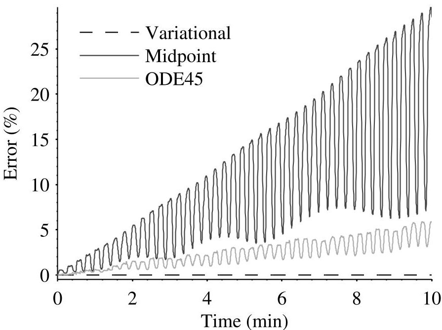


<div align="center">

Figure 6.1: Momentum error for a free rigid body

</div>


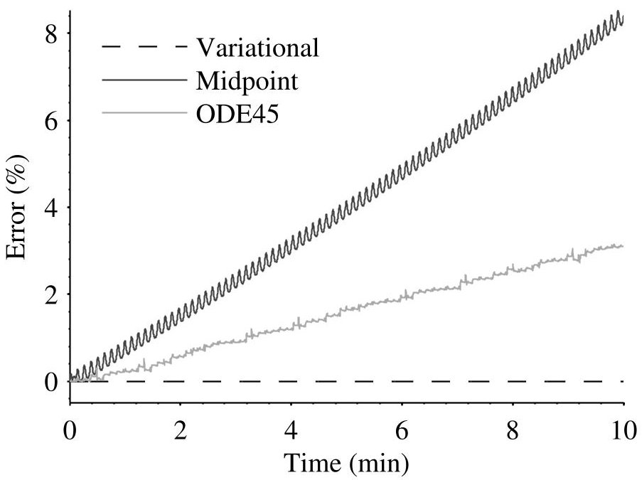


<div align="center">

Figure 6.2: Energy error for a free rigid body

</div>

Figure 6.9.1 shows the normalized momentum error magnitude for all three integrators, and figure 6.2 shows the normalized energy error. Figure 6.3 shows these errors for the variational integrator after continuing the simulation for one million time steps. Together, all three demonstrate the excellent conservation properties

<!-- PDF_PAGE: 119 -->

and long-term stability of the variational integrator. The gradual accumulation of error shown in figure 6.3 is due to numerical round-off, and is an unavoidable consequence of using finite-precision floating-point arithmetic.


<div align="center">

Figure 6.3: Long-term error for a free rigid body

</div>

While it is possible to achieve better momentum and energy conservation with traditional integrators by using smaller time steps and higher-order methods, doing so can become prohibitively computationally expensive for long integration times. The energy and momentum behavior of the variational integrator produces qualitatively realistic simulation results in cases where traditional integrators can produce unphysical behavior.

## 6.9.2 Damped Rigid Body

The second test incorporates the spherical damper of section 6.8 into the rigid body simulation. The damper inertia is set to $ I_{D}=. 2 $ and the damping constant C is varied from 0.1 to 100. The midpoint rule is not shown because it quickly diverges

<!-- PDF_PAGE: 120 -->

as C is increased and requires extremely small step sizes to avoid divergence.


<div align="center">

Figure 6.4: Integrator running time

</div>

Figure 6.4 shows the running time of ODE45 with default error tolerances and the variational integrator with a step size of h=.3 seconds, which is chosen so that the running times are roughly equal for small values of C. As the damping constant increases, the magnitude of the forces between the body and the damper increase and ODE45 must shorten its time steps to maintain accuracy and avoid diverging. The variational integrator, on the other hand, remains stable with a relatively large fixed step size.

Figure 6.5 shows the total energy of the system over the course of a simulation with C=100. The variational integrator shows essentially the same energy damping behavior as ODE45 on this dissipative system while running over 50 times faster. Figure 6.6 shows the same simulation again, but with MATLAB's ODE15s solver, which is intended for solving stiff systems, substituted for ODE45. ODE15s runs in roughly the same time as the variational integrator on this problem but produces obviously incorrect and unrealistic energy behavior, with the total energy

<!-- PDF_PAGE: 121 -->


<div align="center">

Figure 6.5: Energy for rigid body with damper

</div>

increasing over time.


<div align="center">

Figure 6.6: Energy for rigid body with damper

</div>

<!-- PDF_PAGE: 122 -->

## 6.9.3 Extended Kalman Filter

The final test case demonstrates the advantages of variational integrators in a realtime estimation application. A spacecraft attitude determination problem is simulated where a multiplicative extended Kalman filter (MEKF)[52], [53] is used to estimate the attitude quaternion from noisy measurements of two inertial reference vectors. This situation is typical on CubeSats, for example, where magnetometer and sun vector measurements are commonly used for attitude determination.

A simulated truth model is constructed by integrating the rigid body equations of motion with initial conditions $ q_{0}=[0,0,0,1]^{\intercal} $ and $ \omega_{0}=[4,-5,6]^{\intercal} $ degrees per second using ODE45 in MATLAB. Simulated vector measurements are then generated and Gaussian noise is added. Attitudes for filter initialization are computed from the first pair of noisy measurement vectors using the TRIAD algorithm[91].

Figure 6.7 compares a standard MEKF to one using a variational integrator to perform its state prediction step. The two filters have nearly identical perfor-


<div align="center">

Figure 6.7: Multiplicative extended Kalman filter RMS attitude error

</div>

<!-- PDF_PAGE: 123 -->

mance at high sample rates but show very different behavior as the sample rate decreases. The underlying reason for this performance difference is the quality of the linearizations that the variational integrator yields. Equation (6.38) and the corresponding Jacobian of equation (6.36) lead to the true linearization of the map from $ \phi_{k} $ to $ \phi_{k+1} $ :

$$
\frac {\partial \phi_ {k + 1}}{\partial \phi_ {k}} = \left(\frac {\partial \boldsymbol {p} _ {k}}{\partial \phi_ {k + 1}}\right) ^ {- 1} \frac {\partial \boldsymbol {p} _ {k}}{\partial \phi_ {k}}
$$

This linearization is completely independent of the step size taken. As a result, filters built around variational integrators are highly insensitive to sample rate and can maintain good performance and convergence at much lower rates than standard extended Kalman filters.

## 6.10 Conclusions

The integrators developed in this study offer physically realistic momentum and energy behavior while having modest computational costs. They consistently outperform Runge-Kutta schemes in a variety of tests on both conservative and nonconservative systems. High-quality linearizations can also be computed as part of the integration process, making the algorithms well suited for use in real-time estimation and control applications like attitude filtering. Lastly, the methods introduced are general and can be used to develop variational integrators for a wide range of applications in spacecraft dynamics.

<!-- PDF_PAGE: 124 -->

## APPENDIX A KICKSAT CROWD FUNDING

Much of the funding that has made KickSat possible was raised through the crowd-funding website Kickstarter. Figure A.1 shows a screenshot of the KickSat web page on Kickstarter as it appeared in early 2012, shortly after fundraising was completed.


<div align="center">

Figure A.1: KickSat Kickstarter web page

</div>

Kickstarter allows individuals to raise money from "backers" for well-defined projects[92], [93]. A project proposal is first submitted for review by Kickstarter and, if accepted, is hosted on Kickstarter's website for up to 60 days. During that time, individuals can donate to the project in various amounts set by the project's

<!-- PDF_PAGE: 125 -->

creator, with the option of receiving "rewards." In the case of KickSat, 315 individuals pledged in amounts ranging from $25 to $10,000 in exchange for rewards including prototype Sprite hardware, passes to attend the launch of KickSat at Kennedy Space Center, and having their names engraved on KickSat's structure. In total, nearly $75,000 was raised between October and December 2011, as shown in figure A.2.


<div align="center">

Figure A.2: Kickstarter fundraising progress

</div>

In a particularly interesting foreshadowing of the possibilities for low-cost amateur space missions, 26 individuals pledged $1,000 in exchange for a development kit to write flight code for their own Sprite. Of those, nine actually delivered finished software in time for the launch of KickSat-1. One experiment designed by members of the British Interplanetary Society attempted to use the RAM in the microcontroller on the Sprite as a radiation detector by writing pseudo-random data and reading it back repeatedly, checking for bit flips caused by high-energy particles. Most others relied on measurements from the onboard gyroscope, magnetometer, and temperature sensors.

<!-- PDF_PAGE: 126 -->

<div align="center">

# APPENDIX B SPRITE HARDWARE SCHEMATICS

</div>


<!-- PDF_PAGE: 127 -->


<!-- PDF_PAGE: 128 -->

## APPENDIX C

## SPRITE BILL OF MATERIALS

<table border="1"><tr><td>Part</td><td>Value</td><td>Package</td><td>Description</td><td>Part Number</td></tr><tr><td>C1,C5,C9</td><td>10nF</td><td>0603</td><td>Capacitor</td><td>399-1091-1-ND</td></tr><tr><td>C2,C3</td><td>470nF</td><td>0603</td><td>Capacitor</td><td>399-3114-1-ND</td></tr><tr><td>C4,C7</td><td>2.2nF</td><td>0603</td><td>Capacitor</td><td>399-1085-1-ND</td></tr><tr><td>C6,C8,C10</td><td>100nF</td><td>0603</td><td>Capacitor</td><td>399-5089-1-ND</td></tr><tr><td>C11</td><td>220nF</td><td>0603</td><td>Capacitor</td><td>399-1102-1-ND</td></tr><tr><td>C12</td><td>4.7uF</td><td>0603</td><td>Capacitor</td><td>399-3482-1-ND</td></tr><tr><td>L1</td><td>12nH</td><td>0603</td><td>Inductor</td><td>587-1546-1-ND</td></tr><tr><td>D1</td><td>Green</td><td>0603</td><td>LED</td><td>475-2709-1-ND</td></tr><tr><td>R1</td><td>56K</td><td>0603</td><td>Resistor</td><td>P56.0KHCT-ND</td></tr><tr><td>R2</td><td>47K</td><td>0603</td><td>Resistor</td><td>P47.0KHCT-ND</td></tr><tr><td>R3,R4</td><td>4.7K</td><td>0603</td><td>Resistor</td><td>P4.70KHCT-ND</td></tr><tr><td>R5</td><td>270R</td><td>0603</td><td>Resistor</td><td>P270GCT-ND</td></tr><tr><td>R6,R7,R8,R9,R10</td><td>0R</td><td>0805</td><td>Resistor</td><td>P0.0ACT-ND</td></tr><tr><td>U1</td><td>CC430F5137</td><td>RGZ48</td><td>MCU/Radio</td><td>296-27420-1-ND</td></tr><tr><td>U2</td><td>HMC5883LSMD</td><td>16LPCC</td><td>Magnetometer</td><td>342-1082-1-ND</td></tr><tr><td>U3</td><td>ITG-3200</td><td>QFN-24</td><td>Gyro</td><td>37T8091</td></tr><tr><td>X1</td><td>TCXO_7Z</td><td>TXC_7Z</td><td>Crystal Oscillator</td><td>887-1622-1-ND</td></tr><tr><td>P1,P2</td><td>SPRITE_PIN</td><td>SPRITE_PIN</td><td>Test Pin</td><td>ED1088CT-ND</td></tr><tr><td>S1,S2,S3,S4</td><td>TASC</td><td>TASC</td><td>Solar Cell</td><td>N/A</td></tr></table>

<!-- PDF_PAGE: 129 -->

<div align="center">

# APPENDIX D

</div>

<div align="center">

# SPRITE RECEIVER SOURCE CODE

</div>

```c

/* correlator_cf_impl.cc */

/*

 * Copyright 2014 Zac Manchester.

 *

 * This is free software; you can redistribute it and/or modify

 * it under the terms of the GNU General Public License as published by

 * the Free Software Foundation; either version 3, or (at your option)

 * any later version.

 *

 * This software is distributed in the hope that it will be useful,

 * but WITHOUT ANY WARRANTY; without even the implied warranty of

 * MERCHANTABILITY or FITNESS FOR A PARTICULAR PURPOSE.  See the

 * GNU General Public License for more details.

 *

 * You should have received a copy of the GNU General Public License

 * along with this software; see the file COPYING.  If not, write to

 * the Free Software Foundation, Inc., 51 Franklin Street,

 * Boston, MA 02110-1301, USA.

 */

#ifdef HAVE_CONFIG_H

#include "config.h"

#endif

#include <gnuradio/io_signature.h>

#include "correlator_cf_impl.h"

#include <gnuradio/gr_complex.h>

#include <gnuradio/fft/fft.h>

#include <complex>

#include <cmath>

using namespace std;

namespace gr {

  namespace sprite {

    correlator_cf::sptr

    correlator_cf::make(int prn_id0, int prn_id1)

    {

      return gnuradio::get_initial_sptr

        (new correlator_cf_impl(prn_id0, prn_id1));

    }

    /*

     * The private constructor

     */

    correlator_cf_impl::correlator_cf_impl(int prn_id0, int prn_id1)

      : gr::sync_block("correlator_cf",

            gr::io_signature::make(1, 1, sizeof(gr_complex)),

            gr::io_signature::make(1, 1, sizeof(float)))

    {

```

<!-- PDF_PAGE: 130 -->

```c

set_history(SPRITE_PRN_LENGTH);

generate_prns(prn_id0, prn_id1);

cc430_modulator(m_prn0, m_template0);

cc430_modulator(m_prn1, m_template1);

for (int k = 0; k < SPRITE_PRN_LENGTH; k++)

{

    m_template0[k] = conj(m_template0[k]);

    m_template1[k] = conj(m_template1[k]);

}

m_fft0 = new fft::fft_complex(SPRITE_PRN_LENGTH, true, 1);

m_fft_buffer_in0 = m_fft0->get_inbuf();

m_fft_buffer_out0 = m_fft0->get_outbuf();

m_fft1 = new fft::fft_complex(SPRITE_PRN_LENGTH, true, 1);

m_fft_buffer_in1 = m_fft1->get_inbuf();

m_fft_buffer_out1 = m_fft1->get_outbuf();

}

/*

 * Our virtual destructor.

 */

correlator_cf_impl::~correlator_cf_impl()

{

}

}

void correlator_cf_impl::cc430_modulator(int* prnBits, gr_complex* baseBand)

{

    float* diffs = m_buffer_real1;

    float* iBB = m_buffer_real2;

    float* qBB = m_buffer_real3;

    // Differentially encode with +/-1 values

    diffs[0] = -2*prnBits[0] + 1;

    for (int k = 1; k < SPRITE_PRN_LENGTH; k++)

    {

        char diff = prnBits[k] - prnBits[k-1];

        if(diff == 0)

        {

            diffs[k] = 1;

        }

        else

        {

            diffs[k] = -1;

        }

    }

    // Initialize with offset between I and Q

    iBB[0] = 1;

    qBB[0] = diffs[0];

    qBB[1] = diffs[0];

```

<!-- PDF_PAGE: 131 -->

```cpp

    for (int k = 1; k < SPRITE_PRN_LENGTH-2; k+=2)

    {

        iBB[k] = diffs[k]*iBB[k-1];

        iBB[k+1] = iBB[k];

    }

    iBB[SPRITE_PRN_LENGTH-1] =

    diffs[SPRITE_PRN_LENGTH-1]*iBB[SPRITE_PRN_LENGTH-2];

    for (int k = 2; k < SPRITE_PRN_LENGTH; k+=2)

    {

        qBB[k] = diffs[k]*qBB[k-1];

        qBB[k+1] = qBB[k];

    }

    for (int k = 0; k < SPRITE_PRN_LENGTH; k++)

    {

        baseBand[k] = iBB[k]*cos(M_PI/2*k) + 1i*qBB[k]*sin(M_PI/2*k);

    }

}

void correlator_cf_impl::generate_prns(int prn_id0, int prn_id1)

{

    if(prn_id0 == -2)

    {

        //Deep copy M-sequence

        for (int k = 0; k < M_SEQUENCE_LENGTH; k++)

        {

            m_prn0[k] = mseq1[k];

        }

    }

    else if(prn_id0 == -1)

    {

        //Deep copy M-sequence

        for (int k = 0; k < M_SEQUENCE_LENGTH; k++)

        {

            m_prn0[k] = mseq2[k];

        }

    }

    else //if(prn_id >= 0 && prn_id < M_SEQUENCE_LENGTH)

    {

        //Generate Gold Codes by xor'ing 2 M-sequences in different phases

        for (int k = 0; k < M_SEQUENCE_LENGTH-prn_id0; k++)

        {

            m_prn0[k] = mseq1[k] ^ mseq2[k+prn_id0];

        }

        for (int k = M_SEQUENCE_LENGTH-prn_id0; k < M_SEQUENCE_LENGTH; k++)

        {

            m_prn0[k] = mseq1[k] ^ mseq2[k-M_SEQUENCE_LENGTH+prn_id0];

        }

    }

    m_prn0[SPRITE_PRN_LENGTH-1] = 0; //To pad out the last byte, add a zero to the end

    if(prn_id1 == -2)

```

<!-- PDF_PAGE: 132 -->

```cpp

{

    //Deep copy M-sequence

    for (int k = 0; k < M_SEQUENCE_LENGTH; k++)

    {

        m_prn1[k] = mseq1[k];

    }

}

else if(prn_id1 == -1)

{

    //Deep copy M-sequence

    for (int k = 0; k < M_SEQUENCE_LENGTH; k++)

    {

        m_prn1[k] = mseq2[k];

    }

}

else //if(prn_id >= 0 && prn_id < M_SEQUENCE_LENGTH)

{

    //Generate Gold Codes by xor'ing 2 M-sequences in different phases

    for (int k = 0; k < M_SEQUENCE_LENGTH-prn_id1; k++)

    {

        m_prn1[k] = mseq1[k] ^ mseq2[k+prn_id1];

    }

    for (int k = M_SEQUENCE_LENGTH-prn_id1; k < M_SEQUENCE_LENGTH; k++)

    {

        m_prn1[k] = mseq1[k] ^ mseq2[k-M_SEQUENCE_LENGTH+prn_id1];

    }

}

m_prn1[SPRITE_PRN_LENGTH-1] = 0; //To pad out the last byte, add a zero to the end

}

int

correlator_cf_impl::work(int noutput_items,

    gr_vector_const_void_star &input_items,

    gr_vector_void_star &output_items)

{

    const gr_complex *in = (const gr_complex *) input_items[0];

    float *out = (float *) output_items[0];

    // Do <+signal processing>

    for(int k = 0; k < noutput_items; ++k) {

        //Pointwise multiply by baseband template and copy to fft input

        for (int j = 0; j < SPRITE_PRN_LENGTH; ++j)

        {

            m_fft_buffer_in0[j] = m_template0[j]*in[j+k];

            m_fft_buffer_in1[j] = m_template1[j]*in[j+k];

        }

        //Take FFT

        m_fft0->execute();

        m_fft1->execute();

```

<!-- PDF_PAGE: 133 -->

```cpp

//Find largest value in FFT

float mag0 = real( m_fft_buffer_out0 [0] * conj( m_fft_buffer_out0 [0] ));

float max0 = mag0;

float index0 = 0;

for (int j = 1; j < SPRITE_PRN_LENGTH; ++j)

{

    mag0 = real( m_fft_buffer_out0 [j] * conj( m_fft_buffer_out0 [j] ));

    if (mag0 > max0)

    {

        max0 = mag0;

        index0 = j;

    }

}

float mag1 = real( m_fft_buffer_out1 [0] * conj( m_fft_buffer_out1 [0] ));

float max1 = mag1;

float index1 = 0;

for (int j = 1; j < SPRITE_PRN_LENGTH; ++j)

{

    mag1 = real( m_fft_buffer_out1 [j] * conj( m_fft_buffer_out1 [j] ));

    if (mag1 > max1)

    {

        max1 = mag1;

        index1 = j;

    }

}

out[k] = max1 >= max0 ? sqrt(max1) : -sqrt(max0);

}

// Tell runtime system how many output items we produced.

return noutput_items;

}

} /* namespace sprite */

} /* namespace gr */

```

<!-- PDF_PAGE: 134 -->

```c

/* peak_decimator_ff_impl.cc */

/*

 * Copyright 2014 Zac Manchester.

 *

 * This is free software; you can redistribute it and/or modify

 * it under the terms of the GNU General Public License as published by

 * the Free Software Foundation; either version 3, or (at your option)

 * any later version.

 *

 * This software is distributed in the hope that it will be useful,

 * but WITHOUT ANY WARRANTY; without even the implied warranty of

 * MERCHANTABILITY or FITNESS FOR A PARTICULAR PURPOSE.  See the

 * GNU General Public License for more details.

 *

 * You should have received a copy of the GNU General Public License

 * along with this software; see the file COPYING.  If not, write to

 * the Free Software Foundation, Inc., 51 Franklin Street,

 * Boston, MA 02110-1301, USA.

 */

#ifdef HAVE_CONFIG_H

#include "config.h"

#endif

#include <gnuradio/io_signature.h>

#include "peak_decimator_ff_impl.h"

namespace gr {

  namespace sprite {

    peak_decimator_ff::sptr

    peak_decimator_ff::make(int window_size)

    {

      return gnuradio::get_initial_sptr

        (new peak_decimator_ff_impl(window_size));

    }

    /*

     * The private constructor

     */

    peak_decimator_ff_impl::peak_decimator_ff_impl(int window_size)

      : gr::sync_decimator("peak_decimator_ff",

            gr::io_signature::make(1, 1, sizeof(float)),

            gr::io_signature::make(1, 1, sizeof(float)), window_size)

    {

      m_window = window_size;

    }

    /*

     * Our virtual destructor.

     */

    peak_decimator_ff_impl::~peak_decimator_ff_impl()

    {

    }

  }

}

```

<!-- PDF_PAGE: 135 -->

```cpp

int

peak_decimator_ff_impl::work(int noutput_items ,

    gr_vector_const_void_star &input_items ,

    gr_vector_void_star &output_items)

{

    const float *in = (const float *) input_items[0];

    float *out = (float *) output_items[0];

    for(int k = 0; k < noutput_items; ++k)

    {

        m_min = 0;

        m_max = 0;

        for(int j = m_window*k; j < m_window*(k+1); ++j)

        {

            if(in[j] > m_max)

            {

                m_max = in[j];

            }

            else if(in[j] < m_min)

            {

                m_min = in[j];

            }

        }

        out[k] = m_max > -m_min ? m_max : m_min;

    }

    // Tell runtime system how many output items we produced

    return noutput_items;

}

} /* namespace sprite */

} /* namespace gr */

```

<!-- PDF_PAGE: 136 -->

```python

#!/usr/bin/env python

# soft_decoder.py

# Copyright 2015 Zac Manchester.

# This is free software; you can redistribute it and/or modify

# it under the terms of the GNU General Public License as published by

# the Free Software Foundation; either version 3, or (at your option)

# any later version.

# This software is distributed in the hope that it will be useful,

# but WITHOUT ANY WARRANTY; without even the implied warranty of

# MERCHANTABILITY or FITNESS FOR A PARTICULAR PURPOSE.  See the

# GNU General Public License for more details.

# You should have received a copy of the GNU General Public License

# along with this software; see the file COPYING.  If not, write to

# the Free Software Foundation, Inc., 51 Franklin Street,

# Boston, MA 02110-1301, USA.

from __future__ import print_function

from math import *

from numpy import *

from gnuradio import gr

class soft_decoder_c(gr.sync_block):

    """

    docstring for block soft_decoder_c

    """

    def __init__(self, threshold):

        gr.sync_block.__init__(self, name="soft_decoder_c", in_sig=[complex64]

        out_sig=[])

        self.set_history(30)

        self._detection_threshold = threshold

        self._preamble = array([1, 1, 1, -1, -1, 1, -1], dtype=float32)

        self._postamble = array([1, -1, 1, 1, -1, -1, -1], dtype=float32)

        self._template = hstack([self._preamble, zeros(16, dtype=float32),

        self._postamble])/sqrt(14)

        self._C = array([

            [-1, -1, -1, -1, -1, -1, -1, -1, -1, -1, -1, -1, -1],

            [1, 1, -1, 1, -1, 1, 1, 1, -1, -1, -1, -1, -1, -1, 1],

            [-1, 1, 1, 1, 1, -1, -1, -1, -1, -1, -1, -1, 1, -1],

            [1, -1, 1, -1, 1, 1, 1, 1, -1, -1, -1, -1, -1, -1, 1, -1],

            [1, 1, 1, 1, -1, -1, 1, -1, -1, -1, -1, -1, 1, -1, -1],

            [-1, 1, -1, 1, 1, 1, -1, 1, -1, -1, -1, -1, 1, -1, 1],

            [-1, -1, 1, 1, -1, -1, 1, 1, -1, -1, -1, -1, 1, -1, 1],

            [-1, 1, 1, -1, -1, 1, -1, 1, -1, -1, -1, 1, -1, 1],

            [-1, 1, -1, 1, 1, 1, -1, -1, -1, -1, -1, 1, -1, 1],

            [-1, -

<!-- PDF_PAGE: 137 -->

[1, 1, -1, -1, -1, -1, -1, 1, -1, -1, -1, -1, 1, 1, -1, -1],

[-1, -1, -1, 1, -1, 1, 1, -1, -1, -1, -1, -1, 1, 1, -1, 1],

[1, -1, 1, 1, 1, -1, -1, 1, -1, -1, -1, -1, 1, 1, -1, 1],

[-1, 1, 1, -1, 1, 1, 1, -1, -1, -1, -1, -1, 1, 1, 1, 1],

[-1, 1, 1, -1, 1, 1, 1, -1, -1, -1, -1, -1, 1, 1, 1, 1],

[-1, 1, -1, -1, 1, 1, 1, 

<!-- PDF_PAGE: 138 -->

[1, 1, 1, -1, -1, -1, -1, 1, -1, 1, -1, -1, -1, -1, 1],

[1, -1, 1, 1, 1, 1, -1, -1, -1, 1, -1, -1, -1, 1, -1, -1],

[-1, 1, 1, -1, 1, -1, 1, 1, -1, 1, -1, -1, -1, 1, -1, 1],

[1, 1, -1, -1, -1, 1, -1, -1, -1, 1, -1, -1, -1, 1, 1, -1],

[-1, -1, -1, 1, -1, -1, 1, 1, -1, 1, -1, -1, 1, 1, -1, 1],

[-1, 1, 1, 1, 1, 1, -1, 1, -1, 1, -1, -1, 1, -1, -1, -1],

[1, -1, 1, -1, 1, -1, 1, -1, -1, 1, -1, -1, 1, -1, -1, 1],

[-1, -1, -1, -1, -1, 1, -1, 1, -1, 1, -1, -1, 1, -1, 1, -1],

[1, 1, -1, 1, -1, 1, 1, 1, -1, 1, -1, -1, 1, 1, 1, -1],

[-1, -1, 1, -1, -1, -1, -1, -1, -1, -1, -1, -1, -1, -1],

[1, -1, 1, -1, -1, -1, -1, -1, -1, -1, -1, -1, -1, -1],

[1, 1, 1, 1, -1, 1, 1, 1, -1, 1, -1, -1, -1, 1, 1, -1],

[-1, -1, 1, -1, -1, -1, -1, -1, -1, -1, -1, -1, -1, -1],

[1, -1, 1, -1, -1, -1, -1, -1, -1, -1, -1, -1, -1, -1],

[1, -1, 1, -1, -1, -1, -1, -1, -1, -1, -1, -1, -1],

[1, 1, -1, 1, -1, -1, -1, -1, -1, -1, -1, -1, -1, -1],

[1, -1, -1, -1, -1, -1, -1, -1, -1, -1, -1, -1, -1],

[1, -1, -1, -1, -1, -1, -1, -1, -1, -1, -1, -1, -1],

[

<!-- PDF_PAGE: 139 -->

[1, -1, 1, -1, 1, 1, 1, 1, -1, 1, 1, 1, -1, 1, -1],

[-1, 1, 1, 1, 1, -1, -1, -1, -1, 1, 1, 1, -1, 1, -1],

[1, 1, 1, 1, -1, -1, 1, -1, -1, 1, 1, 1, -1, 1],

[-1, 1, -1, 1, 1, 1, -1, 1, -1, 1, 1, 1, -1, 1],

[1, -1, -1, -1, 1, -1, 1, -1, 1, -1, 1, 1, 1, -1],

[1, -1, -1, 1, 1, 1, -1, 1, -1, 1, 1, 1, -1],

[1, -1, -1, 1, 1, 1, -1, 1, -1, 1, 1, 1, -1],

[1, -1, -1, 1, 1, -1, 1, -1, 1, -

<!-- PDF_PAGE: 140 -->

[1, 1, 1, -1, -1, -1, 1, 1, 1, -1, 1, 1, -1, -1, -1, 1],

[-1, 1, -1, -1, 1, 1, -1, -1, 1, -1, 1, 1, -1, -1, 1, -1],

[1, -1, -1, 1, 1, -1, 1, 1, 1, -1, 1, 1, -1, -1, 1, -1],

[-1, -1, -1, 1, -1, -1, -1, 1, 1, -1, 1, 1, -1, -1, 1, -1],

[1, -1, 1, 1, 1, 1, 1, -1, 1, -1, 1, 1, -1, 1, 1, -1],

[-1, 1, 1, -1, 1, -1, -1, 1, 1, -1, 1, 1, -1, 1, 1, -1],

[-1, -1, -1, -1, -1, -1, 1, 1, 1, 1, -1, 1, 1, -1, -1, -1],

[1, 1, -1, 1, -1, -1, -1, -1, 1, 1, 1, 1, -1, -1, 1, -1],

[-1, 1, 1, 1, 1, 1, 1, 1, 1, -1, 1, 1, 1, -1, 1, -1],

[-1, 1, -1, 1, 1, -1, -1, -1, 1, 1, 1, 1, -1, 1, -1],

[-1, 1, -

<!-- PDF_PAGE: 141 -->

```python

[-1, -1, 1, -1, 1, 1, 1, -1, 1, 1, 1, -1, 1, -1, -1],

[1, 1, 1, 1, 1, -1, -1, 1, 1, 1, 1, -1, 1, -1, 1],

[-1, 1, -1, 1, -1, 1, 1, -1, 1, 1, 1, -1, 1, -1, 1],

[1, -1, -1, -1, -1, -1, -1, 1, 1, 1, 1, -1, 1, 1, 1],

[1, -1, 1, -1, -1, 1, -1, -1, 1, 1, 1, -1, 1, 1, 1],

[1, -1, 1, -1, -1, 1, -1, -1, 1, 1, 1, -1, 1, 1, 1],

[1, -1, 1, -1, -1, 1, -1, -1, 1, 1, 1, -1, 1, 1, 1],

[1, -1, -1, -1, -1, -1, -1, 

<!-- PDF_PAGE: 142 -->

<table><tr><td></td><td>else:</td></tr><tr><td></td><td>k += 1</td></tr><tr><td></td><td>else:</td></tr><tr><td></td><td>k += 1</td></tr><tr><td>if</td><td>max_index &lt; 1:</td></tr><tr><td></td><td>return 0</td></tr><tr><td>elif</td><td>k &gt; max_index:</td></tr><tr><td></td><td>return k</td></tr><tr><td>else:</td><td></td></tr><tr><td></td><td>return max_index</td></tr></table>

<!-- PDF_PAGE: 143 -->

<div align="center">

# APPENDIX E

</div>

<div align="center">

# KICKSAT VERIFICATION REPORTS

</div>

<!-- PDF_PAGE: 144 -->

## ELaNa V CubeSat Verification Report

Mass Properties


<table border="1"><tr><td>Revision:</td><td>4</td></tr><tr><td>Date:</td><td>9/3/2013</td></tr><tr><td>Authors:</td><td>Zachary Manchester
Email: zrm3@cornell.edu
Phone: 607-279-1358</td></tr><tr><td>Requirements Verified:</td><td>3.2.3, 3.2.4</td></tr></table>

<!-- PDF_PAGE: 145 -->

## Coordinate System:

In accordance with requirement 3.2.3, the figure 1 indicates the reference coordinate system used by KickSat. The RBF pin is not shown. Figure 1 does not show the remove before flight (RBF) pin, which is located on the -X face of the spacecraft.


<div align="center">

Figure 1: KickSat Reference Coordinate System

</div>

<!-- PDF_PAGE: 146 -->

## Mass Properties:

KickSat's mass was determined by weighing the actual flight unit. The center of mass was determined by balancing the flight unit on a straight edge. The moments of inertia were measured using a bifilar pendulum apparatus. The products of inertia were calculated by analyzing a simplified model of the mass distribution of the spacecraft to calculate the principal axes of inertia, after which a full inertia matrix consistent with both the measured products of inertia and calculated principal axes was calculated. All values are referenced to the geometric center of the spacecraft and the coordinate system used is that depicted in figure 1. All measurements were made without the RBF pin and with all deployables in their stowed (launch) configurations.

Mass: 2.68 kg

Center of Mass:

$$
\begin{array}{l} \mathrm {X} = - 1. 7 7 \mathrm {m m} \\ \mathrm {Y} = 0. 2 9 \mathrm {m m} \\ \mathrm {Z} = - 1 4. 8 \mathrm {m m} \\ \end{array}
$$

Moments of Inertia:

$$
\begin{array}{l} \mathrm {I x x} = 3. 8 7 \times 1 0 ^ {4} \mathrm {k g} \mathrm {m m} ^ {2} \\ \mathrm {I y y} = 3. 6 6 \times 1 0 ^ {4} \mathrm {k g} \mathrm {m m} ^ {2} \\ \mathrm {I z z} = 4. 9 6 \times 1 0 ^ {3} \mathrm {k g} \mathrm {m m} ^ {2} \\ \end{array}
$$

Products of inertia:

$$
\begin{array}{l} \mathrm {I x y} = - 4. 7 7 \times 1 0 ^ {2} \mathrm {k g} \mathrm {m m} ^ {2} \\ \mathrm {I x z} = 1. 1 2 \times 1 0 ^ {3} \mathrm {k g} \mathrm {m m} ^ {2} \\ \mathrm {I y z} = - 4. 8 1 \times 1 0 ^ {2} \mathrm {k g} \mathrm {m m} ^ {2} \\ \end{array}
$$

Mass and center of mass values are in compliance with requirement 3.2.4. Variations in the final mass properties of no more than $ \pm10\% $ are anticipated.

<!-- PDF_PAGE: 147 -->

## ELaNa V CubeSat Verification Report

Venting Analysis


<table border="1"><tr><td>Revision:</td><td>1</td></tr><tr><td>Date:</td><td>7/15/2013</td></tr><tr><td>Authors:</td><td>Zachary Manchester
Email: zrm3@cornell.edu
Phone: 607-279-1358</td></tr><tr><td>Requirements Verified:</td><td>3.2.8</td></tr></table>

<!-- PDF_PAGE: 148 -->


<div align="center">

Figure 1: Exterior of KickSat Spacecraft

</div>

The following analysis considers the (conservatively large) full volume of the 3U CubeSat in the volume-to-vent-area ratio calculation.

$$
\text {T o t a l V o l u m e :} V = (3 4 \mathrm {c m}) * (1 0 \mathrm {c m}) * (1 0 \mathrm {c m}) = 3 4 0 0 \mathrm {c m} ^ {3}
$$

The vent area is taken to be the four large cutouts on the +X, -X, +Y, and -Y faces of the CubeSat depicted in figure 1. Note that this area is conservatively small as it neglects several smaller cutouts.

$$
\text {T o t a l A r e a :} A = 4 * (6. 5 \mathrm {c m}) * (2 0. 6 \mathrm {c m}) = 5 3 5. 6 \mathrm {c m} ^ {2}
$$

The resulting volume-to-vent-area ratio meets requirement 3.2.8 specified in the ELaNa V CubeSat to P-POD Interface Control Document:

$$
\frac {V}{A} = \frac {3 4 0 0 \mathrm {c m} ^ {3}}{5 3 5 . 6 \mathrm {c m} ^ {2}} \approx 6. 3 4 8 \mathrm {c m} \approx 2. 5 \mathrm {i n c h e s} < 2 0 0 0 \mathrm {i n c h e s}
$$

<!-- PDF_PAGE: 149 -->

<div align="center">

# ELaNa V CubeSat Verification Report

</div>

Functional Test


<table border="1"><tr><td>Revision:</td><td>2</td></tr><tr><td>Date:</td><td>11/6/2013</td></tr><tr><td>Authors:</td><td>Zachary Manchester
Email: zrm3@cornell.edu
Phone: 607-279-1358</td></tr><tr><td>Requirements Verified:</td><td>3.2.5.2,3.3.1.1,3.3.1.4,3.3.5</td></tr></table>

<!-- PDF_PAGE: 150 -->

## Overview:

A functional (day in the life) test was performed on the KickSat spacecraft to ensure compliance with ELaNa V ICD requirements 3.4.5.2 (deployable time delay), 3.3.1.1 (deployment switch function), 3.3.1.4 (deployment switch toggle), and 3.3.5 (transmission exclusion).

## Test Setup:

Functional tests were performed in building 17 at NASA Ames Research Center. An electronics bench with grounded mats and wrist straps was used and proper ESD precautions were followed. CubeSat power status was verified using power status LEDs on the avionics boards as shown in figure 1. Times were recorded using a wall clock.


<div align="center">

Figure 1: CubeSat Power Status LED

</div>

## Test Procedure:

The following table lists the steps performed during the test along with the times they were performed.

<table border="1"><tr><td>Step</td><td>Time</td></tr><tr><td>1. Ensure ESD precautions are being followed.</td><td>12:37 PM</td></tr><tr><td>2. Place KickSat on test bench. Ensure satellite is powered off with RBF pin inserted and deployment switch engaged.</td><td>12:38 PM</td></tr></table>

<!-- PDF_PAGE: 151 -->

<table border="1"><tr><td>3. Remove RBF pin. Ensure deployment switch remains engaged.</td><td>12:38 PM</td></tr><tr><td>4. Verify satellite remains powered off.</td><td>12:38 PM</td></tr><tr><td>5. Re-insert RBF pin. Ensure deployment switch remains engaged.</td><td>12:38 PM</td></tr><tr><td>6. Verify that satellite remains powered off.</td><td>12:38 PM</td></tr><tr><td>7. Remove RBF pin. Ensure deployment switch remains engaged.</td><td>12:39 PM</td></tr><tr><td>8. Verify that the satellite remains powered off.</td><td>12:39 PM</td></tr><tr><td>9. Release deployment switch and wait 5 minutes.</td><td>12:40 PM</td></tr><tr><td>10. Re-engage deployment switch. Ensure satellite is powered off.</td><td>12:45 PM</td></tr><tr><td>11. Release deployment switch.</td><td>12:47 PM</td></tr><tr><td>12. Record time at antenna deployment.</td><td>1:37 PM</td></tr><tr><td>13. Record time of first RF transmission.</td><td>1:37 PM</td></tr><tr><td>14. Re-insert RBF pin. Ensure that the satellite is powered off.</td><td>1:38 PM</td></tr><tr><td>15. Re-engage deployment switch.</td><td>1:38 PM</td></tr><tr><td>16. Functional test complete.</td><td>1:38 PM</td></tr></table>

## Results:

All ICD requirements were satisfied. Requirement 3.4.5.2 specifies a minimum of 15 minutes between ejection from the P-POD and any deployments. A delay of 50 minutes was measured. Requirements 3.3.1.1 and 3.3.1.4 specify that the deployment switch should cut all power to the CubeSat and that the switch should tolerate toggling between on and off states. This was verified by actuating the switch multiple times. Requirement 3.3.5 specifies a minimum time of 45 minutes between ejection from the P-POD and any RF transmissions. A delay of 50 minutes was measured.

<!-- PDF_PAGE: 152 -->

<div align="center">

# ELaNa V CubeSat Verification Report

</div>

Vibration Test


<table border="1"><tr><td>Revision:</td><td>2</td></tr><tr><td>Date:</td><td>10/09/2013</td></tr><tr><td>Authors:</td><td>Zachary Manchester
Email: zrm3@cornell.edu
Phone: 607-279-1358</td></tr><tr><td>Requirements Verified:</td><td>3.4.3, 3.4.4, 3.4.8</td></tr></table>

<!-- PDF_PAGE: 153 -->

## Overview:

KickSat underwent vibration testing from August 26-28, 2013 at Space Systems Loral in Palo Alto, California. The testing process conformed to requirements 3.4.3, 3.4.4, and 3.4.8 and was performed to the proto-flight levels listed in table 8 of appendix D of the ICD.

## Test Setup:

All tests were performed on a Ling shaker table. A 1" thick aluminum adapter plate was machined to bolt the TestPOD to the 2" by 2" bolt hole pattern on the shaker table. A mechanical drawing of this plate is provided in Appendix A. Three 3-axis accelerometers were used - one attached to the outside corner of the TestPOD, one attached to the CubeSat structure, and a control accelerometer attached to the adapter plate as shown in figure 1.


<div align="center">

Figure 1: Test Setup Showing Placement of Accelerometers

</div>

Y-axis tests were performed with the shaker in a vertical orientation and the TestPOD bolted to a head expander as shown in figure 2, while X-axis and Z-axis tests were performed with the shaker in a horizontal orientation using a slip table as shown in figures 3 and 4.

<!-- PDF_PAGE: 154 -->


<div align="center">

Figure 2: Y-Axis Test Setup

</div>


<div align="center">

Figure 3: X-Axis Test Setup

</div>

<!-- PDF_PAGE: 155 -->


<div align="center">

Figure 4: Z-Axis Test Setup

</div>

## Test Procedure:

The following table lists the steps performed during the test along with the approximate times they were performed.

<table border="1"><tr><td>Step</td><td>Date/Time</td></tr><tr><td>1. Perform functional test of spacecraft</td><td>8/26 10:10 AM</td></tr><tr><td>2. Perform CubeSat Acceptance Checklist</td><td>8/26 11:00 AM</td></tr><tr><td>3. Install CubeSat into TestPOD</td><td>8/26 1:15 AM</td></tr><tr><td>4. Bolt TestPOD to adapter plate</td><td>8/26 2:30 PM</td></tr><tr><td>5. Attach adapter plate to head expander for Y-axis test</td><td>8/26 3:00 PM</td></tr><tr><td>6. Attach accelerometers</td><td>8/26 3:15 PM</td></tr><tr><td>7. Verify that radio is not transmitting</td><td>8/26 3:45 PM</td></tr><tr><td>8. Perform initial Y-axis sine sweep</td><td>8/26 3:57 PM</td></tr><tr><td>9. Perform Y-axis short duration random vibration test</td><td>8/26 4:09 PM</td></tr><tr><td>10. Perform Y-axis steady state random vibration test</td><td>8/26 4:34 PM</td></tr><tr><td>11. Perform post Y-axis sine sweep</td><td>8/26 4:42 PM</td></tr><tr><td>12. Compare pre/post sine sweeps</td><td>8/26 4:45 PM</td></tr><tr><td>13. Verify that radio is not transmitting</td><td>8/26 4:48 PM</td></tr><tr><td>14. Remove test fixture from head expander</td><td>8/27 9:05 AM</td></tr><tr><td>15. Inspect TestPOD and KickSat for damage</td><td>8/27 9:15 AM</td></tr><tr><td>16. Set up slip table for X and Z-axis tests</td><td>8/27 9:30 AM</td></tr><tr><td>17. Mount test fixture to slip table for X-axis tests</td><td>8/27 10:30 AM</td></tr></table>

<!-- PDF_PAGE: 156 -->

<table border="1"><tr><td>18.Verify that radio is not transmitting</td><td>8/27 11:00 AM</td></tr><tr><td>19. Perform initial X-axis sine sweep</td><td>8/27 11:16 AM</td></tr><tr><td>20. Perform X-axis short duration random vibration test</td><td>8/27 1:13 PM</td></tr><tr><td>21. Perform X-axis steady state random vibration test</td><td>8/27 1:23 PM</td></tr><tr><td>22. Perform post X-axis sine sweep</td><td>8/27 1:39 PM</td></tr><tr><td>23. Compare pre/post sine sweeps</td><td>8/27 1:43 PM</td></tr><tr><td>24. Verify that radio is not transmitting</td><td>8/27 1:45 PM</td></tr><tr><td>25. Remove test fixture from slip table</td><td>8/27 1:50 PM</td></tr><tr><td>26. Inspect TestPOD and KickSat for damage</td><td>8/27 2:15 PM</td></tr><tr><td>27. Mount test fixture to slip table for Z-axis tests</td><td>8/28 10:40 AM</td></tr><tr><td>28. Verify that radio is not transmitting</td><td>8/28 11:50 AM</td></tr><tr><td>29. Perform initial Z-axis sine sweep</td><td>8/28 11:57 AM</td></tr><tr><td>30. Perform Z-axis short duration random vibration test</td><td>8/28 1:10 PM</td></tr><tr><td>31. Perform Z-axis steady state random vibration test</td><td>8/28 1:40 PM</td></tr><tr><td>32. Perform post Z-axis sine sweep</td><td>8/28 1:49 PM</td></tr><tr><td>33. Compare pre/post sine sweeps</td><td>8/28 1:55 PM</td></tr><tr><td>34. Verify that radio is not transmitting</td><td>8/28 2:00 PM</td></tr><tr><td>35. Remove test fixture from slip table</td><td>8/28 2:05 PM</td></tr><tr><td>36. Remove TestPOD from adapter plate</td><td>8/28 2:25 PM</td></tr><tr><td>37. Remove KickSat from TestPOD</td><td>8/28 2:30 PM</td></tr><tr><td>38. Inspect KickSat and TestPOD for damage</td><td>8/28 3:20 PM</td></tr><tr><td>39. Perform functional test</td><td>8/28 4:45 PM</td></tr><tr><td>40. Test complete</td><td>8/28 5:00 PM</td></tr></table>

## Results:

KickSat had no visible or audible signs of damage during vibration testing. The beacon radio remained off while in the TestPOD, and pre/post sine sweep plots were consistent. KickSat passed both pre- and post-vibration functional tests. Frequency response plots taken from the accelerometer mounted to the top corner of the TestPOD as well as control accelerometer data for random vibe tests for the axis under test are given below.

<!-- PDF_PAGE: 157 -->


<div align="center">

Figure 5: Y-Axis Initial Sine Sweep

</div>


<div align="center">

Figure 6: Y-Axis Short Duration Random

</div>

<!-- PDF_PAGE: 158 -->


<div align="center">

Figure 7: Y-Axis Steady State Random

</div>


<div align="center">

Figure 8: Y-Axis Pre/Post Sine Sweep Overlay

</div>

<!-- PDF_PAGE: 159 -->


<div align="center">

Figure 9: X-Axis Initial Sine Sweep

</div>


<div align="center">

Figure 10: X-Axis Short Duration Random

</div>

<!-- PDF_PAGE: 160 -->


<div align="center">

Figure 11: X-Axis Steady State Random

</div>


<div align="center">

Figure 12: X-Axis Pre/Post Sine Sweep Overlay

</div>

<!-- PDF_PAGE: 161 -->


<div align="center">

Figure 13: Z-Axis Initial Sine Sweep

</div>


<div align="center">

Figure 14: Z-Axis Short Duration Random

</div>

<!-- PDF_PAGE: 162 -->


<div align="center">

Figure 15: Z-Axis Steady State Random

</div>


<div align="center">

Figure 16: Z-Axis Pre/Post Sine Sweep Overlay

</div>

<!-- PDF_PAGE: 163 -->

<div align="center">

TestPOD Adapter Plate Mechanical Drawing

</div>


<!-- PDF_PAGE: 164 -->

## ELaNa V CubeSat Verification Report

Thermal Vacuum Test


<table border="1"><tr><td>Revision:</td><td>2</td></tr><tr><td>Date:</td><td>8/28/2013</td></tr><tr><td>Authors:</td><td>Zachary Manchester
Email: zrm3@cornell.edu
Phone: 607-279-1358</td></tr><tr><td>Requirements Verified:</td><td>3.4.5, 3.4.5.1</td></tr></table>

<!-- PDF_PAGE: 165 -->

## Overview:

KickSat underwent bakeout testing overnight from August 21-22, 2013 at the NASA Ames Research Center Engineering Evaluation Laboratory. The bakeout process conformed to requirement 3.4.5 by baking at a nominal pressure of $ 1 0^{-4} $ Torr and conformed to requirement 3.4.5.1 by baking at a nominal temperature of $ 6 0^{\circ} $ C for six hours with a temperature ramp rate of less than $ 5^{\circ} $ C per minute.

## Test Setup:

Figure 1 shows the vacuum chamber used for KickSat's bakeout.


Figure 1: Vacuum Chamber

KickSat was fitted with two thermocouples - one each on the +x and -x exterior faces. The thermocouples were attached to the anodized aluminum surface of the CubeSat structure with kapton tape as shown in Figure 2.

<!-- PDF_PAGE: 166 -->


<div align="center">

Figure 2: KickSat with Thermocouples Fitted

</div>

<div align="center">

Figure 3 shows KickSat inside the vacuum chamber with thermocouples attached prior to lowering the bell jar.

</div>

<!-- PDF_PAGE: 167 -->


<div align="center">

Figure 3: KickSat in Vacuum Chamber

</div>

## Test Procedure:

The following table lists the steps performed during the test along with the approximate times they were performed.

<table border="1"><tr><td>Step</td><td>Time</td></tr><tr><td>1. Attach thermocouples to CubeSat and note locations</td><td>3:50 PM</td></tr><tr><td>2. Check thermocouple readings to ensure they are close to room temperature</td><td>3:53 PM</td></tr></table>

<!-- PDF_PAGE: 168 -->

<table border="1"><tr><td>3. Perform functional test of CubeSat
a. Power on CubeSat
b. Receive radio packets from Stensat
c. Receive radio packets from MHX2420
d. Verify reaction wheels turn
e. Power off CubeSat</td><td>3:55 PM</td></tr><tr><td>4. Clean hardware surfaces</td><td>4:00 PM</td></tr><tr><td>5. Place satellite into vacuum chamber</td><td>4:07 PM</td></tr><tr><td>6. Connect thermocouples</td><td>4:08 PM</td></tr><tr><td>7. Seal vacuum chamber</td><td>4:10 PM</td></tr><tr><td>8. Bring vacuum chamber pressure to $1\times10^{-4}$ Torr</td><td>11:05 PM</td></tr><tr><td>9. Ensure data logging is enabled</td><td>11:05 PM</td></tr><tr><td>10. Slowly raise the heating element temperature while ensuring the chamber pressure does not rise above $5\times10^{-4}$ Torr</td><td>11:06 PM</td></tr><tr><td>11. Maintain spacecraft temperature between $60^{\circ}$ C and $65^{\circ}$ C for 6 hours</td><td>2:56 AM</td></tr><tr><td>12. Slowly lower the heating element temperature until the spacecraft temperature reaches $30^{\circ}$ C</td><td>9:45 AM</td></tr><tr><td>13. Return vacuum chamber to atmospheric pressure</td><td>2:10 PM</td></tr><tr><td>14. Remove CubeSat from vacuum chamber</td><td>2:15 PM</td></tr><tr><td>15. Perform functional test of CubeSat
a. Power on CubeSat
b. Receive radio packets from Stensat
c. Receive radio packets from MHX2420
d. Verify reaction wheels turn
e. Power off CubeSat</td><td>2:18 PM</td></tr><tr><td>16. Remove thermocouples</td><td>2:25 PM</td></tr><tr><td>17. Ensure all data is recorded</td><td>2:27 PM</td></tr><tr><td>18. Test complete</td><td>2:30 PM</td></tr></table>

## Results:

Figure 4 shows the temperature and pressure data recorded during the bakeout. The raw pressure and temperature data is tabulated in Appendix A. The temperature readings of the two thermocouples agreed to within 2 degrees Celsius throughout the test. Significant outgassing was observed once the heaters were turned on, causing the pressure to rise to a maximum of $ 3. 7 \times1 0^{-4} $ Torr before slowly decreasing to a minimum of $ 6. 7 \times1 0^{-5} $ Torr at the end of the 6 hour bakeout period. In total, a minimum temperature of $ 6 0^{\circ} \mathrm{C} $ and maximum pressure of $ 3. 7 \times1 0^{-4} $ were maintained for 6 hours and 50 minutes.

<!-- PDF_PAGE: 169 -->


<div align="center">

Figure 4: Temperature and Pressure Plots

</div>

<!-- PDF_PAGE: 170 -->

<div align="center">

Appendix A:

</div>

<table border="1"><tr><td>TEMPERATURE</td><td>KICKSAT60C for6HOURSService Request:RD-472FILE:RD472 KICKSAT-1</td><td>BAKEOUT</td><td>TIME</td></tr><tr><td>TCT</td><td>TEMPERATURE</td><td>PRESSURE</td><td>586,2,0</td></tr><tr><td>4</td><td>TCT</td><td>TERRA-VAC</td><td></td></tr><tr><td>TC#1</td><td>5</td><td>16</td><td>TIME</td></tr><tr><td>C</td><td>TC#2</td><td>VACUUM</td><td>SECONDS</td></tr><tr><td>24.01</td><td>24.15</td><td>1.47E+00</td><td>8/21/13 16:32</td></tr><tr><td>24</td><td>24.13</td><td>1.47E+00</td><td>8/21/13 16:33</td></tr><tr><td>24</td><td>24.12</td><td>1.98E-03</td><td>8/21/13 16:34</td></tr><tr><td>24.01</td><td>24.13</td><td>1.88E-03</td><td>8/21/13 16:35</td></tr><tr><td>24.03</td><td>24.13</td><td>1.78E-03</td><td>8/21/13 16:36</td></tr><tr><td>24.02</td><td>24.12</td><td>1.78E-03</td><td>8/21/13 16:37</td></tr><tr><td>24.04</td><td>24.13</td><td>1.68E-03</td><td>8/21/13 16:38</td></tr><tr><td>24.03</td><td>24.13</td><td>1.58E-03</td><td>8/21/13 16:39</td></tr><tr><td>24.03</td><td>24.13</td><td>1.48E-03</td><td>8/21/13 16:40</td></tr><tr><td>24.04</td><td>24.12</td><td>1.48E-03</td><td>8/21/13 16:41</td></tr><tr><td>24.04</td><td>24.12</td><td>1.38E-03</td><td>8/21/13 16:42</td></tr><tr><td>24.03</td><td>24.12</td><td>1.38E-03</td><td>8/21/13 16:43</td></tr><tr><td>24.04</td><td>24.13</td><td>1.38E-03</td><td>8/21/13 16:44</td></tr><tr><td>24.04</td><td>24.13</td><td>1.28E-03</td><td>8/21/13 16:45</td></tr><tr><td>24.06</td><td>24.13</td><td>1.28E-03</td><td>8/21/13 16:46</td></tr><tr><td>24.06</td><td>24.14</td><td>1.18E-03</td><td>8/21/13 16:47</td></tr><tr><td>24.06</td><td>24.13</td><td>1.18E-03</td><td>8/21/13 16:48</td></tr><tr><td>24.07</td><td>24.14</td><td>1.18E-03</td><td>8/21/13 16:49</td></tr><tr><td>24.06</td><td>24.13</td><td>1.08E-03</td><td>8/21/13 16:50</td></tr><tr><td>24.07</td><td>24.14</td><td>1.08E-03</td><td>8/21/13 16:51</td></tr><tr><td>24.07</td><td>24.13</td><td>1.08E-03</td><td>8/21/13 16:52</td></tr><tr><td>24.08</td><td>24.12</td><td>1.08E-03</td><td>8/21/13 16:53</td></tr><tr><td>24.09</td><td>24.15</td><td>9.78E-04</td><td>8/21/13 16:54</td></tr><tr><td>24.08</td><td>24.15</td><td>9.79E-04</td><td>8/21/13 16:55</td></tr><tr><td>24.09</td><td>24.13</td><td>9.81E-04</td><td>8/21/13 16:56</td></tr><tr><td>24.08</td><td>24.14</td><td>9.81E-04</td><td>8/21/13 16:57</td></tr><tr><td>24.1</td><td>24.14</td><td>8.80E-04</td><td>8/21/13 16:58</td></tr><tr><td>24.08</td><td>24.16</td><td>9.80E-04</td><td>8/21/13 16:59</td></tr><tr><td>24.1</td><td>24.15</td><td>8.81E-04</td><td>8/21/13 17:00</td></tr><tr><td>24.09</td><td>24.15</td><td>8.81E-04</td><td>8/21/13 17:01</td></tr><tr><td>24.09</td><td>24.15</td><td>8.79E-04</td><td>8/21/13 17:02</td></tr><tr><td>24.1</td><td>24.16</td><td>8.81E-04</td><td>8/21/13 17:03</td></tr><tr><td>24.11</td><td>24.15</td><td>8.80E-04</td><td>8/21/13 17:04</td></tr><tr><td>24.1</td><td>24.17</td><td>8.81E-04</td><td>8/21/13 17:05</td></tr><tr><td>24.09</td><td>24.15</td><td>1.10E-03</td><td>8/21/13 17:06</td></tr><tr><td>24.1</td><td>24.17</td><td>8.80E-04</td><td>8/21/13 17:07</td></tr><tr><td>24.11</td><td>24.17</td><td>1.10E-03</td><td>8/21/13 17:08</td></tr><tr><td>24.12</td><td>24.17</td><td>1.10E-03</td><td>8/21/13 17:09</td></tr><tr><td>24.11</td><td>24.17</td><td>1.10E-03</td><td>8/21/13 17:10</td></tr><tr><td>24.12</td><td>24.17</td><td>1.10E-03</td><td>8/21/13 17:11</td></tr><tr><td>24.12</td><td>24.17</td><td>1.10E-03</td><td>8/21/13 17:12</td></tr></table>

<div align="center">

8/28/2013

</div>

<table border="1"><tr><td>24.12</td><td>24.18</td><td>1.10E-03</td><td>8/21/13 17:13</td></tr><tr><td>24.13</td><td>24.17</td><td>1.09E-03</td><td>8/21/13 17:14</td></tr><tr><td>24.13</td><td>24.18</td><td>1.09E-03</td><td>8/21/13 17:15</td></tr><tr><td>24.13</td><td>24.19</td><td>1.09E-03</td><td>8/21/13 17:16</td></tr><tr><td>24.14</td><td>24.19</td><td>1.09E-03</td><td>8/21/13 17:17</td></tr><tr><td>24.13</td><td>24.17</td><td>6.98E-04</td><td>8/21/13 17:18</td></tr><tr><td>24.13</td><td>24.18</td><td>6.79E-04</td><td>8/21/13 17:19</td></tr><tr><td>24.14</td><td>24.19</td><td>6.68E-04</td><td>8/21/13 17:20</td></tr><tr><td>24.14</td><td>24.2</td><td>6.58E-04</td><td>8/21/13 17:21</td></tr><tr><td>24.14</td><td>24.19</td><td>6.48E-04</td><td>8/21/13 17:22</td></tr><tr><td>24.15</td><td>24.2</td><td>6.38E-04</td><td>8/21/13 17:23</td></tr><tr><td>24.16</td><td>24.21</td><td>6.28E-04</td><td>8/21/13 17:24</td></tr><tr><td>24.15</td><td>24.22</td><td>6.19E-04</td><td>8/21/13 17:25</td></tr><tr><td>24.17</td><td>24.22</td><td>6.08E-04</td><td>8/21/13 17:26</td></tr><tr><td>24.16</td><td>24.22</td><td>5.99E-04</td><td>8/21/13 17:27</td></tr><tr><td>24.15</td><td>24.22</td><td>5.89E-04</td><td>8/21/13 17:28</td></tr><tr><td>24.17</td><td>24.22</td><td>5.89E-04</td><td>8/21/13 17:29</td></tr><tr><td>24.16</td><td>24.21</td><td>5.79E-04</td><td>8/21/13 17:30</td></tr><tr><td>24.17</td><td>24.23</td><td>5.69E-04</td><td>8/21/13 17:31</td></tr><tr><td>24.17</td><td>24.24</td><td>5.59E-04</td><td>8/21/13 17:32</td></tr><tr><td>24.19</td><td>24.25</td><td>5.49E-04</td><td>8/21/13 17:33</td></tr><tr><td>24.18</td><td>24.25</td><td>5.49E-04</td><td>8/21/13 17:34</td></tr><tr><td>24.19</td><td>24.25</td><td>5.39E-04</td><td>8/21/13 17:35</td></tr><tr><td>24.2</td><td>24.26</td><td>5.29E-04</td><td>8/21/13 17:36</td></tr><tr><td>24.2</td><td>24.26</td><td>5.29E-04</td><td>8/21/13 17:37</td></tr><tr><td>24.2</td><td>24.26</td><td>5.19E-04</td><td>8/21/13 17:38</td></tr><tr><td>24.21</td><td>24.28</td><td>5.09E-04</td><td>8/21/13 17:39</td></tr><tr><td>24.22</td><td>24.27</td><td>5.09E-04</td><td>8/21/13 17:40</td></tr><tr><td>24.22</td><td>24.28</td><td>4.99E-04</td><td>8/21/13 17:41</td></tr><tr><td>24.22</td><td>24.28</td><td>4.99E-04</td><td>8/21/13 17:42</td></tr><tr><td>24.22</td><td>24.28</td><td>4.89E-04</td><td>8/21/13 17:43</td></tr><tr><td>24.24</td><td>24.3</td><td>4.89E-04</td><td>8/21/13 17:44</td></tr><tr><td>24.24</td><td>24.29</td><td>4.79E-04</td><td>8/21/13 17:45</td></tr><tr><td>24.24</td><td>24.3</td><td>4.79E-04</td><td>8/21/13 17:46</td></tr><tr><td>24.26</td><td>24.3</td><td>4.69E-04</td><td>8/21/13 17:47</td></tr><tr><td>24.25</td><td>24.31</td><td>4.59E-04</td><td>8/21/13 17:48</td></tr><tr><td>24.25</td><td>24.32</td><td>4.59E-04</td><td>8/21/13 17:49</td></tr><tr><td>24.26</td><td>24.31</td><td>4.59E-04</td><td>8/21/13 17:50</td></tr><tr><td>24.25</td><td>24.32</td><td>4.49E-04</td><td>8/21/13 17:51</td></tr><tr><td>24.26</td><td>24.32</td><td>4.39E-04</td><td>8/21/13 17:52</td></tr><tr><td>24.25</td><td>24.33</td><td>4.39E-04</td><td>8/21/13 17:52</td></tr><tr><td>24.27</td><td>24.33</td><td>4.39E-04</td><td>8/21/13 17:53</td></tr><tr><td>24.27</td><td>24.35</td><td>4.29E-04</td><td>8/21/13 17:54</td></tr><tr><td>24.28</td><td>24.34</td><td>4.29E-04</td><td>8/21/13 17:55</td></tr><tr><td>24.28</td><td>24.34</td><td>4.29E-04</td><td>8/21/13 17:56</td></tr><tr><td>24.28</td><td>24.34</td><td>4.29E-04</td><td>8/21/13 17:57</td></tr><tr><td>24.28</td><td>24.36</td><td>4.29E-04</td><td>8/21/13 17:58</td></tr><tr><td>24.3</td><td>24.35</td><td>4.19E-04</td><td>8/21/13 17:59</td></tr><tr><td>24.29</td><td>24.37</td><td>4.09E-04</td><td>8/21/13 18:00</td></tr><tr><td>24.31</td><td>24.36</td><td>4.09E-04</td><td>8/21/13 18:01</td></tr><tr><td>24.32</td><td>24.37</td><td>3.99E-04</td><td>8/21/13 18:02</td></tr><tr><td>24.31</td><td>24.36</td><td>3.99E-04</td><td>8/21/13 18:03</td></tr><tr><td>24.34</td><td>24.39</td><td>3.99E-04</td><td>8/21/13 18:04</td></tr><tr><td>24.33</td><td>24.38</td><td>3.99E-04</td><td>8/21/13 18:05</td></tr></table>

Thermal Vacuum Test

<table border="1"><tr><td>24.32</td><td>24.39</td><td>3.89E-04</td><td>8/21/13 18:06</td></tr><tr><td>24.33</td><td>24.38</td><td>3.89E-04</td><td>8/21/13 18:07</td></tr><tr><td>24.35</td><td>24.39</td><td>3.89E-04</td><td>8/21/13 18:08</td></tr><tr><td>24.34</td><td>24.41</td><td>3.79E-04</td><td>8/21/13 18:09</td></tr><tr><td>24.36</td><td>24.41</td><td>3.79E-04</td><td>8/21/13 18:10</td></tr><tr><td>24.36</td><td>24.43</td><td>3.79E-04</td><td>8/21/13 18:11</td></tr><tr><td>24.36</td><td>24.41</td><td>3.69E-04</td><td>8/21/13 18:12</td></tr><tr><td>24.37</td><td>24.43</td><td>3.69E-04</td><td>8/21/13 18:13</td></tr><tr><td>24.37</td><td>24.43</td><td>3.59E-04</td><td>8/21/13 18:14</td></tr><tr><td>24.38</td><td>24.44</td><td>3.59E-04</td><td>8/21/13 18:15</td></tr><tr><td>24.38</td><td>24.42</td><td>3.59E-04</td><td>8/21/13 18:16</td></tr><tr><td>24.39</td><td>24.44</td><td>3.49E-04</td><td>8/21/13 18:17</td></tr><tr><td>24.39</td><td>24.45</td><td>3.49E-04</td><td>8/21/13 18:18</td></tr><tr><td>24.38</td><td>24.44</td><td>3.49E-04</td><td>8/21/13 18:19</td></tr><tr><td>24.4</td><td>24.45</td><td>3.39E-04</td><td>8/21/13 18:20</td></tr><tr><td>24.41</td><td>24.45</td><td>3.39E-04</td><td>8/21/13 18:21</td></tr><tr><td>24.41</td><td>24.45</td><td>3.39E-04</td><td>8/21/13 18:22</td></tr><tr><td>24.41</td><td>24.46</td><td>3.29E-04</td><td>8/21/13 18:23</td></tr><tr><td>24.41</td><td>24.46</td><td>3.29E-04</td><td>8/21/13 18:24</td></tr><tr><td>24.41</td><td>24.47</td><td>3.29E-04</td><td>8/21/13 18:25</td></tr><tr><td>24.43</td><td>24.48</td><td>3.29E-04</td><td>8/21/13 18:26</td></tr><tr><td>24.42</td><td>24.47</td><td>3.29E-04</td><td>8/21/13 18:27</td></tr><tr><td>24.43</td><td>24.49</td><td>3.29E-04</td><td>8/21/13 18:28</td></tr><tr><td>24.44</td><td>24.49</td><td>3.19E-04</td><td>8/21/13 18:29</td></tr><tr><td>24.44</td><td>24.49</td><td>3.09E-04</td><td>8/21/13 18:30</td></tr><tr><td>24.46</td><td>24.51</td><td>3.09E-04</td><td>8/21/13 18:31</td></tr><tr><td>24.44</td><td>24.49</td><td>3.17E-04</td><td>8/21/13 18:32</td></tr><tr><td>24.44</td><td>24.5</td><td>3.09E-04</td><td>8/21/13 18:33</td></tr><tr><td>24.47</td><td>24.52</td><td>3.09E-04</td><td>8/21/13 18:34</td></tr><tr><td>24.46</td><td>24.51</td><td>3.09E-04</td><td>8/21/13 18:35</td></tr><tr><td>24.46</td><td>24.5</td><td>2.99E-04</td><td>8/21/13 18:36</td></tr><tr><td>24.46</td><td>24.51</td><td>2.99E-04</td><td>8/21/13 18:37</td></tr><tr><td>24.45</td><td>24.52</td><td>2.99E-04</td><td>8/21/13 18:38</td></tr><tr><td>24.47</td><td>24.53</td><td>2.89E-04</td><td>8/21/13 18:39</td></tr><tr><td>24.48</td><td>24.53</td><td>2.99E-04</td><td>8/21/13 18:40</td></tr><tr><td>24.49</td><td>24.54</td><td>2.89E-04</td><td>8/21/13 18:41</td></tr><tr><td>24.48</td><td>24.53</td><td>2.89E-04</td><td>8/21/13 18:42</td></tr><tr><td>24.49</td><td>24.54</td><td>2.89E-04</td><td>8/21/13 18:43</td></tr><tr><td>24.49</td><td>24.54</td><td>2.89E-04</td><td>8/21/13 18:44</td></tr><tr><td>24.5</td><td>24.56</td><td>2.79E-04</td><td>8/21/13 18:45</td></tr><tr><td>24.49</td><td>24.55</td><td>2.79E-04</td><td>8/21/13 18:46</td></tr><tr><td>24.51</td><td>24.56</td><td>2.79E-04</td><td>8/21/13 18:47</td></tr><tr><td>24.51</td><td>24.55</td><td>2.79E-04</td><td>8/21/13 18:48</td></tr><tr><td>24.51</td><td>24.56</td><td>2.79E-04</td><td>8/21/13 18:49</td></tr><tr><td>24.51</td><td>24.57</td><td>2.79E-04</td><td>8/21/13 18:50</td></tr><tr><td>24.53</td><td>24.58</td><td>2.69E-04</td><td>8/21/13 18:51</td></tr><tr><td>24.52</td><td>24.57</td><td>2.69E-04</td><td>8/21/13 18:52</td></tr><tr><td>24.53</td><td>24.59</td><td>2.69E-04</td><td>8/21/13 18:53</td></tr><tr><td>24.55</td><td>24.59</td><td>2.69E-04</td><td>8/21/13 18:54</td></tr><tr><td>24.56</td><td>24.6</td><td>2.69E-04</td><td>8/21/13 18:55</td></tr><tr><td>24.54</td><td>24.59</td><td>2.69E-04</td><td>8/21/13 18:56</td></tr><tr><td>24.55</td><td>24.6</td><td>2.59E-04</td><td>8/21/13 18:57</td></tr><tr><td>24.55</td><td>24.61</td><td>2.59E-04</td><td>8/21/13 18:58</td></tr></table>

<div align="center">

Rev.1

</div>

<div align="center">

8/28/2013

</div>

Thermal Vacuum Test

<table border="1"><tr><td>24.56</td><td>24.62</td><td>2.59E-04</td><td>8/21/13 18:59</td></tr><tr><td>24.58</td><td>24.63</td><td>2.59E-04</td><td>8/21/13 19:00</td></tr><tr><td>24.57</td><td>24.62</td><td>2.49E-04</td><td>8/21/13 19:01</td></tr><tr><td>24.57</td><td>24.62</td><td>2.49E-04</td><td>8/21/13 19:02</td></tr><tr><td>24.58</td><td>24.63</td><td>2.49E-04</td><td>8/21/13 19:03</td></tr><tr><td>24.58</td><td>24.62</td><td>2.49E-04</td><td>8/21/13 19:04</td></tr><tr><td>24.58</td><td>24.64</td><td>2.49E-04</td><td>8/21/13 19:05</td></tr><tr><td>24.6</td><td>24.64</td><td>2.49E-04</td><td>8/21/13 19:06</td></tr><tr><td>24.59</td><td>24.63</td><td>2.49E-04</td><td>8/21/13 19:07</td></tr><tr><td>24.59</td><td>24.63</td><td>2.49E-04</td><td>8/21/13 19:08</td></tr><tr><td>24.6</td><td>24.64</td><td>2.39E-04</td><td>8/21/13 19:09</td></tr><tr><td>24.61</td><td>24.64</td><td>2.39E-04</td><td>8/21/13 19:10</td></tr><tr><td>24.6</td><td>24.66</td><td>2.39E-04</td><td>8/21/13 19:11</td></tr><tr><td>24.61</td><td>24.67</td><td>2.39E-04</td><td>8/21/13 19:12</td></tr><tr><td>24.63</td><td>24.67</td><td>2.39E-04</td><td>8/21/13 19:13</td></tr><tr><td>24.63</td><td>24.67</td><td>2.39E-04</td><td>8/21/13 19:14</td></tr><tr><td>24.62</td><td>24.67</td><td>2.29E-04</td><td>8/21/13 19:15</td></tr><tr><td>24.62</td><td>24.68</td><td>2.29E-04</td><td>8/21/13 19:16</td></tr><tr><td>24.62</td><td>24.68</td><td>2.29E-04</td><td>8/21/13 19:17</td></tr><tr><td>24.65</td><td>24.67</td><td>2.29E-04</td><td>8/21/13 19:18</td></tr><tr><td>24.63</td><td>24.69</td><td>2.29E-04</td><td>8/21/13 19:19</td></tr><tr><td>24.64</td><td>24.69</td><td>2.29E-04</td><td>8/21/13 19:20</td></tr><tr><td>24.64</td><td>24.69</td><td>2.29E-04</td><td>8/21/13 19:21</td></tr><tr><td>24.64</td><td>24.69</td><td>2.19E-04</td><td>8/21/13 19:22</td></tr><tr><td>24.64</td><td>24.69</td><td>2.19E-04</td><td>8/21/13 19:23</td></tr><tr><td>24.66</td><td>24.71</td><td>2.19E-04</td><td>8/21/13 19:24</td></tr><tr><td>24.65</td><td>24.71</td><td>2.19E-04</td><td>8/21/13 19:25</td></tr><tr><td>24.66</td><td>24.72</td><td>2.19E-04</td><td>8/21/13 19:26</td></tr><tr><td>24.68</td><td>24.73</td><td>2.19E-04</td><td>8/21/13 19:27</td></tr><tr><td>24.67</td><td>24.72</td><td>2.19E-04</td><td>8/21/13 19:28</td></tr><tr><td>24.67</td><td>24.7</td><td>2.19E-04</td><td>8/21/13 19:29</td></tr><tr><td>24.68</td><td>24.73</td><td>2.19E-04</td><td>8/21/13 19:30</td></tr><tr><td>24.69</td><td>24.73</td><td>2.09E-04</td><td>8/21/13 19:31</td></tr><tr><td>24.68</td><td>24.73</td><td>2.09E-04</td><td>8/21/13 19:32</td></tr><tr><td>24.72</td><td>24.74</td><td>2.09E-04</td><td>8/21/13 19:33</td></tr><tr><td>24.69</td><td>24.75</td><td>2.09E-04</td><td>8/21/13 19:34</td></tr><tr><td>24.69</td><td>24.74</td><td>2.09E-04</td><td>8/21/13 19:35</td></tr><tr><td>24.71</td><td>24.74</td><td>2.09E-04</td><td>8/21/13 19:36</td></tr><tr><td>24.72</td><td>24.75</td><td>2.09E-04</td><td>8/21/13 19:37</td></tr><tr><td>24.72</td><td>24.77</td><td>2.09E-04</td><td>8/21/13 19:38</td></tr><tr><td>24.72</td><td>24.77</td><td>2.09E-04</td><td>8/21/13 19:39</td></tr><tr><td>24.73</td><td>24.77</td><td>1.99E-04</td><td>8/21/13 19:40</td></tr><tr><td>24.72</td><td>24.78</td><td>1.99E-04</td><td>8/21/13 19:41</td></tr><tr><td>24.74</td><td>24.77</td><td>1.99E-04</td><td>8/21/13 19:42</td></tr><tr><td>24.73</td><td>24.78</td><td>1.99E-04</td><td>8/21/13 19:43</td></tr><tr><td>24.73</td><td>24.77</td><td>1.99E-04</td><td>8/21/13 19:44</td></tr><tr><td>24.74</td><td>24.77</td><td>1.99E-04</td><td>8/21/13 19:45</td></tr><tr><td>24.75</td><td>24.77</td><td>1.99E-04</td><td>8/21/13 19:46</td></tr><tr><td>24.74</td><td>24.78</td><td>1.99E-04</td><td>8/21/13 19:47</td></tr><tr><td>24.75</td><td>24.78</td><td>1.99E-04</td><td>8/21/13 19:48</td></tr><tr><td>24.75</td><td>24.79</td><td>1.99E-04</td><td>8/21/13 19:49</td></tr><tr><td>24.75</td><td>24.79</td><td>1.89E-04</td><td>8/21/13 19:50</td></tr><tr><td>24.74</td><td>24.79</td><td>1.89E-04</td><td>8/21/13 19:51</td></tr></table>

<!-- PDF_PAGE: 171 -->

<table border="1"><tr><td>24.77</td><td>24.81</td><td>1.89E-04</td><td>8/21/13 19:52</td></tr><tr><td>24.76</td><td>24.8</td><td>1.89E-04</td><td>8/21/13 19:53</td></tr><tr><td>24.76</td><td>24.8</td><td>1.89E-04</td><td>8/21/13 19:54</td></tr><tr><td>24.77</td><td>24.8</td><td>1.89E-04</td><td>8/21/13 19:55</td></tr><tr><td>24.77</td><td>24.8</td><td>1.89E-04</td><td>8/21/13 19:56</td></tr><tr><td>24.78</td><td>24.82</td><td>1.89E-04</td><td>8/21/13 19:57</td></tr><tr><td>24.77</td><td>24.82</td><td>1.89E-04</td><td>8/21/13 19:58</td></tr><tr><td>24.77</td><td>24.81</td><td>1.89E-04</td><td>8/21/13 19:59</td></tr><tr><td>24.79</td><td>24.83</td><td>1.89E-04</td><td>8/21/13 20:00</td></tr><tr><td>24.79</td><td>24.83</td><td>1.79E-04</td><td>8/21/13 20:01</td></tr><tr><td>24.79</td><td>24.83</td><td>1.79E-04</td><td>8/21/13 20:02</td></tr><tr><td>24.79</td><td>24.83</td><td>1.79E-04</td><td>8/21/13 20:03</td></tr><tr><td>24.79</td><td>24.83</td><td>1.79E-04</td><td>8/21/13 20:04</td></tr><tr><td>24.8</td><td>24.82</td><td>1.79E-04</td><td>8/21/13 20:05</td></tr><tr><td>24.8</td><td>24.82</td><td>1.79E-04</td><td>8/21/13 20:06</td></tr><tr><td>24.8</td><td>24.84</td><td>1.79E-04</td><td>8/21/13 20:07</td></tr><tr><td>24.8</td><td>24.83</td><td>1.79E-04</td><td>8/21/13 20:08</td></tr><tr><td>24.81</td><td>24.85</td><td>1.79E-04</td><td>8/21/13 20:09</td></tr><tr><td>24.8</td><td>24.85</td><td>1.79E-04</td><td>8/21/13 20:10</td></tr><tr><td>24.82</td><td>24.84</td><td>1.69E-04</td><td>8/21/13 20:11</td></tr><tr><td>24.81</td><td>24.85</td><td>1.69E-04</td><td>8/21/13 20:12</td></tr><tr><td>24.83</td><td>24.85</td><td>1.79E-04</td><td>8/21/13 20:13</td></tr><tr><td>24.82</td><td>24.85</td><td>1.69E-04</td><td>8/21/13 20:14</td></tr><tr><td>24.84</td><td>24.86</td><td>1.79E-04</td><td>8/21/13 20:15</td></tr><tr><td>24.83</td><td>24.88</td><td>1.69E-04</td><td>8/21/13 20:16</td></tr><tr><td>24.83</td><td>24.87</td><td>1.69E-04</td><td>8/21/13 20:17</td></tr><tr><td>24.82</td><td>24.87</td><td>1.69E-04</td><td>8/21/13 20:18</td></tr><tr><td>24.84</td><td>24.87</td><td>1.69E-04</td><td>8/21/13 20:19</td></tr><tr><td>24.83</td><td>24.87</td><td>1.69E-04</td><td>8/21/13 20:20</td></tr><tr><td>24.83</td><td>24.86</td><td>1.69E-04</td><td>8/21/13 20:21</td></tr><tr><td>24.84</td><td>24.87</td><td>1.69E-04</td><td>8/21/13 20:22</td></tr><tr><td>24.84</td><td>24.87</td><td>1.69E-04</td><td>8/21/13 20:23</td></tr><tr><td>24.85</td><td>24.88</td><td>1.69E-04</td><td>8/21/13 20:24</td></tr><tr><td>24.85</td><td>24.87</td><td>1.59E-04</td><td>8/21/13 20:25</td></tr><tr><td>24.84</td><td>24.87</td><td>1.59E-04</td><td>8/21/13 20:26</td></tr><tr><td>24.85</td><td>24.88</td><td>1.69E-04</td><td>8/21/13 20:27</td></tr><tr><td>24.84</td><td>24.87</td><td>1.69E-04</td><td>8/21/13 20:28</td></tr><tr><td>24.85</td><td>24.88</td><td>1.69E-04</td><td>8/21/13 20:29</td></tr><tr><td>24.84</td><td>24.86</td><td>1.59E-04</td><td>8/21/13 20:30</td></tr><tr><td>24.87</td><td>24.88</td><td>1.59E-04</td><td>8/21/13 20:31</td></tr><tr><td>24.84</td><td>24.88</td><td>1.59E-04</td><td>8/21/13 20:32</td></tr><tr><td>24.84</td><td>24.87</td><td>1.59E-04</td><td>8/21/13 20:33</td></tr><tr><td>24.85</td><td>24.88</td><td>1.59E-04</td><td>8/21/13 20:34</td></tr><tr><td>24.84</td><td>24.88</td><td>1.59E-04</td><td>8/21/13 20:35</td></tr><tr><td>24.85</td><td>24.87</td><td>1.59E-04</td><td>8/21/13 20:36</td></tr><tr><td>24.85</td><td>24.86</td><td>1.59E-04</td><td>8/21/13 20:37</td></tr><tr><td>24.86</td><td>24.89</td><td>1.59E-04</td><td>8/21/13 20:38</td></tr><tr><td>24.86</td><td>24.88</td><td>1.59E-04</td><td>8/21/13 20:39</td></tr><tr><td>24.86</td><td>24.89</td><td>1.59E-04</td><td>8/21/13 20:40</td></tr><tr><td>24.86</td><td>24.88</td><td>1.49E-04</td><td>8/21/13 20:41</td></tr><tr><td>24.86</td><td>24.88</td><td>1.59E-04</td><td>8/21/13 20:42</td></tr><tr><td>24.86</td><td>24.89</td><td>1.49E-04</td><td>8/21/13 20:43</td></tr><tr><td>24.86</td><td>24.87</td><td>1.49E-04</td><td>8/21/13 20:44</td></tr></table>

<div align="center">

Rev.1

</div>

<div align="center">

8/28/2013

</div>

<table border="1"><tr><td>24.86</td><td>24.88</td><td>1.49E-04</td><td>8/21/13 20:45</td></tr><tr><td>24.85</td><td>24.88</td><td>1.49E-04</td><td>8/21/13 20:46</td></tr><tr><td>24.85</td><td>24.88</td><td>1.49E-04</td><td>8/21/13 20:47</td></tr><tr><td>24.87</td><td>24.89</td><td>1.49E-04</td><td>8/21/13 20:48</td></tr><tr><td>24.86</td><td>24.87</td><td>1.49E-04</td><td>8/21/13 20:49</td></tr><tr><td>24.86</td><td>24.88</td><td>1.49E-04</td><td>8/21/13 20:50</td></tr><tr><td>24.85</td><td>24.88</td><td>1.49E-04</td><td>8/21/13 20:51</td></tr><tr><td>24.87</td><td>24.89</td><td>1.49E-04</td><td>8/21/13 20:52</td></tr><tr><td>24.86</td><td>24.89</td><td>1.49E-04</td><td>8/21/13 20:53</td></tr><tr><td>24.86</td><td>24.88</td><td>1.49E-04</td><td>8/21/13 20:54</td></tr><tr><td>24.86</td><td>24.87</td><td>1.49E-04</td><td>8/21/13 20:55</td></tr><tr><td>24.85</td><td>24.89</td><td>1.39E-04</td><td>8/21/13 20:56</td></tr><tr><td>24.86</td><td>24.88</td><td>1.49E-04</td><td>8/21/13 20:57</td></tr><tr><td>24.86</td><td>24.89</td><td>1.39E-04</td><td>8/21/13 20:58</td></tr><tr><td>24.86</td><td>24.89</td><td>1.39E-04</td><td>8/21/13 20:59</td></tr><tr><td>24.86</td><td>24.88</td><td>1.39E-04</td><td>8/21/13 21:00</td></tr><tr><td>24.86</td><td>24.89</td><td>1.39E-04</td><td>8/21/13 21:01</td></tr><tr><td>24.86</td><td>24.89</td><td>1.39E-04</td><td>8/21/13 21:02</td></tr><tr><td>24.86</td><td>24.87</td><td>1.39E-04</td><td>8/21/13 21:03</td></tr><tr><td>24.85</td><td>24.88</td><td>1.39E-04</td><td>8/21/13 21:04</td></tr><tr><td>24.86</td><td>24.88</td><td>1.39E-04</td><td>8/21/13 21:05</td></tr><tr><td>24.87</td><td>24.88</td><td>1.39E-04</td><td>8/21/13 21:06</td></tr><tr><td>24.86</td><td>24.88</td><td>1.39E-04</td><td>8/21/13 21:07</td></tr><tr><td>24.86</td><td>24.87</td><td>1.39E-04</td><td>8/21/13 21:08</td></tr><tr><td>24.86</td><td>24.87</td><td>1.39E-04</td><td>8/21/13 21:09</td></tr><tr><td>24.86</td><td>24.87</td><td>1.39E-04</td><td>8/21/13 21:10</td></tr><tr><td>24.85</td><td>24.86</td><td>1.39E-04</td><td>8/21/13 21:11</td></tr><tr><td>24.86</td><td>24.88</td><td>1.39E-04</td><td>8/21/13 21:12</td></tr><tr><td>24.86</td><td>24.88</td><td>1.29E-04</td><td>8/21/13 21:13</td></tr><tr><td>24.86</td><td>24.89</td><td>1.39E-04</td><td>8/21/13 21:14</td></tr><tr><td>24.86</td><td>24.88</td><td>1.39E-04</td><td>8/21/13 21:15</td></tr><tr><td>24.87</td><td>24.88</td><td>1.29E-04</td><td>8/21/13 21:16</td></tr><tr><td>24.85</td><td>24.87</td><td>1.29E-04</td><td>8/21/13 21:17</td></tr><tr><td>24.87</td><td>24.88</td><td>1.29E-04</td><td>8/21/13 21:18</td></tr><tr><td>24.87</td><td>24.88</td><td>1.29E-04</td><td>8/21/13 21:19</td></tr><tr><td>24.85</td><td>24.87</td><td>1.29E-04</td><td>8/21/13 21:20</td></tr><tr><td>24.85</td><td>24.87</td><td>1.29E-04</td><td>8/21/13 21:21</td></tr><tr><td>24.86</td><td>24.87</td><td>1.39E-04</td><td>8/21/13 21:22</td></tr><tr><td>24.84</td><td>24.87</td><td>1.29E-04</td><td>8/21/13 21:23</td></tr><tr><td>24.84</td><td>24.86</td><td>1.29E-04</td><td>8/21/13 21:24</td></tr><tr><td>24.86</td><td>24.86</td><td>1.29E-04</td><td>8/21/13 21:25</td></tr><tr><td>24.85</td><td>24.85</td><td>1.29E-04</td><td>8/21/13 21:26</td></tr><tr><td>24.85</td><td>24.85</td><td>1.29E-04</td><td>8/21/13 21:27</td></tr><tr><td>24.85</td><td>24.87</td><td>1.29E-04</td><td>8/21/13 21:28</td></tr><tr><td>24.84</td><td>24.86</td><td>1.29E-04</td><td>8/21/13 21:29</td></tr><tr><td>24.83</td><td>24.86</td><td>1.29E-04</td><td>8/21/13 21:30</td></tr><tr><td>24.84</td><td>24.85</td><td>1.29E-04</td><td>8/21/13 21:31</td></tr><tr><td>24.85</td><td>24.87</td><td>1.29E-04</td><td>8/21/13 21:32</td></tr><tr><td>24.85</td><td>24.86</td><td>1.29E-04</td><td>8/21/13 21:33</td></tr><tr><td>24.84</td><td>24.84</td><td>1.19E-04</td><td>8/21/13 21:34</td></tr><tr><td>24.84</td><td>24.85</td><td>1.29E-04</td><td>8/21/13 21:35</td></tr><tr><td>24.85</td><td>24.85</td><td>1.19E-04</td><td>8/21/13 21:36</td></tr><tr><td>24.84</td><td>24.85</td><td>1.19E-04</td><td>8/21/13 21:37</td></tr></table>

<div align="center">

Rev.1

</div>

Thermal Vacuum Test

<table border="1"><tr><td>24.84</td><td>24.85</td><td>1.19E-04</td><td>8/21/13 21:38</td></tr><tr><td>24.85</td><td>24.86</td><td>1.19E-04</td><td>8/21/13 21:39</td></tr><tr><td>24.83</td><td>24.85</td><td>1.29E-04</td><td>8/21/13 21:40</td></tr><tr><td>24.85</td><td>24.86</td><td>1.19E-04</td><td>8/21/13 21:41</td></tr><tr><td>24.84</td><td>24.85</td><td>1.19E-04</td><td>8/21/13 21:42</td></tr><tr><td>24.84</td><td>24.83</td><td>1.19E-04</td><td>8/21/13 21:43</td></tr><tr><td>24.82</td><td>24.84</td><td>1.19E-04</td><td>8/21/13 21:44</td></tr><tr><td>24.83</td><td>24.83</td><td>1.19E-04</td><td>8/21/13 21:45</td></tr><tr><td>24.83</td><td>24.84</td><td>1.19E-04</td><td>8/21/13 21:46</td></tr><tr><td>24.83</td><td>24.86</td><td>1.19E-04</td><td>8/21/13 21:47</td></tr><tr><td>24.82</td><td>24.85</td><td>1.19E-04</td><td>8/21/13 21:48</td></tr><tr><td>24.83</td><td>24.84</td><td>1.19E-04</td><td>8/21/13 21:49</td></tr><tr><td>24.84</td><td>24.84</td><td>1.19E-04</td><td>8/21/13 21:50</td></tr><tr><td>24.83</td><td>24.84</td><td>1.19E-04</td><td>8/21/13 21:51</td></tr><tr><td>24.83</td><td>24.83</td><td>1.19E-04</td><td>8/21/13 21:52</td></tr><tr><td>24.82</td><td>24.83</td><td>1.19E-04</td><td>8/21/13 21:53</td></tr><tr><td>24.83</td><td>24.83</td><td>1.19E-04</td><td>8/21/13 21:54</td></tr><tr><td>24.83</td><td>24.83</td><td>1.19E-04</td><td>8/21/13 21:55</td></tr><tr><td>24.83</td><td>24.84</td><td>1.19E-04</td><td>8/21/13 21:56</td></tr><tr><td>24.82</td><td>24.83</td><td>1.19E-04</td><td>8/21/13 21:57</td></tr><tr><td>24.83</td><td>24.83</td><td>1.19E-04</td><td>8/21/13 21:58</td></tr><tr><td>24.82</td><td>24.83</td><td>1.19E-04</td><td>8/21/13 21:59</td></tr><tr><td>24.82</td><td>24.83</td><td>1.19E-04</td><td>8/21/13 22:00</td></tr><tr><td>24.82</td><td>24.83</td><td>1.19E-04</td><td>8/21/13 22:01</td></tr><tr><td>24.83</td><td>24.82</td><td>1.19E-04</td><td>8/21/13 22:02</td></tr><tr><td>24.82</td><td>24.83</td><td>1.19E-04</td><td>8/21/13 22:03</td></tr><tr><td>24.81</td><td>24.81</td><td>1.09E-04</td><td>8/21/13 22:04</td></tr><tr><td>24.81</td><td>24.82</td><td>1.09E-04</td><td>8/21/13 22:05</td></tr><tr><td>24.81</td><td>24.82</td><td>1.09E-04</td><td>8/21/13 22:06</td></tr><tr><td>24.8</td><td>24.82</td><td>1.09E-04</td><td>8/21/13 22:07</td></tr><tr><td>24.82</td><td>24.83</td><td>1.09E-04</td><td>8/21/13 22:08</td></tr><tr><td>24.81</td><td>24.82</td><td>1.09E-04</td><td>8/21/13 22:09</td></tr><tr><td>24.8</td><td>24.81</td><td>1.09E-04</td><td>8/21/13 22:10</td></tr><tr><td>24.8</td><td>24.81</td><td>1.09E-04</td><td>8/21/13 22:11</td></tr><tr><td>24.8</td><td>24.8</td><td>1.09E-04</td><td>8/21/13 22:12</td></tr><tr><td>24.8</td><td>24.81</td><td>1.09E-04</td><td>8/21/13 22:13</td></tr><tr><td>24.8</td><td>24.81</td><td>1.09E-04</td><td>8/21/13 22:14</td></tr><tr><td>24.79</td><td>24.8</td><td>1.09E-04</td><td>8/21/13 22:15</td></tr><tr><td>24.8</td><td>24.8</td><td>1.09E-04</td><td>8/21/13 22:16</td></tr><tr><td>24.79</td><td>24.79</td><td>1.09E-04</td><td>8/21/13 22:17</td></tr><tr><td>24.79</td><td>24.79</td><td>1.09E-04</td><td>8/21/13 22:18</td></tr><tr><td>24.8</td><td>24.79</td><td>1.09E-04</td><td>8/21/13 22:19</td></tr><tr><td>24.79</td><td>24.79</td><td>1.09E-04</td><td>8/21/13 22:20</td></tr><tr><td>24.79</td><td>24.79</td><td>1.09E-04</td><td>8/21/13 22:21</td></tr><tr><td>24.78</td><td>24.8</td><td>1.09E-04</td><td>8/21/13 22:22</td></tr><tr><td>24.79</td><td>24.79</td><td>1.09E-04</td><td>8/21/13 22:23</td></tr><tr><td>24.77</td><td>24.79</td><td>1.09E-04</td><td>8/21/13 22:24</td></tr><tr><td>24.78</td><td>24.78</td><td>1.09E-04</td><td>8/21/13 22:25</td></tr><tr><td>24.77</td><td>24.77</td><td>1.09E-04</td><td>8/21/13 22:26</td></tr><tr><td>24.78</td><td>24.78</td><td>1.09E-04</td><td>8/21/13 22:27</td></tr><tr><td>24.77</td><td>24.8</td><td>1.09E-04</td><td>8/21/13 22:28</td></tr><tr><td>24.77</td><td>24.78</td><td>1.09E-04</td><td>8/21/13 22:29</td></tr><tr><td>24.77</td><td>24.77</td><td>9.90E-05</td><td>8/21/13 22:30</td></tr></table>

<div align="center">

8/28/2013

</div>

Thermal Vacuum Test

<table border="1"><tr><td>24.76</td><td>24.77</td><td>9.90E-05</td><td>8/21/13</td><td>22:31</td></tr><tr><td>24.76</td><td>24.77</td><td>9.88E-05</td><td>8/21/13</td><td>22:32</td></tr><tr><td>24.77</td><td>24.77</td><td>9.88E-05</td><td>8/21/13</td><td>22:33</td></tr><tr><td>24.77</td><td>24.76</td><td>9.89E-05</td><td>8/21/13</td><td>22:34</td></tr><tr><td>24.76</td><td>24.77</td><td>9.89E-05</td><td>8/21/13</td><td>22:35</td></tr><tr><td>24.74</td><td>24.75</td><td>9.88E-05</td><td>8/21/13</td><td>22:36</td></tr><tr><td>24.75</td><td>24.76</td><td>1.09E-04</td><td>8/21/13</td><td>22:37</td></tr><tr><td>24.74</td><td>24.75</td><td>9.88E-05</td><td>8/21/13</td><td>22:38</td></tr><tr><td>24.74</td><td>24.74</td><td>1.09E-04</td><td>8/21/13</td><td>22:39</td></tr><tr><td>24.74</td><td>24.74</td><td>9.87E-05</td><td>8/21/13</td><td>22:40</td></tr><tr><td>24.74</td><td>24.74</td><td>9.87E-05</td><td>8/21/13</td><td>22:41</td></tr><tr><td>24.74</td><td>24.75</td><td>9.89E-05</td><td>8/21/13</td><td>22:42</td></tr><tr><td>24.74</td><td>24.73</td><td>9.89E-05</td><td>8/21/13</td><td>22:43</td></tr><tr><td>24.72</td><td>24.73</td><td>9.90E-05</td><td>8/21/13</td><td>22:44</td></tr><tr><td>24.71</td><td>24.73</td><td>9.88E-05</td><td>8/21/13</td><td>22:45</td></tr><tr><td>24.72</td><td>24.72</td><td>9.89E-05</td><td>8/21/13</td><td>22:46</td></tr><tr><td>24.72</td><td>24.73</td><td>9.90E-05</td><td>8/21/13</td><td>22:47</td></tr><tr><td>24.72</td><td>24.72</td><td>9.88E-05</td><td>8/21/13</td><td>22:48</td></tr><tr><td>24.71</td><td>24.72</td><td>9.89E-05</td><td>8/21/13</td><td>22:49</td></tr><tr><td>24.71</td><td>24.73</td><td>9.87E-05</td><td>8/21/13</td><td>22:50</td></tr><tr><td>24.71</td><td>24.72</td><td>9.89E-05</td><td>8/21/13</td><td>22:51</td></tr><tr><td>24.71</td><td>24.71</td><td>9.90E-05</td><td>8/21/13</td><td>22:52</td></tr><tr><td>24.72</td><td>24.71</td><td>9.89E-05</td><td>8/21/13</td><td>22:53</td></tr><tr><td>24.7</td><td>24.71</td><td>9.88E-05</td><td>8/21/13</td><td>22:54</td></tr><tr><td>24.7</td><td>24.71</td><td>9.89E-05</td><td>8/21/13</td><td>22:55</td></tr><tr><td>24.69</td><td>24.71</td><td>9.87E-05</td><td>8/21/13</td><td>22:56</td></tr><tr><td>24.71</td><td>24.71</td><td>9.90E-05</td><td>8/21/13</td><td>22:57</td></tr><tr><td>24.69</td><td>24.71</td><td>9.90E-05</td><td>8/21/13</td><td>22:58</td></tr><tr><td>24.71</td><td>24.7</td><td>9.90E-05</td><td>8/21/13</td><td>22:59</td></tr><tr><td>24.69</td><td>24.68</td><td>8.90E-05</td><td>8/21/13</td><td>23:00</td></tr><tr><td>24.69</td><td>24.7</td><td>9.90E-05</td><td>8/21/13</td><td>23:01</td></tr><tr><td>24.68</td><td>24.69</td><td>9.90E-05</td><td>8/21/13</td><td>23:02</td></tr><tr><td>24.68</td><td>24.69</td><td>8.88E-05</td><td>8/21/13</td><td>23:03</td></tr><tr><td>24.69</td><td>24.69</td><td>9.87E-05</td><td>8/21/13</td><td>23:04</td></tr><tr><td>24.73</td><td>24.71</td><td>8.89E-05</td><td>8/21/13</td><td>23:05</td></tr><tr><td>24.79</td><td>24.76</td><td>8.88E-05</td><td>8/21/13</td><td>23:06</td></tr><tr><td>24.86</td><td>24.8</td><td>8.88E-05</td><td>8/21/13</td><td>23:07</td></tr><tr><td>24.94</td><td>24.89</td><td>8.88E-05</td><td>8/21/13</td><td>23:08</td></tr><tr><td>25.02</td><td>24.93</td><td>8.88E-05</td><td>8/21/13</td><td>23:09</td></tr><tr><td>25.11</td><td>24.98</td><td>9.88E-05</td><td>8/21/13</td><td>23:10</td></tr><tr><td>25.18</td><td>25.05</td><td>8.88E-05</td><td>8/21/13</td><td>23:11</td></tr><tr><td>25.27</td><td>25.12</td><td>8.87E-05</td><td>8/21/13</td><td>23:12</td></tr><tr><td>25.34</td><td>25.19</td><td>8.88E-05</td><td>8/21/13</td><td>23:13</td></tr><tr><td>25.48</td><td>25.3</td><td>9.89E-05</td><td>8/21/13</td><td>23:14</td></tr><tr><td>25.63</td><td>25.42</td><td>9.89E-05</td><td>8/21/13</td><td>23:15</td></tr><tr><td>25.79</td><td>25.52</td><td>8.88E-05</td><td>8/21/13</td><td>23:16</td></tr><tr><td>25.94</td><td>25.64</td><td>9.88E-05</td><td>8/21/13</td><td>23:17</td></tr><tr><td>26.09</td><td>25.78</td><td>9.88E-05</td><td>8/21/13</td><td>23:18</td></tr><tr><td>26.2</td><td>25.88</td><td>9.89E-05</td><td>8/21/13</td><td>23:19</td></tr><tr><td>26.33</td><td>25.98</td><td>8.88E-05</td><td>8/21/13</td><td>23:20</td></tr><tr><td>26.47</td><td>26.09</td><td>9.89E-05</td><td>8/21/13</td><td>23:21</td></tr><tr><td>26.59</td><td>26.21</td><td>8.87E-05</td><td>8/21/13</td><td>23:22</td></tr><tr><td>26.7</td><td>26.3</td><td>9.87E-05</td><td>8/21/13</td><td>23:23</td></tr></table>

<!-- PDF_PAGE: 172 -->

<table border="1"><tr><td>26.81</td><td>26.4</td><td>9.87E-05</td><td>8/21/13 23:24</td></tr><tr><td>26.95</td><td>26.52</td><td>9.89E-05</td><td>8/21/13 23:25</td></tr><tr><td>27.14</td><td>26.68</td><td>9.90E-05</td><td>8/21/13 23:26</td></tr><tr><td>27.32</td><td>26.85</td><td>9.88E-05</td><td>8/21/13 23:27</td></tr><tr><td>27.52</td><td>27</td><td>9.87E-05</td><td>8/21/13 23:28</td></tr><tr><td>27.79</td><td>27.24</td><td>9.87E-05</td><td>8/21/13 23:29</td></tr><tr><td>28.11</td><td>27.5</td><td>9.87E-05</td><td>8/21/13 23:30</td></tr><tr><td>28.43</td><td>27.77</td><td>9.89E-05</td><td>8/21/13 23:31</td></tr><tr><td>28.73</td><td>28.02</td><td>9.87E-05</td><td>8/21/13 23:32</td></tr><tr><td>29.02</td><td>28.26</td><td>9.88E-05</td><td>8/21/13 23:33</td></tr><tr><td>29.29</td><td>28.49</td><td>9.88E-05</td><td>8/21/13 23:34</td></tr><tr><td>29.53</td><td>28.7</td><td>1.09E-04</td><td>8/21/13 23:35</td></tr><tr><td>29.73</td><td>28.88</td><td>1.09E-04</td><td>8/21/13 23:36</td></tr><tr><td>29.89</td><td>29.03</td><td>1.09E-04</td><td>8/21/13 23:37</td></tr><tr><td>30.06</td><td>29.21</td><td>1.09E-04</td><td>8/21/13 23:38</td></tr><tr><td>30.22</td><td>29.37</td><td>1.09E-04</td><td>8/21/13 23:39</td></tr><tr><td>30.39</td><td>29.54</td><td>1.09E-04</td><td>8/21/13 23:40</td></tr><tr><td>30.57</td><td>29.7</td><td>1.09E-04</td><td>8/21/13 23:41</td></tr><tr><td>30.73</td><td>29.86</td><td>1.09E-04</td><td>8/21/13 23:42</td></tr><tr><td>30.88</td><td>30.02</td><td>1.09E-04</td><td>8/21/13 23:43</td></tr><tr><td>31.07</td><td>30.2</td><td>1.19E-04</td><td>8/21/13 23:44</td></tr><tr><td>31.22</td><td>30.35</td><td>1.19E-04</td><td>8/21/13 23:45</td></tr><tr><td>31.37</td><td>30.51</td><td>1.19E-04</td><td>8/21/13 23:46</td></tr><tr><td>31.53</td><td>30.67</td><td>1.19E-04</td><td>8/21/13 23:47</td></tr><tr><td>31.69</td><td>30.82</td><td>1.19E-04</td><td>8/21/13 23:48</td></tr><tr><td>31.85</td><td>30.97</td><td>1.19E-04</td><td>8/21/13 23:49</td></tr><tr><td>32.03</td><td>31.14</td><td>1.19E-04</td><td>8/21/13 23:50</td></tr><tr><td>32.17</td><td>31.3</td><td>1.29E-04</td><td>8/21/13 23:51</td></tr><tr><td>32.32</td><td>31.44</td><td>1.19E-04</td><td>8/21/13 23:52</td></tr><tr><td>32.47</td><td>31.59</td><td>1.29E-04</td><td>8/21/13 23:53</td></tr><tr><td>32.61</td><td>31.73</td><td>1.29E-04</td><td>8/21/13 23:54</td></tr><tr><td>32.69</td><td>31.82</td><td>1.29E-04</td><td>8/21/13 23:55</td></tr><tr><td>32.68</td><td>31.85</td><td>1.29E-04</td><td>8/21/13 23:56</td></tr><tr><td>32.66</td><td>31.87</td><td>1.29E-04</td><td>8/21/13 23:57</td></tr><tr><td>32.65</td><td>31.91</td><td>1.29E-04</td><td>8/21/13 23:58</td></tr><tr><td>32.63</td><td>31.92</td><td>1.29E-04</td><td>8/21/13 23:59</td></tr><tr><td>32.64</td><td>31.96</td><td>1.29E-04</td><td>8/22/13 0:00</td></tr><tr><td>32.66</td><td>32</td><td>1.29E-04</td><td>8/22/13 0:01</td></tr><tr><td>32.69</td><td>32.04</td><td>1.29E-04</td><td>8/22/13 0:02</td></tr><tr><td>32.73</td><td>32.09</td><td>1.29E-04</td><td>8/22/13 0:03</td></tr><tr><td>32.77</td><td>32.14</td><td>1.29E-04</td><td>8/22/13 0:04</td></tr><tr><td>32.8</td><td>32.18</td><td>1.29E-04</td><td>8/22/13 0:05</td></tr><tr><td>32.88</td><td>32.26</td><td>1.29E-04</td><td>8/22/13 0:06</td></tr><tr><td>32.95</td><td>32.33</td><td>1.29E-04</td><td>8/22/13 0:07</td></tr><tr><td>33.01</td><td>32.4</td><td>1.29E-04</td><td>8/22/13 0:08</td></tr><tr><td>33.09</td><td>32.47</td><td>1.29E-04</td><td>8/22/13 0:09</td></tr><tr><td>33.16</td><td>32.54</td><td>1.29E-04</td><td>8/22/13 0:10</td></tr><tr><td>33.22</td><td>32.6</td><td>1.29E-04</td><td>8/22/13 0:11</td></tr><tr><td>33.29</td><td>32.67</td><td>1.29E-04</td><td>8/22/13 0:12</td></tr><tr><td>33.36</td><td>32.74</td><td>1.38E-04</td><td>8/22/13 0:13</td></tr><tr><td>33.44</td><td>32.81</td><td>1.29E-04</td><td>8/22/13 0:14</td></tr><tr><td>33.5</td><td>32.87</td><td>1.29E-04</td><td>8/22/13 0:15</td></tr><tr><td>33.56</td><td>32.93</td><td>1.39E-04</td><td>8/22/13 0:16</td></tr></table>

<div align="center">

Rev.1

</div>

<div align="center">

8/28/2013

</div>

<table><tr><td>33.63</td><td>33</td><td>1.39E-04</td><td>8/22/13 0:17</td></tr><tr><td>33.69</td><td>33.05</td><td>1.29E-04</td><td>8/22/13 0:18</td></tr><tr><td>33.77</td><td>33.13</td><td>1.29E-04</td><td>8/22/13 0:19</td></tr><tr><td>33.83</td><td>33.18</td><td>1.39E-04</td><td>8/22/13 0:20</td></tr><tr><td>33.89</td><td>33.24</td><td>1.39E-04</td><td>8/22/13 0:21</td></tr><tr><td>33.97</td><td>33.32</td><td>1.39E-04</td><td>8/22/13 0:22</td></tr><tr><td>34.02</td><td>33.37</td><td>1.39E-04</td><td>8/22/13 0:23</td></tr><tr><td>34.09</td><td>33.44</td><td>1.39E-04</td><td>8/22/13 0:24</td></tr><tr><td>34.14</td><td>33.5</td><td>1.39E-04</td><td>8/22/13 0:25</td></tr><tr><td>34.21</td><td>33.56</td><td>1.39E-04</td><td>8/22/13 0:26</td></tr><tr><td>34.26</td><td>33.61</td><td>1.29E-04</td><td>8/22/13 0:27</td></tr><tr><td>34.32</td><td>33.69</td><td>1.39E-04</td><td>8/22/13 0:28</td></tr><tr><td>34.39</td><td>33.73</td><td>1.39E-04</td><td>8/22/13 0:29</td></tr><tr><td>34.46</td><td>33.79</td><td>1.39E-04</td><td>8/22/13 0:30</td></tr><tr><td>34.52</td><td>33.85</td><td>1.29E-04</td><td>8/22/13 0:31</td></tr><tr><td>34.57</td><td>33.91</td><td>1.39E-04</td><td>8/22/13 0:32</td></tr><tr><td>34.64</td><td>33.97</td><td>1.39E-04</td><td>8/22/13 0:33</td></tr><tr><td>34.69</td><td>34.02</td><td>1.39E-04</td><td>8/22/13 0:34</td></tr><tr><td>34.75</td><td>34.08</td><td>1.39E-04</td><td>8/22/13 0:35</td></tr><tr><td>34.81</td><td>34.14</td><td>1.39E-04</td><td>8/22/13 0:36</td></tr><tr><td>34.86</td><td>34.18</td><td>1.39E-04</td><td>8/22/13 0:37</td></tr><tr><td>34.92</td><td>34.25</td><td>1.39E-04</td><td>8/22/13 0:38</td></tr><tr><td>34.98</td><td>34.3</td><td>1.38E-04</td><td>8/22/13 0:39</td></tr><tr><td>35.03</td><td>34.34</td><td>1.39E-04</td><td>8/22/13 0:40</td></tr><tr><td>35.08</td><td>34.42</td><td>1.39E-04</td><td>8/22/13 0:41</td></tr><tr><td>35.14</td><td>34.47</td><td>1.38E-04</td><td>8/22/13 0:42</td></tr><tr><td>35.19</td><td>34.52</td><td>1.39E-04</td><td>8/22/13 0:43</td></tr><tr><td>35.25</td><td>34.56</td><td>1.38E-04</td><td>8/22/13 0:44</td></tr><tr><td>35.3</td><td>34.62</td><td>1.39E-04</td><td>8/22/13 0:45</td></tr><tr><td>35.36</td><td>34.67</td><td>1.39E-04</td><td>8/22/13 0:46</td></tr><tr><td>35.42</td><td>34.71</td><td>1.29E-04</td><td>8/22/13 0:47</td></tr><tr><td>35.48</td><td>34.77</td><td>1.39E-04</td><td>8/22/13 0:48</td></tr><tr><td>35.59</td><td>34.87</td><td>1.39E-04</td><td>8/22/13 0:49</td></tr><tr><td>35.69</td><td>34.96</td><td>1.39E-04</td><td>8/22/13 0:50</td></tr><tr><td>35.8</td><td>35.05</td><td>1.39E-04</td><td>8/22/13 0:51</td></tr><tr><td>35.92</td><td>35.15</td><td>1.39E-04</td><td>8/22/13 0:52</td></tr><tr><td>36.02</td><td>35.24</td><td>1.39E-04</td><td>8/22/13 0:53</td></tr><tr><td>36.11</td><td>35.32</td><td>1.39E-04</td><td>8/22/13 0:54</td></tr><tr><td>36.22</td><td>35.42</td><td>1.39E-04</td><td>8/22/13 0:55</td></tr><tr><td>36.3</td><td>35.5</td><td>1.39E-04</td><td>8/22/13 0:56</td></tr><tr><td>36.4</td><td>35.58</td><td>1.39E-04</td><td>8/22/13 0:57</td></tr><tr><td>36.49</td><td>35.67</td><td>1.39E-04</td><td>8/22/13 0:58</td></tr><tr><td>36.57</td><td>35.74</td><td>1.39E-04</td><td>8/22/13 0:59</td></tr><tr><td>36.65</td><td>35.82</td><td>1.39E-04</td><td>8/22/13 1:00</td></tr><tr><td>36.73</td><td>35.9</td><td>1.39E-04</td><td>8/22/13 1:01</td></tr><tr><td>36.82</td><td>35.98</td><td>1.39E-04</td><td>8/22/13 1:02</td></tr><tr><td>36.89</td><td>36.05</td><td>1.39E-04</td><td>8/22/13 1:03</td></tr><tr><td>36.99</td><td>36.13</td><td>1.49E-04</td><td>8/22/13 1:04</td></tr><tr><td>37.05</td><td>36.21</td><td>1.49E-04</td><td>8/22/13 1:05</td></tr><tr><td>37.16</td><td>36.3</td><td>1.39E-04</td><td>8/22/13 1:06</td></tr><tr><td>37.34</td><td>36.46</td><td>1.49E-04</td><td>8/22/13 1:07</td></tr><tr><td>37.5</td><td>36.6</td><td>1.49E-04</td><td>8/22/13 1:08</td></tr><tr><td>37.66</td><td>36.73</td><td>1.49E-04</td><td>8/22/13 1:09</td></tr></table>

<div align="center">

Rev.1

</div>

<div align="center">

8/28/2013

</div>

<table border="1"><tr><td>37.8</td><td>36.85</td><td>1.49E-04</td><td>8/22/13 1:10</td></tr><tr><td>37.94</td><td>36.97</td><td>1.49E-04</td><td>8/22/13 1:11</td></tr><tr><td>38.08</td><td>37.08</td><td>1.49E-04</td><td>8/22/13 1:12</td></tr><tr><td>38.19</td><td>37.21</td><td>1.49E-04</td><td>8/22/13 1:13</td></tr><tr><td>38.31</td><td>37.32</td><td>1.49E-04</td><td>8/22/13 1:14</td></tr><tr><td>38.42</td><td>37.43</td><td>1.49E-04</td><td>8/22/13 1:15</td></tr><tr><td>38.53</td><td>37.52</td><td>1.49E-04</td><td>8/22/13 1:16</td></tr><tr><td>38.65</td><td>37.64</td><td>1.49E-04</td><td>8/22/13 1:17</td></tr><tr><td>38.76</td><td>37.74</td><td>1.49E-04</td><td>8/22/13 1:18</td></tr><tr><td>38.86</td><td>37.84</td><td>1.49E-04</td><td>8/22/13 1:19</td></tr><tr><td>38.96</td><td>37.95</td><td>1.49E-04</td><td>8/22/13 1:20</td></tr><tr><td>39.08</td><td>38.04</td><td>1.49E-04</td><td>8/22/13 1:21</td></tr><tr><td>39.19</td><td>38.14</td><td>1.49E-04</td><td>8/22/13 1:22</td></tr><tr><td>39.29</td><td>38.25</td><td>1.49E-04</td><td>8/22/13 1:23</td></tr><tr><td>39.4</td><td>38.34</td><td>1.49E-04</td><td>8/22/13 1:24</td></tr><tr><td>39.49</td><td>38.44</td><td>1.59E-04</td><td>8/22/13 1:25</td></tr><tr><td>39.58</td><td>38.55</td><td>1.58E-04</td><td>8/22/13 1:26</td></tr><tr><td>39.69</td><td>38.64</td><td>1.59E-04</td><td>8/22/13 1:27</td></tr><tr><td>39.79</td><td>38.74</td><td>1.59E-04</td><td>8/22/13 1:28</td></tr><tr><td>39.89</td><td>38.82</td><td>1.49E-04</td><td>8/22/13 1:29</td></tr><tr><td>39.98</td><td>38.93</td><td>1.59E-04</td><td>8/22/13 1:30</td></tr><tr><td>40.16</td><td>39.09</td><td>1.59E-04</td><td>8/22/13 1:31</td></tr><tr><td>40.43</td><td>39.31</td><td>1.59E-04</td><td>8/22/13 1:32</td></tr><tr><td>40.71</td><td>39.55</td><td>1.59E-04</td><td>8/22/13 1:33</td></tr><tr><td>40.97</td><td>39.76</td><td>1.59E-04</td><td>8/22/13 1:34</td></tr><tr><td>41.11</td><td>39.89</td><td>1.59E-04</td><td>8/22/13 1:35</td></tr><tr><td>41.2</td><td>39.98</td><td>1.59E-04</td><td>8/22/13 1:36</td></tr><tr><td>41.29</td><td>40.09</td><td>1.69E-04</td><td>8/22/13 1:37</td></tr><tr><td>41.39</td><td>40.18</td><td>1.58E-04</td><td>8/22/13 1:38</td></tr><tr><td>41.48</td><td>40.27</td><td>1.69E-04</td><td>8/22/13 1:39</td></tr><tr><td>41.56</td><td>40.37</td><td>1.69E-04</td><td>8/22/13 1:40</td></tr><tr><td>41.61</td><td>40.44</td><td>1.69E-04</td><td>8/22/13 1:41</td></tr><tr><td>41.67</td><td>40.5</td><td>1.59E-04</td><td>8/22/13 1:42</td></tr><tr><td>41.74</td><td>40.58</td><td>1.69E-04</td><td>8/22/13 1:43</td></tr><tr><td>41.79</td><td>40.67</td><td>1.68E-04</td><td>8/22/13 1:44</td></tr><tr><td>41.87</td><td>40.73</td><td>1.69E-04</td><td>8/22/13 1:45</td></tr><tr><td>41.93</td><td>40.8</td><td>1.69E-04</td><td>8/22/13 1:46</td></tr><tr><td>42.01</td><td>40.88</td><td>1.79E-04</td><td>8/22/13 1:47</td></tr><tr><td>42.09</td><td>40.96</td><td>1.79E-04</td><td>8/22/13 1:48</td></tr><tr><td>42.16</td><td>41.05</td><td>1.79E-04</td><td>8/22/13 1:49</td></tr><tr><td>42.24</td><td>41.13</td><td>1.79E-04</td><td>8/22/13 1:50</td></tr><tr><td>42.32</td><td>41.2</td><td>1.79E-04</td><td>8/22/13 1:51</td></tr><tr><td>42.39</td><td>41.28</td><td>1.79E-04</td><td>8/22/13 1:52</td></tr><tr><td>42.47</td><td>41.36</td><td>1.79E-04</td><td>8/22/13 1:53</td></tr><tr><td>42.54</td><td>41.43</td><td>1.69E-04</td><td>8/22/13 1:54</td></tr><tr><td>42.62</td><td>41.52</td><td>1.79E-04</td><td>8/22/13 1:55</td></tr><tr><td>42.69</td><td>41.58</td><td>1.69E-04</td><td>8/22/13 1:56</td></tr><tr><td>42.77</td><td>41.66</td><td>1.79E-04</td><td>8/22/13 1:57</td></tr><tr><td>42.84</td><td>41.73</td><td>1.79E-04</td><td>8/22/13 1:58</td></tr><tr><td>42.91</td><td>41.81</td><td>1.79E-04</td><td>8/22/13 1:59</td></tr><tr><td>42.98</td><td>41.87</td><td>1.79E-04</td><td>8/22/13 2:00</td></tr><tr><td>43.06</td><td>41.95</td><td>1.69E-04</td><td>8/22/13 2:01</td></tr><tr><td>43.13</td><td>42.02</td><td>1.79E-04</td><td>8/22/13 2:02</td></tr></table>

Thermal Vacuum Test

Thermal Vacuum Test

<table border="1"><tr><td>43.2</td><td>42.08</td><td>1.79E-04</td><td>8/22/13 2:03</td></tr><tr><td>43.28</td><td>42.16</td><td>1.79E-04</td><td>8/22/13 2:04</td></tr><tr><td>43.36</td><td>42.24</td><td>1.79E-04</td><td>8/22/13 2:05</td></tr><tr><td>43.42</td><td>42.31</td><td>1.69E-04</td><td>8/22/13 2:06</td></tr><tr><td>43.48</td><td>42.37</td><td>1.69E-04</td><td>8/22/13 2:07</td></tr><tr><td>43.57</td><td>42.44</td><td>1.79E-04</td><td>8/22/13 2:08</td></tr><tr><td>43.64</td><td>42.52</td><td>1.79E-04</td><td>8/22/13 2:09</td></tr><tr><td>43.7</td><td>42.58</td><td>1.78E-04</td><td>8/22/13 2:10</td></tr><tr><td>43.77</td><td>42.66</td><td>1.71E-04</td><td>8/22/13 2:11</td></tr><tr><td>43.86</td><td>42.72</td><td>1.69E-04</td><td>8/22/13 2:12</td></tr><tr><td>43.91</td><td>42.77</td><td>1.69E-04</td><td>8/22/13 2:13</td></tr><tr><td>43.99</td><td>42.86</td><td>1.79E-04</td><td>8/22/13 2:14</td></tr><tr><td>44.04</td><td>42.92</td><td>1.69E-04</td><td>8/22/13 2:15</td></tr><tr><td>44.13</td><td>42.99</td><td>1.79E-04</td><td>8/22/13 2:16</td></tr><tr><td>44.18</td><td>43.06</td><td>1.79E-04</td><td>8/22/13 2:17</td></tr><tr><td>44.25</td><td>43.12</td><td>1.69E-04</td><td>8/22/13 2:18</td></tr><tr><td>44.32</td><td>43.19</td><td>1.79E-04</td><td>8/22/13 2:19</td></tr><tr><td>44.38</td><td>43.27</td><td>1.69E-04</td><td>8/22/13 2:20</td></tr><tr><td>44.46</td><td>43.32</td><td>1.79E-04</td><td>8/22/13 2:21</td></tr><tr><td>44.51</td><td>43.38</td><td>1.79E-04</td><td>8/22/13 2:22</td></tr><tr><td>44.57</td><td>43.45</td><td>1.69E-04</td><td>8/22/13 2:23</td></tr><tr><td>44.64</td><td>43.51</td><td>1.79E-04</td><td>8/22/13 2:24</td></tr><tr><td>44.71</td><td>43.57</td><td>1.69E-04</td><td>8/22/13 2:25</td></tr><tr><td>44.78</td><td>43.63</td><td>1.69E-04</td><td>8/22/13 2:26</td></tr><tr><td>44.84</td><td>43.7</td><td>1.69E-04</td><td>8/22/13 2:27</td></tr><tr><td>44.91</td><td>43.76</td><td>1.69E-04</td><td>8/22/13 2:28</td></tr><tr><td>44.97</td><td>43.82</td><td>1.69E-04</td><td>8/22/13 2:29</td></tr><tr><td>45.03</td><td>43.88</td><td>1.69E-04</td><td>8/22/13 2:30</td></tr><tr><td>45.1</td><td>43.95</td><td>1.69E-04</td><td>8/22/13 2:31</td></tr><tr><td>45.29</td><td>44.1</td><td>1.69E-04</td><td>8/22/13 2:32</td></tr><tr><td>45.54</td><td>44.31</td><td>1.69E-04</td><td>8/22/13 2:33</td></tr><tr><td>45.78</td><td>44.52</td><td>1.69E-04</td><td>8/22/13 2:34</td></tr><tr><td>46.02</td><td>44.72</td><td>1.69E-04</td><td>8/22/13 2:35</td></tr><tr><td>46.25</td><td>44.9</td><td>1.69E-04</td><td>8/22/13 2:36</td></tr><tr><td>47.14</td><td>45.7</td><td>1.79E-04</td><td>8/22/13 2:37</td></tr><tr><td>48.23</td><td>46.57</td><td>1.79E-04</td><td>8/22/13 2:38</td></tr><tr><td>49.26</td><td>47.35</td><td>1.89E-04</td><td>8/22/13 2:39</td></tr><tr><td>50.19</td><td>48.09</td><td>1.99E-04</td><td>8/22/13 2:40</td></tr><tr><td>51</td><td>48.76</td><td>1.99E-04</td><td>8/22/13 2:41</td></tr><tr><td>51.74</td><td>49.38</td><td>2.09E-04</td><td>8/22/13 2:42</td></tr><tr><td>52.42</td><td>49.97</td><td>2.19E-04</td><td>8/22/13 2:43</td></tr><tr><td>52.77</td><td>50.27</td><td>2.19E-04</td><td>8/22/13 2:44</td></tr><tr><td>52.95</td><td>50.52</td><td>2.29E-04</td><td>8/22/13 2:45</td></tr><tr><td>53.15</td><td>50.77</td><td>2.29E-04</td><td>8/22/13 2:46</td></tr><tr><td>53.4</td><td>51.06</td><td>2.29E-04</td><td>8/22/13 2:47</td></tr><tr><td>54</td><td>51.67</td><td>2.39E-04</td><td>8/22/13 2:48</td></tr><tr><td>54.72</td><td>52.3</td><td>2.49E-04</td><td>8/22/13 2:49</td></tr><tr><td>55.41</td><td>52.91</td><td>2.49E-04</td><td>8/22/13 2:50</td></tr><tr><td>56.04</td><td>53.46</td><td>2.59E-04</td><td>8/22/13 2:51</td></tr><tr><td>56.63</td><td>54.01</td><td>2.69E-04</td><td>8/22/13 2:52</td></tr><tr><td>57.18</td><td>54.55</td><td>2.79E-04</td><td>8/22/13 2:53</td></tr><tr><td>57.72</td><td>55.05</td><td>2.79E-04</td><td>8/22/13 2:54</td></tr><tr><td>58.27</td><td>55.56</td><td>2.89E-04</td><td>8/22/13 2:55</td></tr></table>

<!-- PDF_PAGE: 173 -->

<table border="1"><tr><td>58.78</td><td>56.05</td><td>2.98E-04</td><td>8/22/13 2:56</td></tr><tr><td>59.28</td><td>56.54</td><td>3.09E-04</td><td>8/22/13 2:57</td></tr><tr><td>59.43</td><td>56.67</td><td>3.09E-04</td><td>8/22/13 2:58</td></tr><tr><td>59.57</td><td>56.97</td><td>3.19E-04</td><td>8/22/13 2:59</td></tr><tr><td>60.09</td><td>57.49</td><td>3.19E-04</td><td>8/22/13 3:00</td></tr><tr><td>60.64</td><td>58.01</td><td>3.29E-04</td><td>8/22/13 3:01</td></tr><tr><td>61.17</td><td>58.51</td><td>3.29E-04</td><td>8/22/13 3:02</td></tr><tr><td>61.68</td><td>58.99</td><td>3.38E-04</td><td>8/22/13 3:03</td></tr><tr><td>62.18</td><td>59.45</td><td>3.39E-04</td><td>8/22/13 3:04</td></tr><tr><td>62.64</td><td>59.91</td><td>3.39E-04</td><td>8/22/13 3:05</td></tr><tr><td>63.1</td><td>60.37</td><td>3.49E-04</td><td>8/22/13 3:06</td></tr><tr><td>63.52</td><td>60.79</td><td>3.49E-04</td><td>8/22/13 3:07</td></tr><tr><td>64.11</td><td>61.32</td><td>3.59E-04</td><td>8/22/13 3:08</td></tr><tr><td>64.58</td><td>61.79</td><td>3.59E-04</td><td>8/22/13 3:09</td></tr><tr><td>65.06</td><td>62.25</td><td>3.59E-04</td><td>8/22/13 3:10</td></tr><tr><td>65.53</td><td>62.69</td><td>3.69E-04</td><td>8/22/13 3:11</td></tr><tr><td>65.84</td><td>63.03</td><td>3.69E-04</td><td>8/22/13 3:12</td></tr><tr><td>66.11</td><td>63.3</td><td>3.69E-04</td><td>8/22/13 3:13</td></tr><tr><td>66.33</td><td>63.57</td><td>3.69E-04</td><td>8/22/13 3:14</td></tr><tr><td>65.98</td><td>63.34</td><td>3.69E-04</td><td>8/22/13 3:15</td></tr><tr><td>65.56</td><td>63.1</td><td>3.59E-04</td><td>8/22/13 3:16</td></tr><tr><td>65.21</td><td>62.93</td><td>3.49E-04</td><td>8/22/13 3:17</td></tr><tr><td>64.94</td><td>62.81</td><td>3.49E-04</td><td>8/22/13 3:18</td></tr><tr><td>64.74</td><td>62.71</td><td>3.38E-04</td><td>8/22/13 3:19</td></tr><tr><td>64.6</td><td>62.63</td><td>3.39E-04</td><td>8/22/13 3:20</td></tr><tr><td>64.47</td><td>62.58</td><td>3.29E-04</td><td>8/22/13 3:21</td></tr><tr><td>64.38</td><td>62.55</td><td>3.19E-04</td><td>8/22/13 3:22</td></tr><tr><td>64.31</td><td>62.52</td><td>3.19E-04</td><td>8/22/13 3:23</td></tr><tr><td>64.25</td><td>62.51</td><td>3.09E-04</td><td>8/22/13 3:24</td></tr><tr><td>64.27</td><td>62.53</td><td>3.09E-04</td><td>8/22/13 3:25</td></tr><tr><td>64.29</td><td>62.56</td><td>2.99E-04</td><td>8/22/13 3:26</td></tr><tr><td>64.31</td><td>62.58</td><td>2.99E-04</td><td>8/22/13 3:27</td></tr><tr><td>64.32</td><td>62.6</td><td>2.99E-04</td><td>8/22/13 3:28</td></tr><tr><td>64.35</td><td>62.63</td><td>2.89E-04</td><td>8/22/13 3:29</td></tr><tr><td>64.36</td><td>62.64</td><td>2.89E-04</td><td>8/22/13 3:30</td></tr><tr><td>64.39</td><td>62.66</td><td>2.79E-04</td><td>8/22/13 3:31</td></tr><tr><td>64.41</td><td>62.68</td><td>2.79E-04</td><td>8/22/13 3:32</td></tr><tr><td>64.41</td><td>62.71</td><td>2.69E-04</td><td>8/22/13 3:33</td></tr><tr><td>64.45</td><td>62.72</td><td>2.69E-04</td><td>8/22/13 3:34</td></tr><tr><td>64.47</td><td>62.76</td><td>2.69E-04</td><td>8/22/13 3:35</td></tr><tr><td>64.5</td><td>62.77</td><td>2.59E-04</td><td>8/22/13 3:36</td></tr><tr><td>64.52</td><td>62.8</td><td>2.69E-04</td><td>8/22/13 3:37</td></tr><tr><td>64.54</td><td>62.82</td><td>2.59E-04</td><td>8/22/13 3:38</td></tr><tr><td>64.56</td><td>62.84</td><td>2.58E-04</td><td>8/22/13 3:39</td></tr><tr><td>64.59</td><td>62.85</td><td>2.59E-04</td><td>8/22/13 3:40</td></tr><tr><td>64.62</td><td>62.87</td><td>2.49E-04</td><td>8/22/13 3:41</td></tr><tr><td>64.64</td><td>62.89</td><td>2.49E-04</td><td>8/22/13 3:42</td></tr><tr><td>64.67</td><td>62.93</td><td>2.49E-04</td><td>8/22/13 3:43</td></tr><tr><td>64.68</td><td>62.95</td><td>2.39E-04</td><td>8/22/13 3:44</td></tr><tr><td>64.71</td><td>62.98</td><td>2.38E-04</td><td>8/22/13 3:45</td></tr><tr><td>64.74</td><td>63</td><td>2.39E-04</td><td>8/22/13 3:46</td></tr><tr><td>64.77</td><td>63.03</td><td>2.39E-04</td><td>8/22/13 3:47</td></tr><tr><td>64.8</td><td>63.05</td><td>2.39E-04</td><td>8/22/13 3:48</td></tr></table>

<div align="center">

Rev.1

</div>

<div align="center">

8/28/2013

</div>

<table><tr><td>64.83</td><td>63.07</td><td>2.29E-04</td><td>8/22/13 3:49</td></tr><tr><td>64.87</td><td>63.1</td><td>2.29E-04</td><td>8/22/13 3:50</td></tr><tr><td>64.88</td><td>63.13</td><td>2.29E-04</td><td>8/22/13 3:51</td></tr><tr><td>64.92</td><td>63.16</td><td>2.29E-04</td><td>8/22/13 3:52</td></tr><tr><td>64.95</td><td>63.18</td><td>2.29E-04</td><td>8/22/13 3:53</td></tr><tr><td>64.99</td><td>63.21</td><td>2.19E-04</td><td>8/22/13 3:54</td></tr><tr><td>65.02</td><td>63.23</td><td>2.19E-04</td><td>8/22/13 3:55</td></tr><tr><td>65.03</td><td>63.25</td><td>2.19E-04</td><td>8/22/13 3:56</td></tr><tr><td>65.04</td><td>63.26</td><td>2.19E-04</td><td>8/22/13 3:57</td></tr><tr><td>65.05</td><td>63.27</td><td>2.19E-04</td><td>8/22/13 3:58</td></tr><tr><td>65.06</td><td>63.28</td><td>2.18E-04</td><td>8/22/13 3:59</td></tr><tr><td>65.06</td><td>63.3</td><td>2.09E-04</td><td>8/22/13 4:00</td></tr><tr><td>65.07</td><td>63.31</td><td>2.09E-04</td><td>8/22/13 4:01</td></tr><tr><td>65.07</td><td>63.32</td><td>2.09E-04</td><td>8/22/13 4:02</td></tr><tr><td>65.1</td><td>63.32</td><td>2.09E-04</td><td>8/22/13 4:03</td></tr><tr><td>65.12</td><td>63.34</td><td>2.09E-04</td><td>8/22/13 4:04</td></tr><tr><td>65.13</td><td>63.34</td><td>2.09E-04</td><td>8/22/13 4:05</td></tr><tr><td>65.15</td><td>63.36</td><td>1.99E-04</td><td>8/22/13 4:06</td></tr><tr><td>65.15</td><td>63.38</td><td>1.99E-04</td><td>8/22/13 4:07</td></tr><tr><td>65.15</td><td>63.38</td><td>1.99E-04</td><td>8/22/13 4:08</td></tr><tr><td>65.18</td><td>63.4</td><td>1.99E-04</td><td>8/22/13 4:09</td></tr><tr><td>65.2</td><td>63.42</td><td>1.99E-04</td><td>8/22/13 4:10</td></tr><tr><td>65.19</td><td>63.4</td><td>1.99E-04</td><td>8/22/13 4:11</td></tr><tr><td>65.14</td><td>63.39</td><td>1.99E-04</td><td>8/22/13 4:12</td></tr><tr><td>65.11</td><td>63.35</td><td>1.89E-04</td><td>8/22/13 4:13</td></tr><tr><td>65.07</td><td>63.33</td><td>1.89E-04</td><td>8/22/13 4:14</td></tr><tr><td>65.05</td><td>63.3</td><td>1.89E-04</td><td>8/22/13 4:15</td></tr><tr><td>65.02</td><td>63.29</td><td>1.79E-04</td><td>8/22/13 4:16</td></tr><tr><td>64.99</td><td>63.26</td><td>1.89E-04</td><td>8/22/13 4:17</td></tr><tr><td>64.98</td><td>63.24</td><td>1.78E-04</td><td>8/22/13 4:18</td></tr><tr><td>64.94</td><td>63.21</td><td>1.89E-04</td><td>8/22/13 4:19</td></tr><tr><td>64.93</td><td>63.21</td><td>1.79E-04</td><td>8/22/13 4:20</td></tr><tr><td>64.9</td><td>63.18</td><td>1.78E-04</td><td>8/22/13 4:21</td></tr><tr><td>64.9</td><td>63.17</td><td>1.79E-04</td><td>8/22/13 4:22</td></tr><tr><td>64.87</td><td>63.14</td><td>1.79E-04</td><td>8/22/13 4:23</td></tr><tr><td>64.85</td><td>63.12</td><td>1.79E-04</td><td>8/22/13 4:24</td></tr><tr><td>64.85</td><td>63.11</td><td>1.79E-04</td><td>8/22/13 4:25</td></tr><tr><td>64.83</td><td>63.1</td><td>1.79E-04</td><td>8/22/13 4:26</td></tr><tr><td>64.82</td><td>63.07</td><td>1.68E-04</td><td>8/22/13 4:27</td></tr><tr><td>64.81</td><td>63.06</td><td>1.69E-04</td><td>8/22/13 4:28</td></tr><tr><td>64.8</td><td>63.04</td><td>1.69E-04</td><td>8/22/13 4:29</td></tr><tr><td>64.79</td><td>63.03</td><td>1.69E-04</td><td>8/22/13 4:30</td></tr><tr><td>64.78</td><td>63.01</td><td>1.69E-04</td><td>8/22/13 4:31</td></tr><tr><td>64.76</td><td>63.01</td><td>1.69E-04</td><td>8/22/13 4:32</td></tr><tr><td>64.75</td><td>63</td><td>1.69E-04</td><td>8/22/13 4:33</td></tr><tr><td>64.74</td><td>62.99</td><td>1.69E-04</td><td>8/22/13 4:34</td></tr><tr><td>64.73</td><td>62.95</td><td>1.69E-04</td><td>8/22/13 4:35</td></tr><tr><td>64.72</td><td>62.96</td><td>1.59E-04</td><td>8/22/13 4:36</td></tr><tr><td>64.72</td><td>62.95</td><td>1.59E-04</td><td>8/22/13 4:37</td></tr><tr><td>64.71</td><td>62.94</td><td>1.59E-04</td><td>8/22/13 4:38</td></tr><tr><td>64.69</td><td>62.92</td><td>1.58E-04</td><td>8/22/13 4:39</td></tr><tr><td>64.69</td><td>62.91</td><td>1.58E-04</td><td>8/22/13 4:40</td></tr><tr><td>64.67</td><td>62.9</td><td>1.59E-04</td><td>8/22/13 4:41</td></tr></table>

<div align="center">

Rev.1

</div>

<div align="center">

8/28/2013

</div>

Thermal Vacuum Test

<table border="1"><tr><td>64.67</td><td>62.9</td><td>1.59E-04</td><td>8/22/13 4:42</td></tr><tr><td>64.67</td><td>62.89</td><td>1.59E-04</td><td>8/22/13 4:43</td></tr><tr><td>64.66</td><td>62.87</td><td>1.49E-04</td><td>8/22/13 4:44</td></tr><tr><td>64.65</td><td>62.87</td><td>1.59E-04</td><td>8/22/13 4:45</td></tr><tr><td>64.64</td><td>62.86</td><td>1.48E-04</td><td>8/22/13 4:46</td></tr><tr><td>64.62</td><td>62.84</td><td>1.49E-04</td><td>8/22/13 4:47</td></tr><tr><td>64.63</td><td>62.83</td><td>1.48E-04</td><td>8/22/13 4:48</td></tr><tr><td>64.62</td><td>62.82</td><td>1.48E-04</td><td>8/22/13 4:49</td></tr><tr><td>64.6</td><td>62.82</td><td>1.49E-04</td><td>8/22/13 4:50</td></tr><tr><td>64.6</td><td>62.8</td><td>1.49E-04</td><td>8/22/13 4:51</td></tr><tr><td>64.58</td><td>62.79</td><td>1.49E-04</td><td>8/22/13 4:52</td></tr><tr><td>64.58</td><td>62.79</td><td>1.49E-04</td><td>8/22/13 4:53</td></tr><tr><td>64.6</td><td>62.81</td><td>1.39E-04</td><td>8/22/13 4:54</td></tr><tr><td>64.57</td><td>62.78</td><td>1.49E-04</td><td>8/22/13 4:55</td></tr><tr><td>64.56</td><td>62.76</td><td>1.49E-04</td><td>8/22/13 4:56</td></tr><tr><td>64.57</td><td>62.77</td><td>1.39E-04</td><td>8/22/13 4:57</td></tr><tr><td>64.53</td><td>62.74</td><td>1.49E-04</td><td>8/22/13 4:58</td></tr><tr><td>64.55</td><td>62.73</td><td>1.39E-04</td><td>8/22/13 4:59</td></tr><tr><td>64.54</td><td>62.73</td><td>1.38E-04</td><td>8/22/13 5:00</td></tr><tr><td>64.54</td><td>62.71</td><td>1.39E-04</td><td>8/22/13 5:01</td></tr><tr><td>64.52</td><td>62.71</td><td>1.39E-04</td><td>8/22/13 5:02</td></tr><tr><td>64.52</td><td>62.7</td><td>1.39E-04</td><td>8/22/13 5:03</td></tr><tr><td>64.51</td><td>62.69</td><td>1.39E-04</td><td>8/22/13 5:04</td></tr><tr><td>64.51</td><td>62.67</td><td>1.39E-04</td><td>8/22/13 5:05</td></tr><tr><td>64.5</td><td>62.67</td><td>1.39E-04</td><td>8/22/13 5:06</td></tr><tr><td>64.5</td><td>62.67</td><td>1.39E-04</td><td>8/22/13 5:07</td></tr><tr><td>64.48</td><td>62.65</td><td>1.39E-04</td><td>8/22/13 5:08</td></tr><tr><td>64.48</td><td>62.65</td><td>1.39E-04</td><td>8/22/13 5:09</td></tr><tr><td>64.46</td><td>62.62</td><td>1.39E-04</td><td>8/22/13 5:10</td></tr><tr><td>64.46</td><td>62.62</td><td>1.29E-04</td><td>8/22/13 5:11</td></tr><tr><td>64.45</td><td>62.63</td><td>1.39E-04</td><td>8/22/13 5:12</td></tr><tr><td>64.44</td><td>62.6</td><td>1.29E-04</td><td>8/22/13 5:13</td></tr><tr><td>64.44</td><td>62.6</td><td>1.29E-04</td><td>8/22/13 5:14</td></tr><tr><td>64.43</td><td>62.59</td><td>1.29E-04</td><td>8/22/13 5:15</td></tr><tr><td>64.43</td><td>62.59</td><td>1.29E-04</td><td>8/22/13 5:16</td></tr><tr><td>64.41</td><td>62.58</td><td>1.29E-04</td><td>8/22/13 5:17</td></tr><tr><td>64.4</td><td>62.56</td><td>1.28E-04</td><td>8/22/13 5:18</td></tr><tr><td>64.41</td><td>62.57</td><td>1.29E-04</td><td>8/22/13 5:19</td></tr><tr><td>64.4</td><td>62.55</td><td>1.29E-04</td><td>8/22/13 5:20</td></tr><tr><td>64.39</td><td>62.55</td><td>1.29E-04</td><td>8/22/13 5:21</td></tr><tr><td>64.4</td><td>62.54</td><td>1.29E-04</td><td>8/22/13 5:22</td></tr><tr><td>64.39</td><td>62.53</td><td>1.28E-04</td><td>8/22/13 5:23</td></tr><tr><td>64.37</td><td>62.53</td><td>1.29E-04</td><td>8/22/13 5:24</td></tr><tr><td>64.37</td><td>62.52</td><td>1.29E-04</td><td>8/22/13 5:25</td></tr><tr><td>64.35</td><td>62.51</td><td>1.29E-04</td><td>8/22/13 5:26</td></tr><tr><td>64.35</td><td>62.52</td><td>1.19E-04</td><td>8/22/13 5:27</td></tr><tr><td>64.35</td><td>62.5</td><td>1.19E-04</td><td>8/22/13 5:28</td></tr><tr><td>64.35</td><td>62.51</td><td>1.19E-04</td><td>8/22/13 5:29</td></tr><tr><td>64.34</td><td>62.49</td><td>1.19E-04</td><td>8/22/13 5:30</td></tr><tr><td>64.32</td><td>62.48</td><td>1.19E-04</td><td>8/22/13 5:31</td></tr><tr><td>64.32</td><td>62.47</td><td>1.19E-04</td><td>8/22/13 5:32</td></tr><tr><td>64.33</td><td>62.47</td><td>1.19E-04</td><td>8/22/13 5:33</td></tr><tr><td>64.31</td><td>62.46</td><td>1.19E-04</td><td>8/22/13 5:34</td></tr></table>

<table><tr><td>64.31</td><td>62.44</td><td>1.19E-04</td><td>8/22/13 5:35</td></tr><tr><td>64.3</td><td>62.45</td><td>1.19E-04</td><td>8/22/13 5:36</td></tr><tr><td>64.29</td><td>62.44</td><td>1.19E-04</td><td>8/22/13 5:37</td></tr><tr><td>64.28</td><td>62.42</td><td>1.19E-04</td><td>8/22/13 5:38</td></tr><tr><td>64.28</td><td>62.43</td><td>1.19E-04</td><td>8/22/13 5:39</td></tr><tr><td>64.28</td><td>62.43</td><td>1.19E-04</td><td>8/22/13 5:40</td></tr><tr><td>64.27</td><td>62.42</td><td>1.18E-04</td><td>8/22/13 5:41</td></tr><tr><td>64.28</td><td>62.42</td><td>1.19E-04</td><td>8/22/13 5:42</td></tr><tr><td>64.28</td><td>62.42</td><td>1.09E-04</td><td>8/22/13 5:43</td></tr><tr><td>64.28</td><td>62.41</td><td>1.19E-04</td><td>8/22/13 5:44</td></tr><tr><td>64.26</td><td>62.4</td><td>1.19E-04</td><td>8/22/13 5:45</td></tr><tr><td>64.26</td><td>62.4</td><td>1.19E-04</td><td>8/22/13 5:46</td></tr><tr><td>64.27</td><td>62.4</td><td>1.19E-04</td><td>8/22/13 5:47</td></tr><tr><td>64.25</td><td>62.4</td><td>1.09E-04</td><td>8/22/13 5:48</td></tr><tr><td>64.26</td><td>62.39</td><td>1.09E-04</td><td>8/22/13 5:49</td></tr><tr><td>64.26</td><td>62.39</td><td>1.09E-04</td><td>8/22/13 5:50</td></tr><tr><td>64.25</td><td>62.39</td><td>1.08E-04</td><td>8/22/13 5:51</td></tr><tr><td>64.25</td><td>62.38</td><td>1.09E-04</td><td>8/22/13 5:52</td></tr><tr><td>64.25</td><td>62.38</td><td>1.09E-04</td><td>8/22/13 5:53</td></tr><tr><td>64.25</td><td>62.37</td><td>1.09E-04</td><td>8/22/13 5:54</td></tr><tr><td>64.24</td><td>62.39</td><td>1.09E-04</td><td>8/22/13 5:55</td></tr><tr><td>64.25</td><td>62.39</td><td>1.08E-04</td><td>8/22/13 5:56</td></tr><tr><td>64.24</td><td>62.38</td><td>1.09E-04</td><td>8/22/13 5:57</td></tr><tr><td>64.24</td><td>62.37</td><td>1.08E-04</td><td>8/22/13 5:58</td></tr><tr><td>64.23</td><td>62.36</td><td>1.09E-04</td><td>8/22/13 5:59</td></tr><tr><td>64.24</td><td>62.38</td><td>1.09E-04</td><td>8/22/13 6:00</td></tr><tr><td>64.24</td><td>62.35</td><td>1.09E-04</td><td>8/22/13 6:01</td></tr><tr><td>64.23</td><td>62.35</td><td>1.09E-04</td><td>8/22/13 6:02</td></tr><tr><td>64.21</td><td>62.35</td><td>1.09E-04</td><td>8/22/13 6:03</td></tr><tr><td>64.21</td><td>62.34</td><td>9.85E-05</td><td>8/22/13 6:04</td></tr><tr><td>64.21</td><td>62.33</td><td>9.84E-05</td><td>8/22/13 6:05</td></tr><tr><td>64.23</td><td>62.33</td><td>1.09E-04</td><td>8/22/13 6:06</td></tr><tr><td>64.21</td><td>62.34</td><td>1.09E-04</td><td>8/22/13 6:07</td></tr><tr><td>64.21</td><td>62.33</td><td>1.09E-04</td><td>8/22/13 6:08</td></tr><tr><td>64.22</td><td>62.33</td><td>1.09E-04</td><td>8/22/13 6:09</td></tr><tr><td>64.22</td><td>62.32</td><td>9.86E-05</td><td>8/22/13 6:10</td></tr><tr><td>64.22</td><td>62.34</td><td>1.09E-04</td><td>8/22/13 6:11</td></tr><tr><td>64.21</td><td>62.34</td><td>1.09E-04</td><td>8/22/13 6:12</td></tr><tr><td>64.22</td><td>62.32</td><td>9.85E-05</td><td>8/22/13 6:13</td></tr><tr><td>64.21</td><td>62.33</td><td>9.85E-05</td><td>8/22/13 6:14</td></tr><tr><td>64.22</td><td>62.33</td><td>1.09E-04</td><td>8/22/13 6:15</td></tr><tr><td>64.2</td><td>62.31</td><td>9.86E-05</td><td>8/22/13 6:16</td></tr><tr><td>64.2</td><td>62.32</td><td>9.84E-05</td><td>8/22/13 6:17</td></tr><tr><td>64.2</td><td>62.33</td><td>9.86E-05</td><td>8/22/13 6:18</td></tr><tr><td>64.21</td><td>62.33</td><td>9.84E-05</td><td>8/22/13 6:19</td></tr><tr><td>64.2</td><td>62.32</td><td>9.86E-05</td><td>8/22/13 6:20</td></tr><tr><td>64.2</td><td>62.32</td><td>9.84E-05</td><td>8/22/13 6:21</td></tr><tr><td>64.2</td><td>62.3</td><td>9.84E-05</td><td>8/22/13 6:22</td></tr><tr><td>64.19</td><td>62.31</td><td>9.85E-05</td><td>8/22/13 6:23</td></tr><tr><td>64.2</td><td>62.3</td><td>9.84E-05</td><td>8/22/13 6:24</td></tr><tr><td>64.2</td><td>62.32</td><td>9.85E-05</td><td>8/22/13 6:25</td></tr><tr><td>64.2</td><td>62.3</td><td>9.85E-05</td><td>8/22/13 6:26</td></tr><tr><td>64.2</td><td>62.31</td><td>9.86E-05</td><td>8/22/13 6:27</td></tr></table>

<!-- PDF_PAGE: 174 -->

<table border="1"><tr><td>64.19</td><td>62.31</td><td>9.86E-05</td><td>8/22/13 6:28</td></tr><tr><td>64.19</td><td>62.3</td><td>9.85E-05</td><td>8/22/13 6:29</td></tr><tr><td>64.2</td><td>62.31</td><td>9.84E-05</td><td>8/22/13 6:30</td></tr><tr><td>64.2</td><td>62.32</td><td>9.86E-05</td><td>8/22/13 6:31</td></tr><tr><td>64.2</td><td>62.33</td><td>9.85E-05</td><td>8/22/13 6:32</td></tr><tr><td>64.21</td><td>62.31</td><td>9.87E-05</td><td>8/22/13 6:33</td></tr><tr><td>64.22</td><td>62.32</td><td>9.86E-05</td><td>8/22/13 6:34</td></tr><tr><td>64.22</td><td>62.32</td><td>9.86E-05</td><td>8/22/13 6:35</td></tr><tr><td>64.23</td><td>62.32</td><td>9.85E-05</td><td>8/22/13 6:36</td></tr><tr><td>64.23</td><td>62.31</td><td>9.86E-05</td><td>8/22/13 6:37</td></tr><tr><td>64.22</td><td>62.32</td><td>9.84E-05</td><td>8/22/13 6:38</td></tr><tr><td>64.23</td><td>62.33</td><td>8.86E-05</td><td>8/22/13 6:39</td></tr><tr><td>64.22</td><td>62.33</td><td>9.84E-05</td><td>8/22/13 6:40</td></tr><tr><td>64.22</td><td>62.31</td><td>9.87E-05</td><td>8/22/13 6:41</td></tr><tr><td>64.22</td><td>62.32</td><td>9.85E-05</td><td>8/22/13 6:42</td></tr><tr><td>64.22</td><td>62.32</td><td>8.85E-05</td><td>8/22/13 6:43</td></tr><tr><td>64.21</td><td>62.32</td><td>8.87E-05</td><td>8/22/13 6:44</td></tr><tr><td>64.21</td><td>62.31</td><td>8.85E-05</td><td>8/22/13 6:45</td></tr><tr><td>64.23</td><td>62.33</td><td>9.85E-05</td><td>8/22/13 6:46</td></tr><tr><td>64.21</td><td>62.32</td><td>8.85E-05</td><td>8/22/13 6:47</td></tr><tr><td>64.23</td><td>62.32</td><td>8.85E-05</td><td>8/22/13 6:48</td></tr><tr><td>64.22</td><td>62.31</td><td>8.87E-05</td><td>8/22/13 6:49</td></tr><tr><td>64.22</td><td>62.32</td><td>8.86E-05</td><td>8/22/13 6:50</td></tr><tr><td>64.2</td><td>62.31</td><td>9.87E-05</td><td>8/22/13 6:51</td></tr><tr><td>64.21</td><td>62.31</td><td>8.86E-05</td><td>8/22/13 6:52</td></tr><tr><td>64.2</td><td>62.3</td><td>9.84E-05</td><td>8/22/13 6:53</td></tr><tr><td>64.2</td><td>62.31</td><td>8.86E-05</td><td>8/22/13 6:54</td></tr><tr><td>64.21</td><td>62.3</td><td>8.86E-05</td><td>8/22/13 6:55</td></tr><tr><td>64.19</td><td>62.3</td><td>8.86E-05</td><td>8/22/13 6:56</td></tr><tr><td>64.2</td><td>62.3</td><td>8.85E-05</td><td>8/22/13 6:57</td></tr><tr><td>64.19</td><td>62.29</td><td>8.86E-05</td><td>8/22/13 6:58</td></tr><tr><td>64.18</td><td>62.29</td><td>8.85E-05</td><td>8/22/13 6:59</td></tr><tr><td>64.19</td><td>62.29</td><td>8.87E-05</td><td>8/22/13 7:00</td></tr><tr><td>64.18</td><td>62.29</td><td>8.85E-05</td><td>8/22/13 7:01</td></tr><tr><td>64.19</td><td>62.29</td><td>8.86E-05</td><td>8/22/13 7:02</td></tr><tr><td>64.19</td><td>62.28</td><td>8.83E-05</td><td>8/22/13 7:03</td></tr><tr><td>64.17</td><td>62.28</td><td>8.84E-05</td><td>8/22/13 7:04</td></tr><tr><td>64.17</td><td>62.27</td><td>8.86E-05</td><td>8/22/13 7:05</td></tr><tr><td>64.17</td><td>62.28</td><td>8.86E-05</td><td>8/22/13 7:06</td></tr><tr><td>64.17</td><td>62.26</td><td>8.85E-05</td><td>8/22/13 7:07</td></tr><tr><td>64.16</td><td>62.28</td><td>8.86E-05</td><td>8/22/13 7:08</td></tr><tr><td>64.16</td><td>62.26</td><td>8.86E-05</td><td>8/22/13 7:09</td></tr><tr><td>64.17</td><td>62.27</td><td>8.84E-05</td><td>8/22/13 7:10</td></tr><tr><td>64.17</td><td>62.26</td><td>8.87E-05</td><td>8/22/13 7:11</td></tr><tr><td>64.14</td><td>62.25</td><td>8.85E-05</td><td>8/22/13 7:12</td></tr><tr><td>64.16</td><td>62.25</td><td>8.86E-05</td><td>8/22/13 7:13</td></tr><tr><td>64.15</td><td>62.25</td><td>8.84E-05</td><td>8/22/13 7:14</td></tr><tr><td>64.16</td><td>62.25</td><td>8.85E-05</td><td>8/22/13 7:15</td></tr><tr><td>64.14</td><td>62.24</td><td>8.85E-05</td><td>8/22/13 7:16</td></tr><tr><td>64.14</td><td>62.24</td><td>8.85E-05</td><td>8/22/13 7:17</td></tr><tr><td>64.15</td><td>62.24</td><td>1.10E-04</td><td>8/22/13 7:18</td></tr><tr><td>64.14</td><td>62.24</td><td>8.86E-05</td><td>8/22/13 7:19</td></tr><tr><td>64.13</td><td>62.24</td><td>8.86E-05</td><td>8/22/13 7:20</td></tr></table>

<div align="center">

Rev.1

</div>

<div align="center">

8/28/2013

</div>

<table><tr><td>64.13</td><td>62.24</td><td>8.86E-05</td><td>8/22/13 7:21</td></tr><tr><td>64.13</td><td>62.25</td><td>8.85E-05</td><td>8/22/13 7:22</td></tr><tr><td>64.11</td><td>62.22</td><td>1.10E-04</td><td>8/22/13 7:23</td></tr><tr><td>64.12</td><td>62.22</td><td>1.10E-04</td><td>8/22/13 7:24</td></tr><tr><td>64.12</td><td>62.22</td><td>8.87E-05</td><td>8/22/13 7:25</td></tr><tr><td>64.11</td><td>62.22</td><td>1.10E-04</td><td>8/22/13 7:26</td></tr><tr><td>64.11</td><td>62.22</td><td>1.10E-04</td><td>8/22/13 7:27</td></tr><tr><td>64.11</td><td>62.21</td><td>8.86E-05</td><td>8/22/13 7:28</td></tr><tr><td>64.12</td><td>62.22</td><td>1.10E-04</td><td>8/22/13 7:29</td></tr><tr><td>64.11</td><td>62.2</td><td>1.10E-04</td><td>8/22/13 7:30</td></tr><tr><td>64.1</td><td>62.21</td><td>1.10E-04</td><td>8/22/13 7:31</td></tr><tr><td>64.11</td><td>62.2</td><td>1.10E-04</td><td>8/22/13 7:32</td></tr><tr><td>64.11</td><td>62.2</td><td>1.10E-04</td><td>8/22/13 7:33</td></tr><tr><td>64.09</td><td>62.2</td><td>1.10E-04</td><td>8/22/13 7:34</td></tr><tr><td>64.1</td><td>62.19</td><td>1.10E-04</td><td>8/22/13 7:35</td></tr><tr><td>64.09</td><td>62.2</td><td>1.10E-04</td><td>8/22/13 7:36</td></tr><tr><td>64.09</td><td>62.2</td><td>1.10E-04</td><td>8/22/13 7:37</td></tr><tr><td>64.1</td><td>62.19</td><td>1.10E-04</td><td>8/22/13 7:38</td></tr><tr><td>64.09</td><td>62.19</td><td>1.10E-04</td><td>8/22/13 7:39</td></tr><tr><td>64.09</td><td>62.2</td><td>1.10E-04</td><td>8/22/13 7:40</td></tr><tr><td>64.08</td><td>62.19</td><td>1.10E-04</td><td>8/22/13 7:41</td></tr><tr><td>64.08</td><td>62.18</td><td>1.10E-04</td><td>8/22/13 7:42</td></tr><tr><td>64.09</td><td>62.19</td><td>1.10E-04</td><td>8/22/13 7:43</td></tr><tr><td>64.08</td><td>62.19</td><td>1.10E-04</td><td>8/22/13 7:44</td></tr><tr><td>64.08</td><td>62.18</td><td>1.10E-04</td><td>8/22/13 7:45</td></tr><tr><td>64.09</td><td>62.18</td><td>1.10E-04</td><td>8/22/13 7:46</td></tr><tr><td>64.08</td><td>62.18</td><td>1.10E-04</td><td>8/22/13 7:47</td></tr><tr><td>64.09</td><td>62.19</td><td>1.10E-04</td><td>8/22/13 7:48</td></tr><tr><td>64.1</td><td>62.2</td><td>1.10E-04</td><td>8/22/13 7:49</td></tr><tr><td>64.09</td><td>62.18</td><td>1.10E-04</td><td>8/22/13 7:50</td></tr><tr><td>64.1</td><td>62.18</td><td>1.10E-04</td><td>8/22/13 7:51</td></tr><tr><td>64.12</td><td>62.2</td><td>1.10E-04</td><td>8/22/13 7:57</td></tr><tr><td>64.1</td><td>62.19</td><td>1.10E-04</td><td>8/22/13 7:59</td></tr><tr><td>64.1</td><td>62.18</td><td>1.10E-04</td><td>8/22/13 8:00</td></tr><tr><td>64.1</td><td>62.18</td><td>1.10E-04</td><td>8/22/13 8:01</td></tr><tr><td>64.1</td><td>62.19</td><td>1.10E-04</td><td>8/22/13 8:02</td></tr><tr><td>64.09</td><td>62.19</td><td>1.10E-04</td><td>8/22/13 8:03</td></tr><tr><td>64.09</td><td>62.19</td><td>1.10E-04</td><td>8/22/13 8:04</td></tr><tr><td>64.1</td><td>62.19</td><td>1.09E-04</td><td>8/22/13 8:05</td></tr><tr><td>64.1</td><td>62.18</td><td>1.10E-04</td><td>8/22/13 8:06</td></tr><tr><td>64.1</td><td>62.18</td><td>1.09E-04</td><td>8/22/13 8:07</td></tr><tr><td>64.1</td><td>62.18</td><td>1.09E-04</td><td>8/22/13 8:08</td></tr><tr><td>64.09</td><td>62.18</td><td>1.10E-04</td><td>8/22/13 8:09</td></tr><tr><td>64.1</td><td>62.18</td><td>1.09E-04</td><td>8/22/13 8:10</td></tr><tr><td>64.09</td><td>62.17</td><td>1.10E-04</td><td>8/22/13 8:11</td></tr><tr><td>64.09</td><td>62.19</td><td>1.09E-04</td><td>8/22/13 8:12</td></tr><tr><td>64.09</td><td>62.19</td><td>1.09E-04</td><td>8/22/13 8:13</td></tr><tr><td>64.08</td><td>62.16</td><td>1.09E-04</td><td>8/22/13 8:14</td></tr><tr><td>64.09</td><td>62.17</td><td>1.10E-04</td><td>8/22/13 8:15</td></tr><tr><td>64.08</td><td>62.18</td><td>1.10E-04</td><td>8/22/13 8:16</td></tr><tr><td>64.07</td><td>62.17</td><td>1.09E-04</td><td>8/22/13 8:17</td></tr><tr><td>64.09</td><td>62.19</td><td>1.09E-04</td><td>8/22/13 8:18</td></tr><tr><td>64.07</td><td>62.17</td><td>1.09E-04</td><td>8/22/13 8:19</td></tr></table>

<div align="center">

Rev.1

</div>

<div align="center">

8/28/2013

</div>

<table border="1"><tr><td>64.09</td><td>62.18</td><td>1.09E-04</td><td>8/22/13 8:20</td></tr><tr><td>64.07</td><td>62.16</td><td>1.09E-04</td><td>8/22/13 8:21</td></tr><tr><td>64.08</td><td>62.16</td><td>1.09E-04</td><td>8/22/13 8:22</td></tr><tr><td>64.08</td><td>62.16</td><td>1.10E-04</td><td>8/22/13 8:23</td></tr><tr><td>64.07</td><td>62.16</td><td>1.09E-04</td><td>8/22/13 8:24</td></tr><tr><td>64.07</td><td>62.17</td><td>1.09E-04</td><td>8/22/13 8:25</td></tr><tr><td>64.07</td><td>62.15</td><td>1.09E-04</td><td>8/22/13 8:26</td></tr><tr><td>64.07</td><td>62.15</td><td>1.09E-04</td><td>8/22/13 8:27</td></tr><tr><td>64.07</td><td>62.16</td><td>1.09E-04</td><td>8/22/13 8:28</td></tr><tr><td>64.07</td><td>62.16</td><td>1.09E-04</td><td>8/22/13 8:29</td></tr><tr><td>64.07</td><td>62.16</td><td>1.09E-04</td><td>8/22/13 8:30</td></tr><tr><td>64.05</td><td>62.14</td><td>1.09E-04</td><td>8/22/13 8:31</td></tr><tr><td>64.05</td><td>62.16</td><td>1.09E-04</td><td>8/22/13 8:32</td></tr><tr><td>64.06</td><td>62.15</td><td>1.09E-04</td><td>8/22/13 8:33</td></tr><tr><td>64.06</td><td>62.15</td><td>1.09E-04</td><td>8/22/13 8:34</td></tr><tr><td>64.07</td><td>62.16</td><td>1.09E-04</td><td>8/22/13 8:35</td></tr><tr><td>64.07</td><td>62.15</td><td>1.09E-04</td><td>8/22/13 8:36</td></tr><tr><td>64.06</td><td>62.15</td><td>1.09E-04</td><td>8/22/13 8:37</td></tr><tr><td>64.07</td><td>62.15</td><td>1.09E-04</td><td>8/22/13 8:38</td></tr><tr><td>64.06</td><td>62.15</td><td>1.09E-04</td><td>8/22/13 8:39</td></tr><tr><td>64.07</td><td>62.15</td><td>1.09E-04</td><td>8/22/13 8:40</td></tr><tr><td>64.06</td><td>62.15</td><td>1.09E-04</td><td>8/22/13 8:41</td></tr><tr><td>64.07</td><td>62.15</td><td>1.09E-04</td><td>8/22/13 8:42</td></tr><tr><td>64.07</td><td>62.16</td><td>1.09E-04</td><td>8/22/13 8:43</td></tr><tr><td>64.06</td><td>62.16</td><td>1.09E-04</td><td>8/22/13 8:44</td></tr><tr><td>64.05</td><td>62.15</td><td>1.09E-04</td><td>8/22/13 8:45</td></tr><tr><td>64.06</td><td>62.14</td><td>1.09E-04</td><td>8/22/13 8:46</td></tr><tr><td>64.07</td><td>62.15</td><td>1.09E-04</td><td>8/22/13 8:47</td></tr><tr><td>64.06</td><td>62.15</td><td>1.09E-04</td><td>8/22/13 8:48</td></tr><tr><td>64.06</td><td>62.15</td><td>1.09E-04</td><td>8/22/13 8:49</td></tr><tr><td>64.07</td><td>62.16</td><td>7.50E-05</td><td>8/22/13 8:50</td></tr><tr><td>64.06</td><td>62.15</td><td>7.39E-05</td><td>8/22/13 8:51</td></tr><tr><td>64.05</td><td>62.14</td><td>7.30E-05</td><td>8/22/13 8:52</td></tr><tr><td>64.06</td><td>62.14</td><td>7.29E-05</td><td>8/22/13 8:53</td></tr><tr><td>64.06</td><td>62.14</td><td>7.30E-05</td><td>8/22/13 8:54</td></tr><tr><td>64.05</td><td>62.15</td><td>7.19E-05</td><td>8/22/13 8:55</td></tr><tr><td>64.05</td><td>62.14</td><td>7.19E-05</td><td>8/22/13 8:56</td></tr><tr><td>64.05</td><td>62.13</td><td>7.20E-05</td><td>8/22/13 8:57</td></tr><tr><td>64.05</td><td>62.15</td><td>7.09E-05</td><td>8/22/13 8:58</td></tr><tr><td>64.06</td><td>62.15</td><td>7.10E-05</td><td>8/22/13 8:59</td></tr><tr><td>64.05</td><td>62.15</td><td>7.10E-05</td><td>8/22/13 9:00</td></tr><tr><td>64.05</td><td>62.15</td><td>7.10E-05</td><td>8/22/13 9:01</td></tr><tr><td>64.05</td><td>62.14</td><td>7.00E-05</td><td>8/22/13 9:02</td></tr><tr><td>64.05</td><td>62.15</td><td>7.00E-05</td><td>8/22/13 9:03</td></tr><tr><td>64.06</td><td>62.13</td><td>7.00E-05</td><td>8/22/13 9:04</td></tr><tr><td>64.06</td><td>62.14</td><td>6.99E-05</td><td>8/22/13 9:05</td></tr><tr><td>64.06</td><td>62.15</td><td>7.00E-05</td><td>8/22/13 9:06</td></tr><tr><td>64.04</td><td>62.15</td><td>6.99E-05</td><td>8/22/13 9:07</td></tr><tr><td>64.05</td><td>62.14</td><td>6.90E-05</td><td>8/22/13 9:08</td></tr><tr><td>64.05</td><td>62.13</td><td>6.90E-05</td><td>8/22/13 9:09</td></tr><tr><td>64.06</td><td>62.14</td><td>6.90E-05</td><td>8/22/13 9:10</td></tr><tr><td>64.07</td><td>62.16</td><td>6.90E-05</td><td>8/22/13 9:11</td></tr><tr><td>64.05</td><td>62.15</td><td>6.90E-05</td><td>8/22/13 9:12</td></tr></table>

Thermal Vacuum Test

Thermal Vacuum Test

<table border="1"><tr><td>64.06</td><td>62.15</td><td>6.80E-05</td><td>8/22/13 9:13</td></tr><tr><td>64.05</td><td>62.14</td><td>6.80E-05</td><td>8/22/13 9:14</td></tr><tr><td>64.05</td><td>62.13</td><td>6.80E-05</td><td>8/22/13 9:15</td></tr><tr><td>64.06</td><td>62.14</td><td>6.80E-05</td><td>8/22/13 9:16</td></tr><tr><td>64.05</td><td>62.14</td><td>6.80E-05</td><td>8/22/13 9:17</td></tr><tr><td>64.06</td><td>62.14</td><td>6.70E-05</td><td>8/22/13 9:18</td></tr><tr><td>64.06</td><td>62.13</td><td>6.70E-05</td><td>8/22/13 9:19</td></tr><tr><td>64.06</td><td>62.14</td><td>6.70E-05</td><td>8/22/13 9:20</td></tr><tr><td>64.05</td><td>62.15</td><td>6.70E-05</td><td>8/22/13 9:21</td></tr><tr><td>64.05</td><td>62.13</td><td>6.70E-05</td><td>8/22/13 9:22</td></tr><tr><td>64.05</td><td>62.14</td><td>6.60E-05</td><td>8/22/13 9:23</td></tr><tr><td>64.06</td><td>62.14</td><td>6.69E-05</td><td>8/22/13 9:24</td></tr><tr><td>64.06</td><td>62.14</td><td>6.70E-05</td><td>8/22/13 9:25</td></tr><tr><td>64.06</td><td>62.14</td><td>6.59E-05</td><td>8/22/13 9:26</td></tr><tr><td>64.07</td><td>62.15</td><td>6.60E-05</td><td>8/22/13 9:27</td></tr><tr><td>64.05</td><td>62.13</td><td>6.60E-05</td><td>8/22/13 9:28</td></tr><tr><td>64.06</td><td>62.15</td><td>6.60E-05</td><td>8/22/13 9:29</td></tr><tr><td>64.05</td><td>62.13</td><td>6.60E-05</td><td>8/22/13 9:30</td></tr><tr><td>64.05</td><td>62.13</td><td>6.60E-05</td><td>8/22/13 9:31</td></tr><tr><td>64.05</td><td>62.13</td><td>6.60E-05</td><td>8/22/13 9:32</td></tr><tr><td>64.05</td><td>62.15</td><td>6.57E-05</td><td>8/22/13 9:33</td></tr><tr><td>64.06</td><td>62.15</td><td>6.50E-05</td><td>8/22/13 9:34</td></tr><tr><td>64.04</td><td>62.13</td><td>6.50E-05</td><td>8/22/13 9:35</td></tr><tr><td>64.06</td><td>62.13</td><td>6.50E-05</td><td>8/22/13 9:36</td></tr><tr><td>64.05</td><td>62.13</td><td>6.49E-05</td><td>8/22/13 9:37</td></tr><tr><td>64.05</td><td>62.14</td><td>6.50E-05</td><td>8/22/13 9:38</td></tr><tr><td>64.05</td><td>62.13</td><td>6.50E-05</td><td>8/22/13 9:39</td></tr><tr><td>64.04</td><td>62.12</td><td>6.50E-05</td><td>8/22/13 9:40</td></tr><tr><td>64.04</td><td>62.13</td><td>6.40E-05</td><td>8/22/13 9:41</td></tr><tr><td>63.94</td><td>62.04</td><td>6.40E-05</td><td>8/22/13 9:42</td></tr><tr><td>63.67</td><td>61.82</td><td>6.40E-05</td><td>8/22/13 9:43</td></tr><tr><td>63.32</td><td>61.54</td><td>6.40E-05</td><td>8/22/13 9:44</td></tr><tr><td>62.89</td><td>61.22</td><td>6.30E-05</td><td>8/22/13 9:45</td></tr><tr><td>62.45</td><td>60.89</td><td>6.30E-05</td><td>8/22/13 9:46</td></tr><tr><td>62.06</td><td>60.59</td><td>6.20E-05</td><td>8/22/13 9:47</td></tr><tr><td>61.69</td><td>60.28</td><td>6.20E-05</td><td>8/22/13 9:48</td></tr><tr><td>61.34</td><td>59.99</td><td>6.10E-05</td><td>8/22/13 9:49</td></tr><tr><td>61.03</td><td>59.73</td><td>6.10E-05</td><td>8/22/13 9:50</td></tr><tr><td>60.7</td><td>59.44</td><td>6.00E-05</td><td>8/22/13 9:51</td></tr><tr><td>60.42</td><td>59.19</td><td>5.90E-05</td><td>8/22/13 9:52</td></tr><tr><td>60.12</td><td>58.95</td><td>5.90E-05</td><td>8/22/13 9:53</td></tr><tr><td>59.86</td><td>58.68</td><td>5.80E-05</td><td>8/22/13 9:54</td></tr><tr><td>59.59</td><td>58.43</td><td>5.70E-05</td><td>8/22/13 9:55</td></tr><tr><td>59.31</td><td>58.19</td><td>5.69E-05</td><td>8/22/13 9:56</td></tr><tr><td>59.06</td><td>57.95</td><td>5.60E-05</td><td>8/22/13 9:57</td></tr><tr><td>58.82</td><td>57.71</td><td>5.60E-05</td><td>8/22/13 9:58</td></tr><tr><td>58.57</td><td>57.49</td><td>5.50E-05</td><td>8/22/13 9:59</td></tr><tr><td>58.32</td><td>57.23</td><td>5.40E-05</td><td>8/22/13 10:00</td></tr><tr><td>58.1</td><td>57.02</td><td>5.40E-05</td><td>8/22/13 10:01</td></tr><tr><td>57.86</td><td>56.79</td><td>5.30E-05</td><td>8/22/13 10:02</td></tr><tr><td>57.61</td><td>56.56</td><td>5.30E-05</td><td>8/22/13 10:03</td></tr><tr><td>57.4</td><td>56.36</td><td>5.20E-05</td><td>8/22/13 10:04</td></tr><tr><td>57.19</td><td>56.12</td><td>5.20E-05</td><td>8/22/13 10:05</td></tr></table>

<!-- PDF_PAGE: 175 -->

<table border="1"><tr><td>56.96</td><td>55.89</td><td>5.10E-05</td><td>8/22/13 10:06</td></tr><tr><td>56.76</td><td>55.69</td><td>5.10E-05</td><td>8/22/13 10:07</td></tr><tr><td>56.54</td><td>55.48</td><td>5.00E-05</td><td>8/22/13 10:08</td></tr><tr><td>56.35</td><td>55.27</td><td>5.00E-05</td><td>8/22/13 10:09</td></tr><tr><td>56.12</td><td>55.07</td><td>5.00E-05</td><td>8/22/13 10:10</td></tr><tr><td>55.92</td><td>54.87</td><td>4.90E-05</td><td>8/22/13 10:11</td></tr><tr><td>55.72</td><td>54.67</td><td>4.80E-05</td><td>8/22/13 10:12</td></tr><tr><td>55.51</td><td>54.46</td><td>4.80E-05</td><td>8/22/13 10:13</td></tr><tr><td>55.3</td><td>54.25</td><td>4.70E-05</td><td>8/22/13 10:14</td></tr><tr><td>55.11</td><td>54.05</td><td>4.70E-05</td><td>8/22/13 10:15</td></tr><tr><td>54.93</td><td>53.85</td><td>4.70E-05</td><td>8/22/13 10:16</td></tr><tr><td>54.73</td><td>53.67</td><td>4.60E-05</td><td>8/22/13 10:17</td></tr><tr><td>54.53</td><td>53.47</td><td>4.50E-05</td><td>8/22/13 10:18</td></tr><tr><td>54.36</td><td>53.27</td><td>4.50E-05</td><td>8/22/13 10:19</td></tr><tr><td>54.17</td><td>53.09</td><td>4.50E-05</td><td>8/22/13 10:20</td></tr><tr><td>53.98</td><td>52.91</td><td>4.40E-05</td><td>8/22/13 10:21</td></tr><tr><td>53.8</td><td>52.72</td><td>4.40E-05</td><td>8/22/13 10:22</td></tr><tr><td>53.61</td><td>52.53</td><td>4.30E-05</td><td>8/22/13 10:23</td></tr><tr><td>53.43</td><td>52.34</td><td>4.30E-05</td><td>8/22/13 10:24</td></tr><tr><td>53.24</td><td>52.15</td><td>4.30E-05</td><td>8/22/13 10:25</td></tr><tr><td>53.05</td><td>51.98</td><td>4.20E-05</td><td>8/22/13 10:26</td></tr><tr><td>52.88</td><td>51.79</td><td>4.20E-05</td><td>8/22/13 10:27</td></tr><tr><td>52.7</td><td>51.61</td><td>4.10E-05</td><td>8/22/13 10:28</td></tr><tr><td>52.54</td><td>51.44</td><td>4.10E-05</td><td>8/22/13 10:29</td></tr><tr><td>52.35</td><td>51.26</td><td>4.10E-05</td><td>8/22/13 10:30</td></tr><tr><td>52.19</td><td>51.1</td><td>4.00E-05</td><td>8/22/13 10:31</td></tr><tr><td>52.01</td><td>50.93</td><td>4.00E-05</td><td>8/22/13 10:32</td></tr><tr><td>51.84</td><td>50.75</td><td>4.00E-05</td><td>8/22/13 10:33</td></tr><tr><td>51.66</td><td>50.59</td><td>3.90E-05</td><td>8/22/13 10:34</td></tr><tr><td>51.5</td><td>50.42</td><td>3.90E-05</td><td>8/22/13 10:35</td></tr><tr><td>51.33</td><td>50.25</td><td>3.80E-05</td><td>8/22/13 10:36</td></tr><tr><td>51.15</td><td>50.07</td><td>3.80E-05</td><td>8/22/13 10:37</td></tr><tr><td>50.98</td><td>49.91</td><td>3.80E-05</td><td>8/22/13 10:38</td></tr><tr><td>50.82</td><td>49.74</td><td>3.70E-05</td><td>8/22/13 10:39</td></tr><tr><td>50.66</td><td>49.57</td><td>3.70E-05</td><td>8/22/13 10:40</td></tr><tr><td>50.49</td><td>49.43</td><td>3.70E-05</td><td>8/22/13 10:41</td></tr><tr><td>50.34</td><td>49.27</td><td>3.60E-05</td><td>8/22/13 10:42</td></tr><tr><td>50.18</td><td>49.11</td><td>3.60E-05</td><td>8/22/13 10:43</td></tr><tr><td>50.02</td><td>48.95</td><td>3.60E-05</td><td>8/22/13 10:44</td></tr><tr><td>49.87</td><td>48.8</td><td>3.60E-05</td><td>8/22/13 10:45</td></tr><tr><td>49.7</td><td>48.65</td><td>3.50E-05</td><td>8/22/13 10:46</td></tr><tr><td>49.56</td><td>48.49</td><td>3.50E-05</td><td>8/22/13 10:47</td></tr><tr><td>49.4</td><td>48.34</td><td>3.40E-05</td><td>8/22/13 10:48</td></tr><tr><td>49.25</td><td>48.19</td><td>3.40E-05</td><td>8/22/13 10:49</td></tr><tr><td>49.1</td><td>48.04</td><td>3.40E-05</td><td>8/22/13 10:50</td></tr><tr><td>48.95</td><td>47.9</td><td>3.40E-05</td><td>8/22/13 10:51</td></tr><tr><td>48.79</td><td>47.75</td><td>3.30E-05</td><td>8/22/13 10:52</td></tr><tr><td>48.64</td><td>47.6</td><td>3.30E-05</td><td>8/22/13 10:53</td></tr><tr><td>48.49</td><td>47.44</td><td>3.30E-05</td><td>8/22/13 10:54</td></tr><tr><td>48.35</td><td>47.31</td><td>3.20E-05</td><td>8/22/13 10:55</td></tr><tr><td>48.21</td><td>47.17</td><td>3.20E-05</td><td>8/22/13 10:56</td></tr><tr><td>48.06</td><td>47.02</td><td>3.20E-05</td><td>8/22/13 10:57</td></tr><tr><td>47.92</td><td>46.86</td><td>3.20E-05</td><td>8/22/13 10:58</td></tr></table>

<div align="center">

Rev.1

</div>

<div align="center">

8/28/2013

</div>

<table><thead><tr><th>47.77</th><th>46.74</th><th>3.20E-05</th><th>8/22/13</th><th>10:59</th></tr></thead><tbody><tr><td>47.63</td><td>46.59</td><td>3.10E-05</td><td>8/22/13</td><td>11:00</td></tr><tr><td>47.49</td><td>46.44</td><td>3.10E-05</td><td>8/22/13</td><td>11:01</td></tr><tr><td>47.34</td><td>46.3</td><td>3.10E-05</td><td>8/22/13</td><td>11:02</td></tr><tr><td>47.21</td><td>46.18</td><td>3.10E-05</td><td>8/22/13</td><td>11:03</td></tr><tr><td>47.07</td><td>46.04</td><td>3.10E-05</td><td>8/22/13</td><td>11:04</td></tr><tr><td>46.93</td><td>45.9</td><td>3.10E-05</td><td>8/22/13</td><td>11:05</td></tr><tr><td>46.8</td><td>45.78</td><td>3.00E-05</td><td>8/22/13</td><td>11:06</td></tr><tr><td>46.66</td><td>45.62</td><td>3.00E-05</td><td>8/22/13</td><td>11:07</td></tr><tr><td>46.52</td><td>45.5</td><td>3.00E-05</td><td>8/22/13</td><td>11:08</td></tr><tr><td>46.39</td><td>45.37</td><td>3.00E-05</td><td>8/22/13</td><td>11:09</td></tr><tr><td>46.26</td><td>45.25</td><td>3.00E-05</td><td>8/22/13</td><td>11:10</td></tr><tr><td>46.14</td><td>45.12</td><td>3.00E-05</td><td>8/22/13</td><td>11:11</td></tr><tr><td>45.99</td><td>44.99</td><td>2.90E-05</td><td>8/22/13</td><td>11:12</td></tr><tr><td>45.85</td><td>44.85</td><td>2.90E-05</td><td>8/22/13</td><td>11:13</td></tr><tr><td>45.74</td><td>44.74</td><td>2.90E-05</td><td>8/22/13</td><td>11:14</td></tr><tr><td>45.61</td><td>44.61</td><td>2.80E-05</td><td>8/22/13</td><td>11:15</td></tr><tr><td>45.48</td><td>44.48</td><td>2.90E-05</td><td>8/22/13</td><td>11:16</td></tr><tr><td>45.36</td><td>44.36</td><td>2.80E-05</td><td>8/22/13</td><td>11:17</td></tr><tr><td>45.22</td><td>44.23</td><td>2.80E-05</td><td>8/22/13</td><td>11:18</td></tr><tr><td>45.11</td><td>44.12</td><td>2.80E-05</td><td>8/22/13</td><td>11:19</td></tr><tr><td>45</td><td>44</td><td>2.80E-05</td><td>8/22/13</td><td>11:20</td></tr><tr><td>44.86</td><td>43.87</td><td>2.80E-05</td><td>8/22/13</td><td>11:21</td></tr><tr><td>44.74</td><td>43.78</td><td>2.70E-05</td><td>8/22/13</td><td>11:22</td></tr><tr><td>44.61</td><td>43.65</td><td>2.70E-05</td><td>8/22/13</td><td>11:23</td></tr><tr><td>44.5</td><td>43.53</td><td>2.70E-05</td><td>8/22/13</td><td>11:24</td></tr><tr><td>44.38</td><td>43.42</td><td>2.70E-05</td><td>8/22/13</td><td>11:25</td></tr><tr><td>44.27</td><td>43.3</td><td>2.60E-05</td><td>8/22/13</td><td>11:26</td></tr><tr><td>44.14</td><td>43.19</td><td>2.60E-05</td><td>8/22/13</td><td>11:27</td></tr><tr><td>44.03</td><td>43.07</td><td>2.60E-05</td><td>8/22/13</td><td>11:28</td></tr><tr><td>43.92</td><td>42.96</td><td>2.60E-05</td><td>8/22/13</td><td>11:29</td></tr><tr><td>43.8</td><td>42.85</td><td>2.50E-05</td><td>8/22/13</td><td>11:30</td></tr><tr><td>43.68</td><td>42.73</td><td>2.50E-05</td><td>8/22/13</td><td>11:31</td></tr><tr><td>43.57</td><td>42.62</td><td>2.50E-05</td><td>8/22/13</td><td>11:32</td></tr><tr><td>43.45</td><td>42.51</td><td>2.40E-05</td><td>8/22/13</td><td>11:33</td></tr><tr><td>43.35</td><td>42.41</td><td>2.50E-05</td><td>8/22/13</td><td>11:34</td></tr><tr><td>43.22</td><td>42.29</td><td>2.40E-05</td><td>8/22/13</td><td>11:35</td></tr><tr><td>43.12</td><td>42.18</td><td>2.40E-05</td><td>8/22/13</td><td>11:36</td></tr><tr><td>43.01</td><td>42.09</td><td>2.40E-05</td><td>8/22/13</td><td>11:37</td></tr><tr><td>42.9</td><td>41.97</td><td>2.40E-05</td><td>8/22/13</td><td>11:38</td></tr><tr><td>42.8</td><td>41.86</td><td>2.40E-05</td><td>8/22/13</td><td>11:39</td></tr><tr><td>42.71</td><td>41.75</td><td>2.40E-05</td><td>8/22/13</td><td>11:40</td></tr><tr><td>42.63</td><td>41.65</td><td>2.40E-05</td><td>8/22/13</td><td>11:41</td></tr><tr><td>42.52</td><td>41.56</td><td>2.40E-05</td><td>8/22/13</td><td>11:42</td></tr><tr><td>42.42</td><td>41.45</td><td>1.47E+00</td><td>8/22/13</td><td>11:43</td></tr><tr><td>42.32</td><td>41.35</td><td>1.47E+00</td><td>8/22/13</td><td>11:44</td></tr><tr><td>42.22</td><td>41.24</td><td>1.47E+00</td><td>8/22/13</td><td>11:45</td></tr><tr><td>42.14</td><td>41.15</td><td>1.47E+00</td><td>8/22/13</td><td>11:46</td></tr><tr><td>42.05</td><td>41.04</td><td>1.47E+00</td><td>8/22/13</td><td>11:47</td></tr><tr><td>41.94</td><td>40.96</td><td>1.47E+00</td><td>8/22/13</td><td>11:48</td></tr><tr><td>41.84</td><td>40.86</td><td>1.47E+00</td><td>8/22/13</td><td>11:49</td></tr><tr><td>41.74</td><td>40.78</td><td>1.47E+00</td><td>8/22/13</td><td>11:50</td></tr><tr><td>41.63</td><td>40.68</td><td>1.47E+00</td><td>8/22/13</td><td>11:51</td></tr></tbody></table>

<table border="1"><tr><td>41.53</td><td>40.58</td><td>1.47E+00</td><td>8/22/13 11:52</td></tr><tr><td>41.44</td><td>40.49</td><td>1.47E+00</td><td>8/22/13 11:53</td></tr><tr><td>41.34</td><td>40.42</td><td>1.47E+00</td><td>8/22/13 11:54</td></tr><tr><td>41.24</td><td>40.31</td><td>1.47E+00</td><td>8/22/13 11:55</td></tr><tr><td>41.13</td><td>40.21</td><td>1.47E+00</td><td>8/22/13 11:56</td></tr><tr><td>41.03</td><td>40.13</td><td>1.47E+00</td><td>8/22/13 11:57</td></tr><tr><td>40.94</td><td>40.02</td><td>1.47E+00</td><td>8/22/13 11:58</td></tr><tr><td>40.84</td><td>39.94</td><td>1.47E+00</td><td>8/22/13 11:59</td></tr><tr><td>40.73</td><td>39.84</td><td>1.47E+00</td><td>8/22/13 12:00</td></tr><tr><td>40.64</td><td>39.75</td><td>1.47E+00</td><td>8/22/13 12:01</td></tr><tr><td>40.54</td><td>39.65</td><td>1.47E+00</td><td>8/22/13 12:02</td></tr><tr><td>40.45</td><td>39.57</td><td>1.47E+00</td><td>8/22/13 12:03</td></tr><tr><td>40.34</td><td>39.49</td><td>1.47E+00</td><td>8/22/13 12:04</td></tr><tr><td>40.26</td><td>39.39</td><td>1.47E+00</td><td>8/22/13 12:05</td></tr><tr><td>40.15</td><td>39.29</td><td>1.47E+00</td><td>8/22/13 12:06</td></tr><tr><td>40.04</td><td>39.2</td><td>1.47E+00</td><td>8/22/13 12:07</td></tr><tr><td>39.95</td><td>39.11</td><td>1.47E+00</td><td>8/22/13 12:08</td></tr><tr><td>39.86</td><td>39.02</td><td>1.47E+00</td><td>8/22/13 12:09</td></tr><tr><td>39.76</td><td>38.94</td><td>1.47E+00</td><td>8/22/13 12:10</td></tr><tr><td>39.66</td><td>38.84</td><td>1.47E+00</td><td>8/22/13 12:11</td></tr><tr><td>39.56</td><td>38.75</td><td>1.47E+00</td><td>8/22/13 12:12</td></tr><tr><td>39.48</td><td>38.66</td><td>1.47E+00</td><td>8/22/13 12:13</td></tr><tr><td>39.38</td><td>38.58</td><td>1.47E+00</td><td>8/22/13 12:14</td></tr><tr><td>39.27</td><td>38.48</td><td>1.47E+00</td><td>8/22/13 12:15</td></tr><tr><td>39.18</td><td>38.4</td><td>1.47E+00</td><td>8/22/13 12:16</td></tr><tr><td>39.08</td><td>38.29</td><td>1.47E+00</td><td>8/22/13 12:17</td></tr><tr><td>38.99</td><td>38.21</td><td>1.47E+00</td><td>8/22/13 12:18</td></tr><tr><td>38.89</td><td>38.13</td><td>1.47E+00</td><td>8/22/13 12:19</td></tr><tr><td>38.8</td><td>38.04</td><td>1.47E+00</td><td>8/22/13 12:20</td></tr><tr><td>38.7</td><td>37.94</td><td>1.47E+00</td><td>8/22/13 12:21</td></tr><tr><td>38.62</td><td>37.86</td><td>1.47E+00</td><td>8/22/13 12:22</td></tr><tr><td>38.54</td><td>37.77</td><td>1.47E+00</td><td>8/22/13 12:23</td></tr><tr><td>38.44</td><td>37.68</td><td>1.47E+00</td><td>8/22/13 12:24</td></tr><tr><td>38.35</td><td>37.6</td><td>1.47E+00</td><td>8/22/13 12:25</td></tr><tr><td>38.25</td><td>37.51</td><td>1.47E+00</td><td>8/22/13 12:26</td></tr><tr><td>38.16</td><td>37.43</td><td>1.47E+00</td><td>8/22/13 12:27</td></tr><tr><td>38.06</td><td>37.35</td><td>1.47E+00</td><td>8/22/13 12:28</td></tr><tr><td>37.99</td><td>37.24</td><td>1.47E+00</td><td>8/22/13 12:29</td></tr><tr><td>37.89</td><td>37.16</td><td>1.47E+00</td><td>8/22/13 12:30</td></tr><tr><td>37.81</td><td>37.09</td><td>1.47E+00</td><td>8/22/13 12:31</td></tr><tr><td>37.73</td><td>37</td><td>1.47E+00</td><td>8/22/13 12:32</td></tr><tr><td>37.63</td><td>36.92</td><td>1.47E+00</td><td>8/22/13 12:33</td></tr><tr><td>37.55</td><td>36.84</td><td>1.47E+00</td><td>8/22/13 12:34</td></tr><tr><td>37.46</td><td>36.76</td><td>1.47E+00</td><td>8/22/13 12:35</td></tr><tr><td>37.37</td><td>36.69</td><td>1.47E+00</td><td>8/22/13 12:36</td></tr><tr><td>37.3</td><td>36.6</td><td>1.47E+00</td><td>8/22/13 12:37</td></tr><tr><td>37.2</td><td>36.52</td><td>1.47E+00</td><td>8/22/13 12:38</td></tr><tr><td>37.11</td><td>36.44</td><td>1.47E+00</td><td>8/22/13 12:39</td></tr><tr><td>37.03</td><td>36.36</td><td>1.47E+00</td><td>8/22/13 12:40</td></tr><tr><td>36.94</td><td>36.29</td><td>1.47E+00</td><td>8/22/13 12:41</td></tr><tr><td>36.87</td><td>36.21</td><td>1.47E+00</td><td>8/22/13 12:42</td></tr><tr><td>36.79</td><td>36.13</td><td>1.47E+00</td><td>8/22/13 12:43</td></tr><tr><td>36.72</td><td>36.05</td><td>1.47E+00</td><td>8/22/13 12:44</td></tr></table>

Thermal Vacuum Test

<div align="center">

8/28/2013

</div>

Thermal Vacuum Test

<table><thead><tr><th>36.62</th><th>35.97</th><th>1.47E+00</th><th>8/22/13</th><th>12:45</th></tr></thead><tbody><tr><td>36.54</td><td>35.89</td><td>1.47E+00</td><td>8/22/13</td><td>12:46</td></tr><tr><td>36.46</td><td>35.83</td><td>1.47E+00</td><td>8/22/13</td><td>12:47</td></tr><tr><td>36.38</td><td>35.74</td><td>1.47E+00</td><td>8/22/13</td><td>12:48</td></tr><tr><td>36.31</td><td>35.67</td><td>1.47E+00</td><td>8/22/13</td><td>12:49</td></tr><tr><td>36.23</td><td>35.6</td><td>1.47E+00</td><td>8/22/13</td><td>12:50</td></tr><tr><td>36.14</td><td>35.53</td><td>1.47E+00</td><td>8/22/13</td><td>12:51</td></tr><tr><td>36.06</td><td>35.45</td><td>1.47E+00</td><td>8/22/13</td><td>12:52</td></tr><tr><td>35.98</td><td>35.37</td><td>1.47E+00</td><td>8/22/13</td><td>12:53</td></tr><tr><td>35.89</td><td>35.29</td><td>1.47E+00</td><td>8/22/13</td><td>12:54</td></tr><tr><td>35.83</td><td>35.22</td><td>1.47E+00</td><td>8/22/13</td><td>12:55</td></tr><tr><td>35.74</td><td>35.15</td><td>1.47E+00</td><td>8/22/13</td><td>12:56</td></tr><tr><td>35.67</td><td>35.07</td><td>1.47E+00</td><td>8/22/13</td><td>12:57</td></tr><tr><td>35.6</td><td>35.02</td><td>1.47E+00</td><td>8/22/13</td><td>12:58</td></tr><tr><td>35.52</td><td>34.94</td><td>1.47E+00</td><td>8/22/13</td><td>12:59</td></tr><tr><td>35.44</td><td>34.87</td><td>1.47E+00</td><td>8/22/13</td><td>13:00</td></tr><tr><td>35.37</td><td>34.79</td><td>1.47E+00</td><td>8/22/13</td><td>13:01</td></tr><tr><td>35.3</td><td>34.73</td><td>1.47E+00</td><td>8/22/13</td><td>13:02</td></tr><tr><td>35.22</td><td>34.67</td><td>1.47E+00</td><td>8/22/13</td><td>13:03</td></tr><tr><td>35.16</td><td>34.59</td><td>1.47E+00</td><td>8/22/13</td><td>13:04</td></tr><tr><td>35.07</td><td>34.52</td><td>1.47E+00</td><td>8/22/13</td><td>13:05</td></tr><tr><td>35.01</td><td>34.46</td><td>1.47E+00</td><td>8/22/13</td><td>13:06</td></tr><tr><td>34.92</td><td>34.39</td><td>1.47E+00</td><td>8/22/13</td><td>13:07</td></tr><tr><td>34.86</td><td>34.32</td><td>1.47E+00</td><td>8/22/13</td><td>13:08</td></tr><tr><td>34.8</td><td>34.25</td><td>1.47E+00</td><td>8/22/13</td><td>13:09</td></tr><tr><td>34.72</td><td>34.2</td><td>1.47E+00</td><td>8/22/13</td><td>13:10</td></tr><tr><td>34.66</td><td>34.11</td><td>1.47E+00</td><td>8/22/13</td><td>13:11</td></tr><tr><td>34.59</td><td>34.06</td><td>1.47E+00</td><td>8/22/13</td><td>13:12</td></tr><tr><td>34.51</td><td>33.99</td><td>1.47E+00</td><td>8/22/13</td><td>13:13</td></tr><tr><td>34.45</td><td>33.93</td><td>1.47E+00</td><td>8/22/13</td><td>13:14</td></tr><tr><td>34.38</td><td>33.87</td><td>1.47E+00</td><td>8/22/13</td><td>13:15</td></tr><tr><td>34.31</td><td>33.81</td><td>1.47E+00</td><td>8/22/13</td><td>13:16</td></tr><tr><td>34.25</td><td>33.73</td><td>1.47E+00</td><td>8/22/13</td><td>13:17</td></tr><tr><td>34.18</td><td>33.68</td><td>1.47E+00</td><td>8/22/13</td><td>13:18</td></tr><tr><td>34.12</td><td>33.62</td><td>1.47E+00</td><td>8/22/13</td><td>13:19</td></tr><tr><td>34.07</td><td>33.56</td><td>1.47E+00</td><td>8/22/13</td><td>13:20</td></tr><tr><td>33.99</td><td>33.5</td><td>1.47E+00</td><td>8/22/13</td><td>13:21</td></tr><tr><td>33.93</td><td>33.42</td><td>1.47E+00</td><td>8/22/13</td><td>13:22</td></tr><tr><td>33.87</td><td>33.38</td><td>1.47E+00</td><td>8/22/13</td><td>13:23</td></tr><tr><td>33.8</td><td>33.32</td><td>1.47E+00</td><td>8/22/13</td><td>13:24</td></tr><tr><td>33.74</td><td>33.25</td><td>1.47E+00</td><td>8/22/13</td><td>13:25</td></tr><tr><td>33.67</td><td>33.19</td><td>1.47E+00</td><td>8/22/13</td><td>13:26</td></tr><tr><td>33.6</td><td>33.12</td><td>1.47E+00</td><td>8/22/13</td><td>13:27</td></tr><tr><td>33.56</td><td>33.06</td><td>1.47E+00</td><td>8/22/13</td><td>13:28</td></tr><tr><td>33.5</td><td>33.01</td><td>1.47E+00</td><td>8/22/13</td><td>13:29</td></tr><tr><td>33.43</td><td>32.96</td><td>1.47E+00</td><td>8/22/13</td><td>13:30</td></tr><tr><td>33.38</td><td>32.89</td><td>1.47E+00</td><td>8/22/13</td><td>13:31</td></tr><tr><td>33.3</td><td>32.83</td><td>1.47E+00</td><td>8/22/13</td><td>13:32</td></tr><tr><td>33.25</td><td>32.79</td><td>1.47E+00</td><td>8/22/13</td><td>13:33</td></tr><tr><td>33.18</td><td>32.73</td><td>1.47E+00</td><td>8/22/13</td><td>13:34</td></tr><tr><td>33.12</td><td>32.67</td><td>1.47E+00</td><td>8/22/13</td><td>13:35</td></tr><tr><td>33.06</td><td>32.61</td><td>1.47E+00</td><td>8/22/13</td><td>13:36</td></tr><tr><td>33.01</td><td>32.55</td><td>1.47E+00</td><td>8/22/13</td><td>13:37</td></tr></tbody></table>

<!-- PDF_PAGE: 176 -->

<table border="1"><tr><td>32.94</td><td>32.49</td><td>1.47E+00</td><td>8/22/13 13:38</td></tr><tr><td>32.89</td><td>32.44</td><td>1.47E+00</td><td>8/22/13 13:39</td></tr><tr><td>32.84</td><td>32.4</td><td>1.47E+00</td><td>8/22/13 13:40</td></tr><tr><td>32.77</td><td>32.33</td><td>1.47E+00</td><td>8/22/13 13:41</td></tr><tr><td>32.7</td><td>32.29</td><td>1.47E+00</td><td>8/22/13 13:42</td></tr><tr><td>32.66</td><td>32.23</td><td>1.47E+00</td><td>8/22/13 13:43</td></tr><tr><td>32.61</td><td>32.18</td><td>1.47E+00</td><td>8/22/13 13:44</td></tr><tr><td>32.55</td><td>32.12</td><td>1.47E+00</td><td>8/22/13 13:45</td></tr><tr><td>32.5</td><td>32.07</td><td>1.47E+00</td><td>8/22/13 13:46</td></tr><tr><td>32.44</td><td>32.01</td><td>1.47E+00</td><td>8/22/13 13:47</td></tr><tr><td>32.39</td><td>31.96</td><td>1.47E+00</td><td>8/22/13 13:48</td></tr><tr><td>32.34</td><td>31.92</td><td>1.47E+00</td><td>8/22/13 13:49</td></tr><tr><td>32.28</td><td>31.86</td><td>1.47E+00</td><td>8/22/13 13:50</td></tr><tr><td>32.22</td><td>31.79</td><td>1.47E+00</td><td>8/22/13 13:51</td></tr><tr><td>32.17</td><td>31.77</td><td>1.47E+00</td><td>8/22/13 13:52</td></tr><tr><td>32.12</td><td>31.71</td><td>1.47E+00</td><td>8/22/13 13:53</td></tr><tr><td>32.08</td><td>31.67</td><td>1.47E+00</td><td>8/22/13 13:54</td></tr><tr><td>32</td><td>31.61</td><td>1.47E+00</td><td>8/22/13 13:55</td></tr><tr><td>31.97</td><td>31.57</td><td>1.47E+00</td><td>8/22/13 13:56</td></tr><tr><td>31.92</td><td>31.53</td><td>1.47E+00</td><td>8/22/13 13:57</td></tr><tr><td>31.88</td><td>31.48</td><td>1.47E+00</td><td>8/22/13 13:58</td></tr><tr><td>31.83</td><td>31.43</td><td>1.47E+00</td><td>8/22/13 13:59</td></tr><tr><td>31.78</td><td>31.38</td><td>1.47E+00</td><td>8/22/13 14:00</td></tr><tr><td>31.71</td><td>31.33</td><td>1.47E+00</td><td>8/22/13 14:01</td></tr><tr><td>31.68</td><td>31.29</td><td>1.47E+00</td><td>8/22/13 14:02</td></tr><tr><td>31.63</td><td>31.24</td><td>1.47E+00</td><td>8/22/13 14:03</td></tr><tr><td>31.58</td><td>31.2</td><td>1.47E+00</td><td>8/22/13 14:04</td></tr><tr><td>31.53</td><td>31.16</td><td>1.47E+00</td><td>8/22/13 14:05</td></tr><tr><td>31.47</td><td>31.11</td><td>1.47E+00</td><td>8/22/13 14:06</td></tr><tr><td>31.45</td><td>31.07</td><td>1.47E+00</td><td>8/22/13 14:07</td></tr></table>

<!-- PDF_PAGE: 177 -->

## BIBLIOGRAPHY

[1] S. Janson, "Mass-producible silicon spacecraft for 21st century missions," in Proceedings of the AIAA Space Technology Conference and Exposition, Albuquerque, NM, 1999.

[2] J. A. Atchison and M. A. Peck, "A millimeter-scale lorentz-propelled spacecraft," in Proceedings of the AIAA Guidance, Navigation and Control Conference, AIAA, Hilton Head, SC, 2007.

[3] D. J. Barnhart, T. Vladimirova, and M. N. Sweeting, "Very-small-satellite design for distributed space missions," Journal of Spacecraft and Rockets, vol. 44, no. 6, pp. 1294-1306, 2007.

[4] J. A. Atchison, Z. R. Manchester, and M. A. Peck, "Microscale atmospheric reentry sensors," in Proceedings of the 7th International Planetary Probe Workshop, Barcelona, Spain, 2010.

[5] Z. R. Manchester and M. A. Peck, "Stochastic space exploration with microscale spacecraft," in Proceedings of the AIAA Guidance, Navigation and Control Conference, Portland, OR, 2011.

[6] C. Escoubet, R Schmidt, and M. Goldstein, "Cluster - science and mission overview," Space Science Reviews, vol. 79, no. 1-2, pp. 11-32, 1997.

[7] V. Angelopoulos, "The THEMIS mission," Space Science Reviews, vol. 141, no. 1-4, pp. 5-34, 2008.

[8] J. A. Atchison and M. A. Peck, "Length scaling in spacecraft dynamics," Journal of Guidance, Control, and Dynamics, vol. 34, no. 1, pp. 231-246, 2011.

<!-- PDF_PAGE: 178 -->

[9] C. Colombo and C. R. McInnes, "Orbital dynamics of earth-orbiting smartdust spacecraft under the effects of solar radiation pressure and aerodynamic drag," in Proceedings of the AIAA/AAS Astrodynamics Specialist Conference, Toronto, 2010.

[10] D. J. Barnhart, T. Vladimirova, A. M. Baker, and M. N. Sweeting, "A lowcost femtosatellite to enable distributed space missions," Acta Astronautica, vol. 64, pp. 1123-1143, 2009.

[11] Triangular advanced solar cells, Spectrolab Inc., Sylmar, CA, Apr. 2002.

[12] M. Noca, F. Jorndan, N. Steiner, T. Choueiri, F. George, G. Roethlisberger, N. Scheidegger, H. Peter-Contesse, M. Borgeaud, R. Krpoun, and H. Shea, "Lessons learned from the first swiss pico-satellite: Swisscube," in Proceedings of the AIAA/USU Conference on Small Satellites, Logan, UT, 2009.

[13] B. Klofas and K. Leveque, "A survey of CubeSat communication systems: 2009-2012," in CubeSat Developers' Workshop, Barcelona, Spain, Apr. 2013.

[14] J. R. Wertz and W. J. Larson, Space Mission Analysis and Design, 3rd ed. Torrance, CA: Microcosm Press, 1999.

[15] B. Sklar, Digital Communications, 2nd ed. Upper Saddle River, NJ: Prentice Hall, 2001.

[16] P. Misra and P. Enge, Global Positioning System: Signals, Measurements and Performance, 2nd ed. Lincoln, MA: Ganga-Jamuna Press, 2010.

[17] L. Welch, "Lower bounds on the maximum cross correlation of signals," IEEE Transactions on Information Theory, vol. 20, no. 3, pp. 297-399, 1974.

[18] R. Gold, "Optimal binary sequences for spread spectrum multiplexing," IEEE Transactions on Information Theory, vol. 13, no. 4, pp. 619-621, 1967.

[19] T. K. Moon, Error Correction Coding, 1st ed. Hoboken, NJ: Wiley, 2005.

<!-- PDF_PAGE: 179 -->

[20] CC1101 low-power sub-1 GHz RF transceiver, Texas Instruments, Dallas, TX, 2014.

[21] R. Barker, "Group synchronizing of binary digital systems," in Communication Theory, W Jackson, Ed., New York: Accademic Press, 1953, pp. 279287.

[22] E. Blossom, "Gnu radio: Tools for exploring the radio frequency spectrum," Linux Journal, vol. 122, Jun. 2004.

[23] W. Press, S. Teukolsky, W. Vetterling, and B. Flannery, Numerical Recipes: The Art of Scientific Computing, 3rd ed. Cambridge, UK: Cambridge University Press, 2007.

[24] USRP manual, Ettus Research, Inc., Santa Clara, CA, May 2015.

[25] M. Kravchenko, M. J. O'Rourke, J. Golden, M. Finckenor, M. Leatherwood, and J. Alred, "MISSE 6, 7 and 8 materials sample experiments from the international space station materials and processes team," in Proceedings of the National Space and Missile Materials Symposium, Scottsdale, AZ, 2010.

[26] CubeSat design specification, Rev. 13, California Polytechnic State University, San Luis Obispo, CA, 2014.

[27] L. Bell, "NASA completes successful phonesat mission," NASA Tech Briefs, vol. 37, no. 7, p. 8, 2013.

[28] P. C. Hughes, Spacecraft Attitude Dynamics. Mineola, New York: Dover Publications, 2004.

[29] K. H. Wiener, "The role of mass properties measurement in the space mission," in Proceedings of the European Conference on Spacecraft Structures, Materials, and Mechanical Testing, Noordwijk, The Netherlands, May 2005.

<!-- PDF_PAGE: 180 -->

[30] T. Kane and G. Tseng, "Dynamics of the bifilar pendulum," International Journal of Mechanical Sciences, vol. 9, no. 2, pp. 83-96, 1967.

[31] M. R. Jardin and E. R. Mueller, "Optimized measurements of uav mass moment of inertia with a bifilar pendulum," in Proceedings of the AIAA Guidance, Navigation and Control Conference, Hilton Head, SC, 2007.

[32] H. Goldstein, C. Poole, and J. Safko, Classical Mechanics, 3rd ed. San Francisco: Addison Wesley, 2001.

[33] "Program level dispenser and CubeSat requirements document," John F. Kennedy Space Center, FL, Tech. Rep. LSP-REQ-317.01, Jan. 2014.

[34] "General environmental verification standard," Greenbelt, MD, Tech. Rep. GSFC-STD-7000, Apr. 2013.

[35] E. V. Bergmann, B. K. Walker, and D. R. Levy, "Mass property estimation for control of asymmetrical satellites," Journal of Guidance, Control, and Dynamics, vol. 10, no. 5, pp. 483-491, 1987.

[36] J. Ahmed, V. T. Coppola, and D. S. Bernstein, "Adaptive asymptotic tracking of spacecraft attitude motion with inertia matrix identification," Journal of Guidance, Control, and Dynamics, vol. 21, no. 5, pp. 684-691, 1998.

[37] M. L. Psiaki, "Estimation of a spacecraft's attitude dynamics parameters by using flight data," Journal of Guidance, Control, and Dynamics, vol. 28, no. 4, pp. 594-603, 2005.

[38] S. Tanygin and T. Williams, "Mass property estimation using coasting maneuvers," Journal of Guidance, Control, and Dynamics, vol. 20, no. 4, pp. 625- 632, 1997.

<!-- PDF_PAGE: 181 -->

[39] M. C. Norman, M. A. Peck, and D. J. O'Shaughnessy, "In-orbit estimation of inertia and momentum-actuator alignment parameters," Journal of Guidance, Control, and Dynamics, vol. 34, no. 6, pp. 1798-1814, 2011.

[40] J. A. Keim, B. A. Acikmese, and J. F. Shields, "Spacecraft inertia estimation via constrained least squares," in Proceedings of the IEEE Aerospace Conference, IEEE, 2006.

[41] M. A. Peck, "Uncertainty models for physically realizable inertia dyadics," The Journal of the Astronautical Sciences, vol. 54, no. 1, pp. 1-16, 2006.

[42] S. Boyd and L. Vandenberghe, Convex Optimization. Cambridge university press, 2009.

[43] S. Altmann, Rotations, Quaternions, and Double Groups, ser. Oxford Science Publications. Oxford, UK: Clarendon Press, 1986.

[44] S. P. Boyd, L. El Ghaoui, E. Feron, and V. Balakrishnan, Linear Matrix Inequalities in System and Control Theory. SIAM, 1994, vol. 15.

[45] P. Nikravesh, R. Wehage, and O. Kwon, "Euler parameters in computational kinematics and dynamics. part 1," Journal of Mechanical Design, vol. 107, no. 3, pp. 358-365, 1985.

[46] F. E. Udwadia and A. D. Schutte, "An alternative derivation of the quaternion equations of motion for rigid-body rotational dynamics," Journal of Applied Mechanics, vol. 77, no. 4, p. 044505, 2010.

[47] H. Schaub and J. L. Junkins, Analytical Mechanics of Space Systems, 2nd ed. Reston, VA: AIAA, Oct. 2009.

[48] A. M. Fosbury and C. K. Nebelecky, "Spacecraft actuator alignment estimation," in Proceedings of the AIAA Guidance, Navigation and Control Conference, Chicago, 2009, pp. 10-13.

<!-- PDF_PAGE: 182 -->

[49] J. E. Marsden and M. West, "Discrete mechanics and variational integrators," Acta Numerica, vol. 10, pp. 357-514, May 2001, ISSN: 1474-0508.

[50] Z. R. Manchester and M. A. Peck, "Quaternion variational integrators for spacecraft dynamics," Journal of Guidance, Control, and Dynamics, 2015.

[51] J. Marsden and T. Ratiu, Introduction to Mechanics and Symmetry. New York: Springer-Verlag, 1994.

[52] E. J. Lefferts, F. L. Markley, and M. D. Shuster, "Kalman filtering for spacecraft attitude estimation," Journal of Guidance, Control, and Dynamics, vol. 5, no. 5, pp. 417-429, 1982.

[53] F. L. Markley, "Attitude error representations for kalman filtering," Journal of Guidance, Control, and Dynamics, vol. 26, no. 2, pp. 311-317, 2003.

[54] L. Trefethen and D. Bau, Numerical Linear Algebra. Society for Industrial and Applied Mathematics (SIAM, 3600 Market Street, Floor 6, Philadelphia, PA 19104), 1997.

[55] G. Golub and C. Van Loan, Matrix Computations. Johns Hopkins University Press, 2012.

[56] ITG-3200 product specification, InvenSense Inc., Sunnyvale, CA, Mar. 2010.

[57] J. F. Sturm, "Using SeDuMi 1.02, a Matlab toolbox for optimization over symmetric cones," Optimization Methods and Software, vol. 11, no. 1-4, pp. 625-653, 1999.

[58] H. D. Mittelmann, "An independent benchmarking of SDP and SOCP solvers," Mathematical Programming, vol. 95, no. 2, pp. 407-430, 2003.

[59] R. N. Bracewell and O. K. Garriott, "Rotation of artificial earth satellites," Nature, vol. 182, pp. 760-762, Sep. 1958.

<!-- PDF_PAGE: 183 -->

[60] W. J. Devey, C. F. Field, and L. Flook, "An active nutation control system for spin stabilized satellites," Automatica, vol. 13, pp. 161-172, 1977.

[61] C. S. Fish, C. M. Swenson, et al., "Design, development, implementation and on-orbit performance of the dynamic ionosphere cubesat experiment mission," Space Science Reviews, vol. 181, pp. 61-120, Feb. 2014.

[62] Z. Manchester, M. Peck, and A. Filo, "Kicksat: A crowd-funded mission to demonstrate the world's smallest spacecraft," AIAA/USU Conference on Small Satellites, 2013.

[63] E. D. Wise, C. M. Pong, et al., "A dual-spinning, three-axis-stabilized cubesat for earth observations," in Proceedings of the AIAA Guidance, Navigation, and Control Conference, Boston, Aug. 2013.

[64] P. M. Barba, N. Furumoto, and I. P. Leliakov, "Techniques for flat-spin recovery of spinning satellites," in Proceedings of the AIAA Guidance and Control Conference, Key Biscayne, FL, Aug. 1973, pp. 859-867.

[65] J. R. Gebman and D. L. Mingori, "Perturbation solution for the flat spin recovery of a dual-spin spacecraft," AIAA Journal, vol. 14, no. 7, pp. 859867, 1976.

[66] D. A. Lawrence and T. E. Holden, "Essentially global asymptotically stable nutation control using a single reaction wheel," Journal of Guidance, Control, and Dynamics, vol. 30, no. 6, pp. 1783-1793, 2007.

[67] C. D. Rahn and P. M. Barba, "Reorientation maneuver for spinning spacecraft," Journal of Guidance, Control, and Dynamics, vol. 14, no. 4, pp. 724728, Jul. 1991.

<!-- PDF_PAGE: 184 -->

[68] N. H. Beachley and J. J. Uicker, "Wobble-spin technique for spacecraft inversion and earth photography," Journal of Spacecraft and Rockets, vol. 6, no. 3, pp. 245-248, Mar. 1969.

[69] N. H. Beachley, "Inversion of spin-stabilized spacecraft by mass translation some practical aspects," Journal of Spacecraft and Rockets, vol. 8, no. 10, pp. 1078-1080, Oct. 1971.

[70] H.-S. Myung and H. Bang, "Predictive nutation and spin inversion control of spin-stabilized spacecraft," Journal of Spacecraft and Rockets, vol. 47, no. 6, pp. 1010-1022, 2010.

[71] P. Lu, "Nonlinear predictive controllers for continuous systems," Journal of Guidance, Control, and Dynamics, vol. 17, no. 3, pp. 553-560, 1994.

[72] H. Khalil, Nonlinear Systems, 3rd ed. Englewood Cliffs, NJ: Prentice Hall, 2002.

[73] J. Slotine and W. Li, Applied Nonlinear Control. Englewood Cliffs, NJ: Prentice Hall, 1991.

[74] C Masaitis, "On the motion of two linked bodies," Archive for Rational Mechanics and Analysis, vol. 8, no. 1, pp. 23-35, 1961.

[75] J. Wittenburg, Dynamics of Systems of Rigid Bodies, 1st ed. Stuttgart: Teubner, 1977.

[76] S. P. Bhat and D. S. Bernstein, "A topological obstruction to continuous global stabilization of rotational motion and the unwinding phenomenon," Systems and Control Letters, vol. 39, no. 1, pp. 63-70, 2000.

[77] L. F. Shampine and M. W. Reichelt, "The Matlab ODE suite," SIAM Journal on Scientific Computing, vol. 18, no. 1, pp. 1-22, 1997.

<!-- PDF_PAGE: 185 -->

[78] E. Hairer, C. Lubich, and G. Wanner, "Geometric numerical integration illustrated by the stormer-verlet method," Acta Numerica, vol. 12, pp. 399450, May 2003, ISSN: 1474-0508.

[79] T. Lee, N. McClamroch, and M. Leok, "A lie group variational integrator for the attitude dynamics of a rigid body with applications to the 3D pendulum," in Proceedings of the IEEE Conference on Control Applications, Toronto: IEEE, Aug. 2005, pp. 962-967.

[80] I. Hussein, M. Leok, A. Sanyal, and A. Bloch, "A discrete variational integrator for optimal control problems on SO(3)," in Proceedings of the 45th IEEE Conference on Decision and Control, San Diego: IEEE, Dec. 2006, pp. 6636-6641.

[81] T. Lee, M. Leok, and N. H. McClamroch, "Lie group variational integrators for the full body problem in orbital mechanics," Celestial Mechanics and Dynamical Astronomy, vol. 98, no. 2, pp. 121-144, 2007.

[82] E. Barth and B. Leimkuhler, "Symplectic methods for conservative multibody systems," Fields Institute Communications, vol. 10, pp. 25-43, 1993.

[83] R. I. McLachlan, "Explicit Lie-Poisson integration and the Euler equations," Physical Review Letters, vol. 71, pp. 3043-3046, 19 Nov. 1993.

[84] I. P. Omelyan, "Algorithm for numerical integration of the rigid-body equations of motion," Physical Review E, vol. 58, no. 1, p. 1169, 1998.

[85] P Krysl, "Direct time integration of rigid body motion with discrete-impulse midpoint approximation: Explicit Newmark algorithms," Communications in Numerical Methods in Engineering, vol. 22, no. 5, pp. 441-451, 2006.

[86] D. D. Holm, Geometric Mechanics: Rotating, Translating, and Rolling, ser. Geometric Mechanics. London: Imperial College Press, 2011, vol. 2.

<!-- PDF_PAGE: 186 -->

[87] C. Lanczos, The Variational Principles of Mechanics, 4th ed. Mineola, New York: Dover Publications, 1986.

[88] H. S. Morton Jr, "Hamiltonian and Lagrangian formulations of rigid-body rotational dynamics based on the Euler parameters," Journal of the Astronautical Sciences, vol. 41, pp. 569-591, 1993.

[89] U. Ascher and C. Greif, A First Course on Numerical Methods, ser. Computational Science and Engineering. Philadelphia: SIAM, 2011.

[90] T. Kane and P. Barba, "Effects of energy dissipation on a spinning satellite," AIAA Journal, vol. 4, no. 8, pp. 1391-1394, 1966.

[91] H. D. Black, "A passive system for determining the attitude of a satellite," AIAA Journal, vol. 2, no. 7, pp. 1350-1351, 1964.

[92] M. Villano, "Small donations in large numbers, with online help," The New York Times, Mar. 14, 2010.

[93] R. Walker, "The trivialities and transcendence of Kickstarter," The New York Times, Aug. 5, 2011.