<!-- PDF_PAGE: 1 -->

# Design of Command, Data and Telemetry Handling System for a Distributed Computing Architecture

CubeSat

Sharan A. Asundi

Sharan A. Asundi Aerospace Science Engineering Tuskegee University, Tuskegee, AL, 36088 334-727-8768 asundi@mytu.tuskegee.edu

Norman G. Fitz-Coy

Mechanical and Aerospace Engineering University of Florida, Gainesville, FL 32611 352-392-1029 nfc@ufl.edu

nfc@ufl.edu

Abstract Among the size, weight and power constraints imposed by the CubeSat specification, the limitation associated with power can be addressed through a distributed computing architecture. This paper describes such a distributed computing architecture and its operational design in the form of command and data handling system and telemetry formulation, adapted for a CubeSat whose power requirements for proving the mission are significantly larger than the on-orbit average power generated. The 1U CubeSat with the mission objective of precision three axes attitude control is composed of a low power flight computer and a high power, high speed auxiliary processor (CMG controller), along with a high capacity battery. The precision sensors, actuators and complex computing algorithms, are interfaced and implemented on the high speed auxiliary processor, which is operated intermittently. Health monitoring sensors, transceiver and other housekeeping tasks are interfaced and implemented on the flight computer, which is in continuous operation. To facilitate effective operation and telemetry packaging, each computing unit is designed to host a storage device. The flight software, designed as operating modes, is distributed across the two computing platforms. Distributed operations are initiated through the flight computer and executed on the auxiliary processor. The paper describes in detail the distributed design of these operating modes as flowcharts and the associated telemetry budget as tables.

## TABLE OF CONTENTS

1 INTRODUCTION 1

2 DESIGN OF COMMAND AND DATA HANDLING SYSTEM 2

3 SAFE-HOLD OPERATING MODE 4

4 DETUMBLE OPERATING MODE 5

5 COMMS OPERATING MODE 7

6 ADS OPERATING MODE 8

7 CMG OPS OPERATING MODE 9

8 CONCLUSION 10

APPENDIX 11

REFERENCES 13

BIOGRAPHY 14

## 1. INTRODUCTION

more accessible, they have imposed size, weight and power constraints on these satellites and limited their capabilities. To increase their potential utility, CubeSats may be required to host capabilities such as precision attitude determination and control, complex communications, and precision instruments. Such enhanced capabilities require precision sensors, actuators, complex algorithms, high speed processors and it can be challenging to host them on a CubeSat with limited power generation capability. However, by adopting a distributed computing architecture, the limited power resources could be efficiently utilized to effectively operate all of the on board capabilities. The command and data handling systems for CubeSats have largely been designed around single board computers [4][5][6][7] and the approach is still being adopted where a distributed architecture might be better suited [8][9]. For certain other CubeSats, which have adopted multiple computing units, a detail design description of the software architecture and its implementation have been lacking [10][11]. This paper describes in detail the design of a distributed computing architecture (Fig. 1) of a 1U CubeSat with the mission to demonstrate precision three axes attitude control.

CubeSats [1][2] have adhered to the CubeSat specification [3] and sought an approach, which has adapted a well defined form factor, a relatively standardized bus and the use of commercial-off-the-shelf components. Although, this approach and the CubeSat specification have made space

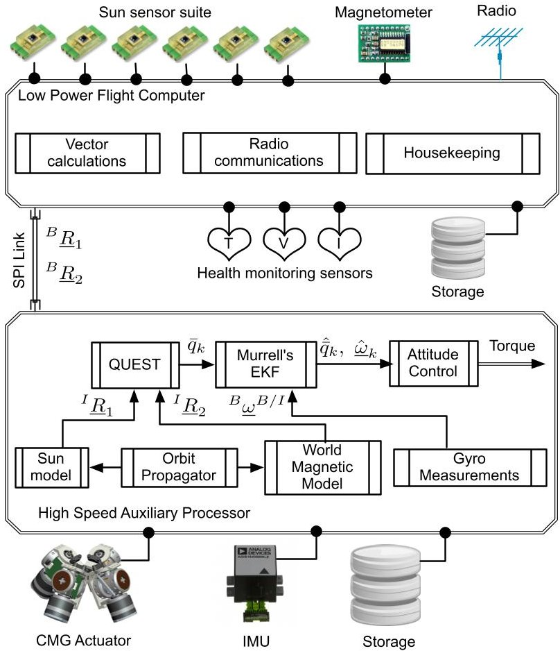

Figure 1. Distributed Computing Architecture

<!-- PDF_PAGE: 2 -->

The distributed computing architecture is composed of a low power flight computer and a high power, high speed auxiliary processor. A schematic of the distributed computing architecture of this CubeSat is shown in Fig.1. The on orbit power generating capability ( 1.5 W) limits the continuous operation of its high performance processor selected for precision computing [12]. The flight computer, although suited well for routine operations, is limited in its ability to support the computational requirements of attitude determination and control. To address these limitations the computing platform is designed as a distributed system. An MSP430 [13] based flight computer is in continuous operation and the CMG controller, a high performance digital signal processor (DSP) [14] from Texas Instruments (TI), is operated intermittently to perform attitude operations.

The precision sensors, actuators and complex computing algorithms, are interfaced and implemented on the high speed auxiliary processor, which is operated only when there is sufficient energy in the batteries. The health monitoring sensors, transceiver and other housekeeping tasks are interfaced and implemented on the flight computer, which is in operation during the entire mission. To facilitate effective operation and telemetry packaging, each computing unit is designed to host a storage device. The CDH system software is composed of multiple operating modes, which are formed by grouping together the low powered housekeeping tasks and the more power intensive computing tasks. These operating modes are initiated through the flight computer and executed on the auxiliary processor when required. The paper describes the design of the distributed computing architecture, which includes the design of operating modes, handshaking/interface protocol, autonomous decision making, and ground based communication exchange with the two computing units. The operating modes are described through flowcharts and the

data assimilated, which forms telemetry packages, is presented in the form of tables. The autonomous and ground based decision making capabilities are demonstrated in the flowchart. The interface protocol, which entails sending and receiving a set number of data bits through the serial peripheral interface (SPI) channel, is presented in the form of tables. The position and value of each data bit sent for every scenario encountered in the operating modes flowcharts is described. A top-down design approach is adopted to facilitate bottom-up coding and implementation of flight software and telemetry formulation.

## 2. DESIGN OF COMMAND AND DATA HANDLING SYSTEM

A CubeSat systems engineering approach, which is discussed in References 15 and 16, is used to translate mission objectives/requirements into basic building blocks through a mission mapping process. The command and data handling system to support the distributed computing architecture is designed by organizing these basic building blocks through the mission concept of operations (CONOPS). Mission CONOPS facilitates a systematic approach of realizing the mission objectives and is critical for organizing mission operations. The mission CONOPS for addressing the distributed operations is summarized as a flowchart in Fig. 2 and the overall software architecture is captured in Fig. 3.

Upon successful launch and deployment from the P-POD [17], the CubeSat enters the power-up and deploy mode, designed as a one time operation for antenna deployment and verification. To date, most pico- and nano-class CubeSats have been flown as a secondary payloads and are required to demonstrate the capability of not interfering with the

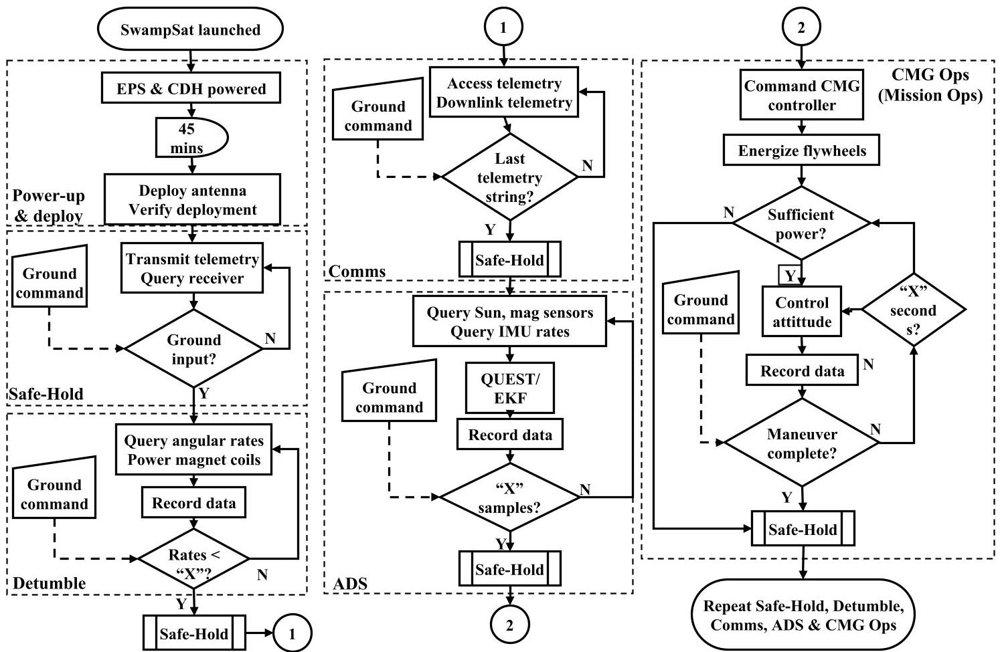

Figure 2. CubeSat Mission CONOPS

<!-- PDF_PAGE: 3 -->

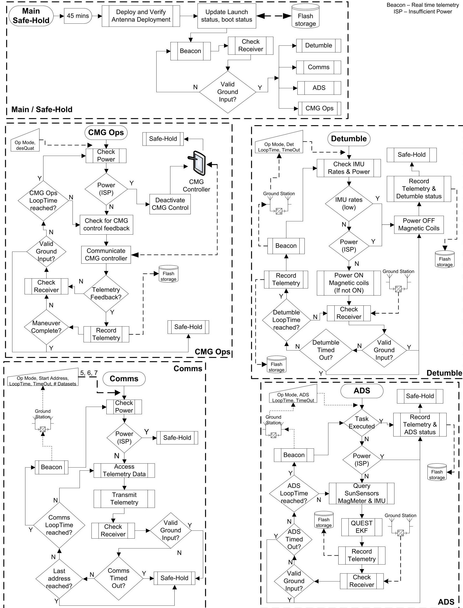

Figure 3. CubeSat Flight Software Architecture

<!-- PDF_PAGE: 4 -->

primary payload communications during the initial minutes of launch [18]. A delay is included to halt the CubeSat from initiating any communications for a set period of time. The CubeSat enters the safe-hold mode, the primary operating mode, after the set delay. During the safe-hold mode, the CubeSat communicates real time telemetry, which includes solar cell voltages, currents, temperatures, battery capacity and satellite angular rates to a ground station. The real time telemetry (satellite beacon) is designed to relay satellite health and assist ground control in decision making. From the safe-hold mode, the CubeSat can transfer to any of these four operating modes: (i) detumble mode (ii) ADS mode (iii) CMG Ops mode and (iv) Comms mode. The detumble mode is primarily designed to stabilize the Cubesat using the magnetic actuators but is also responsible to evaluate the performance of the solar cells by recording their voltage, current and temperature. The ADS modes is designed to validate the attitude determination system and assist in diagnosing the attitude and inertial sensors on board the satellite. During the ADS mode, measurements from Sun sensors, magnetometer and IMU, are fused together for estimating the CubeSat attitude. The estimated attitude along with satellite angular rates is stored on board the satellite. During the CMG Ops (Mission Ops) mode the primary mission goal of rapid retargeting and precision pointing is demonstrated. Similar to the detumble and ADS mode, CMG mode data is stored on board the satellite. During the Comms mode, the mission validating data from the detumble, ADS and CMG Ops mode is downlinked to a ground station. To facilitate multiple attempts for realizing the mission goal, the operating modes can be executed multiple times. Among the operating modes discussed in this section, the CMG Ops mode and the ADS mode are designed as distributed operations. These operations are initiated by the flight computer and executed on the auxiliary processor.

To execute the mission profile shown in Fig. 2, the software is designed as operating modes and implemented as software tasks as shown in Fig. 3. When the safe-hold mode is in operation the CubeSat is designed to consume about 15% [15] of the power generated from the solar cells. The excess power is stored in the Li-Po batteries for use in mission operations. The detail design of each operating mode along with their telemetry budget is discussed in the following sections.

## 3. SAFE-HOLD OPERATING MODE

A flowchart illustrating the power-up & deploy mode and the safe-hold mode is shown in Fig. 4. The P-POD [19] and the separation switch design [3] enable the CubeSat to be powered on upon its deployment out of the P-POD. Once deployed and powered on, the fligh software enters the power-up and deploy operation at the "Power ON" block shown in Fig. 4. This block is the starting point for every reboot of the satellite due to insufficient power, ground command or a watchdog reset. The program communicates with the real time clock (RTC) and records the time as the current boot time on the flash storage. Along with the boot time, the boot counter is also updated on the flash storage. The boot counter is designed to track the number of times the satellite reboots. The antenna deployment operation is designed to be executed only the first time, which is tracked through the launch flag. However, a provision is made to attempt partial and/or complete redeployment in case of an unexpected failure. The success of antenna deployment is verified by sensing the change in acceleration and/or satellite angular rates before and after the deployment. To protect the primary payload

from any potential electromagnetic interference, the CubeSat is designed to be idle for 45 minutes after its deployment out of the P-POD. After successfully executing the antenna deployment and the wait period, the transceiver is powered on and the CubeSat enters safe-hold mode.

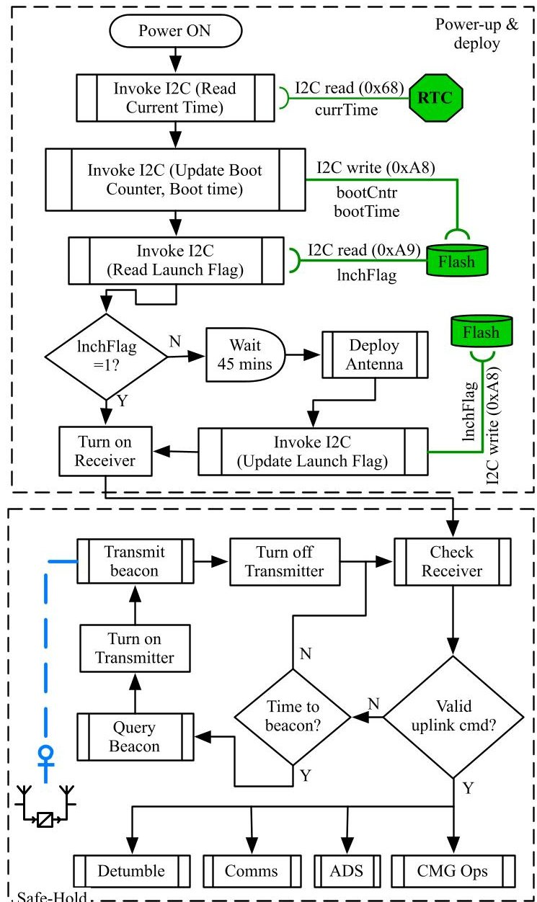

Figure 4. Power-Up & Deploy and Safe-Hold Modes

During safe-hold mode, the onboard transceiver is powered on and the satellite can be located by a ground station or a hand held operator. The safe-hold operating mode is a low power mode designed to validate secondary objectives and facilitate a net positive power generation from the solar cells. Real-time satellite health data is transmitted during this operating mode for ground based decisions to switch to another operating mode. As indicated in the flowchart, safe-hold mode is designed as an infinite loop unless interrupted by a ground command or a power reset. The satellite receiver is in an interrupt mode and can be commanded by a ground station anytime. While the satellite is listening for any ground communication via the receiver, the flight software collects real-time health data from the on board sensors and actively transmits it at specific intervals. As shown in Fig. 4, the satellite can be commanded into another operating mode through a ground input. The flowcharts describing the safe-hold functions - check receiver, query beacon, transmit beacon, and deploy antenna tasks derived from the mission mapping process are included in the Appendix.

<!-- PDF_PAGE: 5 -->

## Safe-hold Mode Downlink Telemetry

Each operating mode is associated with a downlink telemetry, which is as stated earlier, formulated by combining the telemetry overheads associated with the components identified through the mission mapping process. The safe-hold mode downlink telemetry referred to as the satellite beacon is shown in Table 1. Within the limitations of the transceiver [20], the satellite beacon effectively relays its health to assist ground based decisions. The data transmitted as part of satellite beacon is shown in Table 1. As shown in the table the hardware column identifies the components derived from the mission mapping process and the bits column identifies the telemetry overhead associated with these components.

Table 1. Safe-hold Mode Downlink Telemetry

<table border="1"><tr><td>Quantity</td><td>H/W</td><td>I&#x27;face</td><td>Bits</td><td>Hex Chars</td></tr><tr><td colspan="5">time stamp</td></tr><tr><td>year</td><td>RTC</td><td>I2C</td><td>12</td><td>3</td></tr><tr><td>month</td><td>RTC</td><td>I2C</td><td>4</td><td>1</td></tr><tr><td>date</td><td>RTC</td><td>I2C</td><td>8</td><td>2</td></tr><tr><td>hour</td><td>RTC</td><td>I2C</td><td>8</td><td>2</td></tr><tr><td>minute</td><td>RTC</td><td>I2C</td><td>8</td><td>2</td></tr><tr><td>seconds</td><td>RTC</td><td>I2C</td><td>8</td><td>2</td></tr><tr><td colspan="5">MMDB</td></tr><tr><td>temperature1</td><td>TI-DSP</td><td>SPI</td><td>12</td><td>3</td></tr><tr><td>temperature2</td><td>TI-DSP</td><td>SPI</td><td>12</td><td>3</td></tr><tr><td colspan="5">SMDB</td></tr><tr><td>temperature1</td><td>TI-DSP</td><td>SPI</td><td>12</td><td>3</td></tr><tr><td>temperature2</td><td>TI-DSP</td><td>SPI</td><td>12</td><td>3</td></tr><tr><td colspan="5">IMU</td></tr><tr><td>X</td><td>IMU</td><td>SPI</td><td>14</td><td>4</td></tr><tr><td>Y</td><td>IMU</td><td>SPI</td><td>14</td><td>4</td></tr><tr><td>Z</td><td>IMU</td><td>SPI</td><td>14</td><td>4</td></tr><tr><td>temperature</td><td>IMU</td><td>SPI</td><td>12</td><td>3</td></tr><tr><td colspan="5">Battery</td></tr><tr><td>voltage</td><td>EPS</td><td>I2C</td><td>10</td><td>3</td></tr><tr><td>current</td><td>EPS</td><td>I2C</td><td>10</td><td>3</td></tr><tr><td>bus current</td><td>EPS</td><td>I2C</td><td>10</td><td>3</td></tr><tr><td>current direction</td><td>EPS</td><td>I2C</td><td>10</td><td>3</td></tr><tr><td>temperature</td><td>EPS</td><td>I2C</td><td>10</td><td>3</td></tr><tr><td colspan="5">Current</td></tr><tr><td>5V bus</td><td>EPS</td><td>I2C</td><td>10</td><td>3</td></tr><tr><td>3.3V bus</td><td>EPS</td><td>I2C</td><td>10</td><td>3</td></tr><tr><td>transmitter</td><td>TCVR</td><td>I2C</td><td>10</td><td>3</td></tr><tr><td>receiver</td><td>TCVR</td><td>I2C</td><td>10</td><td>3</td></tr><tr><td>boot count</td><td>Flash Storage</td><td>I2C</td><td>12</td><td>3</td></tr><tr><td colspan="5">boot time</td></tr><tr><td>year</td><td>RTC</td><td>I2C</td><td>12</td><td>3</td></tr><tr><td>month</td><td>RTC</td><td>I2C</td><td>4</td><td>1</td></tr><tr><td>date</td><td>RTC</td><td>I2C</td><td>8</td><td>2</td></tr><tr><td>hour</td><td>RTC</td><td>I2C</td><td>8</td><td>2</td></tr><tr><td>minute</td><td>RTC</td><td>I2C</td><td>8</td><td>2</td></tr><tr><td>seconds</td><td>RTC</td><td>I2C</td><td>8</td><td>2</td></tr><tr><td>Flight Computer temperature</td><td>SFC430</td><td>A/D</td><td>12</td><td>3</td></tr><tr><td></td><td></td><td>Total</td><td>312</td><td>84</td></tr></table>

## Safe-hold Mode Uplink Command

To affect parameters within each operating mode an uplink command is designed for each. The formulation of uplink

command for each operating mode is influenced by the tasks, which are grouped to form the operating mode. The uplink command for the safe-hold mode and the specific parameters which can be altered are shown in Table 2. The beacon interval, which is influenced by the query beacon task, is inversely proportional to the net power consumed by the onboard transceiver and this relationship is utilized for satellite power management. By making a provision for varying the beacon interval the satellite can be operated in a "super" safe-hold mode when the power being generated on board the satellite is at its minimum. The safe-hold mode uplink command makes provision to attempt re-deployment through the launch flag variable and makes provision for resetting satellite power. The deploy antenna and verify task influence this parameter within the operating mode.

## 4. DETUMBLE OPERATING MODE

The detumble operating mode is designed to stabilize the satellite about its three axes. Detumble operation is a timed operation and the time period is a function of the variable detumble loop-time as shown in the flowchart in Fig. 5. The operation is a sub routine of the main program and is initiated by a ground command which includes the parameters detumble loop time and a timeout period. Since the main goal of the operating mode is to stabilize the angular rates of the satellite the function queries the IMU rates and compares them against predefined threshold values.

The detumble mode is a relatively power intensive operation compared to the safe-hold mode. To ensure the batteries have enough energy for executing the operation the function queries the battery board through the I2C communication link to EPS. Based on the predetermined threshold values for angular rates of the satellite and the available power the detumbling task is performed. The design makes provision for recording the operation success as a status flag in the flash storage. To detumble the satellite, magnetic coils embedded in the solar panels [21] are energized by the flight computer. A provision is made to terminate the detumble operation from a ground station through the receiver. The detumble operation can also terminate autonomously if the angular rates are estimated to be below a threshold. To assist the ground command in making decisions to terminate the operation the satellite transmits its health data at specified intervals. Additionally the satellite is programmed to record detumble telemetry into the flash storage at specified intervals. The recorded data is transmitted during the Comms operation. The flowcharts describing the safe-hold functions - record telemetry and energizing the magnetic coils tasks, derived from the mission mapping process are included in the Appendix.

## Detumble mode downlink telemetry

The downlink telemetry for the detumble operating mode validates the capability of the magnetic coils, embedded in the solar panels, to detumble the CubeSat and execute the secondary mission objectives. The satellite autonomously terminate the detumble operation in the case of a successful stabilization or insufficient power. To perform a ground analysis of the detumble operation and its termination the satellite angular rates are recorded from the IMU as part of the downlink telemetry. The power generation capacity of solar cells has been researched by several CubeSat missions and traditional satellites. Solar cell voltages, currents and temperatures are included as part of the detumble telemetry to analyze the power generation capacity of the CubeSat in a spinning state. Battery characteristics are included in

<!-- PDF_PAGE: 6 -->

Table 2. Safe-hold Mode Uplink Command

<table border="1"><tr><td>Description</td><td>Bits</td><td>Hex Chars</td><td>Value</td><td>Description</td></tr><tr><td>Operating mode ID</td><td>8</td><td>2</td><td>00</td><td>Safe-hold mode=00</td></tr><tr><td>Beacon interval</td><td>8</td><td>2</td><td>XX(00 to FF)</td><td>00 corresponds to 30s;XX corresponds to increments of 10s;The freq. can be varied from10s to2550s(42mins)</td></tr><tr><td>Launch flag</td><td>8</td><td>1</td><td>X(1or0)</td><td>Default flag is0;Antennas can be attempted to be redeployed using the flag;flag==1 indicates deployment should be repeated</td></tr><tr><td>Total</td><td>32</td><td>7</td><td>00XXX</td><td></td></tr></table>

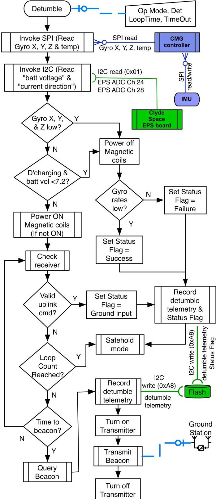

Figure 5. Detumble Operating Mode

the telemetry to record the satellite's health as a function of its spin rate and determine the power consumption of the operating mode. The telemetry data and its details for detumble operating mode are shown in Table 3.

Table 3. Detumble Mode Downlink Telemetry

<table border="1"><tr><td>Quantity</td><td>H/W</td><td>I&#x27;face</td><td>Bits</td><td>Hex Chars</td></tr><tr><td colspan="5">time stamp</td></tr><tr><td>year</td><td>RTC</td><td>I2C</td><td>12</td><td>3</td></tr><tr><td>month</td><td>RTC</td><td>I2C</td><td>4</td><td>1</td></tr><tr><td>date</td><td>RTC</td><td>I2C</td><td>8</td><td>2</td></tr><tr><td>hour</td><td>RTC</td><td>I2C</td><td>8</td><td>2</td></tr><tr><td>minute</td><td>RTC</td><td>I2C</td><td>8</td><td>2</td></tr><tr><td>seconds</td><td>RTC</td><td>I2C</td><td>8</td><td>2</td></tr><tr><td colspan="5">IMU</td></tr><tr><td>X</td><td>IMU</td><td>SPI</td><td>14</td><td>4</td></tr><tr><td>Y</td><td>IMU</td><td>SPI</td><td>14</td><td>4</td></tr><tr><td>Z</td><td>IMU</td><td>SPI</td><td>14</td><td>4</td></tr><tr><td>temperature</td><td>IMU</td><td>SPI</td><td>12</td><td>3</td></tr><tr><td colspan="5">Solar cell</td></tr><tr><td>voltage1</td><td>EPS</td><td>I2C</td><td>10</td><td>3</td></tr><tr><td>voltage2</td><td>EPS</td><td>I2C</td><td>10</td><td>3</td></tr><tr><td>voltage3</td><td>EPS</td><td>I2C</td><td>10</td><td>3</td></tr><tr><td>voltage4</td><td>EPS</td><td>I2C</td><td>10</td><td>3</td></tr><tr><td>voltage5</td><td>EPS</td><td>I2C</td><td>10</td><td>3</td></tr><tr><td>current1</td><td>EPS</td><td>I2C</td><td>10</td><td>3</td></tr><tr><td>current2</td><td>EPS</td><td>I2C</td><td>10</td><td>3</td></tr><tr><td>current3</td><td>EPS</td><td>I2C</td><td>10</td><td>3</td></tr><tr><td>current4</td><td>EPS</td><td>I2C</td><td>10</td><td>3</td></tr><tr><td>current5</td><td>EPS</td><td>I2C</td><td>10</td><td>3</td></tr><tr><td colspan="5">Side</td></tr><tr><td>temperature1</td><td>EPS</td><td>I2C</td><td>10</td><td>3</td></tr><tr><td>temperature2</td><td>EPS</td><td>I2C</td><td>10</td><td>3</td></tr><tr><td>temperature3</td><td>EPS</td><td>I2C</td><td>10</td><td>3</td></tr><tr><td>temperature4</td><td>EPS</td><td>I2C</td><td>10</td><td>3</td></tr><tr><td>temperature5</td><td>EPS</td><td>I2C</td><td>10</td><td>3</td></tr><tr><td colspan="5">Battery</td></tr><tr><td>voltage</td><td>EPS</td><td>I2C</td><td>10</td><td>3</td></tr><tr><td>current</td><td>EPS</td><td>I2C</td><td>10</td><td>3</td></tr><tr><td>current direction</td><td>EPS</td><td>I2C</td><td>10</td><td>3</td></tr><tr><td>temperature</td><td>EPS</td><td>I2C</td><td>10</td><td>3</td></tr><tr><td></td><td></td><td>Total</td><td>292</td><td>84</td></tr></table>

## Detumble mode uplink command

The detumble operation is initiated through an uplink command, the details of which are shown in Table 4. The mode is identified by the operating mode id, which is "01". Since the operation transmits real time satellite health data, the beacon interval makes provision for specifying this interval from ground. The cell voltage is a direct measure of the battery capacity [22] and is used as a termination criteria of the operation. The battery voltage threshold value can be varied and is included as part of the uplink command. Once the CubeSat has been on orbit for a few days and the corresponding telemetry data downloaded the time taken to detumble for a particular angular velocity of the spacecraft

<!-- PDF_PAGE: 7 -->

Table 4. Detumble Mode Uplink Command

<table border="1"><tr><td>Description</td><td>Bits</td><td>Hex Chars</td><td>Value</td><td>Description</td></tr><tr><td>Operating mode ID</td><td>8</td><td>2</td><td>01</td><td>Detumble Mode=01</td></tr><tr><td>Beacon interval</td><td>8</td><td>2</td><td>XX(00 to FF)</td><td>00 corresponds to 30s;XX corresponds to increments of10s;The freq. can be varied from10to2550s(42mins)</td></tr><tr><td>Battery voltage</td><td>8</td><td>2</td><td>XX(00 to FF)</td><td>Signed two&#x27;s complement integer;0 corresponds to7.0v;each increment is0.01v</td></tr><tr><td>Loop count</td><td>8</td><td>2</td><td>XX(00 to FF)</td><td>Minimum=100loops;increments correspond tomultiples of100;00 corresponds toinfinite loops(until angularrates are reached orinterrupted bygroundcommand)</td></tr><tr><td colspan="5">Angular rate threshold</td></tr><tr><td>X offset</td><td>16</td><td>4</td><td>XXXX(0000toFFFF)</td><td>Default desired angular rate=0deg/s;XX</td></tr><tr><td>Y offset</td><td>16</td><td>4</td><td>XXXX(0000toFFFF)</td><td>corresponds toincrements of0.01deg/s;Angular</td></tr><tr><td>Z offset</td><td>16</td><td>4</td><td>XXXX(0000toFFFF)</td><td>rates can be varied between-0.99deg/sto+0.99</td></tr><tr><td>X bound</td><td>8</td><td>2</td><td>XX(00 to FF)</td><td>deg/s;00 corresponds to the default value of0deg/s</td></tr><tr><td>Y bound</td><td>8</td><td>2</td><td>XX(00 to FF)</td><td>Bounds range from0to2deg/s</td></tr><tr><td>Z bound</td><td>8</td><td>2</td><td>XX(00 to FF)</td><td></td></tr><tr><td>Total</td><td>104</td><td>26</td><td colspan="2">01XXXXXXXXXXXXXXXXXXXXXXXXXXXX</td></tr></table>

can be determined. At this stage the spacecraft can be commanded to detumble for a specific period of time and the loop count parameter is included in the command for this purpose. To address the initial gyro bias and enable the mean to be zero the uplink command includes an offset value and a bounding factor for the three gyros. The offsets can be varied between $ - 0.99 $ deg/s to $ + 0.99 $ deg/s and the bounds can be varied from 0 deg/s to 2 deg/s.

## 5. COMMS OPERATING MODE

Mission validating data is stored on board the flash storage during the execution of detumble, ADS and CMG operations. The comms operating mode is designed as a sub routine of the main program to downlink the data to ground control. The operation, described in the form of a flowchart, is shown in Fig. 6. The detumble mode telemetry data is recorded on the flight computer flash storage and the ADS mode and CMG Ops mode telemetry is recorded on the CMG controller flash storage. Based on the data type being requested, the comms operation implements one of the two telemetry access functionalities described in the Appendix. Similar to the detumble operation the comms mode is a relatively power intensive operation and a power check is performed to ensure the satellite is capable of operating in this mode. Based on the available power resources the satellite proceeds to access mission validating data for a particular operating mode and prepares to downlink it to a ground station. A provision is made in the sub routine to terminate the operation autonomously and through ground control. The satellite is also programmed to transmit real time health data for decision making at specified intervals during the operation. Unlike the other 4 operating modes the comms operation is not associated with any downlink telemetry. The flowcharts describing the safe-hold functions - access telemetry from flight computer and Access Telemetry from auxiliary processor, derived from the mission mapping process are included in the Appendix.

## Comms mode uplink command

The comms operation is invoked from within the safe-hold mode with an uplink command, the details of which are shown in Table 5. Comms operation is assigned the operating mode id "03". Apart from transmitting the stored

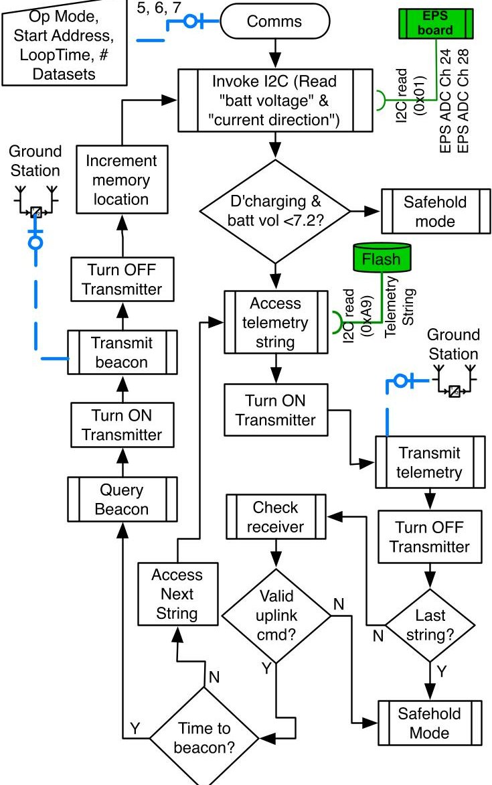

Figure 6. Comms Operating Mode

telemetry data, the operation also transmits real time health data at intervals specified through the beacon interval parameter. Since comms mode transmits at intervals smaller than the safe-hold mode, the operation is relatively more power intensive. A threshold value for the battery voltage is passed as a parameter of the uplink command and the

<!-- PDF_PAGE: 8 -->

Table 5. Comms Mode Uplink Command

<table border="1"><tr><td>Description</td><td>Bits</td><td>Hex Chars</td><td>Value</td><td>Description</td></tr><tr><td>Operating mode ID</td><td>8</td><td>2</td><td>02</td><td>Comms Mode=01</td></tr><tr><td>Beacon interval</td><td>8</td><td>2</td><td>XX(00 to FF)</td><td>00 corresponds to 30s;XX corresponds to increments of 10 seconds;The frequency can be varied from10s to2550s(42mins)</td></tr><tr><td>Battery voltage</td><td>8</td><td>2</td><td>XX(00 to FF)</td><td>Signed two&#x27;s complement integer;0 corresponds to7.0v;each increment is0.01v</td></tr><tr><td>Data type</td><td>8</td><td>2</td><td>XX</td><td>Detumble-01;ADS-03;CMG Ops-04</td></tr><tr><td>Page number</td><td>12</td><td>3</td><td>XXX</td><td>Starting page number in memory</td></tr><tr><td>Number of pages</td><td>12</td><td>3</td><td>XXX</td><td>Number of pages to transmit</td></tr><tr><td>Comms interval</td><td>8</td><td>2</td><td>XX(00 to 99)</td><td>Transmission interval;starts at0and increments in100ms</td></tr><tr><td>Transmission repetitions</td><td>4</td><td>1</td><td>X(0toF)</td><td>Number of repeats of broadcast(0to15 repetitions)</td></tr><tr><td>Total</td><td>68</td><td>17</td><td colspan="2">02XXXXXXXXXXXXXX</td></tr></table>

operation terminates if the threshold is reached. The uplink command specifies the operating mode for which the data is to be downlinked through the data type parameter. The flash storage is divided into pages of size 4096 bytes each and can be identified through an address. Each operating mode stores telemetry data in pages and the page address is passed as a parameter to identify the data specific to a maneuver. To facilitate the downlinking of multiple pages the uplink command includes the number of pages as well. Just like the beacon interval the comms interval can be varied through the comms interval parameter. Although, a CubeSat on orbit is capable of transmitting mission validating telemetry data, all of the data transmitted may not be captured by a ground station on Earth in a single transmission. To accommodate retransmissions, a parameter is included as part of the comms mode uplink command.

## 6. ADS OPERATING MODE

The ADS and the CMG Ops operating modes are designed to address a distributed computing architecture. The attitude sensors, Sun sensors and magnetometer, are interfaced to the flight computer and the IMU is interfaced to the CMG controller. Attitude determination and estimation algorithms are hosted on the CMG controller. A serial peripheral link (SPI) link enables communication between the flight computer and the CMG controller. The ADS operating mode addresses tasks on flight computer to validate the subsystem and diagnose the attitude and inertial sensors. A flowchart of the operating mode is shown in Fig. 7. A significant design feature of the ADS operating mode is to accommodate interaction between flight computer and the CMG controller. The operation starts by querying for power and based on the state of batteries, the flight computer commands the CMG controller to initiate the process of ADS validation.

Attitude determination is accomplished using QUEST [23] and Murrell's version [24] of the extended Kalman filter (EKF) [25][26] is used for attitude estimation. The ADS validation process starts with the execution of the EKF algorithm, which is hosted on the CMG controller. The EKF requests body vector measurements from the flight computer through the SPI link and the reference vectors from the mathematical models which are implemented on the CMG controller. The QUEST algorithm is programmed as a sub routine and is invoked from within the EKF with two sets of vector measurements as function parameters. The ADS operating mode communicates body vector measurements to the CMG controller on a request basis. To assist ground

control in decision making the operating mode transmits realtime health data at specified intervals. The ADS mode is designed to be terminated autonomously or through ground control.

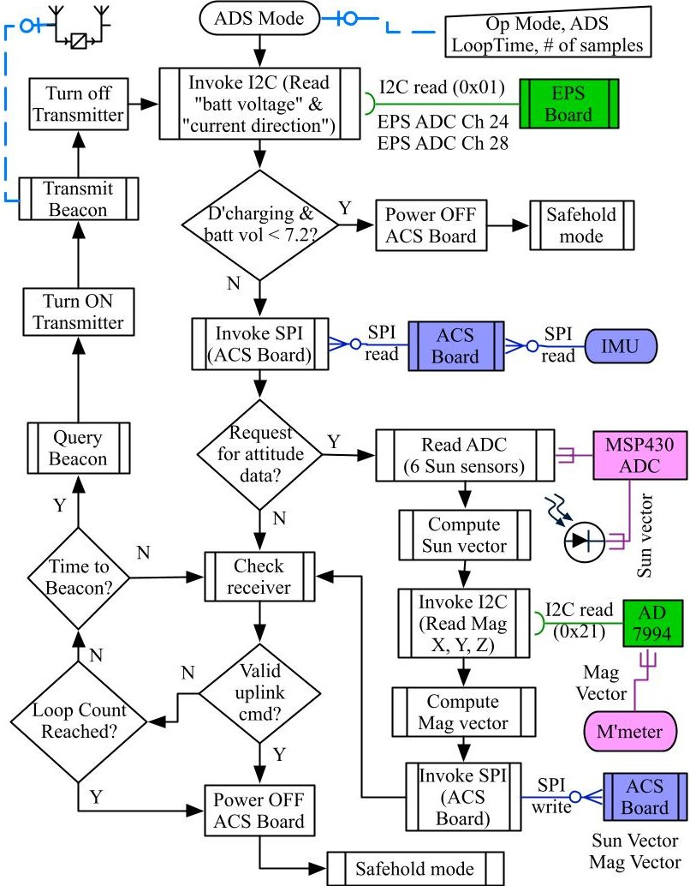

Figure 7. ADS Operating Mode

## ADS mode uplink command

The ADS operation is invoked from within the safe-hold mode through an uplink command. The details of the uplink command are shown in Table 6. The operating mode id assigned to the operation is "04". Since the operation transmits real time satellite health data, the beacon interval makes provision for specifying this interval from ground. The cell voltage is a direct measure of the battery capacity and is used as a termination criteria of the operation. The

<!-- PDF_PAGE: 9 -->

<table border="1"><tr><td>Description</td><td>Bits</td><td>Hex Chars</td><td>Value</td><td>Description</td></tr><tr><td>Operating mode ID</td><td>8</td><td>2</td><td>01</td><td>Detumble Mode=01</td></tr><tr><td>Beacon interval</td><td>8</td><td>2</td><td>XX(00 to FF)</td><td>00 corresponds to 30s;XX corresponds to increments of 10s;The freq. can be varied from10to2550s(42mins)</td></tr><tr><td>Battery voltage</td><td>8</td><td>2</td><td>XX(00 to FF)</td><td>Signed two&#x27;s complement integer;0 corresponds to7.0v;each increment is0.01v</td></tr><tr><td>Uplink time</td><td>48</td><td>12</td><td>XXXXXXXXXX

battery voltage threshold value can be varied and is included as part of the uplink command. The attitude determination and CMG operations require precise time data and this data is communicated from ground through the time parameter. The CubeSat is capable of propagating its orbit but needs to be initialized with position and velocity parameter. The orbital position and orbital velocity parameters within the uplink command are for initializing the satellite's position and velocity. Effectively the uplink command updates the two line elements by updating the RTC, satellite position and satellite velocity. The ADS operation is specifically a timed operation and the number of samples parameter determines the time period of the operation. QUEST estimates the initial satellite attitude and EKF's convergence to the true attitude is determined by the accuracy of this initial estimate. The uplink command includes a parameter for QUEST weights to improve on the initial attitude estimate.

## ADS mode downlink telemetry

The downlink telemetry for the ADS operating mode validates and diagnosis on orbit the attitude sensors, attitude determination, and estimation algorithms. The details of the downlink telemetry for the ADS operation are shown in Table 7. For validating sensors, the operating mode stores Sun sensor, magnetometer and IMU data along with the attitude quaternion computed by QUEST in the flash storage on CMG controller. The ADS telemetry data is bit packaged during storage and downlinked via the comms operation.

## 7. CMG OPS OPERATING MODE

As with the ADS operating mode, the CMG Ops lays emphasis on establishing an efficient communication link between the flight computer and the CMG controller. A flowchart describing the CMG operating mode is shown in Fig. 8. CMG Ops operating mode is similar in functionality to the ADS operating mode and is invoked as a sub routine from within the safe-hold mode. To conserve electrical energy and enable the CMG controller to be autonomous, the transmitter

Table 7. ADS Mode Downlink Telemetry

<table border="1"><tr><td>Quantity</td><td>H/W</td><td>I&#x27;face</td><td>Bits</td><td>Hex Chars</td></tr><tr><td colspan="5">time stamp</td></tr><tr><td>year</td><td>RTC</td><td>I2C</td><td>12</td><td>3</td></tr><tr><td>month</td><td>RTC</td><td>I2C</td><td>4</td><td>1</td></tr><tr><td>date</td><td>RTC</td><td>I2C</td><td>8</td><td>2</td></tr><tr><td>hour</td><td>RTC</td><td>I2C</td><td>8</td><td>2</td></tr><tr><td>minute</td><td>RTC</td><td>I2C</td><td>8</td><td>2</td></tr><tr><td>seconds</td><td>RTC</td><td>I2C</td><td>8</td><td>2</td></tr><tr><td colspan="5">IMU</td></tr><tr><td>X</td><td>IMU</td><td>SPI</td><td>14</td><td>4</td></tr><tr><td>Y</td><td>IMU</td><td>SPI</td><td>14</td><td>4</td></tr><tr><td>Z</td><td>IMU</td><td>SPI</td><td>14</td><td>4</td></tr><tr><td>temperature</td><td>IMU</td><td>SPI</td><td>12</td><td>3</td></tr><tr><td>magnetometer x</td><td>SFC430</td><td>I2C</td><td>12</td><td>3</td></tr><tr><td>magnetometer y</td><td>SFC430</td><td>I2C</td><td>12</td><td>3</td></tr><tr><td>magnetometer z</td><td>SFC430</td><td>I2C</td><td>12</td><td>3</td></tr><tr><td>sun sensor 1</td><td>SFC430</td><td>ADC</td><td>12</td><td>3</td></tr><tr><td>sun sensor 2</td><td>SFC430</td><td>ADC</td><td>12</td><td>3</td></tr><tr><td>sun sensor 3</td><td>SFC430</td><td>ADC</td><td>12</td><td>3</td></tr><tr><td>sun sensor 4</td><td>SFC430</td><td>ADC</td><td>12</td><td>3</td></tr><tr><td>sun sensor 5</td><td>SFC430</td><td>ADC</td><td>12</td><td>3</td></tr><tr><td>sun sensor 6</td><td>SFC430</td><td>ADC</td><td>12</td><td>3</td></tr><tr><td>quaternion q1</td><td>TI-DSP</td><td>SPI</td><td>64</td><td>16</td></tr><tr><td>quaternion q2</td><td>TI-DSP</td><td>SPI</td><td>64</td><td>16</td></tr><tr><td>quaternion q3</td><td>TI-DSP</td><td>SPI</td><td>64</td><td>16</td></tr><tr><td>quaternion q4</td><td>TI-DSP</td><td>SPI</td><td>64</td><td>16</td></tr><tr><td></td><td></td><td>Total</td><td>466</td><td>118</td></tr></table>

is completely turned off during this operation. The receiver, however, is powered on and the operation can be commanded from ground, based on an estimated position of the satellite. Along with QUEST and EKF the CMG control and singularity avoidance algorithms are in execution during this operating mode and the sub routine on the flight computer is responsible for communicating attitude, power data, and

<!-- PDF_PAGE: 10 -->

ground commands to the CMG controller.

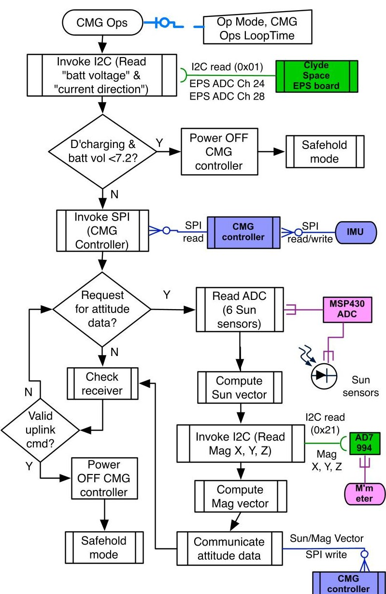

Figure 8. CMG Ops Operating Mode

## CMG Ops mode downlink telemetry

Similar to the downlink telemetry associated with other operating modes, the downlink telemetry for CMG Ops attempts to validate the attitude control subsystem and in the process provides data for mission validation. The downlink telemetry is identified in the Table 8. Similar to any attitude control operations CMG maneuvers are specifically validated with the on board ADS and the data associated with the attitude sensors and attitude mathematics is included as part of the CMG Ops telemetry. The downlink telemetry also includes CMG actuator and sensor data. To facilitate ground based validation of the CMG operations, each telemetry string is time stamped during the maneuver and downlinked.

## CMG Ops mode uplink command

The flight computer is responsible for initiating CMG maneuvers and communicate data contained within the uplink command to the CMG controller. The uplink command for CMG operations is similar to the uplink command for ADS operation. Apart from identifying the operating mode id and uplinking the beacon interval, the uplink command updates the TLEs of the satellite. Additionally the uplink command identifies the maneuver type and the maneuver time to be executed by the CubeSat.

Table 8. CMG Ops Mode Downlink Telemetry

<table border="1"><tr><td>Quantity</td><td>H/W</td><td>I&#x27;face</td><td>Bits</td><td>Hex Chars</td></tr><tr><td colspan="5">time stamp</td></tr><tr><td>year</td><td>RTC</td><td>I2C</td><td>12</td><td>3</td></tr><tr><td>month</td><td>RTC</td><td>I2C</td><td>4</td><td>1</td></tr><tr><td>date</td><td>RTC</td><td>I2C</td><td>8</td><td>2</td></tr><tr><td>hour</td><td>RTC</td><td>I2C</td><td>8</td><td>2</td></tr><tr><td>minute</td><td>RTC</td><td>I2C</td><td>8</td><td>2</td></tr><tr><td>seconds</td><td>RTC</td><td>I2C</td><td>8</td><td>2</td></tr><tr><td colspan="5">IMU</td></tr><tr><td>X</td><td>IMU</td><td>SPI</td><td>14</td><td>4</td></tr><tr><td>Y</td><td>IMU</td><td>SPI</td><td>14</td><td>4</td></tr><tr><td>Z</td><td>IMU</td><td>SPI</td><td>14</td><td>4</td></tr><tr><td>temperature</td><td>IMU</td><td>SPI</td><td>12</td><td>3</td></tr><tr><td colspan="5">MMDB</td></tr><tr><td>temperature1</td><td>TI-DSP</td><td>SPI</td><td>12</td><td>3</td></tr><tr><td>temperature2</td><td>TI-DSP</td><td>SPI</td><td>12</td><td>3</td></tr><tr><td colspan="5">SMDB</td></tr><tr><td>temperature1</td><td>TI-DSP</td><td>SPI</td><td>12</td><td>3</td></tr><tr><td>temperature2</td><td>TI-DSP</td><td>SPI</td><td>12</td><td>3</td></tr><tr><td>flywheel speed1</td><td>TI-DSP</td><td>SPI</td><td>12</td><td>3</td></tr><tr><td>flywheel speed2</td><td>TI-DSP</td><td>SPI</td><td>12</td><td>3</td></tr><tr><td>flywheel speed3</td><td>TI-DSP</td><td>SPI</td><td>12</td><td>3</td></tr><tr><td>flywheel speed4</td><td>TI-DSP</td><td>SPI</td><td>12</td><td>3</td></tr><tr><td>gimbal rate1</td><td>TI-DSP</td><td>SPI</td><td>12</td><td>3</td></tr><tr><td>gimbal rate2</td><td>TI-DSP</td><td>SPI</td><td>12</td><td>3</td></tr><tr><td>gimbal rate3</td><td>TI-DSP</td><td>SPI</td><td>12</td><td>3</td></tr><tr><td>gimbal rate4</td><td>TI-DSP</td><td>SPI</td><td>12</td><td>3</td></tr><tr><td>gimbal angle1</td><td>TI-DSP</td><td>SPI</td><td>12</td><td>3</td></tr><tr><td>gimbal angle2</td><td>TI-DSP</td><td>SPI</td><td>12</td><td>3</td></tr><tr><td>gimbal angle3</td><td>TI-DSP</td><td>SPI</td><td>12</td><td>3</td></tr><tr><td>gimbal angle4</td><td>TI-DSP</td><td>SPI</td><td>12</td><td>3</td></tr><tr><td>magnetometerx</td><td>SFC430</td><td>I2C</td><td>12</td><td>3</td></tr><tr><td>magnetometery</td><td>SFC430</td><td>I2C</td><td>12</td><td>3</td></tr><tr><td>magnetometerz</td><td>SFC430</td><td>I2C</td><td>12</td><td>3</td></tr><tr><td>sun sensor1</td><td>SFC430</td><td>ADC</td><td>12</td><td>3</td></tr><tr><td>sun sensor2</td><td>SFC430</td><td>ADC</td><td>12</td><td>3</td></tr><tr><td>sun sensor3</td><td>SFC430</td><td>ADC</td><td>12</td><td>3</td></tr><tr><td>sun sensor4</td><td>SFC430</td><td>ADC</td><td>12</td><td>3</td></tr><tr><td>sun sensor5</td><td>SFC430</td><td>ADC</td><td>12</td><td>3</td></tr><tr><td>sun sensor6</td><td>SFC430</td><td>ADC</td><td>12</td><td>3</td></tr><tr><td>quaternionq1</td><td>TI-DSP</td><td>SPI</td><td>64</td><td>16</td></tr><tr><td>quaternionq2</td><td>TI-DSP</td><td>SPI</td><td>64</td><td>16</td></tr><tr><td>quaternionq3</td><td>TI-DSP</td><td>SPI</td><td>64</td><td>16</td></tr><tr><td>quaternionq4</td><td>TI-DSP</td><td>SPI</td><td>64</td><td>16</td></tr><tr><td>Total</td><td>658</td><td>166</td><td></td><td></td></tr></table>

## 8. CONCLUSION

CubeSats enabled with distributed computing architecture may be potentially more capable than those designed around a single central processor responsible for operating the entire mission. By distributing the processing load, parallel operations can be enabled and power utilization can be optimized. Distributed computing and parallel processing on CubeSats can potentially enable them to complement the traditional satellites more effectively. However, the design challenges for realizing a distributed computing architecture on a CubeSat can be complex and overwhelming.

The work presented in this paper describes the limitations encountered for a CubeSat mission with regards to its SWaP constraints and the solutions designed by adapting a distributed computing architecture. The computing platform

<!-- PDF_PAGE: 11 -->

Table 9. CMG Ops Mode Uplink Command

<table border="1"><tr><td>Description</td><td>Bits</td><td>Hex Chars</td><td>Value</td><td>Description</td></tr><tr><td>Operating mode ID</td><td>8</td><td>2</td><td>01</td><td>Detumble Mode=01</td></tr><tr><td>Beacon interval</td><td>8</td><td>2</td><td>XX(00 to FF)</td><td>00 corresponds to 30s;XX corresponds to increments of 10s;The frequency can be varied from 10s to 2550s(42mins)</td></tr><tr><td>Battery voltage</td><td>8</td><td>2</td><td>XX(00 to FF)</td><td>Signed two&#x27;s complement integer;0 corresponds to 7.0v;each increment is0.01V</td></tr><tr><td>Uplink time</td><td>48</td><td>12</td><td>XXXXXXXXXX

discussed in this paper is capable of distributed operation and is intelligently designed to perform mission operations through duty cycling of the two processing units. The on orbit average power is utilized effectively to produce net positive power, store it on board the Li-Po batteries and discharge them by executing high power primary mission objectives. Each computing unit is designed with its own storage device to store mission specific data, which is downlinked during an overhead pass of the CubeSat. The CDH flight software is designed in the form of operating modes, which are capable of being commanded from ground multiple times. The CubeSat is capable of teleoperation, autonomous and semiautonomous operation. Every operating mode is designed with a downlink telemetry budget, which is designed to capture data for validating primary and secondary objectives. The flight software and thus the CubeSat is designed for on orbit tuning through an uplink command specific for each operating mode. The ADS mode and CMG Ops mode are implemented as distributed operations, which get initiated by the flight computer through ground control and are executed on the auxiliary processor. Effectively, the distributed computing architecture and its operational design enable a CubeSat to demonstrate precision 3-axes attitude control and showcase the potential of such a computing platform for enabling similar complex capabilities.

## APPENDIX

For completeness and facilitation of design of tasks encountered in the various operating modes, the design of the following functions is presented in the form of flowcharts.

1. Deploy antenna (Fig. 9)

2. Safe-hold mode functions (Fig. 10)

3. Detumble mode functions (Fig. 11)

4. Comms mode functions (Fig. 12)

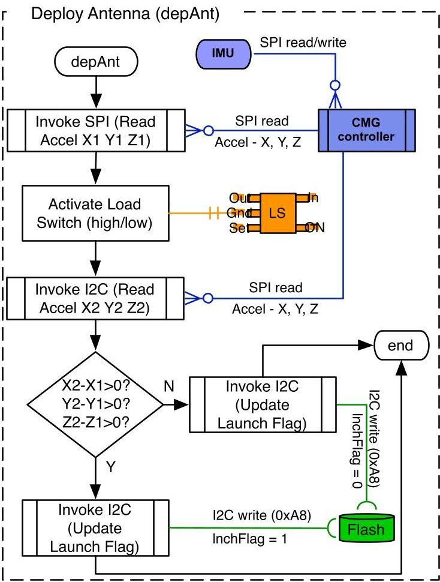

Figure 9. Deploy Antenna

<!-- PDF_PAGE: 12 -->

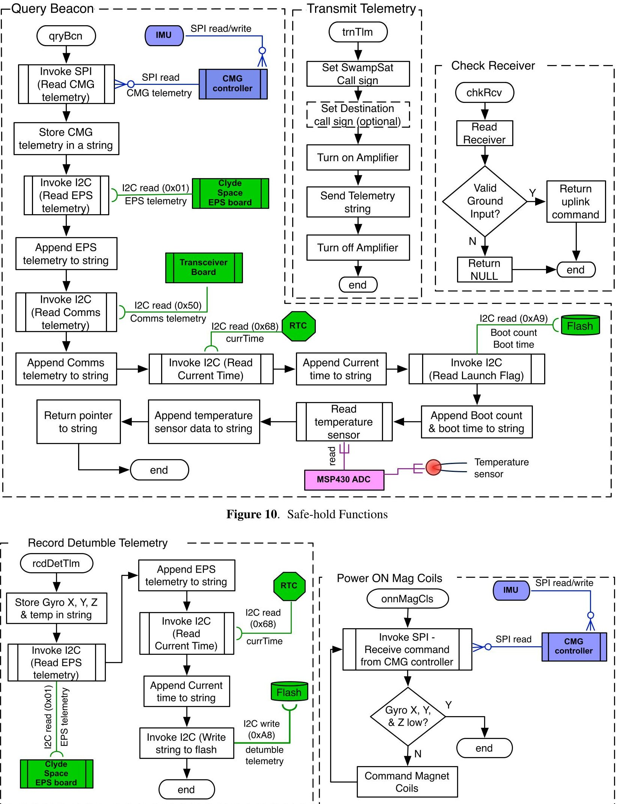

Figure 11. Safe-hold Functions

<!-- PDF_PAGE: 13 -->

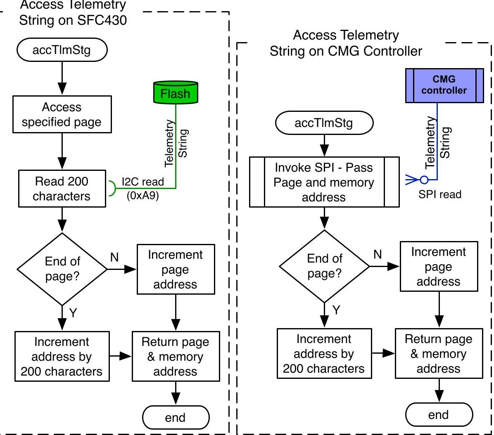

Figure 12. Safe-hold Functions

## REFERENCES

[1] H. Heidt, J. Puig-Suari, A. Moore, S. Nakasuka, and R. Twiggs, "Cubesat: A new generation of picosatellite for education and industry low-cost space experimentation," in Proceedings of the Utah State University Small Satellite Conference, Logan, UT. Citeseer, 2001, pp. 1-2.

[2] J. Schaffner and J. Puig-Suari, "The Electronic System Design, Analysis, Integration, and Construction of the Cal Poly State University CP1 CubeSat," in 16th AIAA/USU on Small Satellites Conference, Logan, UT. Citeseer, 2002, pp. 1-2.

[3] R. Munkata, "Cubesat design specification rev. 12," August 2009.

[4] G. Minelli, A. Ricco, D. Squires, C. Beasley, and J. Hines, "O/oreos: A multi-payload technology demonstration," in Proceedings of the 24th Annual AIAA/USU Conference on Small Satellites, Logan UT, 2010.

[5] C. Kitts, J. Hines, E. Agasid, A. Ricco, B. Yost, K. Ronzano, and J. Puig-Suar, "The GeneSat-1 Microsatellite Mission: A Challenge in Small Satellite Design," in Proc 20th Annual AIAA/USU Conf on Small Satellites, Logan UT, 2006.

[6] D. Schor, J. Scowcroft, C. Nichols, and W. Kinsner, "A command and data handling unit for pico-satellite missions," in Electrical and Computer Engineering, 2009. CCECE'09. Canadian Conference on. IEEE, 2009, pp. 874-879.

[7] M. Swartwout, C. Kitts, R. Twiggs, B. Smith, T. Kenny,

R. Lu, K. Stattenfield, R. Batra, and F. Pranajaya, "Flight results for the sapphire satellite, a low-cost university-class mission."

[8] C. McBryde and E. Lightsey, "A star tracker design for cubesats," in Aerospace Conference, 2012 IEEE. IEEE, 2012, pp. 1-14.

[9] W. Kinsner, D. Schor, R. Fazel-Darbandi, B. Cade, K. Anderson, C. Friesen, D. Kotelko, and P. Ferguson, "The t-sat1 nanosatellite team of teams," in Cognitive Informatics & Cognitive Computing (ICCI* CC), 2012 IEEE 11th International Conference on. IEEE, 2012, pp. 380-390.

[10] M. Swartwout and S. Jayaram, "The argus mission: Detecting thruster plumes for space situational awareness," in Aerospace Conference, 2011 IEEE. IEEE, 2011, pp. 1-10.

[11] M. Swartwout, C. Kitts, P. Stang, and E. Lightsey, "A standardized, distributed computing architecture: Results from three universities," in Proceedings of the 19th Annual AIAA/USU Conference on Small Satellites, 2005.

[12] I. Garcia, "Texas instruments application report - tms320c6711d, c6712d, c6713b power consumption summary," http://focus.ti.com/lit/an/spra889a/spra889a.pdf, 2005.

[13] "MSP430 16-bit Ultra-Low Power Micorcontroller," www.ti.com/msp430.

[14] "C6000 High Performance DSP," http://focus.ti.com/paramsearch/docs/

<!-- PDF_PAGE: 14 -->

parametricsearch.tsp?family tionId=2tabId=57familyId=132.

[15] S. Asundi, "Cubesat system design based on methodologies adopted for developing wireless robotic platform," Ph.D. dissertation, University of Florida, 2011.

[16] S. Asundi and N. Fitz-Coy, "Cubesat mission design based on a systems engineering approach," in IEEE Aerospace Conference. IEEE, 2013.

[17] W. Lan, "Poly Picosatellite Orbital Deployer Mk III ICD," http://cubesat.calpoly.edu/images/ LaunchProviders/mk_iii_icd5.pdf, 2007.

[18] R. Nugent, R. Munakata, A. Chin, R. Coelho, and J. Puig-Suari, "The cubesat: The picosatellite standard for research and education," Aerospace Engineering, vol. 805, pp. 756-5087, 2008.

[19] J. Puig-Suari, C. Turner, and W. Ahlgren, "Development of the standard CubeSat deployer and a CubeSat class PicoSatellite," in Aerospace Conference, 2001, IEEE Proceedings., vol. 1, 2001.

[20] V. Galysh, "Katysat radio board, rev 2.4," January 2008.

[21] S. Asundi, M. Mahin, V. Nagabhushan, T. Lin, and N. Fitz-Coy, "Composite and PCB Based Implementations of a Solar Panel Design for SwampSat," in SmallSat Conference, 2010.

[22] V. Galysh, "Varta poliflexplf 503759 d."

[23] M. Shuster and S. Oh, "Three-axis attitude determination from vector observations," Journal of Guidance and Control, vol. 4, no. 1, pp. 70-77, 1981.

[24] J. Murrell, "Precision attitude determination for multimission spacecraft," in Guidance and Control Conference, Palo Alto, Calif., August 7-9, 1978, Technical Papers.(A78-50159 22-01) New York, American Institute of Aeronautics and Astronautics, Inc., 1978, p. 70-87., 1978.

[25] R. Kalman, "A new approach to linear filtering and prediction problems," Journal of Basic Engineering, vol. 82, no. 1, pp. 35-45, 1960.

[26] R. Kalman and R. Bucy, "New results in linear filtering and prediction theory," Random Processes, 1973.

BIOGRAPHY

Norman G. Fitz-Coy is an Associate Professor in the Department of Mechanical and Aerospace Engineering at the University of Florida in Gainesville. He is the Director of the Advanced Space Technologies Research and Engineering Center (ASTREC) - a National Science Foundation (NSF) Industry/University Cooperative Research Center. Dr. FitzCoy's research efforts address the dynamics and controls of multi-degree-of-freedom (M-DOF) systems with emphasis on space applications. One of the current research interests is attitude control of small satellites (less than 10 kg in mass). His research team has developed the world's smallest control moment gyroscopes and these will be flight verified the upcoming UF CubeSat mission SwampSat.

Sharan Asundi is an Assistant Professor in the Department of Aerospace Science Engineering at Tuskegee University. He graduated with a MS and PhD in Aerospace Engineering from University of Florida in 2011, under the guidance of Dr. Norman Fitz-Coy. His research interests include design of autonomous ground and space systems, spacecraft attitude determination and estimation, ve-

hicle health monitoring and design of small satellite mission operations.