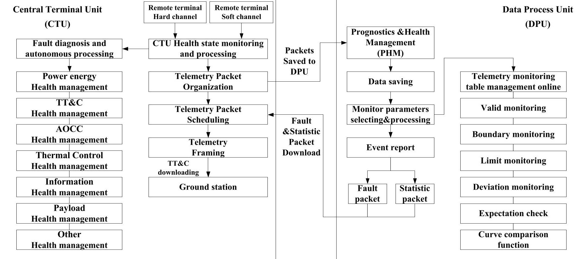
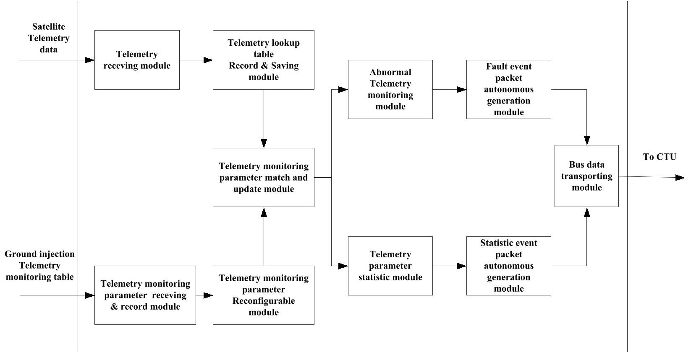
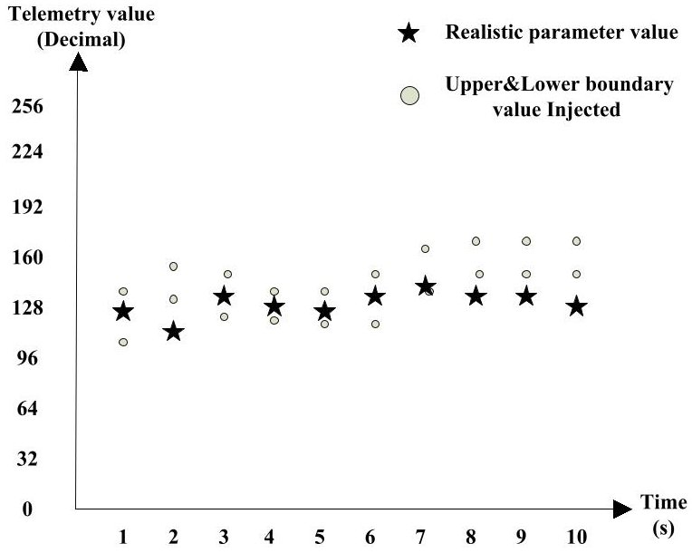

<!-- PDF_PAGE: 1 -->

# Design of Reconfigurable Real-time Telemetry Monitoring and Quantitative Management System for Remote Sensing Satellite In Orbit

Wenping Wang, Yahang Zhang, Xianghui Wang, Hao Xu, Hexiang Tian Beijing Institute of Spacecraft System Engineering, Beijing 100094, China wangwenping304@163.com

Abstract-This paper describes the detailed design of a reconfigurable real-time telemetry monitoring and quantitative management system for the remote sensing satellite in orbit. First of all, the architecture of satellite autonomous health management, based on the satellite On-Board Data Handling Subsystem, is established, which includes Central Terminal Unit health management and Data Process Unit health management. Then, satellite autonomous health management is described in detail. Furthermore, key technologies in general have been illustrated which includes standardized telemetry monitoring table design, quantifiable fault event package design, quantifiable statistical event package design, fault and statistical event package autonomous generation conditions, and the function of the curve comparison for telemetry parameters. Finally, in-orbit autonomous health management engineering validation has been carried out at GF-3 satellite. The test results show that the sensitivity of the satellite to the health condition and the timeliness of the disposal failure have been significantly improved.

Keywords—satellite; autunomous health management; reconfigurable; real-time; telemetry monitoring; telemetry quantitative management

## I. INTRODUCTION

Remote sensing satellites nowadays play an important role in land survey and national economy, and are increasingly becoming important strategic resources for all countries in the world. It has become the consensus of the current aerospace field to improve the high reliability and high autonomy of satellites in orbit[1-4]. With the development of remote sensing satellite technology, onboard computers greatly improve the data processing and management capabilities of subsystems on the satellite, which provides a good hardware foundation for the intelligent autonomy of satellite data self-management. The traditional remote sensing satellite fault diagnosis and satellite health management strategies are mainly passive ground rules and regulations and supplemented by a few onboard positive means. The implementation measures are to collect the telemetry parameters from the onboard computer of each subsystem, and then make fault analysis and diagnosis from the ground after the downlink transmission of telemetry via the satellite Tracking Telemetry and Command (TT&C) channel, and then upload command to complete the relevant orbital operations, enabling some in-orbit management functions[5-9]. Remote sensing satellite health management mechanism mainly has the following deficiencies.

Through analyzing long term on-orbit data of remote sensing satellites, most of the telemetry parameters showed no abnormality in the life cycle of satellite in orbit. However, preformatted telemetry parameter format, will make a huge occupation of TT&C channel. When some faults occur on the satellite, the transmission of relevant important fault parameters may be delayed, whereas the ground may miss the precious opportunity of emergency treatment. Remote sensing satellite has a short visible period on the ground (the average time of ground station connecting with the satellite is less than 15% of the flight time), and the delay telemetry data occupies a large amount of storage space, which also resulting a waste of resources during telemetry downloading. The processing of a large amount of raw data by the ground takes a certain amount of time, and even if a problem is found, a certain delay has already occurred, which is not real-time satellite health management in orbit.

Therefore, it is an important way to improve the reliability and autonomy of remote sensing satellites if the original telemetry data is effectively processed and refined in orbit.

This paper is organized as follows. Section 2 describes its layer architecture. Section 3 illustrates the Central Terminal Unit (CTU) health management part. Section 4 presents Data Process Unit (DPU) health management part. Section 5 focuses on the key technologies of satellite health management designed in general. Section 6 depicts the engineering validation results. Finally, section 7 concludes the paper.

## II. ARCHITECTURE OF HEALTH MANAGEMENT SYSTEM

This paper designs and realizes an autonomous satellite health management system based on real-time monitoring and quantitative management. The autonomous health management system is implemented by the CTU based special health management and the DPU based common-sense health management, which are the component of satellite On-Board Data Handling Subsystem (OBDH)[10], as is shown in Figure 1. CTU health management is used to collect satellite telemetry parameters and subsystems health status, realize satellite system-level autonomous health management strategy, generate and release satellite health indices. DPU health management is used for statistical analysis of the telemetry parameters of satellite subsystems, border value check, expectation check, deviation check, trends analysis, monitoring list maintenance and the other common healthy management of satellite. The design of autonomous health management system

<!-- PDF_PAGE: 2 -->

includes some key technologies, which play an important role

in the intelligent autonomous health management of satellite.

Fig. 1. Architecture of satellite autonomous health management

## III. CTU HEALTH MANAGEMENT

CTU health management functions include the following three aspects.

Firstly, satellite telemetry parameters and subsystem health status are gathered. The CTU collects satellite hard-channel telemetry parameters through remote units, collects subsystem software-channel telemetry parameters through the 1553B bus, and collects the subsystem health status data packets through the 1553B bus. All the above data are taken as input of autonomous health management.

Secondly, system-level self-management strategies are implemented. CTU is dealing with the system-level autonomous health management strategy, which requires the coordinated management of multiple subsystems, including power health management, TT&C health management, control subsystem health management, thermal control health management, information health management, payload health management and other special health management.

Thirdly, satellite health status indices are generated and broadcasted. The health index is the standard of classification of satellite health. There are differences in the strategies for autonomous health management on the satellite under different health levels. When satellite is at high levels of health, the main mission is to optimize the work of payload. The most important task is to ensure the security of satellite platform when the satellite is at low levels of health. The satellite downlinks the health status index as a high priority telemetry parameter, and telemetry source packet scheduling also takes the changes in the health status index into account. Table 1 shows the satellite health status index based on satellite health status results and real-time broadcast via the 1553B bus.

TABLE I. HEALTH STAUS INDEX OF SATELLITE

<table border="1"><tr><td rowspan="2">Index No</td><td>B0</td><td>B1</td><td>B2</td><td>B3</td><td>B4</td><td>B5</td><td>B6</td><td>B7</td><td rowspan="2">Health State</td></tr><tr><td colspan="2">Power state</td><td colspan="2">TT&amp;C state</td><td colspan="3">Payload state</td><td>Other</td></tr><tr><td>1</td><td>1</td><td>1</td><td>1</td><td>1</td><td>1</td><td>1</td><td>1</td><td>1</td><td>Satellite health</td></tr><tr><td>2</td><td>0</td><td>0</td><td>1</td><td>1</td><td>1</td><td>1</td><td>1</td><td>1</td><td>Platform Battery A failure</td></tr><tr><td>3</td><td>1</td><td>0</td><td>1</td><td>1</td><td>1</td><td>1</td><td>1</td><td>1</td><td>Platform Battery B failure</td></tr><tr><td>4</td><td>1</td><td>1</td><td>0</td><td>0</td><td>1</td><td>1</td><td>1</td><td>1</td><td>Usb responder failure</td></tr><tr><td>5</td><td>1</td><td>1</td><td>0</td><td>1</td><td>1</td><td>1</td><td>1</td><td>1</td><td>GPS receiver failure</td></tr><tr><td>6</td><td>1</td><td>1</td><td>1</td><td>1</td><td>0</td><td>0</td><td>0</td><td>1</td><td>SAR work abnormal</td></tr><tr><td>7</td><td>1</td><td>1</td><td>1</td><td>1</td><td>0</td><td>0</td><td>1</td><td>1</td><td>SAR battery failure</td></tr><tr><td>8</td><td>1</td><td>1</td><td>1</td><td>1</td><td>0</td><td>1</td><td>0</td><td>1</td><td>SAR antenna abnormal</td></tr><tr><td>9</td><td>0</td><td>1</td><td>1</td><td>1</td><td>1</td><td>1</td><td>1</td><td>0</td><td>AOCC failure</td></tr><tr><td>10</td><td>0</td><td>1</td><td>1</td><td>1</td><td>1</td><td>1</td><td>1</td><td>1</td><td>Thermal Control failure</td></tr></table>

## IV. DPU HEALTH MANAGEMENT

DPU autonomous health management is a combination of key technologies in general and involves functions such as statistical analysis of telemetry parameters, boundary check expectation check, deviation check, trend analysis and monitoring list maintenance. All the relevant subsystems of these key technologies can be put forward the demand for use, based on the need to monitor and analyze the telemetry type, through the telemetry table betting function to achieve the relevant telemetry monitoring.

Based on high performance DPU, this paper describes a reconfigurable telemetry real-time monitoring and quantification management system for satellite in-orbit, as is shown in Figure 2. The ground operator can modify and update

<!-- PDF_PAGE: 3 -->

the telemetry parameters to be monitored in real time in the form of data revisions, and the modification uses the standardized telemetry monitoring table to realize the reconfiguration of the orbit telemetry monitoring. Real-time monitoring and statistics of the telemetry parameters concerned by DPU monitoring and quantitative management can automatically generate fault event packets for telemetry information with abnormal monitoring parameters and generate

statistical event packets for telemetry parameter information satisfying the statistical conditions. The fault event packet and the statistical event packet are all quantifiable, and are generated and sent to the satellite CTU autonomously. In this way, the CTU can monitor in real time, and pay attention to the working status of the telemetry parameters and realize the quantitative management of on-orbit satellite telemetry parameters.

Fig. 2. Satellite telemetry real-time monitoring and quantitative management system on-orbit

## V. KEY TECHNOLOGIES IN GENERAL

Satellite telemetry in-orbit real-time monitoring and quantitative management, is designed based on the (Consultative Committee for Space Data Systems, CCSDS) protocol, which includes standardized telemetry monitoring talbe design, quantifiable fault event package design, quantifiable statistical event package design, fault and statistical event package autonomous generation conditions, and the function of the curve comparison for telemetry parameters.

## A. Standardized telemetry monitoring table design

Telemetry monitoring table is shown in Table 2. The header is the total length of the data (1 byte reserved), followed by N source packet information; each source packet contains 3 bytes of source header information followed by n parameter information; each parameter contains 6 byte parameter attributes information, the length of the attribute information of each monitoring telemetry packet is $ ( 3+6 n ) $ byte.

TABLE II. STANDARDIZATION TABLE OF TELEMETRY MONITORING

<table border="1"><tr><td rowspan="2">1 byte</td><td colspan="10">(3+6n) bytes</td><td rowspan="2">...</td></tr><tr><td>2 bytes</td><td>1 byte</td><td colspan="7">6 bytes</td><td>...</td><td>6 bytes</td></tr><tr><td rowspan="4">Packet length</td><td rowspan="4">Application identifier</td><td rowspan="4">Parameter number n</td><td colspan="8">The 1st parameter information</td><td rowspan="4">...</td><td rowspan="4">The n th Parameter information</td><td rowspan="4">N packets</td></tr><tr><td>1 byte</td><td colspan="2">1 byte</td><td>2 bits</td><td>2 bits</td><td>12 bits</td><td>1 byte</td><td>1 byte</td></tr><tr><td rowspan="2">Parameter start byte NO</td><td colspan="2">Parameter length</td><td rowspan="2">Processing type</td><td rowspan="2">Statistical Analysis type</td><td rowspan="2">Serial number</td><td rowspan="2">Upper boundary</td><td rowspan="2">Lower boundary</td></tr><tr><td>1 bit</td><td>7 bit</td></tr><tr><td></td><td></td><td>1~256</td><td>0~255</td><td>0:byte1:bit</td><td>1~128</td><td>4 kinds</td><td>4 kinds</td><td></td><td></td><td></td><td>...</td><td>...</td><td>...</td></tr></table>

<!-- PDF_PAGE: 4 -->

## B. Quantitative fault event package design

As shown in Table 3, when the telemetry anomaly detection module detects the telemetry anomaly, the fault event package can be output by designing a quantifiable fault event

report format. Each source packet contains 3 bytes of source header information, followed by n parameter information; each parameter contains 8 bytes of attribute information, so each fault event packet length (3+8 n) byte.

TABLE III. QUANTITATIVE FAULT EVENT PACKET

<table border="1"><tr><td colspan="10">(3+8n)byte</td></tr><tr><td>2bytes</td><td>1byte</td><td colspan="8">8bytes</td><td>...</td><td>8bytes</td></tr><tr><td rowspan="5">Application identifier</td><td rowspan="5">Parameter numbern</td><td colspan="8">The1st parameter information</td><td rowspan="5">...</td><td rowspan="5">Thenth Parameter information</td></tr><tr><td>1byte</td><td colspan="2">1byte</td><td>2bits</td><td>2bits</td><td>4bits</td><td>4bytes</td><td>1byte</td></tr><tr><td rowspan="3">Parameter start byteNO</td><td colspan="2">Parameter length</td><td rowspan="3">Previous check state</td><td rowspan="3">Current check state</td><td rowspan="3">Reserved</td><td rowspan="3">Time code</td><td rowspan="3">Original value</td></tr><tr><td>1bit</td><td>7bit</td></tr><tr><td>byte/bit</td><td>length</td></tr><tr><td></td><td>1~256</td><td>0~255</td><td>0/1</td><td>1~128</td><td>4 kinds</td><td>4 kinds</td><td></td><td>seconds</td><td></td><td>...</td><td>...</td></tr></table>

## C. Quantitative statistical event package design

The quantifiable statistical event package is shown in Table 4. When the statistical conditions of the telemetry statistical analysis module are satisfied, the statistical event

package is output by designing a quantifiable statistical event report format. Each source packet contains 3 bytes of source header followed by n parameters. Each parameter contains 4 bytes of attribute information. Therefore, each packet has a length of (3+4n) bytes.

TABLE IV. QUANTITATIVE STATISTIC EVENT PACKET

<table border="1"><tr><td colspan="10">(3+4n)bytes</td></tr><tr><td>2bytes</td><td>1byte</td><td colspan="7">4bytes</td><td>...</td><td>4bytes</td></tr><tr><td rowspan="5">Application identifier</td><td rowspan="5">Parameter numbern</td><td colspan="7">The1st parameter information</td><td rowspan="5">...</td><td rowspan="5">Thenth Parameter information</td></tr><tr><td>1byte</td><td colspan="2">1byte</td><td>2bits</td><td>2bits</td><td>4bits</td><td>1byte</td></tr><tr><td rowspan="3">Parameter start byte NO</td><td colspan="2">Parameter length</td><td rowspan="3">Reserved</td><td rowspan="3">Statistical analysis type</td><td rowspan="3">Reserved</td><td rowspan="3">Average value</td></tr><tr><td>1bit</td><td>7bits</td></tr><tr><td>byte/bit</td><td>length</td></tr><tr><td></td><td>1~256</td><td>0~255</td><td>0/1</td><td>1~128</td><td></td><td></td><td></td><td></td><td>...</td><td>...</td></tr></table>

## D. Fault and statistical event package automatic generation

Fault event packet autonomous generation conditions: satellite real-time monitoring of telemetry parameters jump, that is "normal $ \rightarrow $ abnormal", or "abnormal $ \rightarrow $ normal." If it has been in a normal state or abnormal state, it will not produce.

Statistics event packet autonomous generation conditions: Statistical event packet generation module detects the betting telemetry monitoring table processing method as "Performing long-term average calculation of data".

## E. Curve comparison function

## Curve comparison function is shown in Figure 3.

When the telemetry monitoring processing mode is set to binary "11", which means to start the curve matching function. In this case, the starting byte numbers of the parameters in each source packet are the same, that is, the curve on the same parameter is betted, and the change of the sampling point is represented by the number in each source packet, so that a curve indicating the trend of the parameter can be betted. The first point in the curve is the starting point of alignment. The starting point is the binary "11" when the statistic analysis bit of the telemetry monitoring table is received.

The monitoring system determines the number of points drawn by the curve based on the maximum bet number, the default interval of points is 1 miniute.

Fig. 3. Curve comparison function sketch map

The number defines the order of the upper and lower boundary values for each sampling point, and "000000000001" in binary is the initial arrangement number. The N source packets correspond to the curve alignment of the same parameter. The number n represents the nth sampling point of the parameter, and the upper and lower boundary values determine the value range of the sampling point.

<!-- PDF_PAGE: 5 -->

After the statistical time is completed, the statistical event package generates the statistical event package by itself. If the upper and lower thresholds are exceeded, the fault event package is returned.

## VI. ENGINEERING VALIDATION

In-orbit autonomous health management engineering validation has been carried out at GF-3 satellite. The test results show that the sensitivity of the satellite to the health condition and the timeliness of the disposal failure have been significantly improved. The subsystem terminal can take the initiative to master the health status of the whole satellite in real time. The timely implementation of the safety management strategy based on the health status at different levels can ensure the monitoring, isolation and recovery of satellite autonomous implementation faults and reduce the troubleshooting time from the failure in no less than one orbital cycle time (more than 90 minutes) to less than 10 seconds[11-12].

## VII. CONCLUSIONS

This paper has described the architecture design and key technologies of the health management system of satellite inorbit autonomous real-time monitoring and quantitative management. Finally, the engineering verification results carried out at the GF-3 satellite are given. The related technical achievements of autonomous health management have been popularized and applied to the subsequent multiple remote sensing satellites, which can improve the security and autonomy of satellites and at the same time reduce the cost.

## ACKNOWLEDGMENT

This work has been supported by National Science and Technology Major Project.

## REFERENCES

[1] Luo Rongzheng, Sun Bo, Zhang Lei, et al. Analysis of PHM technology for spacecraft [J]. Spacecraft Engineering, 2013, 22 (4) : 95-102 (in Chinese)

[2] Pan Yuqian, Zhang Gong, Bai Dongwei, et al. Design and implementation of fault diagnosis algorithm for satellite health management [J]. Spacecraft Engineering, 2011, 20 (5) : 37-42 (in Chinese)

[3] Carlos G, Alan C. Health management and automation for future space systems, AIAA 2005-6803 [R]. Washington D.C.: AIAA, 2005

[4] Gordon B. A review of system health state determination methods, AIAA 2005-2528 [R]. Washington D.C. : AIAA, 2005

[5] Sun Bo, Kang Rui, Xie Jinsong. Research and application of the prognostic and health management system [J]. Systems Engineering and Electronics, 2007, 29(10): 1762-1767 (in Chinese)

[6] Chang Qi, Yuan Shenfang. Overview of integrated vehicle health management (IVHM) technology and development [J]. Systems Engineering and Electronics, 2009, 31(11): 52-57 (in Chinese)

[7] Li Qing, Sun Guojiang, Li Xiaotong. Autonomous healthy management system based on satellite keeping operator [J]. Spacecraft Environment Engineering, 2012, 29(5): 574-578 (in Chinese)

[8] Liang Ke, Deng Kaiwen, Ding Rui, et al. Autonomous on-orbit health management architecture and key technologies for manned spacecrafts [J]. Manned Spaceflight, 2014, 20 (2) : 116-121 (in Chinese)

[9] Liu Fan, Liu Bing, Wang Li, et al. A method of spacecraft health assessment based on projection pursuit algorithm [J]. Journal of Spacecraft TT&C Technology, 2016, 35 (5) : 351-357 (in Chinese)

[10] Zhang Qingjun. System design and key technologies of the GF-3 satellite [J]. Acta Geodaetica et Cartographica Sinica, 2017, 46(3) : 269-277 (in Chinese)

[11] Zhang Qingjun, Liu Jie, Li Yan, et al. System Design Verification of GF-3 Satellite [J]. Spacecraft Engineering, 2017, 26 (5) : 1-7 (in Chinese)

[12] Zhang Qingjun, Han Xiaolei, Liu Jie. Technology Progress and Development Trend of Spaceborne Synthetic Aperture Radar Remote Sensing [J]. Spacecraft Engineering, 2017, 26 (6) : 1-8 (in Chinese)