<!-- PDF_PAGE: 1 -->

# Critical Design of the FACSAT-2 mission CubeSat for the observation and analysis of the Colombian Territory

Diseño crítico del nanosatélite de la misión

FACSAT-2 para la observación y análisis del

territorio colombiano

Sonia Ruth Rincón-Urbina $ ^{1a} $ , Juan Manuel Cárdenas-García $ ^{1b} $ , Karen Nicole Pirazán-Villanueva $ ^{1c} $ , Ignacio Francisco Acero-Niño $ ^{2a} $ , Ronald Hernán Hurtado-Velasco $ ^{2b} $ , Ernesto David Cortés-García $ ^{1d} $

$ ^{1} $ Centro de Investigación en Tecnologías Aeroespaciales (CITAE), Fuerza Aérea Colombiana, Colombia. Orcid: 0000-0003-2628-7516 a, 0000-0002-2917-0885 b, 0000-0002-6382-0773 c, 0000-0001-7298-7519 d. Email: sonia.rincon@fac.mil.co a, juanm.cardenas@fac.mil.co b, karen.villanueva@epfac.edu.co c, ernesto.cortes@epfac.edu.co d

$ ^{2} $ Programa Ingeniería de Sistemas, Universidad Sergio Arboleda, Colombia. Orcid: 0000-0001-7192-0726 $ ^{a} $ , 0000-0002-3584-6191 $ ^{b} $ . Email: ignacio.acero@usa.edu.co $ ^{a} $ , ronald.hurtado@usa.edu.co $ ^{b} $

Received: 23 February 2023. Accepted: 12 June 2023. Final version: 4 July 2023.

## Abstract

The article presents the critical design of the CubeSat for the FACSAT-2 (SAT-CHIRIBIQUETE) space mission for the georeferenced observation and analysis of the Colombian territory for environmental protection purposes. The satellite provides, through two payloads, data as electro-optical multispectral images (resolution between 4.75 m and 5 m) and, in parallel, data using a spectrometer in the short-wave infrared spectral range of 1000-1700 nm for monitoring greenhouse gases. Based on high-level technical requirements and the operational concept, the input identification and definition of the architecture of the space, ground, and launch segments were performed, defining a six-unit satellite, a ground segment with an S/X-band antenna in the city of Cali, and the use of an EXOpod with launcher-associated characteristics. The subsystems of the mechanical structure, electrical power system, data and command handling system, on-board communication system, and attitude control and determination system were defined and characterized in detail, in accordance with the ECSS standards of the European Space Agency. The initial design solution was customized based on spaces, operational and technical requirements, and the financial budget available for the space mission. It is noteworthy that the article contains exclusive contributions from Colombia, including the definition of the S/X-Band antenna, encryption software, and the design and implementation of the physical interface board to achieve electronic compatibility between the satellite bus and the Argus 2000 spectrometer.

Keywords: FACSAT-2; CubeSat; critical design; spacecraft subsystem; space architecture; MultiScape; Argus; Earth Observation; space development; Colombia in space.

<!-- PDF_PAGE: 2 -->

## Resumen

El artículo presenta el diseño crítico del nanosatélite para la misión espacial FACSAT-2 (SAT-CHIRIBIQUETE) para la observación y análisis georreferenciado del territorio colombiano con fines de protección ambiental. El satélite proporciona, a través de dos cargas útiles, datos como imágenes multiespectrales electroópticas (resolución entre 4,75 m y 5 m) y, en paralelo, datos mediante un espectrómetro en el rango espectral infrarrojo de onda corta de 1000-1700 nm para el seguimiento de gases de efecto invernadero. Con base en los requerimientos técnicos de alto nivel y el concepto operacional, se realiza la identificación de insumos y la definición de la arquitectura de los segmentos espacial, terrestre y de lanzamiento, definiendo un satélite de seis unidades, un segmento terrestre con una antena de banda S/X en la ciudad de Cali, y el uso de un EXOpod con características asociadas al lanzador. Bajo los estándares ECSS de la Agencia Espacial Europea se definen en detalle y se caracterizan los subsistemas la Estructura y sistema mecánico, Sistema de energía eléctrica, Sistema de manejo de datos y comandos, Sistema de comunicación a bordo, Sistema de control de actitud y determinación. La solución de diseño inicial se personalizó en función de los espacios, requerimientos operacionales y técnicos, y el presupuesto financiero disponible para la misión espacial. Es de anotar, que el artículo contiene aportes exclusivos de Colombia con la definición de la antena Banda S/X, el software de cifrado, el diseño e implementación de la tarjeta de interface física para lograr compatibilidad electrónica entre el bus satelital y el espectrómetro Argus 2000.

Palabras clave: FACSAT-2; nanosatélite; diseño crítico; subsistemas de la nave espacial; arquitectura espacial; MultiScape; Argus; observación de la Tierra; desarrollo espacial; Colombia en el espacio.

## 1. Introduction

In 2011, the name of the FACSAT program began as the first real effort to maximize the use of space technologies in Colombia involving training and education activities. The first program milestone was the successful launch and operation of the FACSAT-1 mission. FACSAT-1 has been operating in orbit during four consecutive years. From the facilities of the Marco Fidel Suárez Military Aviation Academy (EMAVI acronym in Spanish), 151 images have been downloaded out of the 3,755 captured by the satellite. Each image has an extension of 45 km x 32 km. The Colombian territory covered corresponds to 217,440 km $ ^{2} $ , an equivalent approach of 19.04 % of the total national area.

This three-units (3U) CubeSat (30 cm x 10 cm x 10 cm) is currently orbiting at 431 km above the Earth's surface in a polar trajectory to acquire images over Colombia territory with a resolution of 30 m/pixel in three spectral bands: Red, Green, and Blue (RGB) [1].

From the 3U of FACSAT-1, 2U is used for the CubeSat bus and 1U for the imaging payload. Most parts of the FACSAT-1 CubeSat bus have flight heritage (based on GOMX platform), and the additional components approved the qualification test program successfully. Although FACSAT-1 is a single-satellite mission designed to Earth Observation (EO) and uses a ground-based system: the Ultrahigh Frequency (UHF) transceiver.

The core of the mechanical configuration of the FACSAT1 is the ISIS 3U solid structure. The interior components are hosted using standoffs fixed to threaded rods in each

corner, allocating: the Energy Power System (EPS) that includes batteries and power management unit; Attitude and Determination Control System (ADCS) that includes flight computer, reactions wheels, and magnetorquer; and Payload systems: imager.

The payload system used is the NanoCam C1U. The NanoCam includes a 2048 x 1536 3MP Complementary Metal-Oxide-Semiconductor (CMOS) sensor and a dedicated image process integrated in the camera system. The optics are a rugged 70 mm Schneider lens system. In this configuration the camera has a Field of View (FOV) of approximately 6.5 degrees. This yields a ground spot of about 74 km diagonal.

The satellite exterior components experience wide temperature ranges and higher radiation levels. However, the modular solar panels (20 cells), interstage boards (with exterior-facing sensors) and antennas (UHF and GPS) were placed on the satellite exterior ensuring a proper function. In addition, we can find kill switches, fine sun sensors, coarse sun sensors, and interstage boards.

In contrast to FACSAT-1, the FACSAT-2 mission seeks to put into orbit a six-units (6U) satellite called SAT- CHIRIBIQUETE. The name of this CubeSat was inspired by the national park "Serranía del Chiribiquete." This World Heritage Park is known for its biodiversity and invaluable water resources [2].

The design of the FACSAT-2 mission is based on the four typical life cycle phases for space products: objectives definition, mission characterization, mission evaluation, and requirements definition [3]. This mission would

<!-- PDF_PAGE: 3 -->

benefit the military forces, government entities, and universities identified as stakeholders and final users. Due to the above, the information collected will allow the analysis and processing of images for urban planning agriculture monitoring, critical infrastructure operations identification of natural disasters, control of illegal crops illegal mining, and among others. Additionally, the Colombian databases corresponding to Greenhouse Gases (GHG) would be updated due to the satellite's capacity of acquiring radiometric information.

Miniaturized satellites demand miniaturized sensors. A quick and low-cost development would be possible using components Commercial off-the-shelf (COTS) in the design specification process [4]. The COTS and space sensors (imager and radiometric instruments) integration have become one of the main challenges for FACSAT-2 space bus. Along with technological allied GOMspace, the on-the-job training activities, and the GOMX-4 platform acting as space segment reference, the Colombian Air Force (COLAF) began the co-development and co-design of the SAT-CHIRIBIQUETE.

The aim of this work is to present the design specification or critical design that provides the solution for the FACSAT-2 space segment. This article begins with a description of the design methodology identifying the inputs, decision processes, optimization, and products obtained. In the following section, the reader will find a detailed description about FACSAT-2 mission concept according to the classic elements of a space mission [5]. Then, we describe the subsystems and payloads with their design considerations, Budgets, and analysis approved for the critical design review (CDR). Finally, we present the conclusion focused on the remaining activities and main discoveries.

## 2. Solution design methodology

The design of a system is the preliminary activity with the purpose of satisfying the stakeholder's needs. However, the design process and the system's success will depend on the engineering methods and models used [6]. Small satellite designs, such as SAT- CHIRIBIQUETE, use COTS technologies selected through state-of-the-art reports of compatible components for traditional CubeSat subsystems [7], decreasing the systems issues and environmental risks. Based on the life cycle, the design activities should evaluate the environmental impact by quantifying the resources consumed and the pressures on human health and the environment [8].

Often, the mission drivers establish a cost reduction based on the preliminary design released. Now, the approach to the system solution will depend on the risk decrease associated with COTS technologies use. All of the above requires that design engineers have a proper understanding of the space environment, where the system will be exposed, using suitable techniques and accurate margins [9]. In the case of SATCHIRIBIQUETE, the European Cooperation for Space Standardization ECSS standards were the source to establish the design philosophies for the system analysis.

Figure 1 depicts the solution design cycle framework, defining process inputs and outputs. Taking as reference the seven functions of the system-level design problem [10], the primary inputs are the high-level technical requirements and Concept of Operation (CONOPS), the requirements analysis, and the architectural design. The main outputs are the system qualification specification for the last version released of the Assembly, Integration and Verification (AIV) plan, test procedures, and integration manuals.

The solution design cycle is an iterative process where alternative design solutions are established based on the mission drivers and systems assumptions. Trade studies or figure of merit analysis allows the FACSAT-2 team to identify the most balanced technical solutions that fulfill the schedule, cost, and performance criteria. Once the system concept and architecture are available for technical analysis assessment, the team presents the final qualification and continues with the justification of the design selected. Even though the risk assessment is performed from the beginning of the mission, once the solution designed is selected and defined, the team performs a risk system assessment in the framework of objectives achievement. The team should develop this process for each next lower-level system of development.

Although the design process depends on the correct definition of the satellite system architecture, at the same time should be aligned with the entire mission concept. In the Critical Desing phase, this concept has to be fully defined.

## 2.1. Mission concept

The FACSAT-2 space mission as Science, Technology, and Innovation (STI) project will demonstrate COLAF's capability to deliver an operational Earth observation CubeSat to the nation. Likewise, the possibility of using the satellite mission for environmental protection purposes.

<!-- PDF_PAGE: 4 -->

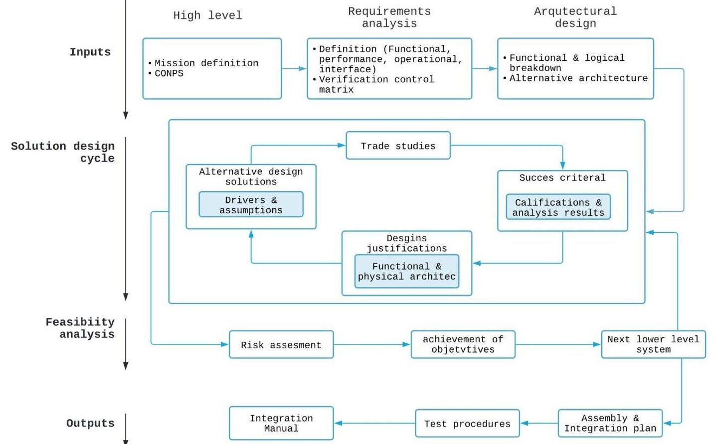

Figure 1. Design decision and evaluation framework for the FACSAT-2 space system. Source: elaborated by the authors.

According to the FACSAT program expectations, FACSAT-2 team established the objectives described below:

- First objective: provide electro-optical images of the Colombian territory for the analysis of COLAF and other governmental and private entities.

- Secondary objective: ensure that COLAF develops and standardizes the design, acquisition, production, and test procedures, as well as experimenting with GHG information.

The High-Level Requirements (HLR) indicate functional and operational performance. The quantifications of HLR become in Technical Requirements (TR). The main TR defined by COLAF will comply with the objectives of the satellite through the following criteria:

- Two payload systems on board;

a. multispectral push-broom imager with Ground Sample Distance (GSD) resolution between 4.75 m to 5 m.

b. Spectrometer operating in the 1000-1700 nm spectral range.

- Two payload data download capabilities on board;

a. X-band for imaging data.

b. S-band for Information of Telemetry and Telecommand (TMTC) and radiometric data.

- Storage capacity for TMTC, orbital data, and raw data from payloads;

- A service life of at least five years.

The payload's technological surveillance results and the market study analysis provided the current limitations present in electro-optical sensors for 6U CubeSats. Due to the physical and geometric characteristics of the optical elements, the sensor resolution would be limited by the size of the satellite. State-of-the-art cameras available on the market can provide RGB and infrared electro-optical images of 4 m to 5 m GSD from a 500 km circular orbit [11].

For Space-certified radiometric instruments case, those operating in the near-infrared bands do not collect information that allows high-precision post-processing geolocation [12]. The parallel operation of the spectrometer and the electro-optical sensor with the synchronization of the ADCS will enable the generation of a local georeferenced data set to explore the atmosphere and obtain information related to GHGs, in special carbon dioxide $ \mathrm{(C O_{2})} $ and methane gas $ \mathrm{(C H_{4})}. $

<!-- PDF_PAGE: 5 -->

## 2.2. Operational concept

The environmental conditions allow to determine the operational modes that the spacecraft will perform during the lifetime. The modes described below are defined based on the criticality of the EPS of nominal payload operations, acting at the same time as a framework of reference of the ADCS modes.

- Mode 1: Detumbling. This is the initial mode of the spacecraft and concerns the period after the first ejection. The expected result for this configuration is to have the spacecraft power positive when the solar panels are stowed.

- Mode 2: Safe Mode. The spacecraft will turn into this configuration whenever the system detects any fault onboard.

- Mode 3: IDLE Mode. The spacecraft is pointed towards the Sun to maximize power generation and it is ready to execute commands. All payload subsystems are powered off and the spacecraft makes contact with the ground station only via the TMTC.

- Mode 4: Payloads Mode. The avionics subsystem is in default configuration, while the payloads are turned on.

- Mode 5: X-Band Downlink. The X-Band communication subsystem is operating to downlink all the imaging data accumulated during the day passes. Previously, the imaging camera has been in readout mode, as well as the spectrometer. The S-Band TMTC will also be active for uplink and downlink.

- Mode 6: S-Band Downlink. As a contingency option for an inoperative X-band.

The payload operation concept is simple. Once the payload data is collected with sunlight and, if necessary, pre-processed, the data is downloaded to the ground station using an X-Band link at local night-time. The preprocessing activities expected to take place on the spacecraft include compression and encryption (packetization) of the payload data. Telemetry and Telecommand (TMTC) data are exchanged on S-Band between the corresponding TMTC ground station and the spacecraft. The data is then transferred to the FACSAT-2 Imagery Database. According to previous environmental conditions analyzed, the team can preliminarily detect latent software and hardware errors that probably will manifest only after a certain run time [13].

Figure 2 provides a general overview of the mission architecture.

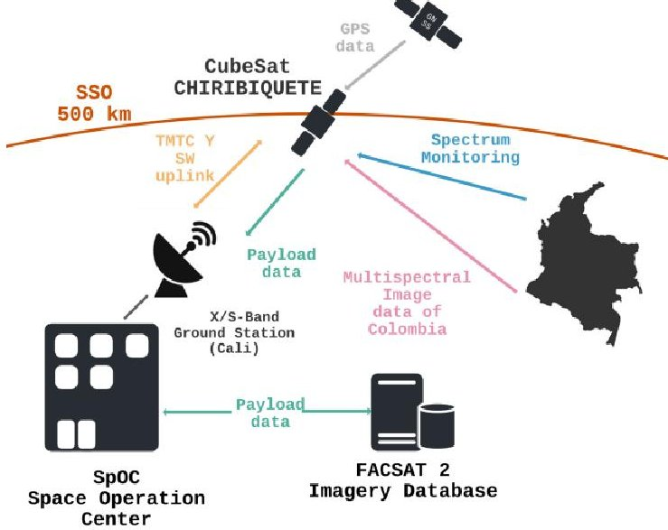

Figure 2. Overview operational concept FACSAT-2. Source: elaborated by the authors.

## 2.3. Orbit design and selection

Successful orbital analysis results depend on whether the design orbit fulfills the following considerations: appropriate coverage time, visibility with the ground station, time under eclipses, beta angle, and orbit lifetime. Orbital analyzes were performed using the Systems Tool Kit (STK) simulation software. For the FACSAT-2 mission, COLAF established the sun-synchronous orbit (SSO) as the best option due to extended opportunities for commercial launches, better lighting conditions for capturing images, and an increase in global coverage capacity [14].

Table 1 shows the main orbital parameters of the FACSAT-2 mission. The payloads coverage is simulated for an imager with a FOV of 62.22 $ ^{\circ} $ to allow an off-nadir slew of up to $ 30^{\circ} $ and a FOV of $ 30.15^{\circ} $ vertical and $ 0.15^{\circ} $ horizontal for a spectrometer.

The lifetime in orbit and the mitigation analysis of space debris comply with the space mitigation requirements ISO 24113:2011 and the thermal analysis handbook [15] the last one defined by the ESA policy. The predictions performed were developed through the DRAMA toolset [16] estimating that the satellite will orbit for approximately 10.04 years in the worst case (stowed solar panels) around the Earth.

<!-- PDF_PAGE: 6 -->

Table 1. FACSAT-2 orbital parameters. Taking as reference Space X TRANSPORTER 7 launch mission: April 2023

<table border="1"><tr><td>Orbital parameter</td><td>Value</td></tr><tr><td>Inclination[deg]</td><td>SSO(97.71)±0.5</td></tr><tr><td>Altitude[km]</td><td>500±25</td></tr><tr><td>Eccentricity</td><td>&lt;0.004</td></tr><tr><td>LTDN[UTC]</td><td>10:00:00±00:30</td></tr><tr><td>Average passes per day[pass/day]</td><td>1.96</td></tr><tr><td>Average time for communication[min]</td><td>9.4</td></tr><tr><td>Average payload revisit time[min]*</td><td>3,000</td></tr></table>

*Represents the average time between each opportunity for FACSAT-2 to capture imagery over any given spot in mainland Colombia with sunlight.

Likewise, it complies with the process for limiting orbital debris NASA-STD-8719.14b, which establishes that "the probability limit of collision with objects that avoid the re-entry of LEO satellites before 25 years must be less than 1%". For SAT-CHIRIBIQUETE the probability of occurrence of this event will not exceed 0.0001%.

## 2.4. Ground segment

The Space Operation Center (SpOC) in EMAVI houses a ground segment antenna capable of transmitting and receiving in S-Band and X-Band.

The Mission Operation Center (MOC) also includes a data Server with customized soft modems. The antenna has a minimum elevation angle of $ 1 0^{\circ} $ [deg]. The ground station consists of a 3.7 m satellite dish, a GOMspace Software-Defined Radio (SDR) for S-Band, an X-Band modem (MDM9000), a rotor system for azimuth/elevation, and a GOMspace MS100 server. Figure 3 shows the interaction between the space and ground segment based on the X-band and S-Band SATCHIRIBIQUETE's communication system on board.

The ground station radio is a vital part of the satellite communication infrastructure. Thus, it responds to CubeSat Space Protocol (CSP) requests and satellite radio. This network layer delivery protocol designed for CubeSats allows embedded systems to have a service-oriented network topology, facilitating the subsystem design because the communication bus works as an interface [17]. Gaussian Minimum Shift Keying (GMSK) modulates the data and transfer at 38.4 kbps for uplink and 38.4 kbps for downlink; however, the radio supports up to 2,000 kbps.

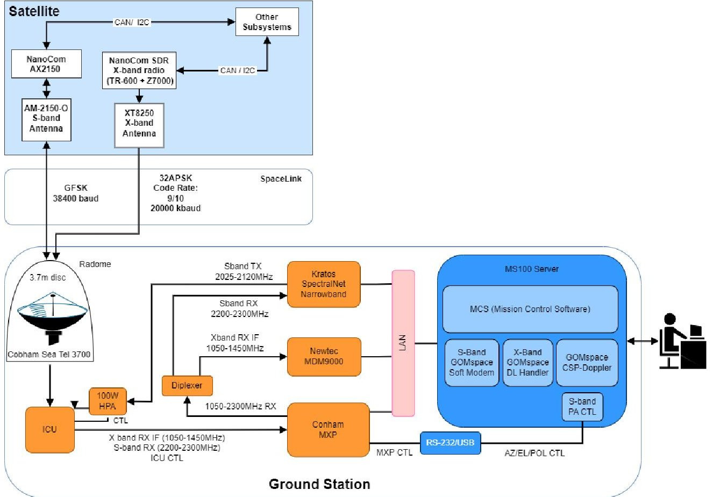

Figure 3. FACSAT-2 ground station layout functional architecture. Source: elaborated by the authors.

<!-- PDF_PAGE: 7 -->

## 2.5. Launch Segment

During the launch phase, summarized in Figure 4, the spacecraft will be inside EXOpod Nova and completely turned off and inactive. When the SAT-CHIRIBIQUETE is released from the deployer, it will wait for 3600 sec before starting to transmit beacons. The above is due to compatibility requirements with the launcher [18].

The spacecraft is commanded by software to transmit beacons every 10 seconds in each operational mode. Using the onboard magnetorquers the spacecraft start to detumble itself automatically. After confirming that the spacecraft is detumbled (when the measured spin rate is below a certain threshold), the nominal attitude is acquired, and every subsystem is checked out and commissioned. The payloads are activated, deployed, and checked out. Finally, the SAT-CHIRIBIQUETE is declared commissioned to start in-orbit operation phase.

## 2.6. Space segment

COLAF decided to use the MultiScape 100 CIS imager, designed by Simera Sense, meeting the first mission objective. The camera is an electro-optical imaging system that uses a CMV12000 CMOSIS sensor with a 7band multispectral filter in VNIR plus a panchromatic band. This balance between spatial resolution will enable the use of artificial intelligence (AI) developments and achieve application proficiency for earth observation (EO) products [19]. The electro-optical sensor has a push-broom along track effect, allowing a swath width of 19.4 km [20]. However, the sensor can capture images in snapshot mode.

As the secondary payload, COLAF selected the Argus 2000 Short Wave Infra-Red (SWIR) spectrometer designed and developed by Thoth Technology. This instrument is a miniature spectrometer with integrated space-grade optics for remote sensing applications. It was designed to make nadir-pointing observations on the Earth's surface with a resolution of 1.6 km if moving at an orbital speed of 7.5 km/s [11].

The CANX-2 mission, led by the University of Toronto within the framework of the Canadian space program, promoted the development and testing of these micro technologies [21]. The 12-bit per pixel radiometric spectrometer and its low exposure time provide precise horizontal spatial resolution increasing sensitivity to absorption by the lower atmosphere below 5 km [22]. Some types of GHG that have been analyzed within the spectral range of the Argus 2000 include oxygen (1.25 $ \mu $m), carbon dioxide (1.57 $ \mu $m, 1.61 $ \mu $m, and 2.05 $ \mu $m), carbon monoxide (1.63 $ \mu $m), methane (1.67 $ \mu $m and 2.25 $ \mu $m) and hydrogen fluoride (1,265 $ \mu $m) [12].

Platform approximations for CubeSats using COTS ease the recognition of high-level functions, needed to accomplish the mission (see Figure 5). However, this type of device must be able to counteract the risk of not having redundant layers. The subsystems identified for the SAT-CHIRIBIQUETE meet the standards for small platforms [23], [24]. Command and Data Handling (C&DH) will be defined by two onboard computers (OBC). There will be no propulsion element as a microthruster, and the control will depend on the ADCS components.

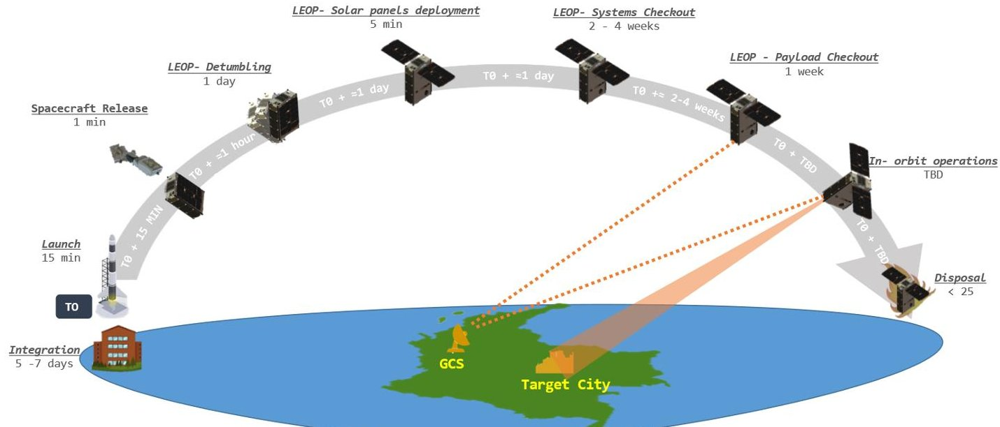

Figure 4. Operational mission phases since integration to final disposal. Time starts counting from the launcher Take-Off (TO). The time of Payload checkout and in-orbit operations is To Be Defined (TBD). Source: elaborated by the authors.

<!-- PDF_PAGE: 8 -->

## 3. Satellite Systems and subsystems design

Once the mission concept is defined, the design of the systems and subsystems begins following the philosophies, methods, and methodologies proposed in the ECSS standards with the definition of the architecture, defining the interfaces (data, power, mechanical, optical, and thermal) as shown in Figure 6.

The coordinate system (CS) of the spacecraft indicates that +Z axis points towards the 2U side and in the opposite direction of payloads (Nadir), whereas the +X axis points to the 3U side where the 7-cell body mounted solar panel is mounted. Finally, the +Y axis points to the 6U side following the "right-hand rule".

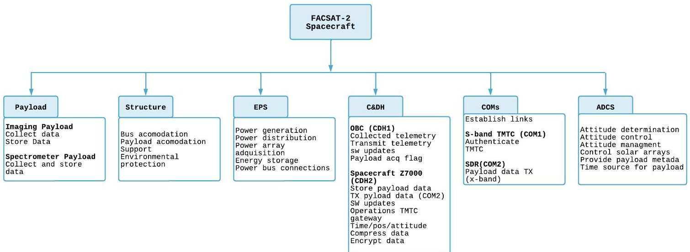

Figure 5. FACSAT-2 spacecraft high-level function architecture and subsystem identification.

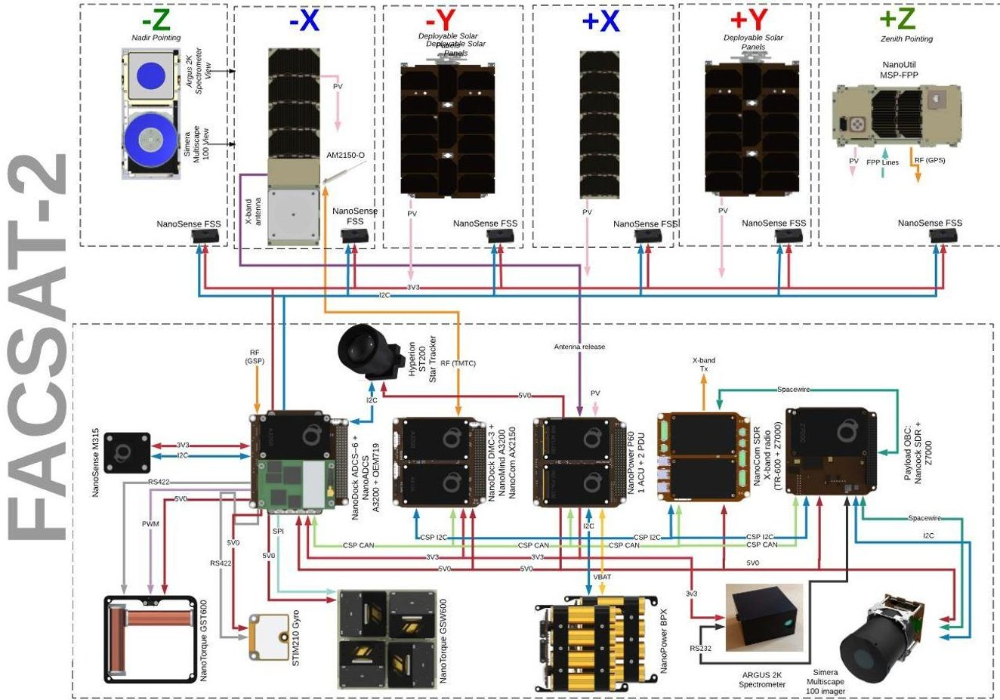

Figure 6. SAT-CHIRIBIQUETE design diagram, components and interfaces between satellite bus, imager and spectrometer integration. Source: Gomspace.

<!-- PDF_PAGE: 9 -->

Figure 7 presents external and internal configuration layout for each component according to SATCHIRIBIQUETES's CS.

The instrument's dimensions and pointing capabilities mainly govern the payload integration into the satellite bus. The electro-optical imager requires 1.5 units of space. As a result, locating the imager on the -Z face of the CubeSat demands a 6U standard structure modification.

The satellite requires an Absolute Knowledge Error (AKE) of less than 0.7° (2-sigma) for nominal imaging payload operation. The above will be possible with the integration of the Hyperion ST-200-star tracker, not used in the FACSAT-1 mission. This optical sensor has a high sensitivity to sunlight, and given the type of SSO selection, its operation could be affected. For this reason, GOMspace developed a simulation algorithm establishing that spacecraft need to tilt the device at $ + 9^{\circ} $ （+Z direction). This adjustment avoids the direct incidence of solar radiation and its reflection on the device from the Earth's atmosphere.

The Non-Tracking Solar Panel (NTSP) hosts 15 solar cells. The solar array (SA) is attached to the spacecraft through primary hinge and is locked using two Holds-Down Release Mechanisms (HDRM) developed by GOMspace. The HDRMs, which are based on a burn wire principle, mechanically lock the SA until a sleigh is released by burning a wire, unlocking the array. The assembly hinges have been designed and manufactured to induce $ + 2 0^{\circ} $ rotation to the panel assembly, ensuring a deployment at a $ 1 1 0^{\circ} $ and $ 7 0^{\circ} $ tilt. The above allows the entire FOV for the star tracker and optimal solar panel power generation during payload mode.

## 3.1. Structure and Mechanical system

The satellite uses an adapted version of the standard NanoStructure 6U [25]. Using mounting rings, the hardware can be mounted inside the structure using M3 threaded rods, either in a standard PC104 stack or directly on the structural frame.

Most of the interfaces in the FACSAT 2 satellite can be mounted directly to the generic GOMspace hole pattern and therefore require no additional work to integrate. However, some third-party products had to be customized (cutouts in the face plates and the z-end brackets) as depicted in Figure 8, where:

a) Simera Multiscale will be mounted to the generic hole pattern via 2 custom brackets, the design propose is to keep optics deviation to a minimum during environmental testing;

c) Spectrometer mounting bracket arrayed at the bottom part of the sensor.

b) Star tracker mounting bracket and support collar to increase the instrument stability during launch phase and a baffle extension to ensure no light enters the satellite via the cutout in the cover plate;

All new developments will be manufactured in aluminum 6082 T6-51 and surface treated with Chromital TCP.

Through dynamic simulation results, the FACSAT-2 mechanical team concluded that the design allows the accommodation of all necessary payloads and subsystems, and the structure is compliant with all Margins of Safety (MoS) for the random load environment.

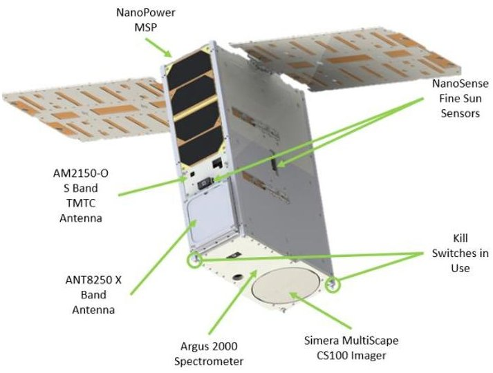

a)

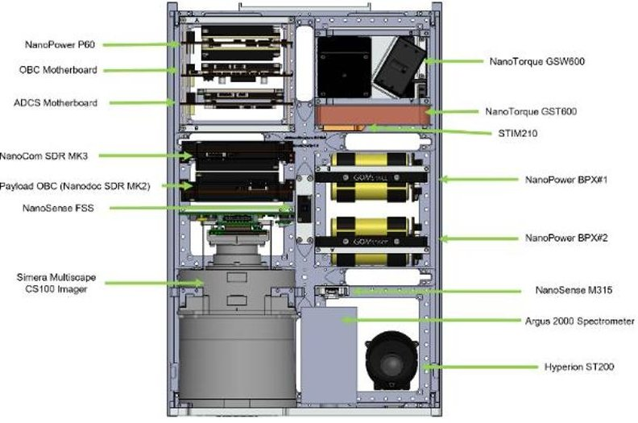

Figure 7. SAT-CHIRIBIQUETE configuration layout, a) external and b) internal. Source: Gomspace.

b)

<!-- PDF_PAGE: 10 -->

From COMSOL Multiphysics software, we identified that maximum displacement is lower than the gap available between the camera and the -Z bracket. In addition, the value of 1 $ \mu m $ complies with the structural factors of safety for spaceflight hardware standard [26].

The thermal analysis applies the margin philosophy according to the standard for thermal control [27], where the sensitivity analysis derives the uncertainty of the model from the space environment [28]. In the hot case, we identified the Maximum Internal Temperature (Tmax) as equal to 35 $ ^{\circ} \mathrm{C} $ and the Minimum External Temperature (Tmin) as equal to 6 $ ^{\circ} \mathrm{C} $ . On the other hand, in the cold, Tmax= -10 $ ^{\circ} \mathrm{C} $ and Tmin=-45 $ ^{\circ} \mathrm{C} $ . As a result, all subsystems are within the design temperature range for both simulation cases.

The mass budget listed in Table 2 is built from the component level up to the spacecraft level using each module mass (subsystem). Following ECSS Standards for CubeSats [29], the mass margins are applied to each

component, establishing its percentage of uncertainty from the design approach. The total nominal mass is 8022.30 g, and the total maximum mass with adding margins is 9140.03 g. The total margin mass allowed for SAT-CHIRIBIQUETE is 12 kg (12000 g), as result the design margin is 23%.

## 3.2. Electrical Power System

This system consists of three main components: solar panels, batteries, and a power distribution system. The modular solar panels (MSP) generate the nominal power of the satellite, which are distributed along the structure in +X 7S1P and -X 4S1P. The satellite will be equipped with two NanoPower BPX battery packs in a 4S2P configuration. Each BPX pack consists of eight lithiumion cells with a nominal capacity of 2600 mAh and 3.6 V each. This package provides a total capacity of 10.4 Ah at an average of 154 Wh with a nominal voltage between 12.4 V and 16 V [30], [31].

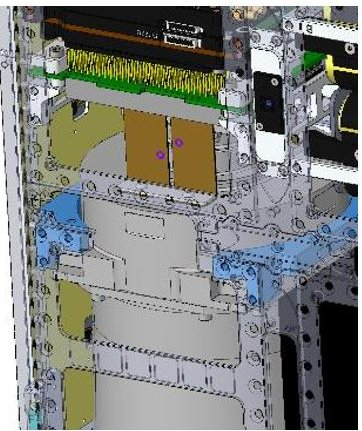

a)

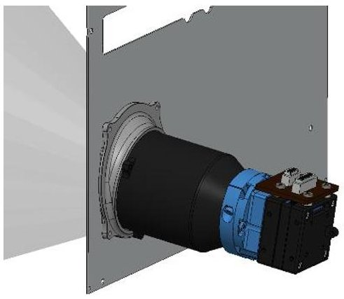

b)

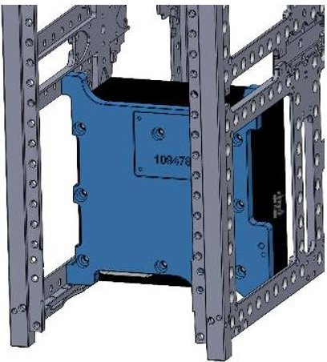

C)

Figure 8. Bracket highlighted in blue for mounting new components. (a) Simera Multiscale mounting; (b) star tracker mounting bracket and support collar, and (c) spectrometer mounting bracket. Source: elaborated by the authors.

Table 2. SAT-CHIRIBIQUETE mass budget stablish for components datasheet and margin philosophy

<table border="1"><tr><td>ID</td><td>Subsystem</td><td>Nominal mass[g]</td><td>Max mass[g]</td><td>Design approach</td><td>Mass contribution[%]</td></tr><tr><td>1</td><td>Estructure</td><td>1217.30</td><td>1492.97</td><td>COTS</td><td>16</td></tr><tr><td>2</td><td>External panels</td><td>1308.18</td><td>1524.97</td><td>COTS</td><td>17</td></tr><tr><td>3</td><td>Power</td><td>1509.75</td><td>1589.06</td><td>COTS</td><td>17</td></tr><tr><td>4</td><td>Communication</td><td>1037.59</td><td>1171.07</td><td>COTS</td><td>13</td></tr><tr><td>5</td><td>ADCS</td><td>1249.48</td><td>1311.95</td><td>COTS</td><td>14</td></tr><tr><td>6</td><td>Payloads</td><td></td><td></td><td></td><td></td></tr><tr><td></td><td>Spectometer</td><td>320.00</td><td>352.00</td><td>COTS</td><td>4</td></tr><tr><td></td><td>Imager</td><td>1180.00</td><td>1298.00</td><td>COTS</td><td>14</td></tr><tr><td>7</td><td>Harness</td><td>200.00</td><td>400.00</td><td>Customized design</td><td>4</td></tr></table>

<!-- PDF_PAGE: 11 -->

The harness is a substantial part of the spacecraft and can be around 10% of the spacecraft's mass, depending on its complexity [32]. The harness design includes the electrical and data interfaces. Each component must be energized, and most of them need data inputs and outputs such as I2C, CAN, GOSH, RS422, RS232, or PPS. The vast majority of the SAT-CHIRIBIQUETE harnesses are products already developed by GOMspace. However, nine cables were designed and customized using Altium for MK2-payload connections by the COLAF.

The power generation capability analysis for the spacecraft is assumed to have NTSP. Each wing is composed of 1 panel with 15 CESI Low-Cost Triple Junction Solar Cells for Space Applications (CTJ-LC). Together with the NTSP, a group of 11 MSPs has been considered in the power generation analysis (4 MSP in X, 7 MSP +X). The efficiency considered is the same. The average and peak power for the maximum, average and minimum beta angle is shown in Table 3. The maximum power is generated during the Sun tracking phase with the maximum beta angle of $ 7 1. 6 0 0^{\circ} $

The Power budget tool is used to simulate a worst-case day of operations performed when the satellite gets the worst beta angle in imaging and downlink scenarios. The above is performed to verify full compliance with the mission requirements in a critical state for the operation. The Payload mode and X-band mode are the operations with more power consumption to values of 24.19 Wh (539.2 s) and 48.86 Wh (345.9 s), respectively.

To fulfil a 5-year lifetime of the mission it is recommended not to have the batteries below 80% of State-of-charge (SoC) at End of Life (EOL) [33]. This is the main parameter to size the batteries, together with the amount of energy consumed in eclipse.

While a higher level may be possible in the context of the expected lifetime, setting this level gives additional safety margins when designing an operational plan.

In Payload and X-band scenarios, battery SoC remains above 80% indicating that the generated power is sufficient for the mission concept. In case the satellite stays above the region and the ground stations both in sun and eclipse during the same orbit, a simulation with 75% of the access time over the region devoted to the X-Band Downlink and 25% to imaging in an orbit has been performed, confirming the positive results of the power budget.

## 3.3. Command and data handling system

The C&DH subsystem integrates the NanoMind A3200 as OBC with 32GB of storage. The NanoMind A3200 has been used in many missions and previously acquired the title of a space-proven system [34]. The A3200 daughterboard is accommodated on the NanoDock DMC-3 motherboard besides the NanoCom AX2150 TMTC Radio. This subsystem also includes the Programming/Debug port, the main bus, and the watchdog timers. Concerning payload control, the satellite uses a payload OBC based on the GOMspace NanoCom SDR platform.

It consists of a processing module NanoMind Z 7000, and an SDR dock used to route connections from the processing modules to connectors, and some RFsampling modules TR600.

Similar to ground systems, satellites are vulnerable to attacks compromising their security and expected operation.

Table 3. SAT-CHIRIBIQUETE power generation summary SSO at 500 km of attitude for EPS operation modes

<table border="1"><tr><td>Operation modes</td><td>Type</td><td>Beta max(71.600deg)</td><td>Beta avg(62.345deg)</td><td>Beta min(52.689deg)</td></tr><tr><td rowspan="2">Sun tracking$\cdot$ (W)</td><td>Average</td><td>34.433</td><td>27.808</td><td>24.317</td></tr><tr><td>Peak</td><td>34.433</td><td>34.433</td><td>34.433</td></tr><tr><td rowspan="2">Payload operations(W)</td><td>Average</td><td>12.530</td><td>12.935</td><td>13.489</td></tr><tr><td>Peak</td><td>21.780</td><td>26.005</td><td>29.697</td></tr><tr><td rowspan="2">X-band downlink(W)</td><td>Average</td><td>32.106</td><td>24.711</td><td>19.966</td></tr><tr><td>Peak</td><td>35.349</td><td>35.452</td><td>34.527</td></tr><tr><td rowspan="2">Tumbling stowed(W)</td><td>Average</td><td>8.35</td><td>7.889</td><td>7.524</td></tr><tr><td>Peak</td><td>18.27</td><td>19.063</td><td>18.969</td></tr><tr><td rowspan="2">Tumbling deployed(W)</td><td>Average</td><td>2.906</td><td>3.346</td><td>4.726</td></tr><tr><td>Peak</td><td>26.648</td><td>27.377</td><td>33.897</td></tr></table>

*20 deg offset due to solar panels' inclination.

<!-- PDF_PAGE: 12 -->

To counter possible attacks, the FACSAT-2 team developed a software application for encryption and decryption that will run on the Nanomind Z7000 computer, protecting binary files corresponding to images captured by the MultiScape100 multispectral camera and spectral signatures from the Argus 2000 spectrometer.

The encryption algorithms correspond to the Advanced Encryption Standard (AES) mathematical function in its Counter (CTR) operation mode. The testing phase for the encryption software is being carried out on the ZedBoard hardware platform, which replicate the capabilities of the Z7000. During the implementation phase, the team verified that the algorithm has the best performance for small-sized embedded hardware, with constraints on power consumption and computing capacity. The design and implementation process are achievable following the practices for handling embedded systems from the National Institute of Standards and Technology (NIST) Cybersecurity framework.

The data budget capabilities in ideal conditions for the S-Band TMTC and X-Band links are based on the link budget results and the ground station access times. In the case of the downlink and uplink for TMTC data, a capacity is established in nominal mode at 19.2 kbps of 0.4468 MB of data on average per access and 1.1364 MB of data on average per day with an overhead of 50% to be considered data "useful". In the case of the downlink, to obtain data from the camera and the spectrometer with a bit rate of 125 Mbps, an average data per access of 5.22 GB and an average data per day of 6.66 GB are established, with an overhead of 10%.

Table 4 shows that the averages imager data generated per day of 2.0607 GB is perfectly within the X-Band capability per access, allowing the Ground Station to download all the images in one pass if needed. In case the downlink is performed with the S-Band for contingency instead, one pass will not be enough.

## 3.4. On-board communication System

SAT-CHIRIBIQUETEs communications design solutions will be satisfied through two subsystems: Omnidirectional S-band TMTC Subsystem (uplink and downlink) and Very High-Speed Link X-Band Data Downlink Subsystem (payload data downlink only).

The TMTC Subsystem is comprised of the NanoCom AX2150 S-band radio and the NanoCom AM2150-O omnidirectional deployable antenna. The subsystem receives two different inputs: i) Telemetry data from the OBC to be modulated into an S-band signal, ii) signals from the ground that includes software updates and telecommands, which are received by the antenna and demodulated by the radio. The purpose of the omnidirectional S-band communication link is to provide a low-power and reliable means of communicating with the spacecraft, regardless of the spacecraft's attitude. On the other hand, the downlink is compressed by the NanoCom ANT8250 antenna for transmission and the NanoComSDR platform that includes the NanoCom SDR MK2.

## 3.5. Attitude and determination control system ADCS

The ADCS architecture, despite in Figure 9, is responsible for performing the orientation maneuvers for the stabilization of the satellite and the execution of pointing and tracking, according to the mission concept [35]. Like any other control system, this requires a reference signal to execute the pointing through a control technique that allows the satellite to be oriented and a determination technique to estimate the orientation. Rotational kinematics and kinetics comprised the dynamic satellite model, where we visualize the propagation of the satellite attitude. Actuators support the control to reach the desired attitude reference. On the other hand, the determination bases its techniques on the information generated by multiple sensors that act as a redundant system to estimate the current attitude.

Table 4. Peak and average generated data from the two FACSAT-2 Payloads in a day. Region includes San Andrés and Providencia islands in the Caribbean and Malpelo Island in the Pacific

<table border="1"><tr><td>Territory</td><td>Bit rate[bytes/s]</td><td>Duty cycle[%]</td><td>Data generated per day(avg)[GB]</td><td>Peak data per day not compressed[GB]</td><td>Compression rate[%]</td><td>Effective data rate(avg)[GB]</td></tr><tr><td>Mainland</td><td>-</td><td>-</td><td>-</td><td>15.95</td><td>90.00</td><td>1.5950</td></tr><tr><td>Region</td><td>7.99E+06</td><td>4.63</td><td>3.1874</td><td>4.6570</td><td>90.00</td><td>0.4657</td></tr></table>

<!-- PDF_PAGE: 13 -->

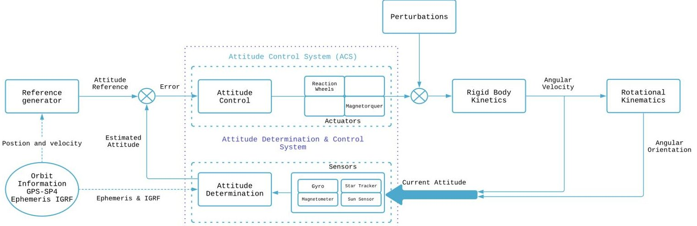

Figure 9. SAT-CHIRIBIQUETE's ADCS control architecture overview. Source: elaborated by the authors.

The ADCS is a design based on a variety of mechatronics components spread throughout the satellite. This package comprises a set of robust actuators,sensors and a dedicated ADCS flight computer (NanoMind A3200). The sensor block is composed of IMU inertial sensors, and guidance requires a redundant architecture. Sensors are the NanoSense M315 magnetometer, Hyperion ST200 star tracker, STIM210 gyroscope, and NanoSense FSS fine sun sensors. Also, this system is responsible for the orbital determination of the satellite and uses GPS receivers (GNSS hardware) that obtain satellite position and velocity signals through propagators. The actuator block is composed of reaction wheels and magnetorquers. The NanoTorque GSW600 reaction wheels base their operation on the principle of the moment of inertia, supplying torque to the satellite with great accuracy and reliability. On the other hand, the NanoTorque GST600 magnetorquers base their operation on magnetic torque taking advantage of the terrestrial electromagnetic field and generating torque to the satellite with low power consumption.

Control and estimation techniques, such as sensor and actuator signal processing and attitude reference calculation, are carried out in the OBC. At the same time, OBC links communications and commands with other subsystems.

Depending on the orbital and satellite conditions, the ADCS must change its behavior to achieve the control objective introduced. In this way, it is possible to distinguish different modes of operation. These modes, along with the eventual transition between them, constitute the state machine of the satellite, shown in Figure 10.

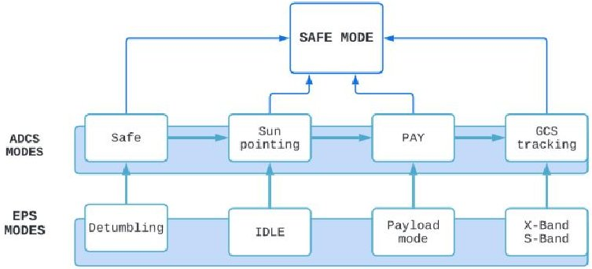

Figure 10. SAT-CHIRIBIQUETE's ADCS-EPS states machine with homologous interdependencies. Source: elaborated by the authors.

Based on the pointing error handbook [36], GOMspace implemented an algorithm in the Pointing Error Engineering Tool (PEET) that allows the execution and analysis of the described concepts. The standard evaluates control and estimation techniques with their associated uncertainties, AKE, and Absolute Pointing Error (APE).

With PEET, COLAF was available to verify and validate the TR control proposed in the mission design. As a result, the precision of the control and determination techniques was obtained through: performance of the error with the presence of sensors noise, manufacturing uncertainties, satellite uncertainties, actuator noise, and disturbances. In Table 5 shows the AKE results for the three axes of the inertial system. It is concluded that the values are within the proposed operational ranges, allowing compliance with the TR established for the ADCS system.

<!-- PDF_PAGE: 14 -->

Table 5. AKE median results

<table border="1"><tr><td>Parameter name</td><td>Value[deg]</td></tr><tr><td>X</td><td>[0.0794-0.0863]</td></tr><tr><td>Y</td><td>[0.0689-0.0767]</td></tr><tr><td>Z</td><td>[0.0793-0.0907]</td></tr></table>

## 3.6. Interface Solutions

Interfaces in Figure 6 were defined using the technical data sheets of each design solution. Most of the systems and components belong to the same provider, GomSpace. However, the principal and secondary payloads selected were manufactured by Simera Sense and Thoth Technology, respectively.

Due to the above, the secondary payload integration required new designs allowing the communication and control signals to configure and receive data from the Argus 2000. Electronic devices, such as Printed Circuit Boards (PCB), ensure communication between the payload and satellite bus and the power supply up to 3.3 V.

The interface consists of a six layers PCB with 26 SMD components. The board has dimensions of 42.3mm x 26mm x 4.77mm, the maximum current supported in the pico-lock connectors is 3A and 1A for the pico-blade. Its operating voltage is 3.3V and its entire design is based on the ECSS-Q-ST-70-12C standard. This PCB receives a connection from the NanoCom SDR-MK2 and the power distribution unit (PDU). The PCB has an optimized mechanical design to be included inside the spacecraft structure with a System on Chip (SoC) module and transceiver modules, compliant with GomSpace CSP control software.

The Payload PCB is a customized space product designed by the COLAF and undergoes environmental validation tests at the GomSpace facilities. The tests include 500 thermal stress cycles between -55 $ ^{\circ} $ C to 100 $ ^{\circ} $ C, and Total Ionizing Dose (TID) radiation up to 20Krad, executed according to the GomSpace qualification program.

## 4. FACSAT-1 and FACSAT-2 comparison

The FACSAT satellite program seeks technological improvement between each satellite mission. Using CubeSats significantly reduces development times by facilitating the exploration of new architectures based on stakeholder requirements. There is a difference between the FACSAT-1 nanosatellite and the FACSAT-2 SAT- CHIRIBIQUETE in terms of size, capacity, technology operation, and mission objectives, as listed in Table 6.

Table 6. FACSAT satellite mission comparison

<table border="1"><tr><td></td><td>FACSAT-1</td><td>FACSAT-2</td></tr><tr><td>Size</td><td>3U</td><td>6U</td></tr><tr><td>Principal Payload(PP)</td><td>NanoCom C1U GomSpace</td><td>Simera MultiScape Cis 100</td></tr><tr><td>Spatial Resolution PP</td><td>30 meters per pixel</td><td>4.75 meter per pixel</td></tr><tr><td>Spectral Resolution PP</td><td>R,G,B 3 bands</td><td>R,G,B,NIR,PAN 8 bands</td></tr><tr><td>Imagin Acquisition</td><td>Snapshot</td><td>Snapshot+Line scan</td></tr><tr><td>Secondary Payload(SP)</td><td>No Applicable</td><td>Spectrometer Argus 2000</td></tr><tr><td>Radiometric resolution SP</td><td>No Applicable</td><td>1000-1700 nm</td></tr><tr><td>Communication</td><td>UHF</td><td>S/X Band</td></tr><tr><td>Bite rate</td><td>9.6 kbps</td><td>S Band 7.99 Mbps,X Band&gt;60 Mbps</td></tr><tr><td>Solar area</td><td>606.8cm2MSP</td><td>666.29cm2MSP+CESI</td></tr><tr><td>Battery Capacity</td><td>2.6Ah</td><td>10.4Ah</td></tr><tr><td>Operative Lifetime</td><td>3.7 years</td><td>5 years</td></tr><tr><td>Downlink access</td><td>2 per day</td><td>Up to 4 per day</td></tr><tr><td>Determination Capability</td><td>Medium</td><td>High-Star tracker</td></tr><tr><td>GPS</td><td>Novatel OEM615</td><td>Novatel OEM719</td></tr><tr><td>Cost</td><td>Low</td><td>Medium</td></tr></table>

In both cases, the vast majority of components used in the FACSAT satellites have been manufactured and tested by GomSpace, with a Readiness Level (TLR) between 8 and 9. FACSAT-2 stands out for its superior capabilities evident from the selection of high-capacity sensor for image acquisition and scientific sensor for radiometric information, taking advantage of the three additional units of space available compared to FACSAT-1. The Line-scan performance and multi-spectral resolution demand a high-speed system integration to increase the download bit rate. Compared to UHF uses, X-band increases the bite rate by 8000 times, optimizing the satellite passes. For example, while FACSAT-1 required four ten-minute passes over the ground segment to download a 50 KB image, FACSAT-2 performs this task more efficiently and faster downloading, up to 2GB of data per pass.

<!-- PDF_PAGE: 15 -->

The technological challenges of FACSAT-2 are related to the integration of a sensor different to NanoCom camera, and a spectrometer, offering some unique opportunities in terms of operational strategy. FACSAT-2 employs a push-broom sensor but also has the option to take snapshots and combine the spectrometer information in post-processing, optimizing the use of the geo-referenced information.

After launching, the satellite will perform an in-orbit calibration campaign over known targets for the camera, the process seeks to transform raw data into Level 1 images (Radiometric and geometric calibration, orthorectification and georeferencing).

The FACSAT-2 mission will support ground monitoring services and ensure frequent and systematic coverage to back up classification, land cover and change mapping, and accurate assessment of biological, physical chemical, and geological parameters such as Leaf Area Index (LAI) and Leaf Chlorophyll Content (LCC), vegetation types, biomass estimates, crop yields, among a variety of uses and applications.

The purpose of the Argus sensor is atmospheric monitoring, collecting data on the vertical columns of significant trace atmospheric gases. It is also suitable for biological analysis, such as organic molecules containing O-H, C-H, and C-O bonds that exhibit some absorption bands in the region near 1700 nm.

## 5. Conclusions

FACSAT-2 mission and SAT-CHIRIBIQUETE enables the acquisition of optical and radiometric information over the Colombian territory under the following conclusions:

The technical solution determined a six-unit geometry for the nanosatellite structure, which will operate in a heliosynchronous orbit at an altitude of 500 km above the Earth's surface, hosting two combined payloads: the MultiScape CIS 100 electro-optical multispectral panchromatic camera with a resolution of 4.7 meters per pixel (84.33% better than FACSAT-1); and the Argus 2000 short-wave infrared spectrometer for spectral signatures between 1000 and 1700 nm (First south American space mission using an Argus instrument to deliver georeferenced and rectified Level 1 data).

According to ADCS simulations, in searching to meet the AKE requirement of 0.7 degrees in all axes of the inertial system, combining sensors with high determination capacity, such as the Star Tracker, and redundant control actuators significantly reduce pointing errors.

In postprocessing, integrating the ADCS data and the payload data will decrease banding issues and improve the quality of the information.

According to ESA's ECSS-Q-ST-70-12C qualification standard, a space-grade Printed Circuit Board (PCB) was specifically designed and validated to ensure electrical and communications compatibility between the satellite bus and the Argus 2000 spectrometer. This PCB successfully converts an RS422 signal to a RS232 interface. The development of this PCB will significantly contribute to the knowledge and expertise required for the in-house production of space-grade boards in Colombia.

The protection of the information acquired by the satellite is ensured by AES data encryption software, in CTR mode of operation, under the Consultative Committee for Space Data Systems (CCSDS) recommendations, accomplishing the requirements of the FACSAT-2 mission about cryptographic measures that guarantee the confidentiality of the data. The development of space- grade software becomes the first intangible that contributes to the technological innovation of the Colombian space program.

Engineering evaluation of each subsystem was performed for the six modes of operation, solving the limitation of available power to feed high-consumption systems, such as communications for X-band downlink, reducing link uses only for electro-optical data download and using the S-band for TMTC and spectral signatures; as well as optimizing energy generation in modes different from sun tracking with the new solar panels release position, even in the penumbra.

## Acknowledgements

The authors want to thank the CITAE Team, GOMspace and collaborators, who have worked in developing this earth observation mission. Also, the authors are grateful for the support from Colombian Air Force, MinCiencias, Ecopetrol, and researchers from Academy and Industry. Whose contribution helped to achieve the goals of this mission and do significant advance for the Colombian space program.

## Funding

Not applicable

<!-- PDF_PAGE: 16 -->

## Autor Contributions

S. R. Rincón-Urbina: Project administration, supervision, Writing - Review & Editing. J. M. Cárdenas-García: Conceptualization, Visualization, Writing - Review & Editing. K. N. Pirazan-Villanueva: Formal Analysis. Investigation, Writing - Original Draft. I. F. Acero-Niño: Methodology. R. H. Hurtado-Velasco: Methodology. E. D. Cortés-García: Formal Analysis. Writing - Original Draft.

All authors have read an agreed to the published version of the manuscript.

## Conflicts of Interest

The authors declare no conflict of interest.

Institutional Review Board Statement

Not applicable.

Not applicable.

## Informed Consent Statement

## References

[1] G. Corredor, E. Benavides, "Transferencia de tecnología y desarrollo de capacidades para el programa espacial colombiano mediante pequeños satelites," TecnoEsufa, vol. 29, pp. 8-19, 2019.

[2] J. M. Cárdenas, M. Castaño, "FACSAT II y FACSAT III programa de desarrollo espacial," Fuerza Aérea Colombiana Revista Aeronáutica, vol.306, pp. 11- 13, 2022.

[3] J. Wertz, D. Everett, J. Puschell, "Space Mission Engineering," in Space Mission Engineering: The New SMAD, 2nd ed., Hawthorne, Ca, USA: Microcosm Press, 2011, pp. 45-49.

[4] J. Willis, P. Walton, D. Wilde, D. Long, "Miniaturized Solutions for CubeSat Servicing and Safety Requirements," IEEE Journal on Miniaturization for Air and Space Systems, vol. 1, no. 1, pp. 3-9, 2019 doi: https://doi.org/10.1109/tgrs.2019.2954807

[5] S. Wertz, D. Everett, J. Puschell, "Mission Concept Definition and Exploration," in Space Mission Engineering: The New SMAD, 2nd ed., Hawthorne, Ca, USA: Microcosm Press, 2011, pp. 61-66.

[6] D. Buede, W. Miller, "Introduction, Overview and Basic Knowledge," in The Engineering Design of Systems: Models and Methods, 3rd ed., Hoboken, NJ, USA: Wiley, 2016, pp. 3-36.

[7] "Small Spacecraft Technology State of the Art," NASA, Santa Clara, CA, USA, Rep. NASA/TP 20210021263, Oct. 2022. [Online]. Available: https://www.nasa.gov/sites/default/files/atoms/files/2022_soa_full_0.pdf

[8] European Space Agency ESA, "Life Cycle Assessment," 2013. [Online]. Available: https://www.esa.int/esearch?q=LIFE+CYCLE

[9] P. W. Fortescue, J. P. W. Stark, G. Swinerd, Spacecraft systems engineering. 4th ed. Chichester, SXW, UK: Wiley, 2011.

[10] D. Buede, W. Mille, "Overview of the System Engineering Design Process," in The Engineering Design of Systems: Models and Methods, 3rd ed., Hoboken, NJ, USA: Wiley, 2016, pp. 46-67.

[11] ThothX, Pembroke, ON., Canada. Argus 2000 IR Spectrometer Owner's Manual, 2018. [Online]. Available: http://thothx.com/getmedia/4c0d3242-b4fb 4e9d-abf7-85dbb5c6653f/20180815-Argus-2K-Owners-Manual,-Thoth-Technology,-rel-1-03.aspx

[12] A.H. Jallad, P. Marpu, Z. Aziz, A. al Marar, M. Awad, "MeznSat-A 3U CubeSat for Monitoring Greenhouse Gases Using ShortWave Infra-Red Spectrometry: Mission Concept and Analysis," Aerospace, vol. 6, no. 11, p. 118, 2019, doi: https://doi.org/10.3390/aerospace6110118

[13] M. Cho, "CubeSat assembly, integration, testing and verification," in Cubesat handbook: from mission design to operations, 4th ed., vol. 4, Nottingham, Northd, UK: Elsevier, 2020, pp. 319-338, doi: https://doi.org/10.1016/C2018-0-02366-X

[14] J. Delgado, "Determinación de una órbita comercial operacional para la misión satelital de observación de la tierra FACSAT-2," M.S. thesis, Dept. Mech. Eng., Univ. Valle, Cali, Colombia, 2021.

[15] Space Debris Mitigation Compliance Verification Guidelines (ESSB-HB-U-002-19), issue 1, European Cooperation for Space Standardization, Noordwijk, Netherlands, 2015.

<!-- PDF_PAGE: 17 -->

[16] ESA, Darmstadt, Germany. Debris risk assessment and mitigation analysis (DRAMA) software user manual, 2022.

[17] CubeSat Space Protocol (CSP) GS-CSP-1, GOMspace, 2011. [Online]. Available: https://github.com/GOMspace/libcsp/

[18] SpaceX, Hawthorne, CA, USA. Rideshare Payload User's Guide, 2021. [Online]. Available: https://www.spacex.com/media/falcon-users-guide- 2021-09.pdf

[19] M. Alessandro, C. Coelho, F. Deconick, I. Babkina, N. Longepe, M. Pastena, "NanoSat MO Framework: Onboard AI Apps for Earth Observation," 35th Annual Small Satellite Conf., 6-11, 2021, Paper SSC21-S1-31.

[20] J. Vos, E. Grobbelaar, Simera Sense MultiScape100 CIS Datasheet., 2021.

[21] K. Sarda, C. Grant, S. Eagleson, D. D. Kekez, R. E. Zee, "Canadian advanced nanospace experiment 2: on-orbit experiences with a three-kilogram satellite," 22nd annual AIAA/USU Conf. on Small Satellites, 11- 14, 2007.

[22] R. K. Jagpal, "Calibration and Validation Argus 1000 Spectrometer - A Canadian Pollution Monitor," Ph.D. dissertation, Dep. Physics and astronomy. York University, Toronto, ON., Canada, 2011.

[23] M. H. bin Azami, N. C. Orger, V. H. Schulz, T. Oshiro, M. Cho, "Earth Observation Mission of a 6U CubeSat with a 5-Meter Resolution for Wildfire Image Classification Using Convolution Neural Network Approach," Remote Sensing, vol. 14, no. 8, p. 1874, 2022, doi: https://doi.org/10.3390/rs14081874

[24] V. Carrara, R. B. Januzi, D. H. Makita, L. F. D. P. Santos, L. S. Sato, "The ITASAT cubesat development and design," JATM, vol. 9, no. 2, pp. 138-147, 2017, doi: https://doi.org/10.5028/jatm.v9i2.614

[25] GOMspace, Aalborg, Denmark. NanoStructure 6U Datasheet Denmark., 2018.

[26] Space Engineering: Structural Factors of Safety for Spaceflight Hardware, ECSS-S-ST-32-10C Rev. 2 European Cooperation for Space Standardization Noordwijk, Netherlands, May. 2019. [Online]. Available: https://ecss.nl/standard/ecss-e-st-32-10c-rev 2-structural-factors-of-safety-for-spaceflight-hardware 15-may-2019/

[27] Space Engineering: Thermal control general requirements, ECSS-E-ST-31C Rev.1, European Cooperation for Space Standardization, Noordwijk, Netherlands, Nov. 2008, [Online]. Available: http://ecss.nl/standard/ecss-e-st-31c-thermal-control/

[28] Space engineering: Testing, ECSS-E-ST-10-03C European Cooperation for Space Standardization Noordwijk, Netherlands, 2012. [Online]. Available: https://ecss.nl/standard/ecss-e-st-10-03c-rev-1-testing 31-may-2022/

[29] Margin philosophy for science assessment studies European Cooperation for Space Standardization Noordwijk, Netherlands, 2012.

[30] GOMspace, Aalborg, Denmark. NanoPower Battery 2600mAh Datasheet Lithium Ion 18650 cells for space flight products, 2019.

[31] GOMspace, Aalborg, Denmark. NanoPower BPX Datasheet High-capacity battery pack for nano-satellites, 2021.

[32] V. Babuska, D. M. Coombs, J. C. Goodding, E. v Ardelean, L. M. Robertson, S. A. Lane, "Modeling and Experimental Validation of Space Structures with Wiring Harnesses," Space Rockets, vol. 47, no. 6, pp. 1038 1052, 2012, doi: https://doi.org/10.2514/1.48078

[33] J. Yang et al., "State-of-health estimation for satellite batteries based on the actual operating parameters - Health indicator extraction from the discharge curves and state estimation," Energy Storage, vol. 31, p. 101490, 2020, doi: https://doi.org/10.1016/j.est.2020.101490

[34] GOMspace, Aalborg, Denmark. NanoMind A3200 Datasheet On-board Computer System for missioncritical space application, 2019.

[35] F. Landis Markley, J. L. Crassidis, Fundamentals of Spacecraft Attitude Determination and Control. 1st ed., NY, USA: Springer, 2014, doi: https://doi.org/10.1007/978-1-4939-0802-8

[36] Space engineering: Pointing error handbook (ESSB-HB-E-003), Issue 1, European Cooperation for Space Standardization, Noordwijk, Netherlands, 2011.